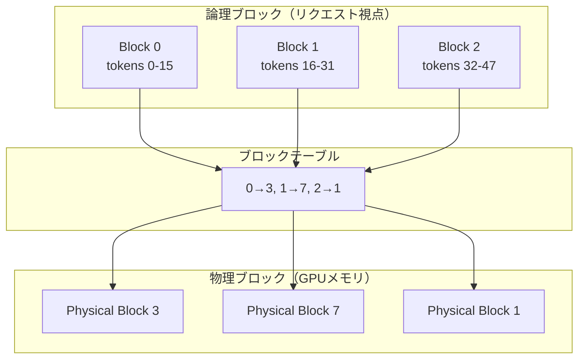
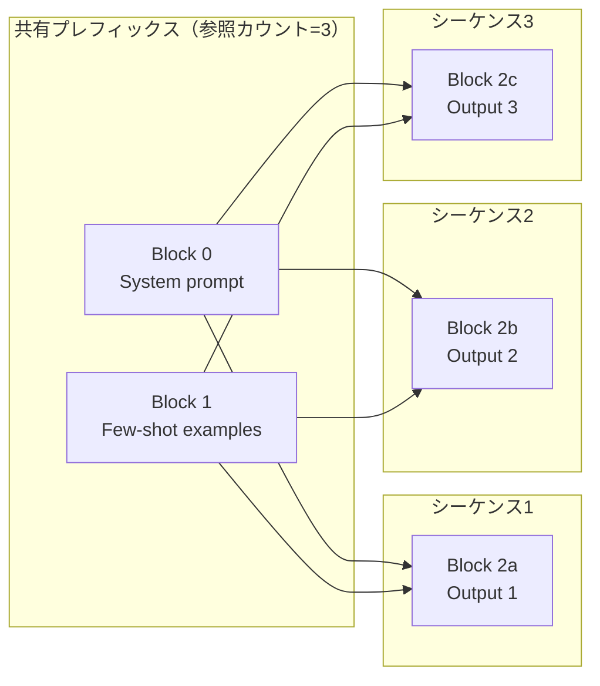

本記事は [Efficient Memory Management for Large Language Model Serving with PagedAttention](https://arxiv.org/abs/2309.06180)（SOSP 2023）の解説記事です。

この記事は [Zenn記事: プロンプトキャッシュのプレフィックス設計とマルチターン最適化で対話コストを最大90%削減する](https://zenn.dev/0h_n0/articles/a0eef8c309235f) の深掘りです。

## 論文概要（Abstract）

LLMサービングにおいて、高スループットを実現するには多数のリクエストをバッチ処理する必要があるが、各リクエストのKVキャッシュは大きく、かつ生成中にサイズが動的に変化する。著者らは、既存システムではメモリの断片化と重複によりKVキャッシュ用メモリの**20.4〜38.2%しか実際に利用されていない**と報告している。本論文では、OSの仮想メモリとページングの仕組みをKVキャッシュに適用したPagedAttentionアルゴリズムを提案し、それを基盤としたLLMサービングエンジンvLLMを構築している。

## 情報源

- **会議名**: SOSP 2023（ACM SIGOPS 29th Symposium on Operating Systems Principles）
- **年**: 2023
- **URL**: [https://arxiv.org/abs/2309.06180](https://arxiv.org/abs/2309.06180)
- **DOI**: [10.1145/3600006.3613165](https://doi.org/10.1145/3600006.3613165)
- **著者**: Woosuk Kwon, Zhuohan Li, Siyuan Zhuang, Ying Sheng, Lianmin Zheng, Cody Hao Yu, Joseph E. Gonzalez, Hao Zhang, Ion Stoica（UC Berkeley, Stanford, UC San Diego）
- **コード**: [https://github.com/vllm-project/vllm](https://github.com/vllm-project/vllm)

## カンファレンス情報

**SOSP（Symposium on Operating Systems Principles）** は、オペレーティングシステム分野における最高峰の国際会議であり、ACM SIGOPSが主催する。1967年から隔年で開催されており、採択率は通常15〜20%程度と非常に競争が激しい。本論文はSOSP 2023（ドイツ・コブレンツ開催）に採択された。OSの会議にLLMサービングの論文が採択されたことは、LLM推論のメモリ管理がシステム研究としても重要なテーマであることを示している。

## 背景と動機（Background & Motivation）

LLMの推論処理は**プロンプトフェーズ（prefill）**と**生成フェーズ（decode）**の2段階で構成される。prefillフェーズでは入力トークン列全体を一括処理し、各レイヤーでKey（K）とValue（V）のテンソルを計算してKVキャッシュに格納する。decodeフェーズでは1トークンずつ自己回帰的に生成し、過去のKVキャッシュを参照して新しいトークンのAttentionを計算する。

高スループットを実現するには、複数のリクエストを同一バッチで処理する必要がある。しかし、各リクエストのKVキャッシュサイズは入力長と生成長に依存して動的に変化する。著者らは既存のシステム（FasterTransformer、Orca等）が以下の問題を抱えていると指摘している。

- **内部断片化**: 出力長が事前にわからないため、最大長で事前確保するとメモリが無駄になる
- **外部断片化**: リクエストの完了・到着によりメモリ領域が断片化する
- **KVキャッシュの重複**: 同一プレフィックスを共有する複数リクエスト（few-shot学習やビームサーチなど）が同じKVキャッシュを個別に保持する

論文のFigure 2によると、これらの要因により既存システムでは確保されたKVキャッシュメモリの**20.4〜38.2%しか実際のデータ格納に使われていない**と報告されている。

## 主要な貢献（Key Contributions）

- **PagedAttentionアルゴリズム**: OS仮想メモリのページングに着想を得て、KVキャッシュを固定サイズの非連続ブロックに分割して管理するAttention計算手法を提案
- **vLLMサービングエンジン**: PagedAttentionを基盤とした分散LLMサービングエンジンを設計・実装
- **KVキャッシュ共有メカニズム**: Copy-on-Write機構により、パラレルサンプリングやビームサーチにおけるKVキャッシュの重複を排除

## 技術的詳細（Technical Details）

### PagedAttentionの仕組み

PagedAttentionは、OSの仮想メモリ管理におけるページングの考え方をKVキャッシュに適用したアルゴリズムである。

従来のAttention計算では、各リクエストのKVキャッシュは連続するメモリ領域に格納される必要があった。PagedAttentionでは、KVキャッシュを固定サイズの**KVブロック**に分割し、各ブロックが物理メモリ上の任意の位置に配置できるようにする。



各KVブロックはデフォルトで**16トークン**分のKeyとValueテンソルを格納する。1つのブロック内では連続配置だが、ブロック間は非連続で構わない。この設計により、OSのページテーブルと同様に**ブロックテーブル**が論理ブロック番号から物理ブロック番号へのマッピングを管理する。

### Attentionカーネルの計算

PagedAttentionのカーネルは、Queryベクトルに対してKVキャッシュの各ブロックから順にKeyとValueを読み出してAttentionスコアを計算する。ブロック $b$ に格納されたKey行列を $K_b$、Value行列を $V_b$ とすると、1ブロック内のAttention計算は次のように定式化できる。

$$
A_b = \text{softmax}\left(\frac{q K_b^T}{\sqrt{d_k}}\right) V_b
$$

ここで $q$ はQueryベクトル（形状: $1 \times d_k$）、$d_k$ はKeyの次元数である。全ブロックにわたるAttention出力は、各ブロックの部分的なsoftmax結果をnumerically stableな方法で結合して得られる。具体的には、各ブロックのsoftmax分母の和と重み付きValue出力を保持しながら逐次更新する**オンラインsoftmax**手法が用いられる。

### メモリ管理: 動的アロケーション

物理ブロックの割り当てはオンデマンドで行われる。プロンプトフェーズでは入力トークン数に応じた物理ブロックを一括割り当てし、デコードフェーズでは現在の最終ブロックが満杯になった時点で新しい物理ブロックを1つ割り当てる。

```python
class BlockAllocator:
    """KVキャッシュの物理ブロック管理"""

    def __init__(self, num_blocks: int, block_size: int = 16):
        self.block_size = block_size
        self.free_blocks: list[int] = list(range(num_blocks))
        self.ref_counts: dict[int, int] = {}

    def allocate(self) -> int:
        """フリーリストから物理ブロックを1つ割り当て"""
        if not self.free_blocks:
            raise RuntimeError("No free blocks available")
        block_id = self.free_blocks.pop()
        self.ref_counts[block_id] = 1
        return block_id

    def free(self, block_id: int) -> None:
        """参照カウントをデクリメントし、0になったら解放"""
        self.ref_counts[block_id] -= 1
        if self.ref_counts[block_id] == 0:
            self.free_blocks.append(block_id)
            del self.ref_counts[block_id]
```

この設計により、内部断片化は最終ブロック内の未使用スロットのみ（平均で $\frac{B}{2}$ トークン分、$B$ はブロックサイズ）に抑えられ、外部断片化は完全に排除される。

### Copy-on-Write（CoW）によるKVキャッシュ共有

パラレルサンプリング（同一プロンプトから複数の出力を生成する）やビームサーチでは、複数のシーケンスが同一のプロンプトプレフィックスを共有する。PagedAttentionでは、物理ブロックに**参照カウント**を付与し、複数の論理ブロックが同一の物理ブロックを指すことを許可する。

あるシーケンスが共有ブロックに書き込みを行う場合、そのブロックの参照カウントが1より大きければ、新しい物理ブロックをアロケートしてデータをコピーし、そこに書き込む（Copy-on-Write）。



著者らの報告によると、この共有メカニズムによりパラレルサンプリングで**6.1〜30.5%**、ビームサーチで**37.6〜66.3%**のメモリ節約が達成されている（データセットはAlpacaとShareGPT、論文Table 3より）。

### スケジューリングとプリエンプション

vLLMはFCFS（First-Come-First-Serve）スケジューリングを採用している。GPUメモリが逼迫した場合、最後に到着したリクエストを優先的にプリエンプトする。プリエンプトされたリクエストのKVキャッシュには2つの復旧方法がある。

1. **スワッピング**: KVブロックをCPUメモリにコピーし、再開時にGPUに戻す
2. **リコンピュテーション**: KVキャッシュを破棄し、再開時にプロンプトと既生成トークンからprefillを再実行する

著者らは、リコンピュテーションのオーバーヘッドがスワッピングの20%以下であったと報告しており（マイクロベンチマーク結果）、メモリが非常に逼迫した状況ではリコンピュテーションが有効であると述べている。

### 分散実行アーキテクチャ

vLLMの分散実行は、**中央スケジューラ**と**KVキャッシュマネージャ**が1つのコントロールプレーンに集約され、複数のGPUワーカーがデータプレーンを構成する。各ワーカーは自身が担当するAttentionヘッドのKVキャッシュを保持し、スケジューラからの指示に従ってブロックの割り当て・解放を実行する。Tensor Parallelismの場合、各ワーカーは同一のブロックテーブルを共有するが、物理ブロック内に格納されるKVテンソルはヘッド分割に対応した部分のみとなる。

## 実装のポイント（Implementation）

vLLMの実装において特に注目すべき点を以下に挙げる。

- **ブロックサイズの選択**: デフォルトは16トークン。小さすぎるとブロックテーブルのオーバーヘッドが増加し、大きすぎると内部断片化が悪化する。著者らはモデルサイズとシーケンス長のバランスから16を選択している
- **PagedAttentionカーネルのオーバーヘッド**: 非連続メモリアクセスのため、FasterTransformerの連続メモリカーネルに比べて20〜26%のレイテンシ増加が報告されているが、メモリ効率改善によるバッチサイズ拡大でスループットは上回る
- **プレフィックスキャッシュ**: 同一のシステムプロンプトやfew-shotプレフィックスを含むリクエスト間で、プレフィックス部分のKVブロックを共有できる。これがZenn記事で解説しているAPI層プロンプトキャッシュの基盤実装にあたる

```python
class PrefixCache:
    """プレフィックスKVブロックのハッシュベース検索"""

    def __init__(self, block_size: int = 16):
        self.block_size = block_size
        self.cache: dict[int, list[int]] = {}

    def compute_prefix_hash(self, token_ids: list[int]) -> int:
        """トークン列からプレフィックスハッシュを計算"""
        num_blocks = len(token_ids) // self.block_size
        prefix_tokens = token_ids[:num_blocks * self.block_size]
        return hash(tuple(prefix_tokens))

    def lookup(self, token_ids: list[int]) -> list[int] | None:
        """プレフィックスに一致するKVブロックIDリストを返す"""
        prefix_hash = self.compute_prefix_hash(token_ids)
        return self.cache.get(prefix_hash)

    def insert(
        self, token_ids: list[int], block_ids: list[int]
    ) -> None:
        """KVブロックをプレフィックスキャッシュに登録"""
        prefix_hash = self.compute_prefix_hash(token_ids)
        self.cache[prefix_hash] = block_ids
```

## Production Deployment Guide

### AWS実装パターン（コスト最適化重視）

vLLM/PagedAttentionを本番環境にデプロイする際の、トラフィック量別の推奨構成を示す。

**トラフィック量別の推奨構成**:

| 規模 | 月間リクエスト | 推奨構成 | 月額コスト | 主要サービス |
|------|--------------|---------|-----------|------------|
| **Small** | ~3,000 (100/日) | Serverless | $50-150 | Lambda + Bedrock + DynamoDB |
| **Medium** | ~30,000 (1,000/日) | Hybrid | $300-800 | ECS Fargate + vLLM + ElastiCache |
| **Large** | 300,000+ (10,000/日) | Container | $2,000-5,000 | EKS + vLLM + Karpenter + GPU Spot |

**Small構成の詳細**（月額$50-150）:
- **Lambda**: 1GB RAM, 30秒タイムアウト（$20/月）
- **Bedrock**: Claude 3.5 Haiku, Prompt Caching有効（$80/月）
- **DynamoDB**: On-Demand（$10/月）
- **CloudWatch**: 基本監視（$5/月）

**Medium構成の詳細**（月額$300-800）:
- **ECS Fargate**: 4 vCPU, 16GB RAM × 2タスク, vLLMコンテナ（$200/月）
- **Bedrock**: Claude 3.5 Sonnet（$400/月）
- **ElastiCache Redis**: cache.t3.micro, プレフィックスキャッシュメタデータ（$15/月）
- **Application Load Balancer**: （$20/月）

**Large構成の詳細**（月額$2,000-5,000）:
- **EKS**: コントロールプレーン（$72/月）
- **EC2 GPU Spot Instances**: g5.xlarge × 2-4台、vLLMデプロイ（平均$800/月、最大90%削減）
- **Karpenter**: GPU自動スケーリング（追加コストなし）
- **S3**: KVキャッシュスナップショット保存（$20/月）
- **CloudWatch + X-Ray**: 詳細監視（$100/月）

**コスト削減テクニック**:
- Spot Instances使用で最大90%削減（EKS + Karpenter）
- Reserved Instances購入で最大72%削減（1年コミット）
- vLLMのprefix caching有効化でprefill計算コスト削減
- アイドルタイムのAuto Scaling to Zero（Fargate/Lambda）

**コスト試算の注意事項**: 上記は2026年11月時点のAWS ap-northeast-1（東京）リージョン料金に基づく概算値です。実際のコストはトラフィックパターン、リージョン、バースト使用量により変動します。最新料金は [AWS料金計算ツール](https://calculator.aws/) で確認してください。

### Terraformインフラコード（Small構成）

```hcl
module "vpc" {
  source  = "terraform-aws-modules/vpc/aws"
  version = "~> 5.0"
  name = "vllm-vpc"
  cidr = "10.0.0.0/16"
  azs             = ["ap-northeast-1a", "ap-northeast-1c"]
  private_subnets = ["10.0.1.0/24", "10.0.2.0/24"]
  enable_nat_gateway   = false
  enable_dns_hostnames = true
}

resource "aws_iam_role" "lambda_bedrock" {
  name = "lambda-bedrock-role"
  assume_role_policy = jsonencode({
    Version = "2012-10-17"
    Statement = [{
      Action = "sts:AssumeRole", Effect = "Allow"
      Principal = { Service = "lambda.amazonaws.com" }
    }]
  })
}

resource "aws_iam_role_policy" "bedrock_invoke" {
  role = aws_iam_role.lambda_bedrock.id
  policy = jsonencode({
    Version = "2012-10-17"
    Statement = [{
      Effect   = "Allow"
      Action   = ["bedrock:InvokeModel", "bedrock:InvokeModelWithResponseStream"]
      Resource = "arn:aws:bedrock:ap-northeast-1::foundation-model/anthropic.claude-3-5-haiku*"
    }]
  })
}

resource "aws_lambda_function" "llm_handler" {
  filename      = "lambda.zip"
  function_name = "vllm-bedrock-handler"
  role          = aws_iam_role.lambda_bedrock.arn
  handler       = "index.handler"
  runtime       = "python3.12"
  timeout       = 60
  memory_size   = 1024
  environment {
    variables = {
      BEDROCK_MODEL_ID    = "anthropic.claude-3-5-haiku-20241022-v1:0"
      DYNAMODB_TABLE      = aws_dynamodb_table.cache.name
      ENABLE_PROMPT_CACHE = "true"
    }
  }
}

resource "aws_dynamodb_table" "cache" {
  name         = "vllm-prefix-cache"
  billing_mode = "PAY_PER_REQUEST"
  hash_key     = "prefix_hash"
  attribute { name = "prefix_hash"; type = "S" }
  ttl { attribute_name = "expire_at"; enabled = true }
}
```

### 運用・監視設定

```python
import boto3

cloudwatch = boto3.client('cloudwatch')
cloudwatch.put_metric_alarm(
    AlarmName='vllm-token-spike',
    ComparisonOperator='GreaterThanThreshold',
    EvaluationPeriods=1,
    MetricName='TokenUsage',
    Namespace='Custom/vLLM',
    Period=3600, Statistic='Sum', Threshold=500000,
    ActionsEnabled=True,
    AlarmActions=['arn:aws:sns:ap-northeast-1:123456789:cost-alerts'],
    AlarmDescription='vLLMトークン使用量異常'
)
```

### コスト最適化チェックリスト

- [ ] ~100 req/日 → Lambda + Bedrock ($50-150/月)
- [ ] ~1,000 req/日 → ECS Fargate + vLLM ($300-800/月)
- [ ] 10,000+ req/日 → EKS + vLLM + GPU Spot ($2,000-5,000/月)
- [ ] Spot Instances優先（最大90%削減）、Reserved 1年で72%削減
- [ ] vLLM `--enable-prefix-caching` フラグ有効化
- [ ] Continuous batching有効化
- [ ] AWS Budgets月額予算（80%警告、100%アラート）
- [ ] CloudWatch: トークン使用量・レイテンシ監視
- [ ] タグ戦略（dev/staging/prod）でコスト可視化

## 実験結果（Results）

著者らはGoogle Cloud A2インスタンス（A100 GPU）上で、OPT-13B（1×A100-40GB）、OPT-66B（4×A100）、OPT-175B（8×A100-80GB）、LLaMA-13Bを用いて評価を行っている。ベースラインはFasterTransformerと3種のOrca実装（Oracle、Pow2、Max）である。

**スループット比較**（論文Section 6の報告値）:

| 設定 | 対Orca (Oracle) | 対Orca (Max) | 対FasterTransformer |
|------|-----------------|--------------|---------------------|
| ShareGPT + 基本サンプリング | 1.7〜2.7× | 2.7〜8× | 最大22× |

著者らは、このスループット向上はメモリ効率改善によるバッチサイズの拡大に起因すると説明している。

**プレフィックス共有の効果**（LLaMA-13B, WMT16データセット）:
- 1-shotプレフィックス: Orca (Oracle)に対して**1.67×**のスループット
- 5-shotプレフィックス: Orca (Oracle)に対して**3.58×**のスループット

プレフィックス長が増加するほどKVキャッシュ共有のメリットが大きくなることが示されている。

**メモリ共有の節約率**（論文Table 3）:

| デコード方式 | Alpaca | ShareGPT |
|-------------|--------|----------|
| パラレルサンプリング | 6.1〜9.8% | 16.2〜30.5% |
| ビームサーチ | 37.6〜55.2% | 44.3〜66.3% |

ShareGPTデータセットは長い入力を含むため、共有プレフィックス部分が大きく、メモリ節約効果も高くなっている。

## 実運用への応用（Practical Applications）

PagedAttention/vLLMは、Zenn記事で解説されているAPI層のプロンプトキャッシュ（Anthropic、OpenAI、Gemini）を支える**基盤技術**として位置づけられる。

- **プレフィックスキャッシュの実装基盤**: vLLMのautomatic prefix cachingは、PagedAttentionのブロックベースKV管理とCoW機構の上に構築されている。APIプロバイダが提供するブレークポイント制御やTTL管理は、この基盤の上位レイヤーに相当する
- **サービングスループットの最大化**: PagedAttentionによるメモリ効率改善は、同一GPU上でより多くのリクエストをバッチ処理可能にし、結果としてAPIの応答レイテンシ低減とコスト効率向上に寄与する
- **マルチテナント環境**: CoWメカニズムにより、異なるユーザーの同一システムプロンプトを共有し、GPU メモリの消費を抑制できる

vLLMは2026年11月現在、LLMサービングのデファクトスタンダードの1つとして広く採用されており、SGLang等の後発フレームワークもPagedAttentionの設計思想を継承している。

## 関連研究（Related Work）

- **Orca** (Yu et al., OSDI 2022): Iteration-levelスケジューリングによるLLMサービング。vLLMのバッチ管理の基盤。ただしメモリ管理は最大長事前確保方式
- **FasterTransformer** (NVIDIA): 高性能Transformerカーネルライブラリ。連続メモリ配置を前提としており、断片化と重複の問題を内包
- **FlashAttention** (Dao et al., NeurIPS 2022): IO-awareなAttention計算で高速化。vLLMのPagedAttentionカーネルはFlashAttentionのタイリング戦略を参考にしている
- **SGLang** (Zheng et al., 2024): RadixAttentionによるツリーベースのKVキャッシュ管理。PagedAttentionを拡張し、部分的なプレフィックスマッチをサポート

## まとめと今後の展望

PagedAttentionは、OS仮想メモリの考え方をLLMのKVキャッシュ管理に適用することで、メモリ断片化と重複という根本的な問題を解決した。その成果はvLLMとして実装され、FasterTransformerに対して2〜4倍のスループット向上を達成している。

本論文が提案したブロックベースのKVキャッシュ管理は、Zenn記事で解説しているプレフィックスキャッシュ（APIレベルのブレークポイント制御やTTL管理）の**インフラ層を構成する基盤技術**である。APIユーザーとしてプロンプトキャッシュを最大限に活用するためには、その背後で動作するPagedAttentionの仕組み——ブロック単位の管理、プレフィックスマッチング、Copy-on-Writeによる共有——を理解しておくことが有用である。

## 参考文献

- **Conference URL**: [https://doi.org/10.1145/3600006.3613165](https://doi.org/10.1145/3600006.3613165)
- **arXiv**: [https://arxiv.org/abs/2309.06180](https://arxiv.org/abs/2309.06180)
- **Code**: [https://github.com/vllm-project/vllm](https://github.com/vllm-project/vllm)
- **Related Zenn article**: [https://zenn.dev/0h_n0/articles/a0eef8c309235f](https://zenn.dev/0h_n0/articles/a0eef8c309235f)
