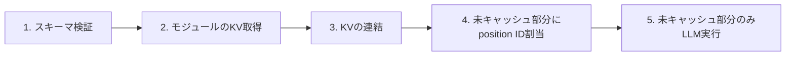

本記事は[Prompt Cache: Modular Attention Reuse for Low-Latency Inference](https://arxiv.org/abs/2311.04934)の解説記事です。

## 1. 論文概要

大規模言語モデル(LLM)の推論では、プロンプトを受け取ってから最初のトークンが出力されるまでの時間(TTFT: Time To First Token)が体感品質を大きく左右する。特に、システムプロンプトや検索で得た長い文書を毎回入力するRAG的な用途では、プロンプト処理の計算量が支配的になる。

本論文(In Gim ら, Yale University / Google)は、異なるプロンプト間で「同じテキスト断片のAttention状態(KVキャッシュ)」を再利用する**Prompt Cache**を提案している。著者らは、再利用可能なテキストを**Prompt Markup Language (PML)** で「モジュール」として宣言し、そのKV状態を事前計算して保存する方式を取る。著者らは、この方式によりGPU推論で最大8倍、CPU推論で最大60倍のTTFT改善を報告しており、モデルのパラメータを変更せずに出力精度をほぼ維持できるとしている。

## 2. 情報源

| 項目 | 内容 |
|---|---|
| 種別 | カンファレンス論文 |
| 会議 | MLSys 2024 (Proceedings of the 5th MLSys Conference) |
| タイトル | Prompt Cache: Modular Attention Reuse for Low-Latency Inference |
| 著者 | In Gim, Guojun Chen, Seung-seob Lee, Nikhil Sarda, Anurag Khandelwal, Lin Zhong |
| arXiv ID | 2311.04934 (v1: 2023-11-07, v2: 2024-04-25) |
| URL | https://arxiv.org/abs/2311.04934 |
| コード | https://github.com/yale-sys/prompt-cache |

本記事の数値はすべてarXivの版と著者公開のコードに基づく。arXivページでは「MLSys 2024に掲載予定」と表示されている。掲載版の本文と細部が一致するかは、読者が一次情報で確認してほしい。

## 3. カンファレンス情報

MLSysは、機械学習システム(学習・推論基盤、コンパイラ、ハードウェア協調設計など)を扱う会議である。本論文はモデルの精度ではなく、推論システムの遅延とメモリ効率を主題とする点で、MLSysの読者層に合う内容になっている。モデルアーキテクチャを変えずに推論側だけで効果を得る、という位置づけが特徴である。

## 4. 技術的詳細

### 4.1 背景: KVキャッシュとプロンプトの冗長性

Transformerの自己注意機構では、各トークンの位置$i$について、Key/Valueを$K_i, V_i$として保持する。生成中は過去のKVを再利用するため、1トークンごとの計算が一定量で済む。しかし、新しいリクエストごとに同じシステムプロンプトや同じ文書を先頭から再計算するのは無駄である。

プロンプトを$P$、そのKVを$\mathrm{KV}(P)$とすると、既存の多くの仕組みは「先頭から完全に一致する接頭辞(prefix)」だけを再利用する。これに対して本論文は、プロンプトの**途中に現れる再利用可能なモジュール**も再利用対象にする点が異なる。

### 4.2 PML: 再利用単位の宣言

PMLは、スキーマ(schema)の中にモジュールを宣言するためのマークアップ言語である。論文の記述に基づく主な要素は次の通り。

- `<module>`: 再利用可能なテキスト断片。KV状態を事前計算して保存する単位になる。
- `<param>`: モジュール内の可変部分(例: 質問文や検索結果の一部)。長さの上限を持たせられる。
- `<union>`: 排他的に選ばれる複数モジュールの集合。例えば「このいずれか1つの言語設定を選ぶ」といった制約を表す。

スキーマは、モジュールの配置場所と排他関係を一度定義する。ユーザーは、そのスキーマを参照しながらプロンプトで使うモジュールを指定する。ここで重要なのは、モジュールの**内容**が事前に固定されていることである。内容が毎回変わる部分は`<param>`に隔離する必要がある。

### 4.3 Position ID: 絶対位置の扱い

Transformerでは、位置情報の与え方(RoPEやALiBiなど)がKVの値に影響する。モジュールを別のプロンプトに差し込むと、その位置が元のスキーマと一致しない。

著者らは、各モジュールをスキーマ内の**絶対位置から** position IDを開始させる方式を採る。すなわち、モジュールAが位置100から始まるスキーマなら、その中のトークンは位置100からのIDを持つ。プロンプトの途中で別のモジュールが抜けると、position IDは不連続になる。論文は、この不連続なposition IDでもLLMが実用上動作することを**実験的に**確認したと報告している。理論的に保証されたものではない点に注意が必要である。

RoPE/ALiBiに対応させるため、著者らは、モデルごとに約20行程度のコード変更で対応できたと述べている。

### 4.4 Attention Masking: モジュール内ローカルアテンション

モジュールを事前計算する際、モジュール内のトークンは**そのモジュール内だけ**を見る(ローカルアテンション)。モジュールAのKVは、モジュールBの内容を知らない状態で計算される。これにより、AのKVは別のプロンプトに差し込んでも再利用できる。

しかし、モジュール間の依存(後続の文が前のモジュールの内容を参照する場合など)は表現できない。論文はこの制約に対して、依存を持つ部分を**scaffolding**と呼ぶ補助的な構造で扱うとしている。ただし、scaffoldingはモジュール間の注意を再現するための追加のKVを保持する方式であり、メモリ使用量を増やす。

### 4.5 キャッシュ推論の流れ

キャッシュ推論は、次の5段階で進む。



各段階の意味は次の通り。

1. **スキーマ検証**: 要求されたプロンプトが、登録済みスキーマに適合するかを確認する。
2. **KV取得**: 対象モジュールの事前計算済みKV状態を、GPUまたはCPUメモリから取り出す。
3. **連結**: 取り出したKVを、スキーマの位置順に連結する。
4. **position ID割当**: 連結に含まれない部分(ユーザーの質問など)に、位置IDを割り当てる。
5. **LLM実行**: 未キャッシュ部分だけをモデルに通し、最初のトークンを生成する。

TTFTの削減は、主に段階5の計算量が減ることによる。モジュールが長いほど、この削減効果は大きくなると考えられる。

### 4.6 モジュールの配置とメモリ

論文は、モジュールのKVをGPUメモリ上に置く場合と、CPUメモリ上に置いてホストからGPUへ転送する場合の両方を評価している。報告された計測値は次の通り。

- 5Kトークン(Llama 2 7B)のKV: device-to-deviceのコピー 0.23 ms, host-to-deviceのコピー 5.34 ms

GPU上のコピーはほぼ無視できるが、CPUからの転送は数ミリ秒のオーダーになる。これが、「GPUメモリ上のモジュール」と「CPUメモリ上のモジュール」でTTFT改善率が異なる理由と説明されている。

KVのメモリ消費も無視できない。KVサイズは層数・KVヘッド数・ヘッド次元・精度に比例するため、モデルとトークン数から見積もる必要がある。筆者の概算では、GQAを使うLlama 70Bでも1Kトークンあたり数百MB程度になり、モジュールを大量に保持するほどメモリ圧力は高くなる。(この値は論文からの引用ではなく、モデル構成からの筆者の見積もりである。)

## 5. アルゴリズム: Python による実装イメージ

以下は、論文の方式を理解するための**概念的な実装イメージ**である。論文の公式実装ではなく、型と流れを示すための簡略版である。KVの連結は実際には各層のテンソルに対して行う。

```python
from dataclasses import dataclass, field
from typing import Mapping, Sequence


@dataclass(frozen=True)
class Module:
    """事前計算済みのモジュール。

    Attributes:
        name: モジュール名。
        start_pos: スキーマ内での絶対位置(position IDの開始値)。
        length: トークン数。
        kv_cache: 層ごとのKV状態を保持するオブジェクト(概念的な表現)。
    """

    name: str
    start_pos: int
    length: int
    kv_cache: object


@dataclass
class Schema:
    """モジュールの配置と排他関係を表すスキーマ。

    Attributes:
        modules: モジュール名からモジュールへの対応。
        unions: 排他的に選べるモジュール名の組の集合。
    """

    modules: Mapping[str, Module]
    unions: Sequence[frozenset[str]] = field(default_factory=tuple)


def build_kv(
    schema: Schema,
    selected: Sequence[str],
    uncached_tokens: Sequence[int],
    uncached_start_pos: int,
) -> tuple[list[object], list[int]]:
    """キャッシュ済みモジュールを連結し、未キャッシュ部分の位置IDを決める。

    Args:
        schema: 利用するスキーマ。
        selected: このリクエストで使うモジュール名の列(スキーマ内の位置順)。
        uncached_tokens: 未キャッシュ部分のトークンID列。
        uncached_start_pos: 未キャッシュ部分の開始position ID。

    Returns:
        連結したKVのリストと、未キャッシュ部分のposition ID列のタプル。

    Raises:
        ValueError: 排他的なモジュールが同時に選ばれた場合、または未定義の
            モジュール名が指定された場合。
    """
    for group in schema.unions:
        if len(group.intersection(selected)) > 1:
            raise ValueError(f"排他的モジュールが同時に選択されています: {sorted(group)}")

    kv_parts: list[object] = []
    for name in selected:
        if name not in schema.modules:
            raise ValueError(f"未定義のモジュールです: {name}")
        kv_parts.append(schema.modules[name].kv_cache)

    position_ids = list(
        range(uncached_start_pos, uncached_start_pos + len(uncached_tokens))
    )
    return kv_parts, position_ids
```

このコードでは、排他制約の検証、KVの収集、未キャッシュ部分のposition ID割当の3点を分けて示している。実装上の要点は、`uncached_start_pos`をスキーマ内の絶対位置から決めることである。ここを誤ると、モデルが期待しない位置情報を受け取る。

## 6. 実装のポイント

論文の記述と公開コードの構成から、実装時に注意すべき点を整理する。

**スキーマの設計が性能を決める。** 再利用されないモジュールを作っても、事前計算とメモリを消費するだけである。逆に、毎回変わる内容を`<module>`の中に入れると、キャッシュが効かない。可変部分は`<param>`に分け、固定部分だけをモジュールにする。

**position IDの扱いはモデル依存である。** RoPEとALiBiは、位置情報の注入方法が異なる。論文は両方に対応できたとするが、新しいモデルに適用する場合は、位置情報の計算箇所を読み、テストで出力の一致を確認する必要がある。

**モジュール間の依存は別途扱う。** 依存を持つ内容をモジュールに分けると、論文の方式では精度が落ちる可能性がある。論文はscaffoldingで対応するとしているが、メモリ増加とのトレードオフを測る必要がある。

**KVのメモリ量を見積もる。** KVサイズは、層数、ヘッド数、ヘッド次元、トークン数、精度に比例する。モジュール数と長さを掛けて、事前に必要なメモリを計算しておくことが重要である。

**CPUメモリに置くなら転送コストを測る。** 論文の計測では、host-to-deviceの転送は数ミリ秒であった。リクエストのTTFT目標がこれより小さい場合、CPU保持は効果が出にくい可能性がある。

## 7. Production Deployment Guide: AWSでの本番運用ガイド

### 7.0 前提と注意

本論文の方式は、KVキャッシュの内部状態を直接操作する。そのため、**マネージドAPIだけでは実装できない**。Amazon Bedrockなどが提供するプロンプトキャッシュは、一般に先頭からの完全一致(接頭辞)を対象とする仕組みであり、本論文のモジュール単位の再利用とは異なる。本節では、論文の方式を本番で動かすには、推論エンジンを自前で持つ必要があることを前提とする。

以下の金額は、2026年11月時点のAWS東京リージョン料金に基づく**概算値**であり、筆者が公式料金表で個別に検証した数値ではない。実際の見積もりは、AWS Pricing Calculatorで再計算することを推奨する。

### 7.1 規模別の構成案

| 規模 | 構成 | 月額概算 | 想定 |
|---|---|---|---|
| Small | Lambda + 外部推論API | $50-150 | 試作、低トラフィック。本方式は未実装で、接頭辞キャッシュの検証に限る |
| Medium | ECS Fargate(GPUではなくCPU推論を含む検証環境) | $300-800 | 中規模、CPU推論の検証 |
| Large | EKS + GPU(Spot併用) | $2,000-5,000 | 本番、GPU推論でモジュールKVをGPUメモリ上に保持 |

注意点として、Fargateは標準ではGPUを提供しない。GPU推論を行う場合は、EC2のGPUインスタンスを使うECSまたはEKSの構成が必要になる。Smallの構成は、本論文の方式を試すための構成ではなく、比較対象の基準として位置づける。

### 7.2 Large構成のTerraform(概要)

以下は、EKSクラスタとGPUノードグループを作る最小限の構成例である。VPCやIAMの詳細は省略している。

```hcl
terraform {
  required_version = ">= 1.6"
  required_providers {
    aws = {
      source  = "hashicorp/aws"
      version = "~> 5.0"
    }
  }
}

provider "aws" {
  region = "ap-northeast-1"
}

variable "cluster_name" {
  description = "EKSクラスタ名"
  type        = string
  default     = "prompt-cache-inference"
}

resource "aws_eks_cluster" "this" {
  name     = var.cluster_name
  role_arn = aws_iam_role.eks_cluster.arn
  version  = "1.30"

  vpc_config {
    subnet_ids = var.private_subnet_ids
  }
}

resource "aws_eks_node_group" "gpu_spot" {
  cluster_name    = aws_eks_cluster.this.name
  node_group_name = "gpu-spot"
  node_role_arn   = aws_iam_role.eks_node.arn
  subnet_ids      = var.private_subnet_ids
  instance_types  = ["g5.2xlarge"]
  capacity_type   = "SPOT"

  scaling_config {
    desired_size = 2
    min_size     = 1
    max_size     = 4
  }
}

resource "aws_iam_role" "eks_cluster" {
  name = "${var.cluster_name}-cluster"
  assume_role_policy = jsonencode({
    Version = "2012-10-17"
    Statement = [{
      Action    = "sts:AssumeRole"
      Effect    = "Allow"
      Principal = { Service = "eks.amazonaws.com" }
    }]
  })
}

resource "aws_iam_role" "eks_node" {
  name = "${var.cluster_name}-node"
  assume_role_policy = jsonencode({
    Version = "2012-10-17"
    Statement = [{
      Action    = "sts:AssumeRole"
      Effect    = "Allow"
      Principal = { Service = "ec2.amazonaws.com" }
    }]
  })
}

variable "private_subnet_ids" {
  description = "プライベートサブネットのID一覧"
  type        = list(string)
}
```

Smallの構成は、Lambdaと外部推論APIの組み合わせであり、本論文の方式の検証には使えない。試作用の参照としてのみ扱う。

### 7.3 セキュリティ

- [ ] KVキャッシュを保持するノードは、推論対象のユーザーデータを含むため、保存先を暗号化する(EBS暗号化を有効化)。
- [ ] 推論エンドポイントへのアクセスはIAMまたはAPI Gatewayの認可で制限する。
- [ ] モジュールのスキーマは、利用者が任意に指定できないようにする。スキーマ検証(段階1)を必ず通す。
- [ ] モジュールの内容にPIIを含めない。キャッシュは共有される可能性があるため、利用者間で内容が漏れない設計にする。
- [ ] Secrets ManagerでAPIキーなどを管理し、コードやイメージに含めない。
- [ ] コンテナイメージの脆弱性スキャンを有効にする(ECR scan on push)。
- [ ] ノードのSSHアクセスは無効化し、Session Managerのみを許可する。
- [ ] ログに、プロンプト本文とKV値を出力しない。

### 7.4 監視

- [ ] TTFT(p50/p95/p99)をCloudWatchカスタムメトリクスとして記録する。
- [ ] キャッシュヒット率(モジュールが使われた割合)を記録する。
- [ ] GPUメモリ使用量とKVキャッシュのメモリ占有量を記録する。
- [ ] CPUからGPUへの転送時間を記録し、閾値を超えたらアラートを出す。
- [ ] Spotの中断通知を受けたら、モジュールの再計算を開始できるようにする。
- [ ] 構造化ログ(1行1イベント)で、`event`, `level`, `ts`, `request_id`, `duration_ms`を必ず出力する。

### 7.5 コスト最適化

- [ ] 再利用率が低いモジュールは事前計算しない。
- [ ] GPUノードはSpot Instancesを使い、中断に耐えるよう複数のインスタンスタイプを指定する。
- [ ] 長いモジュールから優先してキャッシュし、短いものは毎回計算する。
- [ ] 使われていないモジュールのKVを一定時間後に解放する(論文はキャッシュ置換ポリシーを持たないと述べているため、自前で設計する)。
- [ ] モジュールの事前計算はバッチ時間帯に行う。

### 7.6 本番導入チェックリスト

- [ ] 対象モデルでposition IDの扱いを確認し、キャッシュあり/なしで出力が一致するかをテストで確認した。
- [ ] 精度評価を、対象タスク(例: 文書QA)で実施した。論文でもPassage Retrievalでは約3ポイントの低下が報告されている。
- [ ] KVのメモリ見積もりを、最大のモジュール数と長さで計算した。
- [ ] 排他制約(union)の違反が、APIで拒否されることをテストした。
- [ ] 障害時に、キャッシュなしの通常推論へフォールバックする経路がある。
- [ ] タイムアウトとリトライを、指数バックオフとジッタ付きで設定した。
- [ ] リクエストのキャンセルが、GPU上の計算を止めることを確認した。
- [ ] 作成系の操作(モジュールの登録)は冪等に設計した。
- [ ] Terraformの状態ファイルは、暗号化されたS3バックエンドに保存する。
- [ ] コスト試算を、AWS Pricing Calculatorで再計算した。
- [ ] 監視ダッシュボードとアラートを、本番前に試験的に発火させた。
- [ ] 障害時のRunbookを作成した。

## 8. 実験結果

論文が報告する主な結果を、出典とともに示す。数値は論文の記述に基づき、再現実験の結果ではない。

| 条件 | 報告されたTTFT改善 | 出典 |
|---|---|---|
| GPU推論(モジュールがGPUメモリ上) | 5-10倍 | 論文本文 |
| GPU推論(モジュールがCPUメモリ上) | 1.5-3倍 | 論文本文 |
| GPU推論の全体的な改善 | 最大8倍 | 論文アブストラクト |
| CPU推論 | 最大60倍 | 論文アブストラクト |
| CPU推論(Intel Core i9-13900K) | 最大70倍 | 論文本文 |
| CPU推論(AMD Ryzen 9 7950X) | 最大20倍 | 論文本文 |
| RTX 4090, Llama 7B, 約3Kトークン | 約900ms → 約90ms | 論文本文 |

アブストラクトの「8倍」と本文の「5-10倍」は、計測条件が異なる数値の要約である。読者は、どの条件の値かを区別して引用する必要がある。

品質面では、著者らはLongBench(NarrativeQA, 2WikiMQAなど8データセット)で、キャッシュの有無による出力品質がほぼ同等であると報告している。例外として、Passage Retrievalで約3ポイントの低下があると記されている。

評価対象のモデルは、Llama 2(7B, 13B)、MPT 7B、Falcon 7B、CodeLlama 7Bである。これらは2023年時点のオープンモデルであり、現在の大規模モデルや長文脈モデルへの一般化は、論文からは判断できない。

## 9. 実運用への応用

本方式が効果を発揮しやすいのは、次のような状況と考えられる。

- **RAGで同じ文書群を繰り返し参照する**: 文書をモジュールとして事前計算し、質問部分だけを毎回計算する。
- **テンプレート化された指示文が長い**: システムプロンプトの固定部分をモジュールにする。
- **複数の排他的な設定から選ぶ**: `<union>`で、言語や出力形式の選択肢を表す。

一方、次のような場合は効果が限定的である可能性がある。

- 毎回内容が変わる長い文書を入力する場合。キャッシュが効かない。
- モジュール間の依存が強い場合。scaffoldingのメモリコストが増える。
- 推論エンジンを自前で運用できない場合。論文の方式はKVを直接扱うため、マネージドAPIでは再現しにくい。

Zenn記事「プロンプトキャッシュのプレフィックス設計とマルチターン最適化で対話コストを90%削減する」が扱う接頭辞ベースのキャッシュは、本論文の方式より実装が容易である。一方、本論文は接頭辞に一致しない途中のモジュールも対象にできる点が異なる。両者は競合するというより、対象とする再利用パターンが異なると理解するのが妥当である。

## 10. まとめ

本論文は、PMLでモジュールを宣言し、そのAttention状態を再利用するPrompt Cacheを提案した。著者らは、position IDを絶対位置から開始する方式と、モジュール内のローカルアテンションによって、モデルのパラメータを変えずにTTFTを大きく改善できると報告している。

ただし、次の制約がある。

- モジュール間のクロスアテンションは表現できず、scaffoldingはメモリを増やす。
- position IDの不連続性は、理論ではなく実験で確認されたものである。
- KVのメモリ消費が大きく、キャッシュの置換・プリフェッチポリシーは論文では扱われていない。
- 一部のタスク(Passage Retrieval)で品質が低下する。
- 評価モデルは2023年時点のものであり、現在のモデルへの一般化は未確認である。

実務で採用を検討する場合は、まず自社のプロンプトに再利用可能なモジュールがどれだけあるかを測定することが第一歩になる。

## 11. 参考文献

1. In Gim, Guojun Chen, Seung-seob Lee, Nikhil Sarda, Anurag Khandelwal, Lin Zhong. "Prompt Cache: Modular Attention Reuse for Low-Latency Inference." MLSys 2024. https://arxiv.org/abs/2311.04934
2. 公式実装. https://github.com/yale-sys/prompt-cache
3. Zenn記事「プロンプトキャッシュのプレフィックス設計とマルチターン最適化で対話コストを90%削減する」. https://zenn.dev/0h_n0/articles/a0eef8c309235f
