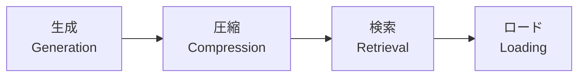
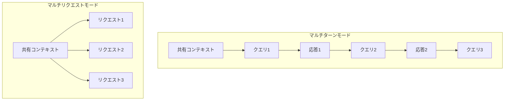

## 論文概要（Abstract）

本記事は [SCBench: A KV Cache-Centric Analysis of Long-Context Methods](https://arxiv.org/abs/2412.10319)（ICLR 2025）の解説記事です。

LLMの長コンテキスト推論ではKVキャッシュの管理が性能とコストのボトルネックとなる。従来のベンチマークは単一リクエストのみを評価対象とし、KVキャッシュの再利用シナリオ——マルチターン対話やマルチリクエストでの共有コンテキスト——を捉えていなかった。著者らはKVキャッシュのライフサイクル全体（生成・圧縮・検索・ロード）を評価軸とするベンチマーク**SCBench（SharedContextBench）**を提案し、8つのLLMに対して13の長コンテキスト手法を体系的に評価している。

この記事は [Zenn記事: プロンプトキャッシュのプレフィックス設計とマルチターン最適化で対話コストを最大90%削減する](https://zenn.dev/0h_n0/articles/a0eef8c309235f) の深掘りです。

## 情報源

- **会議名**: ICLR 2025（International Conference on Learning Representations）
- **年**: 2025
- **arXiv ID**: 2412.10319
- **URL**: [https://arxiv.org/abs/2412.10319](https://arxiv.org/abs/2412.10319)
- **著者**: Yucheng Li, Huiqiang Jiang, Qianhui Wu, Xufang Luo, Surin Ahn, Chengruidong Zhang, Amir H. Abdi, Dongsheng Li, Jianfeng Gao, Yuqing Yang, Lili Qiu
- **所属**: Microsoft Corporation, University of Surrey
- **分野**: cs.CL, cs.LG
- **プロジェクトページ**: [aka.ms/SCBench](https://aka.ms/SCBench)

## カンファレンス情報

**ICLRについて**:
ICLRは機械学習・深層学習分野の主要な国際会議の1つであり、特に表現学習に焦点を当てている。2025年のICLRは査読プロセスの透明性が高く、OpenReviewでの査読コメントが公開される。本論文はICLRの査読を経て採択された。

## 技術的詳細（Technical Details）

### KVキャッシュの4ステージ分類

著者らはKVキャッシュのライフサイクルを以下の4つのステージに整理し、各ステージに対応する最適化手法を分類している。



| ステージ | 概要 | 代表的手法 |
|----------|------|-----------|
| **生成（Generation）** | 入力トークンからKVキャッシュを生成する段階。フルアテンション or スパースアテンション | フルアテンション、MInference（スパース符号化） |
| **圧縮（Compression）** | 生成されたKVキャッシュのサイズを削減する段階 | SnapKV、StreamingLLM、KIVI（量子化）、CLA（レイヤー共有） |
| **検索（Retrieval）** | 必要なKVキャッシュを効率的に取得する段階 | RetrievalAttention、Quest |
| **ロード（Loading）** | KVキャッシュをGPU/CPUメモリ間で転送する段階 | オフローディング、プレフィックスキャッシュ |

この4ステージ分類が重要である理由は、プロンプトキャッシュ（API利用者が接するレイヤー）が主にロードステージに位置づけられる一方で、その性能は上流の生成・圧縮ステージの手法選択に大きく依存するためである。

### ベンチマーク設計：12タスク×4カテゴリ

SCBenchは以下の4つの能力カテゴリに分かれた12のタスクで構成される。

| カテゴリ | タスク名 | 概要 |
|----------|---------|------|
| **文字列検索** | Retr.KV | Key-Valueペアの完全一致検索 |
| | Retr.Prefix-Suffix | プレフィックス・サフィックスマッチング |
| | Retr.MultiHop | 複数ホップの連鎖検索 |
| **意味検索** | Code.RepoQA | コードリポジトリからの質問応答 |
| | En.QA | 英語文書からの質問応答 |
| | Zh.QA | 中国語文書からの質問応答 |
| | En.MultiChoice | 英語の多肢選択問題 |
| **大域情報** | Math.Find | 数学的パターン発見 |
| | ICL.ManyShot | 多数のIn-Context Learning例示 |
| | En.Sum | 英語要約 |
| **マルチタスク** | Mix.Sum+NIAH | 要約とNeedle-in-a-Haystackの同時実行 |
| | Mix.RepoQA+KV | コードQAとKV検索の同時実行 |

著者らの報告によると、ベンチマーク全体で931のマルチターンセッション・4,853のクエリが含まれ、1セッションあたり平均約5ターンで構成される。

### 2つの共有コンテキストモード

SCBenchの最大の特徴は、KVキャッシュの再利用を反映した2つの評価モードを持つ点にある。



**マルチターンモード**: 1つのセッション内で同じコンテキストに対して複数のクエリを順番に投げるシナリオ。チャットボットやコーディングアシスタントの会話に対応する。KVキャッシュが会話のターンごとに成長し、以前のターンのキャッシュを再利用できる。

**マルチリクエストモード**: 同じ共有コンテキスト（例: システムプロンプト + ドキュメント）に対して、独立した複数のリクエストを並列に処理するシナリオ。APIのプロンプトキャッシュ機能（Claude、OpenAI、Geminiの自動キャッシュ）が想定するユースケースである。

この2モードの評価は、Zenn記事で解説したプロンプトキャッシュのプレフィックスベース設計が、サーバ側のKVキャッシュ管理とどのように対応するかを理解する上で有用である。

### 評価対象手法の分類

著者らは13の手法を8つのカテゴリに分類して評価している。

| カテゴリ | 手法例 | メモリ計算量 | prefill計算量 |
|----------|--------|-------------|--------------|
| フルアテンション | — | $O(n)$ | $O(n^2)$ |
| スパース符号化 | MInference | $O(n)$ | $O(n^2)$未満 |
| KVキャッシュドロッピング | SnapKV, StreamingLLM | $O(n)$未満 | $O(n^2)$ |
| KVキャッシュ量子化 | KIVI | $O(n)$（低精度） | $O(n^2)$ |
| レイヤー間KV共有 | CLA | $O(n)$未満 | $O(n^2)$ |
| 動的スパースデコーディング | RetrievalAttention, Quest | $O(n)$ | デコード時$O(n)$未満 |
| SSM/線形アテンション | Mamba | $O(1)$ | $O(n)$ |
| ハイブリッドモデル | Jamba | 混合 | 混合 |

ここで $n$ はコンテキスト長を表す。メモリ計算量が$O(n)$未満の手法は、KVキャッシュの一部を破棄する（ドロッピング）か、固定サイズの状態に圧縮する（SSM）アプローチである。

## 実験結果（Results）

### 主要な定量結果

著者らはLLaMA-3.1-8B、Qwen2.5-72B、GLM-4-9B-1Mなどの8つのLLMで評価を行っている。以下に主要な結果を示す。

| モデル | 手法 | マルチターン | マルチリクエスト |
|--------|------|-------------|-----------------|
| LLaMA-3.1-8B | フルアテンション | 48.7 | 37.2 |
| | MInference (1/32) | 42.5 | 36.4 |
| | StreamingLLM (1/32) | 15.5 | 14.5 |
| | SnapKV (1/32) | 20.9 | 15.2 |
| Qwen2.5-72B | フルアテンション | 52.9 | 45.8 |
| | MInference (1/32) | 50.1 | 44.4 |
| | StreamingLLM (1/32) | 18.9 | 2.2 |
| GLM-4-9B-1M | フルアテンション | 48.7 | 41.8 |
| | MInference (1/32) | 44.5 | 38.7 |
| | SnapKV (1/32) | 26.0 | 18.1 |
| Mamba-Codestral (SSM) | — | 9.3 | 7.4 |

スコアは各タスクの平均正答率（%）であり、括弧内は圧縮率を表す。数値は論文の実験結果に基づく。

### 主要な知見

著者らは論文中で以下の知見を報告している。

**知見1: sub-O(n)メモリ手法はマルチターンで劣化する**

StreamingLLMやSnapKVのようにKVキャッシュを部分的に破棄する手法は、最初のクエリでは比較的良好な性能を示すが、ターンが進むにつれて急速に劣化する。これは、破棄されたKVエントリが後続のターンで必要になるためである。著者らはこの劣化が1/4圧縮率で特に顕著になると報告している。

**知見2: スパース符号化はメモリを維持しつつprefillを削減できる**

MInferenceのようなスパース符号化手法は、KVキャッシュの全体を$O(n)$で保持しつつ、prefillの計算量を$O(n^2)$未満に抑える。マルチターンやマルチリクエストの各クエリでKVキャッシュを再利用するため、性能劣化が小さい。

**知見3: 動的スパーシティは静的パターンより表現力が高い**

動的にアテンションパターンを決定する手法（RetrievalAttention等）は、静的なスパースパターンより多様なタスクに適応できると著者らは述べている。特にKIVIのようなKVキャッシュ量子化手法は圧縮下でも比較的安定した性能を維持する。

**知見4: SSMモデルはKVキャッシュ再利用のシナリオで大幅に劣る**

Mamba-Codestralはマルチターン9.3、マルチリクエスト7.4と、フルアテンションの約1/5程度の性能にとどまっている。$O(1)$メモリという利点があるものの、長コンテキストの情報保持能力に課題がある。

### プロンプトキャッシュへの示唆

この実験結果はプロンプトキャッシュのユーザーにとって以下の示唆を持つ。

1. **プレフィックス部分のKVキャッシュは完全に保持すべき**: sub-O(n)手法による圧縮は、マルチターンで性能劣化を引き起こす。APIプロバイダが提供するプロンプトキャッシュはKVキャッシュを無圧縮で保持するため、この問題を回避している。
2. **共有コンテキストの再利用回数が多いほど効果が大きい**: マルチリクエストモードでは、同一のKVキャッシュが複数リクエストで共有される。Zenn記事で解説した損益分岐点の計算は、このKVキャッシュの再利用回数と直接対応する。

## 実装のポイント（Implementation）

### SCBenchの利用方法

SCBenchはMicrosoftが公開しているプロジェクトページ（[aka.ms/SCBench](https://aka.ms/SCBench)）からアクセス可能である。評価フレームワークはvLLMやSGLangなどの推論エンジンと統合でき、以下のようなワークフローで利用する。

```python
from typing import Any


def evaluate_kv_cache_method(
    model_name: str,
    method: str,
    mode: str = "multi_turn",
    compression_ratio: float = 1.0,
) -> dict[str, Any]:
    """SCBenchでKVキャッシュ手法を評価する概念的なフロー

    Args:
        model_name: 評価対象モデル名
        method: KVキャッシュ手法名（例: "minference", "snapkv"）
        mode: 評価モード（"multi_turn" or "multi_request"）
        compression_ratio: KVキャッシュ圧縮率（1.0 = 圧縮なし）

    Returns:
        タスクごとのスコア辞書
    """
    # 1. 共有コンテキストの生成とKVキャッシュの構築
    shared_context = load_scbench_context(task="Retr.KV")
    kv_cache = generate_kv_cache(model_name, shared_context, method=method)

    # 2. 圧縮の適用（指定された場合）
    if compression_ratio < 1.0:
        kv_cache = compress_kv_cache(kv_cache, ratio=compression_ratio)

    # 3. モードに応じた評価
    if mode == "multi_turn":
        # 同一セッション内で順番にクエリを処理
        results = run_multi_turn_queries(kv_cache, queries=shared_context.queries)
    else:
        # 独立したリクエストとして並列処理
        results = run_multi_request_queries(kv_cache, queries=shared_context.queries)

    return results
```

### 自前の推論システムの評価

プロンプトキャッシュの設計を行う際、自社の推論システムがSCBenchのどのステージで課題を抱えているかを特定することで、最適化の方針が明確になる。

- **生成ステージが遅い場合**: prefillの最適化（スパースアテンション、FlashAttention等）を検討
- **圧縮ステージで品質が落ちる場合**: 圧縮率の見直し、または量子化手法への切り替え
- **ロードステージがボトルネックの場合**: GPU-CPUメモリ間の転送最適化、NVLinkの活用

## Production Deployment Guide

### AWS実装パターン（コスト最適化重視）

SCBenchの知見を活かしたKVキャッシュ最適化推論基盤のAWS構成を示す。

**トラフィック量別の推奨構成**:

| 規模 | 月間リクエスト | 推奨構成 | 月額コスト | 主要サービス |
|------|--------------|---------|-----------|------------|
| **Small** | ~3,000 (100/日) | Serverless | $50-150 | Lambda + Bedrock + DynamoDB |
| **Medium** | ~30,000 (1,000/日) | Hybrid | $300-800 | Lambda + ECS Fargate + ElastiCache |
| **Large** | 300,000+ (10,000/日) | Container | $2,000-5,000 | EKS + Karpenter + EC2 Spot |

**Small構成の詳細**（月額$50-150）:
- **Lambda**: 1GB RAM、60秒タイムアウト（$20/月）
- **Bedrock**: Claude 3.5 Haiku、Prompt Caching有効（$80/月）
- **DynamoDB**: On-Demand（$10/月）
- **CloudWatch**: 基本監視（$5/月）
- **API Gateway**: REST API（$5/月）

**Medium構成の詳細**（月額$300-800）:
- **Lambda**: イベント処理（$50/月）
- **ECS Fargate**: 0.5 vCPU、1GB RAM × 2タスク（$120/月）
- **Bedrock**: Claude 3.5 Sonnet、Batch API活用（$400/月）
- **ElastiCache Redis**: cache.t3.micro（$15/月）
- **ALB**: Application Load Balancer（$20/月）

**Large構成の詳細**（月額$2,000-5,000）:
- **EKS**: コントロールプレーン（$72/月）
- **EC2 Spot**: g5.xlarge × 2-4台（平均$800/月）
- **Karpenter**: 自動スケーリング（追加コストなし）
- **Bedrock Batch**: 50%割引活用（$2,000/月）
- **S3**: KVキャッシュストレージ（$20/月）
- **CloudWatch + X-Ray**: 詳細監視（$100/月）

**コスト削減テクニック**:
- Spot Instances使用で最大90%削減（EKS + Karpenter）
- Reserved Instances購入で最大72%削減（1年コミット）
- Bedrock Batch API使用で50%削減
- Prompt Caching有効化で30-90%削減

**コスト試算の注意事項**:
上記は2026年11月時点のAWS ap-northeast-1（東京）リージョン料金に基づく概算値です。実際のコストはトラフィックパターン、リージョン、バースト使用量により変動します。最新料金は [AWS料金計算ツール](https://calculator.aws/) で確認してください。

### Terraformインフラコード

**Small構成（Serverless）: Lambda + Bedrock + DynamoDB**

```hcl
module "vpc" {
  source  = "terraform-aws-modules/vpc/aws"
  version = "~> 5.0"

  name = "kv-cache-eval-vpc"
  cidr = "10.0.0.0/16"
  azs  = ["ap-northeast-1a", "ap-northeast-1c"]
  private_subnets = ["10.0.1.0/24", "10.0.2.0/24"]

  enable_nat_gateway   = false
  enable_dns_hostnames = true
}

resource "aws_iam_role" "lambda_bedrock" {
  name = "lambda-bedrock-kv-eval-role"

  assume_role_policy = jsonencode({
    Version = "2012-10-17"
    Statement = [{
      Action = "sts:AssumeRole"
      Effect = "Allow"
      Principal = { Service = "lambda.amazonaws.com" }
    }]
  })
}

resource "aws_iam_role_policy" "bedrock_invoke" {
  role = aws_iam_role.lambda_bedrock.id

  policy = jsonencode({
    Version = "2012-10-17"
    Statement = [{
      Effect   = "Allow"
      Action   = ["bedrock:InvokeModel", "bedrock:InvokeModelWithResponseStream"]
      Resource = "arn:aws:bedrock:ap-northeast-1::foundation-model/anthropic.claude-3-5-haiku*"
    }]
  })
}

resource "aws_lambda_function" "kv_eval_handler" {
  filename      = "lambda.zip"
  function_name = "kv-cache-eval-handler"
  role          = aws_iam_role.lambda_bedrock.arn
  handler       = "index.handler"
  runtime       = "python3.12"
  timeout       = 60
  memory_size   = 1024

  environment {
    variables = {
      BEDROCK_MODEL_ID    = "anthropic.claude-3-5-haiku-20241022-v1:0"
      DYNAMODB_TABLE      = aws_dynamodb_table.cache.name
      ENABLE_PROMPT_CACHE = "true"
    }
  }
}

resource "aws_dynamodb_table" "cache" {
  name         = "kv-eval-prompt-cache"
  billing_mode = "PAY_PER_REQUEST"
  hash_key     = "prompt_hash"

  attribute {
    name = "prompt_hash"
    type = "S"
  }

  ttl {
    attribute_name = "expire_at"
    enabled        = true
  }
}

resource "aws_cloudwatch_metric_alarm" "lambda_cost" {
  alarm_name          = "kv-eval-lambda-cost-spike"
  comparison_operator = "GreaterThanThreshold"
  evaluation_periods  = 1
  metric_name         = "Duration"
  namespace           = "AWS/Lambda"
  period              = 3600
  statistic           = "Sum"
  threshold           = 100000
  alarm_description   = "Lambda実行時間異常（コスト急増の可能性）"

  dimensions = {
    FunctionName = aws_lambda_function.kv_eval_handler.function_name
  }
}
```

**Large構成（Container）: EKS + Karpenter + Spot Instances**

```hcl
module "eks" {
  source  = "terraform-aws-modules/eks/aws"
  version = "~> 20.0"

  cluster_name    = "kv-cache-inference-cluster"
  cluster_version = "1.31"

  vpc_id     = module.vpc.vpc_id
  subnet_ids = module.vpc.private_subnets

  cluster_endpoint_public_access = true
  enable_cluster_creator_admin_permissions = true
}

resource "kubectl_manifest" "karpenter_provisioner" {
  yaml_body = <<-YAML
    apiVersion: karpenter.sh/v1
    kind: NodePool
    metadata:
      name: spot-gpu-pool
    spec:
      template:
        spec:
          requirements:
            - key: karpenter.sh/capacity-type
              operator: In
              values: ["spot"]
            - key: node.kubernetes.io/instance-type
              operator: In
              values: ["g5.xlarge", "g5.2xlarge"]
          limits:
            cpu: "32"
            memory: "128Gi"
      disruption:
        consolidationPolicy: WhenEmptyOrUnderutilized
        consolidateAfter: 30s
  YAML
}

resource "aws_budgets_budget" "kv_monthly" {
  name         = "kv-inference-monthly-budget"
  budget_type  = "COST"
  limit_amount = "5000"
  limit_unit   = "USD"
  time_unit    = "MONTHLY"

  notification {
    comparison_operator        = "GREATER_THAN"
    threshold                  = 80
    threshold_type             = "PERCENTAGE"
    notification_type          = "ACTUAL"
    subscriber_email_addresses = ["ops@example.com"]
  }
}
```

### セキュリティベストプラクティス

- **ネットワーク**: EKS `cluster_endpoint_public_access = false` を本番では設定（VPN経由）
- **IAMロール**: 最小権限の原則、Bedrock InvokeModelのみ許可
- **シークレット**: AWS Secrets Manager使用、環境変数ハードコード禁止
- **暗号化**: S3/DynamoDB/EBS全てKMS暗号化
- **監査**: CloudTrail/Config/GuardDuty有効化

### 運用・監視設定

**CloudWatch Logs Insights クエリ**:

```sql
-- KVキャッシュヒット率の監視
fields @timestamp, cache_hit, cache_miss
| stats sum(cache_hit) as hits, sum(cache_miss) as misses by bin(1h)
| filter (hits + misses) > 0

-- レイテンシ分析: P95, P99
fields @timestamp, duration_ms
| stats pct(duration_ms, 95) as p95, pct(duration_ms, 99) as p99 by bin(5m)
```

**CloudWatch アラーム（Python）**:

```python
import boto3

cloudwatch = boto3.client("cloudwatch")

cloudwatch.put_metric_alarm(
    AlarmName="bedrock-token-spike",
    ComparisonOperator="GreaterThanThreshold",
    EvaluationPeriods=1,
    MetricName="TokenUsage",
    Namespace="AWS/Bedrock",
    Period=3600,
    Statistic="Sum",
    Threshold=500000,
    ActionsEnabled=True,
    AlarmActions=["arn:aws:sns:ap-northeast-1:123456789:cost-alerts"],
    AlarmDescription="Bedrockトークン使用量異常",
)
```

**X-Ray トレーシング設定**:

```python
from aws_xray_sdk.core import patch_all, xray_recorder

patch_all()


@xray_recorder.capture("kv_cache_inference")
def run_inference(prompt: str, use_cache: bool = True) -> dict:
    """KVキャッシュを活用した推論実行"""
    xray_recorder.put_annotation("cache_enabled", use_cache)
    xray_recorder.put_metadata("prompt_length", len(prompt))

    response = bedrock.invoke_model(
        modelId="anthropic.claude-3-5-haiku-20241022-v1:0",
        body=json.dumps({"prompt": prompt}),
    )

    xray_recorder.put_metadata("token_count", response["usage"]["total_tokens"])
    return response
```

### コスト最適化チェックリスト

**アーキテクチャ選択**:
- [ ] ~100 req/日 → Lambda + Bedrock（Serverless）: $50-150/月
- [ ] ~1,000 req/日 → ECS Fargate + Bedrock（Hybrid）: $300-800/月
- [ ] 10,000+ req/日 → EKS + Spot Instances（Container）: $2,000-5,000/月

**リソース最適化**:
- [ ] EC2: Spot Instances優先（Karpenter自動管理）
- [ ] Reserved Instances: 1年コミットで72%削減
- [ ] Savings Plans: Compute Savings Plans検討
- [ ] Lambda: メモリサイズ最適化（CloudWatch Insights分析）
- [ ] ECS/EKS: アイドルタイムのスケールダウン

**LLMコスト削減**:
- [ ] Bedrock Batch API: 50%割引
- [ ] Prompt Caching: 30-90%削減
- [ ] モデル選択: Haiku（軽量）/ Sonnet（標準）の使い分け
- [ ] max_tokens設定で過剰生成防止

**監視・アラート**:
- [ ] AWS Budgets: 月額予算設定
- [ ] CloudWatch: トークン使用量スパイク検知
- [ ] Cost Anomaly Detection: 自動異常検知
- [ ] 日次コストレポート: SNS/Slack通知

**リソース管理**:
- [ ] 未使用リソース削除: Trusted Advisor活用
- [ ] タグ戦略: 環境別・プロジェクト別コスト可視化
- [ ] ライフサイクルポリシー: S3古いキャッシュ自動削除
- [ ] 開発環境は夜間停止（Auto Start/Stop）

## 実運用への応用（Practical Applications）

SCBenchの知見はプロンプトキャッシュのプレフィックス設計に直接応用できる。

**マルチターン対話での設計指針**:
- KVキャッシュを無圧縮で保持する（sub-O(n)手法のマルチターン劣化を回避）
- プレフィックス部分（システムプロンプト・ツール定義）は最も再利用頻度が高いため、長いTTLでキャッシュ
- 会話履歴はターンごとに成長するため、lookback制限を考慮した中間ブレークポイントの配置

**マルチリクエスト環境での設計指針**:
- 共有コンテキスト（RAGドキュメント等）のKVキャッシュを複数リクエストで共有
- SCBenchの結果が示すように、フルアテンションによるKVキャッシュ生成が品質面で最も安全

**自社推論基盤の評価**:
- SCBenchの12タスクを使って、自社の推論基盤がマルチターン/マルチリクエストのどちらのモードで性能劣化するかを特定できる

## 関連研究（Related Work）

- **RULER** (Hsieh et al., 2024): 長コンテキストのNeedle-in-a-Haystack系タスクに特化したベンチマーク。単一リクエスト評価のみで、KVキャッシュ再利用のシナリオをカバーしていない
- **LongBench** (Bai et al., 2023): 長コンテキストのQA・要約・コード生成を評価するベンチマーク。SCBenchと同様に多様なタスクを含むが、KVキャッシュのライフサイクルを評価軸としていない
- **Tri-shape** (本論文で提案): 著者らが提案した訓練不要のスパースアテンション手法。動的にアテンションパターンを三角形状に設定し、フルアテンションに近い性能をより少ない計算量で達成する

SCBenchは既存ベンチマークと競合するものではなく、KVキャッシュの再利用という観点を追加した補完的なベンチマークとして位置づけられる。

## まとめと今後の展望

SCBenchは、KVキャッシュのライフサイクル（生成・圧縮・検索・ロード）を軸にした評価フレームワークを提案し、マルチターン・マルチリクエストの2つの共有コンテキストモードで13の長コンテキスト手法を体系的に評価した。

**主要な知見の要約**:
- sub-O(n)メモリ手法はマルチターンで性能が劣化する。プレフィックスキャッシュの設計ではKVキャッシュを完全に保持することが重要
- スパース符号化手法（MInference等）は$O(n)$メモリを維持しつつprefillコストを削減でき、マルチターンでも安定した性能を示す
- SSMモデルはKVキャッシュ再利用シナリオで大幅に劣る

**今後の研究方向**:
- KVキャッシュの圧縮と品質のトレードオフをタスクごとに最適化する適応的手法
- 超長コンテキスト（100K+トークン）でのKVキャッシュ管理
- APIレベルのプロンプトキャッシュとサーバ側のKVキャッシュ管理を統合的に最適化するフレームワーク

## 参考文献

- **arXiv**: [https://arxiv.org/abs/2412.10319](https://arxiv.org/abs/2412.10319)
- **プロジェクトページ**: [https://aka.ms/SCBench](https://aka.ms/SCBench)
- **Related Zenn article**: [https://zenn.dev/0h_n0/articles/a0eef8c309235f](https://zenn.dev/0h_n0/articles/a0eef8c309235f)
