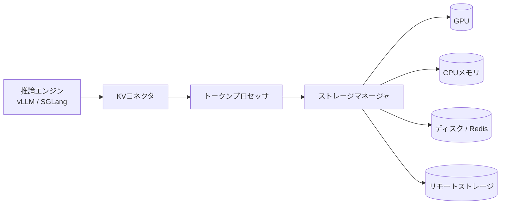

本記事は[LMCache: An Efficient KV Cache Layer for Enterprise-Scale LLM Inference](https://arxiv.org/abs/2510.09665)の解説記事です。

関連するZenn記事: [プロンプトキャッシュのプレフィックス設計とマルチターン最適化で対話コストを90%削減する](https://zenn.dev/0h_n0/articles/a0eef8c309235f)

## 論文概要

LMCacheは、vLLMやSGLangといったLLM推論エンジンと、CPUメモリ・ローカルディスク・リモートストレージなどの記憶装置の間に置かれるKVキャッシュ層である。著者らは、KVキャッシュをGPUメモリの外に退避（オフロード）して保持し、単一クエリを超えて接頭辞（プレフィックス）のKVキャッシュを再利用することで、TTFT（最初のトークンまでの時間）とスループットを改善できると報告している。論文は、プレフィックスのローカル再利用（CPUオフロード）、複数ノード間での再利用（中央ストレージ、P2P共有）、プレフィル・デコード分離（PD分離）の3つの利用形態を扱う。著者らは、マルチラウンドQAのワークロードで同一TTFTにおけるスループットが2.3〜14倍になったと報告しており（§8.2、Fig. 8）、これが要旨の「最大15倍」に相当する主張の根拠と考えられる。ただし本記事の執筆時点では要旨の表記を直接確認していない。

## 情報源

- **論文**: Yuhan Liu, Jiayi Yao, Yihua Cheng ほか, "LMCache: An Efficient KV Cache Layer for Enterprise-Scale LLM Inference", arXiv:2510.09665 (cs.DC, cs.AI)
- **所属**: Tensormesh Inc. / University of Chicago
- **URL**: https://arxiv.org/abs/2510.09665 （HTML版: https://arxiv.org/html/2510.09665v2）
- **版**: 本記事はv2の本文（§1〜§11）を基にしている

## 背景と動機

自己回帰型のLLM推論は、プロンプトを処理するプレフィル段階と、トークンを逐次生成するデコード段階に分かれる。プレフィルで生成されたKVキャッシュは、同じ接頭辞を持つ後続リクエストで再利用できる。しかし、GPUのHBMは容量が限られており、vLLMの標準的なプレフィックスキャッシュは主にGPU内で完結するため、長い文脈を持つ多数のユーザーを同時に扱うと、キャッシュがすぐに追い出される。

著者らは、この問題を「KVキャッシュをエンジンの外に永続化し、エンジンをまたいで共有する層」として解くことを目指している。論文の副題にある"Enterprise-Scale"は、多数のユーザー、長い文脈、複数インスタンスの運用を想定した設計であることを示す。

## 主要な貢献

論文の§1は、以下の3点を貢献として挙げている。

- **データ移動の最適化**: チャンク単位のバッチ転送、計算とI/Oのパイプライン化（§5.1, §5.2）
- **モジュール化されたKVコネクタ**: エンジン本体の改変を最小限にする接続インターフェース（§6）
- **制御API**: lookup、pin、move、clear、compressといった操作でキャッシュを外部から統制する仕組み（§7）

## 技術的詳細

### 階層とデータフロー

LMCacheはGPU、CPUメモリ、ローカルディスク、リモートディスク、Redisの5つの階層を扱う。転送経路はEthernet、RDMA、NVLinkに対応する。§4では次の3つのワークフローが説明されている。

- **Store**: KVコネクタ → トークンプロセッサ（新規トークンの特定）→ ストレージマネージャ → 転送チャネル
- **Retrieve**: KVコネクタ → トークンプロセッサ（接頭辞一致）→ イベントマネージャ（レイヤ単位の非同期ロード）→ GPUコネクタ
- **Lookup**: コントローラが保持するトークンプール。インスタンスがKVをstore/evictするたびに更新される



### チャンク単位のバッチ転送（§5.1）

LMCacheは既定で256トークンのチャンクを単位とする。複数レイヤのページをストリーミング用GPUバッファにまとめ、カスタムCUDAカーネルでDMAエンジンに渡す。デコード時の生成KVは、チャンクが満たされるまでバッファに留め、後からまとめて保存する。論文はこれにより、小さなページの多数転送によるオーバーヘッドを抑えられると述べている。

### 計算とI/Oのオーバーラップ（§5.2）

レイヤごとに別のCUDAストリームを使い、1レイヤ分のKVキャッシュと同じサイズの固定GPUバッファを用いる。さらに、待ち行列にあるクエリのKVを、低速な階層から高速な階層へ非同期にプリフェッチする。

### 余分なコピーの削減（§5.3）

参照カウントによるゼロコピー共有を用い、OSのPCBカウンタに似た考え方で共有データを管理する。動的オフロードでは、空きGPUページ上の3つのポインタ（start、current、end）を使い、初期化・処理中・クエリ到着・定常状態の4つの状態を遷移する。割り当てが現在のポインタを超えると停止（stall）が発生する。重複ウィンドウを小さくすると重複率は下がるが停止が増える、というトレードオフを論文は明示している。論文には数式や形式的なアルゴリズムの記述はなく、この動作は文章で説明されている。

### コネクタとPD分離（§6, §8.5）

vLLMとの接続には、スケジューラ側の`get_num_new_matched_tokens`、`update_state_after_alloc`、`build_connector_meta`と、ワーカー側の`start_load_kv`、`wait_load_kv`、`start_store_kv`、`wait_store_kv`が定義される（Table 2）。著者らは、このAPIがvLLMに6か月以上組み込まれていること、NVIDIA Dynamo、llm-d、AIBrix、vLLM production stackなどで採用されていることを報告している。

PD分離では、LMCacheがプレフィラのチャンクをGPUバッファにコピーし、デコーダ側のバッファへ転送したうえで、デコーダのページ化メモリへ書き込む。vLLMネイティブのPD分離がページ単位でNIXLを使うのに対し、チャンク単位で転送する点が異なる。

### 制御プレーン（§7）

中央のコントローラマネージャと、各インスタンスのワーカーからなる。内部APIは`batched_admit`、`batched_evict`、`batched_p2p_lookup`、外部APIは`lookup`、`move`、`clear`、`pin`/`unpin`、`compress`/`decompress`である。KVを意識したルーティング、マイグレーション、P2P共有などに利用できる。

## 実装のポイント

実装者にとって重要な点を3つに絞る。

1. **チャンク長と転送粒度**: §3.1.1のTable 1は、転送サイズと実効スループットの関係を示す（64KBで4GB/s、1MBで30GB/s、16MBで49GB/s、RCCL経由のデータ）。小さなページを個別に送ると帯域を使い切れないため、チャンク化が必要になる。
2. **ページサイズの扱い**: 論文はページサイズを16〜64KB（§3.1.1）、Llama-3.1-8Bで62.5KB（§3.1.1）、20〜63KB（§5）と記述し、値に揺れがある。自分の環境では`(層数 × 2 × KVヘッド数 × head_dim × 精度バイト数 × チャンク長)`の式で実測値を確認するべきである。
3. **エンジン変更への追従**: 論文は、新しいKVレイアウトを導入するとコネクタの更新が必要になると述べている（§3.1.2, §6）。バージョン固定と統合テストが前提になる。

## Production Deployment Guide

本節は論文の内容ではなく、論文の設計を実運用に持ち込む場合の**構成案**である。コストは2026年11月時点のAWS東京リージョン料金に基づく概算値として扱うが、本記事の執筆時点で料金表を照合していないため、数値は必ず最新の料金ページで再計算すること。

### 構成案の選び方

論文の実験はいずれも単一の8×H100サーバ、あるいは1台のB200で行われており、クラスタ運用の知見は限られている（§8）。そのため、規模に応じて次の2構成を想定する。

| 項目 | Small（単一GPUノード） | Large（EKS + Karpenter + Spot） |
|---|---|---|
| 想定QPS | 数QPS以下 | 数十QPS以上 |
| 構成 | g6e系GPUインスタンス1台に vLLM + LMCache | EKS上に vLLM + LMCache、Central Storage（Redis）と共有 |
| KVの保持先 | GPU → CPUメモリ（§8.2のCPU Offload相当） | GPU → CPU → Redis / リモートディスク |
| 主なリスク | 単一障害点 | Spot中断によるキャッシュ喪失 |

Small構成でLambda+Bedrockを使わない理由は、KVキャッシュがモデルサーバの内部状態であり、マネージドのLLM APIからはKVを外部に保持・再利用できないためである。サーバレスで推論を行う場合は、アプリ側のプロンプト設計（プレフィックスの安定化）で対応する必要がある。

### Small構成のTerraform（単一GPUノード）

```hcl
terraform {
  required_providers {
    aws = { source = "hashicorp/aws", version = "~> 5.0" }
  }
}

provider "aws" {
  region = "ap-northeast-1"
}

variable "ami_id" {
  type        = string
  description = "Deep Learning AMI (GPU) のAMI ID"
}

variable "vpc_id" {
  type = string
}

variable "app_cidr" {
  type        = string
  description = "vLLM APIを呼び出すアプリケーションのCIDR"
}

variable "private_subnet_id" {
  type = string
}

resource "aws_security_group" "lmcache" {
  name        = "lmcache-small"
  description = "vLLM API access from the app VPC only"
  vpc_id      = var.vpc_id

  ingress {
    from_port   = 8000
    to_port     = 8000
    protocol    = "tcp"
    cidr_blocks = [var.app_cidr]
  }

  egress {
    from_port   = 0
    to_port     = 0
    protocol    = "-1"
    cidr_blocks = ["0.0.0.0/0"]
  }
}

resource "aws_instance" "vllm_lmcache" {
  ami                    = var.ami_id
  instance_type          = "g6e.xlarge"
  subnet_id              = var.private_subnet_id
  vpc_security_group_ids = [aws_security_group.lmcache.id]

  root_block_device {
    volume_size = 200
    encrypted   = true
  }

  metadata_options {
    http_tokens = "required"
  }

  tags = { Name = "vllm-lmcache-small" }
}
```

### Large構成のKarpenter設定（Spot）

```yaml
apiVersion: karpenter.sh/v1
kind: NodePool
metadata:
  name: lmcache-gpu-spot
spec:
  template:
    spec:
      requirements:
        - key: karpenter.sh/capacity-type
          operator: In
          values: ["spot", "on-demand"]
        - key: node.kubernetes.io/instance-type
          operator: In
          values: ["g6e.2xlarge", "g6e.4xlarge"]
      taints:
        - key: nvidia.com/gpu
          effect: NoSchedule
  disruption:
    consolidationPolicy: WhenEmpty
    consolidateAfter: 5m
  limits:
    nvidia.com/gpu: 16
```

Spot中断時にCPU側のKVが失われるため、LMCacheのRedis（または共有ディスク）をクラスタ外のマネージドサービスに置き、ワーカーを差し替えても再利用できるようにする。Karpenterのon-demandフォールバックは、キャッシュを持つ常設ノードの確保に使う。

### セキュリティのベストプラクティス

- **ネットワーク**: vLLMのAPIとRedisはプライベートサブネットに置き、アプリVPCからのみ到達可能にする。
- **暗号化**: EBS・S3・Redisの保存時暗号化を有効にし、転送はTLSで保護する。
- **認証**: vLLMの前段でAPIキーまたはIAM認証を必須にする。
- **キャッシュの分離**: テナントをまたいでKVを共有すると、プロンプトの内容が推測されるリスクがあるため、テナントごとに名前空間を分ける。
- **メタデータ**: IMDSv2を必須にする（上記Terraformの`http_tokens = "required"`）。
- **シークレット**: モデルの取得トークンはSecrets Managerで管理し、コードや`user_data`に直接書かない。

### 運用・監視設定

- **CloudWatch**: GPU使用率（DCGM Exporter経由）、TTFT、ITL、キャッシュヒット率をメトリクス化し、ヒット率が急落したらアラームを出す。論文の§9では、文脈のトランケーションによりプレフィックスヒット率が約85%から45%に低下した事例が報告されている。
- **X-Ray**: リクエストごとにlookup、ロード、推論の区間を計測し、キャッシュ取得が推論時間を上回っていないかを確認する。
- **Cost Explorer**: GPUインスタンスとRedisのコストをタグで分け、キャッシュ導入前後の単価を比較する。
- **アラート**: Spot中断通知、キャッシュ容量の上限到達、Redisのエビクション数。

### コスト試算（概算）

以下は2026年11月時点のAWS東京リージョン料金に基づく概算値である。インスタンス単価・為替・割引（Savings Plans、Spot）の前提は本記事では照合しておらず、比較の桁感を示すための仮置きとする。

| 項目 | 月額の目安 | 前提 |
|---|---|---|
| Small: GPUインスタンス1台（常時稼働） | 約10万円 | オンデマンド、24時間稼働 |
| Small: 同（Savings Plans適用） | 約6〜7万円 | 1年・全額前払いを仮定 |
| Large: GPUノード4台、Spot中心 | 約15〜25万円 | Spotの中断率と平均割引率に依存 |
| Large: Redis（キャッシュ層） | 約3〜5万円 | 数百GBのメモリ |

論文が示す効果（§8.2のTTFT短縮、§8.5のPD分離での1.5〜1.8倍のTTFT改善）を用いると、同じ処理量をより少ないGPU台数で捌ける可能性がある。ただし、効果はワークロードのプレフィックス再利用率に依存する。再利用率が低いワークロードでは、キャッシュ層の運用コストが上回ることがある。

### コスト最適化チェックリスト

1. プレフィックスを安定させ、システムプロンプトを動的な値の前に置く
2. 文脈の切り詰め方を固定し、切り詰めによる再利用率の低下を監視する
3. CPUオフロードの上限（論文の実験では500GB）を、実際のヒット率に合わせて決める
4. チャンクサイズ（既定256トークン）を、ワークロードの平均長に合わせて評価する
5. GPUの空き時間を見てKVの退避を制御する（dynamic offloadingのヒステリシス）
6. Spotを使う場合は中断時のリクエストの再試行（指数バックオフ＋ジッタ）を設計する
7. Redisのエビクションポリシーを明示的に選ぶ
8. ノードの統合（consolidation）を、キャッシュの再構築コストを考慮して設定する
9. 推論エンジンのバージョンを固定し、更新時は再利用率を比較する
10. 小さいモデルでは、リモートロードがプレフィルより遅くなる場合があると論文が指摘している（§8.4）ため、KVをリモートから取るかを閾値で切り替える
11. 帯域（論文の実験では15Gbps）を計測し、ロードがプレフィルより速いかを確認する（§8.7）
12. 32Gbpsの帯域では、ロードが有利になるのは約256Kトークン以上の文脈だと論文は示す（§8.7）ので、その閾値を確認する
13. GPUを常時確保するか、Spotで確保するかを、再利用率とSLAで判断する
14. PD分離を採用する場合は、NVLinkの有無で転送方式を分ける（論文はNVLink前提で評価）
15. LMCacheのpin機能を、長期的に再利用される接頭辞に限定して使う
16. 不要なKVはclear APIで定期的に削除し、容量を確保する
17. 再利用率を、テナント・機能単位でダッシュボードに出す
18. 予約インスタンスやSavings Plansの対象を、常設のGPUノードに限定する
19. 夜間など負荷の低い時間帯にノード数を減らす（Karpenterのスケジュール制約）
20. ログ量を抑え、トークン列そのものを記録しない（PII保護）
21. 負荷試験で、TTFTの目標値を満たす最小構成を決めてから本番に出す
22. 月次で「キャッシュ導入によるGPU削減額」と「キャッシュ層の運用費」を比較する

## 実験結果

著者らは、以下の設定で評価している（§8）。

- **モデル**: Llama-3.1-8B-Instruct、Llama-3.1-70B-Instruct、Qwen2.5-Coder-32B-Instruct、Qwen3-Coder-480B-A35B-Instruct-FP8、Qwen2.5-72B-Instruct など（SGLangではQwen3-32B）
- **ハードウェア**: 8×H100サーバ（最小GPU数で評価）、B200（文脈長の感度分析）、PD分離はNVLink
- **ソフトウェア**: LMCache v0.3.6、ベースラインはvLLM v0.10.2（プレフィックスキャッシュ）およびvLLM v0.11.0（CPUオフロード）

主な結果は次のとおりである。

- **CPUオフロード（§8.2、Fig. 8）**: マルチラウンドQAで、QPS=1の時点でTTFTが1.9〜8.1倍短縮。同一TTFTで2.3〜14倍のスループット。
- **実トレース（§8.3、Fig. 9、Fig. 10）**: 図のキャプションでは高QPSでTTFT 3.7〜6.8倍短縮、ITL 19〜44%短縮。本文では19〜58%と記述されており、キャプションと本文で数値が一致しない。
- **中央ストレージ（§8.4、Fig. 11）**: 15Gbpsのリンクで、同一TTFTの下で1.3〜3倍のスループット。
- **PD分離（§8.5、Fig. 12）**: 平均TTFTが1.53〜1.84倍低下、平均ITLが1.12〜1.66倍低下（本文）。キャプションでは1.5〜1.8倍、1.1〜1.7倍。
- **非同期計算（§8.6、Fig. 13）**: エンドツーエンド遅延が1.46倍低減。
- **CPUロード帯域（§8.6、Table 5）**: LMCacheが400Gbps、vLLMネイティブのオフロードが88Gbps。
- **SGLang（§8.8、Fig. 16）**: Qwen3-32B（TP=2）で、オフロードなしのSGLangより高いスループットと低いTTFT。SGLangネイティブのオフロードと同程度。

以上のうち、要旨の「最大15倍」「少なくとも2倍のレイテンシ削減」は、ワークロードと比較対象に強く依存する値である。論文の表を読むと、最大値はマルチラウンドQAの条件に由来し、実トレースでは改善幅がこれより小さい。

## 実運用への応用

論文§9には、3社の本番運用に関する観察が記載されている。

- Company C: リモートからのロードは、フルプレフィルに比べTTFTが22〜32%低かった。
- Company F: 文脈のトランケーションで、プレフィックスヒット率が約85%から45%に低下した。
- Company G: 本番で約50%のヒット率に到達した。

これらは著者らの報告であり、第三者による再現は確認されていない。実運用で重要なのは、ヒット率そのものよりも、ヒット率が低下する条件（文脈の切り詰め、システムプロンプトの変更、モデル更新）を早期に検知することである。

Zenn記事「プロンプトキャッシュのプレフィックス設計とマルチターン最適化で対話コストを90%削減する」で扱うプレフィックス設計は、LMCacheのような層がある場合にも、そのまま効く前提である。API側のプロンプトキャッシュと、自前のKVキャッシュ層は、同じ「接頭辞の安定化」を前提としている点で共通する。

## 関連研究

論文は、vLLMのプレフィックスキャッシュ、vLLMのCPUオフロード、SGLangのネイティブなオフロードを比較対象とする（§8）。PD分離ではvLLMネイティブの実装（NIXLを用いたページ単位の転送）と比較する。また、Table 1の転送帯域の評価ではRCCLを用いた経路を引用しており、通信ライブラリの選択も性能に影響する。

## まとめ

LMCacheは、KVキャッシュをエンジンの外に永続化し、複数の推論インスタンスで共有するための層である。論文は、チャンク単位の転送、レイヤ単位のパイプライン、コネクタAPIとコントローラAPIという3つの設計で、CPUオフロード、中央ストレージ、PD分離の各シナリオで性能改善を示している。一方で、評価は単一ノードまたは少数ノードの環境であり、帯域や文脈長による効果の変動が大きい。導入の判断は、自分のワークロードのプレフィックス再利用率と、ネットワーク帯域を測定してから行うべきである。

## 参考文献

1. Y. Liu, J. Yao, Y. Cheng, et al., "LMCache: An Efficient KV Cache Layer for Enterprise-Scale LLM Inference," arXiv:2510.09665, 2025. https://arxiv.org/abs/2510.09665
2. LMCache, GitHub リポジトリおよびドキュメント（https://github.com/LMCache/LMCache）
3. vLLM Project, "KV Connector" 関連ドキュメント（https://docs.vllm.ai/）
4. Zenn記事「プロンプトキャッシュのプレフィックス設計とマルチターン最適化で対話コストを90%削減する」（https://zenn.dev/0h_n0/articles/a0eef8c309235f）
