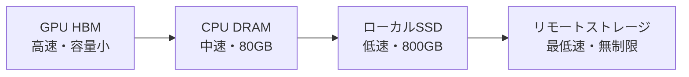
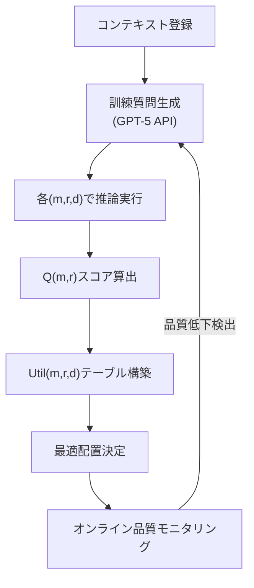

本記事は [EVICPRESS: Joint KV-Cache Compression and Eviction for Efficient LLM Serving](https://arxiv.org/abs/2512.14946) の解説記事です。

この記事は [Zenn記事: プロンプトキャッシュのプレフィックス設計とマルチターン最適化で対話コストを最大90%削減する](https://zenn.dev/0h_n0/articles/a0eef8c309235f) の深掘りです。

## 論文概要（Abstract）

LLM推論において、KVキャッシュの再利用はTime-to-First-Token（TTFT）の短縮に有効だが、キャッシュサイズはGPUメモリを容易に超過する。従来システムはキャッシュの「エビクション（退避）」か「圧縮」のどちらか一方のみで対処してきたが、両者を統合的に最適化するシステムは存在しなかった。EVICPRESSは、非可逆圧縮と適応的エビクションをマルチティアストレージ上で統合的に最適化することで、生成品質を維持しながらTTFTを削減する初のシステムである。著者らは、12のLongBenchデータセットと5つのモデルで評価を行い、同等品質においてTTFTを最大2.19倍削減し、スループットを2.0〜3.6倍向上させたと報告している。

## 情報源

- **arXiv ID**: 2512.14946
- **URL**: [https://arxiv.org/abs/2512.14946](https://arxiv.org/abs/2512.14946)
- **著者**: Shaoting Feng, Yuhan Liu, Hanchen Li, Xiaokun Chen, Samuel Shen, Kuntai Du, Zhuohan Gu, Rui Zhang, Yuyang Huang, Yihua Cheng, Jiayi Yao, Qizheng Zhang, Ganesh Ananthanarayanan, Junchen Jiang（U. Chicago, UC Berkeley, MIT, Stanford, Tensormesh, Microsoft）
- **発表年**: 2025年12月
- **分野**: cs.OS, cs.AI, cs.LG

## 背景と動機（Background & Motivation）

LLMサービングにおいて、KVキャッシュの再利用はプレフィックスキャッシュとして広く実装されている。vLLMやSGLangなどのサービングフレームワーク、さらにはAnthropic、OpenAI、GoogleのAPIレベルでもプロンプトキャッシュとして提供されている。しかし、長いコンテキストや多数の同時リクエストを扱う場合、KVキャッシュはGPUメモリの大半を消費する。

従来のアプローチには2つの方向性があった。

1. **エビクション方式**: LRU（Least Recently Used）等のポリシーでキャッシュをCPUメモリやSSDに退避させる。品質は維持されるが、再利用時のデータ転送に時間がかかる
2. **圧縮方式**: トークンドロッピングや量子化でKVキャッシュのサイズを削減する。転送は高速だが、品質劣化が避けられない

著者らは、これら2つのアプローチを個別に適用するだけでは最適解に到達できないと指摘している。エビクションのみのシステムはGPU上のキャッシュ容量が限られ、圧縮のみのシステムは高品質が要求されるコンテキストに対しても一律に圧縮を適用してしまう。EVICPRESSは、コンテキストごとに「どの程度圧縮するか」「どのティアに配置するか」を統合的に決定することで、品質と遅延の両方を最適化する。

## 主要な貢献（Key Contributions）

- **圧縮とエビクションの統合最適化**: KVキャッシュの非可逆圧縮とマルチティアエビクションを同時に最適化する初のシステムを構築
- **統一ユーティリティ関数**: 品質劣化と読み込み遅延を1つのスコアで評価し、すべての圧縮・配置選択肢を同一基準で比較可能にした
- **適応的プロファイリング**: コンテキストごとに圧縮感度を測定し、圧縮に敏感なコンテキストには軽い圧縮を、耐性のあるコンテキストには積極的な圧縮を適用

## 技術的詳細（Technical Details）

### マルチティアストレージアーキテクチャ

EVICPRESSは4層のストレージ階層でKVキャッシュを管理する。



各ティアの特性は以下の通りである。

| ティア | 帯域幅 | 容量 | 用途 |
|--------|--------|------|------|
| GPU HBM | 最大（ローカル） | 限定的 | アクティブな推論 |
| CPU DRAM | PCIe経由 | ~80GB | 高頻度キャッシュ |
| ローカルSSD | NVMe経由 | ~800GB | 中頻度キャッシュ |
| リモートストレージ | ネットワーク経由 | 無制限 | 低頻度キャッシュ |

従来のエビクション方式では、キャッシュは圧縮されずにティア間を移動するだけだった。EVICPRESSでは、移動先のティアに応じて圧縮率を変えることで、より多くのキャッシュを高速ティアに保持する。

### 統一ユーティリティ関数

EVICPRESSの中核は、圧縮方式・圧縮率・配置先デバイスの全組み合わせを1つのスコアで評価するユーティリティ関数である。

$$
\text{Util}(m, r, d) = \bigl(\alpha \cdot Q(m, r) - T(r, d)\bigr) \cdot f
$$

ここで、
- $m$: 圧縮方式（keydiff, knorm, snapkv等）
- $r$: 圧縮率（0〜1、0が最大圧縮）
- $d$: 配置先デバイス（GPU, CPU, SSD, リモート）
- $Q(m, r)$: 圧縮方式 $m$ と圧縮率 $r$ における生成品質スコア
- $T(r, d)$: 圧縮率 $r$ のキャッシュをデバイス $d$ から読み込む際のTTFT
- $f$: コンテキストのアクセス頻度
- $\alpha$: 品質と遅延のトレードオフパラメータ

$\alpha$ を大きくすると品質を重視した配置になり、小さくすると遅延削減を優先する。この関数により、「GPU上に非圧縮で保持する」「CPU上で50%圧縮する」「SSD上で75%圧縮する」といった選択肢を同一基準で比較できる。

### 圧縮手法

EVICPRESSは以下の3つのトークンドロッピング方式を採用している。

| 手法 | 概要 | 保持するトークンの選択基準 |
|------|------|--------------------------|
| **keydiff** | Keyベクトルの差分が大きいトークンを保持 | 隣接トークン間のKey差分ノルム |
| **knorm** | Keyベクトルのノルムが大きいトークンを保持 | 各トークンのKeyノルム |
| **snapkv** | Attentionスコアに基づきトークンを保持 | Observation windowでのAttention重み |

これらはすべてトークン単位の非可逆圧縮であり、保持されなかったトークンのKVは完全に破棄される。著者らは、量子化（KIVI等）との統合も将来的に可能であると述べている。

### プロファイラによる品質推定

EVICPRESSの重要なコンポーネントは、コンテキストごとの圧縮感度を測定するプロファイラである。



1. 新しいコンテキストが登録されると、GPT-5 APIを用いてそのコンテキストに関する訓練質問（著者らの実験では50問/コンテキスト）を自動生成する
2. 各圧縮方式・圧縮率の組み合わせで推論を実行し、品質スコア $Q(m, r)$ を算出する
3. デバイスごとの読み込み遅延 $T(r, d)$ と合わせてユーティリティテーブルを構築する
4. オンラインで品質低下が検出された場合、プロファイリングを再実行する

### 配置アルゴリズム

コンテキスト $i$ に対して配置 $(m_i, r_i, d_i)$ を選ぶ問題は、各ティアの容量制約のもとでユーティリティ総和を最大化する多重選択ナップサック問題として定式化される。

$$
\max \sum_{i=1}^{N} \text{Util}(m_i, r_i, d_i) \quad \text{s.t.} \quad \sum_{i: d_i = d} s_i \cdot r_i \leq C_d \quad \forall d
$$

ここで、
- $N$: キャッシュされたコンテキスト数
- $s_i$: コンテキスト $i$ の元のKVキャッシュサイズ
- $C_d$: デバイス $d$ の容量

この問題はNP困難であるため、著者らは貪欲アルゴリズム（Algorithm 1）を用いて近似解を求める。ユーティリティの限界減少が大きい順にコンテキストを高速ティアに配置し、ティアが満杯になるとユーティリティ低下が最小の操作（圧縮率の引き上げまたは下位ティアへの移動）を適用してカスケードさせる。

著者らの実験では、SSDに配置されたキャッシュはCPUに配置されたものよりも高い圧縮率が適用される傾向があり、短いコンテキストはCPUメモリに留まりやすいパターンが観察されたと報告している。

## 実装のポイント（Implementation）

EVICPRESSはvLLMとLMCacheの上に約3,000行のコードで実装されている。

**実装上の重要な設計判断**:

- **KVキャッシュインターセプト**: vLLMのKVキャッシュルックアップ・取得・保存の各操作をインターセプトし、圧縮・配置ロジックを挿入
- **オフラインプロファイリング**: 訓練質問の生成とユーティリティスコアの算出はオフラインで実行。GPU空きサイクル時に再プロファイリングを実施
- **カスケードエビクション**: 上位ティアが満杯になった場合、ユーティリティ低下最小の操作を選択して下位ティアにカスケード

```python
from dataclasses import dataclass


@dataclass(frozen=True)
class CacheConfig:
    method: str      # "keydiff", "knorm", "snapkv"
    ratio: float     # 0.0 (max compression) to 1.0 (no compression)
    device: str      # "gpu", "cpu", "ssd", "remote"


def compute_utility(
    quality: float,
    ttft: float,
    frequency: float,
    alpha: float = 1.0,
) -> float:
    """EVICPRESSの統一ユーティリティ関数

    Args:
        quality: 圧縮後の生成品質スコア (0-1)
        ttft: キャッシュ読み込みのTTFT (秒)
        frequency: コンテキストのアクセス頻度
        alpha: 品質vs遅延のトレードオフ

    Returns:
        ユーティリティスコア
    """
    return (alpha * quality - ttft) * frequency


def greedy_placement(
    contexts: list[dict],
    tier_capacities: dict[str, float],
    utility_table: dict[int, dict[tuple, float]],
) -> dict[int, CacheConfig]:
    """貪欲アルゴリズムによるキャッシュ配置

    Args:
        contexts: コンテキスト情報のリスト
        tier_capacities: 各ティアの残容量
        utility_table: コンテキストID -> (method, ratio, device) -> utilityスコア

    Returns:
        コンテキストID -> 最適なCacheConfig
    """
    placements: dict[int, CacheConfig] = {}
    remaining = dict(tier_capacities)

    for ctx in sorted(
        contexts,
        key=lambda c: max(utility_table[c["id"]].values()),
        reverse=True,
    ):
        best_config = None
        best_util = float("-inf")

        for (method, ratio, device), util in utility_table[ctx["id"]].items():
            compressed_size = ctx["size"] * ratio
            if remaining.get(device, 0) >= compressed_size and util > best_util:
                best_util = util
                best_config = CacheConfig(method=method, ratio=ratio, device=device)

        if best_config:
            compressed_size = ctx["size"] * best_config.ratio
            remaining[best_config.device] -= compressed_size
            placements[ctx["id"]] = best_config

    return placements
```

## Production Deployment Guide

### AWS実装パターン（コスト最適化重視）

EVICPRESSのマルチティアKVキャッシュ管理をAWS上で実現する場合、以下の構成が考えられる。

**トラフィック量別の推奨構成**:

| 規模 | 月間リクエスト | 推奨構成 | 月額コスト | 主要サービス |
|------|--------------|---------|-----------|------------|
| **Small** | ~3,000 (100/日) | Serverless | $50-150 | Lambda + Bedrock + DynamoDB |
| **Medium** | ~30,000 (1,000/日) | Hybrid | $300-800 | Lambda + ECS Fargate + ElastiCache |
| **Large** | 300,000+ (10,000/日) | Container | $2,000-5,000 | EKS + Karpenter + EC2 Spot |

**Small構成の詳細**（月額$50-150）:
- **Lambda**: 1GB RAM, 30秒タイムアウト ($20/月)
- **Bedrock**: Claude 3.5 Haiku, Prompt Caching有効 ($80/月)
- **DynamoDB**: On-Demand ($10/月)
- **CloudWatch**: 基本監視 ($5/月)
- **API Gateway**: REST API ($5/月)

**Medium構成の詳細**（月額$300-800）:
- **Lambda**: イベント処理 ($50/月)
- **ECS Fargate**: 0.5 vCPU, 1GB RAM × 2タスク ($120/月)
- **Bedrock**: Claude 3.5 Sonnet, Batch API活用 ($400/月)
- **ElastiCache Redis**: cache.t3.micro ($15/月)
- **Application Load Balancer**: ($20/月)

**Large構成の詳細**（月額$2,000-5,000）:
- **EKS**: コントロールプレーン ($72/月)
- **EC2 Spot Instances**: g5.xlarge × 2-4台 (平均$800/月)
- **Karpenter**: 自動スケーリング（追加コストなし）
- **Bedrock Batch**: 50%割引活用 ($2,000/月)
- **S3**: プロンプトキャッシュストレージ ($20/月)
- **CloudWatch + X-Ray**: 詳細監視 ($100/月)

**コスト試算の注意事項**: 上記は2026年11月時点のAWS ap-northeast-1（東京）リージョン料金に基づく概算値です。実際のコストはトラフィックパターン、リージョン、バースト使用量により変動します。最新料金は [AWS料金計算ツール](https://calculator.aws/) で確認してください。

### Terraformインフラコード

**Small構成 (Serverless): Lambda + Bedrock + DynamoDB**

```hcl
module "vpc" {
  source  = "terraform-aws-modules/vpc/aws"
  version = "~> 5.0"

  name = "evicpress-vpc"
  cidr = "10.0.0.0/16"
  azs  = ["ap-northeast-1a", "ap-northeast-1c"]
  private_subnets = ["10.0.1.0/24", "10.0.2.0/24"]

  enable_nat_gateway   = false
  enable_dns_hostnames = true
}

resource "aws_iam_role" "lambda_bedrock" {
  name = "evicpress-lambda-bedrock-role"

  assume_role_policy = jsonencode({
    Version = "2012-10-17"
    Statement = [{
      Action    = "sts:AssumeRole"
      Effect    = "Allow"
      Principal = { Service = "lambda.amazonaws.com" }
    }]
  })
}

resource "aws_iam_role_policy" "bedrock_invoke" {
  role = aws_iam_role.lambda_bedrock.id

  policy = jsonencode({
    Version = "2012-10-17"
    Statement = [{
      Effect   = "Allow"
      Action   = ["bedrock:InvokeModel", "bedrock:InvokeModelWithResponseStream"]
      Resource = "arn:aws:bedrock:ap-northeast-1::foundation-model/anthropic.claude-3-5-haiku*"
    }]
  })
}

resource "aws_lambda_function" "llm_handler" {
  filename      = "lambda.zip"
  function_name = "evicpress-llm-handler"
  role          = aws_iam_role.lambda_bedrock.arn
  handler       = "index.handler"
  runtime       = "python3.12"
  timeout       = 60
  memory_size   = 1024

  environment {
    variables = {
      BEDROCK_MODEL_ID    = "anthropic.claude-3-5-haiku-20241022-v1:0"
      DYNAMODB_TABLE      = aws_dynamodb_table.cache.name
      ENABLE_PROMPT_CACHE = "true"
    }
  }
}

resource "aws_dynamodb_table" "cache" {
  name         = "evicpress-kv-cache-metadata"
  billing_mode = "PAY_PER_REQUEST"
  hash_key     = "context_hash"

  attribute {
    name = "context_hash"
    type = "S"
  }

  ttl {
    attribute_name = "expire_at"
    enabled        = true
  }
}

resource "aws_cloudwatch_metric_alarm" "lambda_cost" {
  alarm_name          = "evicpress-lambda-cost-spike"
  comparison_operator = "GreaterThanThreshold"
  evaluation_periods  = 1
  metric_name         = "Duration"
  namespace           = "AWS/Lambda"
  period              = 3600
  statistic           = "Sum"
  threshold           = 100000
  alarm_description   = "Lambda実行時間異常（コスト急増の可能性）"

  dimensions = {
    FunctionName = aws_lambda_function.llm_handler.function_name
  }
}
```

**Large構成 (Container): EKS + Karpenter + Spot Instances**

```hcl
module "eks" {
  source  = "terraform-aws-modules/eks/aws"
  version = "~> 20.0"

  cluster_name    = "evicpress-inference-cluster"
  cluster_version = "1.31"
  vpc_id          = module.vpc.vpc_id
  subnet_ids      = module.vpc.private_subnets

  cluster_endpoint_public_access            = true
  enable_cluster_creator_admin_permissions   = true
}

resource "kubectl_manifest" "karpenter_provisioner" {
  yaml_body = <<-YAML
    apiVersion: karpenter.sh/v1alpha5
    kind: Provisioner
    metadata:
      name: spot-provisioner
    spec:
      requirements:
        - key: karpenter.sh/capacity-type
          operator: In
          values: ["spot"]
        - key: node.kubernetes.io/instance-type
          operator: In
          values: ["g5.xlarge", "g5.2xlarge"]
      limits:
        resources:
          cpu: "32"
          memory: "128Gi"
      providerRef:
        name: default
      ttlSecondsAfterEmpty: 30
  YAML
}

resource "aws_budgets_budget" "llm_monthly" {
  name         = "evicpress-monthly-budget"
  budget_type  = "COST"
  limit_amount = "5000"
  limit_unit   = "USD"
  time_unit    = "MONTHLY"

  notification {
    comparison_operator        = "GREATER_THAN"
    threshold                  = 80
    threshold_type             = "PERCENTAGE"
    notification_type          = "ACTUAL"
    subscriber_email_addresses = ["ops@example.com"]
  }
}
```

### セキュリティベストプラクティス

- **ネットワーク**: EKSは`cluster_endpoint_public_access = false`を本番では設定（VPN/Direct Connect経由）。Lambda はVPC内配置
- **認証**: IAMロール最小権限、MFA必須、IRSA（IAM Roles for Service Accounts）
- **シークレット**: AWS Secrets Manager使用、環境変数ハードコード禁止、90日ローテーション
- **暗号化**: TLS 1.2以上、S3/DynamoDB/EBS全てKMS暗号化
- **監査**: CloudTrail全リージョン有効化、Config/GuardDuty有効化

### 運用・監視設定

**CloudWatch Logs Insights クエリ**:

```sql
fields @timestamp, model_id, input_tokens, output_tokens
| stats sum(input_tokens + output_tokens) as total_tokens by bin(1h)
| filter total_tokens > 100000

fields @timestamp, duration_ms
| stats pct(duration_ms, 95) as p95, pct(duration_ms, 99) as p99 by bin(5m)
```

**CloudWatch アラーム（Python）**:

```python
import boto3

cloudwatch = boto3.client("cloudwatch")

cloudwatch.put_metric_alarm(
    AlarmName="evicpress-bedrock-token-spike",
    ComparisonOperator="GreaterThanThreshold",
    EvaluationPeriods=1,
    MetricName="TokenUsage",
    Namespace="AWS/Bedrock",
    Period=3600,
    Statistic="Sum",
    Threshold=500000,
    ActionsEnabled=True,
    AlarmActions=["arn:aws:sns:ap-northeast-1:123456789:cost-alerts"],
    AlarmDescription="Bedrockトークン使用量異常（コスト急増）",
)
```

**X-Ray トレーシング設定**:

```python
from aws_xray_sdk.core import patch_all, xray_recorder

patch_all()

@xray_recorder.capture("kv_cache_lookup")
def lookup_kv_cache(context_hash: str, tier: str) -> dict | None:
    """KVキャッシュルックアップのトレーシング"""
    xray_recorder.put_annotation("tier", tier)
    xray_recorder.put_metadata("context_hash", context_hash)
    # キャッシュルックアップ処理
    return None
```

**Cost Explorer自動レポート**:

```python
import boto3
from datetime import datetime, timedelta

ce = boto3.client("ce")

response = ce.get_cost_and_usage(
    TimePeriod={
        "Start": (datetime.now() - timedelta(days=1)).strftime("%Y-%m-%d"),
        "End": datetime.now().strftime("%Y-%m-%d"),
    },
    Granularity="DAILY",
    Metrics=["UnblendedCost"],
    GroupBy=[{"Type": "SERVICE", "Key": "SERVICE"}],
)

for result in response["ResultsByTime"]:
    for group in result["Groups"]:
        service = group["Keys"][0]
        cost = float(group["Metrics"]["UnblendedCost"]["Amount"])
        if cost > 100:
            pass  # SNS通知
```

### コスト最適化チェックリスト

**アーキテクチャ選択**:
- [ ] ~100 req/日 → Lambda + Bedrock (Serverless) — $50-150/月
- [ ] ~1000 req/日 → ECS Fargate + Bedrock (Hybrid) — $300-800/月
- [ ] 10000+ req/日 → EKS + Spot Instances (Container) — $2,000-5,000/月

**リソース最適化**:
- [ ] EC2: Spot Instances優先（Karpenter自動管理）
- [ ] Reserved Instances: 1年コミットで最大72%削減
- [ ] Savings Plans: Compute Savings Plans検討
- [ ] Lambda: メモリサイズ最適化（CloudWatch Insights分析）
- [ ] ECS/EKS: アイドルタイムのスケールダウン

**LLMコスト削減**:
- [ ] Bedrock Batch API: 50%割引（非リアルタイム処理）
- [ ] Prompt Caching: 30-90%削減（システムプロンプト固定）
- [ ] モデル選択ロジック: 開発はHaiku、本番複雑タスクはSonnet
- [ ] トークン数制限: max_tokens設定で過剰生成防止

**監視・アラート**:
- [ ] AWS Budgets: 月額予算設定（80%で警告、100%でアラート）
- [ ] CloudWatch アラーム: トークン使用量スパイク検知
- [ ] Cost Anomaly Detection: 自動異常検知
- [ ] 日次コストレポート: SNS/Slackへ自動送信

**リソース管理**:
- [ ] 未使用リソース削除: Lambda Insights, Trusted Advisor活用
- [ ] タグ戦略: 環境別（dev/staging/prod）でコスト可視化
- [ ] ライフサイクルポリシー: S3古いキャッシュ自動削除（30日）
- [ ] RDS/ElastiCache: 開発環境は夜間停止

## 実験結果（Results）

著者らは12のLongBenchデータセットと5つのモデルで評価を実施している。

**評価対象モデル**: Llama-3.1-8B-Instruct, Qwen2.5-14B-Instruct, LongChat-7B-v1.5-32K, Mistral-7B-Instruct-v0.3, Qwen3-30B-A3B-Instruct-2507

**ベースラインとの比較**（論文のIntroductionより）:

| 比較対象 | 条件 | TTFT削減 |
|---------|------|---------|
| 圧縮+LRUベースライン | 同品質 | 1.43〜3.77倍 |
| LRUエビクションのみ | 品質低下3%以内 | 1.22〜1.56倍 |
| フルプリフィル（キャッシュなし） | 品質低下3%以内 | 1.29〜2.19倍 |

**スループット**（品質目標80%時）: ベースラインに対して2.0〜3.6倍向上

**IMPRESS（圧縮ベースライン）との比較**:
- 同TTFTで品質13.58〜55.40%向上
- 品質低下なしでTTFT 1.5〜5.2倍削減

著者らは、12のLongBenchタスクのうち11タスクで改善を達成し、唯一MuSiQueタスクではkeydiff+LRUよりわずかに劣る結果になったと報告している。

**プロファイリングの効果**: 定期的な再プロファイリングにより、約11%の品質向上が得られ、時間経過とともに飽和する傾向が観察されている。

## 実運用への応用（Practical Applications）

EVICPRESSの手法は、以下のようなシナリオで有効である。

**長コンテキストLLMサービング**: RAG（Retrieval-Augmented Generation）システムでは、検索されたドキュメントがコンテキストとして繰り返し使用される。EVICPRESSのコンテキスト別圧縮感度プロファイリングにより、頻繁にアクセスされるドキュメントは低圧縮率でGPUに保持し、まれにしかアクセスされないドキュメントは高圧縮率でSSDに退避させることができる。

**マルチテナントサービング**: 複数ユーザーが同時にLLMを利用する環境では、ユーザーごとに異なるシステムプロンプトやコンテキストが存在する。EVICPRESSのユーティリティベースの配置最適化により、アクティブなユーザーのキャッシュを優先的にGPU上に保持できる。

**プロンプトキャッシュのバックエンド最適化**: AnthropicやOpenAIのプロンプトキャッシュAPIの裏側で動作するようなKVキャッシュ管理システムでは、TTLに基づく単純なエビクションではなく、EVICPRESSのユーティリティ関数に基づく判断により、キャッシュヒット率とユーザー体感遅延の両方を最適化できる可能性がある。

## 関連研究（Related Work）

- **LMCache** (arXiv:2510.09665): CPU/SSDへのKVキャッシュオフロードによるプレフィックスキャッシュ容量拡張。EVICPRESSのストレージバックエンドとして使用されている
- **IMPRESS**: 圧縮ベースのKVキャッシュ最適化。EVICPRESSはIMPRESSに対して同品質でTTFT 1.5〜5.2倍の削減を達成している
- **SnapKV** (arXiv:2404.14469): Attentionスコアに基づくKVキャッシュ圧縮。EVICPRESSの圧縮手法の1つとして採用されている
- **PagedAttention/vLLM** (arXiv:2309.06180): ページベースのKVキャッシュ管理。EVICPRESSはvLLMの上に構築されている

## まとめと今後の展望

EVICPRESSは、KVキャッシュの圧縮とエビクションを統合的に最適化する初のシステムであり、統一ユーティリティ関数によって品質と遅延のトレードオフをコンテキストごとに適応的に制御する。著者らは、12のLongBenchデータセットと5つのモデルで同等品質においてTTFTを最大2.19倍削減し、スループットを2.0〜3.6倍向上させたと報告している。

今後の研究方向として、量子化（KIVI等）との統合、オンラインプロファイリングの高速化、およびサービングフレームワーク（SGLang等）への統合が考えられる。また、プロンプトキャッシュAPIを提供するプロバイダ（Anthropic、OpenAI、Google）がバックエンドで採用する可能性のある技術として、実務的な価値も高い。

## 参考文献

- **arXiv**: [https://arxiv.org/abs/2512.14946](https://arxiv.org/abs/2512.14946)
- **vLLM**: [https://github.com/vllm-project/vllm](https://github.com/vllm-project/vllm)
- **LMCache**: [https://arxiv.org/abs/2510.09665](https://arxiv.org/abs/2510.09665)
- **Related Zenn article**: [https://zenn.dev/0h_n0/articles/a0eef8c309235f](https://zenn.dev/0h_n0/articles/a0eef8c309235f)

---

:::message
この記事はAI（Claude Code）により自動生成されました。内容の正確性については複数の情報源で検証していますが、実際の利用時は公式ドキュメントもご確認ください。
:::
