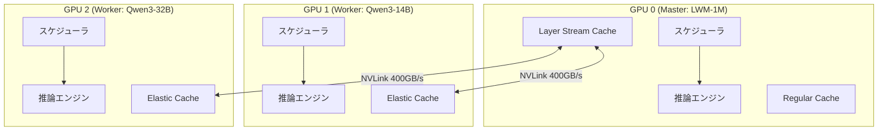

本記事は [SwiftCache: Efficient LLM Serving for Multi-turn Conversations with Heterogeneous KV Cache Sharing](https://arxiv.org/abs/2606.16135) の解説記事です。

この記事は [Zenn記事: プロンプトキャッシュのプレフィックス設計とマルチターン最適化で対話コストを最大90%削減する](https://zenn.dev/0h_n0/articles/a0eef8c309235f) の深掘りです。

## 論文概要（Abstract）

SwiftCacheは、マルチターン対話やエージェントワークロードにおけるKVキャッシュの転送ボトルネックとGPU HBM容量制限を、**異種モデル間のGPUメモリ共有**で解決する推論サービングシステムである。KV需要の高いマスターモデルが、KV需要の低いワーカーモデルの余剰GPUメモリをNVLink経由で借用し、PCIeバス（32 GB/s）の12.5倍の帯域幅（NVLink: 400 GB/s）でKVキャッシュを転送する。著者らは、ShareGPTワークロードでP99 TTFTを最大69%削減し、最大コンテキスト長を3.98倍に拡張したと報告している。

## 情報源

- **arXiv ID**: 2606.16135
- **URL**: [https://arxiv.org/abs/2606.16135](https://arxiv.org/abs/2606.16135)
- **著者**: Jianmin Hu, Minxian Xu, Sa Wang, Chong Ma, Min Shen, Kejiang Ye, Lin Qu, Chengzhong Xu
- **所属**: Southern University of Science and Technology (SUSTech), SIAT/CAS, Institute of Computing Technology (CAS), Alibaba Group, University of Macau
- **発表年**: 2026
- **分野**: cs.DC

## 背景と動機（Background & Motivation）

マルチターン対話やLLMエージェントの普及に伴い、推論サービングシステムは1セッションで数十ターンにわたる長大な会話履歴を処理する必要がある。このとき、KVキャッシュのサイズはターンの増加とともに線形に成長し、GPU HBMの容量を圧迫する。

既存のシステム（vLLM、SGLang）では、HBMに入りきらないKVキャッシュをCPUメモリやSSDにオフロードし、必要時にPCIe経由でGPUに戻す戦略を採る。しかしPCIe 4.0の帯域幅は32 GB/sにとどまり、コンテキストが長くなるほどKVキャッシュの再ロード遅延が支配的になる。著者らの計測によると、ShareGPTワークロードでのprefix-cache hit rateは90.7%に達する一方、キャッシュミス時のPCIe転送がP99レイテンシを大きく悪化させている。

もう一つの課題はHBM容量の限界である。例えばNVIDIA H20（96 GB HBM）上でQwen3-32Bを動作させる場合、モデルパラメータの格納後にKVキャッシュに利用可能なHBMは限られ、長いマルチターン対話のコンテキスト全体を保持できない。

## 主要な貢献（Key Contributions）

- **異種モデル間KVキャッシュ共有**: KV需要の異なるモデルを同一ノード上にco-locateし、低需要モデルの余剰GPUメモリをNVLink経由で高需要モデルに貸し出す協調推論アーキテクチャ
- **Layer Stream Cache (LSC)**: マスターモデルのKVキャッシュを1レイヤー分のみローカルGPUに保持し、残りはワーカーGPUからレイヤー単位でストリーミングする仕組み
- **Elastic Cache**: ワーカー側のキャッシュをO(1)でリサイズ可能なブロック管理。ブロックの再マッピングのみでデータ移動なし
- **層単位パイプライン**: レイヤーごとのKVキャッシュload/storeと注意計算をオーバーラップし、転送レイテンシを隠蔽

## 技術的詳細（Technical Details）

### Master/Workerアーキテクチャ

SwiftCacheの基本設計は、KV需要の高いモデル（マスター）と低いモデル（ワーカー）を同一ノードのGPU群にco-locateする**協調推論アーキテクチャ**である。



各モデルはそれぞれ独立したスケジューラ、キャッシュマネージャ、コーディネータ、推論エンジンを持つ。スケジューリングはイテレーションレベルのFCFS（First-Come-First-Served）で実行される。

### Layer Stream Cache（LSC）

Layer Stream Cacheは、SwiftCacheの核となるメカニズムである。従来のKVキャッシュはすべてのレイヤーのKey/Valueをローカルメモリに保持するが、LSCでは**現在計算中のレイヤーのKVキャッシュのみ**をマスターGPUのローカルメモリに配置する。

レイヤー $l$ の注意計算が終了すると、そのレイヤーのKVキャッシュはNVLink経由でワーカーGPUに書き戻され、次のレイヤー $l+1$ のKVキャッシュがワーカーGPUから読み出される。

これにより、マスターGPUに必要なKVキャッシュ容量は全レイヤー分の $L \times d$ から1レイヤー分の $d$ に削減される（$L$: レイヤー数、$d$: 1レイヤーのKVキャッシュサイズ）。

$$
\text{LSCメモリ使用量} = \frac{1}{L} \times \text{全レイヤーKVキャッシュサイズ}
$$

ここで、
- $L$: モデルのTransformerレイヤー数
- $d$: 1レイヤーあたりのKVキャッシュサイズ（$= 2 \times n_{\text{heads}} \times d_{\text{head}} \times \text{seq\_len}$）

**パイプライン化**: レイヤー $l$ の注意計算と、レイヤー $l-1$ のKVキャッシュ書き戻し・レイヤー $l+1$ のKVキャッシュ読み出しをCUDAストリームで並行実行し、転送レイテンシを隠蔽する。著者らの計測では、Qwen3-32BにおけるKVキャッシュのload/storeオーバーヘッドはprefillレイテンシの1.4%および1.1%未満と報告されている。

### Regular Cache（RC）

LSCが使用しないマスターGPUの残りHBM領域には、従来型のRegular Cache（RC）が配置される。RCでは全レイヤーのKVキャッシュブロックをローカルに保持するため、NVLink転送が不要で高速にアクセスできる。

LSCとRCの間でメモリ配分は動的に調整される。短いリクエストはRCで処理し、長いコンテキストのリクエストのみLSCを利用するという使い分けが可能である。

### Elastic Cache

ワーカー側のElastic Cacheは、**ブロックメジャーレイアウト**を採用し、ブロック単位でマスターへの貸し出しと回収を行う。

```python
# Elastic Cacheの概念的な動作
class ElasticCache:
    """ワーカーGPU上のKVキャッシュブロック管理"""

    def __init__(self, total_blocks: int, block_size: int):
        self.total_blocks = total_blocks
        self.block_size = block_size
        self.local_used: set[int] = set()
        self.lent_to_master: set[int] = set()

    def lend_blocks(self, n: int) -> list[int]:
        """マスターにn個のブロックを貸し出す（O(1)）
        
        ブロックの再マッピングのみ、データ移動なし
        """
        free = self._get_free_block_ids(n)
        self.lent_to_master.update(free)
        return free

    def reclaim_blocks(self, block_ids: list[int]) -> None:
        """ローカル需要増加時にブロックを回収（O(1)）"""
        self.lent_to_master -= set(block_ids)
        self.local_used.update(block_ids)

    def _get_free_block_ids(self, n: int) -> list[int]:
        used = self.local_used | self.lent_to_master
        free = [i for i in range(self.total_blocks) if i not in used]
        return free[:n]
```

リサイズ操作はブロックポインタの再マッピングのみで完了するため、$O(1)$ の時間計算量を実現する。ワーカーのローカル需要が増加すると、一定の時間窓（例: 1分間）における最長リクエストに基づいてブロックを回収する。

マスターとワーカーのブロックサイズが異なる場合、両者の最小公倍数（LCM）をスケーリングユニットとして使用する。

### 系統的なメモリ管理

SwiftCacheのメモリ管理は以下の優先順位で動作する:

1. **短いリクエスト**: マスターGPUのRegular Cacheで処理（NVLink転送不要）
2. **中程度のリクエスト**: LSCでワーカーGPUにKVキャッシュを分散
3. **超長コンテキスト**: 複数ワーカーにまたがるLSCで対応

## 実装のポイント（Implementation）

SwiftCacheの実装規模は約8,600行のPython/Tritonコードと約1,800行のC++コードで構成される。以下の既存技術を統合している:

- **FlashAttention**: 注意計算のメモリ効率最適化
- **PagedAttention**: ブロック単位のKVキャッシュ管理（vLLM由来）
- **continuous batching**: イテレーションレベルのバッチスケジューリング

通信レイヤーにはFastAPI、ZeroMQ、`torch.distributed`を使用する。

実装時の注意点:
- NVLink接続がない環境ではLSCの効果は限定的（PCIeではボトルネックが残る）
- ワーカーモデルのKV需要が急増した場合のブロック回収タイミングの調整が重要
- CUDAストリームの同期管理を誤ると、不完全なKVキャッシュで注意計算が実行されるリスクがある

## Production Deployment Guide

### AWS実装パターン（コスト最適化重視）

SwiftCacheの異種モデルKVキャッシュ共有をAWSで実現する構成を検討する。NVLink接続が必須であるため、GPU間の高帯域通信が可能なインスタンスを選定する。

**コスト試算の注意事項**: 以下は2026年11月時点のAWS ap-northeast-1（東京）リージョン料金に基づく概算値です。実際のコストはトラフィックパターン、リージョン、バースト使用量により変動します。最新料金は [AWS料金計算ツール](https://calculator.aws/) で確認してください。

| 規模 | 月間リクエスト | 推奨構成 | 月額コスト | 主要サービス |
|------|--------------|---------|-----------|------------|
| **Small** | ~3,000 (100/日) | シングルGPU | $2,000-3,000 | p4d.24xlarge (Spot) + Bedrock fallback |
| **Medium** | ~30,000 (1,000/日) | マルチGPU | $8,000-15,000 | p4d.24xlarge (Reserved) + EKS |
| **Large** | 300,000+ (10,000/日) | マルチノード | $30,000-60,000 | p5.48xlarge × 2-4 + EKS + Karpenter |

**Small構成の詳細** (月額$2,000-3,000):
- **EC2 p4d.24xlarge Spot**: 8×A100-40GB、NVLink接続あり (平均$8/h × 60%稼働 = ~$3,500、Spot割引で~$1,400)
- **Amazon Bedrock**: Claude 3.5 Haiku for 低負荷タスク ($500/月)
- **S3**: KVキャッシュのチェックポイント保存 ($20/月)
- **CloudWatch**: 基本監視 ($50/月)

**Medium構成の詳細** (月額$8,000-15,000):
- **EC2 p4d.24xlarge Reserved**: 1年コミットで~42%割引 (~$5,000/月)
- **EKS**: コントロールプレーン ($72/月)
- **EBS gp3**: モデル重み保存、1TB ($80/月)
- **ElastiCache Redis**: prefix-cacheメタデータ管理 ($150/月)
- **Application Load Balancer**: ($20/月)

**コスト削減テクニック**:
- Spot Instances使用で最大90%削減（p4d.24xlargeのSpot可用性はリージョンにより変動）
- Reserved Instances購入（1年コミット）で最大42%削減
- SwiftCacheの異種モデルco-location自体が、モデルごとに専用GPUを割り当てる構成と比較してGPU利用効率を大幅に向上
- 低負荷時間帯のAuto Scaling to Zero（EKS + Karpenter）

### Terraformインフラコード

**Medium構成: p4d.24xlarge + EKS**

```hcl
# --- VPC基盤 ---
module "vpc" {
  source  = "terraform-aws-modules/vpc/aws"
  version = "~> 5.0"

  name = "swiftcache-vpc"
  cidr = "10.0.0.0/16"
  azs  = ["ap-northeast-1a", "ap-northeast-1c"]
  private_subnets = ["10.0.1.0/24", "10.0.2.0/24"]
  public_subnets  = ["10.0.101.0/24", "10.0.102.0/24"]

  enable_nat_gateway   = true
  single_nat_gateway   = true
  enable_dns_hostnames = true
}

# --- EKSクラスタ ---
module "eks" {
  source  = "terraform-aws-modules/eks/aws"
  version = "~> 20.0"

  cluster_name    = "swiftcache-cluster"
  cluster_version = "1.31"

  vpc_id     = module.vpc.vpc_id
  subnet_ids = module.vpc.private_subnets

  cluster_endpoint_public_access = true

  enable_cluster_creator_admin_permissions = true
}

# --- GPU Nodegroup (p4d.24xlarge) ---
resource "aws_eks_node_group" "gpu" {
  cluster_name    = module.eks.cluster_name
  node_group_name = "swiftcache-gpu"
  node_role_arn   = aws_iam_role.eks_node.arn
  subnet_ids      = module.vpc.private_subnets

  instance_types = ["p4d.24xlarge"]
  capacity_type  = "SPOT"

  scaling_config {
    desired_size = 1
    max_size     = 2
    min_size     = 0
  }

  labels = {
    "nvidia.com/gpu" = "true"
    "workload"       = "swiftcache"
  }

  taint {
    key    = "nvidia.com/gpu"
    value  = "true"
    effect = "NO_SCHEDULE"
  }
}

# --- IAMロール（最小権限） ---
resource "aws_iam_role" "eks_node" {
  name = "swiftcache-eks-node"

  assume_role_policy = jsonencode({
    Version = "2012-10-17"
    Statement = [{
      Action = "sts:AssumeRole"
      Effect = "Allow"
      Principal = { Service = "ec2.amazonaws.com" }
    }]
  })
}

resource "aws_iam_role_policy_attachment" "eks_worker" {
  for_each = toset([
    "arn:aws:iam::aws:policy/AmazonEKSWorkerNodePolicy",
    "arn:aws:iam::aws:policy/AmazonEKS_CNI_Policy",
    "arn:aws:iam::aws:policy/AmazonEC2ContainerRegistryReadOnly",
  ])
  policy_arn = each.value
  role       = aws_iam_role.eks_node.name
}

# --- S3バケット（KVキャッシュチェックポイント） ---
resource "aws_s3_bucket" "kv_cache" {
  bucket = "swiftcache-kv-checkpoint"
}

resource "aws_s3_bucket_server_side_encryption_configuration" "kv_cache" {
  bucket = aws_s3_bucket.kv_cache.id
  rule {
    apply_server_side_encryption_by_default {
      sse_algorithm = "aws:kms"
    }
  }
}

# --- CloudWatch アラーム（GPU使用率監視） ---
resource "aws_cloudwatch_metric_alarm" "gpu_utilization" {
  alarm_name          = "swiftcache-gpu-high"
  comparison_operator = "GreaterThanThreshold"
  evaluation_periods  = 2
  metric_name         = "GPUUtilization"
  namespace           = "Custom/SwiftCache"
  period              = 300
  statistic           = "Average"
  threshold           = 90
  alarm_description   = "GPU使用率が90%を超過（スケールアウト検討）"
}

# --- AWS Budgets ---
resource "aws_budgets_budget" "swiftcache" {
  name         = "swiftcache-monthly"
  budget_type  = "COST"
  limit_amount = "15000"
  limit_unit   = "USD"
  time_unit    = "MONTHLY"

  notification {
    comparison_operator       = "GREATER_THAN"
    threshold                 = 80
    threshold_type            = "PERCENTAGE"
    notification_type         = "ACTUAL"
    subscriber_email_addresses = ["ops@example.com"]
  }
}
```

### セキュリティベストプラクティス

1. **ネットワーク**: EKS `cluster_endpoint_public_access = false`（VPN経由）、セキュリティグループでGPUノード間NVLink通信のみ許可
2. **認証**: IRSA（IAM Roles for Service Accounts）でPod単位の最小権限
3. **シークレット**: モデル重みの認証情報はSecrets Manager管理
4. **暗号化**: S3/EBS全てKMS暗号化、転送中はTLS 1.2以上

### 運用・監視設定

**CloudWatch Logs Insights クエリ**:

```sql
-- TTFT分布の監視（SwiftCache LSC vs RC）
fields @timestamp, cache_type, ttft_ms
| stats pct(ttft_ms, 50) as p50, pct(ttft_ms, 95) as p95, pct(ttft_ms, 99) as p99 by cache_type, bin(5m)

-- NVLink転送オーバーヘッドの監視
fields @timestamp, nvlink_transfer_ms, prefill_ms
| stats avg(nvlink_transfer_ms / prefill_ms * 100) as overhead_pct by bin(10m)
| filter overhead_pct > 5
```

**CloudWatch アラーム（コスト重視）**:

```python
import boto3

cloudwatch = boto3.client('cloudwatch')

cloudwatch.put_metric_alarm(
    AlarmName='swiftcache-nvlink-overhead',
    ComparisonOperator='GreaterThanThreshold',
    EvaluationPeriods=2,
    MetricName='NVLinkOverheadPercent',
    Namespace='Custom/SwiftCache',
    Period=300,
    Statistic='Average',
    Threshold=5.0,
    AlarmDescription='NVLink転送オーバーヘッドが5%超過（LSC効率低下）',
    AlarmActions=['arn:aws:sns:ap-northeast-1:123456789:swiftcache-alerts'],
)

cloudwatch.put_metric_alarm(
    AlarmName='swiftcache-cache-miss-rate',
    ComparisonOperator='GreaterThanThreshold',
    EvaluationPeriods=3,
    MetricName='CacheMissRate',
    Namespace='Custom/SwiftCache',
    Period=300,
    Statistic='Average',
    Threshold=20.0,
    AlarmDescription='KVキャッシュミス率20%超過（プレフィックス安定性を確認）',
)
```

### コスト最適化チェックリスト

**アーキテクチャ選択**:
- [ ] ~100 req/日 → p4d Spot + Bedrock fallback - $2,000-3,000/月
- [ ] ~1000 req/日 → p4d Reserved + EKS - $8,000-15,000/月
- [ ] 10000+ req/日 → p5 × 複数ノード + EKS + Karpenter - $30,000-60,000/月

**リソース最適化**:
- [ ] Spot Instances: p4d.24xlargeで最大90%削減（可用性に注意）
- [ ] Reserved Instances: 1年コミットで42%削減
- [ ] SwiftCache co-location: 専用GPU構成比でGPU効率向上
- [ ] 低負荷時間帯のスケールダウン（EKS Karpenter）
- [ ] EBSボリューム最適化: gp3で$0.08/GB/月

**LLMコスト削減**:
- [ ] prefix-cache hit rate監視（目標: 80%以上）
- [ ] LSC vs RC配分の動的調整
- [ ] モデル選択ロジック: 低需要タスクはワーカーモデルで処理
- [ ] Bedrock Batch API: 非リアルタイムタスクに50%割引活用

**監視・アラート**:
- [ ] GPU使用率・NVLink帯域幅の継続監視
- [ ] AWS Budgets: 月額予算設定（80%で警告）
- [ ] Cost Anomaly Detection: GPU Spot価格急騰の検知
- [ ] 日次コストレポート: Slack/SNSへ自動送信

**リソース管理**:
- [ ] 未使用GPUノードの自動削除（Karpenter TTL）
- [ ] タグ戦略: 環境別（dev/prod）でコスト可視化
- [ ] S3ライフサイクル: 古いKVキャッシュチェックポイント自動削除（7日）
- [ ] CloudWatch Logsの保持期間設定（30日）

## 実験結果（Results）

著者らは4台のNVIDIA H20（各96 GB HBM、NVLink 400 GB/s、PCIe 4.0 32 GB/s）上で評価を行ったと報告している。使用モデルはLWM-1M-Text、Qwen3-14B、Qwen3-32Bで、1つのモデルをマスター、残りをワーカーとして配置している。

### P99 TTFT削減

| ワークロード | vs SGLang (HiCache) | vs vLLM (LMCache) |
|-------------|--------------------|--------------------|
| ShareGPT | 約67%削減 | 約54%削減 |
| L-Eval | 約69%削減 | 約58%削減 |

### 最大コンテキスト長の拡張

著者らの報告によると、8Kチャンクprefill設定において、vLLMと比較して1.58倍～3.98倍のコンテキスト長拡張を達成している。VRAM容量を96 GB、80 GB、32 GB、24 GBと変化させた実験では、VRAM容量が小さいほどSwiftCacheの効果が顕著になることが確認されている。

### Prefix-Cache Hit Rate

論文Table 1より、ワークロード別のprefix-cache hit rateは以下の通りである:

| ワークロード | Hit Rate |
|-------------|----------|
| ShareGPT（マルチターン対話） | 90.7% |
| L-Eval QA | 81.8% |
| L-Eval Summarization | 6.3% |
| HumanEval | 0.1% |

マルチターン対話ワークロード（ShareGPT）では極めて高いhit rateを示す一方、要約やコード生成タスクではhit rateが低い。これはマルチターン対話では前ターンの会話履歴が次ターンのプレフィックスとして再利用可能であるのに対し、要約やコード生成では各リクエストの入力が独立しているためである。

### ワーカーへの影響

co-locationによるワーカーモデルへの干渉について、著者らは以下の結果を報告している:

- Qwen3-14Bワーカー: TTFT最大9.7%増加、TPOT最大6.5%増加
- Qwen3-32Bワーカー: TTFT最大7.9%増加、TPOT最大6.4%増加

著者らはこの干渉を「最小限」と評価しているが、レイテンシ要件の厳しいアプリケーションでは考慮が必要である。

## 実運用への応用（Practical Applications）

SwiftCacheのアーキテクチャは、以下のような実運用シナリオで有効と考えられる:

**マルチモデルサービング**: 異なるサイズのモデルを同一GPU上にデプロイし、タスクの複雑度に応じて使い分ける構成。例えば、簡易な分類タスクは小型ワーカーモデルで処理し、複雑な推論は大型マスターモデルで処理する場合、SwiftCacheのco-locationによりGPUコストを抑制できる。

**長文コンテキスト対話**: カスタマーサポートや技術文書分析など、1セッションで数十ターンに及ぶ対話アプリケーションでは、prefix-cache hit rateが90%を超えるため、SwiftCacheのNVLink経由KVキャッシュ共有が特に有効である。

**制約**: NVLink接続が前提であるため、クラウド環境ではp4d/p5系インスタンスに限定される。PCIeのみの環境では、LSCの転送オーバーヘッドが注意計算時間を超過し、逆効果となる可能性がある。

## 関連研究（Related Work）

- **vLLM (Kwon et al., SOSP 2023)**: PagedAttentionに基づくKVキャッシュのページ管理。SwiftCacheはPagedAttentionを内部で利用しつつ、GPU間でのKVキャッシュ共有を追加
- **SGLang (Zheng et al., 2024)**: RadixAttentionに基づくプレフィックスキャッシュ管理。SwiftCacheの評価ではSGLang（HiCache付き）をベースラインとして使用
- **LMCache (2024)**: KVキャッシュのCPU/SSDオフロードレイヤー。PCIe経由の転送がボトルネックとなる点をSwiftCacheがNVLinkで解決
- **CacheBlend (Yao et al., 2024)**: 部分的なKVキャッシュ再利用。プレフィックス一致の制約を緩和する研究

## まとめと今後の展望

SwiftCacheは、異種モデルのco-locationとNVLink経由のKVキャッシュ共有により、マルチターン対話サービングのTTFTを大幅に削減する手法である。

- **主要な成果**: P99 TTFT最大69%削減、最大コンテキスト長3.98倍拡張（著者らの報告による）
- **実務への示唆**: マルチモデルサービング環境ではGPU利用効率とレイテンシの両方を改善可能。ただしNVLink接続が必須
- **制約**: PCIeのみの環境では効果が限定的。ワーカーモデルへの干渉（TTFT最大9.7%増加）は、レイテンシSLAの厳しいサービスでは考慮が必要
- **今後**: マルチノードへの拡張（NVSwitch/NVLink Bridge）やInfiniBand経由の分散KVキャッシュ共有が研究課題

## 参考文献

- **arXiv**: [https://arxiv.org/abs/2606.16135](https://arxiv.org/abs/2606.16135)
- **Related Zenn article**: [https://zenn.dev/0h_n0/articles/a0eef8c309235f](https://zenn.dev/0h_n0/articles/a0eef8c309235f)

---

:::message
この記事はAI（Claude Code）により自動生成されました。内容の正確性については複数の情報源で検証していますが、実際の利用時は公式ドキュメントもご確認ください。
:::
