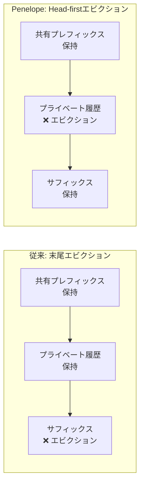
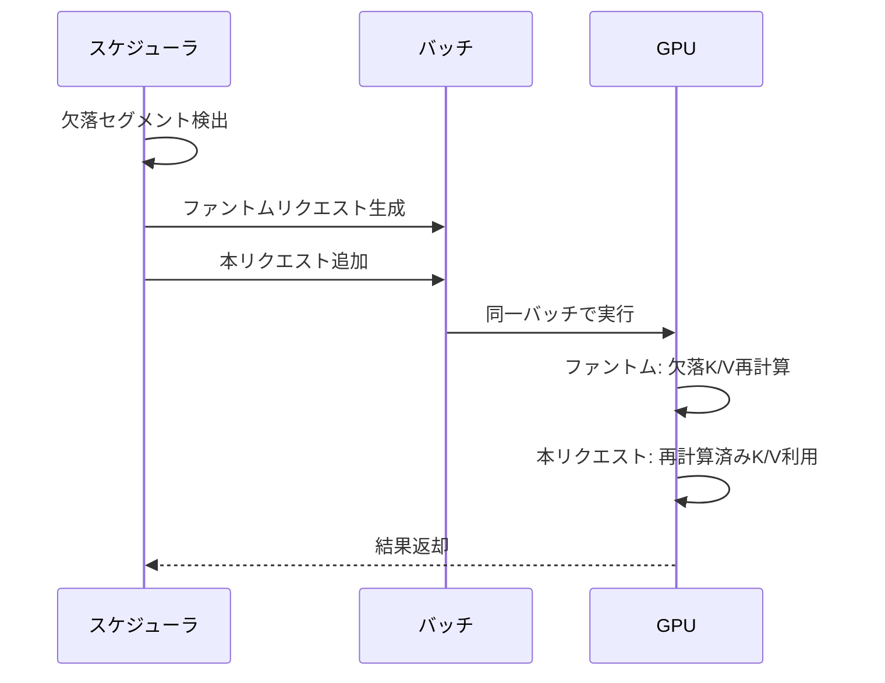

本記事は [Rethinking KV Cache Eviction for Agentic LLM Serving](https://arxiv.org/abs/2611.00391) の解説記事です。

## 論文概要（Abstract）

エージェントワークロード（Claude CodeやFreeInferenceなど）は、長い会話履歴をターンごとに再利用する特性を持つ。既存のLLMサービングエンジンはKVキャッシュ容量が不足した際にシーケンス末尾からエビクション（追い出し）を行うが、エージェント的な長い会話ではこの方針が非効率となる。著者らは共有プレフィックスとキャッシュ済みサフィックスを保持しつつ、プライベート履歴の先頭からエビクションする「head-first」方針を提案し、これをSGLang上にPenelopeとして実装している。GPU-onlyキャッシュ構成ではTime to First Token（TTFT）を最大60%、GPU-CPUの2ティア構成ではTTFTを最大76%、Job Completion Time（JCT）を最大60%削減したと報告されている。

この記事は [Zenn記事: プロンプトキャッシュのプレフィックス設計とマルチターン最適化で対話コストを最大90%削減する](https://zenn.dev/0h_n0/articles/a0eef8c309235f) の深掘りです。

## 情報源

- **arXiv ID**: 2611.00391
- **URL**: [https://arxiv.org/abs/2611.00391](https://arxiv.org/abs/2611.00391)
- **著者**: Jiakun Fan, Han Meng, Yuxuan Xia, Hao Mark Chen, Dong Li, Dimitrios S. Nikolopoulos（Virginia Tech, UC Merced, NYU, Imperial College London）
- **発表年**: 2026（プレプリント、2026年10月投稿）
- **分野**: cs.DC（分散コンピューティング）

## 背景と動機（Background & Motivation）

LLMサービングにおいてKVキャッシュはメモリの主要なボトルネックである。Zenn記事で解説したプロンプトキャッシュの仕組みは、リクエスト間で共通するプレフィックスのKVキャッシュを再利用することでコストを大幅に削減する。しかし、GPU HBMの容量には限りがあるため、キャッシュ容量が不足した場合にはエビクション（追い出し）が発生する。

vLLMやSGLangなどの既存サービングエンジンは、プレフィックス共有を維持するためにシーケンスの**末尾（tail）からエビクション**を行う。この方針は一般的なチャットワークロードでは合理的だが、エージェントワークロードでは問題が生じる。

著者らはエージェントワークロードに固有の2つの課題を指摘している：

1. **長い履歴の再利用**: Claude Codeのようなエージェントは、ツール呼び出しの結果を含む長い会話履歴を累積し、各ターンでその大部分を再利用する。末尾からエビクションすると、直近のターンで生成されたKVキャッシュが失われ、次のリクエストで再計算が必要になる

2. **再計算コストの位置非対称性**: Self-Attentionの計算量は、そのトークンの位置より前にある全トークンに対して計算されるため、シーケンス末尾に近いトークンほど再計算コストが高い。著者らの実験では、8Kトークンのシーケンスで先頭30%をエビクションした場合と末尾30%をエビクションした場合で、次のリクエストのスピードアップがそれぞれ1.14倍と1.0倍であったと報告されている。128Kトークンではこの差が2.93倍にまで拡大する



## 主要な貢献（Key Contributions）

- **Head-firstエビクション方針**: 共有プレフィックスとキャッシュ済みサフィックスを保持しつつ、プライベート履歴の先頭からブロック単位でエビクションする
- **ファントムリクエスト再計算**: エビクションされたセグメントを本リクエストと同一バッチ内で再計算する「ファントムリクエスト」メカニズム
- **統合GPU-CPUキャッシュ管理**: GPU HBMとCPU DRAMを排他的な2ティアとして統一的に管理し、1024トークンのスワップバッファで効率的にデータ交換
- **実トレースでの評価**: Claude Code（24セッション、4,688リクエスト）およびFreeInference（48セッション、4,089リクエスト）の実トレースでQwen3-8B/32B/235Bを評価

## 技術的詳細（Technical Details）

### エビクション方針: Head-first Eviction

Penelopeのエビクション方針の核心は、KVキャッシュのシーケンスを3つの領域に分割する点にある：

1. **共有プレフィックス**: 複数のリクエストで共有される部分（Radixツリー上の共有ノード）。エビクション対象外
2. **プライベート履歴**: 各セッション固有の会話履歴。エビクションの対象
3. **キャッシュ済みサフィックス**: 直近のターンで生成されたKVキャッシュ。保持を優先

エビクションが必要になると、PenelopeはLeast Recently Used（LRU）に基づいて対象セッションを選択し、そのセッションのプライベート履歴の**先頭から**必要なブロック数だけエビクションする。このとき、Radixツリーのノードをブロック境界で分割し、ブロック単位でのリリースを可能にする。

$$
C_{\text{recompute}}(i) = \sum_{j=0}^{i-1} O(d_k) = O(i \cdot d_k)
$$

ここで、
- $i$: トークンの位置（0始まり）
- $d_k$: Attentionヘッドの次元数
- $C_{\text{recompute}}(i)$: 位置$i$のトークンの再計算コスト

先頭のトークンほど$i$が小さいため再計算コストが低く、末尾のトークンは$i$が大きく再計算コストが高い。Head-firstエビクションはこの非対称性を活用している。

### ファントムリクエスト再計算

エビクションによって中間セグメントが欠落した場合、その部分のKVキャッシュを再計算する必要がある。Penelopeは「ファントムリクエスト」と呼ばれる仕組みでこれを実現する。



ファントムリクエストは以下の特性を持つ：

- **同一バッチ実行**: 本リクエストと同じイテレーションで実行され、ファントムが先にK/Vを書き込み、本リクエストのAttention計算で読み取る
- **トークンバジェット消費**: ファントムリクエストのトークン数はバッチのトークンバジェットにカウントされる
- **オーバーヘッド**: 著者らの実験では、ファントムリクエストのバッチングオーバーヘッドは実行時間の1%以内であったと報告されている

### 統合GPU-CPUキャッシュ管理

Penelopeは、GPU HBMとCPU DRAMを**排他的**（exclusive）な2ティアキャッシュとして管理する。各KVブロックはいずれか一方のティアにのみ存在する。

```python
from dataclasses import dataclass
from enum import Enum


class CacheTier(Enum):
    GPU = "gpu"
    CPU = "cpu"


@dataclass
class KVBlock:
    """KVキャッシュのブロック管理"""
    block_id: int
    tier: CacheTier
    token_count: int
    ref_count: int


class UnifiedCacheManager:
    """GPU-CPUの統合キャッシュ管理（論文の設計を模した簡易実装）"""

    SWAP_BUFFER_SIZE = 1024  # トークン数

    def __init__(self, gpu_capacity: int, cpu_capacity: int):
        self.gpu_capacity = gpu_capacity
        self.cpu_capacity = cpu_capacity - self.SWAP_BUFFER_SIZE
        self.gpu_used = 0
        self.cpu_used = 0

    def evict_head_first(
        self, session_blocks: list[KVBlock], num_blocks: int
    ) -> list[KVBlock]:
        """プライベート履歴の先頭からnum_blocks個をエビクション

        共有プレフィックスとサフィックスはスキップする
        """
        evicted = []
        for block in session_blocks:
            if len(evicted) >= num_blocks:
                break
            if block.ref_count <= 1:  # 共有されていないブロック
                evicted.append(block)
        return evicted

    def migrate_to_cpu(self, block: KVBlock) -> None:
        """GPUからCPUへのマイグレーション"""
        if self.cpu_used + block.token_count > self.cpu_capacity:
            raise MemoryError("CPU cache full")
        block.tier = CacheTier.CPU
        self.gpu_used -= block.token_count
        self.cpu_used += block.token_count
```

**設計上の重要なポイント**:

- **排他的管理**: 各ブロックはGPUまたはCPUのいずれかにのみ存在し、同一ブロックの重複を避ける
- **スワップバッファ**: 1,024トークン分のCPUメモリをスワップバッファとして予約。両ティアが満杯の場合、このバッファを経由してデータを交換する
- **CUDAストリーム分離**: GPU-CPU間の転送は専用CUDAストリームで行い、CUDA Eventで依存関係を管理する
- **単一エビクション順序**: 両ティアを横断して統一的なエビクション順序を維持し、マイグレーションが追加のエビクションを引き起こさない設計

### Longest-Prefix-Match（LPM）の拡張

既存のLPMスケジューリングでは、共有プレフィックスの一致長のみでリクエストのルーティングを決定する。Penelopeでは、head-firstエビクション後に保持されたサフィックスも「再利用可能」として扱う。

たとえば、あるセッションのKVキャッシュが以下の状態にあるとする：

```
[共有プレフィックス: 2000トークン] [欠落: 500トークン] [保持サフィックス: 3000トークン]
```

この場合、LPMは共有プレフィックス2,000トークン＋保持サフィックス3,000トークン＝計5,000トークンの再利用が可能と判断し、欠落した500トークンのみファントムリクエストで再計算する。

## 実装のポイント（Implementation）

Penelopeは既存のSGLangエンジン上に約2,500行のPythonコードで実装されている。新規のGPUカーネルは追加されていない。

**実装上の注意点**:

1. **Radixツリーの分割**: ブロック境界でのノード分割はO(1)で行えるが、分割後のメタデータ更新が必要
2. **キャッシュ管理のCPUオーバーヘッド**: 著者らの実験では、キャッシュ管理のCPU時間は全実行時間の1.6%（SGLangの0.54%と比較）と報告されている
3. **ファントムリクエストのスケジューリング**: トークンバジェットの管理が重要。ファントムトークンが多すぎると本リクエストのスループットが低下する
4. **ブロックサイズの選択**: SGLangのデフォルトブロックサイズ（16トークン）に合わせてエビクション粒度が決まる

## Production Deployment Guide

### AWS実装パターン（コスト最適化重視）

Penelopeのhead-firstエビクション方針をエージェントLLMサービングに適用するAWS構成を示す。

| 規模 | 月間リクエスト | 推奨構成 | 月額コスト | 主要サービス |
|------|--------------|---------|-----------|------------|
| **Small** | ~3,000 (100/日) | Serverless | $50-150 | Lambda + Bedrock + DynamoDB |
| **Medium** | ~30,000 (1,000/日) | Hybrid | $500-1,500 | ECS Fargate + ElastiCache + Bedrock |
| **Large** | 300,000+ (10,000/日) | Container | $3,000-8,000 | EKS + GPU Instances + S3 Cache |

**Small構成（月額$50-150）**: エージェントの利用頻度が低い場合、LambdaとBedrockの組み合わせで十分である。Bedrockのプロンプトキャッシュ機能が自動的にプレフィックスキャッシュを管理するため、Penelope的な制御は不要。

**Medium構成（月額$500-1,500）**: ECS Fargate上でSGLang/vLLMを実行し、ElastiCacheでセッション状態を管理する。

**Large構成（月額$3,000-8,000）**: EKS上にGPUノード（g5.xlarge以上）をデプロイし、SGLangをPenelopeパッチ適用で運用する。

**コスト試算の注意事項**: 上記は2026年11月時点のAWS ap-northeast-1（東京）リージョン料金に基づく概算値です。GPUインスタンスの料金はSpot利用で大幅に変動します。最新料金は [AWS料金計算ツール](https://calculator.aws/) で確認してください。

### Terraformインフラコード

**Large構成: EKS + GPU Instances + SGLang**

```hcl
module "vpc" {
  source  = "terraform-aws-modules/vpc/aws"
  version = "~> 5.0"

  name = "agentic-llm-vpc"
  cidr = "10.0.0.0/16"
  azs  = ["ap-northeast-1a", "ap-northeast-1c"]

  private_subnets = ["10.0.1.0/24", "10.0.2.0/24"]
  enable_nat_gateway   = true
  single_nat_gateway   = true
  enable_dns_hostnames = true
}

module "eks" {
  source  = "terraform-aws-modules/eks/aws"
  version = "~> 20.0"

  cluster_name    = "agentic-llm-cluster"
  cluster_version = "1.31"

  vpc_id     = module.vpc.vpc_id
  subnet_ids = module.vpc.private_subnets

  cluster_endpoint_public_access = false

  enable_cluster_creator_admin_permissions = true
}

resource "kubectl_manifest" "karpenter_gpu_provisioner" {
  yaml_body = <<-YAML
    apiVersion: karpenter.sh/v1
    kind: NodePool
    metadata:
      name: gpu-spot-pool
    spec:
      template:
        spec:
          requirements:
            - key: karpenter.sh/capacity-type
              operator: In
              values: ["spot"]
            - key: node.kubernetes.io/instance-type
              operator: In
              values: ["g5.xlarge", "g5.2xlarge"]
          nodeClassRef:
            group: karpenter.k8s.aws
            kind: EC2NodeClass
            name: default
      limits:
        cpu: "64"
        memory: "256Gi"
        nvidia.com/gpu: "8"
      disruption:
        consolidationPolicy: WhenEmptyOrUnderutilized
        consolidateAfter: 60s
  YAML
}

resource "aws_budgets_budget" "llm_monthly" {
  name         = "agentic-llm-monthly"
  budget_type  = "COST"
  limit_amount = "8000"
  limit_unit   = "USD"
  time_unit    = "MONTHLY"

  notification {
    comparison_operator       = "GREATER_THAN"
    threshold                 = 80
    threshold_type            = "PERCENTAGE"
    notification_type         = "ACTUAL"
    subscriber_email_addresses = ["ops@example.com"]
  }
}
```

### セキュリティベストプラクティス

- **ネットワーク**: EKSクラスタはプライベートサブネットに配置。`cluster_endpoint_public_access = false`
- **IAM**: 最小権限原則。SGLangコンテナにはGPUとS3キャッシュアクセスのみを許可
- **シークレット管理**: AWS Secrets Managerでモデル設定を管理
- **暗号化**: S3/EBS全てKMS暗号化。転送中はTLS 1.2以上

### 運用・監視設定

```python
import boto3

cloudwatch = boto3.client("cloudwatch")

cloudwatch.put_metric_alarm(
    AlarmName="sglang-ttft-p99-spike",
    ComparisonOperator="GreaterThanThreshold",
    EvaluationPeriods=2,
    MetricName="TTFT_P99",
    Namespace="AgenticLLM/SGLang",
    Period=300,
    Statistic="Maximum",
    Threshold=30000,  # 30秒超過でアラート
    AlarmDescription="SGLang TTFT P99異常（KVキャッシュエビクション頻発の可能性）",
    AlarmActions=["arn:aws:sns:ap-northeast-1:123456789:ops-alerts"],
)

cloudwatch.put_metric_alarm(
    AlarmName="kv-cache-hit-rate-low",
    ComparisonOperator="LessThanThreshold",
    EvaluationPeriods=3,
    MetricName="CacheHitRate",
    Namespace="AgenticLLM/SGLang",
    Period=300,
    Statistic="Average",
    Threshold=50.0,  # 50%未満でアラート
    AlarmDescription="KVキャッシュヒット率低下",
)
```

### コスト最適化チェックリスト

**アーキテクチャ選択**:
- [ ] ~100 req/日 → Lambda + Bedrock (Serverless) - $50-150/月
- [ ] ~1,000 req/日 → ECS Fargate + Bedrock (Hybrid) - $500-1,500/月
- [ ] 10,000+ req/日 → EKS + GPU (Container) - $3,000-8,000/月

**リソース最適化**:
- [ ] GPU: Spot Instances優先（g5.xlargeで最大90%削減）
- [ ] Karpenter: アイドル60秒後にスケールダウン
- [ ] CPU DRAM: KVキャッシュオフロード用に十分なホストメモリ確保
- [ ] EBS: gp3ボリュームでIOPS/スループットをカスタマイズ
- [ ] S3: 長期キャッシュストレージとして活用

**KVキャッシュ最適化（Penelope方針）**:
- [ ] Head-firstエビクション: サフィックス保持でTTFT削減
- [ ] GPU-CPUティアリング: NVLinkがない場合はPCIe帯域を考慮
- [ ] ブロックサイズ: モデルと平均ターン長に合わせて調整
- [ ] ファントムリクエスト: バッチトークンバジェットの10-20%を確保

**監視・アラート**:
- [ ] TTFT P99: 30秒超過でアラート
- [ ] KVキャッシュヒット率: 50%未満でアラート
- [ ] GPU メモリ使用率: 90%超過でスケールアウト
- [ ] AWS Budgets: 月額予算の80%で警告

**リソース管理**:
- [ ] 未使用GPUノード: Karpenterで自動回収
- [ ] タグ戦略: 環境別（dev/staging/prod）でコスト可視化
- [ ] キャッシュTTL: セッション終了後の保持期間を設定

## 実験結果（Results）

著者らはClaude Code（CC）とFreeInference（FI）の実トレースを用いて評価を行っている。ベースラインはSGLang（commit c36a10aa）である。

### GPU-onlyキャッシュ構成（H100 80GB）

論文Table 1より、Claude Codeトレース（4セッション同時実行）での結果：

| モデル | SGLang TTFT | Penelope TTFT | TTFT削減率 | ヒット率向上 |
|--------|------------|--------------|-----------|------------|
| Qwen3-8B | 19.1s | 9.1s | 52% | 66.5% → 83.6% |
| Qwen3-32B | — | — | 45% | 52.8% → 73.2% |
| Qwen3-235B-A22B | — | — | 43% | 61.9% → 80.7% |

8セッション同時実行（Qwen3-8B）では、TTFTが58.1sから34.1sに削減（41%改善）、JCTが361分から234分に削減（35%改善）されたと報告されている。

### GPU-CPU 2ティアキャッシュ構成

論文Table 2より、GPU-CPU統合キャッシュでの結果：

| モデル | セッション数 | SGLang TTFT | Penelope TTFT | TTFT削減率 |
|--------|-----------|------------|--------------|-----------|
| Qwen3-8B | 4 | 10.4s | 4.5s | 57% |
| Qwen3-8B | 8 | 23.5s | 12.8s | 46% |
| Qwen3-32B | 4 | 11.0s | 3.9s | 65% |
| Qwen3-235B-A22B | 4 | 24.2s | 5.8s | 76% |

特にQwen3-235B-A22B（MoEモデル）でのTTFT 76%削減が注目される。

### アブレーション分析

論文のアブレーション実験（Qwen3-8B、4セッション）では以下が報告されている：

- エビクション開始位置をhead-firstに変更するだけ（ノードレベルリリース）: TTFT最大12%削減
- ブロックレベルリリース + head-firstエビクション: TTFT 63%削減、JCT 39%削減

ブロックレベルの粒度制御がhead-firstエビクションの効果を引き出す上で不可欠であることが示されている。

### 位置非対称性の検証

著者らのモチベーション実験（Qwen3-8B、1×H100）では、シーケンスの30%をエビクションした場合の次リクエストのスピードアップが以下のように報告されている：

| シーケンス長 | 先頭30%エビクション | 末尾30%エビクション |
|------------|-------------------|-------------------|
| 8K tokens | 1.14× | 1.00× |
| 128K tokens | 2.93× | 1.00× |

シーケンスが長くなるほど先頭エビクションの優位性が拡大する。これはAttentionの計算量が位置に対して線形に増加するためである。

## 実運用への応用（Practical Applications）

Zenn記事で解説したプロンプトキャッシュのプレフィックス設計と本論文の知見は以下のように関連する：

1. **エージェントアプリケーション**: Claude CodeやGitHub Copilot Agentのようなツール呼び出しを伴う長時間セッションでは、Penelopeのhead-firstエビクションが有効である。APIレベルのプロンプトキャッシュ（Zenn記事のBreakpoint戦略）とサーバー側のKVキャッシュ管理は相補的な関係にある

2. **マルチテナント環境**: 複数ユーザーのセッションが同一GPUを共有する場合、ユーザーごとのキャッシュ優先度をhead-first方針で管理することで、アクティブなセッションのTTFTを維持できる

3. **コスト最適化**: GPU-CPUティアリングにより、高価なGPU HBMの使用量を削減しつつキャッシュヒット率を維持できる。Zenn記事のTTL設計（安定部分に長いTTL、変動部分に短いTTL）とサーバー側のティアリングを組み合わせることで、エンドツーエンドのコスト削減が実現する

4. **セルフホスティングのLLM**: SGLang/vLLMでセルフホストする場合、Penelopeの方針を直接適用してTTFTを改善できる

## 関連研究（Related Work）

- **SGLang / RadixAttention**: Zheng et al. (2024) が提案したRadixツリーベースのKVキャッシュ管理。プレフィックス共有の基盤技術であり、Penelopeはこの上に構築されている
- **vLLM / PagedAttention**: Kwon et al. (SOSP 2023) によるページ化KVキャッシュ管理。仮想メモリのページングをKVキャッシュに適用し、メモリ断片化を解消した。Penelopeのブロック単位管理はPagedAttentionの延長上にある
- **LMCache**: KVキャッシュの永続化とオフロードを提供するライブラリ。Penelopeの実験ではvLLM+LMCacheがベースライン比較に使用されている
- **CacheBlend / Epic**: プレフィックスに限定されないKVキャッシュ再利用手法

## まとめと今後の展望

Penelopeは、エージェントワークロードにおけるKVキャッシュエビクションの方向を「末尾から」「先頭から」に反転させるという単純だが効果的な設計変更を提案している。著者らの実験では、SGLangと比較してGPU-onlyでTTFT最大60%、GPU-CPU 2ティアでTTFT最大76%の改善が報告されている。

**実務への示唆**: Zenn記事で解説したAPIレベルのプロンプトキャッシュ最適化（Breakpoint配置、TTL設計）は、サーバー内部のKVキャッシュ管理と相補的な関係にある。APIユーザーとしてはプレフィックスの安定性とBreakpoint配置を最適化し、インフラ運用者としてはPenelopeのようなhead-firstエビクション方針の導入を検討することで、エンドツーエンドのコスト削減を実現できる。

**今後の方向**: 著者らはvLLMとの比較実験を行っていない点を制約として認めている。プレフィックスキャッシュのセキュリティやリニアAttentionモデルへの対応など、関連する研究課題が活発に進行している。

## 参考文献

- **arXiv**: [https://arxiv.org/abs/2611.00391](https://arxiv.org/abs/2611.00391)
- **関連データセット**: [Harvard MaDSys FreeInference Trace](https://huggingface.co/datasets/harvardMadsys/freeinference_agentic_trace)
- **Related Zenn article**: [プロンプトキャッシュのプレフィックス設計とマルチターン最適化で対話コストを最大90%削減する](https://zenn.dev/0h_n0/articles/a0eef8c309235f)

:::message
この記事はAI（Claude Code）により自動生成されました。内容の正確性については原論文もご確認ください。
:::
