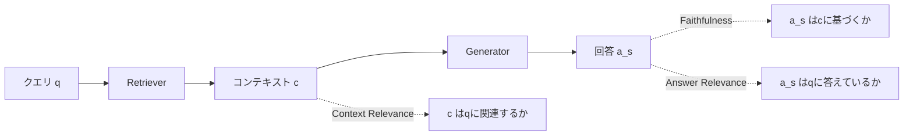
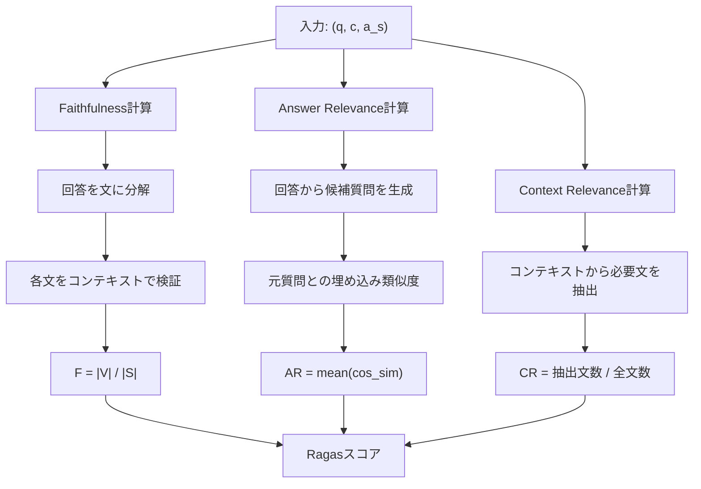

## 論文概要（Abstract）

本記事は [Ragas: Automated Evaluation of Retrieval Augmented Generation (arXiv:2309.15217)](https://arxiv.org/abs/2309.15217) の解説記事です。

RAG（Retrieval-Augmented Generation）パイプラインの性能を評価するには、従来、人手によるアノテーションや参照回答（ground truth）の準備が不可欠とされてきました。Ragasは、このボトルネックを解消するために設計された**参照不要（reference-free）の自動評価フレームワーク**です。著者らは、Faithfulness（忠実性）、Answer Relevance（回答関連性）、Context Relevance（コンテキスト関連性）の3つのメトリクスを提案し、LLMを評価器として用いることで、ground truthなしにRAGパイプラインの品質を定量化する手法を示しています。

この記事は [Zenn記事: LangGraph Agentic RAGの反復深度適応制御と精度-レイテンシ定量評価](https://zenn.dev/0h_n0/articles/349ab03c096ce0) の深掘りです。

## 情報源

- **arXiv ID**: 2309.15217
- **URL**: [https://arxiv.org/abs/2309.15217](https://arxiv.org/abs/2309.15217)
- **著者**: Shahul Es, Jithin James, Luis Espinosa-Anke, Steven Schockaert（CardiffNLP / Cardiff University, Exploding Gradients, AMPLYFI）
- **発表年**: 2023（v1: 2023年9月、v2: 2025年4月改訂）
- **分野**: cs.CL
- **コード**: [https://github.com/explodinggradients/ragas](https://github.com/explodinggradients/ragas)

## 背景と動機（Background & Motivation）

RAGパイプラインは、検索モジュール（Retriever）と生成モジュール（Generator）という2つの主要コンポーネントで構成されます。これらを個別に評価する指標は多数存在する一方、パイプライン全体としての品質を体系的に評価するフレームワークは発展途上でした。

著者らが指摘する従来手法の課題は以下の通りです。

1. **参照回答への依存**: BLEU・ROUGE・BERTScore等はground truthとの比較を前提とし、RAG応用ドメインでは準備コストが高い
2. **単一観点での評価**: 回答品質のみ、または検索精度のみの指標が多く、検索と生成の相互作用を捉えきれない
3. **スケーラビリティ**: 大規模RAGの継続的改善には自動かつ高頻度の評価が不可欠

Ragasは「LLM自体を評価器として活用し参照不要の評価を実現する」アプローチを採用しています。

## 主要な貢献（Key Contributions）

著者らは以下の3つの貢献を主張しています。

- **貢献1**: Faithfulness、Answer Relevance、Context Relevanceの3メトリクスを統合した、参照不要のRAG評価フレームワークの提案。LangChainおよびllama-indexとの統合が可能
- **貢献2**: 各メトリクスの計算手法の設計。Faithfulnessでは文レベル分解と検証、Answer Relevanceでは逆質問生成と埋め込み類似度、Context Relevanceでは必要文抽出を採用
- **貢献3**: WikiEvalデータセットの構築。2022年以降のWikipediaページ50件から構成され、人手アノテーション付きの評価ベンチマークとして公開

## 技術的詳細（Technical Details）

### 3つのメトリクスの設計思想

Ragasの設計は、RAGパイプラインの品質を3つの独立した軸で捉えるという思想に基づいています。



この3軸の関係を整理すると、以下のようになります。

| メトリクス | 入力 | 測定対象 | 参照の要否 |
|:--|:--|:--|:--|
| Faithfulness | 回答 $a_s$, コンテキスト $c$ | 回答がコンテキストに忠実か | 不要 |
| Answer Relevance | 回答 $a_s$, クエリ $q$ | 回答がクエリに関連するか | 不要 |
| Context Relevance | コンテキスト $c$, クエリ $q$ | 検索結果がクエリに関連するか | 不要 |

### Faithfulness（忠実性）の計算手法

Faithfulnessメトリクスは、生成された回答がどの程度検索されたコンテキストに裏付けられているかを測定します。計算は2段階で行われます。

**ステップ1: 回答の文レベル分解**

LLMを用いて回答 $a_s(q)$ を個別の文（statement）の集合 $S(a_s(q))$ に分解します。

**ステップ2: 各文のコンテキストによる検証**

分解された各文について、コンテキスト $c(q)$ から推論可能かどうかをLLMが判定します。判定結果は簡潔な説明とYes/Noの二値で返されます。

**スコア計算**:

$$
F = \frac{|V|}{|S|}
$$

ここで、
- $S$ : 回答から分解された文の総数
- $V$ : コンテキストから推論可能と判定された文の集合（$V \subseteq S$）
- $F \in [0, 1]$ : 1に近いほどハルシネーションが少ない

著者らの実装では、ステップ1とステップ2の両方でgpt-3.5-turbo-16kを使用しています。

**実装例（Pythonによる概念実装）**:

```python
from dataclasses import dataclass


@dataclass
class FaithfulnessResult:
    """Faithfulness評価結果"""
    score: float
    total_statements: int
    supported_statements: int
    details: list[dict[str, str]]


async def compute_faithfulness(
    answer: str,
    context: str,
    llm_client: object,
) -> FaithfulnessResult:
    """Faithfulnessスコアを計算する

    Args:
        answer: RAGパイプラインの生成回答
        context: 検索されたコンテキスト
        llm_client: LLM APIクライアント

    Returns:
        FaithfulnessResult: スコアと詳細情報
    """
    # Step 1: 回答を文レベルに分解
    statements = await decompose_to_statements(answer, llm_client)

    # Step 2: 各文をコンテキストで検証
    verified = []
    for stmt in statements:
        is_supported = await verify_statement(stmt, context, llm_client)
        verified.append({
            "statement": stmt,
            "supported": is_supported,
        })

    supported_count = sum(1 for v in verified if v["supported"])
    total = len(statements)

    return FaithfulnessResult(
        score=supported_count / total if total > 0 else 0.0,
        total_statements=total,
        supported_statements=supported_count,
        details=verified,
    )
```

### Answer Relevance（回答関連性）の計算手法

Answer Relevanceは、生成された回答がクエリに対してどの程度関連しているかを測定します。このメトリクスの特徴は、**事実の正確性を測定しない**点にあります。

**ステップ1: 逆質問生成**

LLMを用いて、回答 $a_s(q)$ のみから $n$ 個の候補質問 $q_1, q_2, \ldots, q_n$ を生成します。回答が元の質問に十分関連していれば、生成される候補質問は元の質問と類似するはずです。

**ステップ2: 埋め込み類似度の計算**

元の質問 $q$ と各候補質問 $q_i$ をtext-embedding-ada-002で埋め込みベクトルに変換し、コサイン類似度を計算します。

**スコア計算**:

$$
AR = \frac{1}{n} \sum_{i=1}^{n} \cos(\mathbf{e}_q, \mathbf{e}_{q_i})
$$

ここで、
- $\mathbf{e}_q$ : 元のクエリの埋め込みベクトル
- $\mathbf{e}_{q_i}$ : $i$ 番目の候補質問の埋め込みベクトル
- $n$ : 生成する候補質問の数
- $\cos(\cdot, \cdot)$ : コサイン類似度

著者らは、このメトリクスが不完全な回答や冗長な回答にペナルティを与える性質を持つと説明しています。回答が不完全であれば、生成される候補質問は元のクエリの一部しかカバーしないため類似度が低下します。

### Context Relevance（コンテキスト関連性）の計算手法

Context Relevanceは、検索されたコンテキストがクエリに対してどの程度関連しているかを測定します。理想的なコンテキストは、質問に回答するために必要な情報のみを含み、冗長な情報を含まないとされています。

**ステップ1: 必要文の抽出**

LLMを用いて、コンテキスト $c(q)$ の中からクエリ $q$ に回答するために必要な文を抽出します。プロンプトでは、文を編集せずそのまま抽出することが指定されています。どの文も関連しない場合は「Insufficient Information」を返します。

**スコア計算**:

$$
CR = \frac{|\text{extracted sentences}|}{|\text{total sentences in } c(q)|}
$$

スコアが高いほど検索結果にノイズが少なく、効率的な検索が行われていることを意味します。

### アルゴリズム全体の処理フロー



3つのメトリクスは独立に計算可能であり、並列実行によってレイテンシを抑えることができます。

## 実装のポイント（Implementation）

Ragasの実装にあたり、以下の点に注意が必要です。

**LLM呼び出し回数の見積もり**: Faithfulnessでは回答の文数に比例するLLM呼び出しが発生します。文数が多い長文回答では評価コスト自体が問題になりえます。バッチ処理による呼び出し回数の削減が有効です。

**埋め込みモデルの一貫性**: Answer Relevance計算では候補質問と元質問を同一モデルでベクトル化する必要があります。論文ではtext-embedding-ada-002が使用されていますが、ドメイン固有のパイプラインでは最適化モデルの使用も検討すべきです。

**Context Relevanceの粒度**: 文レベル抽出はチャンク境界やHTMLテーブル等の非自然文には適用が難しく、前処理での正規化が推奨されます。

**プロンプト設計の安定性**: 著者らの実験はgpt-3.5-turbo-16kで行われており、異なるLLMを評価器として使用する場合は小規模なパイロット評価で一貫性を確認することが重要です。

## Production Deployment Guide

### AWS実装パターン（コスト最適化重視）

RAGASによるRAG評価パイプラインをAWS上に構築する場合のトラフィック量別推奨構成を示します。

**トラフィック量別の推奨構成**:

| 規模 | 月間評価リクエスト | 推奨構成 | 月額コスト | 主要サービス |
|------|------------------|---------|-----------|------------|
| **Small** | ~3,000 (100/日) | Serverless | $80-200 | Lambda + Bedrock + DynamoDB |
| **Medium** | ~30,000 (1,000/日) | Hybrid | $400-1,000 | Lambda + ECS Fargate + ElastiCache |
| **Large** | 300,000+ (10,000/日) | Container | $2,500-6,000 | EKS + Karpenter + EC2 Spot |

**コスト削減テクニック**:
- Spot Instances使用で最大90%削減（EKS + Karpenter）
- Bedrock Batch API使用で50%削減（非リアルタイム評価に最適）
- Prompt Caching有効化で30-90%削減（Faithfulnessの検証プロンプトは共通部分が多い）
- 埋め込みベクトルのキャッシュによりAnswer Relevance計算コスト削減

**コスト試算の注意事項**: 上記は2026年11月時点のAWS ap-northeast-1リージョン料金に基づく概算値です。評価コストはLLM呼び出し回数（回答の文数・コンテキスト長）で大きく変動します。最新料金は[AWS料金計算ツール](https://calculator.aws/)で確認してください。

### Terraformインフラコード

**Small構成（Serverless）: Lambda + Bedrock + DynamoDB**

```hcl
module "vpc" {
  source  = "terraform-aws-modules/vpc/aws"
  version = "~> 5.0"
  name    = "ragas-eval-vpc"
  cidr    = "10.0.0.0/16"
  azs     = ["ap-northeast-1a", "ap-northeast-1c"]
  private_subnets    = ["10.0.1.0/24", "10.0.2.0/24"]
  enable_nat_gateway = false
}

resource "aws_iam_role" "ragas_lambda" {
  name = "ragas-eval-lambda-role"
  assume_role_policy = jsonencode({
    Version = "2012-10-17"
    Statement = [{
      Action    = "sts:AssumeRole"
      Effect    = "Allow"
      Principal = { Service = "lambda.amazonaws.com" }
    }]
  })
}

resource "aws_iam_role_policy" "bedrock_invoke" {
  role = aws_iam_role.ragas_lambda.id
  policy = jsonencode({
    Version = "2012-10-17"
    Statement = [{
      Effect   = "Allow"
      Action   = ["bedrock:InvokeModel"]
      Resource = "arn:aws:bedrock:ap-northeast-1::foundation-model/anthropic.claude-3-5-haiku*"
    }]
  })
}

resource "aws_lambda_function" "ragas_evaluator" {
  filename      = "ragas_eval.zip"
  function_name = "ragas-evaluation-handler"
  role          = aws_iam_role.ragas_lambda.arn
  handler       = "index.handler"
  runtime       = "python3.12"
  timeout       = 120
  memory_size   = 1024
  environment {
    variables = {
      BEDROCK_MODEL_ID = "anthropic.claude-3-5-haiku-20241022-v1:0"
      DYNAMODB_TABLE   = aws_dynamodb_table.eval_cache.name
    }
  }
}

resource "aws_dynamodb_table" "eval_cache" {
  name         = "ragas-eval-cache"
  billing_mode = "PAY_PER_REQUEST"
  hash_key     = "eval_hash"
  attribute { name = "eval_hash"; type = "S" }
  ttl { attribute_name = "expire_at"; enabled = true }
}
```

**Large構成（Container）: EKS + Karpenter + Spot**

```hcl
module "eks" {
  source          = "terraform-aws-modules/eks/aws"
  version         = "~> 20.0"
  cluster_name    = "ragas-eval-cluster"
  cluster_version = "1.31"
  vpc_id          = module.vpc.vpc_id
  subnet_ids      = module.vpc.private_subnets
  cluster_endpoint_public_access             = true
  enable_cluster_creator_admin_permissions   = true
}

resource "kubectl_manifest" "karpenter_provisioner" {
  yaml_body = <<-YAML
    apiVersion: karpenter.sh/v1alpha5
    kind: Provisioner
    metadata:
      name: ragas-spot-provisioner
    spec:
      requirements:
        - key: karpenter.sh/capacity-type
          operator: In
          values: ["spot"]
        - key: node.kubernetes.io/instance-type
          operator: In
          values: ["c6i.xlarge", "c6i.2xlarge"]
      limits:
        resources: { cpu: "16", memory: "64Gi" }
      ttlSecondsAfterEmpty: 30
  YAML
}
```

### 運用・監視設定

**CloudWatch Logs Insights クエリ**:

```sql
-- Faithfulness評価のLLM呼び出し回数を監視
fields @timestamp, metric_name, llm_calls, total_statements
| filter metric_name = "faithfulness"
| stats sum(llm_calls) as total_llm_calls by bin(1h)
| filter total_llm_calls > 500

-- メトリクス別のレイテンシ分析（P95）
fields @timestamp, metric_name, duration_ms
| stats avg(duration_ms) as avg_ms, pct(duration_ms, 95) as p95_ms by metric_name
```

**X-Ray トレーシング設定**:

```python
from aws_xray_sdk.core import xray_recorder, patch_all

patch_all()

@xray_recorder.capture('ragas_faithfulness')
def evaluate_faithfulness(answer: str, context: str) -> float:
    """Faithfulness評価をX-Rayトレースに記録"""
    xray_recorder.put_annotation('metric', 'faithfulness')
    xray_recorder.put_metadata('answer_length', len(answer))
    score = compute_faithfulness_score(answer, context)
    xray_recorder.put_metadata('score', score)
    return score
```

**セキュリティ要件**: IAMロール最小権限、Bedrock呼び出しは特定モデルARNのみ許可、Secrets Manager使用、S3/DynamoDB全てKMS暗号化、CloudTrail有効化。

### コスト最適化チェックリスト

**アーキテクチャ選択**: ~100 eval/日→Serverless($80-200/月)、~1,000 eval/日→Hybrid($400-1,000/月)、10,000+ eval/日→Container($2,500-6,000/月)

**リソース最適化**: Spot Instances優先（最大90%削減）、Reserved Instances 1年コミット（72%削減）、Lambda メモリ最適化、夜間スケールダウン、埋め込みベクトルキャッシュ

**LLMコスト削減**: Bedrock Batch API（50%割引）、Prompt Caching（30-90%削減）、評価器にはHaiku($0.25/MTok)選択、max_tokens制限

**監視**: AWS Budgets月額予算（80%警告）、CloudWatch LLM呼び出しスパイク検知、Cost Anomaly Detection、日次コストレポート

**リソース管理**: 未使用Lambda削除、環境別タグ戦略、DynamoDB TTL（30日）、S3ライフサイクルポリシー

## 実験結果（Results）

### WikiEvalデータセットの構成

著者らは、評価用のベンチマークとしてWikiEvalデータセットを構築しています。2022年以降のWikipediaページ50件から、ChatGPTを用いて質問と回答を生成し、2名のアノテーターがラベル付けを行っています。アノテーター間の一致率は、Faithfulnessおよび Context Relevanceで約95%、Answer Relevanceで約90%と報告されています。

### Pairwise Accuracy評価

評価プロトコルはpairwise accuracy（2つの回答またはコンテキストのうち、どちらが優れているかを判定し、人手評価との一致率を測定）です。

**Table 1の結果（論文Table 1より）**:

| メトリクス | Ragas | GPT Score | GPT Ranking |
|:--|:--|:--|:--|
| **Faithfulness** | **0.95** | 0.72 | 0.54 |
| **Answer Relevance** | **0.78** | 0.52 | 0.40 |
| **Context Relevance** | **0.70** | 0.63 | 0.52 |

ここで、GPT ScoreはChatGPTが0〜10のスコアで各次元を評価する方式、GPT RankingはChatGPTが2つの候補から優れた方を選択する方式です。

著者らは、Ragasが全3メトリクスでGPTベースラインを上回ると報告しています。特にFaithfulnessでの0.95という高い一致率は、文レベルの分解と個別検証というアプローチの有効性を示唆しています。

### 結果の分析

著者らは以下の分析を行っています。

- **Answer Relevanceが相対的に低い（0.78）理由**: 比較対象の2つの回答が微妙にしか異ならないケースが多く、候補質問の生成で差異が十分に反映されないことがある
- **Context Relevanceの課題（0.70）**: 長いコンテキストにおいて、ChatGPTが必要文の抽出を正確に行えないケースが観察された
- **GPT Score/GPT Rankingの低さ**: 単純なスコアリングや直接比較では、RAGの品質次元ごとの微細な差異を捉えきれない

### 制約と限界

この評価手法にはいくつかの制約が存在します。

1. **評価規模**: WikiEvalは50ページと小規模であり、ペアワイズ比較のみを行っている。絶対的なスコアの信頼性は別途検証が必要
2. **LLM依存性**: 全ての判定がgpt-3.5-turbo-16kに依存しており、他のLLMでの再現性は保証されていない
3. **埋め込みモデル依存性**: Answer Relevanceはtext-embedding-ada-002の品質に依存する
4. **Context PrecisionとContext Recall**: 本論文では定義されていない。これらは後のRagasライブラリのバージョンで追加されたメトリクスであり、原論文のスコープ外である

## 実運用への応用（Practical Applications）

Ragasの実運用への応用は主に以下の場面で考えられます。

**CI/CDパイプライン**: RAGパイプラインの変更（Retriever差し替え、プロンプト修正等）のたびにRagasメトリクスを自動計算し回帰を検知する。ground truth不要でテストデータ維持コストが低い。

**A/Bテスト**: 2つのRAG構成をFaithfulness・AR・CRの3軸でPareto分析し多面的に比較する。Zenn記事の反復回数別Pareto分析と組み合わせると、精度-レイテンシ-評価コストの3次元最適化が可能。

**本番監視**: サンプリングした本番クエリにRagasを定期実行し、Faithfulness低下をハルシネーション増加アラートとして活用する。

**スケーリング上の注意**: Faithfulness計算はLLM呼び出しが回答文数に比例し、長文回答環境ではコスト急増する。バッチ処理やサンプリングの導入を推奨。

## 関連研究（Related Work）

- **ARES (arXiv:2311.09476)**: 少量の人手ラベルとPPIを組み合わせた信頼区間付きRAG評価。Ragasが完全に参照不要であるのに対し、少量の参照データを活用する点で異なる
- **TruLens**: Groundedness・Answer Relevance・Context Relevanceの3軸評価を提供するOSSフレームワーク。設計思想はRagasと共通
- **FaithEval / FaithBench**: Faithfulness特化の評価ベンチマーク。ハルシネーション検出に焦点を当てた研究群

## まとめと今後の展望

Ragasは、参照不要のRAG評価という実用上の重要な課題に対し、Faithfulness・Answer Relevance・Context Relevanceの3メトリクスによる体系的な解決策を提示した論文です。

**主要な成果**: LLMを評価器として活用しground truthなしの自動評価を実現。WikiEvalでのFaithfulness pairwise accuracy 0.95は文レベル検証の有効性を示す。LangChain・llama-indexとの統合が容易。

**実務への示唆**: CI/CDへの組み込みで品質回帰を自動検知でき、Faithfulnessはハルシネーション監視の有力指標となる。ただし評価器LLMの信頼性とドメイン固有コンテキストでの安定性には継続検証が必要。

**今後の研究方向**: Context Precision/Recallの標準化（Ragasライブラリv0.4で追加済み）、評価器LLM選択のメトリクスへの影響分析、大規模ベンチマークでの信頼性検証。

## 参考文献

- **arXiv**: [https://arxiv.org/abs/2309.15217](https://arxiv.org/abs/2309.15217)
- **Code**: [https://github.com/explodinggradients/ragas](https://github.com/explodinggradients/ragas)
- **WikiEval Dataset**: [https://huggingface.co/datasets/explodinggradients/WikiEval](https://huggingface.co/datasets/explodinggradients/WikiEval)
- **Related Zenn article**: [https://zenn.dev/0h_n0/articles/349ab03c096ce0](https://zenn.dev/0h_n0/articles/349ab03c096ce0)
