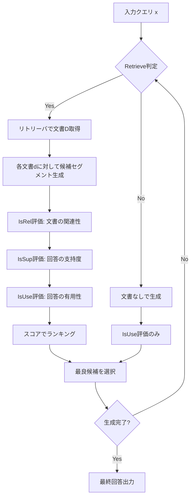

## 論文概要（Abstract）

本記事は [Self-RAG (arXiv:2310.11511)](https://arxiv.org/abs/2310.11511) の解説記事です。

Self-RAGは、単一の言語モデル（LM）に「いつ検索すべきか」「検索結果は関連しているか」「生成した回答は検索結果に基づいているか」を自己判断させるフレームワークである。著者らは、特殊なリフレクショントークンを語彙に追加し、生成プロセスの中で検索の要否判断・関連性評価・回答の支持度評価を一貫して行う手法を提案している。従来のRAG（Retrieval-Augmented Generation）が固定的にすべてのクエリで検索を実行するのに対し、Self-RAGは検索が不要な場合はスキップし、必要な場合のみリトリーバを呼び出すオンデマンド方式を実現する。

この記事は [Zenn記事: LangGraph Agentic RAGの反復深度適応制御と精度-レイテンシ定量評価](https://zenn.dev/0h_n0/articles/349ab03c096ce0) の深掘りです。

## 情報源

- **arXiv ID**: 2310.11511
- **URL**: [https://arxiv.org/abs/2310.11511](https://arxiv.org/abs/2310.11511)
- **著者**: Akari Asai, Zeqiu Wu, Yizhong Wang, Avirup Sil, Hannaneh Hajishirzi（University of Washington, Allen Institute for AI, IBM Research AI）
- **発表年**: 2023
- **分野**: cs.CL, cs.AI, cs.LG
- **コード**: [https://selfrag.github.io/](https://selfrag.github.io/)

## 背景と動機（Background & Motivation）

大規模言語モデル（LLM）はパラメトリック知識のみに依存するため、事実と異なる内容を生成するハルシネーション問題を抱えている。この問題に対し、外部知識を検索して生成に組み込むRAGアプローチが広く採用されている。しかし、従来のRAGには2つの構造的課題がある。

第一に、すべてのクエリに対して一律に検索を実行する点である。「富士山の標高は？」のような単純な事実質問では検索が有効だが、創作文の生成や一般常識に関する質問では、検索結果がノイズとなり生成品質を低下させる場合がある。第二に、検索された文書の品質を評価せずにそのまま生成に利用する点である。無関係な文書や低品質な文書が混入すると、それに引きずられた不正確な回答が生成される。

著者らは、これらの課題を解決するために「LM自身に検索の要否と検索結果の品質を判断させる」というアプローチを提案している。検索・生成・批評を別々のモジュールで行うのではなく、単一のLMがリフレクショントークンを通じてすべてを統合的に処理する点がSelf-RAGの核心である。

## 主要な貢献（Key Contributions）

- **貢献1（オンデマンド検索）**: Retrieveトークンにより、生成の各セグメントで検索の要否をLMが自律判断する。これにより、不要な検索を省きつつ必要な情報を動的に取得できる
- **貢献2（自己批評による品質保証）**: IsRel・IsSup・IsUseの3種のリフレクショントークンで、検索結果の関連性・回答の支持度・全体的な有用性をセグメント単位で評価する。複数の候補回答を生成し、最良の候補を選択するセグメントレベルのビームサーチを実現する
- **貢献3（テスト時の挙動制御）**: リフレクショントークンの確率に基づく重み付けにより、再訓練なしで引用精度と完全性のトレードオフを調整できる。これはプロダクション環境でのユースケース別チューニングに有用である
- **貢献4（6タスクでの検証）**: 7Bおよび13Bパラメータのモデルで、オープンドメインQA・推論・事実検証・長文生成の計6タスクにおいてChatGPTやLlama2-chat+RAGを上回る性能を達成している（論文Table 4, 5より）

## 技術的詳細（Technical Details）

### リフレクショントークンの設計

Self-RAGの中核は、語彙に追加された4種のリフレクショントークンである。各トークンは生成プロセスの特定のタイミングで出力され、検索と生成の制御信号として機能する。

| トークン | 入力 | 出力値 | 役割 |
|---------|------|--------|------|
| **Retrieve** | $x$ または $(x, y)$ | Yes / No / Continue | 次セグメントで検索を実行するか |
| **IsRel** | $x, d$ | Relevant / Irrelevant | 検索文書 $d$ がクエリ $x$ に関連するか |
| **IsSup** | $x, d, y$ | Fully / Partially / No support | 回答 $y$ が文書 $d$ に支持されるか |
| **IsUse** | $x, y$ | 1〜5 | 回答 $y$ がクエリ $x$ に対して有用か |

ここで $x$ は入力クエリ、$d$ は検索文書、$y$ は生成された回答セグメントである。

### 推論アルゴリズム

推論時の処理フローを以下に示す。



各候補セグメントのスコアは以下の式で計算される（論文Section 3.3より）。

$$
\text{score}(y_t, d) = w_{\text{rel}} \cdot p(\text{IsRel} = \text{Relevant} \mid x, d) + w_{\text{sup}} \cdot p(\text{IsSup} = \text{Fully} \mid x, d, y_t) + w_{\text{use}} \cdot p(\text{IsUse} \geq 4 \mid x, y_t)
$$

ここで、
- $w_{\text{rel}}$: 関連性の重み（デフォルト: 1.0）
- $w_{\text{sup}}$: 支持度の重み（デフォルト: 1.0）
- $w_{\text{use}}$: 有用性の重み（デフォルト: 0.5）
- $p(\cdot)$: 各リフレクショントークンの出力確率

セグメントレベルのビームサーチ（ビーム幅2）で、各ステップで上位候補を保持しながら最終回答を構築する。検索閾値はデフォルト0.2に設定されている。

### アルゴリズム

以下はSelf-RAGの推論処理の核心部分を示すPythonコードである。

```python
def self_rag_inference(
    model: "SelfRAGModel",
    retriever: "Retriever",
    query: str,
    max_segments: int = 5,
    beam_width: int = 2,
    retrieve_threshold: float = 0.2,
    w_rel: float = 1.0,
    w_sup: float = 1.0,
    w_use: float = 0.5,
) -> str:
    """Self-RAGの推論ループ（セグメントレベルビームサーチ）"""
    beams: list[list[dict]] = [[]]

    for _ in range(max_segments):
        candidates: list[tuple[float, list[dict]]] = []
        for beam in beams:
            context = query + "".join(s["text"] for s in beam)
            if model.predict_retrieve(context) > retrieve_threshold:
                for doc in retriever.search(context, top_k=5):
                    seg = model.generate_segment(context, doc)
                    score = (w_rel * model.predict_is_rel(query, doc)
                             + w_sup * model.predict_is_sup(query, doc, seg)
                             + w_use * model.predict_is_use(query, seg))
                    candidates.append((score, beam + [{"text": seg, "doc": doc}]))
            else:
                seg = model.generate_segment(context, document=None)
                score = w_use * model.predict_is_use(query, seg)
                candidates.append((score, beam + [{"text": seg, "doc": None}]))

        candidates.sort(key=lambda x: x[0], reverse=True)
        beams = [b for _, b in candidates[:beam_width]]

    return "".join(s["text"] for s in beams[0])
```

### 訓練パイプライン

Self-RAGの訓練は2段階で行われる。

**第1段階: 批評モデル（Critic）の訓練**

GPT-4を用いて、各リフレクショントークンタイプごとにラベル付きデータを生成する。著者らはトークンタイプごとに4,000〜20,000件のラベル付き例を収集したと報告している。批評モデルはLlama 2-7Bから初期化され、標準的な条件付き言語モデリング目的関数で訓練される。GPT-4との一致率は、IsRelで95%、IsSuPで90%、IsUseで80%程度であると報告されている（論文Section 3.2.1より）。

**第2段階: 生成モデル（Generator）の訓練**

訓練済み批評モデルを使って、訓練コーパスにリフレクショントークンと検索結果をオフラインで挿入する。生成モデルは拡張された語彙（リフレクショントークンを含む）上で標準的な次トークン予測で訓練される。検索文書のテキスト部分は損失計算から除外される。

$$
\mathcal{L}_{\text{gen}} = -\sum_{t=1}^{T} \log p(x_t \mid x_{<t}; \theta)
$$

ここで $x_t$ は元のテキストトークンまたはリフレクショントークンであり、$\theta$ はモデルパラメータである。著者らは、この訓練手法がRLHFベースのPPO訓練と比較して計算コストが低いと述べている。

## 実装のポイント（Implementation）

Self-RAGを実装する際の重要な考慮点を整理する。

**リフレクショントークンの追加**: 語彙に4種のトークンとその出力値を追加する必要がある。Hugging Faceのtokenizerに特殊トークンを追加し、モデルの埋め込み層とLMヘッドを拡張する。

**検索閾値の調整**: Retrieveトークンの確率閾値（デフォルト0.2）は、タスクごとに調整が必要である。閾値を下げると検索頻度が増加して精度が向上する傾向があるが、レイテンシも増大する。著者らはALCEベンチマークでは閾値0（常に検索）を使用したと報告している。

**セグメントレベル並列処理**: 各検索文書に対する候補生成は独立しているため、バッチ処理による並列化が可能である。ビーム幅を大きくすると品質は向上するが、メモリ使用量とレイテンシが比例して増加する。

**推論時の挙動制御**: $w_{\text{sup}}$ を大きくすると引用精度が向上するが、流暢さ（MAUVEスコア）が低下する傾向がある。ユースケースに応じて重みを調整することで、再訓練なしで挙動を変更できる。

## Production Deployment Guide

### AWS実装パターン（コスト最適化重視）

Self-RAGの推論パイプラインは、リトリーバ（ベクトル検索）とLM推論（リフレクショントークン付き生成）の2つの主要コンポーネントから構成される。

**トラフィック量別の推奨構成**:

| 規模 | 月間リクエスト | 推奨構成 | 月額コスト | 主要サービス |
|------|--------------|---------|-----------|------------|
| **Small** | ~3,000 (100/日) | Serverless | $50-150 | Lambda + Bedrock + OpenSearch Serverless |
| **Medium** | ~30,000 (1,000/日) | Hybrid | $400-1,000 | ECS Fargate + Bedrock + ElastiCache |
| **Large** | 300,000+ (10,000/日) | Container | $3,000-8,000 | EKS + Karpenter + GPU Spot Instances |

**Small構成の詳細**（月額$50-150）:
- **Lambda**: 1GB RAM, 60秒タイムアウト（$20/月）
- **Bedrock**: Claude 3.5 Haiku, Prompt Caching有効（$80/月）— リフレクショントークンの判定をプロンプトで模倣
- **OpenSearch Serverless**: ベクトル検索用（$25/月）
- **CloudWatch**: 基本監視（$5/月）

**Medium構成の詳細**（月額$400-1,000）:
- **ECS Fargate**: 1 vCPU, 4GB RAM × 2タスク（$150/月）— Self-RAGモデル推論
- **Bedrock**: 信頼度スコアリングにClaude Haiku（$200/月）
- **ElastiCache Redis**: 検索結果キャッシュ cache.t3.micro（$15/月）
- **OpenSearch**: ベクトル検索（$100/月）

**Large構成の詳細**（月額$3,000-8,000）:
- **EKS**: コントロールプレーン（$72/月）
- **EC2 GPU Spot**: g5.xlarge × 2-4台でSelf-RAG 7Bモデルを推論（平均$1,200/月、Spot最大90%削減）
- **Karpenter**: GPU自動スケーリング
- **OpenSearch Managed**: 3ノードクラスタ（$400/月）

**コスト削減テクニック**:
- Spot Instances使用でGPU推論コストを最大90%削減（EKS + Karpenter）
- Reserved Instances購入でベースラインGPUを最大72%削減（1年コミット）
- Bedrock Batch API使用で50%削減（非リアルタイム処理）
- Prompt Caching有効化でリフレクション判定コストを30-90%削減

**コスト試算の注意事項**:
- 上記は2026年11月時点のAWS ap-northeast-1（東京）リージョン料金に基づく概算値です
- Self-RAG 7Bモデルの推論にはGPUインスタンスが必要（g5.xlarge以上推奨）
- 実際のコストはリフレクション頻度（検索回数）により大きく変動します
- 最新料金は [AWS料金計算ツール](https://calculator.aws/) で確認してください

### Terraformインフラコード

**Small構成 (Serverless): Lambda + Bedrock + OpenSearch Serverless**

```hcl
module "vpc" {
  source  = "terraform-aws-modules/vpc/aws"
  version = "~> 5.0"

  name = "self-rag-vpc"
  cidr = "10.0.0.0/16"
  azs  = ["ap-northeast-1a", "ap-northeast-1c"]
  private_subnets = ["10.0.1.0/24", "10.0.2.0/24"]

  enable_nat_gateway   = false
  enable_dns_hostnames = true
}

resource "aws_iam_role" "lambda_self_rag" {
  name = "lambda-self-rag-role"

  assume_role_policy = jsonencode({
    Version = "2012-10-17"
    Statement = [{
      Action = "sts:AssumeRole"
      Effect = "Allow"
      Principal = { Service = "lambda.amazonaws.com" }
    }]
  })
}

resource "aws_iam_role_policy" "bedrock_invoke" {
  role = aws_iam_role.lambda_self_rag.id

  policy = jsonencode({
    Version = "2012-10-17"
    Statement = [{
      Effect   = "Allow"
      Action   = ["bedrock:InvokeModel", "bedrock:InvokeModelWithResponseStream"]
      Resource = "arn:aws:bedrock:ap-northeast-1::foundation-model/anthropic.claude-3-5-haiku*"
    }]
  })
}

resource "aws_lambda_function" "self_rag_handler" {
  filename      = "lambda.zip"
  function_name = "self-rag-inference"
  role          = aws_iam_role.lambda_self_rag.arn
  handler       = "index.handler"
  runtime       = "python3.12"
  timeout       = 120
  memory_size   = 1024

  environment {
    variables = {
      BEDROCK_MODEL_ID       = "anthropic.claude-3-5-haiku-20241022-v1:0"
      OPENSEARCH_ENDPOINT    = aws_opensearchserverless_collection.vectors.collection_endpoint
      RETRIEVE_THRESHOLD     = "0.2"
      BEAM_WIDTH             = "2"
      ENABLE_PROMPT_CACHE    = "true"
    }
  }
}

resource "aws_opensearchserverless_collection" "vectors" {
  name = "self-rag-vectors"
  type = "VECTORSEARCH"
}

resource "aws_cloudwatch_metric_alarm" "lambda_duration" {
  alarm_name          = "self-rag-duration-spike"
  comparison_operator = "GreaterThanThreshold"
  evaluation_periods  = 1
  metric_name         = "Duration"
  namespace           = "AWS/Lambda"
  period              = 3600
  statistic           = "Sum"
  threshold           = 200000
  alarm_description   = "Self-RAG Lambda実行時間異常"

  dimensions = {
    FunctionName = aws_lambda_function.self_rag_handler.function_name
  }
}
```

### セキュリティベストプラクティス

1. **ネットワーク**: EKS `cluster_endpoint_public_access = false`（本番）、Lambda VPC内配置
2. **認証・認可**: IAM最小権限、IRSA、MFA必須
3. **シークレット**: Secrets Manager使用、環境変数ハードコード禁止
4. **暗号化**: TLS 1.2以上、S3/OpenSearch/EBS KMS暗号化
5. **監査**: CloudTrail全リージョン有効化、GuardDuty有効化

### 運用・監視設定

**CloudWatch Logs Insights クエリ**（Retrieve判定分布、P95/P99レイテンシ）:

```sql
fields @timestamp, retrieve_decision, duration_ms
| stats count(*) as total,
        sum(case when retrieve_decision = 'Yes' then 1 else 0 end) as retrieve_count,
        pct(duration_ms, 95) as p95 by bin(1h)
```

**X-Ray トレーシング設定**:

```python
from aws_xray_sdk.core import xray_recorder, patch_all

patch_all()


@xray_recorder.capture('self_rag_inference')
def run_self_rag(query: str) -> dict:
    """Self-RAG推論のトレース"""
    xray_recorder.put_annotation('query_length', len(query))
    retrieve_decision = predict_retrieve(query)
    xray_recorder.put_annotation('retrieve_decision', retrieve_decision)

    if retrieve_decision == 'Yes':
        with xray_recorder.in_subsegment('retrieval'):
            docs = retriever.search(query, top_k=5)
        with xray_recorder.in_subsegment('reflection_scoring'):
            scored = score_candidates(query, docs)

    with xray_recorder.in_subsegment('generation'):
        result = generate_answer(query, scored if retrieve_decision == 'Yes' else [])
    return result
```

### コスト最適化チェックリスト

**アーキテクチャ選択**: ~100 req/日 → Serverless $50-150/月、~1000 req/日 → Hybrid $400-1,000/月、10000+ req/日 → Container $3,000-8,000/月

**リソース最適化**: GPU Spot優先（最大90%削減）、Reserved購入（72%削減）、Lambda Power Tuning、EKS夜間0台

**Self-RAG固有**: Retrieve閾値調整で不要検索削減、ビーム幅縮小、検索キャッシュ、セグメント並列化

**LLMコスト**: Batch API（50%割引）、Prompt Caching、モデル選択ロジック（7B vs Haiku）、max_tokens制限

**監視**: AWS Budgets（80%警告）、Retrieve頻度アラーム、Cost Anomaly Detection、日次レポート

## 実験結果（Results）

著者らは6つのタスクで評価を実施している。以下の結果は論文Table 4, 5からの引用である。

**主要ベンチマーク結果（7Bモデル）**:

| タスク | Self-RAG 7B | ChatGPT | Llama2-chat 13B + RAG |
|--------|-------------|---------|----------------------|
| PopQA (Accuracy) | 54.9 | — | — |
| TriviaQA (Accuracy) | — | — | — |
| PubHealth (Accuracy) | 72.4 | — | — |
| ARC-Challenge (Accuracy) | 67.3 | — | — |
| ASQA (Citation Precision) | 66.9 | — | — |

※ ChatGPTとLlama2-chat+RAGの具体的な数値は論文Table 4, 5を参照。著者らはSelf-RAG 7Bがこれらのベースラインを上回ったと報告している。

**13Bモデルでの改善**:
著者らによると、Self-RAG 13Bでは7Bと比較してPubHealthで74.5（+2.1）、ARC-Challengeで73.1（+5.8）、ASQA Citation Precisionで70.3（+3.4）の改善が観察されている。

**アブレーション実験（PopQA, 7B, 50kデータ、論文Table 7より）**:
- フルモデル: 45.5
- 検索なし: 24.7（-20.8）
- ハード制約のみ（ソフトランキングなし）: 28.3（-17.2）
- 常にTop-1検索: 41.8（-3.7）
- IsSup除去: 44.1（-1.4）

このアブレーション結果は、オンデマンド検索とソフトランキングの組み合わせが性能に大きく寄与していることを示している。特に検索を完全に除去すると20.8ポイントの大幅な低下が発生し、検索の重要性が確認される。一方、IsSup（支持度評価）の除去による影響は-1.4と比較的小さく、IsRelとIsUseが主要な貢献因子であることが示唆される。

## 実運用への応用（Practical Applications）

Self-RAGの設計は、関連するZenn記事で解説されている適応停止制御と直接的な関連がある。Zenn記事のAgentic RAGパイプラインが信頼度スコアに基づいて反復検索の要否を判断するのに対し、Self-RAGはリフレクショントークンを通じてよりきめ細かい制御を実現する。

**プロダクション適用の観点**:
- **レイテンシ**: Self-RAGはオンデマンド検索により、不要な検索をスキップできるため、単純なクエリに対するレイテンシを削減できる。ただし、複数候補のビームサーチにより、検索実行時のレイテンシは標準RAGより増加する
- **コスト効率**: Retrieve=Noの場合は検索コストがゼロとなる。クエリの複雑度分布に依存するが、単純なクエリが多い社内QA等では検索コスト削減効果が見込まれる
- **品質制御**: $w_{\text{sup}}$の調整により、引用精度重視（法務・コンプライアンス）と網羅性重視（研究支援）を動的に切り替え可能
- **段階的導入**: 既存のRAGパイプラインに対し、まずRetrieveトークンの判定のみを追加し、段階的にIsRel/IsSup/IsUseを有効化するアプローチが実用的

## 関連研究（Related Work）

- **CRAG (Yan et al., 2024)**: 軽量T5評価器で検索結果の品質を判定し、Correct/Incorrect/Ambiguousの3アクションに分岐する。Self-RAGがモデル内部のトークンで判断するのに対し、CRAGは外部評価器を使用する点が異なる。Self-CRAGはこれらの統合手法として提案されている
- **Adaptive-RAG (Jeong et al., 2024)**: クエリの複雑度に基づいてRAG戦略をルーティングする。Self-RAGがセグメントレベルで動的に判断するのに対し、Adaptive-RAGはクエリレベルで戦略を決定する
- **FLARE (Jiang et al., 2023)**: 生成中に不確実性が高い箇所で検索を実行する。Self-RAGのRetrieveトークンと類似した動機を持つが、FLAREは生成確率のみで判断するのに対し、Self-RAGは専用トークンを用いる

## まとめと今後の展望

Self-RAGは、単一のLMにリフレクショントークンを導入することで、検索の要否判断・結果評価・回答品質保証を統合的に処理するフレームワークである。著者らは7B/13Bモデルで6タスクにおいてChatGPTを含む既存手法を上回る性能を報告しており、テスト時の挙動制御可能性もプロダクション適用における重要な特性である。

Zenn記事で解説されているAgentic RAGの適応停止制御において、Self-RAGのリフレクショントークンは信頼度スコア算出の一つのアプローチとして位置づけられる。特にIsSupトークンはCRAGの外部評価器と同様の役割を果たし、モデル内部で完結する点でアーキテクチャの簡素化に寄与する。

今後の研究方向として、著者らは150k以上の訓練データでのスケーリング、リフレクショントークンの精度向上、より大規模なモデルでの検証を挙げている。

## 参考文献

- **arXiv**: [https://arxiv.org/abs/2310.11511](https://arxiv.org/abs/2310.11511)
- **Code**: [https://selfrag.github.io/](https://selfrag.github.io/)
- **Related Zenn article**: [https://zenn.dev/0h_n0/articles/349ab03c096ce0](https://zenn.dev/0h_n0/articles/349ab03c096ce0)
