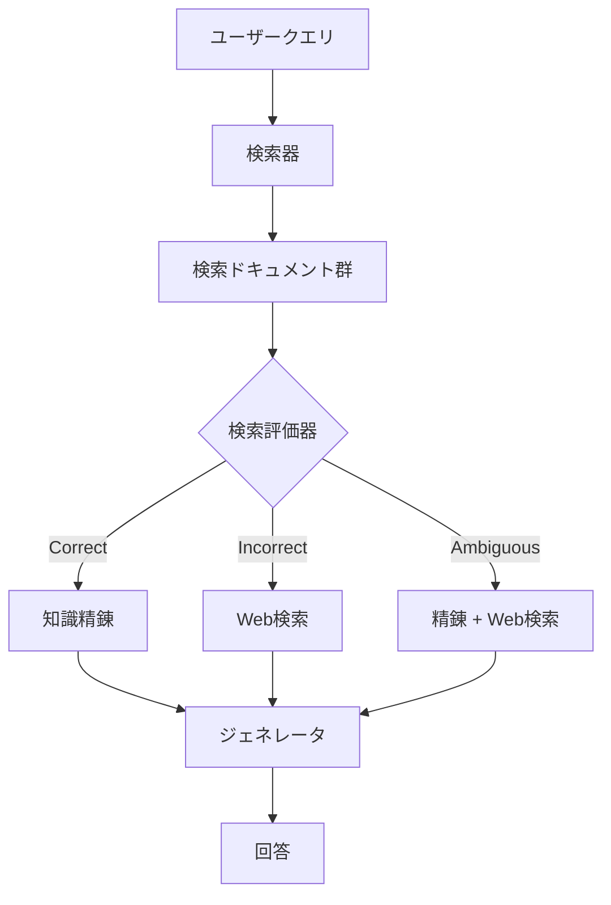

## 論文概要（Abstract）

本記事は [Corrective Retrieval Augmented Generation (arXiv:2401.15884)](https://arxiv.org/abs/2401.15884) の解説記事です。

CRAG（Corrective Retrieval Augmented Generation）は、RAG（Retrieval-Augmented Generation）パイプラインにおける検索結果の品質問題に対処するための補正フレームワークです。著者らは、検索されたドキュメントの品質を軽量な評価器で自動判定し、品質に応じて「精錬」「Web検索へのフォールバック」「両方の併用」という3段階の補正戦略を適用するアプローチを提案しています。既存のRAGベース手法にプラグアンドプレイで統合でき、短文・長文生成の両方で性能改善が報告されています。

この記事は [Zenn記事: LangGraph Agentic RAGの反復深度適応制御と精度-レイテンシ定量評価](https://zenn.dev/0h_n0/articles/349ab03c096ce0) の深掘りです。

## 情報源

- **arXiv ID**: 2401.15884
- **URL**: [https://arxiv.org/abs/2401.15884](https://arxiv.org/abs/2401.15884)
- **著者**: Shi-Qi Yan (USTC), Jia-Chen Gu (UCLA), Yun Zhu (Google DeepMind), Zhen-Hua Ling (USTC)
- **発表年**: 2024（v3: 2024年10月改訂）
- **分野**: cs.CL
- **Code**: [github.com/HuskyInSalt/CRAG](https://github.com/HuskyInSalt/CRAG)

## 背景と動機（Background & Motivation）

LLMはパラメトリック知識のみに依存すると事実と異なる出力（ハルシネーション）を生成する問題があり、RAGはこの問題を外部知識の検索・注入で軽減する手法として広く利用されています。しかし、著者らは従来のRAGが「検索結果が正確であること」を暗黙に前提としている点を問題視しています。

実際のRAGシステムでは、検索器が無関係なドキュメントを返すケースや、部分的にしか関連しないドキュメントを返すケースが頻繁に発生します。こうした不正確な検索結果をそのままLLMに渡すと、ハルシネーションの抑制どころか悪化を招く可能性があります。著者らは「検索が失敗したときにどうするか」という視点から、検索結果を事後的に評価・補正する仕組みの必要性を主張しています。

Self-RAG（Asai et al., 2023）は生成時に自己反省トークンで検索の要否を判断する手法ですが、専用の命令チューニングが必要であり既存手法への追加が容易ではありません。CRAGは「任意のRAG手法に後付けできる補正レイヤー」として設計されている点が差別化のポイントです。

## 主要な貢献（Key Contributions）

著者らは以下の3つの貢献を主張しています。

- **貢献1**: 検索結果が不正確な場合の補正戦略を体系的に設計した、RAG向け補正フレームワーク（CRAG）の提案。著者らの知る限り、検索失敗時の補正を主目的とした初めての研究
- **貢献2**: 既存のRAGベース手法にプラグアンドプレイで統合可能な設計。Self-RAGとの統合（Self-CRAG）も含め、ジェネレータを選ばない汎用性
- **貢献3**: PopQA・Biography・PubHealth・Arc-Challengeの4データセットにおける短文・長文生成での性能改善の実証

## 技術的詳細（Technical Details）

### CRAGの全体アーキテクチャ

CRAGの推論パイプラインは、検索評価器（Retrieval Evaluator）、知識精錬（Knowledge Refinement）、Web検索フォールバックの3コンポーネントで構成されます。



### 検索評価器（Retrieval Evaluator）

検索評価器はT5-large（約0.77Bパラメータ）をファインチューニングしたモデルであり、クエリとドキュメントのペアに対して信頼度スコアを算出します。

**学習データの構築**: PopQAのゴールドWikipediaタイトルを正例とし、クエリに類似するが実際には無関係なドキュメントをランダムサンプリングして負例としています。

**スコアリング**: 各クエリに対して約10件の検索ドキュメントそれぞれについてスコアを算出します。スコアの範囲は $[-1, 1]$ であり、2つの閾値 $(\tau_{\text{upper}}, \tau_{\text{lower}})$ でアクションを決定します。

$$
\text{action} = \begin{cases}
\text{Correct} & \text{if } \exists d_i : s(q, d_i) \geq \tau_{\text{upper}} \\
\text{Incorrect} & \text{if } \forall d_i : s(q, d_i) < \tau_{\text{lower}} \\
\text{Ambiguous} & \text{otherwise}
\end{cases}
$$

ここで、$s(q, d_i)$ はクエリ $q$ とドキュメント $d_i$ の信頼度スコア、$\tau_{\text{upper}}$ と $\tau_{\text{lower}}$ はデータセットごとに経験的に設定される閾値です。

著者らが報告している閾値の設定値は以下の通りです。

| データセット | $\tau_{\text{upper}}$ | $\tau_{\text{lower}}$ |
|:---:|:---:|:---:|
| PopQA | 0.59 | -0.99 |
| PubHealth / Arc-Challenge | 0.5 | -0.91 |
| Biography | 0.95 | -0.91 |

著者らは、Correctのみ・Incorrectのみの2値判定ではなくAmbiguousを加えた3値判定が重要だと主張しています。2値判定では評価器の精度への依存が高すぎるため、不確実な場合に両方のソースを活用するAmbiguousアクションが堅牢性を向上させるとのことです。

**評価器の精度**: 論文Table 4（PopQA）によると、T5ベースの評価器は84.3%の精度を達成しており、ChatGPTの直接評価（58.0%）、Chain-of-Thought評価（62.4%）、Few-shot評価（64.7%）を大幅に上回っています。

### 知識精錬（Knowledge Refinement）

Correctアクションが選択された場合、検索ドキュメントからノイズを除去する知識精錬プロセスが適用されます。このプロセスはDecompose-then-Recomposeの2段階で構成されます。

**Decompose（分解）**: 検索ドキュメントを文単位の「ストリップ」に分割します。1〜2文の短いドキュメントはそのまま1ストリップ、長いドキュメントは数文ごとに分割されます。

**Filter（フィルタリング）**: 検索評価器と同じモデルで各ストリップの関連性スコアを算出し、閾値以下のストリップを除去します（論文によるとフィルタ閾値は-0.5）。

**Recompose（再構成）**: フィルタを通過したストリップを元の順序で結合し、精錬された知識として出力します。上位 $k=5$ のストリップが保持されます。

```python
def decompose_then_recompose(
    documents: list[str],
    query: str,
    evaluator,
    filter_threshold: float = -0.5,
    top_k: int = 5,
) -> str:
    """CRAGの知識精錬: 分解→フィルタ→再構成"""
    strips = []
    for doc_id, doc in enumerate(documents):
        for sent in split_into_sentences(doc):
            score = evaluator.score(query, sent)
            strips.append((sent, score, doc_id))

    relevant = sorted(
        [s for s in strips if s[1] >= filter_threshold],
        key=lambda s: s[1], reverse=True,
    )[:top_k]
    relevant.sort(key=lambda s: (s[2], strips.index(s)))
    return " ".join(s[0] for s in relevant)
```

### Web検索フォールバック

Incorrectアクションが選択された場合、静的なコーパスからの検索を諦め、Web検索にフォールバックします。

1. **クエリ書き換え**: ChatGPTが元の質問からキーワードベースの検索クエリを生成
2. **Web検索**: Google Search APIでURL群を取得。WikipediaやStackOverflowなどの権威あるソースを優先
3. **知識精錬**: 取得したWebページの内容に対して同じDecompose-then-Recomposeを適用し、ノイズを除去

Ambiguousアクションでは、精錬された内部知識とWeb検索結果の両方をジェネレータに渡します。

### Self-CRAG: Self-RAGとの統合

CRAGはプラグアンドプレイ設計のため、Self-RAGの検索・生成パイプラインの上にCRAGの補正レイヤーを追加した「Self-CRAG」も構築可能です。Self-RAGの自己反省トークンによる検索判断の後に、CRAGの信頼度評価と補正が適用されます。

## 実装のポイント（Implementation）

CRAGを実装する際の主要な注意点を整理します。

**検索評価器の学習**: T5-largeを学習させる際、正例（ゴールドドキュメント）と負例（類似だが無関係なドキュメント）のバランスが精度に直結します。論文では約10件の検索ドキュメントに対してペアワイズでスコアリングしており、各クエリ-ドキュメントペアを独立に評価する設計です。

**閾値の調整**: $\tau_{\text{upper}}$ と $\tau_{\text{lower}}$ はデータセットの特性に依存するため、経験的なチューニングが必要です。Biography（長文生成）では $\tau_{\text{upper}} = 0.95$ と高く設定されており、長文生成ではより高い信頼度が求められることが示唆されています。

**レイテンシへの影響**: 論文Table 6によると、CRAGの追加オーバーヘッドはインスタンスあたり約0.15秒です（RAG: 0.363秒 → CRAG: 0.512秒）。Self-CRAG（0.908秒）もSelf-RAG（0.741秒）に対して同程度のオーバーヘッドに収まっています。

**Web検索の品質管理**: Web検索結果にも同じ知識精錬パイプラインを適用することで、Webから取得したノイズの多いコンテンツからも関連情報のみを抽出できます。ただし、Web検索APIの応答時間がボトルネックとなる可能性があります。

## Production Deployment Guide

### AWS実装パターン（コスト最適化重視）

CRAGパイプラインをAWSにデプロイする場合、検索評価器（T5-large, 0.77B）の推論とWeb検索フォールバックの2つがリソース消費の中心となります。

**トラフィック量別の推奨構成**:

| 規模 | 月間リクエスト | 推奨構成 | 月額コスト | 主要サービス |
|------|--------------|---------|-----------|------------|
| **Small** | ~3,000 (100/日) | Serverless | $80-200 | Lambda + SageMaker Serverless + Bedrock |
| **Medium** | ~30,000 (1,000/日) | Hybrid | $400-1,000 | ECS Fargate + SageMaker + ElastiCache |
| **Large** | 300,000+ (10,000/日) | Container | $2,500-6,000 | EKS + SageMaker Endpoint + Karpenter |

**Small構成の詳細** (月額$80-200):
- **Lambda**: オーケストレーション処理、1GB RAM ($20/月)
- **SageMaker Serverless Endpoint**: T5-large検索評価器の推論 ($40/月)
- **Bedrock**: Claude 3.5 Haiku、回答生成 ($80/月)
- **OpenSearch Serverless**: ベクトル検索 ($30/月)
- **API Gateway**: REST API ($5/月)

**コスト削減テクニック**:
- 評価器キャッシュ: 同一クエリ-ドキュメントペアの結果をRedisに保存（最大50%削減）
- SageMaker Serverless: アイドル時コストゼロ
- Correct判定時はWeb検索スキップでAPI費用削減

**コスト試算の注意事項**:
- 上記は2026年11月時点のAWS ap-northeast-1（東京）リージョン料金に基づく概算値です
- 実際のコストはトラフィックパターン、リージョン、バースト使用量により変動します
- 最新料金は [AWS料金計算ツール](https://calculator.aws/) で確認してください

### Terraformインフラコード

**Small構成 (Serverless): Lambda + SageMaker Serverless + Bedrock**

```hcl
# --- IAMロール（最小権限） ---
resource "aws_iam_role" "crag_lambda" {
  name = "crag-lambda-role"

  assume_role_policy = jsonencode({
    Version = "2012-10-17"
    Statement = [{
      Action = "sts:AssumeRole"
      Effect = "Allow"
      Principal = { Service = "lambda.amazonaws.com" }
    }]
  })
}

resource "aws_iam_role_policy" "crag_permissions" {
  role = aws_iam_role.crag_lambda.id

  policy = jsonencode({
    Version = "2012-10-17"
    Statement = [
      {
        Effect = "Allow"
        Action = [
          "sagemaker:InvokeEndpoint"
        ]
        Resource = aws_sagemaker_endpoint.t5_evaluator.arn
      },
      {
        Effect = "Allow"
        Action = [
          "bedrock:InvokeModel",
          "bedrock:InvokeModelWithResponseStream"
        ]
        Resource = "arn:aws:bedrock:ap-northeast-1::foundation-model/anthropic.claude-3-5-haiku*"
      }
    ]
  })
}

# --- SageMaker Serverless Endpoint（T5検索評価器） ---
resource "aws_sagemaker_model" "t5_evaluator" {
  name               = "crag-t5-retrieval-evaluator"
  execution_role_arn = aws_iam_role.sagemaker_execution.arn

  primary_container {
    image          = "763104351884.dkr.ecr.ap-northeast-1.amazonaws.com/pytorch-inference:2.1.0-gpu-py310-cu118-ubuntu20.04-sagemaker"
    model_data_url = "s3://${aws_s3_bucket.models.bucket}/t5-large-crag-evaluator/model.tar.gz"
  }
}

resource "aws_sagemaker_endpoint_configuration" "t5_serverless" {
  name = "crag-t5-serverless-config"

  production_variants {
    variant_name           = "default"
    model_name             = aws_sagemaker_model.t5_evaluator.name
    serverless_config {
      memory_size_in_mb = 4096
      max_concurrency   = 5
    }
  }
}

resource "aws_sagemaker_endpoint" "t5_evaluator" {
  name                 = "crag-t5-evaluator"
  endpoint_config_name = aws_sagemaker_endpoint_configuration.t5_serverless.name
}

# --- Lambda関数（CRAGオーケストレーション） ---
resource "aws_lambda_function" "crag_orchestrator" {
  filename      = "crag_lambda.zip"
  function_name = "crag-orchestrator"
  role          = aws_iam_role.crag_lambda.arn
  handler       = "handler.main"
  runtime       = "python3.12"
  timeout       = 120
  memory_size   = 1024

  environment {
    variables = {
      SAGEMAKER_ENDPOINT = aws_sagemaker_endpoint.t5_evaluator.name
      BEDROCK_MODEL_ID   = "anthropic.claude-3-5-haiku-20241022-v1:0"
      TAU_UPPER          = "0.6"
      TAU_LOWER          = "-0.9"
    }
  }
}

# --- CloudWatchアラーム（コスト監視） ---
resource "aws_cloudwatch_metric_alarm" "sagemaker_invocations" {
  alarm_name          = "crag-evaluator-invocation-spike"
  comparison_operator = "GreaterThanThreshold"
  evaluation_periods  = 1
  metric_name         = "Invocations"
  namespace           = "AWS/SageMaker"
  period              = 3600
  statistic           = "Sum"
  threshold           = 1000
  alarm_description   = "T5評価器の呼び出し回数異常（コスト急増の可能性）"

  dimensions = {
    EndpointName = aws_sagemaker_endpoint.t5_evaluator.name
    VariantName  = "default"
  }
}
```

**Large構成**ではEKS + SageMaker Real-time Endpoint + Karpenter（Spot優先）を使用します。EKSクラスタ（v1.31）にKarpenterでg5.xlarge/g5.2xlargeのSpotインスタンスを自動プロビジョニングし、アイドル30秒後にスケールダウンする構成です。AWS Budgetsで月額$6,000の予算アラート（80%で警告）を設定します。

### セキュリティベストプラクティス

1. **ネットワーク**: SageMaker EndpointはVPCエンドポイント経由でアクセス、パブリック公開しない
2. **IAMロール**: Lambda/EKSからSageMaker・Bedrockへのアクセスは最小権限のIAMポリシーで制御
3. **シークレット管理**: Web検索APIキーはSecrets Managerに格納、環境変数へのハードコード禁止
4. **データ保護**: S3上のモデルアーティファクトはKMS暗号化、転送はTLS 1.2以上

### 運用・監視設定

**CloudWatch Logs Insights クエリ**:

```sql
-- CRAG判定アクションの分布（1時間ごと）
fields @timestamp, action_type
| stats count(*) as action_count by action_type, bin(1h)
| sort action_count desc

-- Web検索フォールバック率の監視
fields @timestamp, action_type
| stats count(*) as total,
        sum(case action_type = 'incorrect' then 1 else 0 end) as web_fallback
| eval fallback_rate = web_fallback / total * 100
```

**CloudWatch アラーム**: Web検索フォールバック回数（Custom/CRAG名前空間）とSageMaker評価器のレイテンシ（ModelLatency 2秒超過）の2種類を設定します。Web検索APIはコスト直結のため、1時間あたり500回超過でSNS通知を推奨します。

**X-Ray トレーシング**: `aws_xray_sdk`の`patch_all()`でboto3を自動計装し、`@xray_recorder.capture`デコレータで評価器呼び出しにアノテーション（action種別、ドキュメント数）を付与します。

### コスト最適化チェックリスト

**アーキテクチャ選択（トラフィック量で判断）**:
- [ ] ~100 req/日 → Lambda + SageMaker Serverless — $80-200/月
- [ ] ~1000 req/日 → ECS Fargate + SageMaker Real-time — $400-1,000/月
- [ ] 10000+ req/日 → EKS + Karpenter + Spot — $2,500-6,000/月

**リソース最適化**:
- [ ] SageMaker: Serverless Endpointでアイドル時コストゼロ
- [ ] EC2: Spot Instances優先で最大90%削減
- [ ] Reserved Instances: 1年コミットで最大72%削減
- [ ] Lambda: メモリサイズ最適化（1024MBを基準に調整）
- [ ] ECS/EKS: 夜間のスケールダウン

**CRAGパイプライン固有の最適化**:
- [ ] 評価器キャッシュ: 同一クエリ-ドキュメントペアの結果をRedis/DynamoDBにキャッシュ
- [ ] Web検索APIコスト: Incorrect判定率をモニタリングし閾値を調整
- [ ] Bedrock Batch API: 非リアルタイム処理で50%割引
- [ ] Prompt Caching: システムプロンプト固定で30-90%削減

**監視・アラート**:
- [ ] AWS Budgets: 月額予算80%警告、Cost Anomaly Detection有効化
- [ ] CloudWatch: 評価器呼び出し数・Web検索フォールバック率監視
- [ ] 日次コストレポート: SNS/Slack自動送信

**リソース管理**:
- [ ] 未使用リソース削除、タグ戦略（環境別コスト可視化）
- [ ] S3ライフサイクル: 評価キャッシュ30日自動削除
- [ ] 開発環境: SageMaker Endpoint夜間停止

## 実験結果（Results）

### メインの比較結果

著者らは4つのデータセット（PopQA、Biography、PubHealth、Arc-Challenge）で実験を行い、論文Table 1に結果を報告しています。

| 手法 | PopQA | Bio (FactScore) | PubHealth | ARC |
|:---:|:---:|:---:|:---:|:---:|
| RAG (LLaMA2-hf-7b) | 50.5 | 44.9 | 48.9 | 43.4 |
| CRAG (LLaMA2-hf-7b) | 54.9 | 47.7 | 59.5 | 53.7 |
| RAG (SelfRAG-LLaMA2-7b) | 52.8 | 59.2 | 39.0 | 53.2 |
| CRAG (SelfRAG-LLaMA2-7b) | 59.8 | 74.1 | 75.6 | 68.6 |
| Self-RAG (SelfRAG-LLaMA2-7b) | 54.9 | 81.2 | 72.4 | 67.3 |
| Self-CRAG (SelfRAG-LLaMA2-7b) | 61.8 | 86.2 | 74.8 | 67.2 |

著者らの報告によると、SelfRAG-LLaMA2-7bベースでCRAGはRAGに対してPopQAで+7.0、PubHealthで+36.6の改善を達成しています。Self-CRAGはSelf-RAGに対してPopQAで+6.9、FactScoreで+5.0の改善を示しています。

### アブレーション分析

論文Table 2（PopQA, SelfRAG-LLaMA2-7b）によるアブレーション結果は以下の通りです。

| 構成 | PopQA精度 |
|:---:|:---:|
| CRAG（フル） | 59.8 |
| Correctアクション除去 | 58.3 |
| Incorrectアクション除去 | 59.5 |
| Ambiguousアクション除去 | 59.0 |

Self-CRAGでの知識精錬除去の影響はさらに顕著であり、論文Table 3によると、LLaMA2-hf-7bベースでは知識精錬を除去すると61.8から35.9まで大幅に低下しています。これは、Web検索結果のノイズ除去がCRAGの性能にとって不可欠であることを示唆しています。

### 検索品質劣化に対する堅牢性

論文Figure 3では、検索品質を人為的に劣化させた場合の性能推移が報告されています。著者らによると、Self-CRAGはSelf-RAGと比較して検索品質の劣化に対してより緩やかに性能が低下し、補正メカニズムの有効性が確認されています。

### 計算オーバーヘッド

論文Table 6によると、CRAGが追加するレイテンシはインスタンスあたり約0.15秒（RAG: 0.363秒 → CRAG: 0.512秒）です。Self-CRAG（0.908秒）もSelf-RAG（0.741秒）に対して0.167秒の追加に抑えられています。

## 実運用への応用（Practical Applications）

CRAGのプラグアンドプレイ設計は、既存のRAGシステムへの段階的な導入に適しています。

**社内ナレッジ検索**: 社内ドキュメントのベクトル検索で関連度が低い場合に、社内Wikiや外部APIへフォールバックする構成が考えられます。閾値をドメインに合わせて調整することで、不要なフォールバックを抑制できます。

**制約と考慮事項**: 著者ら自身が指摘しているように、CRAGは外部の検索評価器（T5-large, 0.77B）のファインチューニングが必要であり、LLMに直接検索評価能力を持たせるアプローチと比較して追加のモデル管理コストが発生します。Web検索フォールバックは外部API依存であり、レイテンシとコストの考慮が必要です。

## 関連研究（Related Work）

- **Self-RAG** (Asai et al., 2023): 自己反省トークンで検索の要否とドキュメントの関連度を判断する手法。CRAGとは異なり、専用の命令チューニングが必要だが、検索判断を生成プロセスに統合している点が特徴。CRAGはSelf-RAGの上に追加で適用可能（Self-CRAG）
- **FLARE** (Jiang et al., 2023): 生成中のlow-probability tokensで検索をトリガーする動的検索手法。CRAGが検索後の補正に注力するのに対し、FLAREは検索タイミングの最適化に注力
- **Active RAG** (Jiang et al., 2023): LLMの内部知識との整合性を検証して能動的に知識を構築する手法。補正アプローチは異なるが検索品質への対処という動機は共通

## まとめと今後の展望

CRAGは「検索が失敗したときにどうするか」という実用上重要な問題に対して、軽量な検索評価器と3段階の補正戦略で対処するフレームワークです。

著者らの実験結果（論文Table 1）によると、特にSelf-RAGとの統合（Self-CRAG）は4データセット中3つで最高性能を達成しており、補正レイヤーの追加が一貫して有効であることが示されています。計算オーバーヘッドもインスタンスあたり約0.15秒と軽量です。

著者らはLLM自体に検索評価能力を直接統合することを今後の方向性として挙げています。閾値の自動調整やドメイン適応も重要な課題です。Agentic RAGの文脈では、CRAGの信頼度スコアに基づく分岐判定は、LangGraphのStateGraphにおける条件付きエッジとして自然に実装でき、反復検索ループの停止条件としても活用可能です。

## 参考文献

- **arXiv**: [https://arxiv.org/abs/2401.15884](https://arxiv.org/abs/2401.15884)
- **Code**: [https://github.com/HuskyInSalt/CRAG](https://github.com/HuskyInSalt/CRAG)
- **Related Zenn article**: [https://zenn.dev/0h_n0/articles/349ab03c096ce0](https://zenn.dev/0h_n0/articles/349ab03c096ce0)
