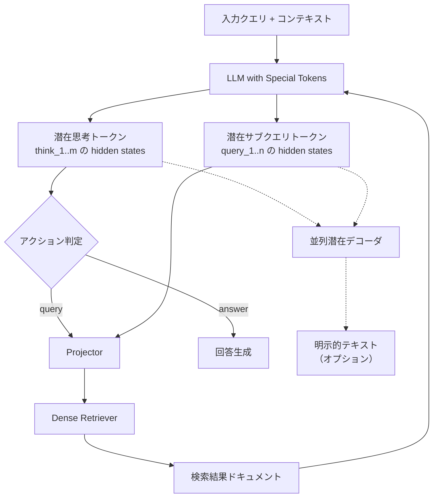

## 論文概要（Abstract）

本記事は [LatentRAG (arXiv:2605.06285)](https://arxiv.org/abs/2605.06285) の解説記事です。

LatentRAGは、Agentic RAGにおける推論（思考）とサブクエリ生成を潜在空間で実行することで、明示的なトークン生成に起因するレイテンシを大幅に削減するフレームワークである。著者らは、7つのベンチマークにおいて既存のAgentic RAG手法と同等の精度を維持しつつ、推論レイテンシを約90%削減したと報告している（論文Abstract）。

この記事は [Zenn記事: LangGraph Agentic RAGの反復深度適応制御と精度-レイテンシ定量評価](https://zenn.dev/0h_n0/articles/349ab03c096ce0) の深掘りです。

## 情報源

- **arXiv ID**: 2605.06285
- **URL**: [https://arxiv.org/abs/2605.06285](https://arxiv.org/abs/2605.06285)
- **著者**: Yijia Zheng, Marcel Worring（University of Amsterdam）
- **発表年**: 2026（NeurIPS 2026採択）
- **分野**: cs.CL, cs.LG
- **コード**: [https://github.com/zhengyijia/LatentRAG](https://github.com/zhengyijia/LatentRAG)

## 背景と動機（Background & Motivation）

Agentic RAGは、単一ステップのRAGでは対応困難なマルチホップ質問に対して、反復的に検索と推論を実行することで回答品質を向上させる手法である。しかし、この反復プロセスには深刻なレイテンシの問題がある。

著者らの計測によると、Search-R1のような明示的Agentic RAG手法は、ナイーブRAGと比較して推論時間が16〜22倍に増大する（論文Section 1）。この増大の約90%は、思考（thought）トークンとサブクエリトークンの逐次生成に起因する。つまり、LLMが「次にどの情報を検索すべきか」を自然言語で考え、検索クエリを文字列として生成するプロセスがボトルネックとなっている。

RAGPerf（arXiv:2603.10765）の報告でも、LLM生成ステップがRAGパイプライン全体のレイテンシの75〜91%を占めることが示されており、Agentic RAGにおける反復的なLLM呼び出しがコスト的に非効率であることは広く認識されている。Zenn記事で解説したPareto分析においても、反復回数の増加がレイテンシに直結する問題が確認されている。

LatentRAGは、この「明示的トークン生成」というボトルネックを根本的に回避するために、推論と検索クエリ生成を潜在空間（latent space）に移行するアプローチを提案している。

## 主要な貢献（Key Contributions）

著者らが論文Introduction（Section 1）で主張する貢献は以下の3点である。

- **貢献1**: LatentRAGフレームワークの提案。思考とサブクエリ生成を潜在空間で実行し、明示的なトークン生成のコストを削減するAgentic RAGフレームワーク
- **貢献2**: 潜在空間整合化目的関数の設計。LLMとリトリーバーを共同最適化し、潜在トークンが検索クエリとして機能するようにend-to-endで学習する手法
- **貢献3**: 並列潜在デコーダの導入。潜在トークンを明示的な思考・サブクエリテキストに変換するオプション機構で、推論の透明性と効率性のトレードオフを制御可能

## 技術的詳細（Technical Details）

### アーキテクチャ全体像

LatentRAGは3つの主要コンポーネントから構成される。



### 潜在生成（Latent Generation）

従来のAgentic RAGでは、LLMが思考過程やサブクエリをトークン単位で逐次生成する。LatentRAGでは、特殊トークン `<think_1>`, ..., `<think_m>` と `<query_1>`, ..., `<query_n>` を入力に追加し、これらのトークンに対応するLLMの最終層hidden statesを潜在表現として利用する（論文Section 4.1）。

具体的には、入力シーケンスの末尾にこれらの特殊トークンを連結し、1回のforward passで全ての潜在トークンの表現を得る。

$$
\mathbf{h}_{\text{think}_i} = \text{LLM}_{\text{last}}(x \oplus [\text{think}_1, \ldots, \text{think}_m])_i
$$

$$
\mathbf{h}_{\text{query}_j} = \text{LLM}_{\text{last}}(x \oplus [\text{query}_1, \ldots, \text{query}_n])_j
$$

ここで、
- $x$: 入力シーケンス（クエリ + 既存コンテキスト）
- $m$: 潜在思考トークン数（デフォルト4）
- $n$: 潜在サブクエリトークン数（デフォルト16）
- $\mathbf{h}$: 最終層のhidden state

最後の思考トークン $\text{think}_m$ のhidden stateからアクショントークン（`<query>` または `<answer>`）を予測し、次に検索を実行するか回答を生成するかを決定する。

学習には、既存のAgentic RAG手法（Search-R1, AutoRefine）から生成した正解トラジェクトリを用い、自然言語の思考・サブクエリを特殊トークンに置換した上でクロスエントロピー損失 $\mathcal{L}_{\text{gen}}$ で教師あり学習（SFT）を行う。

### 潜在検索（Latent Retrieval）

潜在サブクエリトークンのhidden statesを直接検索クエリとして利用するため、軽量なProjectorを導入する（論文Section 4.2）。Projectorは1層の双方向Self-Attentionとフィードフォワードネットワーク（FFN）で構成され、潜在トークンをリトリーバーの入力空間にマッピングする。

$$
\mathbf{q}_{\text{latent}} = \text{Projector}(\mathbf{h}_{\text{query}_1}, \ldots, \mathbf{h}_{\text{query}_n})
$$

リトリーバーは事前学習済みモデル（デフォルトでQwen3-Embedding-0.6B）で初期化し、ファインチューニングする。学習ターゲットは、自然言語サブクエリを入力とした凍結参照リトリーバーの出力分布である。損失関数にはKLダイバージェンスを採用する。

$$
\mathcal{L}_{\text{ret}} = D_{\text{KL}}\left( p_{\text{ref}}(d | q_{\text{NL}}) \| p_{\theta}(d | \mathbf{q}_{\text{latent}}) \right)
$$

ここで、
- $p_{\text{ref}}(d | q_{\text{NL}})$: 自然言語クエリを入力とした参照リトリーバーのドキュメント-クエリ間類似度分布
- $p_{\theta}(d | \mathbf{q}_{\text{latent}})$: 潜在クエリを入力とした学習対象リトリーバーの類似度分布
- 温度パラメータ $\beta = 0.03$

著者らは、InfoNCE損失やコサイン距離直接整合よりもKLダイバージェンスが優れていたと報告している（論文Table 5）。

### 並列潜在デコーダ（Parallel Latent Decoder）

推論の透明性を確保するため、潜在トークンから元の自然言語テキストを復元するデコーダを提供する（論文Section 4.3）。各セグメント（思考・サブクエリ）は自身の潜在トークンのみに依存するため、全セグメントを並列にデコードできる。

このデコーダはオプションであり、透明性が不要な場面ではスキップすることでさらなるレイテンシ削減が可能である。

### 全体の学習目的関数

$$
\mathcal{L} = \mathcal{L}_{\text{gen}} + \lambda_{\text{ret}} \cdot \mathcal{L}_{\text{ret}} + \mathcal{L}_{\text{dec}}
$$

ここで $\lambda_{\text{ret}} = 1$（論文Section 4.4）。

### アルゴリズム

```python
from dataclasses import dataclass

import torch
import torch.nn as nn


@dataclass
class LatentRAGConfig:
    """LatentRAG設定"""
    num_think_tokens: int = 4
    num_query_tokens: int = 16
    kl_temperature: float = 0.03
    lambda_ret: float = 1.0


class LatentRAGProjector(nn.Module):
    """潜在サブクエリトークンをリトリーバー空間にマッピング"""

    def __init__(self, llm_dim: int, retriever_dim: int) -> None:
        super().__init__()
        self.self_attn = nn.MultiheadAttention(
            embed_dim=llm_dim, num_heads=8, batch_first=True
        )
        self.ffn = nn.Sequential(
            nn.Linear(llm_dim, llm_dim * 4),
            nn.GELU(),
            nn.Linear(llm_dim * 4, retriever_dim),
        )

    def forward(self, latent_query_states: torch.Tensor) -> torch.Tensor:
        """潜在クエリ hidden states → リトリーバー空間のクエリベクトル

        Args:
            latent_query_states: (batch, n_query_tokens, llm_dim)

        Returns:
            (batch, retriever_dim) のクエリベクトル
        """
        attn_out, _ = self.self_attn(
            latent_query_states, latent_query_states, latent_query_states
        )
        pooled = attn_out.mean(dim=1)
        return self.ffn(pooled)
```

## 実装のポイント（Implementation）

著者らが報告する学習設定（論文Appendix B）は以下の通りである。

- **LoRA**: rank 16, scaling factor 64でLLMをファインチューニング
- **エポック数**: 5
- **学習率**: 1e-4（AdamW）
- **バッチサイズ**: 16
- **ベースLLM**: Qwen2.5-7B（Base）
- **トラジェクトリ**: Search-R1とAutoRefineからNQ・HotpotQA上で生成し、正解のみ使用

実装上の注意点として、潜在思考・サブクエリトークンの数（$m=4$, $n=16$）は固定であり、タスクの複雑さに応じた動的調整は行われていない。著者らはこの点をAppendix E.3で分析し、トークン数の増加が必ずしも精度向上に繋がらないことを示している。

リトリーバーのProjectorは比較的軽量（Self-Attention 1層 + FFN）であるため、異なるリトリーバーへの適応が容易である。著者らは、Projectorのみをチューニングするcross-retriever adaptationで、フルトレーニングの約95%の性能を回復できると報告している（論文Section 5.4）。

## Production Deployment Guide

### AWS実装パターン（コスト最適化重視）

LatentRAGはQwen2.5-7Bベースのモデルを推論に使用するため、GPUインスタンスが必要となる。以下にトラフィック量別の推奨構成を示す。

**トラフィック量別の推奨構成**:

| 規模 | 月間リクエスト | 推奨構成 | 月額コスト | 主要サービス |
|------|--------------|---------|-----------|------------|
| **Small** | ~3,000 (100/日) | Serverless GPU | $150-400 | SageMaker Serverless + S3 + DynamoDB |
| **Medium** | ~30,000 (1,000/日) | Managed Endpoint | $800-2,000 | SageMaker Real-time + ElastiCache |
| **Large** | 300,000+ (10,000/日) | Container | $3,000-8,000 | EKS + Karpenter + g5.xlarge Spot |

**Small構成の詳細**（月額$150-400）:
- **SageMaker Serverless Inference**: ml.g5.xlarge相当、コールドスタート許容 ($100/月)
- **S3**: FAISSインデックス・モデルアーティファクト保存 ($5/月)
- **DynamoDB**: 潜在トークンキャッシュ、On-Demand ($10/月)
- **CloudWatch**: 基本監視 ($5/月)

**Medium構成の詳細**（月額$800-2,000）:
- **SageMaker Real-time Endpoint**: ml.g5.xlarge × 1台、オートスケーリング ($600/月)
- **ElastiCache Redis**: cache.r6g.large、検索結果キャッシュ ($150/月)
- **Application Load Balancer**: ($20/月)

**Large構成の詳細**（月額$3,000-8,000）:
- **EKS**: コントロールプレーン ($72/月)
- **EC2 Spot Instances**: g5.xlarge × 2-4台 (平均$1,200/月、最大90%削減)
- **Karpenter**: Spot自動スケーリング（追加コストなし）
- **S3**: FAISSインデックス配布 ($20/月)

**コスト削減テクニック**:
- Spot Instances使用で最大90%削減（EKS + Karpenter）
- SageMaker Savings Plans（1年コミット）で最大64%削減
- 潜在トークンのキャッシュにより同一クエリパターンの再計算回避
- LatentRAGの特性を活かし、デコーダなしモードで推論コスト削減

**コスト試算の注意事項**:
- 上記は2026年11月時点のAWS ap-northeast-1（東京）リージョン料金に基づく概算値です
- 実際のコストはトラフィックパターン、モデルサイズ、バッチサイズにより変動します
- 最新料金は [AWS料金計算ツール](https://calculator.aws/) で確認してください

### Terraformインフラコード

**Small構成 (Serverless GPU): SageMaker Serverless + DynamoDB**

```hcl
module "vpc" {
  source  = "terraform-aws-modules/vpc/aws"
  version = "~> 5.0"

  name = "latentrag-vpc"
  cidr = "10.0.0.0/16"
  azs  = ["ap-northeast-1a", "ap-northeast-1c"]
  private_subnets = ["10.0.1.0/24", "10.0.2.0/24"]
  enable_nat_gateway   = false
  enable_dns_hostnames = true
}

resource "aws_iam_role" "sagemaker_execution" {
  name = "latentrag-sagemaker-role"
  assume_role_policy = jsonencode({
    Version = "2012-10-17"
    Statement = [{
      Action    = "sts:AssumeRole"
      Effect    = "Allow"
      Principal = { Service = "sagemaker.amazonaws.com" }
    }]
  })
}

resource "aws_sagemaker_model" "latentrag" {
  name               = "latentrag-model"
  execution_role_arn = aws_iam_role.sagemaker_execution.arn
  primary_container {
    image          = "763104351884.dkr.ecr.ap-northeast-1.amazonaws.com/huggingface-pytorch-inference:2.1-transformers4.36-gpu-py310-cu121-ubuntu22.04"
    model_data_url = "s3://latentrag-model-artifacts/latentrag/model.tar.gz"
    environment = {
      HF_MODEL_ID      = "zhengyijia/LatentRAG"
      SAGEMAKER_PROGRAM = "inference.py"
    }
  }
}

resource "aws_dynamodb_table" "latent_cache" {
  name         = "latentrag-cache"
  billing_mode = "PAY_PER_REQUEST"
  hash_key     = "query_hash"
  attribute { name = "query_hash"; type = "S" }
  ttl { attribute_name = "expire_at"; enabled = true }
}
```

**Large構成 (Container): EKS + Karpenter + Spot**

```hcl
module "eks" {
  source  = "terraform-aws-modules/eks/aws"
  version = "~> 20.0"
  cluster_name    = "latentrag-cluster"
  cluster_version = "1.31"
  vpc_id     = module.vpc.vpc_id
  subnet_ids = module.vpc.private_subnets
  cluster_endpoint_public_access = true
  enable_cluster_creator_admin_permissions = true
}

resource "kubectl_manifest" "karpenter_provisioner" {
  yaml_body = <<-YAML
    apiVersion: karpenter.sh/v1alpha5
    kind: Provisioner
    metadata:
      name: latentrag-gpu-spot
    spec:
      requirements:
        - key: karpenter.sh/capacity-type
          operator: In
          values: ["spot"]
        - key: node.kubernetes.io/instance-type
          operator: In
          values: ["g5.xlarge", "g5.2xlarge"]
      limits:
        resources:
          cpu: "32"
          nvidia.com/gpu: "4"
      ttlSecondsAfterEmpty: 60
  YAML
}
```

### セキュリティ・運用・監視

**セキュリティ**: EKS本番では `cluster_endpoint_public_access = false`（VPN経由）、IAM最小権限、Secrets Managerでモデル設定管理、S3/DynamoDB/EBSのKMS暗号化、CloudTrail有効化。

**CloudWatch Logs Insights**:

```sql
fields @timestamp, latent_gen_ms, decode_ms, total_ms
| stats avg(latent_gen_ms) as avg_latent, avg(decode_ms) as avg_decode by bin(1h)
```

**コスト監視（Python）**:

```python
import boto3

cloudwatch = boto3.client("cloudwatch")
cloudwatch.put_metric_alarm(
    AlarmName="latentrag-gpu-utilization",
    ComparisonOperator="LessThanThreshold",
    EvaluationPeriods=3,
    MetricName="GPUUtilization",
    Namespace="AWS/SageMaker",
    Period=300,
    Statistic="Average",
    Threshold=20.0,
    AlarmDescription="GPU使用率低下（過剰プロビジョニングの可能性）",
)
```

### コスト最適化チェックリスト

- [ ] トラフィック量でアーキテクチャ選択（Serverless/Real-time/EKS）
- [ ] Spot Instances優先（Karpenter管理、最大90%削減）
- [ ] SageMaker Savings Plans検討（1年で最大64%削減）
- [ ] 潜在デコーダなしモード（透明性不要時に約27%追加削減）
- [ ] 潜在トークンキャッシュ（DynamoDB TTL付き）
- [ ] LoRA量子化（4-bit QLoRA）でメモリ削減
- [ ] AWS Budgets月額予算・Cost Anomaly Detection有効化
- [ ] 日次コストレポートSNS配信
- [ ] 未使用エンドポイント削除・開発環境夜間停止

## 実験結果（Results）

### 主要ベンチマーク結果

著者らは7つのQAベンチマークで評価を実施している（論文Table 1）。以下はQwen3-Embedding-0.6Bをリトリーバーとして使用した結果である。

| 手法 | 平均EM | 平均レイテンシ(ms) | レイテンシ削減率 |
|------|--------|-------------------|----------------|
| Naive RAG | — | — | ベースライン |
| Search-R1 | 42.47 | 5,372 | — |
| AutoRefine | 42.73 | 4,827 | — |
| LatentRAG（デコードなし）| 43.46 | 593 | -89.0% |
| LatentRAG（デコードあり）| 43.79 | — | — |

Table 1より、LatentRAGはSearch-R1と比較して平均EMを+2.3%（42.47→43.46）向上させつつ、レイテンシを89.0%削減している。AutoRefineとの比較でも同様の傾向が確認され、著者らはEMの差が「5%以内」であることから同等の精度と主張している。

潜在デコーダを有効にした場合、レイテンシは1,970ms（Search-R1比-63.3%）に増加するものの、明示的な思考・サブクエリテキストが復元可能になり、推論過程の検証が可能となる（論文Table 2）。

### リトリーバー別の結果

著者らは5つの異なるリトリーバーで実験を行っている（論文Table 1）。

| リトリーバー | パラメータ数 | 平均EM | 精度差(vs Search-R1) |
|-------------|------------|--------|---------------------|
| Qwen3-Embedding-0.6B | 0.6B | 43.46 | +2.3% |
| e5-base-v2 | 0.11B | 42.35 | -4.0% |
| jina-embeddings-v5-text-nano | — | — | — |
| harrier-oss-v1-270m | 0.27B | — | — |
| F2LLM-v2-330M | 0.33B | — | — |

e5-base-v2では精度が低下しており、著者らは埋め込み空間の異方性が原因と分析している（論文Appendix E.1）。

### アブレーション実験

論文Table 5より、各コンポーネントの寄与が示されている。

| 設定 | 平均EM |
|------|--------|
| Full（KLダイバージェンス） | 43.46 |
| コサイン距離損失に変更 | 42.55 |
| InfoNCEに変更 | 41.86 |
| 事前学習済みリトリーバーなし | 41.85 |
| 潜在デコーダなし | 40.61 |

KLダイバージェンス損失が他の損失関数を上回っており、事前学習済みリトリーバーの初期化と潜在デコーダ（学習時の正則化効果）がいずれも精度に寄与している。

### Cross-Retriever Adaptation

著者らは、Projectorのみをチューニングすることで新しいリトリーバーへの適応が可能であることを示している（論文Section 5.4）。Jinaリトリーバーに対して、Projectorのみの適応で44.43 EM（フルトレーニング44.79の約99%）を達成したと報告している。5,000件の合成クエリを用いた場合でも41.69 EMとなり、フルトレーニングの20.39と比較して大幅な改善が見られる。

## 実運用への応用（Practical Applications）

LatentRAGは以下のユースケースにおいて特に有効と考えられる。

**レイテンシ制約のあるAgentic RAGシステム**: Zenn記事で解説した反復検索型Agentic RAGでは、反復回数の増加がレイテンシに直結する問題がある。LatentRAGのアプローチにより、同等の反復深度を維持しつつレイテンシを大幅に削減できる可能性がある。特に、応答時間2秒以内が求められる社内ナレッジ検索のような場面で有用である。

**コスト最適化**: 推論レイテンシの削減はGPU利用時間の削減に直結する。Search-R1と比較して約90%のレイテンシ削減は、クラウド環境での推論コストを同程度削減できることを意味する。

**制約事項**: 著者ら自身が指摘する通り（論文Appendix A）、性能はSFTトラジェクトリの品質に依存する。また、vLLMなどの推論最適化フレームワークとの統合はまだ実現されておらず、本番環境での利用にはこの統合が必要となる可能性がある。強化学習による追加最適化は今後の課題として挙げられている。

## 関連研究（Related Work）

- **Search-R1**: 明示的な思考・サブクエリ生成によるAgentic RAG。LatentRAGのベースライン手法であり、レイテンシ面での対比対象。Search-R1はNQ/HotpotQAで42.47 EMを達成するが、レイテンシは5,372msと高い
- **AutoRefine**: 反復的な検索・回答改善手法。Search-R1と同等の精度（42.73 EM）だが、やはりレイテンシが課題（4,827ms）
- **DeepRAG**: 検索の必要性を動的に判断するAgentic RAG。LatentRAGとは異なりトークンレベルの明示的判断を行う

## まとめと今後の展望

LatentRAGは、Agentic RAGのレイテンシボトルネックに対して潜在空間への移行という新しいアプローチを提案している。著者らの報告によれば、7つのベンチマークで既存手法と同等の精度を維持しつつ約90%のレイテンシ削減を達成しており、Agentic RAGの実用化における重要な進歩と考えられる。

ただし、SFTトラジェクトリの品質への依存、vLLM等との未統合、強化学習の未適用といった課題が残されている。また、潜在トークン数の動的制御やより大規模なモデルでの検証も今後の研究方向として期待される。

Zenn記事で扱った適応停止制御と組み合わせることで、潜在空間での高速な反復検索と効率的な停止判断を両立するシステムの構築が考えられる。

## 参考文献

- **arXiv**: [https://arxiv.org/abs/2605.06285](https://arxiv.org/abs/2605.06285)
- **Code**: [https://github.com/zhengyijia/LatentRAG](https://github.com/zhengyijia/LatentRAG)
- **Related Zenn article**: [https://zenn.dev/0h_n0/articles/349ab03c096ce0](https://zenn.dev/0h_n0/articles/349ab03c096ce0)

---

:::message
この記事はAI（Claude Code）により自動生成されました。内容の正確性については原論文と照合していますが、最新情報は公式リポジトリおよび論文をご確認ください。
:::
