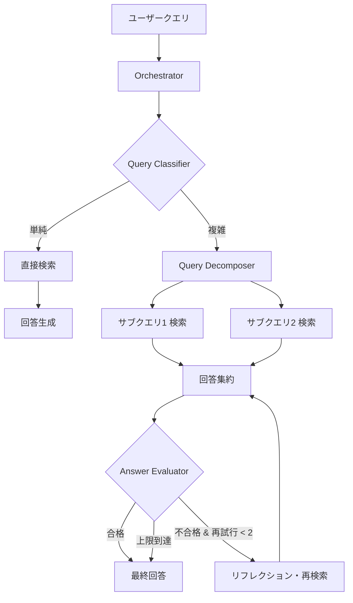

本記事は [Agent-Orchestrated Adaptive RAG (arXiv:2606.05658)](https://arxiv.org/abs/2606.05658) の解説記事です。

この記事は [Zenn記事: LangGraph Agentic RAGの反復深度適応制御と精度-レイテンシ定量評価](https://zenn.dev/0h_n0/articles/349ab03c096ce0) の深掘りです。

## 論文概要（Abstract）

Maharjan らは、従来の静的な単一ステップ検索の限界を超えるために、エージェントオーケストレーション型の適応 RAG フレームワークを提案している。このフレームワークは動的クエリ分解、反復検索、上限付き自己反省評価ループを統合し、クエリの複雑さに応じて検索戦略を切り替える。著者らはカスタム DevOps ナレッジベースと MuSiQue マルチホップベンチマークの 2 種類の対照的なデータセットで評価を行い、クエリ分解がドメイン依存であること、およびリフレクションがレイテンシに対して不均一な品質向上しかもたらさないことを実証的に示している。

## 情報源

- **arXiv ID**: 2606.05658
- **URL**: [https://arxiv.org/abs/2606.05658](https://arxiv.org/abs/2606.05658)
- **著者**: Anuj Maharjan, Devinder Kaur, Richard G. Molyet（University of Toledo, Dept. of EECS）
- **発表年**: 2026
- **分野**: cs.IR, cs.AI

## 背景と動機（Background & Motivation）

Retrieval-Augmented Generation（RAG）は LLM のハルシネーション軽減に有効だが、標準的な RAG パイプラインは単一ステップの検索に依存しており、複雑なクエリに対しては十分な情報を取得できない場合がある。特にマルチホップ質問応答（複数の文書を横断して推論が必要なタスク）では、1 回の検索では回答に必要な情報が揃わないことが多い。

一方、Agentic RAG として知られるエージェント型拡張（クエリ分解、反復検索、自己反省ループなど）は精度向上に寄与し得るが、各コンポーネントがレイテンシやコストをどの程度増加させるかは十分に定量化されていなかった。著者らはこの研究ギャップに対し、「どの agentic 拡張がどのドメインで有効か」を体系的に比較する実証研究を行っている。

## 主要な貢献（Key Contributions）

- **貢献1**: Query Classifier・Query Decomposer・Answer Evaluator・Orchestrator の 4 コンポーネントからなる完全ローカル・プライバシー優先の適応 RAG システムの設計と実装
- **貢献2**: 構造化ドメイン（DevOps ナレッジベース）とマルチホップ推論（MuSiQue）という対照的な 2 種類のデータセットでの比較評価
- **貢献3**: クエリ分解がドメイン依存であり、リフレクションが一貫しない品質向上に対して大きなレイテンシコストを伴うという実証的知見の提示

## 技術的詳細（Technical Details）

### システムアーキテクチャ

著者らが提案するフレームワークは、ルールベースの Orchestrator を中心に 4 つのコンポーネントで構成される。



**Orchestrator（ルールベース）**: クエリの複雑さに応じて、単純なクエリは直接検索、複雑なクエリは分解パイプラインへルーティングする。評価が失敗した場合はリフレクションを実行し、再試行は最大 2 回に制限される。

**Query Classifier**: クエリに対して文書タイプ（Standard, Architecture, Runbooks, Incidents, Postmortem, Onboarding）を割り当て、メタデータフィルタリングを行ってから類似度ランキングを実行する。

**Query Decomposer**: マルチホップ構造を検出し、順序付きサブクエリを生成する。各サブクエリに対して個別に検索を行い、中間回答を集約する。

**Answer Evaluator**: 回答の関連性、引用精度、検索コンテキストへの接地、ハルシネーションを批評する。失敗時は Orchestrator がプロンプトを改善するか、チャンクの再ランキング・入れ替えを行う。

### 推論スタック

著者らはプライバシー優先の完全ローカル推論スタックを採用している。

| コンポーネント | 技術 |
|-------------|------|
| LLM | Llama-3.1-8B-Instruct（4-bit GGUF, llama.cpp） |
| Embedding | BGE-base-en-v1.5 |
| Vector Store | FAISS（コサイン類似度） |
| 前処理 | IBM Docling（PDF/DOCX/YAML → 構造化 Markdown） |
| チャンキング | 600 トークン, 100 トークンオーバーラップ |

チャンキングサイズ（600 トークン）とオーバーラップ（100 トークン）は実験的に決定されたと著者らは述べている。YAML フロントマターによるメタデータ付与が、Query Classifier のフィルタリング精度に寄与する。

### ナレッジベース構成

DevOps ナレッジベースは 80 文書（約 10,000 語）で、6 つの文書タイプに分類される。

| 文書タイプ | 文書数 | 内容 |
|-----------|--------|------|
| Standard | 5 | 標準手順 |
| Architecture | 10 | アーキテクチャ文書 |
| Runbooks | 20 | 運用手順書 |
| Incidents | 15 | インシデント記録 |
| Postmortem | 15 | 事後分析 |
| Onboarding | 15 | オンボーディング資料 |

著者らによると、これらの文書は LLM で生成した後に手動で検証したものである。

### 評価メトリクス

| メトリクス | 測定対象 |
|-----------|---------|
| Overall Score | 総合品質スコア |
| Critical Source Recall | 重要情報源の再現率 |
| MRR (Mean Reciprocal Rank) | 正解文書の平均逆順位 |
| Success@5 | 上位5件に正解が含まれる率 |
| Citation Accuracy | 引用の正確性 |
| Topic Coverage | トピック網羅率 |

## 実験結果（Results）

### クエリ分解の効果

著者らの実験結果（論文 Table に相当）から、クエリ分解の効果はドメインに強く依存することが示されている。

**DevOps ナレッジベース（構造化ドメイン）**:

| メトリクス | ベースライン | 分解あり | 変化 |
|-----------|------------|---------|------|
| Overall Score | 0.814 | 0.855 | +0.041 |
| Critical Source Recall | 0.750 | 0.806 | +0.056 |
| MRR | 0.556 | 0.722 | +0.166 |
| Success@5 | 0.833 | 1.000 | +0.167 |
| Citation Accuracy | 0.750 | 0.917 | +0.167 |
| 平均レイテンシ | 21.00s | 47.66s | +127% |

DevOps ドメインでは全メトリクスで改善が見られ、特に MRR（+0.166）と Success@5（0.833→1.000）の改善が顕著である。ただしレイテンシは 2.3 倍に増加している。

**MuSiQue（マルチホップベンチマーク）**:

| メトリクス | ベースライン | 分解あり | 変化 |
|-----------|------------|---------|------|
| Overall Score | 0.786 | 0.809 | +0.023 |
| Critical Source Recall | 0.833 | 0.604 | -0.229 |
| MRR | 0.469 | 0.102 | -0.367 |
| Success@5 | 1.000 | 0.063 | -0.937 |
| Citation Accuracy | 0.906 | 1.000 | +0.094 |
| 平均レイテンシ | 21.84s | 74.87s | +243% |

MuSiQue では Overall Score はわずかに改善したが、MRR が 0.469 から 0.102 へ急落し、Success@5 は 1.000 から 0.063 へ壊滅的に低下している。著者らはこの原因として、分解によるサブクエリが元のマルチホップ構造を破壊し、ランキング精度を大幅に損なうことを挙げている。レイテンシも 3.4 倍に増加している。

### リフレクションの効果

自己反省ループ（最大 2 回の再試行）の効果も著者らの実験で定量化されている。

**DevOps（ベースライン vs フルエージェント）**:

| メトリクス | ベースライン | フルエージェント | 変化 |
|-----------|------------|---------------|------|
| Overall Score | 0.870 | 0.781 | -0.089 |
| Critical Source Recall | 1.000 | 1.000 | ±0 |
| MRR | 0.778 | 0.778 | ±0 |
| Citation Accuracy | 1.000 | 1.000 | ±0 |
| 平均レイテンシ | 10.57s | 21.78s | +106% |

DevOps ではリフレクション追加後に Overall Score が低下している。レイテンシは 2 倍以上に増加するが、Critical Source Recall と Citation Accuracy は維持されている。

**MuSiQue（ベースライン vs フルエージェント）**:

| メトリクス | ベースライン | フルエージェント | 変化 |
|-----------|------------|---------------|------|
| Overall Score | 0.721 | 0.666 | -0.055 |
| Critical Source Recall | 0.706 | 0.618 | -0.088 |
| MRR | 0.757 | 0.659 | -0.098 |
| Citation Accuracy | 0.882 | 0.941 | +0.059 |
| 平均レイテンシ | 17.21s | 103.53s | +501% |

MuSiQue では Citation Accuracy のみ改善（+0.059）し、他の全メトリクスが悪化している。レイテンシは 6 倍に増加（17.21s → 103.53s）しており、精度改善に対するコストが極めて大きい。

### ルーティング戦略の分布

著者らの実験によると、Orchestrator のルーティング分布は以下の通りである。

- **DevOps**: 標準 RAG 69.2%、分解パイプライン約 5%（大半のクエリは単純と判定）
- **MuSiQue**: 分解パイプライン約 16%、複雑 RAG 49%（マルチホップの性質を反映）

この結果は、適応的ルーティングが機能していることを示す一方、分解トリガーが保守的に設定されている可能性を著者ら自身が指摘している。

## 実装のポイント（Implementation）

### ローカル推論の設計判断

著者らが Llama-3.1-8B-Instruct の 4-bit GGUF 量子化版を使用した理由は、プライバシー優先の完全ローカル実行を実現するためである。llama.cpp による推論は GPU なしでも動作可能だが、レイテンシの絶対値はクラウド GPU 推論と比較して大幅に大きくなる。

### チャンキング戦略

600 トークン・100 トークンオーバーラップという設定は、著者らが実験的に決定している。IBM Docling による前処理で PDF/DOCX/YAML を構造化 Markdown に変換し、YAML フロントマターとしてメタデータを付与する。このメタデータが Query Classifier の精度に直接影響するため、前処理パイプラインの品質が検索精度の上限を規定する。

### 実装時の注意点

1. **分解の適用判断**: 構造化ドメインでは分解が有効だが、マルチホップベンチマークでは逆効果になり得る。ドメインごとの事前評価が必須
2. **リフレクション回数の上限**: 著者らは最大 2 回としているが、1 回でも MuSiQue ではレイテンシが 6 倍になる。本番環境ではタイムアウト設定が重要
3. **評価器の信頼性**: ルールベースの Orchestrator は単純だが拡張性に欠ける。著者ら自身が RL やメタ学習によるルーティング学習を今後の課題として挙げている

## Production Deployment Guide

### AWS 実装パターン（コスト最適化重視）

本論文の適応 RAG フレームワークを AWS 上にデプロイする場合の構成を、トラフィック量別に示す。

**トラフィック量別の推奨構成**:

| 規模 | 月間リクエスト | 推奨構成 | 月額コスト | 主要サービス |
|------|--------------|---------|-----------|------------|
| **Small** | ~3,000 (100/日) | Serverless | $50-150 | Lambda + Bedrock + OpenSearch Serverless |
| **Medium** | ~30,000 (1,000/日) | Hybrid | $400-1,000 | ECS Fargate + Bedrock + ElastiCache |
| **Large** | 300,000+ (10,000/日) | Container | $2,500-6,000 | EKS + Karpenter + EC2 Spot |

**Small 構成の詳細**（月額 $50-150）:
- **Lambda**: Orchestrator ロジック（1GB RAM, 60 秒タイムアウト）$20/月
- **Bedrock**: Claude 3.5 Haiku（Query Classification・Answer Evaluation 用）$80/月
- **OpenSearch Serverless**: ベクトル検索（0.5 OCU）$30/月
- **DynamoDB**: メタデータ・フィルタリング用 On-Demand $10/月

**Medium 構成の詳細**（月額 $400-1,000）:
- **ECS Fargate**: Orchestrator + Decomposer（0.5 vCPU, 1GB RAM × 2 タスク）$120/月
- **Bedrock**: Claude 3.5 Sonnet（複雑クエリ用）+ Haiku（単純クエリ用）$500/月
- **OpenSearch Serverless**: ベクトル検索（2 OCU）$120/月
- **ElastiCache Redis**: サブクエリ結果キャッシュ $15/月

**コスト削減テクニック**:
- Spot Instances 使用で最大 90% 削減（EKS + Karpenter）
- Bedrock Batch API 使用で 50% 削減（非リアルタイム処理）
- Prompt Caching 有効化で 30-90% 削減（Query Classifier のシステムプロンプト固定）
- 適応ルーティングにより単純クエリの 69% を軽量パスで処理しコスト削減

**コスト試算の注意事項**:
- 上記は 2026 年 11 月時点の AWS ap-northeast-1（東京）リージョン料金に基づく概算値
- 実際のコストはトラフィックパターン、クエリ複雑度の分布、バースト使用量により変動
- 最新料金は [AWS 料金計算ツール](https://calculator.aws/) で確認を推奨
- 開発環境・ステージング環境のコストは別途考慮が必要

### Terraform インフラコード

**Small 構成（Serverless）: Lambda + Bedrock + OpenSearch Serverless**

```hcl
module "vpc" {
  source  = "terraform-aws-modules/vpc/aws"
  version = "~> 5.0"

  name = "adaptive-rag-vpc"
  cidr = "10.0.0.0/16"
  azs  = ["ap-northeast-1a", "ap-northeast-1c"]
  private_subnets = ["10.0.1.0/24", "10.0.2.0/24"]

  enable_nat_gateway   = false
  enable_dns_hostnames = true
}

resource "aws_iam_role" "orchestrator_lambda" {
  name = "adaptive-rag-orchestrator-role"

  assume_role_policy = jsonencode({
    Version = "2012-10-17"
    Statement = [{
      Action = "sts:AssumeRole"
      Effect = "Allow"
      Principal = { Service = "lambda.amazonaws.com" }
    }]
  })
}

resource "aws_iam_role_policy" "bedrock_invoke" {
  role = aws_iam_role.orchestrator_lambda.id
  policy = jsonencode({
    Version = "2012-10-17"
    Statement = [{
      Effect   = "Allow"
      Action   = ["bedrock:InvokeModel", "bedrock:InvokeModelWithResponseStream"]
      Resource = "arn:aws:bedrock:ap-northeast-1::foundation-model/anthropic.claude-3-5-haiku*"
    }]
  })
}

resource "aws_lambda_function" "orchestrator" {
  filename      = "orchestrator.zip"
  function_name = "adaptive-rag-orchestrator"
  role          = aws_iam_role.orchestrator_lambda.arn
  handler       = "index.handler"
  runtime       = "python3.12"
  timeout       = 60
  memory_size   = 1024

  environment {
    variables = {
      BEDROCK_MODEL_ID    = "anthropic.claude-3-5-haiku-20241022-v1:0"
      OPENSEARCH_ENDPOINT = aws_opensearchserverless_collection.vectors.collection_endpoint
      MAX_REFLECTIONS     = "2"
      ROUTING_MODE        = "adaptive"
    }
  }
}

resource "aws_opensearchserverless_collection" "vectors" {
  name = "adaptive-rag-vectors"
  type = "VECTORSEARCH"
}

resource "aws_dynamodb_table" "query_metadata" {
  name         = "adaptive-rag-query-metadata"
  billing_mode = "PAY_PER_REQUEST"
  hash_key     = "query_hash"

  attribute {
    name = "query_hash"
    type = "S"
  }

  ttl {
    attribute_name = "expire_at"
    enabled        = true
  }
}

resource "aws_cloudwatch_metric_alarm" "orchestrator_latency" {
  alarm_name          = "adaptive-rag-latency-spike"
  comparison_operator = "GreaterThanThreshold"
  evaluation_periods  = 1
  metric_name         = "Duration"
  namespace           = "AWS/Lambda"
  period              = 3600
  statistic           = "Average"
  threshold           = 30000
  alarm_description   = "Orchestrator平均レイテンシ30秒超過"

  dimensions = {
    FunctionName = aws_lambda_function.orchestrator.function_name
  }
}
```

**Large 構成（Container）: EKS + Karpenter + Spot Instances**

```hcl
module "eks" {
  source  = "terraform-aws-modules/eks/aws"
  version = "~> 20.0"

  cluster_name    = "adaptive-rag-cluster"
  cluster_version = "1.31"
  vpc_id          = module.vpc.vpc_id
  subnet_ids      = module.vpc.private_subnets

  cluster_endpoint_public_access = true
  enable_cluster_creator_admin_permissions = true
}

resource "kubectl_manifest" "karpenter_provisioner" {
  yaml_body = <<-YAML
    apiVersion: karpenter.sh/v1alpha5
    kind: Provisioner
    metadata:
      name: adaptive-rag-spot
    spec:
      requirements:
        - key: karpenter.sh/capacity-type
          operator: In
          values: ["spot"]
        - key: node.kubernetes.io/instance-type
          operator: In
          values: ["m6i.xlarge", "m6i.2xlarge", "c6i.xlarge"]
      limits:
        resources:
          cpu: "64"
          memory: "256Gi"
      providerRef:
        name: default
      ttlSecondsAfterEmpty: 30
  YAML
}

resource "aws_budgets_budget" "monthly" {
  name         = "adaptive-rag-monthly-budget"
  budget_type  = "COST"
  limit_amount = "6000"
  limit_unit   = "USD"
  time_unit    = "MONTHLY"

  notification {
    comparison_operator        = "GREATER_THAN"
    threshold                  = 80
    threshold_type             = "PERCENTAGE"
    notification_type          = "ACTUAL"
    subscriber_email_addresses = ["ops@example.com"]
  }
}
```

### セキュリティベストプラクティス

1. **ネットワーク**: EKS は `cluster_endpoint_public_access = false` を本番環境で設定（VPN 経由アクセス）
2. **IAM**: 最小権限の原則。Bedrock の InvokeModel のみ許可し、モデル ARN を限定
3. **シークレット管理**: AWS Secrets Manager 使用、環境変数へのハードコード禁止
4. **暗号化**: S3/DynamoDB/OpenSearch 全て KMS 暗号化
5. **監査**: CloudTrail 全リージョン有効化

### 運用・監視設定

**CloudWatch Logs Insights クエリ**:

```sql
-- ルーティング戦略別のレイテンシ分析
fields @timestamp, routing_strategy, duration_ms, query_complexity
| stats avg(duration_ms) as avg_latency,
        pct(duration_ms, 95) as p95,
        count(*) as query_count
  by routing_strategy
| sort avg_latency desc

-- リフレクション回数別のコスト分析
fields @timestamp, reflection_count, total_tokens
| stats sum(total_tokens) as total_tokens_used,
        avg(reflection_count) as avg_reflections
  by bin(1h)
| filter total_tokens_used > 100000
```

**CloudWatch アラーム（コスト重視）**:

```python
import boto3

cloudwatch = boto3.client('cloudwatch')

cloudwatch.put_metric_alarm(
    AlarmName='adaptive-rag-reflection-cost',
    ComparisonOperator='GreaterThanThreshold',
    EvaluationPeriods=1,
    MetricName='ReflectionTokenUsage',
    Namespace='AdaptiveRAG/Custom',
    Period=3600,
    Statistic='Sum',
    Threshold=500000,
    ActionsEnabled=True,
    AlarmActions=['arn:aws:sns:ap-northeast-1:123456789:cost-alerts'],
    AlarmDescription='リフレクションによるトークン使用量急増'
)

cloudwatch.put_metric_alarm(
    AlarmName='adaptive-rag-decomposition-latency',
    ComparisonOperator='GreaterThanThreshold',
    EvaluationPeriods=2,
    MetricName='DecompositionLatency',
    Namespace='AdaptiveRAG/Custom',
    Period=300,
    Statistic='Average',
    Threshold=60000,
    AlarmDescription='クエリ分解レイテンシ60秒超過'
)
```

**X-Ray トレーシング設定**:

```python
from aws_xray_sdk.core import xray_recorder, patch_all

patch_all()

@xray_recorder.capture('adaptive_rag_orchestrator')
def orchestrate_query(query: str, complexity: str) -> dict:
    xray_recorder.put_annotation('routing_strategy', complexity)
    xray_recorder.put_annotation('max_reflections', 2)

    if complexity == "simple":
        result = direct_retrieval(query)
    else:
        result = decomposed_retrieval(query)

    xray_recorder.put_metadata('token_count', result['total_tokens'])
    xray_recorder.put_metadata('reflection_count', result.get('reflections', 0))
    return result
```

### コスト最適化チェックリスト

**アーキテクチャ選択**:
- [ ] ~100 req/日 → Lambda + Bedrock（Serverless）$50-150/月
- [ ] ~1,000 req/日 → ECS Fargate + Bedrock（Hybrid）$400-1,000/月
- [ ] 10,000+ req/日 → EKS + Spot（Container）$2,500-6,000/月

**リソース最適化**:
- [ ] EC2: Spot Instances 優先（Karpenter 自動管理、最大 90% 削減）
- [ ] Reserved Instances: 1 年コミットで最大 72% 削減
- [ ] Lambda: メモリサイズ最適化（CloudWatch Insights 分析）
- [ ] ECS/EKS: アイドルタイムのスケールダウン（夜間 0 台）
- [ ] OpenSearch Serverless: 最小 OCU 設定

**LLM コスト削減**:
- [ ] 適応ルーティング: 単純クエリ（約 69%）を Haiku で処理、複雑クエリのみ Sonnet 使用
- [ ] Bedrock Batch API: 50% 割引（非リアルタイム処理）
- [ ] Prompt Caching: Query Classifier のシステムプロンプト固定で 30-90% 削減
- [ ] リフレクション上限: 最大 2 回に制限（論文設定に準拠）
- [ ] max_tokens 設定: 過剰生成防止

**監視・アラート**:
- [ ] AWS Budgets: 月額予算設定（80% で警告、100% でアラート）
- [ ] CloudWatch: ルーティング戦略別レイテンシ監視
- [ ] Cost Anomaly Detection: リフレクションコストスパイク検知
- [ ] 日次コストレポート: SNS/Slack 自動送信

**リソース管理**:
- [ ] 未使用リソース削除: Lambda Insights, Trusted Advisor 活用
- [ ] タグ戦略: 環境別（dev/staging/prod）、ルーティング戦略別でコスト可視化
- [ ] ライフサイクルポリシー: OpenSearch 古いインデックス自動削除（30 日）
- [ ] 開発環境: 夜間停止（ECS Auto Start/Stop）

## 実運用への応用（Practical Applications）

### Agentic RAG の選択的適用

本論文の最も重要な実務的示唆は、「agentic 拡張は選択的かつコスト考慮で適用すべき」という結論である。DevOps ドメインではクエリの 69.2% が単純なクエリとしてルーティングされており、大半のクエリに対しては標準 RAG で十分であることを示している。

### レイテンシバジェットの設計

著者らの実験結果から、各コンポーネントのレイテンシ寄与を見積もることができる。

| 構成 | DevOps レイテンシ | MuSiQue レイテンシ |
|------|------------------|-------------------|
| ベースライン | 10.57-21.00s | 17.21-21.84s |
| +分解 | 47.66s (+127%) | 74.87s (+243%) |
| +リフレクション | 21.78s (+106%) | 103.53s (+501%) |

本番環境では、SLA に基づくレイテンシバジェットを設定し、バジェットを超過する場合はリフレクションをスキップするフォールバック機構が必要である。

### 制約と限界

1. **小規模コーパス**: 80 文書・約 10,000 語のナレッジベースであり、大規模コーパス（数百万文書）への一般化は未検証
2. **単一モデル**: Llama-3.1-8B のみでの評価。より大きなモデルや異なるアーキテクチャでの結果は不明
3. **統計的有意性**: クエリセットが小さく、信頼区間が広い。有意性検定は実施されていない
4. **ルールベースルーティング**: 学習ベースのルーティング（RL やメタ学習）は今後の課題として挙げられている

## 関連研究（Related Work）

- **Self-RAG**（Asai et al., 2023）: 自己反省トークンによる検索判断を学習。本論文の Answer Evaluator は Self-RAG の Critique メカニズムと類似するが、外部評価器として分離されている点が異なる
- **CRAG**（Yan et al., 2024）: 軽量評価器で検索結果の品質を 3 段階（Correct/Incorrect/Ambiguous）に分類。本論文の適応ルーティングは CRAG の行動トリガーを拡張した形と解釈できる
- **Adaptive-RAG**（Jeong et al., 2024）: クエリ複雑度に基づくルーティング。本論文は Adaptive-RAG の概念を実装し、分解とリフレクションを追加した実証研究

## まとめと今後の展望

著者らは、エージェントオーケストレーション型適応 RAG の設計と実証評価を通じて、以下の知見を報告している。

1. クエリ分解は構造化ドメイン（DevOps）では有効だが、マルチホップベンチマーク（MuSiQue）ではランキング精度を大幅に損なう
2. リフレクションは引用精度をわずかに向上させるが、レイテンシコストが極めて大きく（最大 6 倍）、品質向上は不均一である
3. 適応的ルーティングにより大半のクエリを軽量パスで処理できるが、ルーティング判断自体の改善余地がある

今後の研究方向として、RL やメタ学習によるルーティング最適化、コスト考慮型オーケストレーション、ナレッジグラフを活用した分解改善が挙げられている。

## 参考文献

- **arXiv**: [https://arxiv.org/abs/2606.05658](https://arxiv.org/abs/2606.05658)
- **Related Zenn article**: [https://zenn.dev/0h_n0/articles/349ab03c096ce0](https://zenn.dev/0h_n0/articles/349ab03c096ce0)

---

:::message
この記事はAI（Claude Code）により自動生成されました。内容の正確性については原論文と照合の上ご確認ください。
:::
