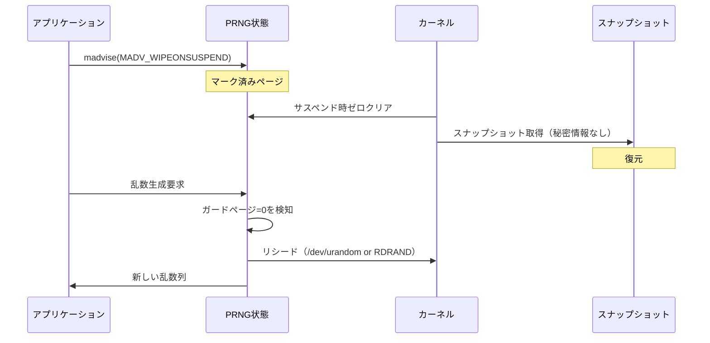

## 論文概要（Abstract）

本記事は [arXiv:2102.12892](https://arxiv.org/abs/2102.12892) の解説記事です。

サーバーレスコンピューティングにおいて、コード初期化はコールドスタート時間の大部分を占める。初期化後のメモリスナップショットを複製・復元することで、コールドスタートを数ミリ秒まで短縮できることが知られている。しかし、メモリ状態の複製はUUIDの重複、暗号ノンスの再利用、擬似乱数生成器（PRNG）の状態共有といった一意性の破壊を引き起こす。本論文では、このスナップショット複製に伴う一意性問題を体系的に分析し、Linuxカーネルへの2つのインターフェース（MADV_WIPEONSUSPENDとSysGenId）を提案している。

この記事は [Zenn記事: Bedrock AgentCore Runtime V2でMCPサーバーをデプロイしコールドスタートを2秒に短縮する](https://zenn.dev/0h_n0/articles/26235aa4b80dc0) の深掘りです。

## 情報源

- **arXiv ID**: 2102.12892
- **URL**: [https://arxiv.org/abs/2102.12892](https://arxiv.org/abs/2102.12892)
- **著者**: Marc Brooker, Adrian Costin Catangiu, Mike Danilov, Alexander Graf, Colm MacCarthaigh, Andrei Sandu（全員AWS所属）
- **発表年**: 2021
- **分野**: cs.CR（暗号とセキュリティ）

## 背景と動機（Background & Motivation）

AWS Lambdaのようなサーバーレスプラットフォームでは、リクエスト到着時にmicroVMを起動してユーザーコードを実行する。このとき、すでに起動済みのmicroVMに振り分けるウォームスタート（10ms未満）と、新しいmicroVMで初期化から開始するコールドスタートが存在する。

著者らによれば、コールドスタートの内訳は以下のとおりである：

| フェーズ | 所要時間 |
|---------|---------|
| microVMブート（最小Linuxカーネル、ネットワーク設定） | 約200ms |
| コードダウンロード（最大250MB、25Gb/sで転送） | 約80ms |
| コード初期化（ライブラリロード、静的初期化子、キャッシュ構築） | 20ms〜60s |
| ウォームスタートルーティング | 10ms未満 |

Du et al.の調査では、初期化がスタートアップ時間の25%〜95%を占めると報告されており、著者らは自身の経験もこれと一致すると述べている。初期化は実質的に顧客側の制御下にあるコードに依存するため、プラットフォーム側での最適化が困難な領域である。

スナップショットを用いたアプローチでは、初期化完了後のメモリ状態をスナップショットとして保存し、以降のコールドスタートではスナップショットの復元のみで起動する。著者らの実験ではFirecrackerのスナップショット復元が最短4msで完了すると報告されており、また関連研究のCatalyzerでは幅広いアプリケーションで10ms未満の復元時間が報告されている。

しかし、スナップショットの複製は3つのシステムレベルの課題を生む：

1. **メモリのディスク永続化**: スナップショットはRAM内容をストレージに書き出すため、暗号鍵やトークンなどの秘密情報がディスク上に残る
2. **メモリ状態の重複**: クローンはPRNG状態を含む全メモリを複製するため、UUID・ノンス・乱数が重複する
3. **セッション層プロトコルとの非互換性**: TCP/TLSは一意のクライアントを前提としており、クローンによるリプレイ攻撃のリスクが発生する

本論文は主に2番目の一意性の問題に焦点を当てている。

## 主要な貢献（Key Contributions）

- **MADV_WIPEONSUSPEND**: サスペンド時にマーク済みメモリページをゼロクリアするLinuxカーネルインターフェース。PRNG状態や秘密情報をスナップショットから排除できる
- **SysGenId（System Generation ID）**: microVMの世代を識別する単調増加カウンタを`/dev/SysGenId`デバイスとして提供。アプリケーションは世代変更を検知してリシードや状態リセットを実行できる
- **一意性問題の体系的分析**: UUID重複、暗号ノンス再利用、ユーザ空間PRNGの決定性がサーバーレス環境にもたらすリスクの分類と対策

## 技術的詳細（Technical Details）

### UUID重複の影響

RFC 4122 Version 4のUUIDは122ビットの乱数で構成される。スナップショットからクローンされた複数のmicroVMが同じPRNG状態を共有すると、同一のUUIDが生成される。著者らは以下の影響を指摘している：

- **データ破壊**: データベースの主キーとして使用されるUUIDが重複し、レコードの上書きが発生する
- **分散トレーシングの破綻**: リクエストIDやトレースIDの重複により、ログの相関分析が不可能になる
- **コンセンサスプロトコルへの攻撃**: Paxosなどの合意プロトコルは参加者の一意な識別を前提としている。クローンによる識別子の重複は意図しないシビル攻撃として機能する

### 暗号ノンスの再利用問題

AES-GCMモードにおいて、同一鍵で初期化ベクトル（IV）を再利用すると暗号文の安全性が完全に破壊される。NIST SP 800-38Dでは、IV再利用の確率が $2^{-32}$ 以下であることを要求している。

$$
P(\text{IV collision}) \leq 2^{-32}
$$

スナップショットクローンではIV生成に使用するPRNG状態が複製されるため、異なるクローンが同一のIVを確実に生成してしまう。著者らはRistenpart and Yilek (2010)によるVM復元脆弱性を利用したTLS 1.0への攻撃を引用し、この脅威が実証済みであると述べている。

### ユーザ空間PRNG問題

カーネルの`/dev/urandom`はクローン後に自動でリシードされるが、ユーザ空間のCSPRNG（暗号学的に安全な擬似乱数生成器）は問題が残る。NIST CTR_DRBG、Java SecureRandom、JavaScript `getRandomValues()`などは決定的アルゴリズムであり、シードから出力を展開する。クローンが同じPRNG状態を引き継ぐと、同一の出力列を生成する。

```python
# 擬似コード: クローン後のPRNG問題
# Clone A と Clone B が同じPRNG状態を持つ場合

# Clone A
random_bytes_a = csprng.generate(32)  # => 0xABCD...

# Clone B（同じPRNG状態からスタート）
random_bytes_b = csprng.generate(32)  # => 0xABCD...（同一！）

# UUID, ノンス, セッショントークンが全て重複する
```

著者らは、2020年だけでこのクラスのバグに350件以上のCVEが割り当てられたと報告している。AWS Lambdaは任意のバイナリを実行するため、全てのユーザ空間PRNGを制御することは困難である。

### 解決策1: MADV_WIPEONSUSPEND

Linux 4.14で導入された`MADV_WIPEONFORK`の類似機構として、著者らは`MADV_WIPEONSUSPEND`を提案している。

```c
// PRNGライブラリでの使用例
void *prng_state = mmap(NULL, PAGE_SIZE, PROT_READ | PROT_WRITE,
                        MAP_PRIVATE | MAP_ANONYMOUS, -1, 0);
madvise(prng_state, PAGE_SIZE, MADV_WIPEONSUSPEND);
// サスペンド時にこのページはゼロクリアされる
// 復元後、PRNGはガードページのゼロを検知してリシードする
```

**設計上の重要な判断**: ワイプはサスペンド時（復元時ではない）に実行される。著者らは、復元はコールドスタートのクリティカルパス上にあるため、復元時のオーバーヘッドを最小化する設計が必要だと説明している。これにより秘密情報もスナップショットから除外されるという副次的効果がある。



### 解決策2: SysGenId

著者らはMicrosoftのHyper-V VmGenId（128ビットUUID）を一般化したLinux SysGenIdを提案している。SysGenIdは`/dev/SysGenId`デバイスとして公開される単調増加の世代カウンタである。

**API設計**:
- **read()**: 現在の世代IDを取得。変更がない場合は`EWOULDBLOCK`を返す（ノンブロッキングモード）
- **write()**: 新しい世代IDを書き込むことで「確認済み」を通知
- **mmap()**: オフセット0でmmapし、現在のIDを直接メモリ参照で取得
- **ioctl SysGenId_GET_OUTDATED_WATCHERS**: 未確認のハンドル数を返す
- **ioctl SysGenId_WAIT_WATCHERS**: 全ハンドルが確認するまでブロック

`SysGenId_WAIT_WATCHERS`は、サーバーレスプラットフォームのコントロールプレーンがクローン復元後に全コードが一意性を回復したことを確認してからリクエストを送信するために使用できる。

### 2つの手法の比較

著者らは論文Table 1で以下の比較を示している：

| 特性 | MADV_WIPEONSUSPEND | VmGenId | SysGenId |
|-----|-------------------|---------|----------|
| fork対応 | ○ | × | × |
| 秘密情報排除 | ○ | × | × |
| インメモリ | ○ | ○ | ○ |
| 通知機構 | × | × | ○ |
| 非root動作 | ○ | × | ○ |
| 最小権限 | ○ | × | × |
| エントロピー提供 | × | ○ | × |
| コンテナ対応 | × | × | ○ |

著者らは、MADV_WIPEONSUSPENDは`MADV_WIPEONFORK`との互換性と秘密情報排除の面で優れ、SysGenIdは柔軟性と監視機能の面で優れると分析している。実運用ではPRNGライブラリが両方を`WIPEONFORK`と`WIPEONSUSPEND`でマークし、共通のリシードパスを使うことを推奨している。

## 実装のポイント（Implementation）

### ガードページチェックのコスト

著者らのベンチマーク（EC2 m5.12xlarge、x86）では以下の結果が報告されている：

| 操作 | レイテンシ |
|------|----------|
| `/dev/urandom`からの32バイトリシード（open/read/close含む） | 平均11μs |
| RDRAND/RDSEEDからの32バイトリシード | 約0.6μs |
| シーケンシャルノンスのガードチェックオーバーヘッド | スループット13倍低下 |
| OpenSSL md_randでのガードチェック | 統計的に有意な差なし |

シーケンシャルノンス（128ビットインクリメント）のような軽量操作ではガードチェックのコストが顕著に現れるが、実際の暗号操作（OpenSSL md_rand等）のように有意義な処理と組み合わせると、オーバーヘッドはほぼゼロに償却されると著者らは報告している。

### スナップショット取得のタイミング

```python
# スナップショットタイミングの設計判断
class SnapshotStrategy:
    """
    ワイプをサスペンド時に実行する理由:
    - 復元はコールドスタートのクリティカルパス上にある
    - サスペンドは非クリティカルパス（バックグラウンドで実行可能）
    - 秘密情報がスナップショットに含まれなくなる副次効果
    """

    def on_suspend(self, marked_pages: list[int]) -> None:
        for page in marked_pages:
            zero_fill(page)  # サスペンド時にゼロクリア

    def on_restore(self) -> None:
        # 復元時は追加作業なし（ゼロクリア済み）
        # PRNGは最初のアクセス時にガードページを検知してリシード
        pass
```

### TOCTOU（Time-of-Check/Time-of-Use）の考慮

著者らは原子性の問題も指摘している。値の生成と使用の間、または使用と破棄の間にクローンが発生すると、値が再利用される可能性がある。Lambda環境ではリクエスト処理中にのみVMを活性化し、リクエスト間のキャッシュを禁止することでこの問題に対処している。汎用的な環境では、ロードバランサやオーケストレータによる外部フェンス（ヘルスチェック完了後に接続・ストレージ書き込みを許可）が推奨されている。

## Production Deployment Guide

### AWS実装パターン（コスト最適化重視）

本論文の知見は、microVMスナップショットを使用するサーバーレス基盤に直接適用される。Amazon Bedrock AgentCore Runtime V2はFirecrackerのスナップショット起動を採用しており、本論文が扱う一意性保証はこの基盤技術の信頼性を支えている。

**トラフィック量別の推奨構成**:

| 規模 | 月間リクエスト | 推奨構成 | 月額コスト | 主要サービス |
|------|--------------|---------|-----------|------------|
| **Small** | ~3,000 (100/日) | Serverless | $50-150 | Lambda + Bedrock + DynamoDB |
| **Medium** | ~30,000 (1,000/日) | Hybrid | $300-800 | Lambda + ECS Fargate + ElastiCache |
| **Large** | 300,000+ (10,000/日) | Container | $2,000-5,000 | EKS + Karpenter + EC2 Spot |

**Small構成の詳細** (月額$50-150):
- **Lambda**: 1GB RAM, 30秒タイムアウト ($20/月)
- **Bedrock**: Claude 3.5 Haiku, Prompt Caching有効 ($80/月)
- **DynamoDB**: On-Demand ($10/月)
- **CloudWatch**: 基本監視 ($5/月)
- **API Gateway**: REST API ($5/月)

**Medium構成の詳細** (月額$300-800):
- **Lambda**: イベント処理 ($50/月)
- **ECS Fargate**: 0.5 vCPU, 1GB RAM × 2タスク ($120/月)
- **Bedrock**: Claude 3.5 Sonnet, Batch API活用 ($400/月)
- **ElastiCache Redis**: cache.t3.micro ($15/月)
- **Application Load Balancer**: ($20/月)

**Large構成の詳細** (月額$2,000-5,000):
- **EKS**: コントロールプレーン ($72/月)
- **EC2 Spot Instances**: g5.xlarge × 2-4台 (平均$800/月)
- **Karpenter**: 自動スケーリング（追加コストなし）
- **Bedrock Batch**: 50%割引活用 ($2,000/月)
- **S3**: プロンプトキャッシュストレージ ($20/月)
- **CloudWatch + X-Ray**: 詳細監視 ($100/月)

**コスト削減テクニック**:
- Spot Instances使用で最大90%削減（EKS + Karpenter）
- Reserved Instances購入で最大72%削減（1年コミット）
- Bedrock Batch API使用で50%削減
- Prompt Caching有効化で30-90%削減

**コスト試算の注意事項**:
- 上記は2026年11月時点のAWS ap-northeast-1（東京）リージョン料金に基づく概算値です
- 実際のコストはトラフィックパターン、リージョン、バースト使用量により変動します
- 最新料金は [AWS料金計算ツール](https://calculator.aws/) で確認してください

### Terraformインフラコード

**Small構成 (Serverless): Lambda + Bedrock + DynamoDB**

```hcl
module "vpc" {
  source  = "terraform-aws-modules/vpc/aws"
  version = "~> 5.0"

  name = "snapshot-safe-vpc"
  cidr = "10.0.0.0/16"
  azs  = ["ap-northeast-1a", "ap-northeast-1c"]
  private_subnets = ["10.0.1.0/24", "10.0.2.0/24"]

  enable_nat_gateway   = false
  enable_dns_hostnames = true
}

resource "aws_iam_role" "lambda_bedrock" {
  name = "lambda-bedrock-role"

  assume_role_policy = jsonencode({
    Version = "2012-10-17"
    Statement = [{
      Action    = "sts:AssumeRole"
      Effect    = "Allow"
      Principal = { Service = "lambda.amazonaws.com" }
    }]
  })
}

resource "aws_iam_role_policy" "bedrock_invoke" {
  role = aws_iam_role.lambda_bedrock.id

  policy = jsonencode({
    Version = "2012-10-17"
    Statement = [{
      Effect   = "Allow"
      Action   = ["bedrock:InvokeModel", "bedrock:InvokeModelWithResponseStream"]
      Resource = "arn:aws:bedrock:ap-northeast-1::foundation-model/anthropic.claude-3-5-haiku*"
    }]
  })
}

resource "aws_lambda_function" "handler" {
  filename      = "lambda.zip"
  function_name = "snapshot-safe-handler"
  role          = aws_iam_role.lambda_bedrock.arn
  handler       = "index.handler"
  runtime       = "python3.12"
  timeout       = 60
  memory_size   = 1024

  environment {
    variables = {
      BEDROCK_MODEL_ID    = "anthropic.claude-3-5-haiku-20241022-v1:0"
      DYNAMODB_TABLE      = aws_dynamodb_table.cache.name
      ENABLE_PROMPT_CACHE = "true"
    }
  }
}

resource "aws_dynamodb_table" "cache" {
  name         = "snapshot-prompt-cache"
  billing_mode = "PAY_PER_REQUEST"
  hash_key     = "prompt_hash"

  attribute {
    name = "prompt_hash"
    type = "S"
  }

  ttl {
    attribute_name = "expire_at"
    enabled        = true
  }
}

resource "aws_cloudwatch_metric_alarm" "lambda_cost" {
  alarm_name          = "lambda-cost-spike"
  comparison_operator = "GreaterThanThreshold"
  evaluation_periods  = 1
  metric_name         = "Duration"
  namespace           = "AWS/Lambda"
  period              = 3600
  statistic           = "Sum"
  threshold           = 100000
  alarm_description   = "Lambda実行時間異常（コスト急増の可能性）"

  dimensions = {
    FunctionName = aws_lambda_function.handler.function_name
  }
}
```

**Large構成 (Container): EKS + Karpenter + Spot Instances**

```hcl
module "eks" {
  source  = "terraform-aws-modules/eks/aws"
  version = "~> 20.0"

  cluster_name    = "snapshot-inference-cluster"
  cluster_version = "1.31"

  vpc_id     = module.vpc.vpc_id
  subnet_ids = module.vpc.private_subnets

  cluster_endpoint_public_access            = true
  enable_cluster_creator_admin_permissions   = true
}

resource "kubectl_manifest" "karpenter_provisioner" {
  yaml_body = <<-YAML
    apiVersion: karpenter.sh/v1
    kind: NodePool
    metadata:
      name: spot-pool
    spec:
      template:
        spec:
          requirements:
            - key: karpenter.sh/capacity-type
              operator: In
              values: ["spot"]
            - key: node.kubernetes.io/instance-type
              operator: In
              values: ["g5.xlarge", "g5.2xlarge"]
          limits:
            cpu: "32"
            memory: "128Gi"
      disruption:
        consolidationPolicy: WhenEmpty
        consolidateAfter: 30s
  YAML
}

resource "aws_budgets_budget" "monthly" {
  name         = "snapshot-monthly-budget"
  budget_type  = "COST"
  limit_amount = "5000"
  limit_unit   = "USD"
  time_unit    = "MONTHLY"

  notification {
    comparison_operator        = "GREATER_THAN"
    threshold                  = 80
    threshold_type             = "PERCENTAGE"
    notification_type          = "ACTUAL"
    subscriber_email_addresses = ["ops@example.com"]
  }
}
```

### セキュリティベストプラクティス

本論文の知見を踏まえたスナップショット環境でのセキュリティ対策：

1. **スナップショット内秘密情報の排除**: MADV_WIPEONSUSPENDに相当する仕組みで、スナップショット取得前に秘密情報を含むメモリ領域をクリアする
2. **復元後のPRNGリシード**: SysGenIdに相当する世代IDの変更を検知し、全PRNG状態をリシードする
3. **IAMロール最小権限**: Bedrock呼び出しに必要なモデルARNのみを許可
4. **Secrets Manager使用**: 環境変数へのハードコード禁止、復元後にSecrets Managerから再取得

### 運用・監視設定

**CloudWatch Logs Insights クエリ**:
```sql
fields @timestamp, model_id, input_tokens, output_tokens
| stats sum(input_tokens + output_tokens) as total_tokens by bin(1h)
| filter total_tokens > 100000

fields @timestamp, duration_ms
| stats pct(duration_ms, 95) as p95, pct(duration_ms, 99) as p99 by bin(5m)
```

**CloudWatch アラーム（コスト重視）**:
```python
import boto3

cloudwatch = boto3.client('cloudwatch')

cloudwatch.put_metric_alarm(
    AlarmName='bedrock-token-spike',
    ComparisonOperator='GreaterThanThreshold',
    EvaluationPeriods=1,
    MetricName='TokenUsage',
    Namespace='AWS/Bedrock',
    Period=3600,
    Statistic='Sum',
    Threshold=500000,
    ActionsEnabled=True,
    AlarmActions=['arn:aws:sns:ap-northeast-1:123456789:cost-alerts'],
    AlarmDescription='Bedrockトークン使用量異常'
)
```

**X-Ray トレーシング設定**:
```python
from aws_xray_sdk.core import xray_recorder, patch_all

patch_all()

@xray_recorder.capture('bedrock_inference')
def call_bedrock(prompt: str) -> dict:
    xray_recorder.put_annotation('model', 'claude-3-5-haiku')
    xray_recorder.put_metadata('prompt_length', len(prompt))
    response = bedrock.invoke_model(
        modelId='anthropic.claude-3-5-haiku-20241022-v1:0',
        body=json.dumps({'prompt': prompt})
    )
    xray_recorder.put_metadata('token_count', response['usage']['total_tokens'])
    return response
```

### コスト最適化チェックリスト

**アーキテクチャ選択**:
- [ ] ~100 req/日 → Lambda + Bedrock (Serverless) - $50-150/月
- [ ] ~1000 req/日 → ECS Fargate + Bedrock (Hybrid) - $300-800/月
- [ ] 10000+ req/日 → EKS + Spot Instances (Container) - $2,000-5,000/月

**リソース最適化**:
- [ ] EC2: Spot Instances優先（最大90%削減、Karpenter自動管理）
- [ ] Reserved Instances: 1年コミットで72%削減（予測可能な負荷）
- [ ] Savings Plans: Compute Savings Plans検討
- [ ] Lambda: メモリサイズ最適化（CloudWatch Insights分析）
- [ ] ECS/EKS: アイドルタイムのスケールダウン（夜間0台）

**LLMコスト削減**:
- [ ] Bedrock Batch API: 50%割引（非リアルタイム処理）
- [ ] Prompt Caching: 30-90%削減（システムプロンプト固定）
- [ ] モデル選択: 開発/テスト→Haiku、本番複雑タスク→Sonnet
- [ ] トークン数制限: max_tokens設定で過剰生成防止

**監視・アラート**:
- [ ] AWS Budgets: 月額予算設定（80%で警告、100%でアラート）
- [ ] CloudWatch アラーム: トークン使用量スパイク検知
- [ ] Cost Anomaly Detection: 自動異常検知
- [ ] 日次コストレポート: SNS/Slackへ自動送信

**リソース管理**:
- [ ] 未使用リソース削除: Lambda Insights, Trusted Advisor活用
- [ ] タグ戦略: 環境別（dev/staging/prod）でコスト可視化
- [ ] ライフサイクルポリシー: S3古いキャッシュ自動削除（30日）
- [ ] 開発環境: 夜間停止（Auto Start/Stop）

## 実験結果（Results）

著者らはEC2 m5.12xlarge（x86）上で、リシードコストとガードページチェックのオーバーヘッドを計測している。

| 指標 | 測定値 | 備考 |
|------|--------|------|
| `/dev/urandom`リシード | 平均11μs | open/read/close含む |
| RDRAND/RDSEEDリシード | 約0.6μs | Intel公称性能と一致 |
| ガードチェック（シーケンシャルノンス） | スループット13倍低下 | 軽量操作では顕著 |
| ガードチェック（OpenSSL md_rand） | 有意差なし | 実用的な暗号操作では影響なし |
| Firecrackerスナップショット復元 | 最短4ms | Introduction記載の数値 |
| Catalyzer復元時間 | 10ms未満 | 関連研究の報告値 |

著者らは、ガードページチェックのコストは実際の暗号操作と組み合わせるとほぼゼロに償却されると結論づけている。RDRANDを使用する場合のリシードコスト0.6μsは、Lambda関数の典型的な実行時間（数ms〜数秒）に対して無視できるレベルである。

なお、論文にはエンドツーエンドのコールドスタート比較やCTR_DBGのスループット影響（"TODO%"のプレースホルダが残っている）は含まれていない点に注意が必要である。

## 実運用への応用（Practical Applications）

### AgentCore Runtime V2との関連

Zenn記事で解説したBedrock AgentCore Runtime V2は、FirecrackerのmicroVMスナップショット起動を基盤技術としている。V2のコールドスタートがイメージサイズによらずP75で1.9〜2.0秒に収まるのは、まさに本論文が扱うスナップショット/クローン技術の成果である。

本論文の一意性保証メカニズムは、AgentCore Runtime V2のセッションIDベースのmicroVMアフィニティにも関連する。各microVMクローンが一意なセッションIDを生成できるのは、復元後のPRNGリシードが適切に機能しているためである。

### スケーリング時の考慮事項

- **大規模クラスタ**: 数千のmicroVMクローンが同時に復元される環境では、SysGenIdの通知完了待ち（`SysGenId_WAIT_WATCHERS`）がボトルネックになる可能性がある
- **コスト最適化**: スナップショット取得時のメモリワイプは非クリティカルパスで実行されるため、コスト面の影響は軽微
- **セキュリティ**: スナップショットをディスクに永続化する場合、KMS暗号化とアクセス制御が必須

## 関連研究（Related Work）

- **Catalyzer (Du et al., ASPLOS 2020)**: サブミリ秒の初期化なしブートを実現。幅広いアプリケーションで10ms未満の復元時間を報告しており、本論文の前提となる高速復元技術を提供している
- **SEUSS (Cadden et al., EuroSys 2020)**: ユニカーネルベースのスナップショット/復元アプローチ。新しいランタイムごとにバックポートが必要という制約がある
- **Ristenpart and Yilek (2010)**: VM復元時の暗号脆弱性を実証。TLS 1.0に対する攻撃でIV再利用のリスクを示した。本論文の動機の一つ
- **Firecracker (Agache et al., NSDI 2020)**: AWS Lambdaの基盤VMM。インクリメンタルスナップショットと高速復元機能を提供し、本論文のスナップショット複製基盤となっている
- **GCM-SIV (RFC 8452)**: ノンス再利用に対する耐性を持つ暗号モード。著者らはこのアプローチが有効だが既存プロトコルの多くは未対応であると述べている

## まとめと今後の展望

本論文は、サーバーレス環境におけるmicroVMスナップショットの複製・復元が引き起こす一意性問題を体系的に分析し、MADV_WIPEONSUSPENDとSysGenIdという2つのLinuxカーネルインターフェースで解決するアプローチを提案している。

著者らによれば、これらの手法は低オーバーヘッド（実用的な暗号操作では統計的有意差なし）で柔軟性が高く、比較的容易に既存のPRNGライブラリへ統合できる。また、SysGenIdの一つはメインラインLinuxカーネルに貢献されたことが報告されている。

AgentCore Runtime V2のスナップショット起動は、本論文が解決した一意性保証の上に成り立っている。コンテナイメージのサイズに依存しない一定のコールドスタート時間は、初期化済みスナップショットの復元というアプローチが実用レベルに達したことを示している。一方で、ユーザ空間の全PRNGを制御する困難さや、TOCTOU問題への汎用的な解決策は今後の課題として残されている。

## 参考文献

- **arXiv**: [https://arxiv.org/abs/2102.12892](https://arxiv.org/abs/2102.12892)
- **Firecracker**: [https://github.com/firecracker-microvm/firecracker](https://github.com/firecracker-microvm/firecracker)
- **Related Zenn article**: [https://zenn.dev/0h_n0/articles/26235aa4b80dc0](https://zenn.dev/0h_n0/articles/26235aa4b80dc0)
