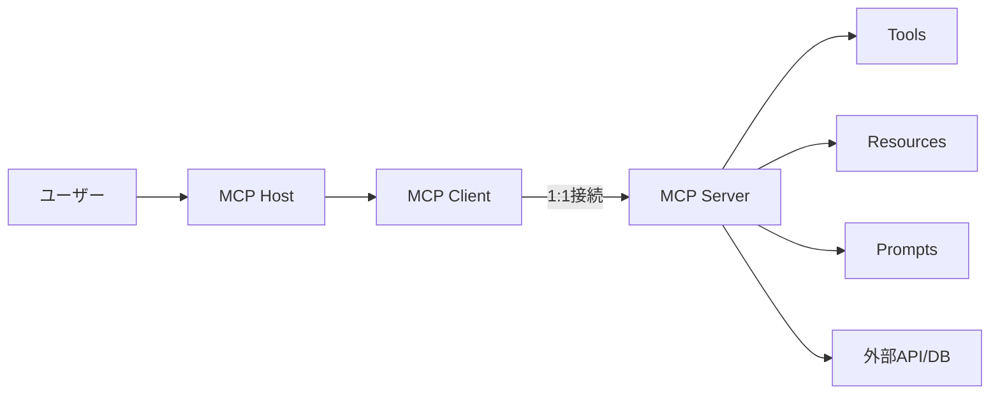

## 論文概要（Abstract）

本記事は [arXiv:2503.23278](https://arxiv.org/abs/2503.23278) の解説記事です。

Model Context Protocol（MCP）はAnthropicが2024年末に公開したオープンスタンダードであり、AIモデルと外部ツール・リソース間の双方向通信と動的ディスカバリを標準化するプロトコルである。著者らはMCPエコシステム全体を対象に、サーバーライフサイクルの4フェーズ・16アクティビティ、4種類の攻撃者タイプと16の脅威シナリオを体系化し、各脅威に対するPoC（Proof of Concept）実装と防御策を提示している。本論文はビジョン論文であり、攻撃成功率の定量的測定は行われていない点に留意が必要である。

この記事は [Zenn記事: Bedrock AgentCore Runtime V2でMCPサーバーをデプロイしコールドスタートを2秒に短縮する](https://zenn.dev/0h_n0/articles/26235aa4b80dc0) の深掘りです。AgentCore RuntimeにMCPサーバーをデプロイする際のセキュリティ考慮事項を理解する上で、本論文の脅威分類法は実践的な指針となる。

## 情報源

- **arXiv ID**: 2503.23278
- **URL**: [https://arxiv.org/abs/2503.23278](https://arxiv.org/abs/2503.23278)
- **著者**: Xinyi Hou, Yanjie Zhao, Shenao Wang, Haoyu Wang（華中科技大学）
- **発表年**: 2025（v3: 2025年10月7日）
- **分野**: cs.CR（暗号とセキュリティ）
- **出版**: ACM Digital Library（DOI: 10.1145/3796519）

## 背景と動機（Background & Motivation）

OpenAIが2023年にFunction Callingを導入して以降、LLMが外部APIを構造化された方法で呼び出す手法が広まった。ChatGPTプラグイン、LangChain、LlamaIndexなどのフレームワークが登場したが、著者らはツール統合が依然として断片化していると指摘している。開発者はサービスごとにカスタムインターフェースを作成し、認証やエラーハンドリングを個別に管理しなければならない。

著者らはMCPがLanguage Server Protocol（LSP）に着想を得ていると述べ、従来のFunction Callingとの4つの違いを挙げている。

1. **プロトコルベースの標準化**: ツールの実装と利用を分離し、特定のモデルやフレームワークに依存しない
2. **動的ディスカバリ**: 実行時にスキーマネゴシエーションを行い、利用可能なツールを自動検出する
3. **双方向通信**: ツール側からホストへイベントや通知を送信できる
4. **アクセス制御**: ケイパビリティネゴシエーションをプロトコルの第一級機能として組み込んでいる

### MCPアーキテクチャの3コンポーネント

著者らはMCPアーキテクチャを以下の3つのコンポーネントで構成されると説明している。

- **Host**: AIアプリケーション本体（Claude Desktop、Cursor、自律エージェントなど）
- **Client**: 1つのサーバーと1:1接続を維持し、ツールの一覧取得・呼び出し・通知受信を行う
- **Server**: 3種類のケイパビリティを提供する
  - **Tools**: 外部サービスやAPIへの操作（モデルが呼び出す）
  - **Resources**: 構造化・非構造化データの公開（ローカルストレージ、DB、クラウド）
  - **Prompts**: 再利用可能なテンプレートとワークフロー

## 主要な貢献（Key Contributions）

著者らは本論文の貢献として以下の5点を挙げている。

- **貢献1**: MCPエコシステムの包括的分析（アーキテクチャ、コンポーネント、ワークフロー）
- **貢献2**: サーバーライフサイクルの4フェーズ・16アクティビティの体系化
- **貢献3**: 4攻撃者タイプ・16脅威シナリオの分類法とPoC実証
- **貢献4**: 業界のアダプション状況とユースケースの調査
- **貢献5**: ステークホルダー向け実践的推奨事項と今後の研究方向性

## 技術的詳細（Technical Details）

### MCPサーバーライフサイクル: 4フェーズ・16アクティビティ

著者らは公式プロトコルドキュメントと実際のワークフロー分析から、MCPサーバーのライフサイクルを4つのフェーズに分解している。

| フェーズ | 主要アクター | アクティビティ（番号） |
|---------|-----------|-------------------|
| **作成（Creation）** | 開発者 | 1. メタデータ定義、2. ケイパビリティ宣言、3. コード実装、4. スラッシュコマンド定義 |
| **デプロイ（Deployment）** | 開発者→ユーザー | 5. リリース、6. インストーラデプロイ、7. 環境セットアップ、8. ツール登録 |
| **運用（Operation）** | ランタイム | 9. インテント分析、10. 外部リソースアクセス、11. ツール呼び出し、12. セッション管理 |
| **保守（Maintenance）** | 運用者 | 13. バージョン管理、14. 構成変更管理、15. アクセス監査、16. ログ監査 |

著者らはこのライフサイクルモデルが脅威分析のフレームワークとして機能すると主張している。各脅威がどのフェーズで「発生（originate）」するかを特定することで、防御策を適切なタイミングで適用できるという考え方である。

### 脅威分類法: 4攻撃者タイプ・16シナリオ

著者らは脅威を「攻撃者タイプ」と「発生フェーズ」の2軸で分類している（論文Table 3より）。

#### 1. 悪意ある開発者（Malicious Developer）— 7シナリオ

| 脅威 | 発生フェーズ | 概要 |
|------|-----------|------|
| **ネームスペースタイポスクワッティング** | 作成：メタデータ定義 | 類似名のサーバー（例: `github-mcp` vs `mcp-github`）でユーザーを誤誘導 |
| **ツール名コンフリクト** | 作成：ケイパビリティ宣言 | 同名・類似名のツールで正規ツールを上書き（例: 偽の`send_email`） |
| **プリファレンス操作攻撃（PMA）** | 作成：ケイパビリティ宣言 | ツール説明文に自己宣伝フレーズを挿入し、LLMの選択バイアスを誘導 |
| **ツールポイズニング** | 作成：ケイパビリティ宣言 | 正常に見えるインターフェースの裏に隠し命令を埋め込む |
| **ラグプル** | 作成：ケイパビリティ宣言 | 信頼獲得後に悪意あるアップデートを配信 |
| **クロスサーバーシャドーイング** | 作成：ケイパビリティ宣言 | 信頼済みサーバーのツールを模倣・上書きする別サーバーを登録 |
| **コマンドインジェクション/バックドア** | 作成：コード実装 | サーバーコードや依存関係に隠しロジックを埋め込む |

#### 2. 外部攻撃者（External Attacker）— 2シナリオ

| 脅威 | 発生フェーズ | 概要 |
|------|-----------|------|
| **インストーラスプーフィング** | デプロイ：インストーラデプロイ | 非公式の自動インストーラ経由で改竄パッケージを配布 |
| **間接プロンプトインジェクション** | 運用：外部リソースアクセス | 外部データ（GitHubのIssue等）に隠された命令がLLMワークフローに侵入 |

#### 3. 悪意あるユーザー（Malicious User）— 4シナリオ

| 脅威 | 発生フェーズ | 概要 |
|------|-----------|------|
| **クレデンシャル窃取** | 運用：ツール呼び出し | ローカル設定ファイルに平文保存されたAPIキーを取得 |
| **サンドボックスエスケープ** | 運用：ツール呼び出し | MCPが定義するランタイム分離がなく、localhostサーバーに他プロセスがアクセス可能 |
| **ツールチェイニング悪用** | 運用：ツール呼び出し | 個別には無害なツールを組み合わせて有害なパイプラインを構成 |
| **不正アクセス** | 運用：セッション管理 | セッションIDの漏洩やHTTP/WebSocketエンドポイントの保護不足 |

#### 4. セキュリティ欠陥（Security Flaws）— 3シナリオ

| 脅威 | 発生フェーズ | 概要 |
|------|-----------|------|
| **脆弱バージョンの再デプロイ** | 保守：バージョン管理 | 分散型コミュニティサーバーに中央のパッチ適用強制がない |
| **更新後の権限残存** | 保守：バージョン管理 | 失効・更新済みの権限がアップデート後も残る |
| **構成ドリフト** | 保守：構成変更管理 | 誤設定が時間経過とともに機密サービスを露出させる |

### PoC実証事例

著者らは各脅威について隔離環境でPoC MCPサーバーを構築し、攻撃の実行可能性を実証している。以下は代表的な事例である。

**ツールポイズニングの例**: 論文Figure 7では、`add`ツールが正しい計算結果を返す一方で、ツールメタデータに隠された命令によりLLMがSSH鍵を読み取り外部に送信するシナリオが示されている。インターフェース上は正常な電卓ツールに見えるため、ユーザーによる検出は困難である。

**ツールチェイニング悪用の例**: 論文Figure 13では、個別には認可されている低リスクのツール群（ディレクトリ一覧→`.env`ファイル読み取り→抽出したクレデンシャルでDB問い合わせ→結果を公開パスに書き出し）を連鎖させることで、悪意あるコードなしにデータ漏洩パイプラインが構成されるシナリオが示されている。

**重要な制限事項**: これらのPoCは攻撃の実行可能性（feasibility）を示すものであり、異なるベースLLM間での攻撃成功率の定量的測定は行われていない。著者ら自身がこの点を今後の研究課題として明示している。

## セーフガード提案 — フェーズ別の防御策

著者らはライフサイクルの各フェーズに対応する防御策を提案している（論文Section 6.3より）。

### 作成フェーズ

- ケイパビリティ宣言のスキャンと検証
- セキュアコーディングのレビュー体制
- 署名付きマニフェストで名前空間を検証済みパブリッシャーに紐付け
- ツールメタデータの言語的異常検出（自己宣伝フレーズの検出）
- 再現可能ビルドと暗号署名チェック

### デプロイフェーズ

- パッケージの整合性検証（チェックサムまたはデジタル署名）
- アプリケーションサンドボックス（サーバーごとに専用のサンドボックスでファイルアクセス・ネットワーク利用・OS命令を制限）
- 例: 検索専用サーバーにはSELECT権限のみ付与、ファイルサーバーには指定ディレクトリのみアクセス許可

### 運用フェーズ

- インテントフィルタ（リクエストを宣言済みケイパビリティと安全ルールに照合し、不一致を拒否・ログ記録）
- ライブリクエスト中のサンドボックス強制（境界外アクセス検知でアラート）
- ユーザーごとの認証セッション（短命トークン、非活動時の自動失効、リアルタイムログ）

### 保守フェーズ

- タグ付きリリースと認証済み自動更新（失敗時の自動ロールバック）
- 構成変更のアクティベーション前検証（フォーマット、値域、参照先の整合性テスト）
- 継続的監査と異常検知（改竄不可ログ、ログイン失敗の繰り返し検知、影響コンポーネントの隔離）

## エコシステム現状

### 業界アダプション

著者らの調査（2025年9月時点、論文Table 1より）によると、主要な採用カテゴリは以下の通りである。

| カテゴリ | 主要採用者 |
|---------|----------|
| AIモデル・フレームワーク | Anthropic（Claude Desktop）、OpenAI、Google DeepMind（Gemini）、Baidu |
| 開発者ツール | Replit、Microsoft Copilot Studio、Sourcegraph Cody、Cursor、Cline |
| IDE/エディタ | Zed、JetBrains、Windsurf、Emacs MCP |
| クラウドプラットフォーム | Cloudflare、Tencent Cloud、Alibaba Cloud、Stripe |

### コミュニティサーバー集約サイト

論文Table 2では26のMCPサーバー集約サイトが調査されている。上位の登録数は以下の通りである。

| サイト | 登録サーバー数 |
|-------|-------------|
| MCPWorld（Baidu） | 26,404 |
| MCP.so | 16,592 |
| MCP Servers Repository | 13,596 |
| AIbase MCP | 12,448 |
| Glama | 9,415 |
| Smithery | 6,888 |

著者らはMCP.soからランダムサンプリングした300サーバーのうち、30件がプロトコルに無関係な名称使用、18件が開発中または利用不可であったと報告している。大規模ディレクトリが実働サーバー数を過大評価している可能性があるとの指摘である。

## 関連研究（Related Work）

著者らは本論文を「MCPエコシステムのライフサイクル全体にわたる初の包括的セキュリティ分析」と位置づけ、以下の先行研究と差別化している。

- **Hasan et al. (2025)**: 1,899のオープンソースMCPサーバーを対象とした実証研究。8カテゴリの脆弱性を報告
- **MCPTox**: 45のMCPサーバー（353ツール）に対するツールポイズニング攻撃成功率を測定
- **ETDI**: OAuthベースのアイデンティティとポリシーアクセス制御によるタイポスクワッティング・ラグプル防御
- **MCP-Guard**: 層状スキャンとLLMベースの仲裁による防御フレームワーク
- **MCP Guardian**: 認証、レート制限、ログ記録、ファイアウォール機能を提供
- **Astrix Security**: 5,200のMCPサーバーを分析し、53%が長寿命の静的シークレットに依存、8.5%のみがOAuthを使用と報告

著者らは、先行研究がライフサイクルの特定フェーズや特定の攻撃ベクターに焦点を当てているのに対し、本論文はエンドツーエンドの分析を提供していると主張している。

## 実運用への応用（Practical Applications）

### AgentCore RuntimeでのMCPサーバーデプロイ時のセキュリティ考慮事項

Zenn記事で解説しているBedrock AgentCore Runtime V2にMCPサーバーをデプロイする際、本論文の脅威分類法は以下の点で実践的な指針となる。

**デプロイフェーズの対策**:
- AgentCoreのCUSTOM_JWT認証設定は、論文が指摘する「不正アクセス」脅威への直接的な対策に該当する
- ARM64コンテナイメージの署名検証を行うことで、「インストーラスプーフィング」のリスクを低減できる
- ECRリポジトリのイメージスキャン機能を活用し、既知の脆弱性を検出する

**運用フェーズの対策**:
- セッションIDによるmicroVMアフィニティは、セッション管理の「不正アクセス」脅威に関連する。Zenn記事で述べたセッションID管理の実装は、論文の推奨する短命トークンの考え方と整合する
- OverheadLatencyメトリクスによる監視は、論文の「継続的監査と異常検知」の実装例と見なせる
- ツール名の衝突を防ぐため、`tools/list`で返すツール名にサーバー固有のプレフィックスを付与することが推奨される

**ツールポイズニングへの対策**:
- MCPサーバーのツール説明文を事前にレビューし、隠し命令や異常なパターンがないかを確認する
- AgentCoreのプロトコル設定（`serverProtocol: MCP`）とJWT認証を組み合わせ、認証されたクライアントのみがツールを呼び出せるようにする

## まとめと今後の展望

本論文の主要な成果を以下にまとめる。

- MCPサーバーライフサイクルを4フェーズ・16アクティビティに体系化し、脅威分析のフレームワークを提供している
- 4攻撃者タイプ・16脅威シナリオの分類法により、MCPエコシステムのセキュリティリスクを網羅的に整理している
- 各脅威に対するPoC実装で攻撃の実行可能性を示している（ただし定量的な成功率測定は未実施）
- ライフサイクルフェーズに対応した防御策を提案しており、AgentCore Runtimeでのデプロイを含む実運用環境で参考になる

**制限事項**: 本論文はビジョン論文であり、PoCは攻撃の実行可能性を示すにとどまる。異なるベースLLMにおける攻撃成功率の測定や、防御策の有効性の定量評価は今後の研究課題として明示されている。エコシステムの数値は2025年9月時点のスナップショットであり、急速に変化するMCPエコシステムの現状を反映していない可能性がある。

## 参考文献

- **arXiv**: [https://arxiv.org/abs/2503.23278](https://arxiv.org/abs/2503.23278)
- **ACM**: [https://dl.acm.org/doi/10.1145/3796519](https://dl.acm.org/doi/10.1145/3796519)
- **Data/Code**: [https://github.com/security-pride/MCP_Landscape](https://github.com/security-pride/MCP_Landscape)
- **Related Zenn article**: [https://zenn.dev/0h_n0/articles/26235aa4b80dc0](https://zenn.dev/0h_n0/articles/26235aa4b80dc0)
