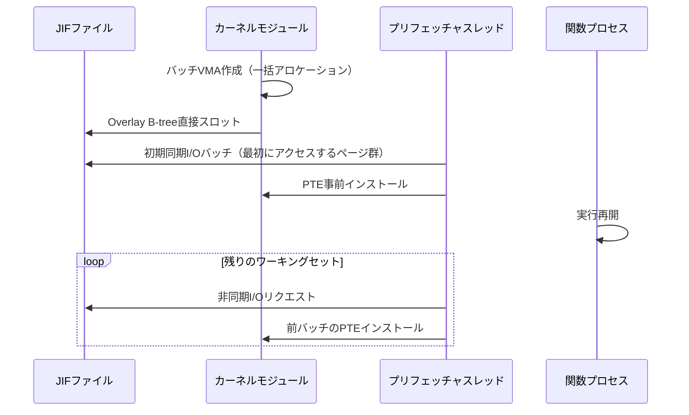

## 論文概要（Abstract）

本記事は [arXiv:2509.14292](https://arxiv.org/abs/2509.14292) の解説記事です。

サーバーレスコンピューティングはきめ細かいスケーラビリティを提供する一方、非アクティブな関数の呼び出し時にコールドスタート遅延が発生するという問題を抱えている。従来はサブミリ秒のコールドスタートにはメモリ上にステートを保持する必要があると考えられてきたが、MIT CSAILのBen Holmesらは本論文でこの仮定に異議を唱えている。著者らは、ストレージ速度ではなくOSレベルの制約がディスクからの高速復元の真のボトルネックであると分析し、OS協調設計によるスナップショット/リストア実行エンジン**Spice**を提案している。

著者らの報告によると、Spiceは既存のプロセスベースシステムと比較して最大14.9倍、VMベースシステムと比較して最大10.6倍のレイテンシ削減を達成している。

この記事は [Zenn記事: Bedrock AgentCore Runtime V2でMCPサーバーをデプロイしコールドスタートを2秒に短縮する](https://zenn.dev/0h_n0/articles/26235aa4b80dc0) の深掘りです。

## 情報源

- **arXiv ID**: 2509.14292
- **URL**: [https://arxiv.org/abs/2509.14292](https://arxiv.org/abs/2509.14292)
- **著者**: Ben Holmes, Baltasar Dinis, Lana Honcharuk, Joshua Fried, Adam Belay（MIT CSAIL）
- **発表年**: 2025年9月（arXiv v1）、OSDI'26に採択
- **分野**: cs.OS, cs.DC

## 背景と動機（Background & Motivation）

AWS LambdaやAzure Functionsなどのサーバーレスプラットフォームでは、関数はコンテナまたは軽量VM内にパッケージングされ、呼び出し時に初期化される。コールドスタート遅延はコンテナセットアップ、ランタイム初期化、ライブラリロード、JITコンパイル等から生じ、数十〜数百ミリ秒に達する。場合によっては関数自体の実行時間を上回ることもある。

既存のアプローチは大きく2つに分類される。

- **ウォームステート方式**: keep-aliveやforkベースのレプリケーション（RDMA、CXL活用）。高速だが、保持する関数数に比例したメモリを消費する
- **コールドステート方式**: 初期化済み状態を永続ストレージにシリアライズし、要求時にリロードする。メモリ効率は良いが、復元レイテンシがウォームスタートに遠く及ばない

著者らは既存のコールドステート方式の性能ギャップがハードウェア限界ではなく**OSインタフェースの不整合**に起因すると主張している。具体的には以下の3つのOS制約を指摘している。

### 制約1: メタデータ（カーネルステート）復元のコスト

Linuxにはプロセスのカーネル管理ステート（スレッド、ファイルディスクリプタ、メモリマッピング、シグナルハンドラ等）を一括復元するネイティブインタフェースが存在しない。

- **CRIUのsyscall replay方式**: 空プロセスから元のsyscallを再発行する。1つのファイルディスクリプタの復元に`open`、`lseek`、`dup`、`fcntl`等の複数コールが必要で、JVMアプリケーションでは数千回に達する
- **フルVM方式**: カーネル構造が永続化されるためreplayは不要だが、ゲストカーネル全体が復活し、デーモンやRCU回収等のハウスキーピングスレッドが関数の実行を遅延させる

### 制約2: メモリ復元の不確実性

- `read()`による同期プリフェッチはスレッドをブロックする
- `madvise()`はヒントに過ぎず、カーネルが無視・部分適用する可能性がある
- フェッチ済みページもPTEマッピング前の最初のアクセスでマイナーフォルトが発生する
- Copy-on-Write（CoW）マッピングされたページへの書き込みでフォルト＋ページコピーが生じる。JVM関数では起動時に数万回のCoWフォルトが発生し、数十ミリ秒のコストとなる

### 制約3: メモリ共有の非効率性

共有ライブラリやランタイムはページキャッシュに存在するが、関数のワーキングセットの17〜51%を占める（論文Figure 5より）。しかしOSはVMA単位でプライベートページと共有ページを分離するインタフェースを持たず、CRIUはPTE単位の更新、他のシステムは多数の小さなVMAへの分割で対処しており、いずれもスケールしない。

## 主要な貢献（Key Contributions）

- **JIF（Joint Image Format）**: プロセス復元に必要なすべての情報（シリアライズ済みカーネルメタデータ、メモリページ、レイアウト情報）を1つの構造化バイナリファイルにパッキングする、ELFにインスパイアされたスナップショットフォーマット
- **Overlay VMA**: 共有バッキングファイル上にプライベート修正ページをスパースにオーバーレイするカーネル構造。B-treeで修正ページを管理し、アドレス空間の断片化を回避する
- **バッチVMA作成**: VMAを個別ではなく一括で作成し、事前計算済みのOverlay B-treeをカーネルのメモリ管理フレームワークに直接スロットする
- **最適化されたプリフェッチ**: JIFレイアウトに基づきワーキングセット全体を1回の高スループットI/Oで取得し、PTEを事前ポピュレートすることでマイナーフォルトを排除する

## 技術的詳細（Technical Details）

### Spiceのアーキテクチャ

Spiceはコンテナ内のプロセスレベルでスナップショットを取得する。VM全体ではなくコンテナが標準的なサーバーレスデプロイ単位であるため、呼び出しごとに取得すべきステートが小さくなる。

設計目標は3つある。

1. 非本質的な初期化を遅延させ、クリティカルパス上のステートを最小化する
2. 関数非依存のセットアップを事前に済ませ、汎用的な準備を償却する
3. 復元中にI/Oと計算をオーバーラップさせ、並列性を最大化する

### JIFフォーマットとメタデータ復元

JIF内のメタデータセクションは、サブシステムごとのシリアライザによって生成される。ネットワーキングやIPCのシリアライザは空のパイプ・ソケットバッファをトリミングし、必須のインフライトデータのみを保存する。

復元時は、このコンパクトなバイナリから直接プロセスを再構築する。CRIUのような数千回のカーネルエントリオーバーヘッドを回避し、バッチ化されたユーザスペース操作として実行される。さらに、ファイルディスクリプタは復元時に再オープンせず、最初の使用時に遅延解決することで、ファイルシステムトラバーサルをクリティカルパスから外している。

### メモリ復元メカニズム

復元は2つのタスクが同時に開始される。



**バッチVMA作成**: VMAを1つずつ作成する代わりに、単一のバッチアロケーションで処理する。JIF内に事前計算・事前バランス済みのOverlay B-treeがバイナリ形式で格納されており、デシリアライズなしでカーネルのメモリ管理フレームワークにスロットされる。

**Overlay VMA**: 共有バッキングファイルをマッピングし、コンパクトなB-treeを補助構造として使用する。B-treeの各エントリはページを「プライベート修正済み」または「ゼロ埋め」としてマークする。

$$
\text{Fault}(addr) = \begin{cases}
\text{Private overlay (JIF)} & \text{if B-tree marks modified} \\
\text{Shared backing file} & \text{if unmodified} \\
\text{Zero page} & \text{if B-tree marks zero}
\end{cases}
$$

ここで、$addr$はフォルトが発生したアドレスである。プロファイルされたワークロードではプリフェッチによりフォルト自体の発生を防止し、B-treeは実行パスがプロファイルから逸脱した場合の正確性保証として機能する。

**ページ使用パターンに基づく最適化**:
- 初期化時に修正されたが通常実行時には書き込まれないページ → CoWマッピング（共有可能）
- プライベートで頻繁に書き込まれるページ → 書き込み可能メモリとして直接インストール（CoWバイパス）

これにより、ページキャッシュ内のread-mostlyデータはコンテナ破棄後も生存し、アイドルインスタンスを維持せずとも後続の呼び出しが高速に開始できる。

### オフラインJIF準備

1. 関数を複数回プリウォーム（JITコンパイル等の完了）
2. フルメモリチェックポイント取得
3. ファイルバックドページをバッキングファイルと比較し、未修正ページをJIFから除去（ファイル参照に置換）
4. 各VMAに対してOverlay VMAを生成（B-treeは事前バランス済みバイナリ形式で保存）
5. 追加の呼び出しでメモリアクセストレースを取得し、アクセス順にページを再配置

ステップ5により、復元時のI/Oがシーケンシャルリードとなり、高スループットを実現する。

## 実装のポイント（Implementation）

- **メタデータ復元**: Junction（ユーザスペースライブラリOS）内に実装。JunctionはLinuxカーネルインタフェースを実装し、ほとんどのsyscallをユーザスペースで処理する。seccompとchrootのジェイル内でLinuxバイナリを無修正で実行可能
- **jiftool**: JIFイメージの構築・更新・検証ツール（Rust、7,400行）
- **メモリモジュール**: Linuxカーネルモジュール（Linux 6.5.0、4,300行）。ワーキングセット推定も担当。カーネル内トレーシングにより、ユーザスペーストレーサが実行を歪める問題を回避
- **スナップショットサイズ削減**: アプリケーション協調（チェックポイント前のGC実行・キャッシュ破棄）とOS側の`MADV_FREE`→`MADV_DONTNEED`変換、スタックのトリミング

著者らは、完全な実装にはLinuxカーネルへの深い変更が必要であり、本プロトタイプはカーネルコミュニティへのブループリントと位置付けていると述べている。

## Production Deployment Guide

### AWS実装パターン（コスト最適化重視）

Spiceの研究成果をサーバーレス基盤に応用する場合、以下のAWS構成が考えられる。AgentCore Runtime V2が採用するスナップショット起動と同様のアプローチだが、Spiceのプロセスレベル最適化はさらなる改善の余地を示している。

**トラフィック量別の推奨構成**:

| 規模 | 月間リクエスト | 推奨構成 | 月額コスト目安 | 主要サービス |
|------|--------------|---------|-----------|------------|
| **Small** | ~3,000 (100/日) | Serverless | $50-150 | Lambda + Bedrock + DynamoDB |
| **Medium** | ~30,000 (1,000/日) | Hybrid | $300-800 | Lambda + ECS Fargate + ElastiCache |
| **Large** | 300,000+ (10,000/日) | Container | $2,000-5,000 | EKS + Karpenter + EC2 Spot |

**Small構成の詳細** (月額$50-150):
- **Lambda**: 1GB RAM, 30秒タイムアウト ($20/月)
- **Bedrock**: Claude 3.5 Haiku, Prompt Caching有効 ($80/月)
- **DynamoDB**: On-Demand ($10/月)
- **CloudWatch**: 基本監視 ($5/月)

**Large構成の詳細** (月額$2,000-5,000):
- **EKS**: コントロールプレーン ($72/月)
- **EC2 Spot**: g5.xlarge × 2-4台 (平均$800/月)
- **Karpenter**: 自動スケーリング
- **Bedrock Batch**: 50%割引活用 ($2,000/月)

**コスト試算の注意事項**: 上記は2026年11月時点のAWS ap-northeast-1（東京）リージョン料金に基づく概算値です。実際のコストはトラフィックパターン、リージョン、バースト使用量により変動します。最新料金は [AWS料金計算ツール](https://calculator.aws/) で確認してください。

### Terraformインフラコード

**Small構成 (Serverless): Lambda + Bedrock + DynamoDB**

```hcl
module "vpc" {
  source  = "terraform-aws-modules/vpc/aws"
  version = "~> 5.0"

  name = "spice-demo-vpc"
  cidr = "10.0.0.0/16"
  azs  = ["ap-northeast-1a", "ap-northeast-1c"]
  private_subnets = ["10.0.1.0/24", "10.0.2.0/24"]

  enable_nat_gateway   = false
  enable_dns_hostnames = true
}

resource "aws_iam_role" "lambda_bedrock" {
  name = "lambda-bedrock-role"

  assume_role_policy = jsonencode({
    Version = "2012-10-17"
    Statement = [{
      Action    = "sts:AssumeRole"
      Effect    = "Allow"
      Principal = { Service = "lambda.amazonaws.com" }
    }]
  })
}

resource "aws_iam_role_policy" "bedrock_invoke" {
  role = aws_iam_role.lambda_bedrock.id

  policy = jsonencode({
    Version = "2012-10-17"
    Statement = [{
      Effect   = "Allow"
      Action   = ["bedrock:InvokeModel", "bedrock:InvokeModelWithResponseStream"]
      Resource = "arn:aws:bedrock:ap-northeast-1::foundation-model/anthropic.claude-3-5-haiku*"
    }]
  })
}

resource "aws_lambda_function" "handler" {
  filename      = "lambda.zip"
  function_name = "spice-handler"
  role          = aws_iam_role.lambda_bedrock.arn
  handler       = "index.handler"
  runtime       = "python3.12"
  timeout       = 60
  memory_size   = 1024

  environment {
    variables = {
      BEDROCK_MODEL_ID    = "anthropic.claude-3-5-haiku-20241022-v1:0"
      DYNAMODB_TABLE      = aws_dynamodb_table.cache.name
      ENABLE_PROMPT_CACHE = "true"
    }
  }
}

resource "aws_dynamodb_table" "cache" {
  name         = "spice-prompt-cache"
  billing_mode = "PAY_PER_REQUEST"
  hash_key     = "prompt_hash"

  attribute {
    name = "prompt_hash"
    type = "S"
  }

  ttl {
    attribute_name = "expire_at"
    enabled        = true
  }
}

resource "aws_cloudwatch_metric_alarm" "lambda_cost" {
  alarm_name          = "spice-lambda-cost-spike"
  comparison_operator = "GreaterThanThreshold"
  evaluation_periods  = 1
  metric_name         = "Duration"
  namespace           = "AWS/Lambda"
  period              = 3600
  statistic           = "Sum"
  threshold           = 100000
  alarm_description   = "Lambda実行時間異常"

  dimensions = {
    FunctionName = aws_lambda_function.handler.function_name
  }
}
```

**Large構成 (Container): EKS + Karpenter + Spot**

```hcl
module "eks" {
  source  = "terraform-aws-modules/eks/aws"
  version = "~> 20.0"

  cluster_name    = "spice-inference-cluster"
  cluster_version = "1.31"

  vpc_id     = module.vpc.vpc_id
  subnet_ids = module.vpc.private_subnets

  cluster_endpoint_public_access            = true
  enable_cluster_creator_admin_permissions   = true
}

resource "kubectl_manifest" "karpenter_provisioner" {
  yaml_body = <<-YAML
    apiVersion: karpenter.sh/v1alpha5
    kind: Provisioner
    metadata:
      name: spot-provisioner
    spec:
      requirements:
        - key: karpenter.sh/capacity-type
          operator: In
          values: ["spot"]
        - key: node.kubernetes.io/instance-type
          operator: In
          values: ["g5.xlarge", "g5.2xlarge"]
      limits:
        resources:
          cpu: "32"
          memory: "128Gi"
      providerRef:
        name: default
      ttlSecondsAfterEmpty: 30
  YAML
}

resource "aws_budgets_budget" "monthly" {
  name         = "spice-monthly-budget"
  budget_type  = "COST"
  limit_amount = "5000"
  limit_unit   = "USD"
  time_unit    = "MONTHLY"

  notification {
    comparison_operator        = "GREATER_THAN"
    threshold                  = 80
    threshold_type             = "PERCENTAGE"
    notification_type          = "ACTUAL"
    subscriber_email_addresses = ["ops@example.com"]
  }
}
```

### セキュリティベストプラクティス

- **ネットワーク**: EKSの`cluster_endpoint_public_access = false`設定（本番環境）、Lambda VPC内配置
- **IAM**: 最小権限の原則、Service Account + IRSA
- **シークレット**: Secrets Manager使用、環境変数ハードコード禁止
- **暗号化**: S3/DynamoDB/EBSすべてKMS暗号化
- **監査**: CloudTrail全リージョン有効化、GuardDuty脅威検知

### 運用・監視設定

```sql
-- CloudWatch Logs Insights: コールドスタート検知
fields @timestamp, @duration, @billedDuration, @memorySize, @maxMemoryUsed
| filter @type = "REPORT"
| stats avg(@duration) as avg_ms, pct(@duration, 95) as p95_ms, pct(@duration, 99) as p99_ms by bin(5m)
```

```python
import boto3

cloudwatch = boto3.client('cloudwatch')

cloudwatch.put_metric_alarm(
    AlarmName='spice-lambda-cold-start',
    ComparisonOperator='GreaterThanThreshold',
    EvaluationPeriods=2,
    MetricName='Duration',
    Namespace='AWS/Lambda',
    Period=300,
    Statistic='Average',
    Threshold=30000,
    AlarmDescription='Lambda実行時間異常（コールドスタート多発の可能性）'
)
```

### コスト最適化チェックリスト

**アーキテクチャ選択**:
- [ ] ~100 req/日 → Lambda + Bedrock (Serverless) - $50-150/月
- [ ] ~1000 req/日 → ECS Fargate + Bedrock (Hybrid) - $300-800/月
- [ ] 10000+ req/日 → EKS + Spot Instances (Container) - $2,000-5,000/月

**リソース最適化**:
- [ ] Spot Instances優先（最大90%削減）
- [ ] Reserved Instances（1年コミット72%削減）
- [ ] Lambda メモリサイズ最適化
- [ ] ECS/EKS アイドル時スケールダウン
- [ ] Savings Plans検討

**LLMコスト削減**:
- [ ] Bedrock Batch API使用（50%割引）
- [ ] Prompt Caching有効化（30-90%削減）
- [ ] モデル選択ロジック（タスク複雑度に応じてHaiku/Sonnet切替）
- [ ] max_tokens設定で過剰生成防止

**監視・アラート**:
- [ ] AWS Budgets月額予算設定
- [ ] CloudWatch コールドスタート検知アラーム
- [ ] Cost Anomaly Detection有効化
- [ ] 日次コストレポート自動送信

## 実験結果（Results）

著者らはIntel Xeon Gold 5420+（28コア、2.00 GHz）、128 GB RAM、Crucial T705 NVMe（PCIe Gen 5.0、最大シーケンシャルリード13,600 MB/s）の環境で評価を行っている。

### ベースラインとの比較

比較対象は以下の3システムで、いずれも著者らによるチューニング済みバージョン（アスタリスク付き）である。

| システム | 方式 | チューニング内容 |
|---------|------|----------------|
| **REAP*** | VMベース、ワーキングセットプリフェッチ | SCHED_FIFOで関数実行 |
| **FaaSnap*** | VMベース、非同期プリフェッチ | 最適プリフェッチ戦略選択 |
| **CRIU*** | プロセスベース、syscall replay | デマンドページング使用に変更 |

### エンドツーエンドレイテンシ

コールドページキャッシュ（純粋にストレージからの復元）での評価結果（論文Figure 9より）:

- **REAP*比**: 4〜89%のレイテンシ削減
- **CRIU*比**: 7〜92%のレイテンシ削減
- **ウォーム呼び出し比**: 1.01〜7.75倍の遅延（ただし、"hello"のような計算なしの関数を除く）

著者らは、短時間実行の関数で改善効果が最も大きいと報告しており、これはサーバーレスワークロードの大半が短時間関数であるという先行研究の知見（Shahrad et al. 2020、Chai et al. 2025）と整合する。

### マイクロベンチマーク

- **メタデータ復元**: SpiceのメタデータリストアレイテンシはCRIUと比較してすべてのケースで有意に低い（論文Figure 10より）
- **メモリ復元アブレーション**: Python RNN関数での実験（論文Figure 11より）で、Overlay VMAにより**1,451個のVMA作成を回避**（元プロセスは314個のVMAのみ）。アクセス順のページ再配置のみでは3,095個のインターバルに断片化するが、Overlay VMAがこの問題を解消

### 並行性

バースト呼び出し（1つの関数の複数同時起動）での最大呼び出しレイテンシ（論文Figure 12より）:
- ゼロページプールにより、大量のI/Oバッチが要求するページの事前アロケーションが可能
- 並行性の増加に伴うレイテンシ上昇がSpiceでは有意に抑制される

### ワークロード特性

評価に使用された12のFunctionBench派生関数（論文Table 1より、代表値）:

| 言語 | 関数 | ウォームレイテンシ (μs) | ワーキングセット (MB) |
|------|------|-------------------|------------------|
| Python | hello (no-op) | 77 | 1.3 |
| Python | cnn (推論) | 53,686 | 55.4 |
| Python | html (レンダリング) | 10,977 | 8.3 |
| Java | image (JPEG回転) | 255,713 | 63.4 |
| Node.js | image (JPEG回転) | 43,069 | 56.3 |

**注意**: 上記の数値は論文のTable 1からの抜粋であり、一部のテキスト抽出に不整合がある可能性がある。正確な値はarXivの原論文を参照されたい。

## 実運用への応用（Practical Applications）

### AgentCore Runtime V2との関連

Zenn記事で紹介したAmazon Bedrock AgentCore Runtime V2は、Firecrackerのスナップショット起動を活用してコールドスタートをP75で1.9〜2.0秒に短縮している。Spiceの研究は、この技術の次世代改良の方向性を示唆している。

- **プロセスレベル vs VMレベル**: AgentCore V2はVM全体のスナップショットを使用するが、Spiceはプロセスレベルのスナップショットにより、ゲストカーネルの復活やスケジューリング干渉を回避する
- **メタデータ復元の効率化**: CRIUのsyscall replayに代わるバッチ化された復元は、将来的にコンテナベースのランタイムにも応用可能
- **ページキャッシュ共有**: 同一ランタイム（Python、Node.js等）を使用する複数関数がページキャッシュを共有でき、クラスタ全体のメモリ効率が向上する

### スケーリングへの影響

Spiceの設計は、ウォームプールとkeep-aliveポリシーへの依存を軽減する可能性がある。著者らは、関数をデフォルトでディスクにオフロードし、要求時にミリ秒単位でインスタンス化する未来を示唆している。これはサーバーレスプラットフォームのコストモデルに影響し、アイドルインスタンスの維持コストを削減できる。

## 関連研究（Related Work）

- **Firecracker (Agache et al., NSDI 2020)**: AWS Lambda/AgentCoreの基盤となるmicroVM。VM全体のスナップショット/リストアを提供するが、ゲストカーネルの干渉やVM exitのコストが残る
- **CRIU**: Linuxプロセスのチェックポイント/リストア。syscall replayによる復元はプロセスの複雑性に比例して遅くなる
- **FaaSnap/REAP**: VMベースのワーキングセットプリフェッチ。Spiceはこれらの手法のオーバーヘッドが本質的ではないことを示している
- **Catalyzer (Du et al., ASPLOS 2020)**: サブミリ秒の初期化レス起動。Spiceと同様にプロセスレベルのアプローチだが、OS協調設計は行っていない
- **Medes (Saxena et al., 2022)**: 明示的な重複排除による半ウォーム関数の維持
- **SEUSS (Cadden et al., EuroSys 2020)**: ユニカーネルベースのスナップショット。新しいランタイムごとのバックポートが必要

## まとめと今後の展望

本論文は、サーバーレスコールドスタートの「パフォーマンスとメモリ弾力性のトレードオフ」が本質的なものではなく、サーバーレス以前に設計されたOSの制約に起因すると主張している。SpiceはJIFフォーマット、Overlay VMA、バッチ復元、最適化プリフェッチにより、ディスクからのコールドリストアでもウォーム実行に近いレイテンシを実現する。

今後の方向性として、著者らは以下を挙げている:
- **仮想化環境への拡張**: EPTエントリを一括ポピュレートするハイパーコールにより、VM exit数千回を排除
- **ネットワーク越し復元**: リモートストレージや他ノードのメモリからの復元で、コールドスタートとリモートフォークの境界を曖昧にする

AgentCore Runtime V2のようなプロダクションサービスにとって、Spiceの知見はコールドスタートのさらなる短縮（現在の2秒からサブ秒領域へ）への道筋を示す重要な研究である。

## 参考文献

- **arXiv**: [https://arxiv.org/abs/2509.14292](https://arxiv.org/abs/2509.14292)
- **OSDI'26**: [https://www.usenix.org/conference/osdi26/presentation/holmes](https://www.usenix.org/conference/osdi26/presentation/holmes)
- **Related Zenn article**: [https://zenn.dev/0h_n0/articles/26235aa4b80dc0](https://zenn.dev/0h_n0/articles/26235aa4b80dc0)

---

:::message
この記事はAI（Claude Code）により自動生成されました。内容の正確性については原論文をご確認ください。
:::
