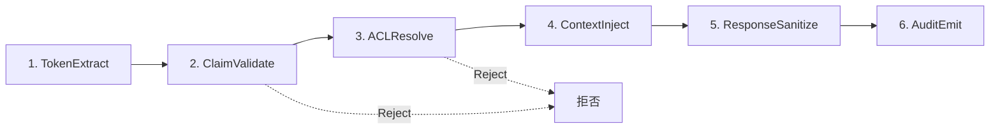

本記事は [arXiv:2603.13417](https://arxiv.org/abs/2603.13417) の解説記事です。

この記事は [Zenn記事: Bedrock AgentCore Runtime V2でMCPサーバーをデプロイしコールドスタートを2秒に短縮する](https://zenn.dev/0h_n0/articles/26235aa4b80dc0) の深掘りです。

## 論文概要（Abstract）

Model Context Protocol（MCP）は、AIエージェントが外部ツールを発見・呼び出すためのオープンプロトコルとして急速に普及しており、著者によれば2026年初頭時点で10,000以上のアクティブサーバーと月間9,700万のSDKダウンロードがあるとされる。しかし、MCPはツールの安全な本番運用に関する標準化が未整備であると著者は指摘している。

本論文では、ある企業のAIエージェントプラットフォームを大手クラウドプロバイダのMCPサーバーに統合した実務経験から得られた知見をもとに、本番環境での障害モードを5つの設計次元に整理し、以下の3つのメカニズムを提案している。

- **CABP（Context-Aware Broker Protocol）**: JSON-RPCにID付きルーティングを追加する6段パイプライン
- **ATBA（Adaptive Timeout Budget Allocation）**: 異種レイテンシ分布上の逐次ツール呼び出しを予算配分問題として扱うアルゴリズム
- **SERF（Structured Error Recovery Framework）**: 機械可読な障害セマンティクスによるエージェント自律回復フレームワーク

**重要な注意**: 本論文は設計提案と検証可能な仮説（H1〜H6）を提示しているが、実験による検証結果は報告されていない。

## 情報源

- **arXiv ID**: 2603.13417
- **URL**: [https://arxiv.org/abs/2603.13417](https://arxiv.org/abs/2603.13417)
- **著者**: Vasundra Srinivasan（AI Architect、O'Reilly著者）
- **発表年**: 2026年3月
- **分野**: cs.SE, cs.AI
- **ライセンス**: CC BY-NC-ND 4.0

## 背景と動機（Background & Motivation）

MCPはツールの発見（`tools/list`）と能力ネゴシエーション（`initialize`ハンドシェイク）を標準化しているが、著者は本番運用に不可欠な3つのプロトコルレベルの要素が欠けていると主張している。

1. **ID伝播（Identity Propagation）**: JSON-RPCプロトコルにはユーザーID、権限、テナントスコープを伝搬する標準的な方法がない。著者によれば、これがないとサーバーが全ユーザーのデータや誤ったテナントのデータを返す可能性がある。
2. **適応的ツール予算配分（Adaptive Tool Budgeting）**: 逐次的なツール呼び出しチェーンにおいて、静的なタイムアウト設定では一部のツールのレイテンシスパイクがチェーン全体を失敗させる。
3. **構造化エラーセマンティクス（Structured Error Semantics）**: MCPのエラーモデルは2層（プロトコル層のJSON-RPCコードとツール層の`isError`フラグ）だが、リトライ可否や推奨アクションを機械可読に伝達する仕組みがない。

著者はTable 1でMCP、REST、GraphQLを比較し、MCPの「ユーザーコンテキスト」が「仕様外」である点を指摘している。

## 主要な貢献（Key Contributions）

著者は本番環境での障害モードを以下の5つの設計次元に分類している。

1. **サーバー契約設計（Server Contract Design）**: ツールの名前と説明がプランナーにとって実質的なAPIコントラクトとなる
2. **ブローカーパターン（Broker Pattern）**: ユーザーIDの注入とACL適用をプロキシ層で行う
3. **タイムアウトと非同期処理**: 逐次ツールチェーンにおけるターン予算の管理
4. **エラー処理と回復力**: 2層エラーモデルと構造化エラーレスポンス
5. **可観測性と計装**: OpenTelemetryトレース伝搬によるエンドツーエンド監視

さらに3つの失敗事例（Failure Vignettes）を報告している。

- **事例1（Phantom Tool）**: 曖昧な説明のツール`get_data_v2`がプランナーに無視され、捏造されたレスポンスが返された。ツール名の変更と説明の充実だけで解決した。
- **事例2（Silent Egress Failure）**: ヘルスチェックのないサーバーでネットワーク障害が2日間検出されず、エージェントが「プロジェクトがない」と誤報告した。
- **事例3（Retry Storm）**: `retryable`フラグと冪等性キーがなく、1回の一時的障害から3件の重複リクエストが発生した。

## 技術的詳細（Technical Details）

### CABP: Context-Aware Broker Protocol

CABPは全JSON-RPCリクエストに対して6段のパイプラインを適用する（Figure 2）。



各段の役割は以下の通りである。

1. **TokenExtract**: リクエストからOAuth JWTを抽出
2. **ClaimValidate**: JWT署名・有効期限・発行者を検証（不正なら拒否）
3. **ACLResolve**: ツールレベルのACLを適用（権限不足なら拒否）
4. **ContextInject**: `tenant_id`、`user_id`、スコープをリクエストに注入
5. **ResponseSanitize**: クロステナントデータのフィルタリング
6. **AuditEmit**: ID、ツール名、サニタイズ済み入力、出力要約、レイテンシ、ステータスを記録

著者は仮説H1として「CABPによりクロステナントデータ漏洩がゼロになる（入力パラメータ方式との比較）」、仮説H2として「追加レイテンシの中央値が15ms未満（ツール処理時間150〜400msに対して）」を提示している。

**運用上の注意点**: 著者はJWT検証をセッション開始時だけでなく毎リクエストで行うこと、トークンをキャッシュしないこと、サービスアカウントにも同じ検証を適用することを推奨している。

### ATBA: Adaptive Timeout Budget Allocation

ATBAは逐次ツールチェーンのタイムアウトを動的に配分するアルゴリズムである。著者はTable 2で4ツールチェーンのレイテンシ予算を示している。

| ツール | 典型的レイテンシ | カテゴリ |
|--------|----------------|---------|
| FetchResources | 200 ms | Read |
| FetchServices | 150 ms | Read |
| FetchUsageLimits | 300 ms | Read |
| CreateLimitRequest | 400 ms | Write |
| プランナーオーバーヘッド | 約500 ms | System |
| **合計** | **約1,550 ms** | |

ATBAの配分式は以下の通りである。

$$
b_i = \frac{p99(L_i)}{\sum_{j=1}^{n} p99(L_j)} \times (B - B_{\text{reserve}})
$$

ここで、
- $b_i$: ツール$i$に配分されるタイムアウト予算
- $p99(L_i)$: ツール$i$のレイテンシのp99値（直近$w=100$回の観測に基づく）
- $B$: 総ターン予算（例: 100秒）
- $B_{\text{reserve}}$: 予備予算（$B$の10%）

**カスケード機構**: 高速に完了したツールの余剰時間$(b_i - t_i)$は残りのツールに均等配分される。

著者は仮説H3として「静的配分と比較して少なくとも40%のチェーンタイムアウト削減」、仮説H4として「カスケードにより少なくとも25%のタイムアウト発生チェーンが回復する」と提示している。

Figure 5では、100秒の予算に対して静的配分（各25秒）とATBA配分（10秒、8秒、42秒、30秒 + 10秒予備）の比較が示されている。

### SERF: Structured Error Recovery Framework

SERFは6カテゴリの機械可読エラーメタデータを定義する。

| カテゴリ | 回復パス |
|---------|---------|
| INVALID_INPUT | 入力修正して再試行 |
| RESOURCE_NOT_FOUND | 代替リソース検索 |
| RESOURCE_EXHAUSTED | バックオフ後に再試行 |
| PERMISSION_DENIED | 権限エスカレーション要求 |
| UPSTREAM_FAILURE | フォールバックツール使用 |
| INTERNAL_ERROR | オペレーター通知 |

各カテゴリには確定的な回復パスと、順序付きの推奨アクションリストが含まれる。著者は仮説H5として「自律回復率60%以上（非構造化エラーの25%以下と比較）」、仮説H6として「エラー後の幻覚を70%以上削減」を提示している。

## 実装のポイント（Implementation）

### ブローカーの実装選択肢

著者はSection 5.4で以下の実装選択肢を挙げている。

- **Kong AI Gateway**: MCP Proxyプラグイン
- **Cloudflare Workers**: Zero Trustとの統合
- **Envoy AI Gateway**: サービスメッシュ統合
- **カスタムミドルウェア**: Flask/Expressで200行以下

推奨として、1〜3サーバーではカスタムミドルウェア、10サーバー以上ではKongまたはEnvoyとしている。

### MCP Tasksによる非同期処理

10秒を超える操作にはMCP Tasks機能の使用が推奨されている。クライアントは`tools/call`でタスクIDを取得し（約50ms）、指数バックオフ（1秒〜30秒キャップ）で`tasks/get`をポーリングする。著者はタスクIDパターンはアーキテクチャ的に安定しているとの見解を示している。

### 本番準備チェックリスト

著者はSection 11で以下のチェックリストを提示している。

- **契約**: 記述的なツール名、型付きスキーマ、副作用と冪等性の文書化
- **回復力**: 長時間処理にTasks、冪等性キー、構造化エラー、サーキットブレーカー
- **運用**: ヘルス/レディネスエンドポイント、ツール別メトリクス、JWT検証付きブローカー、監査ログ

## Production Deployment Guide

### AWS実装パターン（コスト最適化重視）

MCPブローカーとエージェントプラットフォームをAWS上にデプロイする場合のトラフィック量別推奨構成を示す。

| 規模 | 月間リクエスト | 推奨構成 | 月額コスト目安 | 主要サービス |
|------|--------------|---------|-------------|------------|
| **Small** | ~3,000 (100/日) | Serverless | $50-150 | Lambda + API Gateway + DynamoDB |
| **Medium** | ~30,000 (1,000/日) | Hybrid | $300-800 | Lambda + ECS Fargate + ElastiCache |
| **Large** | 300,000+ (10,000/日) | Container | $2,000-5,000 | EKS + Karpenter + EC2 Spot |

**Small構成の詳細**（月額$50-150）:
- **Lambda**: MCPブローカー（CABP 6段パイプライン実行）、1GB RAM、30秒タイムアウト（$20/月）
- **API Gateway**: REST API、JWTオーソライザー（$5/月）
- **DynamoDB**: 冪等性キー保存（On-Demand、TTL 24時間）（$10/月）
- **CloudWatch**: ツール別レイテンシメトリクス（$5/月）
- **Bedrock**: エージェントプランナー用（$80/月）

**Medium構成の詳細**（月額$300-800）:
- **ECS Fargate**: MCPブローカー常駐（0.5 vCPU、1GB RAM × 2タスク）（$120/月）
- **ElastiCache Redis**: セッションID管理、ATBA観測値キャッシュ（$15/月）
- **Lambda**: 非同期Tasks処理（$50/月）
- **Bedrock**: Claude 3.5 Sonnet、Batch API活用（$400/月）
- **ALB**: ヘルスチェック付きロードバランサー（$20/月）

**Large構成の詳細**（月額$2,000-5,000）:
- **EKS**: コントロールプレーン（$72/月）
- **EC2 Spot**: g5.xlarge × 2-4台（平均$800/月）
- **Karpenter**: Spot優先の自動スケーリング
- **Bedrock Batch**: 50%割引活用（$2,000/月）
- **X-Ray**: 分散トレーシング（$100/月）

**コスト試算の注意事項**: 上記は2026年11月時点のAWS ap-northeast-1（東京）リージョン料金に基づく概算値です。実際のコストはトラフィックパターンやリージョンにより変動します。最新料金は [AWS料金計算ツール](https://calculator.aws/) で確認してください。

### Terraformインフラコード

**Small構成（Serverless）: CABP ブローカー + DynamoDB**

```hcl
module "vpc" {
  source  = "terraform-aws-modules/vpc/aws"
  version = "~> 5.0"

  name = "mcp-broker-vpc"
  cidr = "10.0.0.0/16"
  azs  = ["ap-northeast-1a", "ap-northeast-1c"]
  private_subnets = ["10.0.1.0/24", "10.0.2.0/24"]

  enable_nat_gateway   = false
  enable_dns_hostnames = true
}

resource "aws_iam_role" "mcp_broker_lambda" {
  name = "mcp-broker-lambda-role"

  assume_role_policy = jsonencode({
    Version = "2012-10-17"
    Statement = [{
      Action    = "sts:AssumeRole"
      Effect    = "Allow"
      Principal = { Service = "lambda.amazonaws.com" }
    }]
  })
}

resource "aws_iam_role_policy" "broker_permissions" {
  role = aws_iam_role.mcp_broker_lambda.id

  policy = jsonencode({
    Version = "2012-10-17"
    Statement = [
      {
        Effect   = "Allow"
        Action   = ["dynamodb:PutItem", "dynamodb:GetItem", "dynamodb:DeleteItem"]
        Resource = aws_dynamodb_table.idempotency.arn
      },
      {
        Effect   = "Allow"
        Action   = ["bedrock:InvokeModel"]
        Resource = "arn:aws:bedrock:ap-northeast-1::foundation-model/anthropic.claude-3-5-haiku*"
      }
    ]
  })
}

resource "aws_lambda_function" "mcp_broker" {
  filename      = "broker.zip"
  function_name = "mcp-cabp-broker"
  role          = aws_iam_role.mcp_broker_lambda.arn
  handler       = "handler.main"
  runtime       = "python3.12"
  timeout       = 30
  memory_size   = 1024

  environment {
    variables = {
      JWT_ISSUER_URL     = var.jwt_issuer_url
      DYNAMODB_TABLE     = aws_dynamodb_table.idempotency.name
      ATBA_WINDOW_SIZE   = "100"
      ATBA_RESERVE_RATIO = "0.10"
    }
  }
}

resource "aws_dynamodb_table" "idempotency" {
  name         = "mcp-idempotency-keys"
  billing_mode = "PAY_PER_REQUEST"
  hash_key     = "idempotency_key"

  attribute {
    name = "idempotency_key"
    type = "S"
  }

  ttl {
    attribute_name = "expire_at"
    enabled        = true
  }
}

resource "aws_cloudwatch_metric_alarm" "broker_latency" {
  alarm_name          = "mcp-broker-p99-latency"
  comparison_operator = "GreaterThanThreshold"
  evaluation_periods  = 2
  metric_name         = "Duration"
  namespace           = "AWS/Lambda"
  period              = 300
  extended_statistic  = "p99"
  threshold           = 15000
  alarm_description   = "MCPブローカーp99レイテンシ15秒超過"

  dimensions = {
    FunctionName = aws_lambda_function.mcp_broker.function_name
  }
}
```

### セキュリティベストプラクティス

本論文のSection 9で著者が提示する脅威モデル（T1〜T4）に基づくAWS上での対策を示す。

1. **T1（プロンプトインジェクション）対策**: CABPのResponseSanitize段で出力をフィルタリング。型付き出力スキーマの強制。
2. **T2（データ漏洩）対策**: 入力最小化、監査ログ、VPCエンドポイント経由のegress制限。
3. **T3（権限昇格）対策**: ブローカーのACL段で書き込みツールへのアクセスを制限。ツールチェーンレベルのポリシー。
4. **T4（DoS）対策**: ツール別タイムアウト（ATBA）、レスポンスサイズ制限、サーキットブレーカー。

### 運用・監視設定

**CloudWatch Logs Insights クエリ**:

```sql
-- ツール別レイテンシ分析
fields @timestamp, tool_name, duration_ms, status
| stats pct(duration_ms, 50) as p50, pct(duration_ms, 99) as p99, count() as invocations by tool_name
| filter duration_ms > 0

-- ATBA予算超過の検出
fields @timestamp, chain_id, total_budget_ms, actual_duration_ms
| filter actual_duration_ms > total_budget_ms * 0.9
| stats count() as near_timeout_chains by bin(1h)
```

**OpenTelemetryトレース設定**:

```python
from opentelemetry import trace
from opentelemetry.sdk.trace import TracerProvider
from opentelemetry.exporter.otlp.proto.grpc.trace_exporter import OTLPSpanExporter

provider = TracerProvider()
provider.add_span_processor(
    BatchSpanProcessor(OTLPSpanExporter(endpoint="otel-collector:4317"))
)
trace.set_tracer_provider(provider)
tracer = trace.get_tracer("mcp-cabp-broker")

async def cabp_pipeline(request: dict) -> dict:
    """CABP 6段パイプラインの計装例"""
    with tracer.start_as_current_span("cabp.pipeline") as span:
        span.set_attribute("mcp.tool_name", request.get("method", ""))
        span.set_attribute("mcp.tenant_id", "")  # ContextInject段で設定

        # Stage 1-2: Token検証
        with tracer.start_as_current_span("cabp.token_validate"):
            claims = validate_jwt(request)
            span.set_attribute("mcp.tenant_id", claims["tenant_id"])

        # Stage 3: ACL適用
        with tracer.start_as_current_span("cabp.acl_resolve"):
            check_acl(claims, request["method"])

        # Stage 4-6: コンテキスト注入、レスポンスサニタイズ、監査
        result = await forward_to_mcp_server(request, claims)
        return sanitize_response(result, claims)
```

### コスト最適化チェックリスト

**アーキテクチャ選択**:
- [ ] ~100 req/日 → Lambda（CABP Broker）+ DynamoDB（冪等性キー）: $50-150/月
- [ ] ~1,000 req/日 → ECS Fargate（常駐Broker）+ ElastiCache: $300-800/月
- [ ] 10,000+ req/日 → EKS + Karpenter（Spot優先）: $2,000-5,000/月

**リソース最適化**:
- [ ] EC2 Spot Instances優先（Karpenter自動管理、最大90%削減）
- [ ] Reserved Instances: 1年コミットで72%削減（予測可能な負荷のブローカー）
- [ ] Lambda: メモリサイズ最適化（CABP処理に1GB推奨）
- [ ] ECS/EKS: アイドル時スケールダウン（夜間0台）
- [ ] DynamoDB TTLで不要な冪等性キーを自動削除

**LLMコスト削減**:
- [ ] Bedrock Batch API: 非リアルタイムタスク処理で50%割引
- [ ] Prompt Caching: システムプロンプト固定で30-90%削減
- [ ] モデル選択: 簡易タスクはHaiku($0.25/MTok)、複雑タスクはSonnet($3/MTok)
- [ ] ATBA予算制御: max_tokens設定で過剰生成を防止

**監視・アラート**:
- [ ] AWS Budgets: 月額予算80%で警告
- [ ] CloudWatch: ツール別p99レイテンシアラーム
- [ ] Cost Anomaly Detection: 自動異常検知
- [ ] 日次コストレポート: SNS/Slack通知

**リソース管理**:
- [ ] タグ戦略: 環境別（dev/staging/prod）、ツール別でコスト可視化
- [ ] 未使用リソース: Lambda Insights + Trusted Advisor
- [ ] S3ライフサイクル: 監査ログ90日後にGlacier移行
- [ ] 開発環境: ECS/EKS夜間停止

## 実験結果（Results）

**本論文は実験結果を報告していない。** すべての主張は検証可能な仮説（H1〜H6）として提示されており、著者はオープンソースのベンチマークスイートを公開予定としている。

著者がSection 13で提示した計画上の実験手法は以下の通りである。

- **環境**: 対数正規分布のレイテンシを持つ合成MCPサーバー、最小限のブローカー、負荷生成器
- **試行数**: レイテンシ条件あたり500回以上、エラー回復条件あたり200回以上
- **統計手法**: t検定、カイ二乗検定、Cohen's d、オッズ比、95%信頼区間

実務者がこれらの仮説を自身の環境で検証する際は、上記のベースラインと統計手法が参考になるが、論文中の具体的な閾値（例: H3の40%削減、H5の60%回復率）はまだ実証されていない点に注意が必要である。

## 実運用への応用（Practical Applications）

本論文で提案されたCABP、ATBA、SERFの3つのメカニズムは、Zenn記事で解説したAgentCore RuntimeにMCPサーバーをデプロイする際の本番運用設計に直接適用できる。

- **CABPブローカー**: AgentCore Runtimeのカスタム認証（Custom JWT Authorizer）と組み合わせることで、テナント分離とACLをMCPリクエストレベルで実現できる。
- **ATBAタイムアウト**: AgentCoreのセッションIDベースのアフィニティと組み合わせることで、ウォームヒット時とコールドスタート時で異なるタイムアウト予算を動的配分できる。
- **SERFエラー回復**: Zenn記事で解説したJSON-RPCエラーコード（-32003 ThrottlingException等）をSERFカテゴリにマッピングすることで、エージェントの自律的なエラー回復ロジックを実装できる。

## 関連研究（Related Work）

- **Hou et al. (arXiv:2503.23278)**: MCPサーバーのライフサイクルを4フェーズ・16アクティビティに分割し、16の脅威シナリオを分類した。本論文は同研究の脅威分類を参照しつつ、運用面の設計パターンに焦点を当てている。
- **Hasan et al.**: 1,899のオープンソースMCPサーバーを調査し、7.2%に一般的な脆弱性、5.5%にツールポイズニングリスクを検出した。
- **CA-MCP (Li et al.)**: 共有メモリストアによるコンテキスト伝搬を提案。本論文のCABPはステートレスなリクエスト単位のJWT注入で対比されている。
- **MCPTox**: 45の実サーバー（353ツール）におけるツールポイズニング攻撃の成功率を測定した。
- **Astrix Security**: 5,200のMCPサーバーを分析し、53%が長寿命の静的シークレットに依存、8.5%のみがOAuthを使用していると報告した。

## まとめと今後の展望

本論文は、MCPの本番運用に不可欠な3つのプロトコルレベル要素（ID伝播、適応的ツール予算配分、構造化エラーセマンティクス）の欠如を特定し、CABP・ATBA・SERFという3つの検証可能なメカニズムを提案している。5つの設計次元と失敗事例の体系化は、MCPサーバーを本番環境にデプロイする際の実践的な指針となる。

ただし、すべての提案は検証可能な仮説として提示されており、実験的な裏付けは今後の課題である。実務者は自身の環境でベンチマークを実施し、各メカニズムの効果を確認することが推奨される。

## 参考文献

- **arXiv**: [https://arxiv.org/abs/2603.13417](https://arxiv.org/abs/2603.13417)
- **Related Zenn article**: [https://zenn.dev/0h_n0/articles/26235aa4b80dc0](https://zenn.dev/0h_n0/articles/26235aa4b80dc0)
