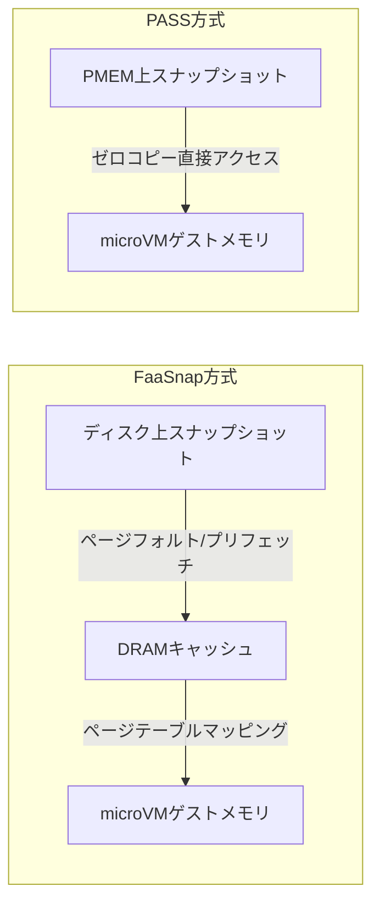

本記事は [Expeditious High-Concurrency MicroVM SnapStart in Persistent Memory with an Augmented Hypervisor（USENIX ATC 2024）](https://www.usenix.org/conference/atc24/presentation/pang) の解説記事です。

この記事は [Zenn記事: Bedrock AgentCore Runtime V2でMCPサーバーをデプロイしコールドスタートを2秒に短縮する](https://zenn.dev/0h_n0/articles/26235aa4b80dc0) の深掘りです。

## 論文概要（Abstract）

AWS Lambda SnapStartに代表されるmicroVMスナップショット復元は、サーバーレスのコールドスタート削減に有効だが、オンデマンドページングにおける頻繁なページフォルトがボトルネックとなる。先行研究のFaaSnapはワーキングセットのプリフェッチでこれを緩和するが、DRAMキャッシュのオーバーヘッドとI/O負荷が同時実行性を制限する。著者らは、バイトアドレッサブルな永続メモリ（PMEM）を活用し、ゼロコピーオンデマンドページングを実現するPASSを提案している。PASSはFirecrackerベースラインに対してSnapStart実行時間を最大72%削減し、同時実行数を2倍に拡大したと報告している。

## 情報源

- **会議名**: USENIX ATC 2024（2024 USENIX Annual Technical Conference）
- **年**: 2024年7月10〜12日、Santa Clara, CA
- **URL**: [https://www.usenix.org/conference/atc24/presentation/pang](https://www.usenix.org/conference/atc24/presentation/pang)
- **著者**: Xingguo Pang, Yanze Zhang, Liu Liu（University of Macau）; Dazhao Cheng（Wuhan University）; Chengzhong Xu, Xiaobo Zhou（University of Macau）
- **ISBN**: 978-1-939133-41-0
- **ページ**: 985–998

## カンファレンス情報

**USENIX ATCについて**: USENIX Annual Technical Conferenceはシステムソフトウェアの幅広いトピック（OS、ストレージ、ネットワーキング、仮想化）を扱う主要会議である。OSDIと並びシステム分野の重要な発表の場として位置付けられている。

## 背景と動機（Background & Motivation）

### SnapStartの現状と課題

スナップショットベースのmicroVM復元（SnapStart）は、AWS Lambdaをはじめとするサーバーレスプラットフォームで広く採用されている。SnapStartでは、初期化済みのmicroVMメモリ状態をスナップショットファイルとして保存し、次回起動時にスクラッチからの初期化を省略する。

しかし、現行の実装では**オンデマンドページング**で復元するため、復元中に大量のページフォルトが発生する。これがSnapStart実行時間のボトルネックとなっている。

### FaaSnapの限界

先行研究のFaaSnap（EuroSys 2022）は、プロファイルされたワーキングセットページをDRAMにプリフェッチすることでページフォルトを削減する。しかし、著者らは以下の限界を指摘している。

1. **高いキャッシュオーバーヘッド**: ディスクからDRAMへのデータ移動に要する「プレウォーム時間」が無視できない
2. **一時的アクセスの非効率**: サーバーレスのような一回限りのアクセスパターン（エフェメラルページ）では、DRAMキャッシュが過剰
3. **同時実行性の制限**: DRAM上のキャッシュ容量が同時実行可能なSnapStart数を制限する
4. **I/O干渉**: 集中的なプリフェッチが並行ワークロードのディスクI/Oと干渉する

### PMEMの可能性

Intel Optane DCに代表される永続メモリ（Persistent Memory, PMEM）は、メモリバス上に配置されるバイトアドレッサブルなストレージデバイスである。DRAMのように直接アクセスでき、SSDのように永続性がある。

著者らは、スナップショットをPMEM上に格納し、DAX（Direct Access）機能を活用してゼロコピーでアクセスすることで、DRAMキャッシュ層を完全にバイパスできると主張している。

## 主要な貢献（Key Contributions）

- **貢献1**: PMEM上に完全なアドレスインデックスを構築し、ゲストメモリへのゼロコピーオンデマンドページングを実現
- **貢献2**: ハッシュベースのスナップショットアドレステーブルにより、キャッシュ層とPMEMファイルシステムをバイパスする直接アクセスメカニズム
- **貢献3**: Firecrackerハイパーバイザーへの拡張として実装し、ゲストOS変更なしで動作

## 技術的詳細（Technical Details）

### PASSのアーキテクチャ

PASSは「PMEM-aware augmented hypervisor」として設計されている。通常のFirecrackerがディスク上のスナップショットファイルからDRAMにページをコピーして復元するのに対し、PASSはPMEM上のスナップショットに直接マッピングを構築する。

### 3つの技術的課題と解決策

著者らは、PMEMをSnapStartに活用する上で3つの技術的課題を特定し、それぞれに解決策を提案している。

**課題1: PMEM上の効率的なページマッピング**

FaaSnapやREAPのようなプリフェッチベースの手法は、階層型メモリ（ディスク→DRAM）を前提としており、部分的なマッピングのみを構築する。PMEM環境ではこの部分的マッピングが非連続に分散し、OSがマッピングセグメントを結合するための追加オーバーヘッドが発生する。

**解決策**: PASSはスナップショット復元時にPMEMのメモリ空間からゲスト物理メモリへの**完全なアドレスインデックス**を事前構築する。これにより、反復的なアドレス変換とページテーブルルックアップを排除する。

**課題2: PMEM上の直接データアクセス**

PMEMファイルシステムのDAX機能は、キャッシュ中間層をバイパスして直接データアクセスを提供する。しかし、PMEMファイルシステムとmicroVMが同一のスナップショットメモリファイルに対して個別のアドレスマッピングテーブルを維持するため、セマンティックギャップが生じ、DAXフォルトが発生する。

**解決策**: PASSはPMEMをファイルシステム経由のデバイスとしてではなく、プライマリメモリとして扱う。ハッシュベースのスナップショットアドレステーブルを用いて、ユーザースペースでPMEMを直接制御する。これによりDAXフォルトを排除しつつ、直接アクセス能力を維持する。

**課題3: エフェメラルワークロードへの対応**

線形DNNInferenceのような非反復的・一回限りアクセスのワークロード（エフェメラルページ）では、DRAMキャッシュへのコピーが無駄になる。

**解決策**: PMEMのDAX機能により、エフェメラルページへの一回限りのアクセスをDRAMへの複製なしで直接実行する。これにより、キャッシュベース手法で発生する不要な複製オーバーヘッドを排除する。

### ゼロコピーオンデマンドページング

PASSのコアメカニズムは、ハードウェアMMU（Memory Management Unit）マッピングとハッシュベースのスナップショットアドレステーブルの組み合わせである。

1. **スナップショット格納**: 初期化済みmicroVMのメモリ状態をPMEM上に直接保存
2. **アドレスインデックス構築**: ゲスト物理アドレスとPMEMアドレスの完全なマッピングをハッシュテーブルで構築
3. **ゼロコピーアクセス**: microVMがメモリページにアクセスすると、ハードウェアMMUがPMEM上のページを直接参照（データコピーなし）

この方式では、従来のオンデマンドページングで発生していた以下のオーバーヘッドが排除される:
- ディスクからDRAMへのページコピー
- DRAMキャッシュの管理
- PMEMファイルシステムのDAXフォルト処理

## 実験結果（Results）

著者らは実アプリケーションを用いた評価を実施し、以下の結果を報告している。

| メトリクス | PASS vs Firecracker | PASS vs FaaSnap |
|----------|-------------------|-----------------|
| SnapStart実行時間 | 最大72%削減 | 最大47%削減 |
| 最大同時実行数 | 2倍 | 2倍 |
| コスト効率 | 2.2倍改善 | 1.6倍改善 |

**同時実行性の改善が特に重要である理由**: サーバーレス環境ではバースト的なリクエスト到着が一般的であり、同時に多数のmicroVMをSnapStartする必要がある。DRAMキャッシュ方式では同時実行数がDRAM容量に制限されるが、PASS方式ではPMEMの大容量（TB級）を活用して同時実行数を大幅に拡大できる。

**注意点**: これらの数値は著者ら自身の測定結果である。PMEMの入手性とコスト（Intel Optane DC PMEMは2022年に製品ラインナップから終了）を考慮すると、実運用環境での再現にはハードウェア選定の検討が必要である。

## 実装のポイント（Implementation）

### Firecrackerへの統合

PASSはFirecrackerハイパーバイザーのユーザースペース拡張として実装されている。ゲストOS側の変更は不要であり、既存のFirecrackerベースのサーバーレスプラットフォーム（AWS Lambda等）に原理的に統合可能である。

### PMEM要件

- **デバイス**: Intel Optane DC Persistent Memory（または互換デバイス）
- **構成**: App Direct Mode（メモリモードではなく、永続性を活用）
- **容量**: スナップショットサイズ × 同時実行数分のPMEM容量が必要

### 制約

- **ハードウェア依存**: Intel Optane PMEMは2022年にIntelが製品ラインナップを終了しており、新規導入が困難
- **代替技術**: CXL（Compute Express Link）ベースの永続メモリデバイスが後継として期待される。CXLはPMEMと同様のバイトアドレッサブルアクセスを提供し、PASSの原理を適用可能

## 実運用への応用（Practical Applications）

### AgentCore V2との関連

AgentCore Runtime V2のスナップショット起動は、PASSと同様に「スナップショットからの高速復元」を実現している。V2がPMEMベースのアプローチを内部で採用しているかはAWSから公開されていないが、以下の共通点がある:

- **オンデマンドページングの最適化**: V2の弾力的メモリ管理はPASSのゼロコピーアクセスと同様に、必要なメモリのみをオンデマンドでロード
- **同時実行性の重視**: V2はバースト的なエージェント起動に対応しており、PASSの同時実行性改善と同じ課題に取り組んでいる

### CXL時代への展望

Intel Optane PMEMの生産終了後、CXL（Compute Express Link）メモリエクスパンダーが次世代の大容量メモリ技術として台頭している。CXLデバイスはPMEMと同様にバイトアドレッサブルであり、PASSのゼロコピーオンデマンドページングの原理を適用できる可能性がある。Samsung CMM-Dなど、CXLメモリ拡張デバイスが2024年から市場投入されており、PASSの手法がCXLベースのサーバーレスインフラで実用化される可能性がある。

## 関連研究（Related Work）

- **FaaSnap（Ao et al., EuroSys 2022）**: DRAMプリフェッチでページフォルト削減。PASSはPMEMゼロコピーでプリフェッチ自体を不要に
- **REAP（Du et al., ASPLOS 2021）**: 同期プリフェッチによるワーキングセット復元。PASSは完全アドレスインデックスで非同期プリフェッチも不要に
- **Sabre（Lazarev et al., OSDI 2024）**: ハードウェア圧縮でスナップショットサイズ削減。PASSとは直交する最適化で組み合わせ可能

## まとめと今後の展望

PASSは、PMEMのバイトアドレッサビリティを活用し、サーバーレスmicroVMのSnapStartにおけるDRAMキャッシュ層のボトルネックを根本的に解消する手法である。Firecracker比72%のSnapStart高速化と2倍の同時実行性は、スナップショット復元の新しい可能性を示している。

PMEMの後継であるCXLメモリが普及すれば、PASSの原理は今後のサーバーレスインフラにおいても適用可能と考えられる。AgentCore V2のようなプラットフォームレベルの最適化が、PASSのような学術研究の知見をどのように取り入れるかは、今後のクラウドインフラの重要な技術動向である。

## 参考文献

- **Conference URL**: [https://www.usenix.org/conference/atc24/presentation/pang](https://www.usenix.org/conference/atc24/presentation/pang)
- **Related Zenn article**: [https://zenn.dev/0h_n0/articles/26235aa4b80dc0](https://zenn.dev/0h_n0/articles/26235aa4b80dc0)
- **FaaSnap**: [https://www.sysnet.ucsd.edu/~voelker/pubs/faasnap-eurosys22.pdf](https://www.sysnet.ucsd.edu/~voelker/pubs/faasnap-eurosys22.pdf)
- **REAP**: [https://arxiv.org/abs/2101.09355](https://arxiv.org/abs/2101.09355)
