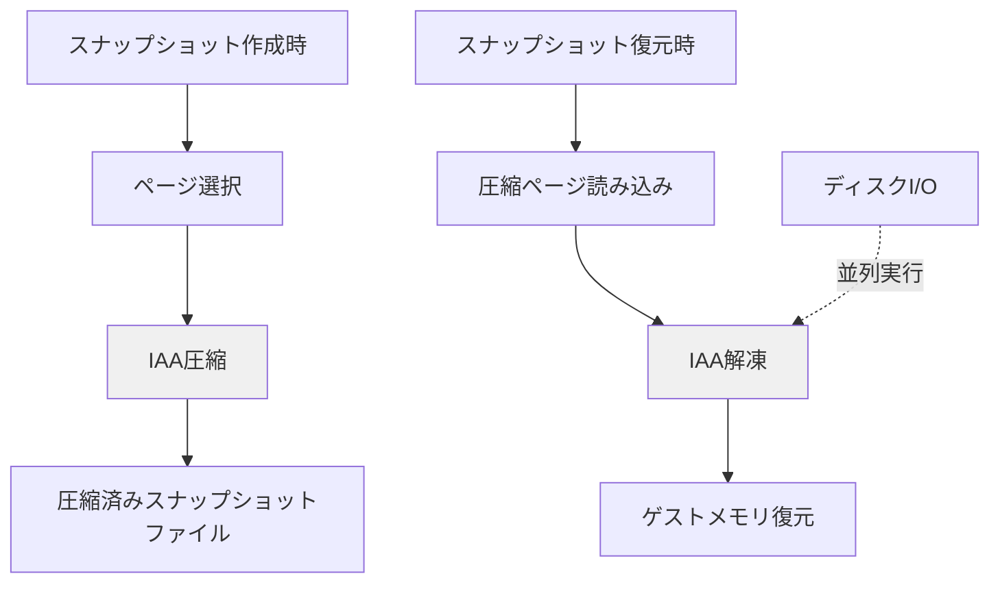

本記事は [Sabre: Hardware-Accelerated Snapshot Compression for Serverless MicroVMs（OSDI 2024）](https://www.usenix.org/conference/osdi24/presentation/lazarev) の解説記事です。

この記事は [Zenn記事: Bedrock AgentCore Runtime V2でMCPサーバーをデプロイしコールドスタートを2秒に短縮する](https://zenn.dev/0h_n0/articles/26235aa4b80dc0) の深掘りです。

## 論文概要（Abstract）

microVMスナップショットはサーバーレスアプリケーションのコールドスタートを大幅に削減する技術であるが、スナップショットのサイズとプリフェッチの効率がボトルネックとなる。ソフトウェアベースの圧縮は高いCPUコストのため実用的でない。著者らは、データセンタープロセッサに搭載されたハードウェアアクセラレータを活用する新手法Sabreを提案し、スナップショットを最大4.5倍圧縮しつつ、圧縮解除コストをほぼゼロに抑えることに成功したと報告している。

## 情報源

- **会議名**: OSDI 2024（18th USENIX Symposium on Operating Systems Design and Implementation）
- **年**: 2024年7月10〜12日、Santa Clara, CA
- **URL**: [https://www.usenix.org/conference/osdi24/presentation/lazarev](https://www.usenix.org/conference/osdi24/presentation/lazarev)
- **著者**: Nikita Lazarev, Varun Gohil（MIT CSAIL）; James Tsai, Andy Anderson, Bhushan Chitlur（Intel Labs）; Zhiru Zhang（Cornell University）; Christina Delimitrou（MIT CSAIL）
- **ISBN**: 978-1-939133-40-3

## カンファレンス情報

**OSDIについて**: OSDI（USENIX Symposium on Operating Systems Design and Implementation）はシステムソフトウェア分野の最高峰会議の1つであり、OSカーネル、仮想化、分散システム、ストレージなどの革新的研究が発表される。本論文はOSDI 2024に採択されている。

## 背景と動機（Background & Motivation）

### microVMスナップショットの現状

サーバーレスコンピューティングでは、AWS Firecrackerに代表されるmicroVMが広く使用されている。microVMはKVMベースの軽量仮想化技術で、サブ秒単位の起動と高いセキュリティ隔離を両立する。しかし、コールドスタート（初回起動時のオーバーヘッド）はmicroVM固有の課題であり、依存関係の初期化やモデルアーティファクトの読み込みを含めると数秒〜数十秒に達することがある。

VMスナップショットはこの課題に対する有力な解決策で、初期化済みのVM状態をファイルに保存し、次回起動時にスクラッチから起動する代わりにスナップショットから復元する。Firecrackerではフルメモリスナップショットとダーティページスナップショットの2種類が提供されている。

### プリフェッチの限界

スナップショットからの復元をさらに高速化するために、ワーキングセット推定に基づくページプリフェッチが提案されている（REAP [ASPLOS 2021]、FaaSnap [EuroSys 2022]）。しかし、プリフェッチの効果はメモリフットプリントのどれだけをカバーできるかに依存する。著者らは、スナップショットの圧縮によってプリフェッチのカバレッジを拡大できると主張している。

### ソフトウェア圧縮の限界

ページの可逆圧縮はスナップショットサイズを削減する有効な手段だが、ソフトウェアベースの圧縮（zswap、zramなど）はCPUコストが高く、復元のクリティカルパス上にあるサーバーレス環境では実用的でない。論文では、モバイルデバイス向けのzswap/zramは性能が重要でないドメインで使用されるものであり、サーバーレスのレイテンシ要件を満たさないと指摘している。

## 主要な貢献（Key Contributions）

- **貢献1**: Intel IAA（In-Memory Analytics Accelerator）を多様なベンチマークで初めて体系的に評価し、メモリページ圧縮におけるポテンシャルを明らかにした
- **貢献2**: IAAを活用した汎用メモリプリフェッチシステムSabreを設計・実装し、Firecracker VMMに統合した
- **貢献3**: ダーティページベースとワーキングセットベースの2種類のスナップショット方式で、幅広いサーバーレスアプリケーションに対するエンドツーエンド評価を実施した

## 技術的詳細（Technical Details）

### Intel IAAの特性

Intel IAA（In-Memory Analytics Accelerator）は、第4世代Xeon ScalableプロセッサにSoC統合されたニアメモリアナリティクスアクセラレータである。IAAはDeflate互換の可逆圧縮・解凍をハードウェアで実行し、CPUサイクルを消費しない。

論文によると、IAAは以下の特性を持つ:

- メモリページの圧縮率: ページ選択アルゴリズムに依存して2〜4.5倍
- 解凍速度: ソフトウェア実装と比較して最大10倍高速
- 解凍コスト: ディスクI/Oとページフォルトハンドリングの背後に完全に隠蔽可能

### Sabreのアーキテクチャ

Sabreの設計は以下の特徴を持つ。

**ページスナップショットポリシーに非依存**: Sabreはスナップショットの取得方法（フルメモリ、ダーティページ、ワーキングセット）に関係なく動作する。

**ホストのユーザースペースで動作**: カーネル変更が不要であり、既存のVMMに統合しやすい。

**SVM（Shared Virtual Memory）によるIAAとの連携**: IAAアクセラレータとのデータ交換にSVMメカニズムを使用し、明示的なメモリコピーなしで透過的に統合できる。

### プリフェッチとの統合

Sabreのプリフェッチライブラリは、圧縮されたスナップショットからのページ復元を以下のように最適化する。

1. **圧縮ページのバッチ読み込み**: ディスクからの読み込み単位を圧縮ページのバッチに最適化
2. **I/Oと解凍のオーバーラップ**: ディスクI/Oの完了を待つ間にIAAで前バッチの解凍を実行
3. **ページフォルトハンドリングとの協調**: オンデマンドページングで発生するページフォルトのコスト内で解凍を完了

著者らは、この設計により解凍時間がディスクI/Oとページフォルトハンドリングの背後に「完全に隠蔽」され、メモリ復元のレイテンシに対する追加コストがほぼゼロであると報告している。

### スナップショット方式との組み合わせ

Sabreは2種類のスナップショット方式で評価されている。

**ダーティページベーススナップショット**: Firecracker標準機能。初期化後にダーティ（書き換えられた）ページのみを保存する。スナップショットサイズはゲストメモリ全体より小さいが、初期化で多くのページがダーティになるアプリケーション（例: MLモデルロード）ではサイズが大きくなる。

**ワーキングセットベーススナップショット**: REAP等の手法で提案された方式。実行時にアクセスされるページ群（ワーキングセット）を推定し、それのみを保存する。ダーティページ方式より小さいスナップショットが得られるが、ワーキングセット推定の精度に依存する。

Sabreの圧縮はどちらの方式にも適用可能であり、特にスナップショットサイズが大きいダーティページ方式で圧縮の恩恵が大きい。

### 圧縮アルゴリズムの選択

Sabreが使用する圧縮アルゴリズムはDeflate互換の可逆圧縮であり、IAAがハードウェアレベルで実行する。Deflateはzlib/gzipで広く使われる成熟したアルゴリズムであり、圧縮率と速度のバランスに優れている。

IAAではDeflateの圧縮レベルを制御でき、低レベル（高速・低圧縮率）から高レベル（低速・高圧縮率）まで選択可能である。著者らはページ内容の特性に応じたレベル選択が圧縮率に影響することを示している。

## 実験結果（Results）

### スナップショット圧縮率

論文のTable/Figureより、著者らが報告した圧縮率は以下の通りである。

- **最大圧縮率**: 4.5倍（ページ選択アルゴリズムに依存）
- **圧縮率の範囲**: 2〜4.5倍（アプリケーションとスナップショット方式による）
- **解凍コスト**: 「ほぼゼロ」（I/Oとのオーバーラップにより隠蔽）

### エンドツーエンド性能

著者らは幅広いサーバーレスアプリケーションで評価を実施し、以下の結果を報告している。

| メトリクス | 結果 |
|----------|------|
| メモリ復元の高速化 | 最大55% |
| エンドツーエンドコールドスタート時間の追加削減 | 最適化済みベースラインに対して最大20% |
| 解凍オーバーヘッド | ほぼゼロ（I/O隠蔽） |

**注意点**: これらの数値は「最大」値であり、アプリケーション特性（メモリフットプリント、ページのコンテンツパターン）に大きく依存する。圧縮率はページの内容の冗長性に依存し、ランダムデータに近いページでは圧縮効果が低下する。

### 既存手法との位置付け

Sabreは既存のスナップショット最適化手法と直交する技術である。

- **REAP（ASPLOS 2021）**: ワーキングセットのプリフェッチ → Sabreの圧縮と組み合わせ可能
- **FaaSnap（EuroSys 2022）**: 非ブロッキングプリフェッチ → Sabreの圧縮でカバレッジ拡大
- **ダーティページスナップショット**: Firecracker標準機能 → Sabreで圧縮率をさらに向上

## 実装のポイント（Implementation）

### Firecrackerへの統合

SabreはFirecracker VMMにライブラリとして統合される。著者らはSabreをオープンソースとして公開している。

統合のポイント:
- Firecrackerのスナップショットパイプラインにフック
- 圧縮・解凍はIAAへのオフロードで実現（CPU負荷なし）
- 既存のスナップショット互換性を維持

### ハードウェア要件

- **CPU**: Intel 4th Gen Xeon Scalable以降（IAA搭載）
- **IAA対応**: SoC統合アクセラレータ、ドライバサポート必要
- **制約**: IAA非搭載のプロセッサでは使用不可。ARM系プロセッサやAMDプロセッサでは代替のハードウェアアクセラレータが必要

## 実運用への応用（Practical Applications）

### AgentCore Runtime V2との関連

Amazon Bedrock AgentCore Runtime V2は、コンテナイメージサイズに関係なくP75で約2秒のコールドスタートを実現している。AWSの公式ブログでは「スナップショットからキャッシュと一時メモリを除去し、スナップショットサイズを一定に保つ」と説明されており、これはSabreが示した「スナップショット圧縮によるサイズ削減がプリフェッチ効率を向上させる」という知見と整合する。

V2が具体的にSabreの技術を使用しているかはAWSから公開されていないが、V2の「イメージサイズに関係なくコールドスタートが一定」という特性は、スナップショットサイズの一定化というSabreの目標と同じ方向性にある。

### サーバーレスプラットフォーム全般への適用

Sabreの手法は以下のプラットフォームに適用可能である:

- **AWS Lambda SnapStart**: Firecrackerベースであり、直接統合可能
- **Google Cloud Functions**: gVisorベースだが、スナップショット圧縮の原理は適用可能
- **カスタムFaaSプラットフォーム**: Firecrackerを基盤とするプラットフォームで利用可能

**制約**: IAAハードウェアが必要なため、Intel 4th Gen Xeon Scalable（Sapphire Rapids）以降の環境に限定される。AWSのデータセンターではGravitonプロセッサ（ARM）が広く使用されており、IAAは利用できない。Intel Xeonインスタンス（m7i、c7iなど）では利用可能性があるが、IAA対応はインスタンスタイプ依存であり、クラウドプロバイダーのインフラ構成はユーザーからは不透明な場合が多い。AgentCore V2がARM64を必須としている点を考慮すると、V2の内部でSabreのIAA圧縮が直接使用されている可能性は低く、同様の原理を別のハードウェアで実現している可能性がある。

## 関連研究（Related Work）

- **REAP（Du et al., ASPLOS 2021）**: ワーキングセット推定によるプリフェッチで平均3.7倍のコールドスタート短縮。Sabreはプリフェッチに圧縮を追加することでカバレッジを拡大
- **FaaSnap（Ao et al., EuroSys 2022）**: Firecrackerへの非ブロッキングプリフェッチ統合。Sabreと直交する最適化
- **PASS（Pang et al., ATC 2024）**: PMEMを活用したゼロコピーオンデマンドページングで72%の高速化。メモリ階層の異なるアプローチ

## まとめと今後の展望

Sabreは、ハードウェアアクセラレーションによるスナップショット圧縮がサーバーレスmicroVMのコールドスタート問題に対して実用的な解であることを示した。IAAの近ゼロ解凍コストにより、圧縮が「フリーランチ」に近い形で実現される点は注目に値する。

一方で、IAA搭載プロセッサへのハードウェア依存は適用範囲を制限する。AMDのGenoa以降やARM Neoverseなど他のアーキテクチャでも同様のアクセラレータが搭載されれば、手法の汎用性が高まると考えられる。

AgentCore V2のような産業実装がSabreの研究を参考にしているかは不明だが、「スナップショットサイズの一定化によるコールドスタートの均一化」という設計目標は完全に共有されている。

## 参考文献

- **Conference URL**: [https://www.usenix.org/conference/osdi24/presentation/lazarev](https://www.usenix.org/conference/osdi24/presentation/lazarev)
- **Related Zenn article**: [https://zenn.dev/0h_n0/articles/26235aa4b80dc0](https://zenn.dev/0h_n0/articles/26235aa4b80dc0)
- **REAP**: [https://arxiv.org/abs/2101.09355](https://arxiv.org/abs/2101.09355)
- **PASS**: [https://www.usenix.org/conference/atc24/presentation/pang](https://www.usenix.org/conference/atc24/presentation/pang)
