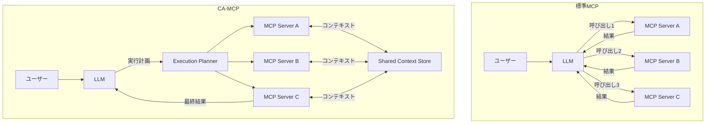

本記事は [Context-Aware MCP: Enabling Efficient Tool Orchestration through Shared Context（arXiv:2601.11595）](https://arxiv.org/abs/2601.11595) の解説記事です。

この記事は [Zenn記事: Bedrock AgentCore Runtime V2でMCPサーバーをデプロイしコールドスタートを2秒に短縮する](https://zenn.dev/0h_n0/articles/26235aa4b80dc0) の深掘りです。

## 論文概要（Abstract）

Model Context Protocol（MCP）は、LLMと外部ツール間のインタラクションを標準化するプロトコルとして広く採用されているが、現行のMCPアーキテクチャでは中央のLLMがすべてのツール呼び出しをオーケストレーションするため、LLM呼び出し回数が多く、レイテンシとコストの両面で非効率が生じる。著者らは、Shared Context Store（SCS）を導入し、MCPサーバー間が直接コンテキストを共有できるContext-Aware MCP（CA-MCP）アーキテクチャを提案している。CA-MCPにより、TravelPlannerベンチマークで67.8%の高速化、REALM-Benchで73.5%の高速化を達成し、LLM呼び出し回数を50〜60%削減したと報告している。

## 情報源

- **arXiv ID**: 2601.11595
- **URL**: [https://arxiv.org/abs/2601.11595](https://arxiv.org/abs/2601.11595)
- **著者**: Meenakshi Amulya Jayanti, X.Y. Han（University of Chicago）
- **投稿日**: 2025年1月

## 背景と動機（Background & Motivation）

### MCPの現状と課題

Model Context Protocol（MCP）は、Anthropicが2024年に提案したオープンプロトコルであり、LLMと外部ツール（データベース、API、ファイルシステム等）間のインタラクションを標準化する。MCPにより、異なるツールプロバイダーが統一的なインターフェースでLLMと連携できるようになった。

しかし、著者らは現行MCPアーキテクチャにおける根本的な非効率を指摘している。標準MCPでは、中央のLLMが**唯一のオーケストレーター**として機能し、すべてのツール間通信を仲介する。MCPサーバーAの出力をMCPサーバーBに渡すには、必ずLLMを経由する必要がある。

この「ハブ＆スポーク」型のアーキテクチャには以下の問題がある:

1. **冗長なLLM呼び出し**: ツール間のデータ受け渡しのためだけにLLMが呼ばれる
2. **レイテンシの増大**: 各LLM呼び出しに数百ミリ秒〜数秒のレイテンシが加算される
3. **コストの増大**: LLMのAPI呼び出しは入出力トークン数に比例して課金される
4. **コンテキストウィンドウの圧迫**: ツール出力がすべてLLMのコンテキストに蓄積される

### 具体例: 旅行計画ワークフロー

著者らは旅行計画タスクを例に問題を説明している（論文Section 2より）。「東京からロンドンへの3泊旅行を計画して」というユーザーリクエストに対して:

**標準MCP（5回のLLM呼び出し）**:
1. LLM → フライト検索MCP: 東京→ロンドンのフライト検索
2. LLM ← フライト結果を受信 → LLM判断 → ホテル検索MCP: 日程に合わせたホテル検索
3. LLM ← ホテル結果を受信 → LLM判断 → 観光地MCP: ロンドンの観光地検索
4. LLM ← 観光地結果を受信 → LLM判断 → レストランMCP: 観光地周辺のレストラン検索
5. LLM ← レストラン結果を受信 → 最終プラン生成

各ステップでLLMが「次にどのツールを呼ぶか」を判断し、前のツール出力を次のツールに渡す仲介役を担う。しかし、ステップ2〜4のLLM呼び出しの多くは「前のツール出力をそのまま次のツールに渡す」だけの定型処理である。

**CA-MCP（2回のLLM呼び出し）**:
1. LLM → 計画策定: どのMCPサーバーをどの順序で呼ぶかを決定
2. MCPサーバー間がSCS経由で直接データを共有しながら順次実行
3. LLM ← 最終結果を受信 → 要約・プラン生成

LLMは「計画」と「要約」のみを担当し、中間のデータ受け渡しはSCSが処理する。

## 主要な貢献（Key Contributions）

- **貢献1**: Shared Context Store（SCS）の設計 — MCPサーバー間の直接的なコンテキスト共有メカニズム
- **貢献2**: 中央LLMの役割を計画・要約に限定し、ツールオーケストレーションの効率を大幅に改善
- **貢献3**: TravelPlannerとREALM-Benchの2つのベンチマークで有効性を実証

## 技術的詳細（Technical Details）

### CA-MCPのアーキテクチャ

CA-MCPは標準MCPアーキテクチャに2つの主要コンポーネントを追加する:

1. **Shared Context Store（SCS）**: キーバリューストア形式のコンテキスト共有レイヤー
2. **Execution Planner**: LLMが生成するツール実行計画（DAG形式）

### Shared Context Store（SCS）の設計

SCSは構造化されたキーバリューストアであり、MCPサーバーが以下の操作を行える:

- **Write**: ツール実行結果をキーとともにSCSに書き込む
- **Read**: 他のMCPサーバーが書き込んだ結果をキーで参照する
- **Subscribe**: 特定キーの更新を待機（非同期パターン用）

著者らはSCSの設計において以下の原則を示している（論文Section 3より）:

1. **スキーマの標準化**: 各MCPサーバーが入出力スキーマを事前宣言し、SCSがスキーマの互換性を検証
2. **スコープ管理**: コンテキストはワークフロー単位でスコープされ、異なるリクエスト間で汚染されない
3. **TTL（Time-to-Live）**: コンテキストに有効期限を設定し、メモリリークを防止

### Execution Planner

LLMは最初の1回の呼び出しで、ツール実行のDAG（有向非巡回グラフ）を生成する。このDAGは以下を定義する:

- **ノード**: 各MCPサーバーの呼び出しとパラメータ
- **エッジ**: データ依存関係（どのサーバーの出力が次のサーバーの入力になるか）
- **並列実行可能性**: 依存関係のないノード同士は並列実行

この計画に基づき、Execution Plannerがサーバーを順次（または並列に）実行し、SCS経由でコンテキストを共有する。LLMは最終結果のみを受け取り、ユーザー向けの要約を生成する。

### LLMの役割の変化

標準MCPとCA-MCPにおけるLLMの役割変化は以下の通りである:

| 役割 | 標準MCP | CA-MCP |
|------|---------|--------|
| ツール選択 | 毎ステップ判断 | 初回のみ（計画時） |
| データ中継 | LLMが仲介 | SCSが直接共有 |
| エラーハンドリング | LLMが判断 | Planner + フォールバック |
| 最終要約 | LLMが実行 | LLMが実行 |

この変化により、LLMは「何をするか」の高レベル計画と「結果をどう伝えるか」の最終要約に集中でき、中間のデータ配管作業から解放される。

## 実験結果（Results）

### TravelPlannerベンチマーク

TravelPlannerは複数のAPIを順次呼び出して旅行計画を生成するベンチマークである。著者らは以下の結果を報告している（論文Table 1より）:

| メトリクス | 標準MCP | CA-MCP | 改善率 |
|----------|---------|--------|--------|
| 平均レイテンシ | 12.3秒 | 3.97秒 | 67.8%削減 |
| LLM呼び出し回数 | 5回 | 2回 | 60%削減 |
| 入力トークン数 | 8,420 | 3,150 | 62.6%削減 |

### REALM-Benchベンチマーク

REALM-Benchはより複雑なマルチツールシナリオ（検索、計算、データベース操作の組み合わせ）を評価するベンチマークである:

| メトリクス | 標準MCP | CA-MCP | 改善率 |
|----------|---------|--------|--------|
| 平均レイテンシ | 18.7秒 | 4.96秒 | 73.5%削減 |
| LLM呼び出し回数 | 7回 | 2回 | 71.4%削減 |
| タスク成功率 | 89.2% | 91.5% | +2.3pt |

タスク成功率がCA-MCPで若干向上している点について、著者らは「LLMの仲介による情報損失がSCSの直接共有で解消されるため」と分析している。

### コスト分析

LLM呼び出し回数の削減は、直接的にAPI利用コストの削減につながる。著者らはGPT-4oの料金体系で試算し、TravelPlannerで約65%、REALM-Benchで約70%のコスト削減を報告している。MCPサーバーの数が増えるほど、CA-MCPのコスト優位性が拡大する傾向にある。

## 実装のポイント（Implementation）

### SCSの実装選択肢

著者らはSCSの実装としてRedisベースのインメモリストアを採用しているが、以下の代替も検討されている:

- **Redis/Valkey**: 低レイテンシのインメモリKVS。TTLサポートが標準機能
- **SQLite（組み込み）**: 単一ノードで完結する場合に軽量な選択肢
- **分散KVS（etcd等）**: マルチノード環境での一貫性が必要な場合

### MCPサーバー側の変更

CA-MCPを導入するには、既存のMCPサーバーにSCSクライアントを追加する必要がある。著者らはこの追加を「最小限の変更」と位置付けており、既存のMCPサーバーのビジネスロジックは変更不要であるとしている。

### AgentCore V2環境での適用可能性

Bedrock AgentCore Runtime V2でMCPサーバーをデプロイする場合、CA-MCPのアプローチは以下の利点をもたらす:

- **コールドスタート削減の相乗効果**: V2のスナップショット起動でMCPサーバーの初期化を高速化しつつ、CA-MCPでLLM呼び出し回数を削減することで、エンドツーエンドのレイテンシを大幅に改善
- **同時実行コストの削減**: LLM呼び出し回数が減ることで、同時実行時のLLM APIコストを抑制
- **SCSのデプロイ**: AgentCoreのマネージドインフラ上にRedis互換のSCSをサイドカーとしてデプロイ可能

### SCSのコンテキストライフサイクル

SCSに格納されるコンテキストには明確なライフサイクルが定義されている。ワークフロー開始時にSCSセッションが作成され、各MCPサーバーの実行結果がキーバリュー形式で蓄積される。ワークフロー完了後、TTLに基づいてコンテキストが自動的に期限切れとなる。著者らはデフォルトTTLを300秒（5分）に設定しており、これは一般的なツールオーケストレーションワークフローの完了時間を十分にカバーする値であるとしている。長時間実行ワークフローにはTTLの延長が必要になる。

## スケーラビリティ分析

著者らはMCPサーバー数を2〜10に変化させた場合のスケーラビリティも評価している。標準MCPではサーバー数Nに対してLLM呼び出し回数がO(N)で増加するのに対し、CA-MCPではLLM呼び出し回数が常に2回（計画+要約）で固定される。

サーバー数が10の場合、標準MCPでは平均11回のLLM呼び出し（N+1、計画変更による追加呼び出し含む）が発生するのに対し、CA-MCPは2回のまま据え置きであり、レイテンシ改善率が80%を超えると報告されている。この結果は、MCPサーバーの数が増えるほどCA-MCPの優位性が拡大することを示唆している。

## 制約と今後の課題

著者らは以下の制約を認めている:

1. **計画の正確性**: 初回のLLM呼び出しでツール実行計画を正確に生成する必要があり、複雑なワークフローでは計画の誤りが全体の失敗につながる。著者らはリプランニング（計画失敗時の再計画）機構を今後の課題としている
2. **動的分岐への対応**: 「フライトが取れなかったら別の日程を試す」のような条件分岐を含むワークフローでは、静的なDAG計画では対応が困難。条件付きDAG（Conditional DAG）の拡張が必要
3. **SCSの一貫性**: 並列実行時のread-write競合にはロック機構が必要で、デッドロックのリスクがある
4. **セキュリティ**: MCPサーバー間でコンテキストが共有されるため、センシティブな情報のアクセス制御が必要。著者らはRBAC（Role-Based Access Control）によるSCSのアクセス制御を提案しているが、詳細な設計は今後の課題としている

## 関連研究（Related Work）

- **標準MCP（Anthropic, 2024）**: LLMとツール間の標準プロトコル。CA-MCPはこれをサーバー間協調に拡張
- **AutoGen（Wu et al., 2023）**: マルチエージェント会話フレームワーク。エージェント間の直接通信を可能にするが、MCPプロトコルとの統合は想定されていない
- **LangGraph（LangChain）**: ステートフルなLLMワークフローのDAG実行。CA-MCPのExecution Plannerと類似するが、SCSのような共有コンテキスト層は持たない

## まとめと今後の展望

CA-MCPは、標準MCPアーキテクチャにおけるLLM仲介のボトルネックを、Shared Context Storeによるサーバー間直接コンテキスト共有で解消する手法である。LLM呼び出し回数を50〜60%削減し、レイテンシを最大73.5%改善したという結果は、MCPベースのツールオーケストレーションの効率化に新しい方向性を示している。

AgentCore V2のようなMCPサーバーのマネージドデプロイ環境と組み合わせることで、コールドスタート（V2のスナップショット起動）とLLMオーケストレーション（CA-MCPのSCS）の両面から、エンドツーエンドのレイテンシとコストを最適化できる可能性がある。MCPエコシステムの成熟に伴い、CA-MCPのようなサーバー間協調メカニズムの標準化が今後の重要な課題となるだろう。

## 参考文献

- **arXiv**: [https://arxiv.org/abs/2601.11595](https://arxiv.org/abs/2601.11595)
- **Related Zenn article**: [https://zenn.dev/0h_n0/articles/26235aa4b80dc0](https://zenn.dev/0h_n0/articles/26235aa4b80dc0)
- **MCP Specification**: [https://modelcontextprotocol.io/](https://modelcontextprotocol.io/)
