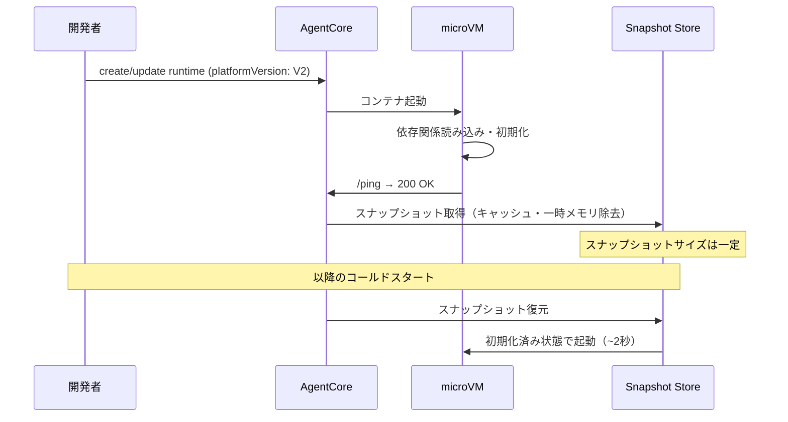

本記事は [The new AgentCore runtime: Elastic, optimized, and consistently fast starts（AWS Machine Learning Blog、2026年9月18日公開）](https://aws.amazon.com/blogs/machine-learning/the-new-agentcore-runtime-elastic-optimized-and-consistently-fast-starts/) の解説記事です。

この記事は [Zenn記事: Bedrock AgentCore Runtime V2でMCPサーバーをデプロイしコールドスタートを2秒に短縮する](https://zenn.dev/0h_n0/articles/26235aa4b80dc0) の深掘りです。

## ブログ概要（Summary）

AWS Machine Learning Blogの本記事は、Amazon Bedrock AgentCore Runtime V2（2026年9月18日GA）のコア技術である**スナップショット起動**と**弾力的メモリ管理**の設計思想とベンチマーク結果を公開したものである。著者はEvandro Franco、Aniketh Manjunath、Rahul Nama、Mark Roy、Shishir Bharathi、Abhishek Singhの6名。V2では`platformVersion: V2`を指定するだけで、コンテナイメージサイズに関係なくコールドスタートがP75で約2秒に均一化される。

## 情報源

- **種別**: 企業テックブログ（AWS公式）
- **URL**: [https://aws.amazon.com/blogs/machine-learning/the-new-agentcore-runtime-elastic-optimized-and-consistently-fast-starts/](https://aws.amazon.com/blogs/machine-learning/the-new-agentcore-runtime-elastic-optimized-and-consistently-fast-starts/)
- **組織**: Amazon Web Services / Bedrock AgentCoreチーム
- **発表日**: 2026年9月18日
- **著者**: Evandro Franco, Aniketh Manjunath, Rahul Nama, Mark Roy, Shishir Bharathi, Abhishek Singh

## 技術的背景（Technical Background）

### V1が抱えていた2つの構造的課題

AgentCore Runtime V1には、本番運用上2つの課題があった。

**課題1: メモリの非効率な占有**。V1ではセッション開始時に確保されたメモリが、セッション終了まで解放されなかった。バースト的にメモリを消費するワークロード（例: 大きなドキュメントを一時的に解析するエージェント）でも、ピーク時のメモリ量がセッション全体の課金対象となっていた。

**課題2: イメージサイズに比例するコールドスタート**。V1では、リクエストが到着するたびにコンテナイメージのダウンロード→展開→起動→ヘルスチェックという一連の処理が走った。このため、200MBのイメージでは約5.4秒、2GBのイメージでは約30秒のコールドスタートが発生していた（ブログ記載のP75値）。

ブログでは、これらの課題に対してユーザーが独自にスペア環境プールやメモリチューニングを構築していたことを「コストがかかり差別化に寄与しない作業」と表現している。

### 学術研究との関連

AgentCore V2のスナップショット起動は、サーバーレスコンピューティングにおけるmicroVMスナップショット技術の産業応用である。学術的にはREAP（ASPLOS 2021）やFaaSnap（EuroSys 2022）がFirecracker上でワーキングセット推定によるスナップショット復元を提案しており、Sabre（OSDI 2024）がハードウェアアクセラレータによるスナップショット圧縮を実現している。V2のスナップショット機構はこれらの研究成果を踏まえた産業実装と位置付けられる。

## 実装アーキテクチャ（Architecture）

### スナップショット起動の3段階メカニズム

ブログでは、V2のスナップショット起動を以下の3つの原則で説明している。

**原則1: ページメモリのオンデマンド読み込みと回収**。V2ではセッション開始時に小さなメモリフットプリントで起動し、ワークロードがメモリページに触れた時点で読み込む。リクエスト処理後に解放されたバッファや期限切れキャッシュは、セッション終了を待たずに回収される。

**原則2: 初回ロード後のスナップショット取得**。ランタイムの作成または更新時に、AgentCoreはコンテナを起動し、ヘルスチェック（`/ping`が2xxを返す）を確認した後、実行環境のスナップショットを取得する。`pip install`やモデルアーティファクトの読み込みなどの初期化処理はこの時点で完了しているため、以降のインスタンス起動ではこれらの処理が不要になる。

**原則3: スナップショットサイズの一定化**。ナイーブなスナップショットはキャッシュや一時メモリも含むため、イメージサイズに比例してスナップショットサイズが増大する。V2ではこれらを除去し、再開に必要な作業状態のみをスナップショットに保持する。この結果、イメージサイズが200MBでも2GBでもスナップショットサイズがほぼ一定に保たれ、復元レイテンシも一定になる。

### 弾力的メモリ管理

V2のもう一つの技術的特徴が弾力的メモリ管理である。ブログによると、この機構は「数十億のセッションにわたるアロケーションパターンの分析」に基づいて設計されている。

V1ではセッション中のピークメモリが終了まで保持されていたのに対し、V2ではメモリがコールド状態になり再アクセスの可能性が低いと判断された場合にプラットフォームが回収する。これにより、課金対象のGB-hourが大幅に削減される。

**トレードオフ**: ブログでは「GB-hourあたりの単価はV1より高いが、課金対象のGB-hourが大幅に減るため、多くのエージェントでコストが下がる」と説明している。常時大量のメモリを消費するワークロード（例: 大規模モデルをローカルにロードするケース）では、V2のコストメリットが薄れる可能性がある。

## ベンチマーク結果（Performance）

### 測定条件

ブログで公開されたベンチマークの条件は以下の通りである。

| 項目 | 内容 |
|------|------|
| テスト対象 | エコーエージェント（入力をそのまま返す。モデル・ツール呼び出しなし） |
| クライアント | us-west-2のEC2インスタンス上のPythonクライアント（boto3使用） |
| サーバー | us-east-1のAgentCore Runtime |
| ネットワーク | パブリックインターネット経由（VPCピアリングなし） |
| 試行回数 | 各イメージサイズで5,000回のコールドスタート |
| 制約 | デフォルトアカウントクォータ内 |

エージェント自体のコード実行時間はP75で約34msであったため、計測時間のほとんどはプラットフォーム側の起動時間である。

### 結果

ブログのFigure 2に示されたP75コールドスタート時間（ブログより引用）:

| イメージサイズ | V1 P75 | V2 P75 | 改善率 |
|------------|--------|--------|-------|
| 200 MB | 約5.4秒 | 約2.0秒 | 2.7倍 |
| 2 GB | 約30秒 | 約2.0秒 | 15倍 |

V2ではイメージサイズが200MBから2GBに増加しても、P75コールドスタートがほぼ2秒で一定に保たれている。これはスナップショットサイズが一定に保たれるためである。

**注意点**: この数値はAWS自身の測定結果であり、リージョン間通信の遅延（us-west-2 → us-east-1）を含む。実際のワークロードではモデル呼び出しやツール実行の時間が加わるため、エンドツーエンドのレイテンシはこれより大きくなる。また、P50、P90、P99などの他のパーセンタイルはブログでは公開されていない。

### 第三者による検証

Classmethodによる東京リージョン（ap-northeast-1）での独立測定では、859MBのイメージでV1が13.6秒、V2が1.8秒と報告されている（[Classmethod記事](https://dev.classmethod.jp/en/articles/amazon-bedrock-agentcore-runtime-v2-tried/)）。AWS公式のベンチマーク傾向と概ね一致している。

## 運用での学び（Production Lessons）

### 事前ウォームアップの推奨

ブログでは、ユーザーがチャットウィンドウを開いた時点（入力を送信する前）でセッションを開始することを推奨している。ユーザーが挨拶を読み、入力を準備している間にmicroVMがウォーム状態になるため、最初のメッセージ送信時にはウォームヒット（100ms未満）で応答できる。

**制約**: ウォームアップしたmicroVMはアイドル状態でも弾力的メモリの課金対象となる。大量のセッションを事前にウォームアップすると無視できないコストが発生するため、予測トラフィックに応じた適切な数に制限する必要がある。

### 有効化方法

V2の有効化は、ランタイム作成または更新時に`platformVersion`を`V2`に設定するだけである。コード変更は原則不要だが、スナップショット起動特有の考慮事項がある。

**スナップショット特有の注意点**:
- 初期化時に取得した認証情報やネットワーク接続はスナップショットに含まれるため、復元時に期限切れになっている可能性がある
- キャッシュや一時ファイルはスナップショットから除去されるため、これらに依存する初期化ロジックは再設計が必要
- リクエスト固有の状態（例: リクエストID、ユーザーコンテキスト）は初期化時に設定せず、リクエスト処理時に動的に取得すべきである

### 今後のロードマップ

ブログでは以下の機能が「Coming Soon」として予告されている（日程未定）:

- **コミッテッドベースライン料金**: セッションごとにメモリフロアを予約し、それを超える分は従量課金
- **大容量コンピュート・ストレージ**: より多くのRAM、vCPU、セッションストレージ
- **x86 microVMサポート**: 現在はARM64のみ。x86依存のコードやライブラリを変更なしで実行可能に
- **セッションの一時停止と再開**: メモリスナップショットによるセッション状態の保存と、終了前のフック
- **セッションコンテキストキー**: 各セッションにスコープ付きIDを付与（無人エージェント向け）

## 学術研究との関連（Academic Connection）

AgentCore V2のスナップショット起動は、以下の学術研究と技術的に関連する。

- **REAP（ASPLOS 2021）**: Firecracker上でワーキングセットのプリフェッチにより平均3.7倍のコールドスタート短縮を実現。V2のスナップショット取得時のワーキングセット推定と同様のアプローチ
- **Sabre（OSDI 2024）**: IAA（In-Memory Analytics Accelerator）によるハードウェアアクセラレーション圧縮で、スナップショットを最大4.5倍圧縮。V2のスナップショットサイズ一定化と関連
- **Spice（arXiv 2509.14292）**: OS協調設計によるプロセスレベルのスナップショット復元で、ディスクからのコールドリストアを5ms未満に短縮。V2のスナップショット復元高速化と同系統の研究
- **PASS（USENIX ATC 2024）**: 永続メモリ（PMEM）を活用したゼロコピーオンデマンドページングで、Firecrackerベースラインに対して最大72%のSnapStart実行時間削減

V2の「スナップショットサイズの一定化」は、Sabreが示したようにスナップショットの圧縮・選択的保存が実用レベルに達したことと整合している。また、弾力的メモリ管理はSpiceのOverlay VMAやPASSのゼロコピーページングと同様に、メモリのオンデマンドロードを前提とした設計である。

## コスト分析と移行判断（Cost Analysis）

### V1 vs V2のコスト構造

V2のコスト構造はV1と根本的に異なる。ブログでは具体的な料金は公開されていないが、構造の違いは明確に説明されている。

**V1**: セッション開始時に確保したメモリがセッション終了まで課金対象。ピーク時に2GBを消費し、その後200MBしか使わなくても、2GB×セッション時間が課金される。

**V2**: 実際に使用しているメモリのみが課金対象。2GBのピーク後に200MBに減少すれば、以降は200MB分のGB-hourが課金される。ただしGB-hourあたりの単価はV1より高い。

この違いは、以下のようなワークロード特性によって移行の損益が変わることを意味する。

| ワークロード特性 | V2が有利 | V1が有利 |
|--------------|---------|---------|
| メモリ使用パターン | バースト的（一時的に高い） | 定常的（常時高い） |
| セッション持続時間 | 長時間（メモリ回収の恩恵大） | 短時間（回収の余地が少ない） |
| イメージサイズ | 大きい（コールドスタート改善大） | 小さい（V1でも許容範囲） |

### 移行前に確認すべき事項

ブログおよび関連ドキュメントから、V2移行前に確認すべき事項を整理する。

1. **ARM64必須**: V2はARM64アーキテクチャのみ対応。x86 microVMは「Coming Soon」であり、現時点ではx86依存のバイナリは動作しない
2. **スナップショット互換性**: 初期化時にファイルシステムキャッシュやネットワーク接続に依存するコードは、スナップショット復元後に期限切れになる可能性がある
3. **対応リージョン**: V2のGA時点ではus-east-1、us-east-2、us-west-2、eu-west-1、ap-northeast-1（東京）が報告されている（第三者情報、AWS公式ドキュメントで要確認）
4. **課金モデルの変更**: GB-hourの単価が変わるため、自社のワークロードプロファイルでコスト試算が必要

## まとめと実践への示唆

AgentCore Runtime V2は、スナップショット起動と弾力的メモリ管理の2つの技術により、コールドスタート問題に対する実用的な解を提供している。特にイメージサイズに関係なくP75で約2秒のコールドスタートが実現される点は、MLモデルや大規模依存関係を含むエージェントを運用する際の設計制約を大幅に緩和する。

一方で、GB-hourあたりの単価はV1より高いため、常時大量メモリを消費するワークロードではコスト比較が必要である。また、AWS自身のベンチマークであることを考慮し、自社のワークロードで実測した上でV2への移行を判断すべきである。

## 参考文献

- **Blog URL**: [The new AgentCore runtime: Elastic, optimized, and consistently fast starts](https://aws.amazon.com/blogs/machine-learning/the-new-agentcore-runtime-elastic-optimized-and-consistently-fast-starts/)
- **Related Papers**: REAP (ASPLOS 2021), Sabre (OSDI 2024), Spice (arXiv:2509.14292), PASS (USENIX ATC 2024)
- **Related Zenn article**: [https://zenn.dev/0h_n0/articles/26235aa4b80dc0](https://zenn.dev/0h_n0/articles/26235aa4b80dc0)
- **Classmethod独立検証**: [https://dev.classmethod.jp/en/articles/amazon-bedrock-agentcore-runtime-v2-tried/](https://dev.classmethod.jp/en/articles/amazon-bedrock-agentcore-runtime-v2-tried/)
