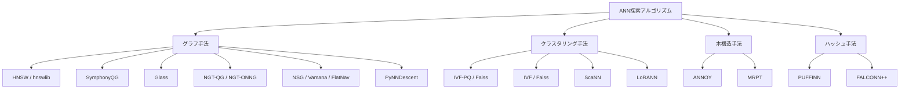

本記事は [https://arxiv.org/abs/2505.17810](https://arxiv.org/abs/2505.17810) の解説記事です。

## 論文概要（Abstract）

VIBE（Vector Index Benchmark for Embeddings）は、近似最近傍探索（ANN）アルゴリズムを現代の埋め込みデータセットで体系的に評価するオープンソースベンチマークフレームワークである。著者らは、従来のANN-Benchmarksが使用するデータセット（MNIST、Fashion-MNIST、SIFT等）がもはや現代のMLパイプラインで使用される埋め込みベクトルを代表しないと指摘し、RAG等の実用的なユースケースに対応した12のin-distribution（ID）データセットと6のout-of-distribution（OOD）データセットを構築している。21のANN実装を対象とした評価の結果、グラフ手法とクラスタリング手法が他の手法を上回ること、量子化技術が性能に大きく寄与すること、OODシナリオでは通常のANN手法が大幅に劣化することが報告されている。

この記事は [Zenn記事: 組み込みベクトルDB選定ガイド2026](https://zenn.dev/0h_n0/articles/5864692403321d) の深掘りです。

## 情報源

- **arXiv ID**: 2505.17810
- **URL**: [https://arxiv.org/abs/2505.17810](https://arxiv.org/abs/2505.17810)
- **著者**: Elias Jääsaari, Ville Hyvönen, Matteo Ceccarello, Teemu Roos, Martin Aumüller（ヘルシンキ大学、アールト大学、パドヴァ大学、ITコペンハーゲン大学）
- **発表年**: 2025
- **分野**: cs.DS, cs.IR, cs.LG
- **コード**: [github.com/vector-index-bench/vibe](https://github.com/vector-index-bench/vibe)

## 背景と動機（Background & Motivation）

ANN（Approximate Nearest Neighbor）探索は、RAG（Retrieval-Augmented Generation）やセマンティック検索などのMLパイプラインにおいて性能のボトルネックとなる処理である。ベクトルDBの選定ではアルゴリズムの特性を理解することが重要だが、それを支える標準ベンチマークが陳腐化しているという問題がある。

従来の標準であるANN-Benchmarksは、MNIST（784次元）、SIFT（128次元）、GloVe（100次元）といったデータセットを使用している。著者らは、これらのデータセットが現代の埋め込みモデルが生成するベクトル（768〜3072次元、テキスト・画像・コード等のマルチモーダル）を代表していないと指摘している。さらに、ANN-Benchmarksは検索クエリとコーパスが同一分布（in-distribution）であることを前提としているが、実際のRAGパイプラインではテキストクエリで画像を検索するなど、異なる分布間の検索（out-of-distribution）が発生する。

このギャップを埋めるため、VIBEは現代の埋め込みモデルから自動的にデータセットを生成するパイプラインを構築し、ID・OOD両方のシナリオを体系的に評価する枠組みを提供している。

## 主要な貢献（Key Contributions）

著者らは以下の5つの貢献を挙げている：

- **貢献1**: 現代のML埋め込みに特化したベンチマークフレームワークの構築。テキスト、画像、コード、単語ベクトルの各ドメインをカバー
- **貢献2**: 埋め込みモデルからデータセットを自動生成する拡張可能なパイプラインの提供。新しいモデルやドメインへの対応が容易
- **貢献3**: 21のANN実装を12のIDデータセットで比較。うち11実装（FlatNav、SymphonyQG等）はANN-Benchmarksに含まれない新規実装
- **貢献4**: 6つのOODデータセットによる体系的なOOD評価。テキスト-画像検索と近似Attention計算の2カテゴリ
- **貢献5**: クエリ難易度に基づく粒度の細かい分析（easy/hard分割、ID/OOD分割）

## 技術的詳細（Technical Details）

### 評価指標

VIBEでは以下の指標を採用している。

**リコール（Recall）**: 真のk最近傍のうち、アルゴリズムが返した候補に含まれる割合。

$$
\text{Recall}@k = \frac{|S_k(q) \cap S_k^*(q)|}{k}
$$

ここで、
- $S_k(q)$: アルゴリズムが返したk個の候補集合
- $S_k^*(q)$: 真のk最近傍集合
- $k$: 近傍数（VIBEでは$k=100$を採用）

著者らは、$k=100$を選択した理由として、実際のリトリーバルパイプラインではフィルタリング、多様性確保、リランキングのためにより多くの候補を取得する傾向があることを挙げている。

**スループット（QPS）**: 1秒あたりの処理クエリ数。単一CPUコアで計測。

**クエリ難易度**: Relative Contrast（RC）を使用。RCが低いほど難しいクエリとなる。

$$
RC_k(q) = \frac{d(q, x_{2k})}{d(q, x_k)}
$$

ここで、$x_k$は$q$のk番目の最近傍、$d$は距離関数である。

### アルゴリズム分類

VIBEが評価する21実装は、以下の4カテゴリに分類される。



**グラフ手法**: 近似kNNグラフを構築し、クエリ時にグラフを辿って近傍を探索する。HNSWは階層的なグラフ構造を持ち、上位層で粗い探索を行い下位層で精密な探索を行う。SymphonyQGとGlassは量子化されたコードを利用して距離計算を高速化する。

**クラスタリング手法**: データをクラスタに分割し、クエリに近いクラスタのみを探索する。IVF-PQはInverted File Index（転置インデックス）とProduct Quantization（直積量子化）を組み合わせ、コンパクトなコードで距離を近似する。ScaNN（Scalable Nearest Neighbors）は異方性量子化（anisotropic quantization）を採用している。

**木構造手法**: ランダム化された木のアンサンブルで空間を分割する。ANNOYはSpotifyが開発した実装で、組み込みDBでも広く利用されている。

**ハッシュ手法**: 局所感応型ハッシュ（LSH）を使用し、確率的な理論保証を持つ。

### データセット設計

著者らが構築したデータセットの特徴を以下にまとめる（論文Table 1, 2より）。

**IDデータセット（12個）**: 現代の埋め込みモデル（MXBAI、Nomic Text、CLIP、OpenAI text-embedding-3-large等）を使用し、テキスト（AGNews、arXiv抄録、Google Q&A等）、画像（ImageNet、Landmark）、コード（CodeSearchNet）、単語（GloVe）の各ドメインをカバー。次元数は200〜3072、データ規模は約20万〜147万件。

**OODデータセット（6個）**: テキスト-画像検索（MS COCO、ImageNet、LAION、Yandex）と近似Attention計算（Yi-6B-200K、Llama-3-8B-262k）の2カテゴリ。近似Attention計算データセットは、LLMの特定のレイヤー・ヘッドからkey/queryベクトルを抽出して構成されている。

### 量子化の重要性

著者らの分析において、量子化技術がトップ手法の共通要素であることが強調されている。

| 手法 | 量子化方式 | 概要 |
|------|-----------|------|
| SymphonyQG | RaBitQ | ランダム直交射影 + バイナリ量子化 |
| Glass | スカラー量子化 | 次元ごとの線形量子化 |
| NGT-QG | 4-bit PQ | 4ビットのProduct Quantization |
| ScaNN | 異方性量子化 | 方向を重視した非等方的な量子化 |
| IVF-PQ (Faiss) | 4-bit PQ Fast Scan | SIMD最適化されたPQコード走査 |
| LoRANN | 8-bit スカラー量子化 | 低ランク回帰 + スカラー量子化 |

## 実験結果（Results）

### In-Distribution結果

著者らは12のIDデータセットで21実装を評価し、以下の結果を報告している。

**95%リコール時のスループット勝利数**（論文Section 5.2より）:

| 手法 | 勝利データセット数（/12） |
|------|-------------------------|
| SymphonyQG | 5 |
| Glass | 4 |
| NGT-QG | 2 |
| LoRANN | 1 |

SymphonyQGが最も多くのデータセットで最速であり、Glassがそれに続く。著者らは、この2手法がともに量子化コードを活用した距離計算の高速化を実現していることを指摘している。

**インデックス構築時間**（論文Table 8より、90%リコール達成時の設定、秒）:

| 手法 | agnews | arxiv | gooaq | imagenet | landmark | yahoo |
|------|--------|-------|-------|----------|----------|-------|
| IVF-PQ (Faiss) | 64 | 68 | 121 | 45 | 126 | 19 |
| IVF (Faiss) | 84 | 214 | 229 | 156 | 203 | 89 |
| HNSW (hnswlib) | 3,208 | 3,174 | 3,689 | 2,339 | 1,097 | 905 |

この結果から、クラスタリング手法（IVF-PQ、IVF）はグラフ手法（HNSW）と比較してインデックス構築が1〜2桁速いことがわかる。HNSWはagnewsデータセット（約77万件、1024次元）で約53分を要しているのに対し、IVF-PQは約1分で構築が完了している。

**クエリ難易度に対する頑健性**（論文Figure 4より）: 90%平均リコール達成時の最速設定で、最も難しい100クエリに対するリコールを計測した結果、GlassとLoRANNは約70%まで低下するのに対し、SymphonyQGは難易度に関わらず安定したリコールを維持すると報告されている。

**GPU実行結果**（論文Figure 5より）: NVIDIA V100でバッチサイズ1,000のクエリを実行した場合、CAGRA（cuVS）が90%リコール時に約$10^5$ QPSを達成している。これはCPU実行（約$10^3$ QPS）の約100倍のスループットに相当する。

### Out-of-Distribution結果

**テキスト-画像検索**: 著者らは、OOD専用手法（RoarGraph、MLANN）が通常のANN手法に対して有意な優位性を示さなかったと報告している。高リコール領域では、Glassが両データセットで最高スループットを記録し、RoarGraphを上回った（論文Figure 7より）。

**近似Attention計算**: 通常のANN手法が大幅に劣化するシナリオとして報告されている。GlassとHNSW（hnswlib）は合理的なハイパーパラメータの範囲内で50%リコールに到達できなかった。ScaNNとIVF-PQはプレーンなIVFよりも低い性能を示した。一方、RoarGraph、MLANN-RF、LoRANNが最高のリコールを達成している（論文Figure 8より）。

著者らは、近似Attention計算におけるIVF-PQの劣化について、Attentionベクトルの分布がPQの仮定（各サブベクトル空間が独立）と合致しないことが原因である可能性を示唆している。

### バイナリ量子化の効果

論文Figure 5より、agnews-mxbaiデータセットでフロートベクトルの最良手法が90%リコール時に約$10^3$ QPSであるのに対し、バイナリ化されたベクトルでは約$8 \times 10^3$ QPSに達すると報告されている。NGT-ONNGがバイナリデータで最速の手法であった。

## 実装のポイント（Implementation）

VIBEを実際に利用する際の実装上の注意点を整理する。

**インストールと実行**:

```python
# VIBEのインストール（Pythonバインディング必須のため依存関係に注意）
pip install vibe-benchmark

# データセット生成パイプラインの実行例
from vibe import DatasetPipeline

pipeline = DatasetPipeline(
    source="arxiv_abstracts",
    model="nomic-embed-text-v1.5",
    n_samples=100_000,
    n_queries=1_000,
)
dataset = pipeline.build()
```

**ベンチマーク実行の考慮事項**:

- **k=100の設定**: VIBEはk=100をデフォルトとしている。k=10やk=20を使用する場合、結果が変わる可能性がある
- **シングルコア計測**: スループットは単一CPUコアで計測されている。マルチコア環境では並列化効率も考慮が必要
- **ハイパーパラメータ**: 全データセットで同一のハイパーパラメータグリッドを使用しているため、個別のデータセットに最適化した場合は異なる結果になり得る
- **OODデータセット**: テキスト-画像検索のOODデータは別途クエリ学習サンプルを含む。RoarGraph、MLANN、LoRANNのみがこれを利用している

**組み込みベクトルDB選定への示唆**:

```python
def select_index_strategy(
    n_vectors: int,
    dimension: int,
    target_recall: float,
    max_build_time_seconds: float,
) -> str:
    """VIBEの結果に基づくインデックス戦略の選択指針

    Args:
        n_vectors: ベクトル数
        dimension: ベクトルの次元数
        target_recall: 目標リコール（0.0-1.0）
        max_build_time_seconds: 許容するインデックス構築時間

    Returns:
        推奨するインデックス戦略の文字列
    """
    if n_vectors < 100_000:
        return "brute_force"

    estimated_hnsw_build = n_vectors * dimension * 2.5e-6
    estimated_ivf_build = n_vectors * dimension * 0.05e-6

    if max_build_time_seconds < estimated_hnsw_build:
        if target_recall >= 0.95:
            return "ivf_pq_with_refinement"
        return "ivf_pq"

    if target_recall >= 0.95:
        return "hnsw_with_quantization"

    return "hnsw_or_ivf_pq"
```

## Production Deployment Guide

### AWS実装パターン（コスト最適化重視）

VIBEのようなベンチマークツールをAWS上で継続的に実行し、ベクトルインデックスの性能を自動評価するインフラ構成を示す。

**トラフィック量別の推奨構成**:

| 規模 | 月間ベンチマーク回数 | 推奨構成 | 月額コスト | 主要サービス |
|------|-------------------|---------|-----------|------------|
| **Small** | ~10回 | Serverless | $50-120 | Lambda + S3 + Step Functions |
| **Medium** | ~50回 | Hybrid | $300-700 | ECS Fargate + S3 + EventBridge |
| **Large** | 200回+ | Container | $2,000-4,000 | EKS + Spot GPU + S3 |

**Small構成の詳細**（月額$50-120）:
- **Lambda**: 10GB RAM, 15分タイムアウト（小規模データセットのみ）（$30/月）
- **S3**: データセット・結果保存（$5/月）
- **Step Functions**: ベンチマークパイプラインのオーケストレーション（$5/月）
- **CloudWatch**: 実行ログ・メトリクス（$10/月）

**Medium構成の詳細**（月額$300-700）:
- **ECS Fargate**: 4 vCPU, 30GB RAM × タスク数（$200/月）
- **S3**: データセット・結果・モデルキャッシュ（$20/月）
- **EventBridge**: スケジュール実行（$5/月）
- **ECR**: コンテナイメージ（$5/月）

**Large構成の詳細**（月額$2,000-4,000）:
- **EKS**: コントロールプレーン（$72/月）
- **EC2 Spot Instances**: g5.xlarge（GPU）× 2-4台（$600/月、Spot価格）
- **S3**: 大規模データセット保存（$50/月）
- **Karpenter**: 自動スケーリング

**コスト削減テクニック**:
- Spot Instances使用で最大90%削減（EKS + Karpenter）
- S3 Intelligent-Tieringでストレージコスト自動最適化
- ベンチマーク結果のキャッシュで再実行回避
- アイドルタイムのAuto Scaling to Zero

**コスト試算の注意事項**:
- 上記は2026年11月時点のAWS ap-northeast-1（東京）リージョン料金に基づく概算値です
- 実際のコストはデータセットサイズ、ベンチマーク実行回数、GPU使用時間により変動します
- 最新料金は [AWS料金計算ツール](https://calculator.aws/) で確認してください

### Terraformインフラコード

**Small構成（Serverless）: Lambda + S3 + Step Functions**

```hcl
module "vpc" {
  source  = "terraform-aws-modules/vpc/aws"
  version = "~> 5.0"

  name = "vibe-benchmark-vpc"
  cidr = "10.0.0.0/16"
  azs  = ["ap-northeast-1a", "ap-northeast-1c"]
  private_subnets = ["10.0.1.0/24", "10.0.2.0/24"]

  enable_nat_gateway   = false
  enable_dns_hostnames = true
}

resource "aws_iam_role" "benchmark_lambda" {
  name = "vibe-benchmark-lambda-role"

  assume_role_policy = jsonencode({
    Version = "2012-10-17"
    Statement = [{
      Action = "sts:AssumeRole"
      Effect = "Allow"
      Principal = { Service = "lambda.amazonaws.com" }
    }]
  })
}

resource "aws_iam_role_policy" "s3_access" {
  role = aws_iam_role.benchmark_lambda.id

  policy = jsonencode({
    Version = "2012-10-17"
    Statement = [{
      Effect   = "Allow"
      Action   = ["s3:GetObject", "s3:PutObject", "s3:ListBucket"]
      Resource = [
        aws_s3_bucket.benchmark_data.arn,
        "${aws_s3_bucket.benchmark_data.arn}/*"
      ]
    }]
  })
}

resource "aws_lambda_function" "benchmark_runner" {
  filename      = "benchmark_runner.zip"
  function_name = "vibe-benchmark-runner"
  role          = aws_iam_role.benchmark_lambda.arn
  handler       = "index.handler"
  runtime       = "python3.12"
  timeout       = 900
  memory_size   = 10240

  environment {
    variables = {
      S3_BUCKET     = aws_s3_bucket.benchmark_data.id
      RESULTS_PREFIX = "results/"
    }
  }
}

resource "aws_s3_bucket" "benchmark_data" {
  bucket = "vibe-benchmark-data-${data.aws_caller_identity.current.account_id}"
}

resource "aws_s3_bucket_intelligent_tiering_configuration" "benchmark" {
  bucket = aws_s3_bucket.benchmark_data.id
  name   = "auto-tier"

  tiering {
    access_tier = "ARCHIVE_ACCESS"
    days        = 90
  }
}

resource "aws_cloudwatch_metric_alarm" "lambda_cost" {
  alarm_name          = "vibe-lambda-cost-spike"
  comparison_operator = "GreaterThanThreshold"
  evaluation_periods  = 1
  metric_name         = "Duration"
  namespace           = "AWS/Lambda"
  period              = 3600
  statistic           = "Sum"
  threshold           = 300000
  alarm_description   = "Lambda実行時間異常（ベンチマーク暴走の可能性）"

  dimensions = {
    FunctionName = aws_lambda_function.benchmark_runner.function_name
  }
}

data "aws_caller_identity" "current" {}
```

**Large構成（Container）: EKS + Spot GPU**

```hcl
module "eks" {
  source  = "terraform-aws-modules/eks/aws"
  version = "~> 20.0"

  cluster_name    = "vibe-benchmark-cluster"
  cluster_version = "1.31"

  vpc_id     = module.vpc.vpc_id
  subnet_ids = module.vpc.private_subnets

  cluster_endpoint_public_access = true
  enable_cluster_creator_admin_permissions = true
}

resource "kubectl_manifest" "karpenter_provisioner" {
  yaml_body = <<-YAML
    apiVersion: karpenter.sh/v1alpha5
    kind: Provisioner
    metadata:
      name: gpu-spot-provisioner
    spec:
      requirements:
        - key: karpenter.sh/capacity-type
          operator: In
          values: ["spot"]
        - key: node.kubernetes.io/instance-type
          operator: In
          values: ["g5.xlarge", "g5.2xlarge"]
      limits:
        resources:
          cpu: "32"
          memory: "128Gi"
          nvidia.com/gpu: "4"
      providerRef:
        name: default
      ttlSecondsAfterEmpty: 60
  YAML
}

resource "aws_budgets_budget" "benchmark_monthly" {
  name         = "vibe-benchmark-monthly"
  budget_type  = "COST"
  limit_amount = "4000"
  limit_unit   = "USD"
  time_unit    = "MONTHLY"

  notification {
    comparison_operator        = "GREATER_THAN"
    threshold                  = 80
    threshold_type             = "PERCENTAGE"
    notification_type          = "ACTUAL"
    subscriber_email_addresses = ["ops@example.com"]
  }
}
```

### セキュリティベストプラクティス

- **IAMロール**: 最小権限の原則。Lambda/ECSタスクロールはS3とCloudWatch Logsへのアクセスのみ許可
- **ネットワーク**: EKSのpublic accessは開発時のみ。本番では`cluster_endpoint_public_access = false`を設定
- **データ保護**: S3バケットはKMS暗号化を有効化。ベンチマークデータ自体は公開データだが、結果には内部情報が含まれる可能性がある
- **監査**: CloudTrail有効化で全API操作を記録

### 運用・監視設定

**CloudWatch Logs Insights クエリ**:

```sql
-- ベンチマーク実行時間の異常検知
fields @timestamp, algorithm, dataset, duration_seconds, recall_at_100
| stats avg(duration_seconds) as avg_duration,
        max(duration_seconds) as max_duration
        by algorithm
| filter max_duration > 3600

-- アルゴリズム別リコール vs QPS サマリ
fields @timestamp, algorithm, recall, qps
| stats avg(qps) as avg_qps by algorithm, bin(recall, 0.05) as recall_bin
| sort recall_bin desc
```

**CloudWatch アラーム（Python）**:

```python
import boto3

cloudwatch = boto3.client('cloudwatch')

cloudwatch.put_metric_alarm(
    AlarmName='vibe-benchmark-duration-spike',
    ComparisonOperator='GreaterThanThreshold',
    EvaluationPeriods=1,
    MetricName='Duration',
    Namespace='AWS/Lambda',
    Period=3600,
    Statistic='Maximum',
    Threshold=840000,
    ActionsEnabled=True,
    AlarmActions=['arn:aws:sns:ap-northeast-1:123456789:benchmark-alerts'],
    AlarmDescription='ベンチマーク実行時間が14分超過（Lambda 15分制限に迫る）'
)
```

**Cost Explorer自動レポート（Python）**:

```python
import boto3
from datetime import datetime, timedelta

ce = boto3.client('ce')

response = ce.get_cost_and_usage(
    TimePeriod={
        'Start': (datetime.now() - timedelta(days=7)).strftime('%Y-%m-%d'),
        'End': datetime.now().strftime('%Y-%m-%d')
    },
    Granularity='DAILY',
    Metrics=['UnblendedCost'],
    Filter={
        'Tags': {
            'Key': 'Project',
            'Values': ['vibe-benchmark']
        }
    }
)

for result in response['ResultsByTime']:
    cost = float(result['Total']['UnblendedCost']['Amount'])
    if cost > 200:
        print(f"⚠️ 日次コスト ${cost:.2f} が閾値超過")
```

### コスト最適化チェックリスト

**アーキテクチャ選択**:
- [ ] 月10回以下 → Lambda（Serverless） - $50-120/月
- [ ] 月50回程度 → ECS Fargate（Hybrid） - $300-700/月
- [ ] 月200回以上 → EKS + Spot GPU（Container） - $2,000-4,000/月

**リソース最適化**:
- [ ] GPU: Spot Instances優先（最大90%削減）
- [ ] Lambda: メモリサイズを実行プロファイルに基づき最適化
- [ ] S3: Intelligent-Tieringで古いデータを自動階層化
- [ ] ECS/EKS: ベンチマーク非実行時はスケールダウン
- [ ] ECR: 古いイメージのライフサイクルポリシー設定

**ベンチマークコスト削減**:
- [ ] 結果キャッシュ: 同一設定の再実行を回避（S3に保存）
- [ ] データセットプリフェッチ: S3からの転送コスト削減
- [ ] 段階的評価: 小規模で予備実行→有望な設定のみ全規模実行
- [ ] GPU時間最小化: CPU手法はCPUインスタンスで、GPU手法のみGPUで実行

**監視・アラート**:
- [ ] AWS Budgets: 月額予算設定（80%で警告）
- [ ] CloudWatch アラーム: 実行時間スパイク検知
- [ ] Cost Anomaly Detection: 自動異常検知
- [ ] 週次コストレポート: SNSへ自動送信

**リソース管理**:
- [ ] 未使用リソース: Trusted Advisor活用
- [ ] タグ戦略: Project=vibe-benchmark でコスト可視化
- [ ] S3ライフサイクル: 90日以上のログをGlacierに移行
- [ ] EKSノード: アイドル60秒でKarpenterが自動回収

## 実運用への応用（Practical Applications）

VIBEの結果は、組み込みベクトルDBの選定に直接的な示唆を与える。

**LanceDB（IVF-PQ採用）への示唆**: VIBEの結果では、IVF-PQはインデックス構築時間でHNSWを1〜2桁上回る。100万件規模でIVF-PQが約1分、HNSWが約50分である。一方、スループットではグラフ手法（SymphonyQG、Glass）がIVF-PQを上回る傾向がある。LanceDBのようなIVF-PQ採用のDBは、頻繁にインデックスを再構築するワークロードで有利である。

**Chroma・DuckDB vss（HNSW採用）への示唆**: HNSWベースのDBは、インデックス構築コストが高いものの、クエリスループットでは競争力がある。ただし、近似Attention計算のようなOODシナリオでは性能が大幅に劣化する可能性がある。

**sqlite-vec（brute-force）への示唆**: VIBEは10万件以上のデータセットでANNインデックスの優位性を示している。brute-forceは小規模データ（10万件以下）では依然として実用的だが、スケールアップ時のインデックス導入タイミングをVIBEの結果から判断できる。

**量子化の重要性**: VIBEの結果は、トップ手法がすべて何らかの量子化技術を採用していることを示している。ベクトルDB選定の際には、対応する量子化方式（RaBitQ、PQ、スカラー量子化等）を確認することが重要である。

## 関連研究（Related Work）

- **ANN-Benchmarks（Aumüller et al., 2020）**: VIBEの直接の前身。MNIST、SIFT等の古典的データセットを使用。VIBEはこれを現代の埋め込みデータセットに拡張した
- **BigVectorBench（PVLDB 2025）**: ANN-Benchmarksのユニモーダルクエリの限界を指摘し、複合クエリ（フィルタリング付き検索等）の評価を提案。VIBEとは補完的な関係にある
- **big-ann-benchmarks**: 10億件規模のデータセットでのANN評価を対象とする。VIBEは100万件規模に焦点を当てているため、スケールの異なるベンチマーク

## まとめと今後の展望

VIBEは、現代の埋め込みモデルに対応したANNベンチマークとして、以下の知見を提供している。

- グラフ手法（SymphonyQG、Glass）とクラスタリング手法（LoRANN、ScaNN、IVF-PQ）がトップ性能を占め、量子化が共通の成功要因である
- IVF-PQはインデックス構築速度でHNSWを大きく上回る（論文Table 8より、1〜2桁の差）
- OODシナリオ（特に近似Attention計算）では、通常のANN手法が大幅に劣化し、専用手法（RoarGraph、MLANN等）が必要となる
- 論文のスコープ外として、フィルタリング付き検索、ストリーミング挿入、スパース検索は今後の課題とされている

組み込みベクトルDBを選定する際には、自身のデータ分布・次元数・規模でVIBEを実行し、対象DBが内部的に使用するアルゴリズムの特性を定量的に評価することが推奨される。

## 参考文献

- **arXiv**: [https://arxiv.org/abs/2505.17810](https://arxiv.org/abs/2505.17810)
- **Code**: [https://github.com/vector-index-bench/vibe](https://github.com/vector-index-bench/vibe)
- **Interactive Results**: [https://vector-index-bench.github.io/](https://vector-index-bench.github.io/)
- **ANN-Benchmarks**: [https://ann-benchmarks.com/](https://ann-benchmarks.com/)
- **Related Zenn article**: [https://zenn.dev/0h_n0/articles/5864692403321d](https://zenn.dev/0h_n0/articles/5864692403321d)
