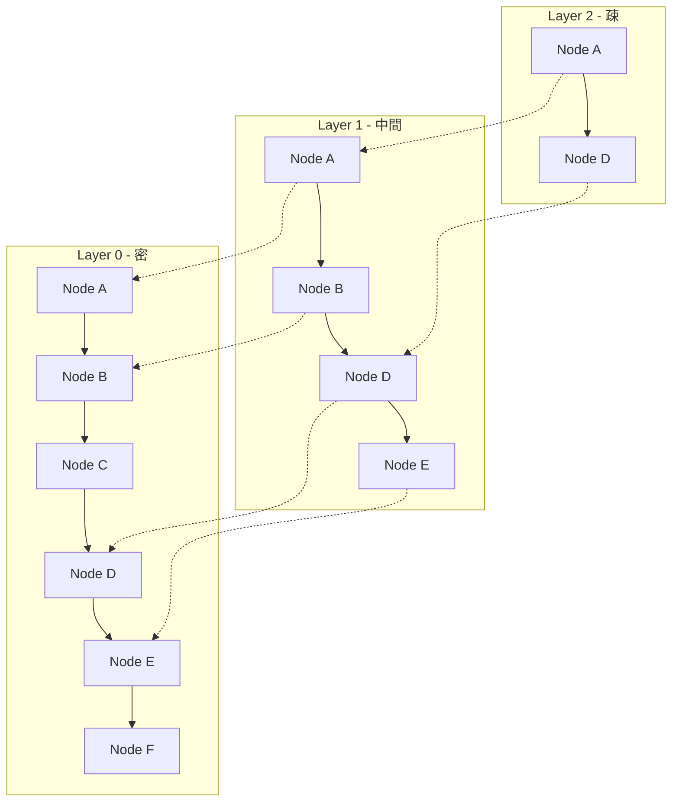
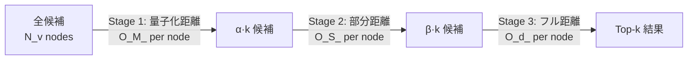

本記事は [https://arxiv.org/abs/2602.21600](https://arxiv.org/abs/2602.21600) の解説記事です。

## 論文概要（Abstract）

AQR-HNSWは、グラフベースの近似最近傍探索（ANN）アルゴリズムであるHNSWに対して、密度適応量子化（Density-aware Adaptive Quantization）、多段リランキング（Multi-stage Re-ranking）、およびSIMD最適化の3つの技術を組み合わせることで、探索スループットとメモリ効率を同時に改善するフレームワークである。著者らは、標準ベンチマークにおいてベースラインHNSW実装と比較して2.5〜3.3倍のクエリスループット向上を98%以上のリコールを維持しながら達成したと報告している。

この記事は [Zenn記事: 組み込みベクトルDB選定ガイド2026：LanceDB・sqlite-vec・Chroma・DuckDB vssの性能と制約を比較する](https://zenn.dev/0h_n0/articles/5864692403321d) の深掘りです。

## 情報源

- **arXiv ID**: 2602.21600
- **URL**: [https://arxiv.org/abs/2602.21600](https://arxiv.org/abs/2602.21600)
- **著者**: Ganap Ashit Tewary, Nrusinga Charan Gantayat, Jeff Zhang
- **発表年**: 2026年（DAC 2026に採択）
- **分野**: cs.IR（Information Retrieval）
- **採択会議**: DAC 2026（Design Automation Conference）

## 背景と動機（Background & Motivation）

HNSW（Hierarchical Navigable Small World）は、近似最近傍探索において高いリコールと低いレイテンシを両立する手法として広く利用されている。ChromaやDuckDB vssなどの組み込みベクトルDBでもHNSWがデフォルトのインデックスアルゴリズムとして採用されている。

しかし、HNSWにはデータ規模が増大するにつれて顕在化する3つの課題がある。第一に、グラフの全ノードがフルプレシジョン（通常float32）のベクトルを保持するため、メモリ消費がデータ件数に対して線形に増加する。第二に、探索時の距離計算がボトルネックとなり、特にベクトル次元が高い場合にスループットが低下する。第三に、データ密度が不均一な実世界のデータセットでは、高密度領域と低密度領域で最適な探索戦略が異なるにもかかわらず、従来のHNSWは一律の手法で処理を行っている。

著者らは、これらの課題に対してデータ密度に適応した量子化と段階的な候補フィルタリングを組み合わせることで、メモリ削減と探索高速化を同時に実現するAQR-HNSWフレームワークを提案している。

## 主要な貢献（Key Contributions）

著者らが報告している主要な貢献は以下の3点である。

- **密度適応量子化（Density-aware Adaptive Quantization）**: データ分布の局所密度に基づいてコードブックを最適化する量子化手法。著者らによれば、距離関係を保持しながら4倍の圧縮を達成する
- **多段リランキング（Multi-stage Re-ranking）**: 粗い距離推定から精密な距離計算へと段階的に候補を絞り込む探索戦略。著者らは不要な計算を35%削減したと報告している
- **SIMD最適化**: 量子化コードに対して最適化されたSIMD命令セットの活用により、サイクルあたり16〜64回の距離演算を実現

## 技術的詳細（Technical Details）

### HNSWの基本構造と課題

HNSWは、Skip Listの概念をグラフ探索に応用した階層的なグラフインデックスである。各層でNavigable Small Worldグラフを構成し、上位層（疎）から下位層（密）へとグリーディ探索を行う。



標準的なHNSWの探索アルゴリズムでは、各ノード訪問時にフルプレシジョンの距離計算が必要である。ベクトル$\mathbf{q} \in \mathbb{R}^d$とグラフノード$\mathbf{x}_i \in \mathbb{R}^d$の距離計算は以下の通りである。

$$
\text{dist}(\mathbf{q}, \mathbf{x}_i) = \sqrt{\sum_{j=1}^{d} (q_j - x_{i,j})^2}
$$

ここで、$d$は次元数、$q_j$はクエリベクトルの$j$番目の要素、$x_{i,j}$はノード$i$のベクトルの$j$番目の要素である。

この距離計算のコストは$O(d)$であり、探索中に訪問するノード数を$N_v$とすると、1クエリあたりの総計算量は$O(N_v \cdot d)$となる。$d = 768$や$d = 1536$といった高次元のembeddingでは、この計算がスループットの支配的ボトルネックとなる。

### 密度適応量子化（Density-aware Adaptive Quantization）

AQR-HNSWの第一の技術は、データの局所密度に応じて量子化パラメータを適応的に調整する手法である。

#### 標準的な積量子化（PQ）との違い

標準的な積量子化（Product Quantization）では、$d$次元ベクトルを$M$個のサブベクトルに分割し、各サブベクトルをk-meansで学習したコードブックにマッピングする。

$$
\mathbf{x} \approx [\mathbf{c}_{1}^{(k_1)}, \mathbf{c}_{2}^{(k_2)}, \ldots, \mathbf{c}_{M}^{(k_M)}]
$$

ここで、$\mathbf{c}_{m}^{(k_m)}$はサブスペース$m$のコードブックにおける$k_m$番目のセントロイドである。

標準PQの問題点は、コードブックがデータ全体に対して一様に学習されるため、データ密度が高い領域では量子化誤差が大きくなりやすいことである。

#### AQR-HNSWの密度適応アプローチ

著者らが提案する密度適応量子化では、まずデータセット全体の局所密度を推定する。ノード$\mathbf{x}_i$の局所密度$\rho_i$は、$k$近傍の平均距離の逆数として定義される。

$$
\rho_i = \frac{k}{\sum_{j=1}^{k} \text{dist}(\mathbf{x}_i, \mathbf{x}_j^{\text{nn}})}
$$

ここで、$\mathbf{x}_j^{\text{nn}}$はノード$\mathbf{x}_i$の$j$番目の近傍である。

密度に基づいてデータを複数の密度領域に分割し、各領域に対して独立したコードブックを学習する。高密度領域ではより多くのセントロイドを割り当てることで量子化精度を維持し、低密度領域ではセントロイド数を削減してメモリ効率を高める。

```python
import numpy as np
from sklearn.cluster import KMeans
from sklearn.neighbors import NearestNeighbors


def estimate_local_density(vectors: np.ndarray, k: int = 32) -> np.ndarray:
    """各ベクトルの局所密度を推定する"""
    nn = NearestNeighbors(n_neighbors=k, metric="euclidean")
    nn.fit(vectors)
    distances, _ = nn.kneighbors(vectors)
    mean_dist = distances[:, 1:].mean(axis=1)
    return 1.0 / (mean_dist + 1e-8)


def build_density_adaptive_codebooks(
    vectors: np.ndarray,
    density: np.ndarray,
    n_subspaces: int = 8,
    n_centroids_base: int = 256,
    n_bins: int = 4,
) -> dict[int, list[np.ndarray]]:
    """密度領域ごとにコードブックを構築する"""
    sub_dim = vectors.shape[1] // n_subspaces
    thresholds = np.percentile(density, np.linspace(0, 100, n_bins + 1))

    codebooks: dict[int, list[np.ndarray]] = {}
    for bin_idx in range(n_bins):
        mask = (density >= thresholds[bin_idx]) & (
            density < thresholds[bin_idx + 1]
            if bin_idx < n_bins - 1
            else True
        )
        subset = vectors[mask]
        # 高密度領域にはより多くのセントロイドを割り当て
        n_centroids = min(int(n_centroids_base * (1.0 + bin_idx * 0.5)), len(subset))

        codebooks[bin_idx] = []
        for m in range(n_subspaces):
            sub = subset[:, m * sub_dim : (m + 1) * sub_dim]
            km = KMeans(n_clusters=n_centroids, n_init=1).fit(sub)
            codebooks[bin_idx].append(km.cluster_centers_)
    return codebooks
```

著者らは、この密度適応アプローチにより、全体で4倍の圧縮率を達成しながらも、標準PQと比較して距離推定の精度を向上させたと報告している。

### 多段リランキング（Multi-stage Re-ranking）

第二の技術は、探索候補を段階的にフィルタリングする多段リランキング戦略である。

#### 3段階の距離計算パイプライン

著者らの手法では、候補ノードに対する距離計算を3段階に分けて実行する。

**Stage 1: 量子化距離による粗いフィルタリング**

密度適応量子化で符号化されたベクトルに対して、ルックアップテーブルを用いた近似距離を計算する。

$$
\hat{d}(\mathbf{q}, \mathbf{x}_i) = \sum_{m=1}^{M} \| \mathbf{q}_m - \mathbf{c}_{m}^{(k_{i,m})} \|^2
$$

ここで、$\mathbf{q}_m$はクエリの$m$番目のサブベクトル、$\mathbf{c}_{m}^{(k_{i,m})}$はノード$i$の$m$番目のサブスペースに割り当てられたセントロイドである。この計算はルックアップテーブルにより$O(M)$で完了する。

Stage 1で上位$\alpha \cdot k$件（$\alpha > 1$はオーバーフェッチ係数）を選択する。

**Stage 2: 部分的フルプレシジョン距離によるリランキング**

Stage 1で選択された候補に対して、ベクトルの一部の次元のみを用いたフルプレシジョン距離を計算する。

$$
d_{\text{partial}}(\mathbf{q}, \mathbf{x}_i) = \sqrt{\sum_{j \in S} (q_j - x_{i,j})^2}
$$

ここで、$S \subset \{1, \ldots, d\}$は距離識別性の高い次元のサブセットであり、$|S| \ll d$である。Stage 2で上位$\beta \cdot k$件（$1 < \beta < \alpha$）を選択する。

**Stage 3: フルプレシジョン距離による最終ランキング**

Stage 2の候補に対して、全次元を用いたフルプレシジョン距離を計算し、最終的な上位$k$件を返す。



この3段階パイプラインにより、フルプレシジョン距離計算が必要なノード数を大幅に削減できる。著者らは、全体の不要な計算を35%削減したと報告している。

### SIMD最適化（Quantization-optimized SIMD）

第三の技術は、密度適応量子化のルックアップテーブル演算に対するSIMD命令セットの最適化である。

標準的なPQ距離計算では、各サブスペースのルックアップテーブル参照と加算が必要である。著者らは、AVX-512命令セットを活用して、テーブル参照と距離加算を並列化する実装を提案している。

具体的には、以下の最適化が含まれる。

1. **テーブルプリフェッチ**: 量子化コードのデコード前にルックアップテーブルをL1キャッシュにプリフェッチ
2. **パックド演算**: 8ビット量子化コードに対してパックドバイト演算を適用し、1命令で複数のサブスペースの距離を同時計算
3. **レジスタタイリング**: 512ビットSIMDレジスタを活用し、サイクルあたり16〜64回の距離演算を実現

AVX-512では512ビットレジスタを活用し、float32の場合は1命令で16要素、int8の場合は64要素を同時処理できる。著者らは、テーブルプリフェッチ（L1キャッシュへの先読み）、パックドバイト演算（8ビットコードの並列デコード）、レジスタタイリング（複数サブスペースの同時処理）を組み合わせ、スカラー実装と比較してStage 1の距離計算速度を大幅に向上させたと報告している。

## 実装のポイント（Implementation）

AQR-HNSWを既存のHNSW実装に統合する際の主要な考慮事項を整理する。

**コードブック管理の複雑さ**: 密度領域ごとに独立したコードブックを保持する必要があるため、メモリレイアウトが標準PQより複雑になる。各ノードがどの密度領域に属するかのメタデータも保持する必要がある。

**オフライン前処理**: 密度推定とコードブック構築はインデックス構築時のオフライン処理として実行される。著者らは5倍のインデックス構築高速化を報告しているが、これは密度適応量子化によりグラフ構築中の距離計算が高速化されたことによる。

**Stage間のバッファ管理**: 多段リランキングでは、各Stageの出力を次のStageの入力として受け渡す必要がある。メモリアロケーションの頻度を抑えるため、固定サイズバッファのプリアロケーションが推奨される。

**SIMD互換性**: AVX-512命令セットはIntel Ice Lake以降およびAMD Zen 4以降のCPUで利用可能である。対応していないCPUではAVX2へのフォールバックが必要であり、その場合はサイクルあたりの演算数が半減する。

**パラメータチューニング**: オーバーフェッチ係数$\alpha$と$\beta$、密度ビンの数、各密度領域のセントロイド数はデータセットに依存する。著者らは$\alpha = 4$、$\beta = 2$をデフォルトとして推奨しているとみられるが、最適値はデータ分布と要求リコールに応じて調整する必要がある。

## Production Deployment Guide

### AWS実装パターン（コスト最適化重視）

AQR-HNSWベースのベクトル検索をAWS上にデプロイする際のトラフィック量別推奨構成を以下に示す。

**トラフィック量別の推奨構成**:

| 規模 | 月間リクエスト | 推奨構成 | 月額コスト | 主要サービス |
|------|--------------|---------|-----------|------------|
| **Small** | ~3,000 (100/日) | Serverless | $50-150 | Lambda + OpenSearch Serverless |
| **Medium** | ~30,000 (1,000/日) | Hybrid | $300-800 | Lambda + ECS Fargate + ElastiCache |
| **Large** | 300,000+ (10,000/日) | Container | $2,000-5,000 | EKS + Karpenter + EC2 Spot (AVX-512対応) |

AQR-HNSWの量子化によるメモリ75%削減は、同一データ規模でより小型のインスタンスを選択できることを意味する。Large構成ではAVX-512対応のc6i/c7iインスタンスをSpot（最大90%削減）で調達し、Karpenterで自動スケーリングする。Reserved Instances（1年コミット、最大72%削減）やElastiCacheによるクエリキャッシュも有効である。

**注意**: 上記は2026年11月時点のAWS東京リージョン概算値。最新料金は[AWS料金計算ツール](https://calculator.aws/)で確認のこと。

### Terraformインフラコード

**Large構成: EKS + AVX-512対応Spot Instances（抜粋）**

```hcl
module "eks" {
  source  = "terraform-aws-modules/eks/aws"
  version = "~> 20.0"

  cluster_name    = "aqr-hnsw-cluster"
  cluster_version = "1.31"
  vpc_id          = module.vpc.vpc_id
  subnet_ids      = module.vpc.private_subnets

  cluster_endpoint_public_access = true
  enable_cluster_creator_admin_permissions = true
}

# Karpenter NodePool: AVX-512対応Spotインスタンス
resource "kubectl_manifest" "karpenter_nodepool" {
  yaml_body = <<-YAML
    apiVersion: karpenter.sh/v1
    kind: NodePool
    metadata:
      name: avx512-spot
    spec:
      template:
        spec:
          requirements:
            - key: karpenter.sh/capacity-type
              operator: In
              values: ["spot"]
            - key: node.kubernetes.io/instance-type
              operator: In
              values: ["c6i.2xlarge", "c6i.4xlarge", "c7i.2xlarge"]
          nodeClassRef:
            group: karpenter.k8s.aws
            kind: EC2NodeClass
            name: default
      limits:
        cpu: "32"
        memory: "64Gi"
      disruption:
        consolidationPolicy: WhenEmptyOrUnderutilized
        consolidateAfter: 30s
  YAML
}
```

**セキュリティ**: 本番環境では`cluster_endpoint_public_access = false`、IRSA（IAM Roles for Service Accounts）で最小権限、EBS/S3はKMS暗号化、Secrets Manager使用、CloudTrail有効化を推奨。

### 運用・監視設定

**CloudWatch Logs Insights クエリ**:

```sql
-- AQR-HNSW各Stageのレイテンシ分析
fields @timestamp, stage, duration_ms, candidates_in, candidates_out
| stats avg(duration_ms) as avg_ms,
        pct(duration_ms, 95) as p95_ms,
        pct(duration_ms, 99) as p99_ms
  by stage, bin(5m)

-- リコール低下検知
fields @timestamp, recall, query_count
| filter recall < 0.95
| stats count(*) as low_recall_count by bin(1h)
```

**CloudWatch アラーム**: P99レイテンシ（50ms閾値）とリコール率（95%閾値）の2つのアラームを設定し、SNS経由で通知する。リコール低下はインデックスの再構築タイミングの判断指標となる。

**X-Ray トレーシング**: `aws_xray_sdk`で各Stage（量子化距離→部分距離→フル距離）をサブセグメントとして計測し、パイプラインのボトルネックを特定できる。

### コスト最適化チェックリスト

**アーキテクチャ選択**:
- [ ] ~100 req/日 → Lambda + OpenSearch Serverless（$50-150/月）
- [ ] ~1,000 req/日 → ECS Fargate + カスタムHNSW（$300-800/月）
- [ ] 10,000+ req/日 → EKS + Spot（AVX-512対応インスタンス、$2,000-5,000/月）

**リソース最適化**:
- [ ] EC2: c6i/c7i Spot Instances優先（AVX-512対応、最大90%削減）
- [ ] Reserved Instances: 1年コミットで最大72%削減
- [ ] Savings Plans: Compute Savings Plans検討
- [ ] AQR-HNSW量子化でメモリ75%削減 → 小型インスタンスで対応
- [ ] EKS: Karpenterでアイドル時30秒後にスケールダウン

**検索コスト削減**:
- [ ] ElastiCacheでクエリキャッシュ（同一クエリの重複排除）
- [ ] 多段リランキングの$\alpha$, $\beta$パラメータ最適化で計算量調整
- [ ] バッチクエリ対応（複数クエリをまとめて処理）
- [ ] Stage 1のルックアップテーブルをL1キャッシュに常駐

**監視・アラート**:
- [ ] AWS Budgets: 月額予算設定（80%で警告）
- [ ] CloudWatch: P99レイテンシ・リコール低下アラーム
- [ ] Cost Anomaly Detection: 自動異常検知
- [ ] 日次コストレポート: SNS/Slack通知

**リソース管理**:
- [ ] 未使用インデックス自動削除（S3ライフサイクル）、タグ戦略でコスト可視化、開発環境夜間停止

## 実験結果（Results）

著者らは標準的なANNベンチマークデータセットを用いて評価を行っている。論文Abstractによれば、以下の結果が報告されている。

**スループット向上**:

| 指標 | ベースラインHNSW | AQR-HNSW | 改善率 |
|------|-----------------|----------|--------|
| クエリスループット（QPS） | 1x（基準） | 2.5〜3.3x | +150〜230% |
| リコール（Recall@10） | 98%+ | 98%+ | 維持 |

著者らは、ベースラインのHNSW実装と比較して、98%以上のリコールを維持しながら2.5〜3.3倍のクエリスループット向上を達成したと報告している（論文Abstractより）。

**メモリ効率**:

| 指標 | ベースラインHNSW | AQR-HNSW | 改善 |
|------|-----------------|----------|------|
| インデックスメモリ | 1x（基準） | 0.25x | 75%削減 |
| インデックス構築時間 | 1x（基準） | 0.2x | 5倍高速化 |

密度適応量子化による4倍の圧縮率がメモリ削減に直結している。インデックス構築においても、量子化済みベクトルに対する距離計算の高速化により5倍の高速化が報告されている（論文Abstractより）。

**注意**: 上記数値は論文Abstractからの引用。データセット名等の詳細は論文本文を参照のこと。DAC 2026査読済みだが、独立した追試は本記事執筆時点で未確認。

## 実運用への応用（Practical Applications）

AQR-HNSWの技術は、組み込みベクトルDBの文脈で以下のような応用が考えられる。

**ChromaやDuckDB vssへの適用可能性**: 関連Zenn記事で取り上げたChromaはhnswlibのフォーク、DuckDB vssはusearchライブラリをそれぞれHNSW実装の基盤としている。AQR-HNSWの密度適応量子化と多段リランキングをこれらのライブラリに組み込むことで、同一ハードウェアでのスループット向上が期待できる。ただし、Chromaはメモリ常駐型であるため、量子化による75%のメモリ削減はコレクションサイズの上限引き上げに直結する。

**エッジ・オンデバイス推論**: AQR-HNSWのSIMD最適化はサーバーサイドCPU（AVX-512対応）を前提としているが、ARM NEON命令セットへの移植により、モバイルデバイスやRaspberry Piでのオンデバイスベクトル検索にも適用可能である。メモリ制約の厳しいエッジ環境では、75%のメモリ削減は特に有効である。

**大規模RAGシステム**: 100万件以上のドキュメントを扱うRAGシステムでは、検索レイテンシがエンドツーエンドのレスポンスタイムに直結する。AQR-HNSWの2.5〜3.3倍のスループット向上により、同一ハードウェアで処理可能な同時リクエスト数が増加し、インフラコストの削減につながる。

**LanceDBとの組み合わせ**: LanceDBはIVF-PQをメインのインデックスとして採用しているが、IVFのパーティション内探索にHNSWを併用するIVF-HNSW-SQ構成も提供している。AQR-HNSWのアプローチをIVF-HNSW-SQ内のHNSW層に適用することで、パーティション内探索の効率化が見込まれる。

## 関連研究（Related Work）

- **HNSW（Malkov & Yashunin, 2020）**: 元祖のHNSWアルゴリズム。AQR-HNSWはこの基盤に量子化とリランキングを追加する改良手法
- **ScaNN（Guo et al., 2020）**: Google提案の量子化ベースANN。密度適応量子化はScaNNのアプローチを発展させたもの
- **DiskANN（Subramanya et al., 2019）**: ディスクベースのグラフインデックス。多段リランキングはDiskANNのbeam search思想と共通
- **RaBitQ（Gao & Long, 2024）**: 1ビット/次元のバイナリ量子化。LanceDBが採用。AQR-HNSWはより多ビットで密度適応するアプローチ

## まとめと今後の展望

AQR-HNSWは、HNSWに対して密度適応量子化、多段リランキング、SIMD最適化の3つの技術を統合することで、98%以上のリコールを維持しながら2.5〜3.3倍のスループット向上と75%のメモリ削減を達成したとされるフレームワークである。DAC 2026に採択されており、ハードウェアアーキテクチャの観点からも評価されている。

ChromaやDuckDB vssが採用するHNSWインデックスの性能改善に直接適用可能な技術であり、組み込みベクトルDBの性能上限を引き上げる可能性がある。一方で、密度適応コードブックの管理複雑性やAVX-512依存などの実装上の課題もあり、ライブラリレベルでの統合には追加の開発工数が必要となる。

今後はARM NEON対応によるエッジ展開、IVF-HNSWハイブリッドとの統合、ストリーミングデータ対応が研究課題として挙げられる。

## 参考文献

- **arXiv**: [https://arxiv.org/abs/2602.21600](https://arxiv.org/abs/2602.21600)
- **Related Zenn article**: [組み込みベクトルDB選定ガイド2026](https://zenn.dev/0h_n0/articles/5864692403321d)
- Malkov, Y. A., & Yashunin, D. A. (2020). Efficient and Robust Approximate Nearest Neighbor Search Using Hierarchical Navigable Small World Graphs. *IEEE Transactions on Pattern Analysis and Machine Intelligence*, 42(4), 824-836.
- Guo, R., et al. (2020). Accelerating Large-Scale Inference with Anisotropic Vector Quantization. *ICML 2020*.
- Subramanya, S. J., et al. (2019). DiskANN: Fast Accurate Billion-point Nearest Neighbor Search on a Single Node. *NeurIPS 2019*.
- Gao, J., & Long, C. (2024). RaBitQ: Quantizing High-Dimensional Vectors with a Theoretical Error Bound for Approximate Nearest Neighbor Search. *SIGMOD 2024*.
