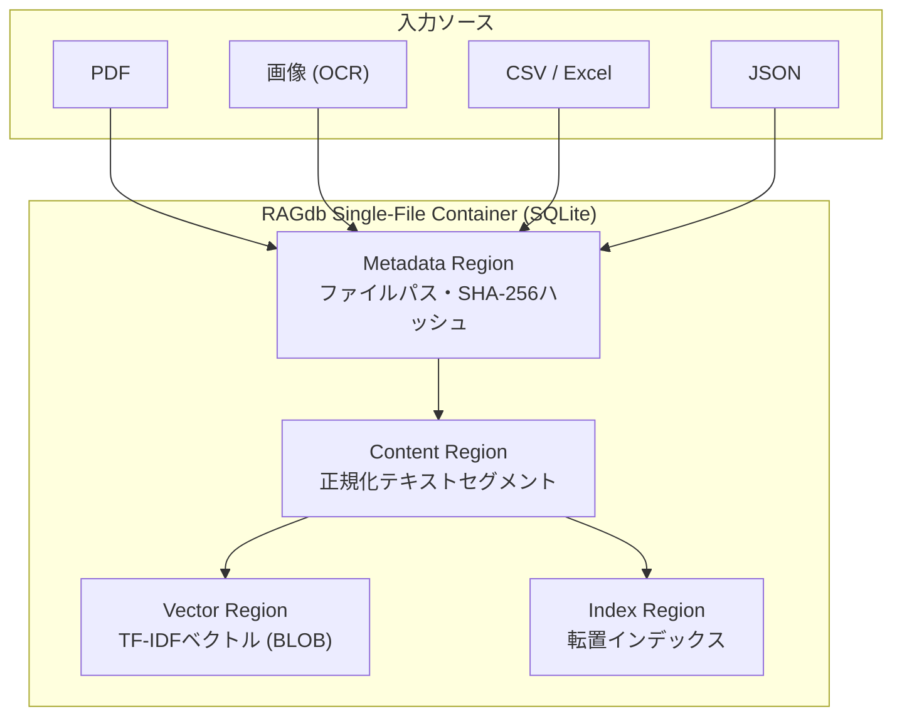

## 論文概要（Abstract）

本記事は [https://arxiv.org/abs/2602.22217](https://arxiv.org/abs/2602.22217) の解説記事です。

RAGdbは、Retrieval-Augmented Generation（RAG）に必要な機能を単一のSQLiteファイルに統合する組み込み型アーキテクチャである。著者であるAhmed Bin Khalid（SKAS IT）は、従来のEnterprise RAGスタックが必要としていたDocker・ベクトルDBサーバー・GPU推論サーバーをすべて排除し、30MB未満のPythonライブラリと単一のデータファイルだけで動作するシステムを提案している。著者らは、Intel i7-1165G7搭載のコンシューマ向けラップトップ上での評価において、インクリメンタル更新で31.6倍の高速化、ディスク使用量の約99.5%削減を報告している。

この記事は [Zenn記事: 組み込みベクトルDB選定ガイド2026：LanceDB・sqlite-vec・Chroma・DuckDB vssの性能と制約を比較する](https://zenn.dev/0h_n0/articles/5864692403321d) の深掘りです。

## 情報源

- **arXiv ID**: 2602.22217
- **URL**: [https://arxiv.org/abs/2602.22217](https://arxiv.org/abs/2602.22217)
- **著者**: Ahmed Bin Khalid（SKAS IT）
- **発表年**: 2025年12月
- **分野**: cs.IR（Information Retrieval）
- **Code**: [https://github.com/abkmystery/ragdb](https://github.com/abkmystery/ragdb)（Apache 2.0）

## 背景と動機（Background & Motivation）

RAGは大規模言語モデル（LLM）を外部知識で接地（grounding）するための標準的パラダイムとして定着しているが、そのエンタープライズ実装は複雑化の一途をたどっている。著者らは、典型的なEnterprise RAGスタックが以下の4つのコンポーネントで構成されることを指摘している（論文Section 1より）。

1. **Ingestion Service**: PDF・HTML・画像を解析するパイプライン（Unstructured.io等）
2. **Embedding Service**: GPU推論サーバー（TorchServe / Triton）
3. **Vector Database**: 専用のステートフルサービス（Pinecone / Milvus / Weaviate）
4. **Orchestration Layer**: コンポーネント接続フレームワーク（LangChain / LlamaIndex）

この分散アーキテクチャには、持続的なサーバーインフラの必要性、コンポーネント間のネットワークレイテンシ、障害ポイントの増大という問題がある。さらに、`torch`・`transformers`・`cuda`といったPython依存チェーンがしばしば2GBを超え、モバイルデバイス・IoTエッジノード・CI/CDパイプラインなどの制約環境では実行が困難である。

Zenn記事で取り上げた組み込みベクトルDB（LanceDB、sqlite-vec、Chroma、DuckDB vss）は、この問題の一部を解決するが、RAGdbはさらに踏み込んでベクトルDBだけでなくIngestion・検索ロジック・メタデータ管理を含む全体を単一ファイルに統合するアプローチを採っている。

## 主要な貢献（Key Contributions）

著者らは、以下の3つの貢献を主張している（論文Section 1末尾より）。

- **Architecture（アーキテクチャ）**: ベクトル・メタデータ・コンテンツを単一のBツリー構造ファイル（SQLite）に格納し、参照整合性とポータビリティを保証する統一スキーマの定義
- **Algorithm（アルゴリズム）**: ハッシュベースのインクリメンタルインジェスションパイプラインにより、再インデキシング時間を$O(N)$から$O(U)$に削減（$U$は更新ファイル数）
- **Evaluation（評価）**: RAGdbが密ベクトル検索と同等のエンティティ検索精度を達成しつつ、インフラオーバーヘッドをほぼゼロにすることを実証するベンチマーク

## 技術的詳細（Technical Details）

### Single-File Knowledge Containerアーキテクチャ

RAGdbの設計原則は「Single-File Knowledge Container」である。FAISS のインデックスファイル＋pickleメタデータファイル＋ソースフォルダのようにステートを複数ファイルに分散させるのではなく、すべてのアーティファクトを単一のACID準拠SQLiteコンテナに格納する。

コンテナ$K$は以下のリレーショナルタプルとして定義される（論文Section 3.1より）：

$$
K = \langle M, C, V, I \rangle
$$

ここで、
- $M$（Metadata Region）: ファイルパス、タイムスタンプ、SHA-256ハッシュを格納し、来歴（provenance）を追跡
- $C$（Content Region）: PDF・DOCX・JSON等から抽出された正規化テキストセグメント
- $V$（Vector Region）: 計算済みベクトルのバイナリラージオブジェクト（BLOB）
- $I$（Index Region）: ボキャブラリトークンからドキュメントIDへの転置インデックス

同時実行性を確保するため、SQLiteエンジンはWrite-Ahead Logging（WAL）モードで設定されており、データベース全体をロックせずに同時読み書きが可能である。



### マルチモーダル自動インジェスション

従来のパイプラインではファイルタイプごとにパーサーを手動設定する必要があるが、RAGdbはmagic-byte解析による適応的インジェスションインターフェースを実装している（論文Section 3.2より）。

**画像データ処理**: 画像入力$I$に対して、RAGdbはONNXRuntime経由でRapidOCRエンジンを統合している。Tesseractのようなシステムレベルバイナリを必要とせず、量子化済みモデルにより依存ゼロでOCRを実行する：

$$
T = \text{OCR}_{\text{onnx}}(P)
$$

ここで$P$はピクセルデータ、$T$は抽出されたテキスト表現である。

**構造データ処理**: CSV・Excelの表形式データは、行を意味的文字列にシリアライズし、カラムヘッダーをコンテキストキーとして保持する。

### インクリメンタルインジェスションアルゴリズム

RAGdbの技術的新規性の一つが、継続的なバックグラウンドプロセス（「Live Sync」）として機能するための状態ベースハッシュアルゴリズムである（論文Section 3.3より）。

アルゴリズムの手順は以下の通りである：

1. 対象ディレクトリをスキャン
2. 各ファイルのビットストリームからSHA-256署名を計算
3. メタデータ領域$M$に格納されたハッシュと比較
4. ハッシュが一致すれば処理をスキップ、異なれば「抽出→正規化→ベクトル化」パイプラインを起動

```python
import hashlib
from pathlib import Path
from typing import Iterator


def incremental_scan(
    target_dir: Path,
    stored_hashes: dict[str, str],
) -> Iterator[Path]:
    """変更ファイルのみを検出するインクリメンタルスキャン

    Args:
        target_dir: スキャン対象ディレクトリ
        stored_hashes: {ファイルパス: SHA-256ハッシュ}の辞書

    Yields:
        更新が検出されたファイルのパス
    """
    for file_path in target_dir.rglob("*"):
        if not file_path.is_file():
            continue
        current_hash = hashlib.sha256(
            file_path.read_bytes()
        ).hexdigest()
        stored = stored_hashes.get(str(file_path))
        if stored != current_hash:
            yield file_path
            stored_hashes[str(file_path)] = current_hash
```

この設計により、再インデキシングの時間計算量が$O(N)$（$N$: 全ファイル数）から$O(U)$（$U$: 更新ファイル数）に削減される。著者らは、大規模知識ベースに対してもほぼ即時の同期が可能であると報告している。

### ハイブリッド検索手法（Hybrid Scoring Function）

密ベクトルはセマンティック検索に優れるが、特定の部品番号やエラーコードなどの「完全一致検索」ではしばしば失敗する。RAGdbはこの問題をHybrid Scoring Function（HSF）で解決している（論文Section 4より）。

**サブリニアTF-IDFベクトル化**: CPU実行に最適化された統計的ベクトル化を採用している。ドキュメント$d$中のターム$t$に対する重み付けは、長いドキュメントが結果を支配するのを防ぐためにサブリニアスケーリングを使用する：

$$
\text{tf}(t, d) = 1 + \ln(f_{t,d})
$$

ここで$f_{t,d}$はドキュメント$d$中のターム$t$の出現回数である。

逆文書頻度（IDF）は、多くのドキュメントに出現する語（ストップワード等）にペナルティを与える：

$$
\text{idf}(t) = \ln\left(\frac{N}{1 + df_t}\right) + 1
$$

ここで$N$は総ドキュメント数、$df_t$はターム$t$のドキュメント頻度である。

ドキュメントベクトル$\mathbf{v}_d$はこれらの重みの$\ell_2$正規化合成であり、標準的な内積によるコサイン類似度計算を可能にしている。

**サブストリングブースティング**: 近似最近傍探索の限界に対処するため、ブースティング項$\beta$を導入している。クエリ$Q$とドキュメント$D$の全体的な関連スコアは：

$$
\text{Score}(Q, D) = \alpha \cdot \text{Sim}_{\cos}(\mathbf{v}_Q, \mathbf{v}_D) + \beta \cdot \mathbf{1}_{\text{substr}}(Q, D)
$$

ここで$\alpha$と$\beta$はスカラー重み、$\mathbf{1}_{\text{substr}}$は指示関数である：

$$
\mathbf{1}_{\text{substr}}(Q, D) = \begin{cases} 1.0 & \text{if } \text{lowercase}(Q) \subseteq \text{lowercase}(D) \\ 0 & \text{otherwise} \end{cases}
$$

これにより、ユーザーが特定のエンティティコード（例: `INV-2024`）をクエリした場合、その文字列を含むドキュメントがランキングの最上位に数学的に強制される。

## 実装のポイント（Implementation）

RAGdbの実装において注目すべき点は以下の通りである。

**依存関係の最小化**: RAGdbは`pip install ragdb`（<30MB）だけで導入可能であり、PyTorch・TensorFlowなどの深層学習フレームワークへの依存を完全に排除している。検索ステップではNumPyによる統計的ベクトル化のみを使用する。OCR機能にはONNXRuntime経由のRapidOCRを採用し、Tesseractのようなシステムバイナリも不要である。

**SQLiteの活用**: データストレージにはSQLiteを使用し、WALモードによる同時読み書きを実現している。すべてのデータ（ベクトル、メタデータ、コンテンツ、インデックス）が単一の`.ragdb`ファイルに格納されるため、バックアップはファイルコピーだけで完了する。データ削除も`.ragdb`ファイルの削除で完結し、GDPR「忘れられる権利」への対応が容易である。

**スパースベクトル vs 密ベクトル**: RAGdbは意図的にスパースベクトル（TF-IDF）を採用している。これにより、GPU推論サーバーが不要になり、クエリ時のレイテンシが低下する。ただし、セマンティック検索の精度は密ベクトル（BERT、Sentence Transformers等）に劣る可能性がある。著者らはサブストリングブースティングでエンティティ検索の弱点を補っているが、セマンティックな類義語検索（例: 「automobile」で「car」を検索）では限界がある。

**ハイパーパラメータ**: HSFの重み$\alpha$, $\beta$の具体値は論文中に明記されていない。実運用ではユースケースに応じたチューニングが必要になる。

## Production Deployment Guide

### AWS実装パターン（コスト最適化重視）

RAGdbはエッジ・オンプレミス向け設計だが、AWS上でスケーラブルなRAGサービスとしてデプロイすることも可能である。

**トラフィック量別の推奨構成**:

| 規模 | 月間リクエスト | 推奨構成 | 月額コスト | 主要サービス |
|------|--------------|---------|-----------|------------|
| **Small** | ~3,000 (100/日) | Serverless | $30-80 | Lambda + S3 + DynamoDB |
| **Medium** | ~30,000 (1,000/日) | Hybrid | $200-500 | Lambda + ECS Fargate + S3 |
| **Large** | 300,000+ (10,000/日) | Container | $800-2,000 | EKS + EFS + S3 |

RAGdbの特性（単一ファイル、軽量、GPU不要）により、一般的なRAGスタックよりも大幅にコストを抑えられる。

**Small構成の詳細**（月額$30-80）:
- **Lambda**: 512MB RAM, 30秒タイムアウト ($15/月) — RAGdbは軽量なためメモリ要件が低い
- **S3**: .ragdbファイルの永続化 ($1/月)
- **DynamoDB**: クエリキャッシュ ($5/月)
- **API Gateway**: REST API ($5/月)
- **CloudWatch**: 基本監視 ($5/月)

**Medium構成の詳細**（月額$200-500）:
- **ECS Fargate**: 0.5 vCPU, 1GB RAM × 2タスク ($120/月)
- **Lambda**: イベント駆動インジェスション ($30/月)
- **EFS**: タスク間.ragdbファイル共有 ($30/月)
- **S3 + ALB**: ストレージ+ロードバランシング ($30/月)

**Large構成の詳細**（月額$800-2,000）:
- **EKS + EC2 c6i.xlarge × 2**: CPU構成、GPU不要 ($322/月)
- **EFS + S3**: 共有・アーカイブストレージ ($70/月)
- **CloudWatch + X-Ray**: 詳細監視 ($80/月)

**コスト削減のポイント**: GPU不要のためCPUインスタンスのみで運用（一般的RAGスタック比60-80%削減）。単一ファイル設計でマネージドベクトルDBの月額費用不要。Lambda <30MBパッケージで軽量コールドスタート。

**注意**: 上記は2026年11月時点のAWS東京リージョン概算値。最新料金は [AWS料金計算ツール](https://calculator.aws/) で確認を推奨。

### Terraformインフラコード

**Small構成（Serverless）: Lambda + S3**

```hcl
resource "aws_s3_bucket" "ragdb_storage" {
  bucket = "ragdb-knowledge-base"
}

resource "aws_s3_bucket_server_side_encryption_configuration" "ragdb_storage" {
  bucket = aws_s3_bucket.ragdb_storage.id
  rule {
    apply_server_side_encryption_by_default {
      sse_algorithm = "aws:kms"
    }
  }
}

resource "aws_iam_role" "ragdb_lambda" {
  name = "ragdb-lambda-role"
  assume_role_policy = jsonencode({
    Version = "2012-10-17"
    Statement = [{
      Action    = "sts:AssumeRole"
      Effect    = "Allow"
      Principal = { Service = "lambda.amazonaws.com" }
    }]
  })
}

resource "aws_iam_role_policy" "ragdb_s3_access" {
  role = aws_iam_role.ragdb_lambda.id
  policy = jsonencode({
    Version = "2012-10-17"
    Statement = [{
      Effect   = "Allow"
      Action   = ["s3:GetObject", "s3:PutObject"]
      Resource = "${aws_s3_bucket.ragdb_storage.arn}/*"
    }]
  })
}

resource "aws_lambda_function" "ragdb_query" {
  filename      = "ragdb_lambda.zip"
  function_name = "ragdb-query-handler"
  role          = aws_iam_role.ragdb_lambda.arn
  handler       = "handler.query"
  runtime       = "python3.12"
  timeout       = 30
  memory_size   = 512
  environment {
    variables = {
      RAGDB_BUCKET = aws_s3_bucket.ragdb_storage.id
      RAGDB_KEY    = "knowledge.ragdb"
    }
  }
}
```

**Large構成（Container）: EKS + EFS**

```hcl
module "eks" {
  source          = "terraform-aws-modules/eks/aws"
  version         = "~> 20.0"
  cluster_name    = "ragdb-cluster"
  cluster_version = "1.31"
  vpc_id          = module.vpc.vpc_id
  subnet_ids      = module.vpc.private_subnets
}

resource "aws_efs_file_system" "ragdb_shared" {
  creation_token = "ragdb-shared-storage"
  encrypted      = true
  lifecycle_policy {
    transition_to_ia = "AFTER_30_DAYS"
  }
}
```

### セキュリティと運用

**セキュリティ考慮事項**: RAGdbの「Zero-Egress」設計はデータが外部に送信されないことを保証する。AWS上ではVPCエンドポイント経由でS3アクセスし、インターネットゲートウェイを排除可能。.ragdbファイルにはSQLCipher暗号化を推奨し、S3保管時はKMS暗号化を必須とする。IAMは最小権限の原則に従い、CloudTrailで全アクセスログを記録する。

**CloudWatch Logs Insightsクエリ**:

```sql
-- RAGdbクエリレイテンシP95/P99分析
fields @timestamp, latency_ms
| stats avg(latency_ms) as avg, pct(latency_ms, 95) as p95, pct(latency_ms, 99) as p99
  by bin(5m)
```

**X-Rayトレーシング**:

```python
from aws_xray_sdk.core import xray_recorder, patch_all

patch_all()

@xray_recorder.capture("ragdb_query")
def handle_query(query_text: str, ragdb_path: str) -> list[dict]:
    """RAGdbクエリをX-Rayでトレーシング"""
    xray_recorder.put_annotation("query_length", len(query_text))
    import ragdb
    db = ragdb.open(ragdb_path)
    results = db.search(query_text, top_k=5)
    xray_recorder.put_metadata("result_count", len(results))
    return results
```

### コスト最適化チェックリスト

**アーキテクチャ選択**: ~100 req/日 → Lambda+S3 ($30-80/月) / ~1,000 req/日 → ECS+EFS ($200-500/月) / 10,000+ req/日 → EKS+EFS ($800-2,000/月)

**リソース最適化**: GPU不要（CPUインスタンスのみ） / Lambda 512MB-1GBで十分 / EFS IAへの自動移行 / S3 Intelligent-Tiering / Reserved Instances 1年コミット

**RAGdb固有**: .ragdbファイルサイズ監視 / インクリメンタル更新活用（31.6x高速化） / TF-IDFボキャブラリサイズ管理 / OCRバッチ化

**監視**: AWS Budgets 80%警告 / CloudWatchアラーム / Cost Anomaly Detection / 日次SNSレポート

**データ管理**: S3バージョニング / AWS Backup / ライフサイクルポリシー / ログ保持30日

## 実験結果（Results）

著者らはIntel i7-1165G7（2.80 GHz）、16GB RAM、NVMe SSD搭載のWindows 11ラップトップ上で評価を実施している（論文Section 5.1より）。テストデータセットは1,000件の合成ドキュメント（ビジネス・技術ドメインの英語テキスト）で、特定のドキュメントにユニークなエンティティコード（例: `UNIQUE_INVOICE_CODE_XYZ_999`）が埋め込まれている。

### RQ1: インクリメンタルインジェスションの効率

論文Section 5.2の実験結果を以下に示す：

| 操作 | 所要時間 (秒) | スループット |
|------|-------------|------------|
| コールドインジェスション | 14.59 | ~68.5 Docs/秒 |
| インクリメンタル更新 | 0.46 | >2,100 Docs/秒 |

著者らは31.6倍のスピードアップを報告している。ハッシュアルゴリズムの効率性により、数千ファイルのフォルダを監視しても、変更されたファイルのみを再インデキシングするためCPU負荷は無視できるレベルになるとしている。

### RQ2: ハイブリッド検索のエンティティ検索精度

特定のエンティティコード（`UNIQUE_INVOICE_CODE_XYZ_999`、doc_500.txtにのみ存在）をクエリした結果（論文Section 5.3より）：

- **ベースライン（純粋なベクトル検索）**: ランダムな英数字文字列に対して低い信頼度スコアを割り当てるか、類似のノイズを含むドキュメントを検索
- **RAGdb（ハイブリッド検索）**: doc_500.txtをスコア1.5753でトップ結果として識別 → **100% Recall@1**を達成

### RQ3: リソースフットプリントの比較

論文Section 5.4のTable 3より、Docker + ChromaDB + LangChainスタックとの比較：

| メトリクス | 標準Dockerスタック | RAGdb | 改善 |
|-----------|------------------|-------|------|
| ディスク使用量 | >1.2 GB | ~5 MB | 99.5%削減 |
| クエリレイテンシ | ~120 ms | ~60 ms | 2倍高速 |
| セットアップ時間 | ~10分 | <10秒 | 即時 |
| インフラ | Docker / Pythonサーバー | 単一ファイル | サーバーレス |

クエリレイテンシの改善は、アプリケーションコードとベクトルDBサーバー間のHTTPネットワークオーバーヘッドの排除に起因するとされている。

**注意点**: テストコーパスは1,000件の合成データであり、大規模実データでの性能は未検証。ChromaDBが密ベクトルを使用するのに対しRAGdbはTF-IDFを使用しており、セマンティック検索の直接比較は困難である。

## 実運用への応用（Practical Applications）

RAGdbの設計思想は、Zenn記事で比較した組み込みベクトルDBと共通する「サーバー不要」の哲学を持つが、検索パイプライン全体を統合している点が特徴的である。

**適用が有効なシナリオ**: エッジAI（SLMとの組み合わせ、8GB RAMラップトップ上でのRAG）、エアギャップ環境（外部APIなしの検索）、GDPR/HIPAA準拠（Zero-Egressアーキテクチャ）、CI/CDパイプライン（外部サービス不要の統合テスト）

**適用に注意が必要なシナリオ**: 大規模セマンティック検索（TF-IDFは密ベクトルに劣る場合あり）、マルチテナント環境（単一ファイル設計はテナント分離に不向き）、高並列書き込み（SQLite WALの限界）

## 関連研究（Related Work）

- **Dense Passage Retrieval (DPR)** [Karpukhin et al., 2020]: BERTベースの密ベクトル検索。GPU推論サーバーが必要であり、RAGdbはこの依存を排除するためにスパースベクトルを採用
- **FAISS** [Johnson et al., 2019]: GPU対応ANN探索ライブラリ。メタデータ管理やインジェスション機能は含まない
- **ChromaDB**: 組み込み型ベクトルDBだがembedding生成にPyTorch依存。RAGdbはこの依存を完全排除
- **BM25** [Robertson and Zaragoza, 2009]: 語彙的マッチングの標準手法。RAGdbのTF-IDFはサブリニアスケーリングとブースティングで拡張

## まとめと今後の展望

RAGdbは、RAGに分散インフラが必要であるという前提に挑戦し、モノリシックな単一ファイルアプローチでも高忠実度な検索が可能であることを示した論文である。著者らは31.6倍のインクリメンタル更新高速化と99.5%のストレージ削減を報告している。

ただし、テストコーパスが1,000件と小規模であること、スパースベクトル（TF-IDF）は密ベクトルにセマンティック精度で劣る場合があること、単一ファイル設計はマルチノード水平スケーリングに非対応であることに留意が必要である。

「Single-File Knowledge Container」はsqlite-vecやLanceDBと共通する設計思想であり、エッジAI時代のプライバシー保護AIアプリケーションの方向性を示唆している。

## 参考文献

- **arXiv**: [https://arxiv.org/abs/2602.22217](https://arxiv.org/abs/2602.22217)
- **Code**: [https://github.com/abkmystery/ragdb](https://github.com/abkmystery/ragdb)
- **Related Zenn article**: [https://zenn.dev/0h_n0/articles/5864692403321d](https://zenn.dev/0h_n0/articles/5864692403321d)
- P. Lewis et al., "Retrieval-Augmented Generation for Knowledge-Intensive NLP Tasks," NeurIPS, 2020.
- V. Karpukhin et al., "Dense Passage Retrieval for Open-Domain Question Answering," EMNLP, 2020.
- S. Robertson and H. Zaragoza, "The Probabilistic Relevance Framework: BM25 and Beyond," Foundations and Trends in IR, 2009.
- J. Johnson, M. Douze, and H. Jégou, "Billion-scale similarity search with GPUs," IEEE TBD, 2019.
- R. Schwartz et al., "Green AI," Communications of the ACM, 2020.

---

:::message
この記事はAI（Claude Code）により自動生成されました。実際の利用時は論文原文と公式リポジトリもご確認ください。
:::
