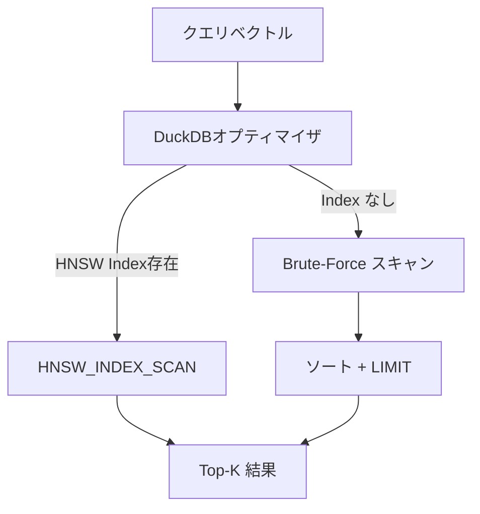

本記事は [https://duckdb.org/2024/05/03/vector-similarity-search-vss](https://duckdb.org/2024/05/03/vector-similarity-search-vss) および [https://duckdb.org/2024/10/23/whats-new-in-the-vss-extension](https://duckdb.org/2024/10/23/whats-new-in-the-vss-extension) の解説記事です。

## ブログ概要（Summary）

DuckDB Labsの Max Gabrielsson 氏が2024年5月と10月に公開した2本の公式ブログ記事では、DuckDBのベクトル類似検索拡張（vss: Vector Similarity Search）の設計思想、HNSW（Hierarchical Navigable Small World）インデックスの実装、およびSQL構文でのベクトル検索インターフェースが解説されている。vss拡張はDuckDB 0.10.2で導入され、usearchライブラリをベースにHNSWインデックスを提供する。分析ワークロードと同一プロセスでベクトル検索を実行できる点が特徴だが、永続化は実験段階であり、WALリカバリが未実装のため本番環境での利用は公式に非推奨とされている。

この記事は [Zenn記事: 組み込みベクトルDB選定ガイド2026：LanceDB・sqlite-vec・Chroma・DuckDB vssの性能と制約を比較する](https://zenn.dev/0h_n0/articles/5864692403321d) の深掘りです。

## 情報源

- **種別**: 企業テックブログ（公式）
- **URL（初回）**: [https://duckdb.org/2024/05/03/vector-similarity-search-vss](https://duckdb.org/2024/05/03/vector-similarity-search-vss)
- **URL（更新）**: [https://duckdb.org/2024/10/23/whats-new-in-the-vss-extension](https://duckdb.org/2024/10/23/whats-new-in-the-vss-extension)
- **組織**: DuckDB Labs
- **著者**: Max Gabrielsson
- **発表日**: 2024年5月3日（初回）、2024年10月23日（更新）

## 技術的背景（Technical Background）

### なぜDuckDBにベクトル検索が必要なのか

DuckDBは列指向の組み込み型分析データベースとして広く利用されている。ETLパイプラインやデータ分析ワークフローの中で、テキストや画像のembeddingベクトルを扱う需要が増加しており、分析クエリとベクトル検索を同一プロセスで実行したいというユースケースが生まれている。

従来、ベクトル検索を行うには専用のベクトルDB（Qdrant、Milvus、Pinecone等）を別途立ち上げる必要があった。しかし、分析パイプライン内でアドホックにベクトル類似検索を行いたい場合、外部プロセスへのネットワーク通信は不要なオーバーヘッドとなる。DuckDB開発チームは、既存のDuckDBエコシステム（Parquet/CSV読み込み、Arrow連携、SQLインターフェース）にベクトル検索を統合することで、このギャップを埋めることを目指したと説明している。

### DuckDBのARRAY型の導入

vss拡張の基盤となったのは、DuckDB 0.10.0で導入された固定長`ARRAY`型である。従来の可変長`LIST`型と異なり、`ARRAY`型は全要素が同一サイズであることを型システムが保証する。DuckDB開発チームによれば、この設計により位置ベースの分岐なしアクセスが可能になり、Apache Arrowの固定長リスト型との相互運用性も向上したとのことである。

`ARRAY`型の導入と同時に、3つのベクトル距離関数が追加された：

- `array_distance`：ユークリッド距離（L2二乗距離）
- `array_cosine_similarity`：コサイン類似度（後にv1.1.2で`array_cosine_distance`も追加）
- `array_inner_product`：内積（後に`array_negative_inner_product`も追加）

### 学術的背景：HNSWアルゴリズム

HNSW（Hierarchical Navigable Small World）は、Malkov & Yashunin（2018）が提案した近似最近傍探索アルゴリズムである。多層のスキップリスト構造を持つナビゲーブル・スモールワールドグラフを構築し、上位層から粗く探索を絞り込み、下位層で精密に最近傍を特定する。

$$
\text{dist}(q, v) = \sqrt{\sum_{i=1}^{d} (q_i - v_i)^2}
$$

ここで、$q$ はクエリベクトル、$v$ はデータベクトル、$d$ はベクトルの次元数である。HNSWの計算量は構築が $O(N \log N)$、検索が $O(\log N)$ であり、brute-force（$O(N)$）と比較して大規模データで有利になる。

## 実装アーキテクチャ（Architecture）

### usearchライブラリの統合

DuckDB開発チームは、HNSWインデックスの実装基盤として[usearch](https://github.com/unum-cloud/usearch)ライブラリを採用している。usearchはUnum Cloud社が開発したC++11ベースのHNSW実装であり、以下の特徴を持つ：

- **外部依存ゼロ**: ポータブルなC++11で記述されており、追加のライブラリを必要としない
- **許容的ライセンス**: Apache 2.0ライセンスで配布
- **クロスプラットフォーム**: DuckDB公式ブログによれば、すべてのサポートプラットフォーム（Wasm含む）でのビルド・配布パイプラインへの統合が容易だったとのことである

DuckDB開発チームは、usearchの機能のサブセットのみを利用していると説明している。具体的には、HNSWグラフの構築・検索機能は利用するが、usearchが提供するチューニングオプション（`M`、`ef_construction`、`ef_search`等）の全てがDuckDBのSQL APIに公開されているわけではない。

### SQL構文によるベクトル検索

vss拡張が追加するのはHNSWインデックス型のみであり、新しいデータ型やスカラー関数は追加しない。インデックスの作成と利用はすべて標準SQLで行う：

```sql
-- テーブル作成（FLOAT型の固定長ARRAY）
CREATE TABLE embeddings (
    id INTEGER,
    text VARCHAR,
    vec FLOAT[384]
);

-- HNSWインデックス作成（デフォルト: L2二乗距離）
CREATE INDEX idx ON embeddings USING HNSW (vec);

-- コサイン距離を使用する場合
CREATE INDEX cos_idx ON embeddings USING HNSW (vec)
WITH (metric = 'cosine');

-- 内積を使用する場合
CREATE INDEX ip_idx ON embeddings USING HNSW (vec)
WITH (metric = 'ip');
```

ベクトル検索クエリは、距離関数で `ORDER BY` し `LIMIT` を指定する標準的なSQLの形式をとる：

```sql
-- 類似ベクトル上位5件を取得
SELECT id, text, array_distance(vec, query_vec) AS distance
FROM embeddings
ORDER BY array_distance(vec, query_vec)
LIMIT 5;
```

DuckDBのオプティマイザは、この `ORDER BY ... LIMIT` パターンを検出すると、通常のソート＋リミット計画を `HNSW_INDEX_SCAN` オペレータに書き換える。`EXPLAIN` 出力でこの書き換えを確認できる。

### 対応距離メトリクス

| メトリクス | `WITH (metric = ...)` | 距離関数 | 特徴 |
|-----------|----------------------|---------|------|
| L2二乗距離 | `'l2sq'`（デフォルト） | `array_distance` | ユークリッド距離。値が小さいほど類似 |
| コサイン距離 | `'cosine'` | `array_cosine_distance` | 1 - コサイン類似度。正規化済みベクトルで有効 |
| 負の内積 | `'ip'` | `array_negative_inner_product` | 内積の符号反転。値が小さいほど類似 |

DuckDB開発チームは、初回リリース時に `array_cosine_similarity`（類似度が1に近いほど類似）を提供したが、ORDER BY の方向が距離関数と逆になる不整合があった。2024年10月の更新で `array_cosine_distance`（= 1 - cosine_similarity）と `array_negative_inner_product`（= -inner_product）を追加し、全メトリクスで「値が小さいほど類似」というセマンティクスを統一した。さらに、pgvectorと互換の `<=>` 演算子を `array_cosine_distance` のエイリアスとして追加している。



## パフォーマンス最適化（Performance）

### インデックス構築速度の改善

2024年10月の更新（DuckDB 1.1.2 + vss拡張）で、インデックス構築の並列化が改善された。DuckDB開発チームによれば、初回リリースではDuckDBの行グループ（デフォルト約120,000行）単位でしか並列化できず、ワーカースレッドの割り当てが粗かった。更新後は、インデックス作成パイプラインにバッファステップを追加し、以下を実現したとのことである：

- 細粒度のワーク分散
- メモリ割り当ての最適化
- スレッド間のコンテンション削減

具体的なベンチマーク数値は公式ブログには記載されていないが、多スレッド環境でのCPU使用率が向上し、テーブルサイズに依存しない速度改善が報告されている。

### Top-K集約関数のインデックス加速

DuckDB 1.1.2では、`min_by`/`max_by`（エイリアス: `arg_min`/`arg_max`）に第3引数 $n$（上位N件）が追加された。vss拡張はこの機能にフックし、距離関数がHNSWインデックス付きカラムに対して計算される場合、フルスキャン＋ソートを回避する最適化ルールを適用する。

```sql
-- HNSWインデックスを利用した上位3件の効率的な取得
SELECT arg_min(id, array_distance(vec, [2.0, 2.0, 2.0]::FLOAT[3]), 3)
FROM vecs;
```

### LATERAL JOINによるN:M検索の最適化

公式ブログが報告した最も注目すべき性能改善は、LATERAL JOINを使ったN:M検索のインデックス加速である。プロファイリングの結果、ボトルネックはusearchの検索処理ではなく（実行時間の約2%のみ）、DuckDBの単一行ポイントルックアップのオーバーヘッドにあった。DuckDBのベクトル化エンジンは2,048行単位のバルク処理に最適化されており、1行ずつの探索は非効率だった。

DuckDB開発チームは、1:N（1クエリ対N結果）ではなくN:M（Nクエリそれぞれに対しM件の最近傍）のケースを最適化する設計判断を行った。LATERAL JOINパターンにHNSWインデックスを活用する：

```sql
-- 各クエリベクトルについて最近傍5件を取得
SELECT q.id, list(i.id ORDER BY dist)
FROM queries q,
LATERAL (
    SELECT i.id, array_distance(i.embedding, q.embedding) AS dist
    FROM items i
    ORDER BY dist
    LIMIT 5
) sub
GROUP BY q.id;
```

ベンチマーク（Apple M3 Pro, 36GB RAM、10,000行×10,000行、FLOAT[3]ベクトル）：

| 条件 | 実行時間 | 推定行数 | 主要オペレータ |
|------|---------|---------|--------------|
| HNSWインデックスなし | 約10秒 | 約50,000,000行（CROSS_PRODUCT） | CROSS_PRODUCT + HASH_GROUP_BY |
| HNSWインデックスあり | 約0.15秒 | 約50,000行（HNSW_INDEX_JOIN） | HNSW_INDEX_JOIN |

DuckDB開発チームは約66倍の高速化を報告している（公式ブログの記載値）。`CROSS_PRODUCT`が`HNSW_INDEX_JOIN`に置き換わることで、推定処理行数が3桁削減されている。

## 運用での学び（Production Lessons）

### 永続化の実験的制約

vss拡張の最も重要な制約は、永続化が実験段階であることである。DuckDB開発チームは公式ブログおよびドキュメントで「**本番環境での利用を推奨しない**」と明記している。

デフォルトでは、HNSWインデックスはインメモリデータベースでのみ作成可能である。ディスクバックアップ付きデータベースでインデックスを作成するには、以下の設定が必要となる：

```sql
SET hnsw_enable_experimental_persistence = true;
```

この設定により、チェックポイント時にインデックスがDuckDBファイルにシリアライズされる。再起動後、テーブルに初めてアクセスした際に遅延ロードされる（再構築より高速とのことである）。しかし、以下の重大な制約がある：

1. **WALリカバリ未実装**: カスタムインデックスのWAL（Write-Ahead Log）リカバリが未実装のため、予期しないシャットダウン時にコミットされていない変更のデータ損失やインデックス破損の可能性がある
2. **チェックポイント時の全書き換え**: インデックスの差分更新はサポートされず、チェックポイントのたびにインデックス全体がディスクに再書き込みされる
3. **メモリ管理外**: HNSWインデックスのメモリはDuckDBのメモリマネージャの管理外で割り当てられ、`memory_limit`設定に計上されない。予期しないメモリ消費が発生する可能性がある
4. **32ビット浮動小数点限定**: `FLOAT`（float32）のみ対応。float16やint8量子化には対応していない

DuckDB開発チームは、手動リカバリの手順（DuckDB起動→vss読み込み→`ATTACH`でデータベースファイルを接続→WAL再生時にインデックスを利用可能にする）を記載しているが、これに頼るべきではないと付記している。

### 削除操作のインデックス反映

DuckDB公式ドキュメント（v2.0系）では、削除操作がHNSWインデックスに即座に反映されないことが記載されている。明示的なコンパクション（`PRAGMA hnsw_compact_index`）を実行しないと、削除済みのベクトルが検索結果に残る可能性がある。頻繁にデータを更新するワークロードでは注意が必要である。

### コミュニティ拡張の動向

公式のvss拡張の制約を補完するコミュニティ拡張も登場している：

- **hnsw_acorn**: ACORN-1アルゴリズム（arXiv:2403.04871）に基づくフィルタ付きHNSW検索を提供。公式拡張がWHERE句をインデックス検索後に適用するのに対し、hnsw_acornはインデックス検索時にフィルタリングを行う。RaBitQバイナリ量子化やper-group最近傍検索にも対応
- **vindex**: HNSWに加え、複数のインデックスタイプと量子化手法を提供

## 学術研究との関連（Academic Connection）

vss拡張のHNSW実装は、Malkov & Yashunin（2018）のオリジナルHNSWアルゴリズムをusearchライブラリ経由で利用している。usearchの内部実装はオリジナル論文の設計に忠実であるが、DuckDBのSQLオプティマイザとの統合により、データベースエンジンのクエリ計画最適化とANNインデックスの連携という独自の工学的課題に取り組んでいる。

LATERAL JOINの最適化は、データベースシステムにおけるベクトル検索統合の研究方向と合致する。近年、pgvectorやSQLiteの拡張でもSQL統合型のベクトル検索が研究されており、分析エンジンへのベクトル検索統合はデータベースコミュニティで活発な研究テーマとなっている。DuckDB vssの設計判断（N:Mケースの最適化、usearchのサブセット利用、インデックス型のみの追加）は、分析ワークロード特化という明確な設計方針に基づいている。

## Production Deployment Guide

### AWS実装パターン（コスト最適化重視）

DuckDB vssは本番環境での利用が公式に非推奨のため、本ガイドではDuckDBを**分析・バッチ処理パイプライン内でのベクトル検索**に限定した構成を示す。リアルタイムサービングには専用のベクトルDBを推奨する。

**トラフィック量別の推奨構成**:

| 規模 | 月間リクエスト | 推奨構成 | 月額コスト | 主要サービス |
|------|--------------|---------|-----------|------------|
| **Small** | ~3,000 (100/日) | Serverless バッチ | $30-80 | Lambda + S3 + DuckDB |
| **Medium** | ~30,000 (1,000/日) | ECS バッチ | $150-400 | ECS Fargate + S3 + EventBridge |
| **Large** | 300,000+ (10,000/日) | Step Functions | $500-1,500 | Step Functions + ECS + S3 |

**Small構成の詳細**（月額$30-80）:
- **Lambda**: 2GB RAM、5分タイムアウト（$15/月）- DuckDBのインメモリ処理に十分
- **S3**: Parquetファイルストレージ（$5/月）- DuckDBが直接読み取り
- **EventBridge**: スケジュール実行（$1/月）- 日次/時次バッチトリガー
- **CloudWatch**: 基本監視（$5/月）

**Medium構成の詳細**（月額$150-400）:
- **ECS Fargate**: 1 vCPU、4GB RAM×1タスク（$80/月）- 大規模データセットのインメモリ処理
- **S3**: データレイク（$20/月）- Parquet/Lance形式のembeddingストレージ
- **EventBridge + SQS**: イベント駆動バッチ（$5/月）
- **ECR**: コンテナレジストリ（$5/月）

**Large構成の詳細**（月額$500-1,500）:
- **Step Functions**: ワークフローオーケストレーション（$25/月）
- **ECS Fargate**: 2 vCPU、8GB RAM×2-4タスク（$300/月）- 並列バッチ処理
- **S3**: データレイク + 中間結果保存（$50/月）
- **Glue Data Catalog**: メタデータ管理（$10/月）

**コスト削減テクニック**:
- Fargate Spotタスク使用で最大70%削減（バッチ処理に適合）
- S3 Intelligent-Tieringでストレージコスト自動最適化
- Lambdaのarm64アーキテクチャで20%のコスト/性能改善
- DuckDBのParquet直接読み取りでETL中間層のコスト削除

**コスト試算の注意事項**:
- 上記は2026年11月時点のAWS ap-northeast-1（東京）リージョン料金に基づく概算値です
- 実際のコストはデータ量、ベクトル次元数、クエリ頻度により変動します
- DuckDB vssはインメモリ処理のため、ベクトル数×次元数×4バイトのRAMが必要です（100万×384次元で約1.5GB）
- 最新料金は [AWS料金計算ツール](https://calculator.aws/) で確認してください

### Terraformインフラコード

**Small構成 (Serverless): Lambda + S3 + DuckDB**

```hcl
# --- S3バケット（Embeddingストレージ） ---
resource "aws_s3_bucket" "embeddings" {
  bucket = "duckdb-vss-embeddings"
}

resource "aws_s3_bucket_versioning" "embeddings" {
  bucket = aws_s3_bucket.embeddings.id
  versioning_configuration {
    status = "Enabled"
  }
}

resource "aws_s3_bucket_server_side_encryption_configuration" "embeddings" {
  bucket = aws_s3_bucket.embeddings.id
  rule {
    apply_server_side_encryption_by_default {
      sse_algorithm = "aws:kms"
    }
  }
}

# --- IAMロール（最小権限） ---
resource "aws_iam_role" "lambda_duckdb" {
  name = "lambda-duckdb-vss-role"

  assume_role_policy = jsonencode({
    Version = "2012-10-17"
    Statement = [{
      Action = "sts:AssumeRole"
      Effect = "Allow"
      Principal = {
        Service = "lambda.amazonaws.com"
      }
    }]
  })
}

resource "aws_iam_role_policy" "s3_read" {
  role = aws_iam_role.lambda_duckdb.id

  policy = jsonencode({
    Version = "2012-10-17"
    Statement = [{
      Effect = "Allow"
      Action = [
        "s3:GetObject",
        "s3:ListBucket"
      ]
      Resource = [
        aws_s3_bucket.embeddings.arn,
        "${aws_s3_bucket.embeddings.arn}/*"
      ]
    }]
  })
}

# --- Lambda関数（DuckDB + vss拡張同梱） ---
resource "aws_lambda_function" "duckdb_search" {
  filename      = "lambda_duckdb.zip"
  function_name = "duckdb-vss-batch-search"
  role          = aws_iam_role.lambda_duckdb.arn
  handler       = "index.handler"
  runtime       = "python3.12"
  timeout       = 300
  memory_size   = 2048
  architectures = ["arm64"]

  environment {
    variables = {
      S3_BUCKET      = aws_s3_bucket.embeddings.id
      DUCKDB_MEMORY  = "1.5GB"
      VECTOR_DIM     = "384"
    }
  }
}

# --- EventBridgeスケジュール ---
resource "aws_scheduler_schedule" "daily_batch" {
  name = "duckdb-vss-daily-batch"

  flexible_time_window {
    mode = "OFF"
  }

  schedule_expression = "cron(0 14 * * ? *)"

  target {
    arn      = aws_lambda_function.duckdb_search.arn
    role_arn = aws_iam_role.lambda_duckdb.arn
  }
}

# --- CloudWatchアラーム ---
resource "aws_cloudwatch_metric_alarm" "lambda_errors" {
  alarm_name          = "duckdb-vss-lambda-errors"
  comparison_operator = "GreaterThanThreshold"
  evaluation_periods  = 1
  metric_name         = "Errors"
  namespace           = "AWS/Lambda"
  period              = 3600
  statistic           = "Sum"
  threshold           = 3
  alarm_description   = "DuckDBバッチ処理エラー検知"

  dimensions = {
    FunctionName = aws_lambda_function.duckdb_search.function_name
  }
}
```

**Large構成 (Container): ECS Fargate + Step Functions**

```hcl
# --- ECSクラスタ ---
resource "aws_ecs_cluster" "duckdb" {
  name = "duckdb-vss-cluster"

  setting {
    name  = "containerInsights"
    value = "enabled"
  }
}

# --- ECSタスク定義 ---
resource "aws_ecs_task_definition" "duckdb_search" {
  family                   = "duckdb-vss-search"
  requires_compatibilities = ["FARGATE"]
  network_mode             = "awsvpc"
  cpu                      = "2048"
  memory                   = "8192"
  execution_role_arn       = aws_iam_role.ecs_execution.arn
  task_role_arn            = aws_iam_role.ecs_task.arn

  container_definitions = jsonencode([{
    name  = "duckdb-vss"
    image = "${aws_ecr_repository.duckdb.repository_url}:latest"
    essential = true

    environment = [
      { name = "S3_BUCKET", value = aws_s3_bucket.embeddings.id },
      { name = "DUCKDB_MEMORY", value = "6GB" },
      { name = "VECTOR_DIM", value = "384" }
    ]

    logConfiguration = {
      logDriver = "awslogs"
      options = {
        "awslogs-group"         = "/ecs/duckdb-vss"
        "awslogs-region"        = "ap-northeast-1"
        "awslogs-stream-prefix" = "search"
      }
    }
  }])
}

# --- Step Functions（並列バッチ処理） ---
resource "aws_sfn_state_machine" "batch_pipeline" {
  name     = "duckdb-vss-batch-pipeline"
  role_arn = aws_iam_role.sfn_role.arn

  definition = jsonencode({
    StartAt = "SplitDataPartitions"
    States = {
      SplitDataPartitions = {
        Type     = "Task"
        Resource = "arn:aws:lambda:ap-northeast-1:${data.aws_caller_identity.current.account_id}:function:split-partitions"
        Next     = "ParallelSearch"
      }
      ParallelSearch = {
        Type = "Map"
        ItemsPath = "$.partitions"
        MaxConcurrency = 4
        Iterator = {
          StartAt = "RunDuckDBSearch"
          States = {
            RunDuckDBSearch = {
              Type     = "Task"
              Resource = "arn:aws:states:::ecs:runTask.sync"
              Parameters = {
                Cluster        = aws_ecs_cluster.duckdb.arn
                TaskDefinition = aws_ecs_task_definition.duckdb_search.arn
                LaunchType     = "FARGATE"
                NetworkConfiguration = {
                  AwsvpcConfiguration = {
                    Subnets = module.vpc.private_subnets
                  }
                }
              }
              End = true
            }
          }
        }
        Next = "MergeResults"
      }
      MergeResults = {
        Type     = "Task"
        Resource = "arn:aws:lambda:ap-northeast-1:${data.aws_caller_identity.current.account_id}:function:merge-results"
        End      = true
      }
    }
  })
}

# --- AWS Budgetsアラート ---
resource "aws_budgets_budget" "duckdb_monthly" {
  name         = "duckdb-vss-monthly-budget"
  budget_type  = "COST"
  limit_amount = "1500"
  limit_unit   = "USD"
  time_unit    = "MONTHLY"

  notification {
    comparison_operator        = "GREATER_THAN"
    threshold                  = 80
    threshold_type             = "PERCENTAGE"
    notification_type          = "ACTUAL"
    subscriber_email_addresses = ["ops@example.com"]
  }
}
```

### セキュリティベストプラクティス

**本番環境での推奨設定**:

1. **ネットワークセキュリティ**: ECS Fargateタスクはプライベートサブネットに配置。S3アクセスはVPCエンドポイント経由
2. **認証・認可**: IAMロールは最小権限。S3バケットへのアクセスは特定バケット・プレフィックスに限定
3. **シークレット管理**: 環境変数にハードコードしない。AWS Secrets Managerを使用
4. **データ保護**: S3バケットはKMS暗号化必須。DuckDBのインメモリデータは処理完了後に破棄
5. **監査**: CloudTrailで全API操作を記録。S3アクセスログ有効化

### 運用・監視設定

**CloudWatch Logs Insights クエリ**:

```sql
-- DuckDBバッチ処理のレイテンシ分析
fields @timestamp, duration_ms, vector_count, query_count
| stats pct(duration_ms, 95) as p95, pct(duration_ms, 99) as p99 by bin(1h)
| filter vector_count > 0

-- メモリ使用量の異常検知
fields @timestamp, memory_used_mb, vector_dim, total_vectors
| filter memory_used_mb > 6000
| stats count() as oom_risk_count by bin(1h)
```

**CloudWatch アラーム（コスト重視）**:

```python
import boto3

cloudwatch = boto3.client('cloudwatch')

cloudwatch.put_metric_alarm(
    AlarmName='duckdb-batch-duration-spike',
    ComparisonOperator='GreaterThanThreshold',
    EvaluationPeriods=2,
    MetricName='Duration',
    Namespace='AWS/Lambda',
    Period=300,
    Statistic='Average',
    Threshold=180000,
    AlarmDescription='DuckDBバッチ処理が平均3分超過（コスト増加リスク）',
    AlarmActions=['arn:aws:sns:ap-northeast-1:123456789:cost-alerts']
)

cloudwatch.put_metric_alarm(
    AlarmName='ecs-task-failure',
    ComparisonOperator='GreaterThanThreshold',
    EvaluationPeriods=1,
    MetricName='RunningTaskCount',
    Namespace='ECS/ContainerInsights',
    Period=300,
    Statistic='Maximum',
    Threshold=6,
    AlarmDescription='ECSタスク数が想定上限超過'
)
```

**Cost Explorer自動レポート**:

```python
import boto3
from datetime import datetime, timedelta

ce = boto3.client('ce')

response = ce.get_cost_and_usage(
    TimePeriod={
        'Start': (datetime.now() - timedelta(days=1)).strftime('%Y-%m-%d'),
        'End': datetime.now().strftime('%Y-%m-%d')
    },
    Granularity='DAILY',
    Metrics=['UnblendedCost'],
    GroupBy=[
        {'Type': 'SERVICE', 'Key': 'SERVICE'}
    ],
    Filter={
        'Tags': {
            'Key': 'Project',
            'Values': ['duckdb-vss']
        }
    }
)

for result in response['ResultsByTime']:
    for group in result['Groups']:
        service = group['Keys'][0]
        cost = float(group['Metrics']['UnblendedCost']['Amount'])
        if cost > 50:
            print(f"⚠️ {service}: ${cost:.2f}/日")
```

### コスト最適化チェックリスト

**アーキテクチャ選択（バッチ処理前提で判断）**:
- [ ] 日次バッチ (~100件/日) → Lambda + S3 - $30-80/月
- [ ] 時次バッチ (~1,000件/日) → ECS Fargate + EventBridge - $150-400/月
- [ ] 継続バッチ (10,000+件/日) → Step Functions + ECS並列 - $500-1,500/月

**リソース最適化**:
- [ ] Lambda: arm64アーキテクチャで20%コスト削減
- [ ] Fargate Spot: バッチ処理に最大70%割引適用
- [ ] S3: Intelligent-Tiering有効化（アクセス頻度に応じた自動階層化）
- [ ] DuckDBメモリ: ベクトル数×次元数×4Bで必要RAMを事前計算
- [ ] Parquet列選択: `SELECT vec FROM read_parquet(...)` で不要列の読み込みを回避

**DuckDB固有の最適化**:
- [ ] インメモリモードで運用（永続化は使わない）
- [ ] Parquet直接読み取りでETL中間層を削除
- [ ] `LATERAL JOIN` + HNSW で N:M検索を最適化（brute-forceの66倍高速化が報告されている）
- [ ] `PRAGMA threads=N` でワーカースレッド数を明示指定
- [ ] バッチサイズをDuckDBの行グループ（120K行）の倍数に揃える

**監視・アラート（コスト異常の即時検知）**:
- [ ] AWS Budgets: 月額予算設定（80%で警告、100%でアラート）
- [ ] CloudWatch: Lambda Duration/ECS TaskCount のスパイク検知
- [ ] Cost Anomaly Detection: 自動異常検知有効化
- [ ] 日次コストレポート: SNS/Slackへ自動送信

**リソース管理**:
- [ ] タグ戦略: Project=duckdb-vss, Environment=dev/prod でコスト可視化
- [ ] S3ライフサイクル: 30日超の中間結果を自動削除
- [ ] Lambda: Provisioned Concurrency不使用（バッチ処理にはオンデマンドで十分）
- [ ] ECS: イベント駆動起動、アイドルタスク0台

## まとめと実践への示唆

DuckDB vss拡張は、分析ワークロードとベクトル検索を同一プロセスで実行するための組み込み型ソリューションである。usearchベースのHNSW実装とSQL統合により、SQLに慣れたエンジニアが追加のインフラなしにベクトル類似検索を利用できる。2024年10月の更新では、LATERAL JOINの最適化により約66倍の高速化が報告され、N:M検索パターンでの実用性が向上した。

しかし、永続化の実験的制約（WALリカバリ未実装、チェックポイント時の全書き換え、メモリ管理外のインデックス）は、本番環境でのリアルタイムサービングに利用する上で大きな障壁となる。DuckDB公式ドキュメントが本番利用を非推奨と明記している以上、現時点では分析パイプラインやバッチ処理でのアドホック検索に限定するのが妥当である。

Zenn記事で解説している通り、10万件以上の本番ベクトル検索にはLanceDB（IVF-PQインデックス、BM25ハイブリッド検索）やChroma（HNSW、Chroma Cloudへの移行パス）を検討すべきである。DuckDB vssの強みは、既存のDuckDB分析環境に追加コストゼロでベクトル検索を統合できる点にあり、その設計思想を理解した上で適切なスコープで活用することが重要である。

## 参考文献

- **Blog URL（初回）**: [https://duckdb.org/2024/05/03/vector-similarity-search-vss](https://duckdb.org/2024/05/03/vector-similarity-search-vss)
- **Blog URL（更新）**: [https://duckdb.org/2024/10/23/whats-new-in-the-vss-extension](https://duckdb.org/2024/10/23/whats-new-in-the-vss-extension)
- **DuckDB vss拡張ドキュメント**: [https://duckdb.org/docs/2.0/core_extensions/vss](https://duckdb.org/docs/2.0/core_extensions/vss)
- **usearchライブラリ**: [https://github.com/unum-cloud/usearch](https://github.com/unum-cloud/usearch)
- **HNSW原論文**: Malkov, Y. A., & Yashunin, D. A. (2018). Efficient and robust approximate nearest neighbor search using Hierarchical Navigable Small World graphs. *IEEE Transactions on Pattern Analysis and Machine Intelligence*.
- **hnsw_acornコミュニティ拡張**: [https://duckdb.org/community_extensions/extensions/hnsw_acorn](https://duckdb.org/community_extensions/extensions/hnsw_acorn)
- **Related Zenn article**: [https://zenn.dev/0h_n0/articles/5864692403321d](https://zenn.dev/0h_n0/articles/5864692403321d)
