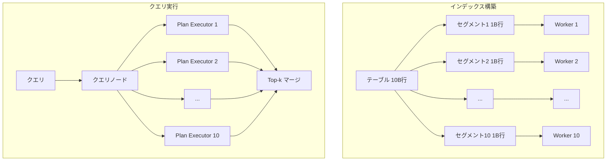

## ブログ概要（Summary）

本記事は [How LanceDB Accelerates Vector Search at 10 Billion Scale](https://www.lancedb.com/blog/how-lancedb-accelerates-vector-search-at-10-billion-scale) の解説記事です。

LanceDBは組み込み型ベクトルデータベースとして知られるが、同社のエンジニアリングブログでは100億（10B）ベクトル規模の分散検索アーキテクチャについて詳細な技術解説を公開している。IVFパーティショニングにRaBitQ量子化を組み合わせた独自のインデックス設計により、10Bベクトル（1536次元、float32）に対して中央値18ms、p99で21msのレイテンシを実現したとLanceDBチームは報告している。本記事では、この分散インデックスアーキテクチャの設計思想、RaBitQ量子化の数学的背景、Lance列指向フォーマットの特徴を修士学生レベルで解説する。

この記事は [Zenn記事: 組み込みベクトルDB選定ガイド2026](https://zenn.dev/0h_n0/articles/5864692403321d) の深掘りです。

## 情報源

- **種別**: 企業テックブログ
- **URL**: [https://www.lancedb.com/blog/how-lancedb-accelerates-vector-search-at-10-billion-scale](https://www.lancedb.com/blog/how-lancedb-accelerates-vector-search-at-10-billion-scale)
- **組織**: LanceDB（Lance列指向フォーマットの開発元）
- **発表日**: 2026年（ニュースレター2026年4月号で紹介）

## 技術的背景（Technical Background）

### なぜ100億ベクトル規模が課題なのか

RAG（Retrieval-Augmented Generation）やセマンティック検索の普及に伴い、ベクトルデータベースが扱うデータ規模は急速に拡大している。100万件程度であれば単一ノードのHNSWインデックスで十分だが、10億〜100億件規模になると以下の課題が生じる。

- **メモリ制約**: 10Bベクトル × 1536次元 × 4バイト（float32）= 約57TBの生データ。HNSWグラフのメモリオーバーヘッドを含めると、単一マシンのRAMには到底収まらない
- **インデックス構築時間**: 単一ノードでの逐次的なインデックス構築は日単位の時間を要する
- **クエリレイテンシ**: ネットワークホップやディスクI/Oがボトルネックとなり、リアルタイム検索の要求を満たせない

LanceDBは組み込み型の軽量設計で知られるが、LanceDB Cloudではこのスケールに対応する分散アーキテクチャを構築している。

### 学術研究との位置づけ

LanceDBが採用するIVF（Inverted File）インデックスは、Jégouら（2011年）のProduct Quantization（PQ）の研究に端を発する。IVFはベクトル空間をクラスタ（パーティション）に分割し、クエリ時には最も近いクラスタのみを探索することで計算量を削減する。HNSWがグラフ探索ベースであるのに対し、IVFはクラスタベースのアプローチであり、大規模データではディスク上のデータを効率的にスキャンできる点で優位性がある。

RaBitQ（Random Bit Quantization）は、バイナリ量子化の精度限界を克服する手法として提案された。従来のバイナリ量子化（各次元を1ビットに丸める）では情報損失が大きく、高いリコールを得にくいという課題があった。RaBitQはランダム直交回転を前処理として適用し、量子化誤差の分布を均一化することで、1ビット量子化でも高いリコールを実現する。

## 実装アーキテクチャ（Architecture）

### 分散インデックス設計

LanceDBチームは、10Bベクトルのインデックスを**セグメント分割**方式で構築していると報告している。テーブル全体を互いに重複しない複数のインデックスセグメントに分割し、各セグメントが独自のセグメントレベルインデックスを持つ。



ブログによれば、10Bベクトル（1536次元、float32）のベンチマークでは、10セグメント（各1B行）に分割し、10台のワーカーノードで並列にインデックスを構築している。スケジューラが失敗したセグメントのリトライとメタデータのマージを管理し、ユーザーからは論理的に1つのインデックスとして見える設計となっている。

### クエリ実行フロー

クエリ実行は以下の流れで進む。

1. **クエリノード**がクエリプランを生成し、各セグメントに対応するPlan Executorにルーティングする
2. 各Plan Executorがセグメントレベルの検索を実行し、部分的なtop-k結果を返す
3. クエリノードが全セグメントの結果をマージして最終的なtop-k結果を生成する

各セグメントはPlan Executorのローカルに配置されるため（ローカルSSDキャッシュ）、ネットワーク遅延が最小化される。LanceDBチームは、パーティションルーティングと圧縮距離計算はCPUバウンドであり、リランキングと行取得は高速なベクトルアクセスに依存すると述べている。

### IVFパーティショニングとHNSWセントロイドルーティング

IVFインデックスのクエリプランは以下のステップで構成される。

1. **セントロイド訓練**: ベクトル空間をk-meansクラスタリングでパーティションに分割
2. **ベクトル割り当て**: 各ベクトルを最も近いパーティションに割り当て
3. **パーティション探索**: クエリに最も近い`nprobes`個のパーティションを選択
4. **圧縮距離計算**: パーティション内の量子化ベクトルで距離を近似計算
5. **リランキング**: 上位候補の元ベクトルで正確な距離を再計算

ここで重要なのがステップ3のパーティション選択方法である。ナイーブな実装ではクエリベクトルと全セントロイドの距離を計算する必要があるが、LanceDBではIVFセントロイドに対してHNSWグラフを構築し、最近傍の`nprobes`パーティションを効率的に特定する。セントロイド行列が大きい場合には、HNSW構築の専用高速パスが用意されているとのことである。

### RaBitQ量子化の仕組み

RaBitQは、LanceDBが採用する量子化手法の1つである。その核心はインデックス構築時のランダム直交回転にある。

$$
\hat{\mathbf{x}} = \mathbf{R} \mathbf{x}
$$

ここで、
- $\mathbf{x} \in \mathbb{R}^d$: 元のベクトル（$d$次元）
- $\mathbf{R} \in \mathbb{R}^{d \times d}$: ランダム直交行列（$\mathbf{R}^T \mathbf{R} = \mathbf{I}$）
- $\hat{\mathbf{x}}$: 回転後のベクトル

回転後のベクトルの各成分を符号関数で1ビットに量子化する。

$$
b_i = \text{sign}(\hat{x}_i) = \begin{cases} 1 & \text{if } \hat{x}_i \geq 0 \\ 0 & \text{if } \hat{x}_i < 0 \end{cases}
$$

クエリベクトルも同じ回転行列$\mathbf{R}$で変換する必要があるが、密な回転行列の適用はクエリあたり$O(d^2)$のコストがかかる。LanceDBではこれを高速化するため、以下の3ステップで回転を近似する「fast」モードを実装している。

1. **ランダム符号反転**: 各次元にランダムな$\pm 1$を乗算（$O(d)$）
2. **Fast Walsh-Hadamardスタイルの混合**: バタフライ演算による次元間の混合（$O(d \log d)$）
3. **Kacスタイルのペアワイズ混合**: 隣接次元間の回転（$O(d)$）

この組み合わせにより、行列を保持せずに$O(d \log d)$で擬似的な直交回転を実現する。ブログでは`fast`（デフォルト）と`matrix`（密な回転行列を使用）の2つの回転モードが公開されている。

```python
import lancedb
import numpy as np

db = lancedb.connect("./my_lance_db")

data = [
    {"id": i, "text": f"doc_{i}", "vector": np.random.randn(1536).tolist()}
    for i in range(100_000)
]
table = db.create_table("documents", data)

# RaBitQインデックスの作成
# rotation_mode: "fast"（デフォルト、O(d log d)）または "matrix"（O(d^2)）
table.create_index(
    "vector",
    config=lancedb.index.BQ(  # Binary Quantization (RaBitQ)
        distance_type="cosine",
        num_partitions=256,
    ),
)

# IVF-PQインデックスの作成（別の量子化オプション）
table.create_index(
    "vector",
    config=lancedb.index.IvfPq(
        distance_type="cosine",
        num_partitions=256,
        num_sub_vectors=48,
    ),
)

# 検索（nprobesで探索パーティション数を指定）
query = np.random.randn(1536).tolist()
results = (
    table.search(query)
    .metric("cosine")
    .nprobes(20)
    .limit(100)
    .to_pandas()
)
```

## Lance列指向フォーマットの設計思想

LanceDBの性能の基盤となっているのが、独自開発のLance列指向フォーマットである。LanceDBの開発者であるWeston Paceは、2024年4月のブログ記事「Lance v2: A New Columnar Container Format」で、既存のParquetフォーマットがAI/MLワークロードに不向きである理由と、Lance v2の設計判断を解説している。

### Parquetの制約

LanceDBチームは、Parquetの以下の点がベクトル検索ワークロードに適さないと指摘している。

1. **ポイントルックアップの非効率性**: Parquetのエンコーディングは「スライス可能」でないため、1行を読むにもページ全体のロードが必要。セマンティック検索や全文検索のようなポイントルックアップで顕著なオーバーヘッドが生じる

2. **ワイドカラムの問題**: 1536次元のembedding（約6KB/行）のような大きな値を含むカラムでは、適切なrow groupサイズの決定が困難。row groupが大きすぎるとメモリ使用量が増え、小さすぎるとI/O効率が落ちる

3. **カラム数の爆発**: 全カラムのメタデータを一括ロードする必要があるため、カラム数が多いスキーマでレイテンシとメモリコストが増加する

### Lance v2のアプローチ

Lance v2では以下の設計判断を採用している。

- **Row groupの廃止**: ページの配置を自由化し、カラム内のページが隣接する必要がない。ライターはデータが十分に蓄積された時点（S3向けには約8MiB）でページをフラッシュする
- **カラム単位のメタデータ分離**: 各カラムのメタデータは独立したブロックとして格納。1カラムの読み取りに他カラムのメタデータロードが不要
- **プラガブルなエンコーディング**: エンコーディングをProtobufの`any`メッセージとして定義。新しいエンコーディングの追加は`.proto`ファイルとエンコーダ/デコーダの公開のみで完結
- **I/Oサイズとバッチサイズの分離**: 8MiBのページを10Ki行のデコードタスクに分割し、2つのページから約100タスクを並列処理可能

Lance v2.2ではさらにストレージ効率が改善され、LanceDBチームはParquet比で約50%のストレージ削減、blob取得で75倍、カラムバックフィルで61倍の高速化を報告している（「Lance Format v2.2 Benchmarks」ブログ記事より）。

## パフォーマンス最適化（Performance）

### ベンチマーク結果

LanceDBチームは以下の条件でベンチマークを実施したと報告している。

- **データセット**: 10Bベクトル、1536次元、float32
- **インデックス**: IVF + RaBitQ量子化、10セグメント（各1B行）
- **クエリ設定**: 全10セグメントにファンアウト、`nprobes`=20、`topk`=100

| 指標（topk=100, N=10B） | p50 | p95 | p99 |
|---|---|---|---|
| エンドツーエンドレイテンシ | 18 ms | 20 ms | 21 ms |

ニュースレター（2026年4月号）のティーザーでは、10Bベクトルに対して1,066 QPSのスループットが言及されている。ただし、この数値のハードウェア構成やワーカー数の詳細は同ブログ記事内では明記されていない。

### インデックス構築の並列化

10ワーカー（1セグメントあたり1ワーカー）での構築は、単一ノード比で約5倍の高速化を実現しているとのことである。セントロイド訓練と最終マージは固定コストであり、全体のwall-clock timeは最も遅いセグメントの構築時間に律速される。

### チューニングパラメータ

| パラメータ | 説明 | ブログでの設定値 |
|---|---|---|
| `nprobes` | 探索パーティション数（多いほどリコール向上、レイテンシ増加） | 20 |
| `topk` | 返却する上位件数 | 100 |
| `num_partitions` | IVFのパーティション数 | ブログ未記載 |
| `rotation_mode` | RaBitQ回転方式（`fast` or `matrix`） | `fast`（デフォルト） |

ブログ記事ではリコール値（再現率）の具体的な数値は報告されていない。IVF-PQやRaBitQの量子化はリコールとスループットのトレードオフがあるため、本番環境ではbrute-force検索の結果と比較してリコールが95%以上であることを確認してからデプロイすることが推奨される。

## Production Deployment Guide

### AWS実装パターン（コスト最適化重視）

LanceDBのアーキテクチャをAWS上に構築する場合のトラフィック量別推奨構成を示す。以下のコスト試算は2026年11月時点のAWS ap-northeast-1（東京）リージョン料金に基づく概算値であり、実際のコストはトラフィックパターン、バースト使用量により変動する。最新料金は [AWS料金計算ツール](https://calculator.aws/) で確認されたい。

| 規模 | 月間リクエスト | 推奨構成 | 月額コスト | 主要サービス |
|------|--------------|---------|-----------|------------|
| **Small** | ~3,000 (100/日) | Serverless | $50-150 | Lambda + Bedrock + DynamoDB |
| **Medium** | ~30,000 (1,000/日) | Hybrid | $300-800 | Lambda + ECS Fargate + ElastiCache |
| **Large** | 300,000+ (10,000/日) | Container | $2,000-5,000 | EKS + Karpenter + EC2 Spot |

**Small構成の詳細**（月額$50-150）:
- **Lambda**: 1GB RAM, 30秒タイムアウト ($20/月)
- **Bedrock**: Claude 3.5 Haiku, Prompt Caching有効 ($80/月)
- **DynamoDB**: On-Demand ($10/月)
- **CloudWatch**: 基本監視 ($5/月)
- **API Gateway**: REST API ($5/月)

**Medium構成の詳細**（月額$300-800）:
- **Lambda**: イベント処理 ($50/月)
- **ECS Fargate**: 0.5 vCPU, 1GB RAM × 2タスク ($120/月)
- **Bedrock**: Claude 3.5 Sonnet, Batch API活用 ($400/月)
- **ElastiCache Redis**: cache.t3.micro ($15/月)
- **Application Load Balancer**: ($20/月)

**Large構成の詳細**（月額$2,000-5,000）:
- **EKS**: コントロールプレーン ($72/月)
- **EC2 Spot Instances**: g5.xlarge × 2-4台 (平均$800/月)
- **Karpenter**: 自動スケーリング（追加コストなし）
- **Bedrock Batch**: 50%割引活用 ($2,000/月)
- **S3**: プロンプトキャッシュストレージ ($20/月)
- **CloudWatch + X-Ray**: 詳細監視 ($100/月)

**コスト削減テクニック**:
- Spot Instances使用で最大90%削減（EKS + Karpenter）
- Reserved Instances購入で最大72%削減（1年コミット）
- Bedrock Batch API使用で50%削減
- Prompt Caching有効化で30-90%削減

### Terraformインフラコード（抜粋）

**Small構成（Serverless）の主要リソース**:

```hcl
resource "aws_lambda_function" "vector_search" {
  function_name = "lancedb-vector-search"
  role          = aws_iam_role.lambda_lancedb.arn
  handler       = "index.handler"
  runtime       = "python3.12"
  timeout       = 60
  memory_size   = 1024

  environment {
    variables = {
      LANCEDB_URI    = "s3://my-lance-bucket/vectors"
      DYNAMODB_TABLE = aws_dynamodb_table.cache.name
    }
  }
}

resource "aws_dynamodb_table" "cache" {
  name         = "lancedb-query-cache"
  billing_mode = "PAY_PER_REQUEST"
  hash_key     = "query_hash"
  attribute { name = "query_hash"; type = "S" }
  ttl { attribute_name = "expire_at"; enabled = true }
}
```

**Large構成（Container）の主要リソース**:

```hcl
module "eks" {
  source          = "terraform-aws-modules/eks/aws"
  version         = "~> 20.0"
  cluster_name    = "lancedb-search-cluster"
  cluster_version = "1.31"
  vpc_id          = module.vpc.vpc_id
  subnet_ids      = module.vpc.private_subnets
}

# Karpenter: Spot Instances優先で最大90%コスト削減
resource "kubectl_manifest" "karpenter_provisioner" {
  yaml_body = <<-YAML
    apiVersion: karpenter.sh/v1alpha5
    kind: Provisioner
    metadata:
      name: lancedb-spot
    spec:
      requirements:
        - key: karpenter.sh/capacity-type
          operator: In
          values: ["spot"]
        - key: node.kubernetes.io/instance-type
          operator: In
          values: ["r6i.xlarge", "r6i.2xlarge"]
      limits:
        resources: { cpu: "64", memory: "256Gi" }
      ttlSecondsAfterEmpty: 30
  YAML
}
```

### セキュリティ・運用の要点

- **ネットワーク**: EKSは`cluster_endpoint_public_access = false`推奨。Lambda: VPC内配置
- **認証**: IAM最小権限原則 + IRSA。Secrets Manager使用（環境変数ハードコード禁止）
- **暗号化**: S3/DynamoDB/EBS全てKMS暗号化。転送中TLS 1.2以上
- **監査**: CloudTrail + GuardDuty有効化

**監視クエリ例（CloudWatch Logs Insights）**:

```sql
fields @timestamp, duration_ms, nprobes, topk
| stats pct(duration_ms, 95) as p95, pct(duration_ms, 99) as p99 by bin(5m)
```

**X-Ray トレーシング**:

```python
from aws_xray_sdk.core import xray_recorder, patch_all
patch_all()

@xray_recorder.capture('lancedb_search')
def search_vectors(query_vector: list[float], nprobes: int = 20, topk: int = 100):
    xray_recorder.put_annotation('nprobes', nprobes)
    results = table.search(query_vector).nprobes(nprobes).limit(topk).to_pandas()
    return results
```

### コスト最適化チェックリスト

- [ ] アーキテクチャ選択: ~100 req/日→Serverless ($50-150)、~1K→Hybrid ($300-800)、10K+→Container ($2K-5K)
- [ ] Spot Instances優先（Karpenter管理、最大90%削減）
- [ ] Reserved Instances 1年コミット（最大72%削減）
- [ ] Lambda メモリサイズ最適化（CloudWatch Insights分析）
- [ ] ECS/EKS アイドルタイム スケールダウン（夜間0台）
- [ ] Bedrock Batch API活用（50%割引）
- [ ] Prompt Caching有効化（30-90%削減）
- [ ] モデル選択ロジック: 開発Haiku / 本番Sonnet
- [ ] AWS Budgets + Cost Anomaly Detection設定
- [ ] 日次コストレポート SNS/Slack送信
- [ ] S3ライフサイクルポリシー: 古いセグメント自動削除（90日）

## 運用での学び（Production Lessons）

- **セグメント数のトレードオフ**: セグメント数を増やすと構築は並列化されるが、クエリのファンアウトコストが増加。10Bで10セグメント（各1B行）は、管理単位とファンアウトのバランスを取った設定と考えられる
- **ホットスポット回避**: IVFパーティションのデータ分布偏りで負荷集中が起こりうるため、定期的な再分割とデータ分布の監視が必要
- **インデックス再構築**: データ追加でリコール劣化の可能性あり。Lanceのネイティブバージョニングを活用し、定期的な再構築とA/B比較を推奨

### LanceDB S3バックエンドの活用

LanceDBはS3/GCS互換ストレージ上のデータに直接アクセスできるが、S3レイテンシ（GETで数十ms）がボトルネックになるため、ローカルSSDキャッシュとの併用が重要である。

```python
import lancedb

db = lancedb.connect("s3://my-bucket/lance-data/")
table = db.open_table("vectors")
results = table.search([0.1, 0.2, ...]).nprobes(20).refine_factor(10).limit(100).to_pandas()
```

## 学術研究との関連（Academic Connection）

LanceDBのアーキテクチャは以下の学術研究に基づいている。

- **IVF（Inverted File Index）**: Jégou et al., "Product Quantization for Nearest Neighbor Search" (IEEE TPAMI, 2011)。ベクトル空間のクラスタベース分割の基礎
- **RaBitQ**: Gao and Long, "RaBitQ: Quantizing High-Dimensional Vectors with a Theoretical Error Bound for Approximate Nearest Neighbor Search" (2024)。ランダム直交回転による高精度バイナリ量子化
- **HNSW**: Malkov and Yashunin, "Efficient and Robust Approximate Nearest Neighbor Using Hierarchical Navigable Small World Graphs" (IEEE TPAMI, 2020)。LanceDBではIVFセントロイドのルーティングに活用

LanceDBの独自貢献は、これらの手法を分散セグメントアーキテクチャとLance列指向フォーマットに統合し、S3互換ストレージ上で100億ベクトル規模の検索を実用的なレイテンシで実現した点にある。

## まとめと実践への示唆

LanceDBチームが公開した10Bスケールベクトル検索のエンジニアリングブログは、組み込み型ベクトルDBの枠を超えた分散検索アーキテクチャの詳細を提供している。IVFパーティショニング × RaBitQ量子化 × HNSWセントロイドルーティングの組み合わせにより、10Bベクトルでp50=18ms、p99=21msのレイテンシを達成したと報告されている。

Zenn記事で紹介したLanceDBの「100万件以上のスケーラブルな用途」という評価は、この分散アーキテクチャによって裏付けられる。ただし、ブログで報告されたベンチマークはLanceDB Cloud環境での結果であり、組み込みモード（単一プロセス）での性能とは異なる点に注意が必要である。

実務への示唆として、以下の3点が挙げられる。
1. **量子化手法の選択**: RaBitQはPQ比でメモリ効率が高いが、リコールの検証が必須。本番環境ではbrute-forceとのリコール比較を行うこと
2. **Lanceフォーマットの活用**: ParquetからLanceへの移行により、ポイントルックアップ性能の大幅な改善が期待できる。特にRAGのリランキングフェーズで効果が大きい
3. **段階的スケーリング**: 組み込みモードで検証し、データ規模の増大に応じてS3バックエンド → 分散セグメントへと段階的に移行する戦略が有効

## 参考文献

- **Blog URL**: [How LanceDB Accelerates Vector Search at 10 Billion Scale](https://www.lancedb.com/blog/how-lancedb-accelerates-vector-search-at-10-billion-scale)
- **Lance v2 Format**: [Lance v2: A New Columnar Container Format](https://blog.lancedb.com/lance-v2/)
- **Lance v2.2 Benchmarks**: [Lance Format v2.2 Benchmarks: Half the Storage, None of the Slowdown](https://www.lancedb.com/blog/lance-format-v2-2-benchmarks-half-the-storage-none-of-the-slowdown)
- **RaBitQ Paper**: Gao and Long, "RaBitQ: Quantizing High-Dimensional Vectors with a Theoretical Error Bound for Approximate Nearest Neighbor Search", 2024
- **IVF-PQ Paper**: Jégou et al., "Product Quantization for Nearest Neighbor Search", IEEE TPAMI, 2011
- **Related Zenn article**: [組み込みベクトルDB選定ガイド2026](https://zenn.dev/0h_n0/articles/5864692403321d)
