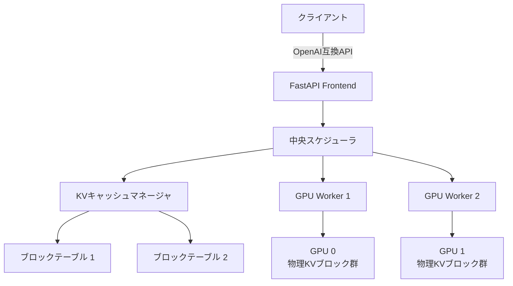

本記事は [arXiv:2309.06180](https://arxiv.org/abs/2309.06180) / [SOSP 2023](https://doi.org/10.1145/3600006.3613165) の解説記事です。

## 論文概要（Abstract）

Kwonら（UC Berkeley, Stanford, UC San Diego）は、LLMサービングにおけるKVキャッシュのメモリ管理問題を、OSの仮想メモリとページング機構のアナロジーで解決するPagedAttentionアルゴリズムと、それを基盤とするvLLMサービングエンジンを提案した。既存システム（FasterTransformer, Orca）ではKVキャッシュメモリの**20.4%-38.2%**しか実際のトークンデータに使われておらず、残りはフラグメンテーションと重複で浪費されていた。PagedAttentionにより、vLLMはKVキャッシュ浪費をほぼゼロに抑え、同一レイテンシで**2-4倍のスループット**を達成している。

この記事は [Zenn記事: Ollamaでオンプレミス推論環境を構築しNginx認証付きでチーム共有する](https://zenn.dev/0h_n0/articles/e0ac1e1b30fcc9) の深掘りです。

## 情報源

- **会議名**: ACM SIGOPS 29th Symposium on Operating Systems Principles（SOSP 2023）
- **開催地**: Koblenz, Germany, 2023年10月23-26日
- **arXiv ID**: 2309.06180
- **URL**: [https://arxiv.org/abs/2309.06180](https://arxiv.org/abs/2309.06180)
- **著者**: Woosuk Kwon\*, Zhuohan Li\*（\*equal contribution）, Siyuan Zhuang, Ying Sheng, Lianmin Zheng, Cody Hao Yu, Joseph E. Gonzalez, Hao Zhang, Ion Stoica
- **DOI**: 10.1145/3600006.3613165
- **コード**: [github.com/vllm-project/vllm](https://github.com/vllm-project/vllm)

## カンファレンス情報

**SOSPについて**: SOSPはオペレーティングシステム分野の最高峰国際会議の一つであり、隔年開催で採択率は例年15-20%程度と競争率が高い。本論文はOSの仮想メモリ管理のアイデアをLLMサービングに適用するという、システム論文としての独自性が評価された。

## 背景と動機（Background & Motivation）

### なぜKVキャッシュがボトルネックなのか

LLMの自己回帰生成では、各ステップで過去全トークンのKey-Valueペアを参照する必要がある。このKVキャッシュは巨大で動的に成長する：

**OPT-13Bの例**: 1トークンあたりのKVキャッシュサイズは

$$
\text{KV size per token} = 2 \times d_{\text{hidden}} \times n_{\text{layers}} \times 2\text{bytes} = 2 \times 5120 \times 40 \times 2 \approx 800\text{KB}
$$

ここで、2はKey/Valueの2テンソル、$d_{\text{hidden}} = 5120$はOPT-13Bの隠れ層次元、$n_{\text{layers}} = 40$はTransformerレイヤー数、2bytesはFP16精度。

2048トークンのシーケンスでは約1.6GBとなり、A100 40GB上では数十リクエストしか同時処理できない。

### メモリ浪費の3つの原因

著者らは、既存システム（Orca, FasterTransformer）が各リクエストのKVキャッシュを**連続メモリ領域**に格納することが浪費の根本原因だと指摘している：

1. **予約スロット（Reserved slots）**: 出力長が不明なため最大長（例: 2048トークン）分を事前確保。リクエストの全生存期間にわたり保持
2. **内部フラグメンテーション**: 実際の出力長が最大長より短い場合、差分が無駄になる。リクエスト完了時にのみ判明
3. **外部フラグメンテーション**: バディアロケータ等により、リクエスト間のチャンクサイズの違いがギャップを生む

著者らの計測（論文Figure 2）によれば、既存システムではKVキャッシュメモリのうち実際にトークンデータを保持しているのは**20.4%-38.2%**に過ぎない。

## 技術的詳細（Technical Details）

### PagedAttentionアルゴリズム

PagedAttentionの核心は、OSの仮想メモリとページングの概念をKVキャッシュ管理に応用することにある。

**OSの仮想メモリとの対応関係**:

| OS概念 | vLLM概念 |
|--------|---------|
| ページ | KVブロック |
| バイト | トークンのKVベクトル |
| プロセス | リクエスト |
| 論理ページ→物理フレーム | ブロックテーブル（論理KVブロック→物理KVブロック） |

各シーケンスのKVキャッシュは固定サイズの**KVブロック**に分割される。各ブロックは$B$トークン分のKeyとValueを格納し、物理メモリ上で連続である必要がない。

**ブロック単位のAttention計算**:

標準的なScaled Dot-Product Attentionは

$$
\text{Attention}(Q, K, V) = \text{softmax}\left(\frac{QK^T}{\sqrt{d_k}}\right)V
$$

PagedAttentionではこれをブロック単位に分解する。クエリ$q_i$に対するブロック$j$のアテンションスコアは：

$$
A_{ij} = \frac{\exp(q_i^T K_j / \sqrt{d_k})}{\sum_{t=1}^{\lceil i/B \rceil} \exp(q_i^T K_t / \sqrt{d_k})}
$$

出力は各ブロックの重み付き和：

$$
o_i = \sum_{j=1}^{\lceil i/B \rceil} V_j A_{ij}^T
$$

ここで、$K_j, V_j$はブロック$j$に格納されたKey/Value行列、$B$はブロックサイズ（トークン数）である。

カーネルは各ブロックを個別にフェッチし、部分スコアを計算し、最終的に結合する。これにより物理的に不連続なメモリブロックに対してもAttention計算が可能になる。

### vLLMシステムアーキテクチャ

**主要コンポーネント**:

- **中央スケジューラ**: FCFS方式でリクエストをスケジューリング。プリエンプション時は最新リクエストをスワップまたは再計算
- **KVブロックマネージャ**: 各リクエストのブロックテーブルを管理。物理ブロックの割り当て・解放・参照カウント管理
- **ブロックエンジン**: GPU DRAM上に連続領域を確保し物理KVブロックに分割。CPU RAMにも同様のスワップ領域を確保
- **GPU Worker**: Megatron方式のテンソル並列化でNCCL all-reduceを使用

### メモリ割り当ての動的管理

PagedAttentionの重要な特徴は**オンデマンド割り当て**である。物理ブロックは現在の最終ブロックが満杯になった時にのみ新規割り当てが行われる。

**デコードの例**（論文Figure 6より）:

1. プロンプト7トークン → 論理ブロック0, 1が物理ブロック7, 1にマッピング。最初の4トークンでブロック0が満杯、残り3トークンがブロック1に入り1スロット空き
2. 最初のデコードステップ → ブロック7, 1に対してPagedAttention実行。新トークンが空きスロットを埋め、filled countを更新
3. 次のデコードステップ → 最終ブロックが満杯なので新物理ブロック3を割り当て・マッピング

この方式では、各リクエストの浪費は最大でも**1つの部分充填ブロック**（$< B$トークン分）に限定される。

### Copy-on-Writeによるメモリ共有

parallel sampling（同一プロンプトから複数サンプルを生成）やbeam searchでは、プロンプト部分のKVキャッシュを共有できる。

PagedAttentionでは**参照カウント付きのcopy-on-write**を実装：

1. プロンプトの物理ブロックに参照カウント2を設定（2サンプルの場合）
2. サンプルA1が共有ブロックに書き込む際、新物理ブロックを割り当て、内容をコピー、カウントをデクリメント
3. サンプルA2は元ブロックのカウントが1になった時点で直接書き込み

これはOS fork時のcopy-on-writeと完全に同じ原理である。

### GPUカーネル実装

著者らは3種のfusedカーネルを実装している：

1. **reshape-and-write**: 新トークンのKVベクトルをブロックに書き込み
2. **block-read-and-attention**: 各ブロックを読み出しAttention計算（FasterTransformerベース、1 GPU warpあたり1ブロック）
3. **block-copy**: copy-on-write用のブロックコピー

PagedAttentionカーネル単体ではFasterTransformerの最適化カーネルより20-26%遅いが、メモリ効率向上によるバッチサイズ増加がこのオーバーヘッドを上回る。

## 実験結果（Results）

### 実験設定

- **ハードウェア**: Google Cloud A2インスタンス、NVIDIA A100 GPU
- **モデル**: OPT-13B, OPT-66B, OPT-175B, LLaMA-13B
- **ワークロード**: ShareGPTトレース（長い入出力）、Alpacaトレース（短い入出力）、Poisson到着
- **計測メトリクス**: 正規化レイテンシ = 平均エンドツーエンドレイテンシ / 出力長

### メモリ構成（論文Table 1より）

| モデル | GPU数 | パラメータ | KVキャッシュ | KVスロット |
|--------|------|----------|-----------|----------|
| OPT-13B | 1×A100-40GB | 26GB | 12GB | ~15,700 |
| OPT-66B | 4×A100 (160GB) | 132GB | 21GB | ~9,700 |
| OPT-175B | 8×A100-80GB (640GB) | 346GB | 264GB | ~60,100 |

### スループット比較（著者らの報告）

**Basic sampling, ShareGPTワークロード**:

| 比較対象 | 改善倍率 |
|---------|---------|
| vs Orca (Oracle) | 1.7-2.7倍 |
| vs Orca (Max) | 2.7-8倍 |
| vs FasterTransformer | 最大22倍 |

ここでOrca (Oracle)は出力長を事前に知っている理想的な上界、Orca (Max)は最大長2048トークンを事前確保する現実的な設定。

**Parallel sampling / Beam search**:

OPT-13B、Alpacaワークロードでは、beam幅を広げるほどOrcaに対する改善が大きくなる。beam幅6でOrca (Oracle)比2.3倍を達成。これはcopy-on-writeによるKVキャッシュ共有の効果である。

**メモリ共有による節約**:

| ワークロード | Parallel sampling | Beam search |
|------------|-------------------|-------------|
| OPT-13B, Alpaca | 6.1-9.8%節約 | 37.6-55.2%節約 |
| OPT-13B, ShareGPT | 16.2-30.5%節約 | 44.3-66.3%節約 |

## 実装のポイント（Implementation）

**ブロックサイズの選択**: ブロックサイズ$B$が大きいほどカーネルの並列性が向上するが、内部フラグメンテーションも増加する。論文Section 7.2で検討されているが、実運用では$B=16$が一般的な選択肢。

**プリエンプション戦略**: メモリ不足時は最新リクエストを優先的にプリエンプト。スワップ（CPU RAMへ退避）と再計算の2方式があり、KVキャッシュサイズに応じて選択。

**スケジューリング**: vLLMのデフォルトはFCFSだが、2309.06180以降のバージョンでは優先度付きスケジューリングも導入されている。

## 実運用への応用（Practical Applications）

Zenn記事で紹介されたOllama vs vLLMの性能差は、本論文の知見で明確に説明できる。

**なぜvLLMが並行処理で圧倒的に強いのか**: OllamaはKVキャッシュを連続メモリに格納する従来方式を使用しており、各リクエストが最大長分のメモリを確保する。10並列リクエストでは$10 \times 1.6\text{GB} = 16\text{GB}$のKVキャッシュ領域が必要になるが、実際に使われるのはその20-38%に過ぎない。vLLMはPagedAttentionにより、ほぼ100%のメモリ利用率を達成し、同一GPU上でより多くのリクエストをバッチ処理できる。

**Zenn記事のベンチマーク数値との対応**: Zenn記事で引用されているA100環境でのvLLM約793 tok/s vs Ollama約41 tok/sという差は、本論文が示す2-4倍の改善に加え、continuous batchingの効果が重畳した結果と理解できる。

## 関連研究（Related Work）

- **Orca** (Yu et al., OSDI 2022): iteration-level schedulingを導入し、静的バッチの非効率を解消。PagedAttentionはOrcaのスケジューリングと直交する貢献
- **FasterTransformer** (NVIDIA): レイテンシ最適化に特化した推論エンジン。動的バッチング機能はあるがメモリ管理は従来方式
- **FlashAttention** (Dao et al., NeurIPS 2022): IO-awareなAttention計算。PagedAttentionとは目的が異なるが、vLLMのprefillフェーズで活用

## まとめと今後の展望

PagedAttentionは、LLMサービングにおけるKVキャッシュメモリ管理のパラダイムシフトを実現した。OSの仮想メモリという確立されたアイデアをGPUメモリ管理に適用するという着眼点は、SOSP会議にふさわしいシステム研究である。vLLMは2023年の公開以来急速に普及し、2026年現在ではプロダクションLLMサービングのデファクトスタンダードとなっている。

今後の研究方向として、KVキャッシュの量子化（FP8/INT4）による更なるメモリ効率改善、disaggregated serving（prefillとdecodeの分離）、異機種GPU間のKVキャッシュ転送最適化が挙げられる。

## 参考文献

- **SOSP 2023**: [https://doi.org/10.1145/3600006.3613165](https://doi.org/10.1145/3600006.3613165)
- **arXiv**: [https://arxiv.org/abs/2309.06180](https://arxiv.org/abs/2309.06180)
- **Code**: [https://github.com/vllm-project/vllm](https://github.com/vllm-project/vllm)
- **Related Zenn article**: [https://zenn.dev/0h_n0/articles/e0ac1e1b30fcc9](https://zenn.dev/0h_n0/articles/e0ac1e1b30fcc9)
