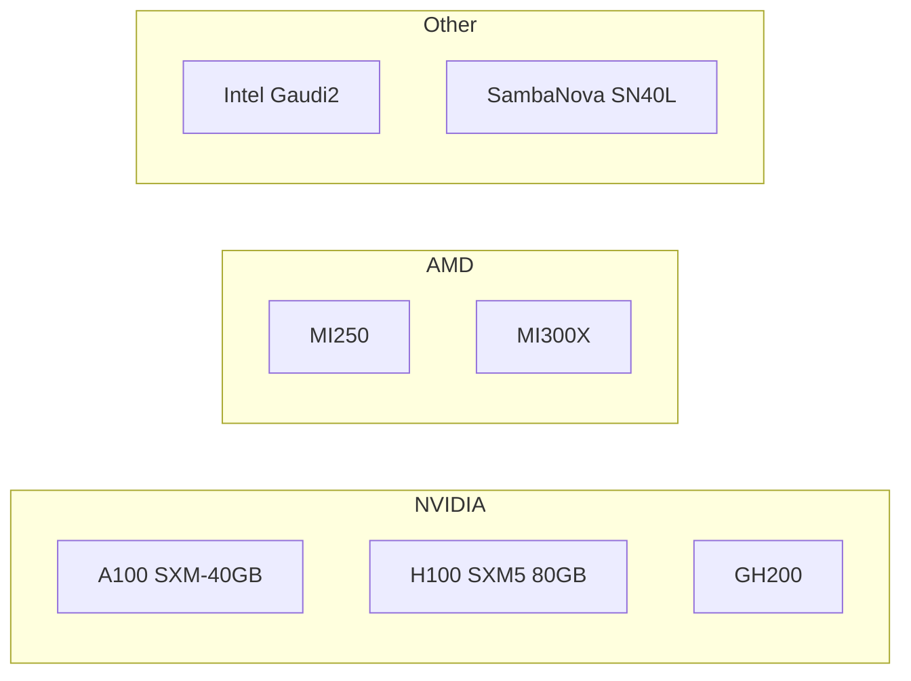

本記事は [arXiv:2411.00136](https://arxiv.org/abs/2411.00136) の解説記事です。

## 論文概要（Abstract）

Chitty-Venkataら（Argonne National Laboratory、9名）は、多様なAIアクセラレータ上でのLLM推論性能を体系的に評価するベンチマークスイート「LLM-Inference-Bench」を提案した。NVIDIA GPU（A100, H100, GH200）、AMD GPU（MI250, MI300X）、Intel Habana Gaudi2、SambaNova SN40Lの7種のアクセラレータ上で、TensorRT-LLM、vLLM、DeepSpeed-MII、llama.cppの4種の推論フレームワークを、LLaMA、Mistral、Qwenファミリの7B/70Bモデルで評価している。

この記事は [Zenn記事: Ollamaでオンプレミス推論環境を構築しNginx認証付きでチーム共有する](https://zenn.dev/0h_n0/articles/e0ac1e1b30fcc9) の深掘りです。

## 情報源

- **arXiv ID**: 2411.00136
- **URL**: [https://arxiv.org/abs/2411.00136](https://arxiv.org/abs/2411.00136)
- **著者**: Krishna Teja Chitty-Venkata（equal contribution）, Siddhisanket Raskar, Bharat Kale, Farah Ferdaus, Aditya Tanikanti, Ken Raffenetti, Valerie Taylor, Murali Emani, Venkatram Vishwanath
- **所属**: Argonne National Laboratory, Lemont, IL, USA
- **分野**: cs.DC（Distributed, Parallel, and Cluster Computing）, cs.AI, cs.PF
- **コード**: [https://github.com/argonne-lcf/LLM-Inference-Bench](https://github.com/argonne-lcf/LLM-Inference-Bench)

## 背景と動機（Background & Motivation）

LLMの推論需要が急速に増加する中、多様なAIアクセラレータが市場に登場している。しかし、これらのハードウェアプラットフォーム上での推論フレームワークの性能を体系的に比較した研究は限られていた。

特に以下の疑問に対する実証的な回答が必要とされていた：

1. TensorRT-LLMとvLLMの性能差はハードウェアによってどう変わるか
2. AMD GPUやIntel Gaudi2はNVIDIA GPUの代替になりうるか
3. llama.cppのGPUアクセラレーションはプロダクション用途に適するか
4. バッチサイズ・入出力長・テンソル並列がスループットにどう影響するか

Zenn記事ではOllama vs vLLM vs llama.cppの使い分けが議論されているが、本論文はこの比較をより広い**ハードウェア×フレームワーク**の組み合わせ空間に拡張している。

## 主要な貢献（Key Contributions）

- **貢献1**: 7種のAIアクセラレータ × 4種の推論フレームワーク × 8種のモデルの組み合わせ空間を体系的にベンチマーク
- **貢献2**: スループット、TTFT（Time-to-First-Token）、ITL（Inter-Token Latency）、パープレキシティ、消費電力の5つの指標で多面的に評価
- **貢献3**: インタラクティブダッシュボードの公開により、特定ハードウェア構成での最適設定の探索を容易化

## 技術的詳細（Technical Details）

### 評価対象のアクセラレータ



| アクセラレータ | メモリ | メモリ帯域幅 | 特徴 |
|-------------|--------|-----------|------|
| NVIDIA A100 SXM-40GB | 40GB HBM2e | 1.6TB/s | データセンター向けGPU（Ampere世代） |
| NVIDIA H100 SXM5 | 80GB HBM3 | 3.35TB/s | 次世代GPU（Hopper世代）、FP8対応 |
| NVIDIA GH200 | 96GB HBM3 + 480GB LPDDR5X | 4TB/s | Grace CPU + Hopper GPU統合 |
| AMD MI250 | 128GB HBM2e | 3.2TB/s | CDNA2アーキテクチャ |
| AMD MI300X | 192GB HBM3 | 5.3TB/s | CDNA3、大容量VRAM |
| Intel Gaudi2 | 96GB HBM2E | 2.46TB/s | AI専用アクセラレータ |
| SambaNova SN40L | — | — | RDUアーキテクチャ、638 BF16 TFLOPS/socket |

### 評価対象のフレームワーク

| フレームワーク | 対応ハードウェア | 特徴 |
|-------------|--------------|------|
| TensorRT-LLM 0.11.0 | NVIDIA GPU | NVIDIAの最適化推論エンジン。FP8/INT8量子化対応 |
| vLLM | NVIDIA, AMD, Intel Gaudi2 | PagedAttention + continuous batching。最も幅広いハードウェア対応 |
| DeepSpeed-MII | NVIDIA A100, Intel Gaudi2 | MicrosoftのDeepSpeed推論最適化 |
| llama.cpp | NVIDIA, AMD | C/C++実装、GGUF量子化モデル対応 |

### 評価メトリクス

**スループット**:

$$
\text{Throughput} = \frac{\text{Batch Size} \times (\text{Input Tokens} + \text{Output Tokens})}{\text{End-to-End Latency}}
$$

**TTFT（Time-to-First-Token）**: max_outputを1トークンに設定して計測。

**ITL（Inter-Token Latency）**:

$$
\text{ITL} = \frac{\text{End-to-End Latency} - \text{TTFT}}{\text{Batch Size} \times (\text{Output Tokens} - 1)}
$$

**消費電力**: NVIDIA GPUではpynvml経由でアクセラレータ単体の平均ワット数を測定。tokens/s/Wも報告。他ハードウェアは今後の課題。

### 実験パラメータ

- **入出力長**: 128, 256, 512, 1024, 2048トークン
- **バッチサイズ**: 1, 16, 32, 64
- **精度**: 全て16-bit（FP16/BF16）
- **GPU数 = テンソル並列度**: モデルサイズに応じて1-8

### 評価対象モデル

| モデル | レイヤー数 | KVヘッド | Attention方式 | 語彙サイズ |
|--------|---------|---------|-------------|----------|
| LLaMA-2-7B | 32 | 32 | MHSA | 32,000 |
| LLaMA-3-8B | 32 | 8 | GQA | 128,256 |
| Mistral-7B | 32 | 8 | GQA | 32,000 |
| Qwen-2-7B | 28 | 4 | GQA | 152,064 |
| LLaMA-2-70B | 80 | 8 | GQA | 32,000 |
| LLaMA-3-70B | 80 | 8 | GQA | 128,256 |
| Qwen-2-72B | 80 | 8 | GQA | 152,064 |
| Mixtral-8x7B | 32 | 8 | GQA + MoE (8 experts) | 32,000 |

## 実験結果（Results）

### フレームワーク間比較の主要知見

著者らの報告によると、以下の知見が得られている。

**1. TensorRT-LLMがNVIDIAハードウェアで最高性能**

TensorRT-LLMはvLLMおよびDeepSpeed-MIIに対してNVIDIAプラットフォーム上で最高のスループットと最低の消費電力を達成したと報告されている。

**2. GQAモデルの優位性がフレームワーク依存**

GQA（Grouped Query Attention）を採用するLLaMA-3-8BやMistral-7Bは、MHSA（Multi-Head Self-Attention）のLLaMA-2-7Bと比較して：

- TensorRT-LLM: batch 64でH100上1.9倍、A100上2.79倍高速
- vLLM: 同様の傾向
- llama.cpp: **GQAの恩恵を受けない**

これはZenn記事のOllama（llama.cppバックエンド）ユーザーにとって重要な知見である — Ollamaでは新しいGQAモデルへの移行による速度改善が限定的である可能性がある。

**3. llama.cppのGPUスケーラビリティの限界**

著者らは、llama.cppがA100上で最も低速であり、マルチGPUスケーリングが弱く、バッチサイズ増加による恩恵も限定的であると報告している。これはllama.cppがテンソル並列化やTensor Coreの完全活用を行っていないためだと説明されている。

Ollamaはllama.cppをバックエンドに使用するため、この制限はOllamaにも直接適用される。

**4. バッチサイズとスループットの関係**

LLaMA-3-8B on A100、vLLMの場合：

$$
\frac{\text{Throughput}(\text{batch}=64)}{\text{Throughput}(\text{batch}=1)} = 26.6\times \quad \text{（入出力長2048の場合）}
$$

この26.6倍のスケーリングは、vLLMのcontinuous batchingとPagedAttentionの効果を示している。

**5. H100 vs A100のスケーリング特性**

LLaMA-3-70B on TensorRT-LLM、batch 64の場合：
- H100のスループットはA100の**7.8倍**
- バッチサイズ1→64のスケーリング: H100で**39倍** vs A100で**3倍**

H100のHBM3帯域幅（3.35 TB/s vs 1.6 TB/s）とFP8テンソルコアの効果が大きいと著者らは分析している。

**6. AMD MI250のvLLMサポート**

AMD MI250上のvLLMまたはllama.cppは、一部のシナリオでNVIDIA A100と同等の性能を達成したと報告されている。AMD GPUがNVIDIAの代替として実用的になりつつあることを示唆する結果である。

### テンソル並列 vs パイプライン並列

LLaMA-3-8B on 4×A100での比較（著者らの報告）：

| 並列化方式 | 相対性能 |
|----------|---------|
| テンソル並列 (TP=4) | 1.00× (ベースライン) |
| ハイブリッド (TP=2, PP=2) | 0.77× (1.30倍遅い) |
| パイプライン並列 (PP=4) | 0.52× (1.94倍遅い) |

テンソル並列がLLM推論では支配的に有利であることが示されている。これはvLLMやTensorRT-LLMの設計選択（テンソル並列をデフォルトとする）を裏付ける結果である。

### 入出力長のスループットへの影響

TensorRT-LLMでの実験結果として、入力1024/出力128の構成は入力128/出力1024と比較して**14.6倍高速**と報告されている。これは、prefillフェーズ（入力処理）がGPU並列化の恩恵を受けやすいのに対し、decodeフェーズ（出力生成）がメモリ帯域幅にバウンドされるためである。

### 消費電力効率

著者らの報告によれば、NVIDIA H100が全GPUの中で最高のtokens/s/Wを達成した。ただし、消費電力の計測はNVIDIA GPU（pynvml経由）に限定されており、AMD GPUやIntel Gaudi2との直接比較はできない。

## 実装のポイント（Implementation）

### ベンチマーク環境の再現

著者らはGitHubリポジトリ（`argonne-lcf/LLM-Inference-Bench`）でベンチマークスクリプトとインタラクティブダッシュボードを公開している。

**ベンチマーク実行の基本構造**:

```python
def benchmark_inference(
    model_name: str,
    framework: str,
    batch_size: int,
    input_length: int,
    output_length: int,
    num_gpus: int,
) -> dict:
    """LLM推論ベンチマークの1構成を実行

    Args:
        model_name: HuggingFace モデルID
        framework: "tensorrt-llm" | "vllm" | "deepspeed-mii" | "llama.cpp"
        batch_size: 1, 16, 32, or 64
        input_length: 入力トークン数
        output_length: 出力トークン数
        num_gpus: テンソル並列度

    Returns:
        {"throughput": float, "ttft": float, "itl": float, "power_w": float}
    """
    ...
```

### フレームワーク選択の判断基準

本論文の結果に基づく、実運用でのフレームワーク選択ガイドライン：

| ユースケース | 推奨フレームワーク | 理由 |
|-----------|----------------|------|
| NVIDIA GPU + 最大スループット | TensorRT-LLM | 全NVIDIA GPUで最高性能 |
| マルチハードウェア対応 | vLLM | NVIDIA/AMD/Gaudi2に対応 |
| シングルユーザー・エッジ | llama.cpp / Ollama | 低オーバーヘッド。ただしスケーリング制限あり |
| 大規模モデル + DeepSpeed | DeepSpeed-MII | ZeRO最適化との統合 |

## 実運用への応用（Practical Applications）

### Zenn記事の推論エンジン選択への示唆

Zenn記事では「Ollama vs vLLM vs llama.cpp」の使い分けが議論されている。本論文の知見は、この判断をより定量的に裏付ける。

**Ollama（llama.cppバックエンド）の位置づけ**:

本論文の結果から、llama.cppは：
- シングルGPU・低バッチサイズでは他フレームワークと同等の性能
- マルチGPU構成ではスケーリングが弱い（テンソル並列・Tensor Coreの不完全活用）
- GQAモデルの恩恵を十分に受けられない

Zenn記事の結論 — 「10名超の同時利用ではvLLMの採用を検討」 — は本論文のバッチサイズスケーリング結果（vLLMのbatch 64でbatch 1の26.6倍）と整合する。

**H100への投資判断**:

Zenn記事はRTX 4090等の消費者向けGPUを想定しているが、本論文のH100 vs A100比較は、スケールアップ時のハードウェア選択に有用な情報を提供する。特にH100のバッチサイズスケーリング（batch 1→64で39倍）はA100（3倍）を大幅に上回り、高並列環境ではH100のコスト効率が逆転する可能性がある。

### AMD GPUの代替可能性

本論文はAMD MI250がvLLM上で一部シナリオでA100と同等の性能を達成したと報告している。AMD GPUはNVIDIAに比べてコスト優位性がある場合があり、オンプレミス環境でのLLMサービングにおける選択肢として検討に値する。

## 関連研究（Related Work）

- **vLLM / PagedAttention** (Kwon et al., SOSP 2023): 本論文のvLLMベンチマークの基盤技術。KVキャッシュのページング管理により高バッチサイズでのスループットを最大化
- **TensorRT-LLM** (NVIDIA): NVIDIAハードウェアに特化した最適化推論エンジン。FP8量子化やinflight batchingをサポート
- **FlashAttention** (Dao et al., NeurIPS 2022): IO-awareなAttention計算。vLLMやTensorRT-LLMの内部で使用される基盤技術

## まとめと今後の展望

LLM-Inference-Benchは、推論フレームワークとハードウェアの選択が**独立ではなく相互作用する**ことを実証的に示した。TensorRT-LLMはNVIDIAハードウェアで支配的だが、vLLMの幅広いハードウェア対応は異機種混在環境で価値がある。llama.cpp（Ollamaのバックエンド）はシングルユーザー用途では実用的だが、プロダクションスケールへの拡張には根本的な制約がある。

今後の課題として、FP8/INT4量子化での比較、推論サーバーの全スタック（前処理・後処理含む）での電力効率評価、NVIDIA以外のアクセラレータでの消費電力計測が挙げられている。

## 参考文献

- **arXiv**: [https://arxiv.org/abs/2411.00136](https://arxiv.org/abs/2411.00136)
- **Code**: [https://github.com/argonne-lcf/LLM-Inference-Bench](https://github.com/argonne-lcf/LLM-Inference-Bench)
- **vLLM / PagedAttention**: [https://arxiv.org/abs/2309.06180](https://arxiv.org/abs/2309.06180)
- **Related Zenn article**: [https://zenn.dev/0h_n0/articles/e0ac1e1b30fcc9](https://zenn.dev/0h_n0/articles/e0ac1e1b30fcc9)
