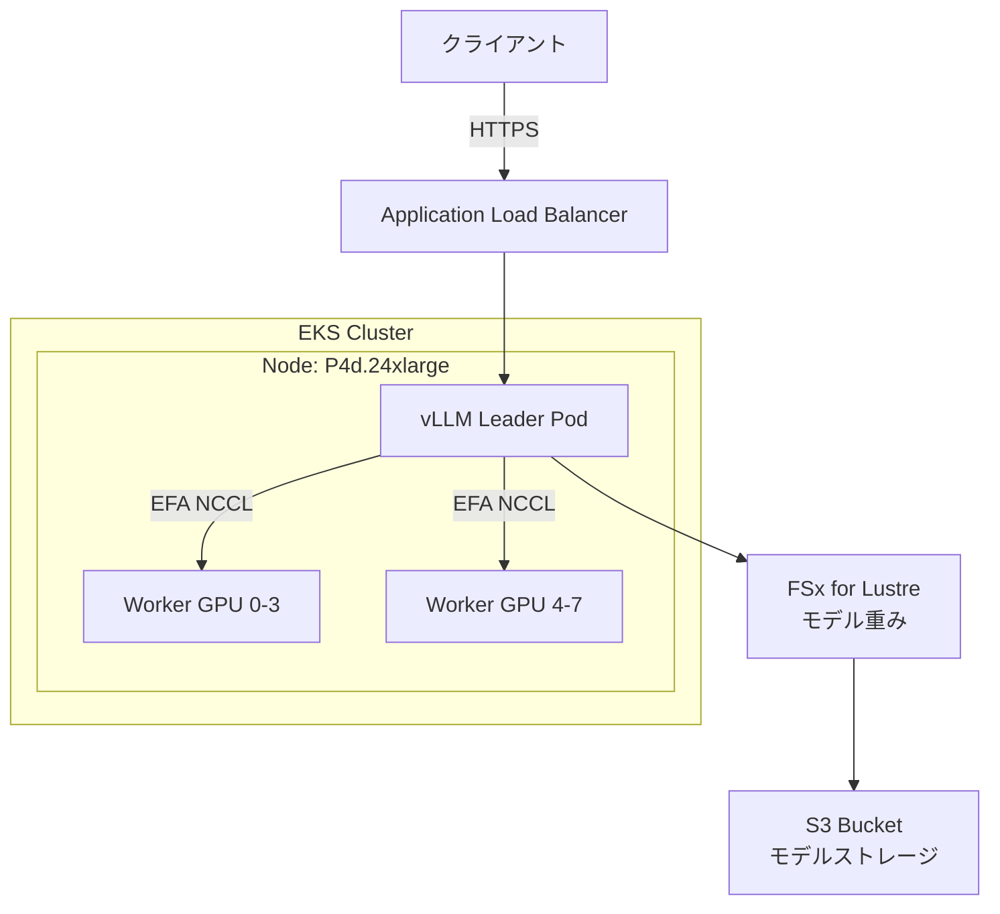

本記事は [AWS Architecture Blog: Deploy LLMs on Amazon EKS using vLLM Deep Learning Containers](https://aws.amazon.com/blogs/architecture/deploy-llms-on-amazon-eks-using-vllm-deep-learning-containers/) の解説記事です。

## ブログ概要（Summary）

Vishal NaikとSumeet Tripathi（AWS）は2025年8月14日、Amazon EKS上でvLLM Deep Learning Containers（DLC）を用いたLLMサービング環境の構築ガイドを公開した。DeepSeek-R1-Distill-Qwen-32Bを対象モデルとし、P4d.24xlarge（8×A100 GPU）、Elastic Fabric Adapter（EFA）、FSx for Lustre、LeaderWorkerSetパターンを組み合わせた本番向け分散推論アーキテクチャを解説している。

Zenn記事がOllamaによるシングルサーバー構成を扱うのに対し、本ブログはvLLMによるマルチGPU・Kubernetes環境でのエンタープライズ向けサービングに焦点を当てている。両記事はLLM推論の**異なるスケールレンジ**を補完する関係にある。

この記事は [Zenn記事: Ollamaでオンプレミス推論環境を構築しNginx認証付きでチーム共有する](https://zenn.dev/0h_n0/articles/e0ac1e1b30fcc9) の深掘りです。

## 情報源

- **種別**: 企業テックブログ
- **URL**: [https://aws.amazon.com/blogs/architecture/deploy-llms-on-amazon-eks-using-vllm-deep-learning-containers/](https://aws.amazon.com/blogs/architecture/deploy-llms-on-amazon-eks-using-vllm-deep-learning-containers/)
- **組織**: Amazon Web Services (Architecture Blog)
- **著者**: Vishal Naik, Sumeet Tripathi
- **発表日**: 2025年8月14日

## 技術的背景（Technical Background）

### なぜEKS + vLLMなのか

Zenn記事で紹介されている通り、Ollamaはシングルユーザー〜少数並列で十分な性能を発揮するが、10名以上の同時利用ではスループットが急激に低下する。vLLMはPagedAttentionとcontinuous batchingにより高並列環境で圧倒的なスループットを達成するが、マルチGPU環境でのデプロイには相応のインフラ構築が必要になる。

AWSのvLLM DLCは、CUDAドライバ・EFAドライバ・テンソル/パイプライン並列化のための依存関係を事前構成済みのコンテナイメージとして提供し、このギャップを埋める。

### Ollamaとの比較：スケールの違い

| 観点 | Ollama (Zenn記事) | vLLM on EKS (AWSブログ) |
|------|------------------|----------------------|
| 対象規模 | 1-5名、開発/プロトタイプ | 10名以上、本番サービス |
| GPU | 単一GPU（消費者向け） | マルチGPU（A100×8） |
| モデルサイズ | 7B-13B（量子化） | 32B-70B（FP16/FP8） |
| 並列化 | OLLAMA_NUM_PARALLEL | テンソル並列 + continuous batching |
| 認証 | Nginx リバースプロキシ | ALB + IAM + K8s RBAC |
| 月額コスト | $0（オンプレミス電気代のみ） | $7,000-15,000+（P4dインスタンス） |

## 実装アーキテクチャ（Architecture）

### システム構成



### 使用AWSサービス

| サービス | 役割 | 構成 |
|---------|------|------|
| Amazon EKS | コンテナオーケストレーション | コントロールプレーン + マネージドノードグループ |
| EC2 P4d.24xlarge | GPU計算 | 8×NVIDIA A100 GPU、EFA対応 |
| Elastic Fabric Adapter | GPU間通信 | NCCL all-reduceの高速化 |
| FSx for Lustre | モデル重みストレージ | 高スループット並列ファイルシステム |
| Application Load Balancer | リクエストルーティング | AWS Load Balancer Controller経由 |
| vLLM DLC | 推論コンテナ | `public.ecr.aws/deep-learning-containers/vllm` |

### デプロイ手順の概要

ブログ記事では以下の手順が示されている（所要時間: 60-90分）:

**前提条件**:
- AWS CLI 2.11.0以降
- eksctl 0.150.0以降
- kubectl 1.27以降
- Helm 3.12.0以降
- P4dインスタンスのクォータ（要増加申請の場合あり）
- リージョン: us-west-2

**Step 1: EKSクラスタ作成**（15-20分）

```bash
# リポジトリのクローン
git clone https://github.com/aws-samples/sample-aws-deep-learning-containers.git
cd vllm-samples/deepseek/eks

# クラスタ作成
eksctl create cluster -f eks-cluster.yaml --profile vllm-profile
```

**Step 2: GPUノードグループ作成**（10-15分）

```bash
# プライベートサブネットのAZを取得してノードグループ設定に反映
eksctl create nodegroup -f large-model-nodegroup.yaml --profile vllm-profile
```

ノードグループはプライベートサブネットに配置され、`map-public-ip-on-launch=false`が設定されている。EKS最適化GPU AMI（`ami-0ad09867389dc17a1`）にはNVIDIAデバイスプラグインが含まれている。

**Step 3: GPU認識の確認**

```bash
# NVIDIAデバイスプラグインの確認
kubectl get pods -n kube-system | grep nvidia

# GPU数の確認（1ノードあたり8を期待）
kubectl get nodes -o json | jq '.items[].status.allocatable["nvidia.com/gpu"]'
```

**Step 4: FSx for Lustre構成**

FSx for Lustreはモデル重みの高速読み込みに使用される。S3バケットとの連携により、モデル重みを並列にストリーミング読み込みできる。

**Step 5: vLLMデプロイメント（LeaderWorkerSet）**

LeaderWorkerSetはKubernetesのカスタムリソースで、分散推論のLeader-Worker構造を管理する。Leaderポッドがリクエストを受け付け、NCCL over EFAでWorkerポッドと通信してテンソル並列推論を実行する。

## パフォーマンス最適化（Performance）

### vLLM DLCの最適化ポイント

AWSのvLLM DLCには以下の最適化が事前構成されている（ブログ記事の記載による）:

1. **テンソル並列化**: 8GPU間でモデル重みを分割。NCCL all-reduceによる勾配同期
2. **EFA統合**: GPU Direct RDMA対応のEFAドライバによりGPU間通信を高速化
3. **continuous batching**: vLLMのiteration-level schedulingにより、リクエストの到着・完了に応じて動的にバッチを構成
4. **PagedAttention**: KVキャッシュのページング管理（前述のarXiv:2309.06180の技術）

### コールドスタート最適化

ブログでは以下のコールドスタート最適化が推奨されている：

1. **ECRプライベートリポジトリ**: vLLM DLCイメージをECRに格納し、VPCエンドポイント経由でアクセスすることでイメージプル時間を短縮
2. **FSx for Lustre**: モデル重み（32Bモデルで約60GB）を並列ファイルシステムから読み込み
3. **イメージタグの固定**: `:latest`ではなくバージョンタグを固定（例: `0.11.2`）

## 運用での学び（Production Lessons）

### Ollamaからvllm on EKSへのマイグレーション判断基準

Zenn記事の構成から本ブログの構成へ移行すべきタイミングは、以下の条件に基づいて判断できる：

**移行を検討すべき場合**:
- 同時利用ユーザーが10名を超える
- 32B以上のモデルをFP16/FP8で提供する必要がある
- SLAとして推論レイテンシのP99保証が必要
- マルチモデルサービング（複数モデルの同時提供）が必要

**Ollamaを継続すべき場合**:
- 同時利用が5名以下
- 7B-13Bの量子化モデルで十分
- インフラ運用チームがない
- 月額$7,000+のGPUインスタンスコストが許容できない

### 運用上の注意点

1. **P4dインスタンスの可用性**: P4d.24xlargeは需要が高く、リージョンによっては在庫がない場合がある。Capacity Reservationsの事前確保を推奨
2. **EFA対応インスタンス**: EFAはすべてのインスタンスタイプで利用できるわけではない。P4d, P5, Trn1などの特定タイプが必要
3. **コスト管理**: P4d.24xlarge単体でオンデマンド$32.77/hour（us-west-2）。Spot Instancesの活用で最大90%削減が可能だが、推論ワークロードでは中断リスクの許容が前提

## 学術研究との関連（Academic Connection）

### vLLMとPagedAttention

本ブログのvLLM DLCは、Kwonら（SOSP 2023）のPagedAttentionを実装基盤としている。ブログが示すP4d.24xlargeでの分散推論は、論文で示されたマルチGPU構成（OPT-175B on 8×A100）と同等のハードウェア構成である。

### テンソル並列化

分散推論で使用されるMegatron方式のテンソル並列化は、Shoeybi et al. (2019)が提案したアプローチに基づく。モデルの各Transformerレイヤーの重みを複数GPUに分割し、NCCL all-reduceで中間結果を集約する。

$$
Y = \text{AllReduce}(X \cdot W_{\text{shard}})
$$

ここで$W_{\text{shard}}$は各GPUに分割された重み行列、AllReduceはNCCL all-reduce操作。EFAはこのAllReduce操作を高速化するハードウェアアクセラレーションを提供する。

### LeaderWorkerSetパターン

Kubernetesの標準DeploymentやStatefulSetでは、分散推論のLeader-Worker構造を表現しにくい。LeaderWorkerSetは、Leaderポッドがサービスエンドポイントを担い、Workerポッドが計算リソースを提供するトポロジを宣言的に定義するカスタムリソースである。

## Production Deployment Guide

### AWS実装パターン（コスト最適化重視）

**トラフィック量別の推奨構成**:

| 規模 | 月間リクエスト | 推奨構成 | 月額コスト | 主要サービス |
|------|------------|---------|-----------|------------|
| **Small** | ~3,000 (100/日) | Serverless | $200-500 | Lambda + Bedrock API |
| **Medium** | ~30,000 (1,000/日) | Single GPU | $3,000-5,000 | EC2 g5.xlarge + vLLM |
| **Large** | 300,000+ (10,000/日) | Multi-GPU EKS | $10,000-20,000 | EKS + P4d/P5 + EFA |

**Small構成の詳細**（月額$200-500）:
- **Lambda**: API Gateway経由でリクエスト受付（$20/月）
- **Bedrock API**: Claude 3.5 Haiku呼び出し（$150-400/月、使用量依存）
- **DynamoDB**: プロンプトキャッシュ用（$10/月）
- 自前GPUサーバー不要。Ollamaの代替としてBedrock APIを使用する構成

**Medium構成の詳細**（月額$3,000-5,000）:
- **EC2 g5.xlarge**: 1×A10G GPU、24GB VRAM（$1,006/月オンデマンド）
- **vLLM**: 7B-13Bモデルの推論（PagedAttention有効）
- **ALB**: リクエスト分散（$20/月）
- **EBS gp3**: モデルストレージ（$50/月）
- Zenn記事のOllama構成をvLLMに置き換えた形。認証はALBのOIDC統合を使用

**Large構成の詳細**（月額$10,000-20,000）:
- **EKS**: コントロールプレーン（$72/月）
- **EC2 P4d.24xlarge**: 8×A100 GPU（$23,594/月オンデマンド、Spot使用で$7,000-10,000/月）
- **FSx for Lustre**: モデル重みストレージ（$300/月）
- **EFA**: GPU間通信高速化（追加コストなし）
- **ALB + WAF**: 認証・セキュリティ（$100/月）
- ブログ記事の構成そのもの。32B-70Bモデルのマルチユーザーサービング

**コスト削減テクニック**:
- Spot Instances: P4dでの推論は中断耐性がない場合注意が必要。Spot利用時はチェックポイント・リトライ機構が前提
- Savings Plans: Compute Savings Plansで最大66%削減（1年コミット）
- Graviton活用: 推論前処理（トークナイゼーション等）をGravitonインスタンスにオフロード

**コスト試算の注意事項**:
- 上記は2026年11月時点のAWS us-west-2リージョン料金に基づく概算値です
- 実際のコストはトラフィックパターン、Spot可用性、リージョンにより変動します
- 最新料金は [AWS料金計算ツール](https://calculator.aws/) で確認してください

### Terraformインフラコード

**Medium構成 (Single GPU): EC2 + vLLM + ALB**

```hcl
module "vpc" {
  source  = "terraform-aws-modules/vpc/aws"
  version = "~> 5.0"

  name = "vllm-vpc"
  cidr = "10.0.0.0/16"
  azs  = ["us-west-2a", "us-west-2b"]
  private_subnets = ["10.0.1.0/24", "10.0.2.0/24"]
  public_subnets  = ["10.0.101.0/24", "10.0.102.0/24"]

  enable_nat_gateway = true
  single_nat_gateway = true
}

resource "aws_iam_role" "vllm_instance" {
  name = "vllm-instance-role"

  assume_role_policy = jsonencode({
    Version = "2012-10-17"
    Statement = [{
      Action = "sts:AssumeRole"
      Effect = "Allow"
      Principal = { Service = "ec2.amazonaws.com" }
    }]
  })
}

resource "aws_iam_role_policy" "vllm_s3_access" {
  role = aws_iam_role.vllm_instance.id
  policy = jsonencode({
    Version = "2012-10-17"
    Statement = [{
      Effect   = "Allow"
      Action   = ["s3:GetObject", "s3:ListBucket"]
      Resource = [
        "arn:aws:s3:::model-weights-bucket",
        "arn:aws:s3:::model-weights-bucket/*"
      ]
    }]
  })
}

resource "aws_instance" "vllm_server" {
  ami           = "ami-0ad09867389dc17a1"
  instance_type = "g5.xlarge"
  subnet_id     = module.vpc.private_subnets[0]

  iam_instance_profile = aws_iam_instance_profile.vllm.name

  root_block_device {
    volume_size = 100
    volume_type = "gp3"
  }

  user_data = <<-EOF
    #!/bin/bash
    docker pull public.ecr.aws/deep-learning-containers/vllm:0.21.0
    docker run -d --gpus all \
      -p 8000:8000 \
      public.ecr.aws/deep-learning-containers/vllm:0.21.0 \
      --model deepseek-ai/DeepSeek-R1-Distill-Qwen-7B \
      --port 8000
  EOF

  tags = { Name = "vllm-inference-server" }
}

resource "aws_lb" "vllm_alb" {
  name               = "vllm-alb"
  internal           = false
  load_balancer_type = "application"
  security_groups    = [aws_security_group.alb.id]
  subnets            = module.vpc.public_subnets
}

resource "aws_lb_target_group" "vllm" {
  name     = "vllm-tg"
  port     = 8000
  protocol = "HTTP"
  vpc_id   = module.vpc.vpc_id

  health_check {
    path                = "/health"
    healthy_threshold   = 2
    unhealthy_threshold = 3
    interval            = 30
  }
}
```

**Large構成 (EKS + Multi-GPU): ブログ記事の本構成**

```hcl
module "eks" {
  source  = "terraform-aws-modules/eks/aws"
  version = "~> 20.0"

  cluster_name    = "vllm-inference-cluster"
  cluster_version = "1.31"

  vpc_id     = module.vpc.vpc_id
  subnet_ids = module.vpc.private_subnets

  cluster_endpoint_public_access = true
  enable_cluster_creator_admin_permissions = true

  eks_managed_node_groups = {
    gpu-nodes = {
      instance_types = ["p4d.24xlarge"]
      min_size       = 1
      max_size       = 4
      desired_size   = 1

      ami_type = "AL2_x86_64_GPU"

      labels = {
        "nvidia.com/gpu" = "true"
        workload         = "inference"
      }

      taints = [{
        key    = "nvidia.com/gpu"
        value  = "true"
        effect = "NO_SCHEDULE"
      }]
    }
  }
}

resource "aws_fsx_lustre_file_system" "model_storage" {
  storage_capacity            = 1200
  subnet_ids                  = [module.vpc.private_subnets[0]]
  deployment_type             = "PERSISTENT_2"
  per_unit_storage_throughput = 250
  security_group_ids          = [aws_security_group.fsx.id]

  tags = { Name = "model-weights-fsx" }
}

resource "aws_budgets_budget" "inference_monthly" {
  name         = "inference-monthly-budget"
  budget_type  = "COST"
  limit_amount = "15000"
  limit_unit   = "USD"
  time_unit    = "MONTHLY"

  notification {
    comparison_operator       = "GREATER_THAN"
    threshold                 = 80
    threshold_type            = "PERCENTAGE"
    notification_type         = "ACTUAL"
    subscriber_email_addresses = ["ops-team@example.com"]
  }
}
```

### セキュリティベストプラクティス

1. **ネットワーク**: vLLMポッドはプライベートサブネットのみ。ALB経由でのみアクセス可能
2. **認証**: ALBのOIDC認証統合でIdP連携。K8s RBACでポッド間アクセス制御
3. **シークレット**: モデルアクセスキーはAWS Secrets Manager + External Secrets Operatorで管理
4. **暗号化**: EBSボリューム・FSx・S3はKMS暗号化必須
5. **監査**: CloudTrail全リージョン有効化、EKS Audit Log有効化

### 運用・監視設定

**CloudWatch Container Insightsクエリ**:

```sql
fields @timestamp, kubernetes.pod_name, @message
| filter kubernetes.container_name = "vllm"
| stats avg(latency_ms) as avg_latency, 
        pct(latency_ms, 95) as p95_latency,
        pct(latency_ms, 99) as p99_latency 
  by bin(5m)
```

**GPU使用率モニタリング（DCGM Exporter + Prometheus）**:

```yaml
# Prometheus scrape config for DCGM
scrape_configs:
  - job_name: 'dcgm-exporter'
    kubernetes_sd_configs:
      - role: pod
    relabel_configs:
      - source_labels: [__meta_kubernetes_pod_annotation_prometheus_io_scrape]
        action: keep
        regex: true
```

### コスト最適化チェックリスト

**アーキテクチャ選択**:
- [ ] ~100 req/日 → Bedrock API（サーバーレス） - $200-500/月
- [ ] ~1,000 req/日 → EC2 g5 + vLLM - $3,000-5,000/月
- [ ] 10,000+ req/日 → EKS + P4d（ブログ構成） - $10,000-20,000/月

**リソース最適化**:
- [ ] Spot Instances: g5/g6で最大70%削減（中断許容の場合）
- [ ] Savings Plans: 1年コミットで66%削減
- [ ] 右サイジング: CloudWatch GPU Utilizationで使用率を確認
- [ ] スケールダウン: 夜間・休日のノード数削減（Cluster Autoscaler/Karpenter）
- [ ] モデル量子化: FP16→INT8で必要GPU数を半減

**LLMコスト削減**:
- [ ] Prompt Caching: vLLMのautomatic prefix cachingで重複プロンプト処理を削減
- [ ] モデル選択: 簡易タスクは7Bモデル、複雑タスクのみ32B+モデル
- [ ] max_tokens制限: 不要な長文生成を防止
- [ ] バッチ処理: 非リアルタイムタスクはバッチキューで処理

**監視・アラート**:
- [ ] AWS Budgets: 月額予算設定（80%警告、100%アラート）
- [ ] GPU Utilization: 50%未満が継続する場合はインスタンスサイズダウン検討
- [ ] Container Insights: ポッドレベルのリソース使用量監視
- [ ] Cost Anomaly Detection: 異常なコスト増加の自動検知

**リソース管理**:
- [ ] 未使用GPUノードの自動停止
- [ ] タグ戦略: 環境別（dev/staging/prod）でコスト可視化
- [ ] FSx不要時の削除: モデルロード完了後はEBSにコピーして削除可能
- [ ] ECRライフサイクル: 古いDLCイメージの自動削除

## まとめと実践への示唆

AWSのvLLM DLCブログは、Ollamaのシングルサーバー構成から一段上のスケールに進む際の**公式リファレンスアーキテクチャ**として位置づけられる。P4d.24xlarge + EFA + FSx for Lustre + LeaderWorkerSetの組み合わせは、32B-70Bモデルのマルチユーザーサービングに適した構成である。

ただし、月額$10,000-20,000のコストはチーム規模とビジネス要件に見合うものかを慎重に判断する必要がある。多くのチームにとっては、Zenn記事のOllama + Nginx構成（コスト$0、GPU電気代のみ）から開始し、需要増加に応じてvLLM on EC2（g5.xlarge）→ EKS + P4d と段階的にスケールアップする戦略が現実的である。

## 参考文献

- **AWS Blog**: [https://aws.amazon.com/blogs/architecture/deploy-llms-on-amazon-eks-using-vllm-deep-learning-containers/](https://aws.amazon.com/blogs/architecture/deploy-llms-on-amazon-eks-using-vllm-deep-learning-containers/)
- **GitHub**: [https://github.com/aws-samples/sample-aws-deep-learning-containers](https://github.com/aws-samples/sample-aws-deep-learning-containers)
- **vLLM / PagedAttention**: [https://arxiv.org/abs/2309.06180](https://arxiv.org/abs/2309.06180)
- **Related Zenn article**: [https://zenn.dev/0h_n0/articles/e0ac1e1b30fcc9](https://zenn.dev/0h_n0/articles/e0ac1e1b30fcc9)
