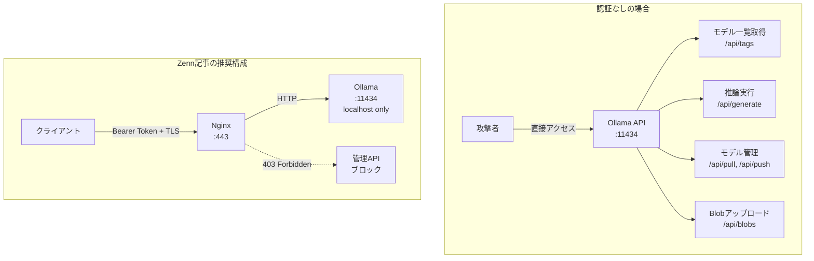

本記事は [CSA Research Note: Exposed AI Infrastructure](https://labs.cloudsecurityalliance.org/research/csa-research-note-exposed-ai-infrastructure-selfhosted-secur/) の解説記事です。

## レポート概要（Summary）

Cloud Security Alliance（CSA）AI Safety Initiativeは2026年5月7日、セルフホストAIインフラストラクチャのセキュリティ実態を調査したレポート「Exposed AI Infrastructure: Self-Hosted Services Under Attack」を公開した。IntruderによるインターネットスキャンとGreyNoiseのハニーポットデータを基に、Ollama、Open WebUI、Flowise、Langflow、n8nなどのセルフホストAIサービスの公開状況と攻撃実態を報告している。

このレポートは、Ollamaのデフォルト設定には**認証機能がない**という根本的問題を中心に据え、実際の攻撃キャンペーンの詳細と防御策を提示している。

この記事は [Zenn記事: Ollamaでオンプレミス推論環境を構築しNginx認証付きでチーム共有する](https://zenn.dev/0h_n0/articles/e0ac1e1b30fcc9) の深掘りです。

## 情報源

- **種別**: セキュリティ調査レポート
- **URL**: [https://labs.cloudsecurityalliance.org/research/csa-research-note-exposed-ai-infrastructure-selfhosted-secur/](https://labs.cloudsecurityalliance.org/research/csa-research-note-exposed-ai-infrastructure-selfhosted-secur/)
- **組織**: Cloud Security Alliance AI Safety Initiative
- **発表日**: 2026年5月7日

## 技術的背景（Technical Background）

### セルフホストLLMの普及と認証の空白

プライバシー保護・コスト管理・データ主権の観点から、OllamaをはじめとするセルフホストLLM推論サーバーの導入が急速に進んでいる。しかし、これらのツールの多くはデフォルトで**認証機能が無効**の状態で出荷されている。

Zenn記事で指摘されている通り、Ollamaはデフォルトで`127.0.0.1:11434`にバインドするが、`OLLAMA_HOST=0.0.0.0`に変更してLAN/インターネットに公開する運用が広く行われている。CSAレポートはこの設定変更が大規模なセキュリティリスクを生んでいることを実データで裏付けている。

### Ollamaの認証問題の構造

CSAレポートは、認証なしのOllamaサーバーに対して攻撃者が実行可能な操作を以下のように整理している：

1. インストール済みモデルの一覧取得
2. 任意のシステムプロンプト・ユーザープロンプトによる推論実行
3. 接続されたツール統合の情報取得
4. エージェント機能を持つ場合、接続先システムへの書き込みアクセス

## 公開状況の調査結果（Intruderスキャン）

### 調査方法

Intruder社は2026年初頭、証明書透過性ログとAI関連ドメインの命名パターンに基づくOSINTにより、約100万件のAIサービスエンドポイントのデータセットを構築した。認証状況、脆弱性露出、データ漏洩の分析が行われた。

### 主要な発見

| サービス | 公開インスタンス数 | 認証なしの割合 | 備考 |
|---------|----------------|-------------|------|
| Ollama | 5,200+ | 31%（1,652件が認証なしプロンプトに応答） | ポート11434 |
| Open WebUI | 12,000+ | 一部で認証なし | Ollama フロントエンド |
| Flowise | 2,650+ | 92件がフルワークフロー開示 | エージェントプラットフォーム |
| Langflow | ~300 | 不明 | ワークフロープラットフォーム |

さらに、518件の「フロンティアモデル」エンドポイントが**不正プロキシ**として機能しており、Anthropic、OpenAI、Google等の有料APIキーが設定されたまま公開されていた。これらのサーバーの所有者は、自身のAPIキーが露出し課金されていることを認識していない可能性がある。

## 主要な脆弱性（CVE詳細）

### CVE-2026-7482: "Bleeding Llama"（CVSS 9.1, Critical）

**発見者**: Cyera Research

**影響**: Ollama v0.17.1未満で、モデル量子化パイプラインのGGUFローダーにヒープ境界外読み取りの脆弱性が存在。

**攻撃手順**:

1. 攻撃者が細工したGGUFモデルファイルを作成。テンソルサイズを実データよりはるかに大きく宣言
2. Blobエンドポイント（`/api/blobs`）経由でファイルをアップロード
3. モデル作成API（`/api/create`）でファイルを処理させる。Ollamaはバッファを超えて隣接ヒープメモリを読み取る
4. 結果を攻撃者のサーバーにプッシュ（`/api/push`）

**漏洩する可能性のある情報**: システムプロンプト、メッセージ履歴、環境変数、APIキー

**公開サーバー数**: SecurityWeek の報告では約300,000件のOllamaインスタンスがインターネットに直接公開されている（CSAレポートより引用。ただし、調査方法論の違いにより数値は報告元によって異なる）。

### CVE-2025-64496: Open WebUI Direct Connections RCE（CVSS 7.3, High）

**発見者**: Cato Networks

**影響**: Open WebUI v0.6.34以前で、Direct Connections機能を通じたリモートコード実行

**攻撃手順**: 悪意あるOpenAI互換サーバーがSSEの"execute"イベントを送信 → `new Function()`コンストラクタで未サニタイズJavaScript実行 → localStorageから認証トークン窃取 → `workspace.tools`権限がある場合、バックエンドのPython `exec()`呼び出しでRCE

**修正**: v0.6.35で"execute"イベントのブロックが追加

### CVE-2025-68613: n8n ワークフロー式評価RCE（Critical）

n8nのexpression評価エンジンを通じた認証済みユーザーによるRCE。2025年12月の修正がバイパス可能であることが2026年2月に報告された。侵害されたn8nインスタンスは、Salesforce、AWS、OpenAI等の全資格情報ストアを攻撃者に公開する。

## 攻撃キャンペーンの実態（GreyNoiseデータ）

### キャンペーン1: SSRF攻撃（2025年10月〜2026年1月）

GreyNoiseのハニーポットで91,403件の攻撃セッションが観測された。

- **手法**: OllamaのModel Pull APIのSSRF脆弱性とTwilio SMSウェブフック統合を悪用
- **スキャンツール**: ProjectDiscovery OASTインフラでコールバック確認。JA4Hフィンガープリントの99%が単一パターンに集中 → Nucleiカスタムテンプレートの使用が示唆される
- **攻撃元**: 27カ国、62ソースIP

### キャンペーン2: 大規模列挙（2025年12月28日〜）

2つのIP（45.88.186.70, 204.76.203.125）から、73以上のLLMエンドポイントに対して80,469セッションの列挙活動。

- **手法**: OpenAI互換APIおよびGemini APIフォーマットのプローブ
- **対象モデル名**: GPT-4o, Claude Sonnet/Opus/Haiku, Llama 3.x, DeepSeek-R1, Gemini, Mistral, Qwen, Grok
- **送信プロンプト**: "hi"や米国の州に関する無害な質問 → 有料APIプロキシの探索が目的と推定される

## 防御策（CSA推奨）

### 即時対応

1. **外部公開の監査**: Ollama（ポート11434）、Open WebUI、Flowise、Langflow、n8nのインターネット公開状況を確認
2. **ネットワーク制限**: パブリックアクセスが不要なサービスを内部ネットワーク/VPNに制限
3. **認証の追加**: 推論サービスの前に認証付きリバースプロキシ（APIキーまたはOAuth）を配置
4. **パッチ適用**: CVE-2026-7482（Ollama v0.17.1以降へ）、CVE-2025-64496（Open WebUI v0.6.35以降へ）

### 短期対応

5. **APIキーのローテーション**: 露出した可能性のあるAnthropic、OpenAI、AWS等のキーをローテーション
6. **ログ記録**: リバースプロキシで全リクエストをログ記録し異常検知に活用
7. **継続的な外部攻撃面監視**: AIインフラを対象に含める

### 戦略的対応

8. **プラットフォームメンテナーへの提言**: 認証デフォルト有効化、非localhostバインド時の警告、セキュリティリスクのドキュメント改善
9. **企業標準の策定**: セグメンテーション、強制認証、CVE深刻度に応じたパッチSLA、定期的な脆弱性スキャンの標準化

### CSAフレームワークとの対応

| フレームワーク | 該当コントロール |
|-------------|--------------|
| MAESTRO | Layer 4-5（ツール/統合セキュリティ、アプリケーションインターフェースセキュリティ） |
| AI Controls Matrix (AICM) v1.0 | AI Infrastructure Securityドメイン |
| Shared Security Responsibility Model | インフラコントロールはデプロイヤーの責任 |
| Zero Trust | ネットワーク位置に基づく暗黙的信頼の排除 |

## Zenn記事の構成との対応

Zenn記事で紹介されたNginx + Bearer Token認証の構成は、CSAレポートの推奨事項と完全に合致している。具体的に：

| CSA推奨事項 | Zenn記事の対応 |
|-----------|-------------|
| 認証付きリバースプロキシ | Nginx + Bearer Token |
| 推論サービスをlocalhost限定 | `expose: "11434"`（ポート公開なし） |
| TLS暗号化 | `ssl_certificate` / `ssl_certificate_key` |
| モデル管理APIのブロック | `location ~ ^/api/(pull\|push\|delete)` → 403 |
| レート制限 | `limit_req_zone` |

ただし、CSAレポートの知見に基づくと、Zenn記事の構成にさらに以下の強化を検討すべきである：

1. **静的Bearer Tokenの限界**: CSAレポートはJWTベースの認証（スコープ付きクレーム、短い有効期限）やOAuth 2.0を推奨。大規模チームではOAuth2 Proxy等の導入を検討
2. **バージョン管理の重要性**: CVE-2026-7482のようなクリティカル脆弱性が継続的に発見されるため、`ollama/ollama:0.40.16`のようにイメージタグを固定した上で定期的なセキュリティパッチ適用が必要
3. **監査ログの充実**: Nginxのアクセスログに加え、推論リクエストの内容（プロンプト長、モデル名、レスポンス時間）をJSON構造化ログで記録し異常検知に活用

## 運用での学び（Production Lessons）

### コンテナ環境で観測された問題

CSAレポートは、調査対象のコンテナ環境で以下の問題が広く観測されたと報告している：

- docker-compose.ymlへのハードコードされた資格情報
- rootユーザーでのサービス実行
- AI推論とエンタープライズシステム間のネットワークセグメンテーション欠如
- あるツールでは公開インスタンスの90%以上が既知の深刻な脆弱性を抱えたまま稼働

### パッチ適用の遅さ

CSAレポートによれば、新しいRCE脆弱性が開示された後**1週間でパッチを適用したインスタンスは0件**だった（対象ツール名は非公開）。これはセルフホストAIインフラのパッチ管理が重大な課題であることを示している。

## 学術研究との関連（Academic Connection）

本レポートの知見は、以下の学術研究と関連する：

- **LLMセキュリティ全般**: OWASP Top 10 for LLMs（2025）が定義するLLMアプリケーション固有のリスク分類と整合
- **プロンプトインジェクション研究**: 認証なしの推論エンドポイントは、プロンプトインジェクション攻撃のベクトルを大幅に広げる
- **サプライチェーンセキュリティ**: CVE-2026-7482のGGUFファイルを介した攻撃は、モデルサプライチェーンの信頼性問題を浮き彫りにする

## まとめと実践への示唆

CSAレポートは、セルフホストLLMインフラが**デフォルトで安全ではない**という現実を定量データで示した。Zenn記事のNginx + Bearer Token構成は最低限の防御策として有効だが、エンタープライズ環境ではOAuth 2.0認証、WAF、SIEM連携、定期的な脆弱性スキャンを組み合わせた多層防御が必要である。

Ollamaの認証機能は2026年11月時点でも公式には提供されておらず、リバースプロキシによる外部認証が唯一の実用的手段であり続けている。この状況はZenn記事の構成の妥当性を裏付けると同時に、プラットフォームレベルでの認証デフォルト有効化の必要性を示している。

## 参考文献

- **CSA Report**: [https://labs.cloudsecurityalliance.org/research/csa-research-note-exposed-ai-infrastructure-selfhosted-secur/](https://labs.cloudsecurityalliance.org/research/csa-research-note-exposed-ai-infrastructure-selfhosted-secur/)
- **CVE-2026-7482**: [https://nvd.nist.gov/vuln/detail/CVE-2026-7482](https://nvd.nist.gov/vuln/detail/CVE-2026-7482)
- **Related Zenn article**: [https://zenn.dev/0h_n0/articles/e0ac1e1b30fcc9](https://zenn.dev/0h_n0/articles/e0ac1e1b30fcc9)
