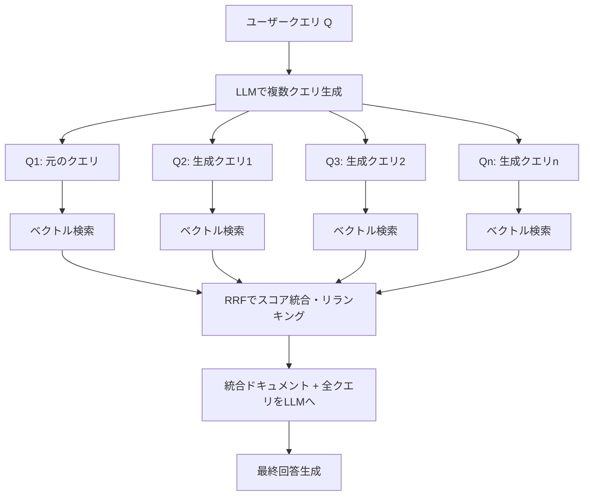

本記事は [https://arxiv.org/abs/2402.03367](https://arxiv.org/abs/2402.03367) の解説記事です。

## 論文概要（Abstract）

RAG-Fusionは、Retrieval-Augmented Generation（RAG）にReciprocal Rank Fusion（RRF）を組み合わせた手法である。著者は、ユーザーの元クエリからLLMで複数の検索クエリを自動生成し、各クエリの検索結果をRRFで統合・リランキングすることで、単一クエリのRAGよりも包括的な回答が得られると報告している。ただし、定量的な精度指標による評価は行われておらず、手動評価にとどまっている点に注意が必要である。

この記事は [Zenn記事: BM25×ベクトル検索ハイブリッドの本番パイプライン構築：スコア正規化・キャッシュ・品質モニタリング](https://zenn.dev/0h_n0/articles/fca0326faf7a05) の深掘りです。

## 情報源

- **arXiv ID**: 2402.03367
- **URL**: [https://arxiv.org/abs/2402.03367](https://arxiv.org/abs/2402.03367)
- **著者**: Zackary Rackauckas（Infineon Technologies, San Jose, CA）
- **発表年**: 2024年
- **掲載誌**: International Journal on Natural Language Computing (IJNLC) Vol. 13, No. 1, February 2024
- **分野**: cs.IR（情報検索）, cs.LG（機械学習）

## 背景と動機（Background & Motivation）

Retrieval-Augmented Generation（RAG）は、外部知識ベースから関連文書を検索し、その内容をLLMのコンテキストに注入することで回答精度を向上させるアプローチである。しかし、ユーザーが入力する単一のクエリでは検索の観点が限定されるため、関連文書を取りこぼすケースがある。

著者はこの課題について、単一クエリでは「質問を一つの角度からしか見ていない」と指摘している。たとえば「IM72D128のIP等級」というクエリに対し、防水性能、動作温度範囲、実装上の注意点など、複数の観点から関連文書を検索する必要がある。

従来のRAGでは、クエリとドキュメントのベクトル距離に基づくTop-k検索を行い、取得した文書をそのままLLMに渡していた。この単純なパイプラインでは、クエリの表現揺れや多義性に弱く、本来関連する文書がランキング下位に埋もれる問題がある。

## 主要な貢献（Key Contributions）

- **貢献1**: RAGパイプラインにRRF（Reciprocal Rank Fusion）を導入し、複数クエリの検索結果を統合するRAG-Fusionアーキテクチャを提案
- **貢献2**: Infineon Technologiesの製品サポートチャットボットにおいて、エンジニア・営業・顧客向けの各ユースケースで手動評価を実施
- **貢献3**: RAG-Fusionのレイテンシオーバーヘッドを定量的に計測し、本番適用時のトレードオフを明示

## 技術的詳細（Technical Details）

### RAG-Fusionのアーキテクチャ

RAG-Fusionは、以下の4ステップで構成される。



**ステップ1: 複数クエリの生成**

ユーザーの元クエリをLLMに入力し、異なる観点からの検索クエリを複数生成する。論文中の例では、「Tell me about MEMS microphones」というクエリから「What are MEMS microphones and how do they work?」「What are the advantages of using MEMS microphones?」といった派生クエリが生成されている（論文Section 3.2より）。

生成するクエリ数は論文中で固定されていない。IP等級に関する例では4つの派生クエリが使用されている。

**ステップ2: 各クエリでベクトル検索**

生成された各クエリに対して、ベクトルデータベースから類似文書をTop-k検索する。この段階では、従来のRAGと同じベクトル距離ベースの検索が行われる。

**ステップ3: RRFによるスコア統合**

各クエリの検索結果リストをRRFで統合する。

**ステップ4: 最終回答の生成**

RRFでリランキングされた文書群と、元クエリおよび生成クエリのすべてをLLMに入力し、最終回答を生成する。

### Reciprocal Rank Fusion（RRF）

RRFは、複数のランキングリストを統合するための手法であり、各リストにおけるドキュメントの**順位のみ**を使用してスコアを計算する。元々はCormack, Clarke, Buettcher（SIGIR 2009）が提案した手法である。

各ドキュメント $d$ のRRFスコアは以下の式で計算される：

$$
\text{RRFscore}(d) = \sum_{r \in R} \frac{1}{r(d) + k}
$$

ここで、
- $R$: 各検索クエリのランキングリストの集合
- $r(d)$: ランキングリスト $r$ におけるドキュメント $d$ の順位（1始まり）
- $k$: 平滑化定数。順位の重みづけを制御するパラメータ

論文内では $k$ の具体的な値は明記されていない。RRFの原著論文（Cormack et al., 2009）では $k = 60$ が使用されており、多くの実装でこの値がデフォルトとされている。

**RRFの特性:**

RRFはスコアの絶対値を使わず順位のみで統合するため、以下の利点がある：

- **スコアスケール非依存**: 異なる検索エンジンや異なるクエリ間でスコアの範囲が異なっても影響を受けない
- **正規化不要**: MinMaxやZ-scoreなどのスコア正規化処理を必要としない
- **チューニング不要**: ラベルデータなしで動作する（$k$ を除く）

一方、RRFは順位情報のみを使用するため、1位と2位のスコア差が大きい場合でもその情報は失われる。

### RRFスコアの計算例

```python
from collections import defaultdict


def reciprocal_rank_fusion(
    ranked_lists: list[list[str]],
    k: int = 60,
) -> list[tuple[str, float]]:
    """複数ランキングリストをRRFで統合する。

    Args:
        ranked_lists: 各クエリの検索結果（ドキュメントIDの順序付きリスト）
        k: 平滑化定数（デフォルト60、Cormack et al. 2009）

    Returns:
        (ドキュメントID, RRFスコア) のリスト（スコア降順）
    """
    scores: dict[str, float] = defaultdict(float)

    for ranked_list in ranked_lists:
        for rank, doc_id in enumerate(ranked_list, start=1):
            scores[doc_id] += 1.0 / (k + rank)

    return sorted(scores.items(), key=lambda x: x[1], reverse=True)


# 使用例: 3つのクエリからの検索結果を統合
query_results = [
    ["doc_A", "doc_B", "doc_C", "doc_D", "doc_E"],  # Q1の結果
    ["doc_B", "doc_A", "doc_F", "doc_C", "doc_G"],  # Q2の結果
    ["doc_A", "doc_F", "doc_B", "doc_H", "doc_C"],  # Q3の結果
]

fused = reciprocal_rank_fusion(query_results, k=60)
for doc_id, score in fused[:5]:
    print(f"{doc_id}: {score:.6f}")
# doc_A: 3つのリストすべてに登場し、上位に集中 → 最高スコア
# doc_B: 同じく3つに登場するが、順位がばらつく → 2番目
```

### RAG-Fusionにおけるクエリ生成

著者はクエリ生成にLLMを使用している。生成プロンプトの詳細は論文中に完全には開示されていないが、元クエリに対して「異なる角度からの質問」を生成するよう指示する形式であると説明されている。

論文で示されている生成例（Section 3.2より）：

| 元クエリ | 生成クエリ例 |
|---------|------------|
| Tell me about MEMS microphones | What are MEMS microphones and how do they work? |
| | What are the advantages of using MEMS microphones? |
| | What are the different types of MEMS microphones? |
| IM72D128 IP Rating | What is the IP rating of the IM72D128? |
| | What does IP57 mean for a microphone? |

## 実装のポイント（Implementation）

RAG-Fusionを実装する際の主要な考慮事項を整理する。

**クエリ生成の品質管理:**

著者は、生成クエリが元のクエリの意図から逸脱する問題を報告している。たとえば「Is IM72D128 very good for an outdoor surveillance camera?」というクエリに対して、マイクロフォンではなくカメラ自体に関する回答が生成されるケースがあった（論文Section 4.2より）。これは生成クエリが「surveillance camera」の方向に偏った結果である。

**レイテンシの管理:**

著者は10回の連続実行で以下のレイテンシを計測している（論文Table 1より）：

| 指標 | RAG-Fusion | RAG | 比率 |
|------|-----------|-----|------|
| 平均応答時間 | 34.62秒 | 19.52秒 | 1.77倍 |

レイテンシ増加の主な原因は以下の2つである：

1. **クエリ生成のLLM呼び出し**: 約5秒程度（70語以上のクエリでも）
2. **最終回答生成のLLM呼び出し**: 複数クエリ分の文書がコンテキストに含まれるため、入力トークン数が増大

著者は対策として、ローカルLLMの使用と生成クエリ数の削減を挙げている。

**ドキュメントカバレッジの限界:**

検索対象のドキュメントに情報が含まれていない場合、RAG-Fusionでも正確な回答は得られない。著者はSTM32マイクロコントローラとIM69D130の接続に関する質問で、ドキュメントにI2Sスレーブ受信モードの詳細が含まれていなかったため、一般的なトラブルシューティング手順が返された事例を報告している（論文Section 4.1より）。

```python
import asyncio
from dataclasses import dataclass


@dataclass
class RAGFusionConfig:
    """RAG-Fusion パイプラインの設定。

    Attributes:
        num_queries: 生成するクエリ数（元クエリを含む）
        retrieval_top_k: 各クエリのベクトル検索Top-k
        rrf_k: RRFの平滑化定数
        final_top_k: 最終的にLLMに渡すドキュメント数
    """
    num_queries: int = 4
    retrieval_top_k: int = 10
    rrf_k: int = 60
    final_top_k: int = 5


async def rag_fusion_pipeline(
    query: str,
    config: RAGFusionConfig,
    llm_client,
    vector_store,
) -> str:
    """RAG-Fusionパイプラインの実装例。

    Args:
        query: ユーザーの元クエリ
        config: パイプライン設定
        llm_client: LLMクライアント
        vector_store: ベクトルストアクライアント

    Returns:
        生成された回答文字列
    """
    # Step 1: 複数クエリ生成
    generated_queries = await llm_client.generate_queries(
        original_query=query,
        num_queries=config.num_queries - 1,
    )
    all_queries = [query] + generated_queries

    # Step 2: 各クエリで並列ベクトル検索
    search_tasks = [
        vector_store.search(q, top_k=config.retrieval_top_k)
        for q in all_queries
    ]
    all_results = await asyncio.gather(*search_tasks)

    # Step 3: RRFでリランキング
    ranked_lists = [
        [doc.id for doc in results] for results in all_results
    ]
    fused = reciprocal_rank_fusion(ranked_lists, k=config.rrf_k)

    # 上位ドキュメントを取得
    top_doc_ids = [doc_id for doc_id, _ in fused[: config.final_top_k]]
    # ドキュメント本文の取得（重複排除済み）
    documents = await vector_store.get_documents(top_doc_ids)

    # Step 4: 最終回答生成
    answer = await llm_client.generate_answer(
        original_query=query,
        generated_queries=generated_queries,
        documents=documents,
    )
    return answer
```

## Production Deployment Guide

### AWS実装パターン（コスト最適化重視）

RAG-FusionパイプラインをAWSで構築する場合のトラフィック量別推奨構成を示す。

**トラフィック量別の推奨構成:**

| 規模 | 月間リクエスト | 推奨構成 | 月額コスト | 主要サービス |
|------|--------------|---------|-----------|------------|
| **Small** | ~3,000 (100/日) | Serverless | $80-200 | Lambda + Bedrock + OpenSearch Serverless |
| **Medium** | ~30,000 (1,000/日) | Hybrid | $400-1,000 | Lambda + ECS Fargate + OpenSearch |
| **Large** | 300,000+ (10,000/日) | Container | $2,500-6,000 | EKS + OpenSearch + ElastiCache |

**Small構成の詳細**（月額$80-200）:
- **Lambda**: クエリ生成・RRF統合処理、1GB RAM、60秒タイムアウト ($25/月)
- **Bedrock**: Claude 3.5 Haiku（クエリ生成）+ Claude 3.5 Sonnet（回答生成）、Prompt Caching有効 ($100/月)
- **OpenSearch Serverless**: ベクトル検索、2 OCU最小構成 ($50/月)
- **DynamoDB**: RRF結果キャッシュ、On-Demand ($5/月)
- **CloudWatch**: 基本監視 ($5/月)

**Medium構成の詳細**（月額$400-1,000）:
- **Lambda**: イベント処理・クエリ生成 ($60/月)
- **ECS Fargate**: RRF統合・リランキング処理、0.5 vCPU × 1GB RAM × 2タスク ($120/月)
- **Bedrock**: Claude 3.5 Sonnet、Batch API活用（非リアルタイム処理） ($500/月)
- **OpenSearch**: t3.medium.search × 2ノード ($180/月)
- **ElastiCache Redis**: cache.t3.micro、セマンティックキャッシュ ($15/月)

**Large構成の詳細**（月額$2,500-6,000）:
- **EKS**: コントロールプレーン ($72/月)
- **EC2 Spot Instances**: c6i.xlarge × 2-4台、RRF・リランキング処理 ($200/月)
- **OpenSearch**: r6g.large.search × 3ノード ($800/月)
- **Bedrock**: Claude 3.5 Sonnet、Batch API + Prompt Caching ($3,000/月)
- **ElastiCache Redis**: r6g.large、セマンティック＋完全一致キャッシュ ($200/月)
- **CloudWatch + X-Ray**: 詳細監視 ($100/月)

**コスト削減テクニック:**
- Bedrock Prompt Caching有効化でクエリ生成プロンプトの入力コストを最大90%削減
- Bedrock Batch APIで非リアルタイム処理を50%割引
- 生成クエリ数を制限（4→2）してBedrock呼び出し回数を半減
- セマンティックキャッシュで類似クエリへのLLM呼び出しをスキップ

**コスト試算の注意事項:**
- 上記は2026年11月時点のAWS ap-northeast-1（東京）リージョン料金に基づく概算値です
- 実際のコストはクエリ長、生成クエリ数、ドキュメントサイズにより変動します
- 最新料金は [AWS料金計算ツール](https://calculator.aws/) で確認してください

### Terraformインフラコード

**Small構成（Serverless）: Lambda + Bedrock + OpenSearch Serverless**

```hcl
# --- IAMロール（最小権限） ---
resource "aws_iam_role" "rag_fusion_lambda" {
  name = "rag-fusion-lambda-role"

  assume_role_policy = jsonencode({
    Version = "2012-10-17"
    Statement = [{
      Action = "sts:AssumeRole"
      Effect = "Allow"
      Principal = { Service = "lambda.amazonaws.com" }
    }]
  })
}

resource "aws_iam_role_policy" "bedrock_and_search" {
  role = aws_iam_role.rag_fusion_lambda.id

  policy = jsonencode({
    Version = "2012-10-17"
    Statement = [
      {
        Effect = "Allow"
        Action = [
          "bedrock:InvokeModel",
          "bedrock:InvokeModelWithResponseStream"
        ]
        Resource = [
          "arn:aws:bedrock:ap-northeast-1::foundation-model/anthropic.claude-3-5-haiku*",
          "arn:aws:bedrock:ap-northeast-1::foundation-model/anthropic.claude-3-5-sonnet*"
        ]
      },
      {
        Effect   = "Allow"
        Action   = ["aoss:APIAccessAll"]
        Resource = aws_opensearchserverless_collection.vectors.arn
      }
    ]
  })
}

# --- OpenSearch Serverless（ベクトル検索） ---
resource "aws_opensearchserverless_collection" "vectors" {
  name = "rag-fusion-vectors"
  type = "VECTORSEARCH"
}

# --- Lambda関数（RAG-Fusionパイプライン） ---
resource "aws_lambda_function" "rag_fusion" {
  filename      = "rag_fusion.zip"
  function_name = "rag-fusion-pipeline"
  role          = aws_iam_role.rag_fusion_lambda.arn
  handler       = "index.handler"
  runtime       = "python3.12"
  timeout       = 60
  memory_size   = 1024

  environment {
    variables = {
      BEDROCK_QUERY_MODEL  = "anthropic.claude-3-5-haiku-20241022-v1:0"
      BEDROCK_ANSWER_MODEL = "anthropic.claude-3-5-sonnet-20241022-v2:0"
      OPENSEARCH_ENDPOINT  = aws_opensearchserverless_collection.vectors.collection_endpoint
      RRF_K                = "60"
      NUM_GENERATED_QUERIES = "3"
      ENABLE_PROMPT_CACHE  = "true"
    }
  }
}

# --- DynamoDB（RRF結果キャッシュ） ---
resource "aws_dynamodb_table" "rrf_cache" {
  name         = "rag-fusion-rrf-cache"
  billing_mode = "PAY_PER_REQUEST"
  hash_key     = "query_hash"

  attribute {
    name = "query_hash"
    type = "S"
  }

  ttl {
    attribute_name = "expire_at"
    enabled        = true
  }
}

# --- CloudWatchアラーム（コスト監視） ---
resource "aws_cloudwatch_metric_alarm" "lambda_duration" {
  alarm_name          = "rag-fusion-duration-spike"
  comparison_operator = "GreaterThanThreshold"
  evaluation_periods  = 2
  metric_name         = "Duration"
  namespace           = "AWS/Lambda"
  period              = 300
  statistic           = "Average"
  threshold           = 45000  # 45秒（RAG-Fusionの平均34.62秒 + バッファ）
  alarm_description   = "RAG-Fusion Lambda実行時間異常"

  dimensions = {
    FunctionName = aws_lambda_function.rag_fusion.function_name
  }
}
```

**Large構成（Container）: EKS + OpenSearch + ElastiCache**

```hcl
module "eks" {
  source  = "terraform-aws-modules/eks/aws"
  version = "~> 20.0"

  cluster_name    = "rag-fusion-cluster"
  cluster_version = "1.31"

  vpc_id     = module.vpc.vpc_id
  subnet_ids = module.vpc.private_subnets

  cluster_endpoint_public_access = true
  enable_cluster_creator_admin_permissions = true
}

resource "kubectl_manifest" "karpenter_provisioner" {
  yaml_body = <<-YAML
    apiVersion: karpenter.sh/v1
    kind: NodePool
    metadata:
      name: rag-fusion-pool
    spec:
      template:
        spec:
          requirements:
            - key: karpenter.sh/capacity-type
              operator: In
              values: ["spot"]
            - key: node.kubernetes.io/instance-type
              operator: In
              values: ["c6i.xlarge", "c6i.2xlarge"]
          limits:
            cpu: "16"
            memory: "64Gi"
      disruption:
        consolidationPolicy: WhenEmpty
        consolidateAfter: 30s
  YAML
}

# --- ElastiCache Redis（セマンティックキャッシュ） ---
resource "aws_elasticache_replication_group" "semantic_cache" {
  replication_group_id = "rag-fusion-cache"
  description          = "Semantic cache for RAG-Fusion"
  node_type            = "cache.r6g.large"
  num_cache_clusters   = 2
  engine_version       = "7.1"
  port                 = 6379

  at_rest_encryption_enabled = true
  transit_encryption_enabled = true
}

# --- AWS Budgets（予算アラート） ---
resource "aws_budgets_budget" "rag_fusion_monthly" {
  name         = "rag-fusion-monthly"
  budget_type  = "COST"
  limit_amount = "6000"
  limit_unit   = "USD"
  time_unit    = "MONTHLY"

  notification {
    comparison_operator       = "GREATER_THAN"
    threshold                 = 80
    threshold_type            = "PERCENTAGE"
    notification_type         = "ACTUAL"
    subscriber_email_addresses = ["ops@example.com"]
  }
}
```

### セキュリティベストプラクティス

**本番環境での推奨設定:**

1. **ネットワーク**: OpenSearch Serverlessはプライベートエンドポイント経由、Lambda VPC内配置
2. **認証・認可**: IAMロール最小権限、OpenSearch Serverless Data Access Policy
3. **シークレット管理**: Bedrock APIキーは不要（IAMロールベース認証）、その他はSecrets Manager
4. **暗号化**: OpenSearch Serverless（デフォルト暗号化）、DynamoDB（AWS managed CMK）
5. **監査**: CloudTrail全リージョン有効化、OpenSearchアクセスログ

### 運用・監視設定

**CloudWatch Logs Insights クエリ:**

```sql
-- RAG-Fusion レイテンシ分析: クエリ生成 vs 検索 vs 回答生成
fields @timestamp, query_generation_ms, retrieval_ms, rrf_fusion_ms, answer_generation_ms
| stats avg(query_generation_ms) as avg_gen,
        avg(retrieval_ms) as avg_ret,
        avg(rrf_fusion_ms) as avg_rrf,
        avg(answer_generation_ms) as avg_ans
  by bin(1h)

-- 生成クエリのドリフト検知: 元クエリとの類似度が低いケース
fields @timestamp, original_query, generated_queries, query_similarity_score
| filter query_similarity_score < 0.7
| sort @timestamp desc
| limit 20
```

**CloudWatch アラーム（コスト重視）:**

```python
import boto3

cloudwatch = boto3.client('cloudwatch')

# Bedrockトークン使用量アラート（RAG-Fusionは通常RAGの2-3倍消費）
cloudwatch.put_metric_alarm(
    AlarmName='rag-fusion-token-spike',
    ComparisonOperator='GreaterThanThreshold',
    EvaluationPeriods=1,
    MetricName='TokenUsage',
    Namespace='Custom/RAGFusion',
    Period=3600,
    Statistic='Sum',
    Threshold=1000000,  # 100万トークン/時間超過でアラート
    ActionsEnabled=True,
    AlarmActions=['arn:aws:sns:ap-northeast-1:123456789:cost-alerts'],
    AlarmDescription='RAG-Fusion Bedrockトークン使用量異常'
)
```

**X-Rayトレーシング設定:**

```python
from aws_xray_sdk.core import xray_recorder, patch_all

patch_all()

@xray_recorder.capture('rag_fusion_pipeline')
def handle_query(query: str) -> str:
    """RAG-Fusionパイプライン全体をトレースする。"""
    # クエリ生成フェーズ
    with xray_recorder.in_subsegment('query_generation'):
        generated = generate_queries(query)
        xray_recorder.put_annotation('num_queries', len(generated) + 1)

    # 並列検索フェーズ
    with xray_recorder.in_subsegment('parallel_retrieval'):
        results = parallel_search(generated)
        xray_recorder.put_metadata('total_docs_retrieved', sum(len(r) for r in results))

    # RRF統合フェーズ
    with xray_recorder.in_subsegment('rrf_fusion'):
        fused = reciprocal_rank_fusion(results)
        xray_recorder.put_annotation('unique_docs', len(fused))

    # 回答生成フェーズ
    with xray_recorder.in_subsegment('answer_generation'):
        answer = generate_answer(query, generated, fused)

    return answer
```

### コスト最適化チェックリスト

**アーキテクチャ選択（トラフィック量で判断）:**
- [ ] ~100 req/日 → Lambda + Bedrock + OpenSearch Serverless（$80-200/月）
- [ ] ~1,000 req/日 → Lambda + ECS + OpenSearch（$400-1,000/月）
- [ ] 10,000+ req/日 → EKS + OpenSearch + ElastiCache（$2,500-6,000/月）

**RAG-Fusion固有の最適化:**
- [ ] 生成クエリ数の制限（4→2でBedrock呼び出し50%削減、精度とのトレードオフ検証必要）
- [ ] クエリ生成にHaikuモデル使用（Sonnet比で約92%コスト削減）
- [ ] 回答生成のみSonnetモデル使用（品質が必要な箇所のみ高性能モデル）
- [ ] Prompt Caching: システムプロンプトをキャッシュ対象に設定

**リソース最適化:**
- [ ] Spot Instances優先（EKS + Karpenter、最大90%削減）
- [ ] OpenSearch Serverless: アイドル時自動スケールダウン
- [ ] Lambda: メモリサイズ最適化（Power Tuning実施）
- [ ] ElastiCache: 開発環境は夜間停止

**監視・アラート:**
- [ ] AWS Budgets: 月額予算設定（80%で警告）
- [ ] CloudWatch: トークン使用量スパイク検知
- [ ] X-Ray: パイプライン各フェーズのレイテンシ可視化
- [ ] Cost Anomaly Detection: 自動異常検知

**リソース管理:**
- [ ] DynamoDBキャッシュのTTL設定（古いRRF結果の自動削除）
- [ ] OpenSearchインデックスのライフサイクルポリシー
- [ ] タグ戦略: env/project/componentでコスト可視化
- [ ] 未使用Lambda関数・古いバージョンの定期削除

## 実験結果（Results）

### レイテンシ評価

著者は同一クエリに対する10回の連続実行でレイテンシを計測している（論文Table 1より）。

| 実行回 | RAG-Fusion（秒） | RAG（秒） |
|-------|-----------------|----------|
| 1 | 42.72 | 30.48 |
| 2 | 32.05 | 32.93 |
| 3 | 12.85 | 25.94 |
| 4 | 42.78 | 16.70 |
| 5 | 36.58 | 11.89 |
| 6 | 45.99 | 10.62 |
| 7 | 34.92 | 17.58 |
| 8 | 35.56 | 14.42 |
| 9 | 37.55 | 28.21 |
| 10 | 25.19 | 6.44 |
| **平均** | **34.62** | **19.52** |

RAG-Fusionは平均で1.77倍のレイテンシ増加が報告されている。著者は、クエリ生成自体は最大5秒程度であり、レイテンシ増加の主因は第2のLLM呼び出し（複数クエリ分のドキュメントを含む大きなプロンプト）であると分析している。

### 品質の手動評価

著者は精度・関連性・包括性の3軸で手動評価を行っているが、**定量的なスコアは報告されていない**。以下は論文中で記述されている定性的な評価である（論文Section 4より）：

| ユースケース | 評価結果 |
|------------|---------|
| エンジニア（IP等級照会） | 正確。IP57を正しく回答し、各桁の意味も説明。ただし密封型デュアルメンブレン構造の詳細は欠落 |
| トラブルシューティング | 一般的な手順にとどまる。ドキュメントにI2Sスレーブ受信モードの情報がなく、LLMの事前知識で補完 |
| 営業（製品提案） | 最も良好。IEEE 802.3bt規格、価値提案、販売戦略をカバー |
| 顧客（製品適合性） | 適切。IP57等級と動作温度範囲を引用して回答 |

**重要な制約**: この評価は著者自身による単一評価者の手動レーティングであり、評価尺度やスコアの定量的報告は含まれていない。著者自身も、ROUGE、BLEU、BLEURT、METEOR等の自動評価指標を検討したが、期待される正解が一意でないユースケースでは適切でないと判断し、使用していないと述べている。

## 実運用への応用（Practical Applications）

RAG-Fusionは以下のユースケースで有効性が期待される：

**適している場面:**
- 製品サポートチャットボット: 技術仕様、トラブルシューティング、適合性判断など多角的な情報が必要
- ナレッジベースQA: 社内文書の検索で、単一クエリでは取りこぼしが発生しやすい場面
- 探索的な質問: 「〇〇について教えて」のような広範なクエリ

**適していない場面:**
- リアルタイム応答が必要なシステム: 1.77倍のレイテンシ増加は許容できない場合がある
- 単純なファクトイド質問: 「〇〇の値は？」のように検索対象が明確な場合、複数クエリ生成のオーバーヘッドに見合わない

**ハイブリッド検索との関係:**

Zenn記事で解説されているBM25×ベクトル検索のハイブリッド構成にRAG-Fusionを組み合わせる場合、各生成クエリに対してハイブリッド検索（BM25 + ベクトル）を実行し、その結果をRRFで統合する二段階のFusionアーキテクチャが考えられる。ただし、検索パス数が（生成クエリ数）×（検索手法数）に増加するため、レイテンシとコストのトレードオフを慎重に検討する必要がある。

## 関連研究（Related Work）

- **Cormack, Clarke, Buettcher (SIGIR 2009)**: RRFの原著論文。$k = 60$ で複数のランキングリストを統合する手法を提案。RAG-Fusionが直接依存する基盤手法
- **Lewis et al. (NeurIPS 2020)**: RAG（Retrieval-Augmented Generation）の原著論文。検索結果をLLMのコンテキストに注入するアーキテクチャを提案。RAG-Fusionの前段となる手法
- **Medrano et al. (arXiv 2603.02153, 2026)**: RAG-Fusionの産業展開における教訓を報告。115件のエンタープライズクエリでHit@10が51%から48%に低下するケースがあり、リランキング後のFusion効果の減衰を指摘している

## まとめと今後の展望

RAG-Fusionは、単一クエリのRAGが持つ検索カバレッジの限界に対して、複数クエリ生成とRRFという組み合わせでアプローチした手法である。著者はInfineonの製品サポートチャットボットにおいて、特に営業向けユースケースで包括的な回答が得られたと報告している。

ただし、以下の制約を認識する必要がある：
- 定量的な精度評価が行われていない（手動・単一評価者）
- レイテンシが平均1.77倍に増加する
- 生成クエリのドリフトにより、無関係な文書が混入するリスクがある

ハイブリッド検索パイプラインにRAG-Fusionを導入する場合は、生成クエリ数の制限、セマンティックキャッシュの活用、非リアルタイム処理へのBatch API適用など、コストとレイテンシの管理策を併せて検討することが重要である。

## 参考文献

- **arXiv**: [https://arxiv.org/abs/2402.03367](https://arxiv.org/abs/2402.03367)
- **RRF原著**: Cormack, G.V., Clarke, C.L.A., Buettcher, S. "Reciprocal rank fusion outperforms condorcet and individual rank learning methods." SIGIR 2009.
- **RAG原著**: Lewis, P. et al. "Retrieval-Augmented Generation for Knowledge-Intensive NLP Tasks." NeurIPS 2020.
- **Related Zenn article**: [https://zenn.dev/0h_n0/articles/fca0326faf7a05](https://zenn.dev/0h_n0/articles/fca0326faf7a05)

---

:::message
この記事はAI（Claude Code）により自動生成されました。内容の正確性については原論文と照合していますが、実際の利用時は原論文もご確認ください。
:::
