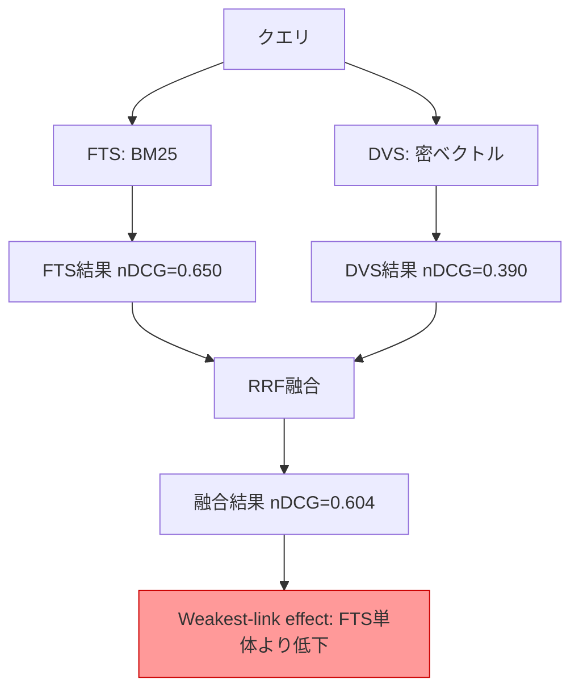

本記事は [https://arxiv.org/abs/2508.01405](https://arxiv.org/abs/2508.01405) の解説記事です。

## 論文概要（Abstract）

ハイブリッド検索は、キーワードベースの検索と意味ベースの検索を組み合わせることで検索精度を向上させるアプローチとして広く採用されている。しかし、どの検索パラダイムをどのように組み合わせるべきかの設計空間は十分に理解されていない。Wang et al. は、4つの検索パラダイム（全文検索、スパースベクトル検索、密ベクトル検索、テンソル検索）とその組み合わせ・リランキング戦略を11の実世界データセットで体系的に評価し、3つの主要な知見を報告している。

この記事は [Zenn記事: BM25×ベクトル検索ハイブリッドの本番パイプライン構築：スコア正規化・キャッシュ・品質モニタリング](https://zenn.dev/0h_n0/articles/fca0326faf7a05) の深掘りです。

## 情報源

- **arXiv ID**: 2508.01405
- **URL**: [https://arxiv.org/abs/2508.01405](https://arxiv.org/abs/2508.01405)
- **著者**: Mengzhao Wang, Boyu Tan, Yunjun Gao, Hai Jin, Yingfeng Zhang et al.（浙江大学、Infiniflow、杭州電子科技大学）
- **発表年**: 2025（VLDB 2026に投稿）
- **分野**: cs.DB（データベース）

## 背景と動機（Background & Motivation）

近年、RAG（Retrieval-Augmented Generation）パイプラインの普及に伴い、ハイブリッド検索への関心が高まっている。BM25のようなキーワードベースの手法と、密ベクトル検索のような意味ベースの手法を組み合わせることで、単一手法の弱点を補完できることが経験的に知られている。

しかし著者らは、既存のハイブリッド検索に関する研究には以下の問題があると指摘している：

- **設計空間の未整理**: 全文検索（BM25）、スパースベクトル（学習型スパース表現）、密ベクトル（HNSW等）、テンソル検索（ColBERT型）の4パラダイムをすべて含めた体系的な比較が存在しない
- **融合手法の評価不足**: RRF（Reciprocal Rank Fusion）と重み付き和の比較は行われてきたが、テンソルベースのリランキングとの比較は行われていない
- **リソースコストの無視**: 精度のみの評価が多く、レイテンシ・メモリ・インデキシングコストとのトレードオフが議論されていない

これらのギャップを埋めるため、著者らはオープンソースデータベースInfinityの開発経験を活かし、包括的な実験分析を行っている。

## 主要な貢献（Key Contributions）

- **貢献1**: 4つの検索パラダイムの15通りの組み合わせ（単体4 + 2パス6 + 3パス4 + 4パス1）を11データセットで評価し、**Weakest-link effect**（弱いパスが全体の精度を引き下げる現象）を体系的に確認した
- **貢献2**: 精度・レイテンシ・メモリ・インデキシングコストの4次元でトレードオフマップを構築し、**万能な構成は存在しない**ことをデータで示した
- **貢献3**: **Tensor-based Re-ranking Fusion（TRF）** を提案し、クロスエンコーダの100倍以上高速でありながら、多くのデータセットでRRFを上回る精度を達成することを報告した

## 技術的詳細（Technical Details）

### 4つの検索パラダイム

著者らが評価した4つのパラダイムは以下の通りである：

| パラダイム | 略称 | インデックス | 特徴 |
|-----------|------|------------|------|
| Full-Text Search | FTS | BM25 (Block-Max WAND) | キーワード完全一致に強い |
| Sparse Vector Search | SVS | 学習型スパース表現 (Block-Max Pruning) | BM25の拡張、語彙ミスマッチに対応 |
| Dense Vector Search | DVS | HNSW (M=16, ef=200) + LVQ | 意味的類似性に強い |
| Tensor Search | TenS | EMVB (8192 centroids) | トークン粒度のマッチング |

エンベディングモデルにはBGE-M3（密・スパース）、answerai-colbert-small-v1（英語テンソル、96次元）、Jina-ColBERT-v2（中国語テンソル、64次元）が使用されている。

### 融合手法

#### RRF（Reciprocal Rank Fusion）

RRFは各検索パスの順位のみを使い、スコアの絶対値を無視して統合する手法である。論文中では定数 $\kappa = 60$ が使用されている：

$$
\text{RRF}(d) = \sum_{r \in R} \frac{1}{\kappa + \text{rank}_r(d)}
$$

ここで、$R$ は各検索パスのランキング集合、$\text{rank}_r(d)$ はパス $r$ におけるドキュメント $d$ の順位、$\kappa$ は平滑化定数である。

RRFの利点は、スコアの正規化が不要で、ラベルデータなしに適用できることである。一方、順位のみを使うため、スコア差（1位と2位がどれだけ近いか）という情報を捨てるというトレードオフがある。

#### 重み付き和（Weighted Sum）

各パスの単体nDCG@10をそのまま重みとして使用する手法である。スコアベースの融合であるため、事前に何らかの正規化（MinMax、Z-score等）が必要となる。

#### TRF（Tensor-based Re-ranking Fusion）

著者らが提案するTRFは、融合された候補プールに対してMaxSim演算でリスコアリングを行う手法である：

$$
\text{MaxSim}(q, d) = \sum_{i=1}^{|q|} \max_{j=1}^{|d|} \text{sim}(q_i, d_j)
$$

ここで、$q_i$ はクエリの $i$ 番目のトークン埋め込み、$d_j$ はドキュメントの $j$ 番目のトークン埋め込み、$\text{sim}$ はコサイン類似度である。

TRFの設計上のポイントは以下の通りである：

- ドキュメントトークンの埋め込みは事前計算されるため、クエリ時にはMaxSim演算のみが必要
- クロスエンコーダと異なり、入力長の制限（例：512トークン）がなく、長文ドキュメントにも対応可能
- データベース内部でインデックスとして保持できるため、外部GPUパスが不要

```python
import numpy as np

def maxsim_score(
    query_embeddings: np.ndarray,
    doc_embeddings: np.ndarray,
) -> float:
    """MaxSimスコアを計算する

    Args:
        query_embeddings: クエリトークン埋め込み (num_query_tokens, dim)
        doc_embeddings: ドキュメントトークン埋め込み (num_doc_tokens, dim)

    Returns:
        MaxSimスコア（各クエリトークンの最大類似度の合計）
    """
    similarity_matrix = query_embeddings @ doc_embeddings.T
    max_sims = similarity_matrix.max(axis=1)
    return float(max_sims.sum())
```

### 実験設定

- **データセット**: BEIR系（DBPE, TOUC, FIQA, CQAD, SCID, SCIF）、MTEB多言語（MLDR(zh), MLDR(en)）、AIR-Bench（MCCN）等、11データセット
- **候補リストサイズ**: 各パス $k_0 = 10$
- **評価指標**: nDCG@10（主指標）、Recall@10、MRR@10
- **外部ベースライン**: gte-multilingual-reranker-base（GTE）、bge-reranker-v2-m3（BGE）
- **ハードウェア**: Xeon E5-2650 v4 × 2（48論理プロセッサ）、125GB RAM、RTX 5000 Ada × 2

## 実験結果（Results）

### 単体パスの性能

論文Table 2より、単体パスのnDCG@10を以下に示す：

| パス | MSMA | DBPE | MCCN | TOUC | MLDR(zh) | MLDR(en) |
|------|------|------|------|------|----------|----------|
| FTS  | .744 | .565 | .222 | **.650** | .411 | .634 |
| SVS  | .645 | .479 | .354 | .626 | .405 | .619 |
| DVS  | **.830** | **.692** | **.543** | .390 | .262 | .489 |

データセットによってパスごとの優劣が大きく異なることがわかる。TOUCではFTS（.650）がDVS（.390）を大きく上回る一方、DBPEではDVS（.692）がFTS（.565）を上回っている。

### Weakest-link effect

著者らが報告した最も重要な知見は**Weakest-link effect**である。弱いパスを追加すると、ハイブリッド検索の精度が最強の単体パスを下回る場合がある。

論文Table 2より、TOUCデータセットでの顕著な例：

| 構成 | 融合手法 | nDCG@10 |
|------|---------|---------|
| FTS単体 | — | .650 |
| DVS単体 | — | .390 |
| FTS + DVS | RRF | **.604** |
| FTS + DVS | TRF | .618 |

FTS + DVSをRRFで融合すると.604となり、FTS単体の.650から**7.1%低下**している。これは、DVSの低品質な候補がRRFにより高順位に押し上げられ、FTSの正しい候補を追い出すためである。

著者らはこの現象のメカニズムを以下のように説明している：

- **RRFの場合**: 弱いパスから来た無関係な文書でも高順位であればRRFスコアが高くなり、強いパスの関連文書を押し出す
- **TRFの場合**: ハードネガティブ（高いMaxSimスコアを持つ無関係文書）が存在すると、同様の問題が発生する



### TRFの性能

論文Table 2より、RRFとTRFの比較（FTS+DVS構成）：

| データセット | RRF | TRF | 改善率 |
|-------------|-----|-----|--------|
| MSMA | .816 | .894 | +9.6% |
| DBPE | .668 | .722 | +8.1% |
| MCCN | .440 | .624 | +41.8% |
| TOUC | .604 | .618 | +2.3% |

著者らは、TRFが多くのデータセットでRRFと重み付き和の双方を上回ると報告している。ただし、全データセットで一様に優れるわけではない。例えばCQADの3パス構成ではRRF（.486）がTRF（.465）を上回るケースも観測されている（論文Table 2より）。

### クロスエンコーダとの比較

論文の実験において、外部クロスエンコーダ（GTE、BGE）との比較が行われている：

- **CQADデータセット**: GTE・BGEはTRFと同程度の精度
- **MLDR(en)データセット**: GTE・BGEはRRFを下回る。著者らは、クロスエンコーダの入力長制限（512トークン）による長文文書の切り捨てが原因と分析している
- **レイテンシ**: 著者らはTRFがGTE・BGEの100倍以上高速であると報告している
- **メモリ**: MLDR(en)において、TRFはFTS+DVS+TenS構成と比較してピークメモリを86%削減

## 実装のポイント（Implementation）

著者らの実験設定から、ハイブリッド検索の実装時に注意すべきポイントをまとめる：

**パス選択の重要性**: 組み合わせる前に各パスの単体性能を評価し、弱いパスを含めないことが重要である。著者らは「FTS+SVS+DVSの3パス構成がバランスの取れたスイートスポット」と述べている。テンソル検索はメモリ・インデキシングコストが高いため、リソース制約がある場合は除外を検討すべきである。

**候補リストサイズ $k_0$ の選択**: 論文では $k_0 = 10$ がデフォルトとして使用されている。$k_0$ を増やすとレイテンシとメモリが線形に増加する一方、精度改善は逓減すると報告されている。

**クエリ長に応じた適応的パス選択**: 短いキーワードクエリではFTS（BM25）が強く、長い自然文クエリではDVS（密ベクトル）が強い傾向がある。著者らは、クエリ長をヒューリスティックとした適応的パス選択を提案している。

**RRFの $\kappa$ パラメータ**: 論文では $\kappa = 60$（Cormack et al., 2009の標準値）が使用されている。$\kappa$ が小さいほど上位順位の差が強調され、大きいほど順位間の差が平滑化される。

```python
from collections import defaultdict


def adaptive_hybrid_search(
    query: str,
    bm25_search_fn,
    vector_search_fn,
    k: int = 60,
    short_query_threshold: int = 5,
    top_k: int = 10,
) -> list[tuple[str, float]]:
    """クエリ長に応じた適応的ハイブリッド検索

    Args:
        query: 検索クエリ
        bm25_search_fn: BM25検索関数
        vector_search_fn: ベクトル検索関数
        k: RRFの平滑化定数
        short_query_threshold: 短いクエリの閾値（単語数）
        top_k: 返却する結果数

    Returns:
        (doc_id, score) のリスト
    """
    query_words = query.split()

    if len(query_words) <= short_query_threshold:
        bm25_weight = 0.7
    else:
        bm25_weight = 0.3

    bm25_results = bm25_search_fn(query, top_k=50)
    vector_results = vector_search_fn(query, top_k=50)

    scores: dict[str, float] = defaultdict(float)
    for rank, doc_id in enumerate(bm25_results, start=1):
        scores[doc_id] += bm25_weight * (1.0 / (k + rank))
    for rank, doc_id in enumerate(vector_results, start=1):
        scores[doc_id] += (1 - bm25_weight) * (1.0 / (k + rank))

    sorted_results = sorted(scores.items(), key=lambda x: x[1], reverse=True)
    return sorted_results[:top_k]
```

## Production Deployment Guide

### AWS実装パターン（コスト最適化重視）

ハイブリッド検索パイプラインをAWS上でデプロイする場合のトラフィック量別推奨構成を示す。以下のコスト試算は2026年11月時点のAWS ap-northeast-1（東京）リージョン料金に基づく概算値であり、実際のコストはトラフィックパターンやバースト使用量により変動する。最新料金は [AWS料金計算ツール](https://calculator.aws/) で確認されたい。

| 規模 | 月間リクエスト | 推奨構成 | 月額コスト | 主要サービス |
|------|--------------|---------|-----------|------------|
| **Small** | ~3,000 (100/日) | Serverless | $50-150 | Lambda + OpenSearch Serverless + DynamoDB |
| **Medium** | ~30,000 (1,000/日) | Hybrid | $400-900 | Lambda + OpenSearch Managed + ElastiCache |
| **Large** | 300,000+ (10,000/日) | Container | $2,500-6,000 | EKS + OpenSearch Managed + ElastiCache Cluster |

**Small構成の詳細**（月額$50-150）:
- **Lambda**: 1GB RAM, 30秒タイムアウト ($20/月)
- **OpenSearch Serverless**: 0.5 OCU（検索+インデキシング）($85/月)
- **DynamoDB**: On-Demand、キャッシュ用 ($10/月)
- **CloudWatch**: 基本監視 ($5/月)

**Medium構成の詳細**（月額$400-900）:
- **Lambda**: イベント処理 ($50/月)
- **OpenSearch Managed**: r6g.large.search × 2ノード ($350/月)
- **ElastiCache Redis**: cache.t3.micro ($15/月)
- **Application Load Balancer**: ($20/月)

**Large構成の詳細**（月額$2,500-6,000）:
- **EKS**: コントロールプレーン ($72/月)
- **EC2 Spot Instances**: r6g.xlarge × 2-4台 (平均$300/月)
- **OpenSearch Managed**: r6g.xlarge.search × 3ノード ($1,500/月)
- **ElastiCache Redis**: cache.r6g.large クラスタ ($400/月)

**コスト削減テクニック**:
- Spot Instances使用で最大90%削減（EKS + Karpenter）
- Reserved Instances購入で最大72%削減（1年コミット）
- OpenSearch Reserved Instances購入でコンピュート50%削減
- 完全一致キャッシュ導入でOpenSearchクエリ数削減

### Terraformインフラコード

**Small構成 (Serverless): Lambda + OpenSearch Serverless**

```hcl
module "vpc" {
  source  = "terraform-aws-modules/vpc/aws"
  version = "~> 5.0"

  name = "hybrid-search-vpc"
  cidr = "10.0.0.0/16"
  azs  = ["ap-northeast-1a", "ap-northeast-1c"]
  private_subnets = ["10.0.1.0/24", "10.0.2.0/24"]

  enable_nat_gateway   = false
  enable_dns_hostnames = true
}

resource "aws_iam_role" "lambda_search" {
  name = "lambda-hybrid-search-role"

  assume_role_policy = jsonencode({
    Version = "2012-10-17"
    Statement = [{
      Action = "sts:AssumeRole"
      Effect = "Allow"
      Principal = { Service = "lambda.amazonaws.com" }
    }]
  })
}

resource "aws_iam_role_policy" "opensearch_access" {
  role = aws_iam_role.lambda_search.id

  policy = jsonencode({
    Version = "2012-10-17"
    Statement = [{
      Effect   = "Allow"
      Action   = ["aoss:APIAccessAll"]
      Resource = "arn:aws:aoss:ap-northeast-1:*:collection/*"
    }]
  })
}

resource "aws_lambda_function" "hybrid_search" {
  filename      = "lambda.zip"
  function_name = "hybrid-search-handler"
  role          = aws_iam_role.lambda_search.arn
  handler       = "index.handler"
  runtime       = "python3.12"
  timeout       = 30
  memory_size   = 1024

  environment {
    variables = {
      OPENSEARCH_ENDPOINT = "https://your-collection.aoss.amazonaws.com"
      CACHE_TABLE         = aws_dynamodb_table.search_cache.name
    }
  }
}

resource "aws_dynamodb_table" "search_cache" {
  name         = "hybrid-search-cache"
  billing_mode = "PAY_PER_REQUEST"
  hash_key     = "query_hash"

  attribute {
    name = "query_hash"
    type = "S"
  }

  ttl {
    attribute_name = "expire_at"
    enabled        = true
  }
}

resource "aws_cloudwatch_metric_alarm" "search_latency" {
  alarm_name          = "hybrid-search-latency-spike"
  comparison_operator = "GreaterThanThreshold"
  evaluation_periods  = 2
  metric_name         = "Duration"
  namespace           = "AWS/Lambda"
  period              = 300
  statistic           = "p99"
  threshold           = 10000
  alarm_description   = "検索レイテンシP99が10秒超過"

  dimensions = {
    FunctionName = aws_lambda_function.hybrid_search.function_name
  }
}
```

**Large構成 (Container): EKS + OpenSearch Managed**

```hcl
module "eks" {
  source  = "terraform-aws-modules/eks/aws"
  version = "~> 20.0"

  cluster_name    = "hybrid-search-cluster"
  cluster_version = "1.31"

  vpc_id     = module.vpc.vpc_id
  subnet_ids = module.vpc.private_subnets

  cluster_endpoint_public_access = true
  enable_cluster_creator_admin_permissions = true
}

resource "kubectl_manifest" "karpenter_provisioner" {
  yaml_body = <<-YAML
    apiVersion: karpenter.sh/v1
    kind: NodePool
    metadata:
      name: search-nodes
    spec:
      template:
        spec:
          requirements:
            - key: karpenter.sh/capacity-type
              operator: In
              values: ["spot"]
            - key: node.kubernetes.io/instance-type
              operator: In
              values: ["r6g.xlarge", "r6g.2xlarge"]
          limits:
            cpu: "32"
            memory: "128Gi"
      disruption:
        consolidationPolicy: WhenEmptyOrUnderutilized
        consolidateAfter: 30s
  YAML
}

resource "aws_budgets_budget" "search_monthly" {
  name         = "hybrid-search-monthly-budget"
  budget_type  = "COST"
  limit_amount = "6000"
  limit_unit   = "USD"
  time_unit    = "MONTHLY"

  notification {
    comparison_operator        = "GREATER_THAN"
    threshold                  = 80
    threshold_type             = "PERCENTAGE"
    notification_type          = "ACTUAL"
    subscriber_email_addresses = ["ops@example.com"]
  }
}
```

### セキュリティベストプラクティス

**本番環境での推奨設定**:

1. **ネットワークセキュリティ**: EKSは `cluster_endpoint_public_access = false`（VPN経由アクセス）、OpenSearchはVPC内エンドポイント使用
2. **認証・認可**: IAMロール最小権限、OpenSearch Fine-Grained Access Control有効化
3. **シークレット管理**: AWS Secrets Manager使用、環境変数へのハードコード禁止
4. **データ保護**: 転送中TLS 1.2以上、保管中KMS暗号化（OpenSearch、DynamoDB、EBS）
5. **監査**: CloudTrail全リージョン有効化、OpenSearch Audit Logs有効化

### 運用・監視設定

**CloudWatch Logs Insights クエリ**:

```sql
-- ハイブリッド検索のレイテンシ分析: パス別の内訳
fields @timestamp, bm25_latency_ms, vector_latency_ms, fusion_latency_ms, total_latency_ms
| stats avg(bm25_latency_ms) as avg_bm25,
        avg(vector_latency_ms) as avg_vector,
        avg(fusion_latency_ms) as avg_fusion,
        pct(total_latency_ms, 95) as p95_total,
        pct(total_latency_ms, 99) as p99_total
  by bin(5m)

-- Weakest-link effect検知: パス間のスコア乖離
fields @timestamp, bm25_top1_score, vector_top1_score
| stats avg(abs(bm25_top1_score - vector_top1_score)) as avg_score_gap by bin(1h)
| filter avg_score_gap > 0.3
```

**CloudWatch アラーム（Python）**:

```python
import boto3

cloudwatch = boto3.client('cloudwatch')

cloudwatch.put_metric_alarm(
    AlarmName='hybrid-search-p99-latency',
    ComparisonOperator='GreaterThanThreshold',
    EvaluationPeriods=2,
    MetricName='Duration',
    Namespace='AWS/Lambda',
    Period=300,
    ExtendedStatistic='p99',
    Threshold=5000,
    ActionsEnabled=True,
    AlarmActions=['arn:aws:sns:ap-northeast-1:123456789:search-alerts'],
    AlarmDescription='ハイブリッド検索P99レイテンシが5秒超過'
)

cloudwatch.put_metric_alarm(
    AlarmName='opensearch-search-latency',
    ComparisonOperator='GreaterThanThreshold',
    EvaluationPeriods=2,
    MetricName='SearchLatency',
    Namespace='AWS/ES',
    Period=300,
    Statistic='p99',
    Threshold=1000,
    AlarmDescription='OpenSearch検索レイテンシP99が1秒超過'
)
```

**X-Ray トレーシング設定**:

```python
from aws_xray_sdk.core import xray_recorder, patch_all

patch_all()

@xray_recorder.capture('hybrid_search')
def hybrid_search(query: str) -> list[dict]:
    xray_recorder.put_annotation('query_length', len(query.split()))

    with xray_recorder.in_subsegment('bm25_search'):
        bm25_results = bm25_search(query)
        xray_recorder.put_metadata('bm25_count', len(bm25_results))

    with xray_recorder.in_subsegment('vector_search'):
        vector_results = vector_search(query)
        xray_recorder.put_metadata('vector_count', len(vector_results))

    with xray_recorder.in_subsegment('rrf_fusion'):
        fused = rrf_fusion(bm25_results, vector_results)

    return fused
```

### コスト最適化チェックリスト

**アーキテクチャ選択（トラフィック量で判断）**:
- [ ] ~100 req/日 → Lambda + OpenSearch Serverless - $50-150/月
- [ ] ~1,000 req/日 → Lambda + OpenSearch Managed - $400-900/月
- [ ] 10,000+ req/日 → EKS + OpenSearch Managed Cluster - $2,500-6,000/月

**リソース最適化**:
- [ ] EC2: Spot Instances優先（最大90%削減、Karpenter自動管理）
- [ ] Reserved Instances: 1年コミットで最大72%削減（予測可能な負荷）
- [ ] OpenSearch: Reserved Instances購入で50%削減
- [ ] Lambda: メモリサイズ最適化（Power Tuning）
- [ ] EKS: アイドルタイムのスケールダウン（夜間0台）

**検索コスト削減**:
- [ ] 完全一致キャッシュ: クエリハッシュでDynamoDB/Redis参照（TTL 5-15分）
- [ ] Weakest-link回避: 弱いパスを含めない（論文の知見を適用）
- [ ] 候補リストサイズ最適化: $k_0$ を必要最小限に設定
- [ ] クエリ長ベースのパス選択: 短いクエリではBM25のみ使用

**監視・アラート（品質劣化の即時検知）**:
- [ ] AWS Budgets: 月額予算設定（80%で警告、100%でアラート）
- [ ] CloudWatch: パス別レイテンシ監視（P95, P99）
- [ ] ゴールデンクエリセット: 定期実行でnDCG回帰を検知
- [ ] Cost Anomaly Detection: 自動異常検知

**リソース管理**:
- [ ] 未使用インデックス削除: OpenSearch ISMポリシー
- [ ] タグ戦略: 環境別（dev/staging/prod）でコスト可視化
- [ ] ライフサイクルポリシー: 古いキャッシュエントリ自動削除
- [ ] 開発環境: OpenSearch夜間停止

## 実運用への応用（Practical Applications）

本論文の知見をZenn記事で解説されているハイブリッド検索パイプラインに適用する場合、以下の点が実務上重要である。

**パス選択戦略**: 本論文が示すWeakest-link effectは、ハイブリッド検索に「とりあえず全パスを入れれば精度が上がる」というnaiveな期待が誤りであることを意味する。本番環境では、まず各パスの単体nDCG@10を評価し、弱いパスを除外する事前評価フェーズを設けることが推奨される。

**TRFの適用**: ColBERTスタイルのマルチベクトル表現が利用可能な環境では、RRFの代替としてTRFを検討する価値がある。ただし、TRFにはテンソルインデックスの追加メモリコストが伴う。著者らが報告する86%のメモリ削減は、4パス構成（FTS+DVS+TenS）の代わりにFTS+DVSの候補をTRFでリランクする場合の比較である点に注意が必要である。

**クエリ適応**: 短いキーワードクエリではBM25が強く、長い自然文クエリではDVSが強いという傾向は、クエリルーターの設計に直接活用できる。

## 関連研究（Related Work）

- **Cormack et al. (SIGIR 2009)**: RRFを提案した原論文。$\kappa = 60$ が標準パラメータとして広く使用されている。本論文の実験でもこの値が採用されている
- **BGE-M3 (Chen et al., 2024)**: 密・スパース・ColBERTの3種類の埋め込みを1モデルで生成するエンコーダ。本論文の主要な埋め込みモデルとして使用されている
- **BEIR Benchmark (Thakur et al., NeurIPS 2021)**: ゼロショット情報検索の標準ベンチマーク。本論文の11データセットの多くがBEIRに由来する

## まとめと今後の展望

Wang et al. は、ハイブリッド検索の設計空間を4パラダイム × 15組み合わせ × 3融合手法で体系的に評価し、以下を明らかにした：

- **Weakest-link effect**: 弱いパスの追加は精度を低下させうる。パスの事前評価が不可欠
- **万能構成は存在しない**: 最適な構成はデータセットとリソース制約に依存する
- **TRFの有効性**: テンソルベースのリランキングはRRFを多くのケースで上回り、クロスエンコーダより大幅に高速

ただし、本論文にはいくつかの制約がある。エンベディングモデルがBGE-M3に限定されていること、$k_0 = 10$ という比較的小さな候補リストでの評価であること、また適応的パス選択は提案のみで実験的検証がないことが挙げられる。

今後の研究方向として、著者らはクエリ認識型の適応的パス選択や、テンソル圧縮（スカラー・バイナリ量子化）によるTRFの効率改善を提案している。

## 参考文献

- **arXiv**: [https://arxiv.org/abs/2508.01405](https://arxiv.org/abs/2508.01405)
- **Code**: [https://github.com/whenever5225/infinity](https://github.com/whenever5225/infinity)（Infinity OSSデータベース）
- **Related Zenn article**: [https://zenn.dev/0h_n0/articles/fca0326faf7a05](https://zenn.dev/0h_n0/articles/fca0326faf7a05)

---

:::message
この記事はAI（Claude Code）により自動生成されました。内容の正確性については原論文と照合して検証していますが、論文のTable配置がHTML版で崩れている箇所があるため、正確な数値は原論文PDFでご確認ください。
:::
