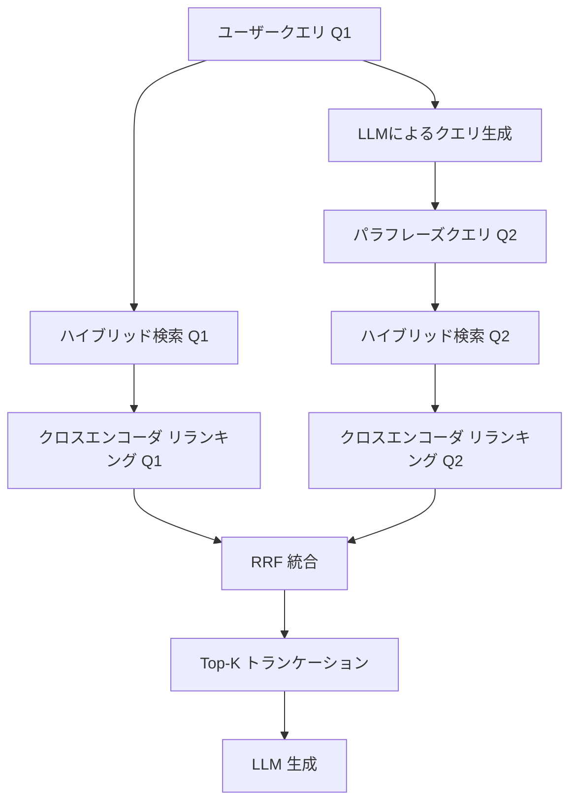

本記事は [https://arxiv.org/abs/2603.02153](https://arxiv.org/abs/2603.02153) の解説記事です。

## 論文概要（Abstract）

RAG（Retrieval-Augmented Generation）システムでは、マルチクエリ検索とReciprocal Rank Fusion（RRF）を組み合わせて検索のリコールを向上させるアプローチが広く採用されている。著者らは、この「リコール向上がそのまま回答品質の向上につながる」という暗黙の前提を、エンタープライズ環境の知識ベース（KB）を対象にした実験で検証している。結論として、Fusionは上流のraw recallを改善するものの、リランキングとコンテキストのトランケーションを経たend-to-endの結果では改善が見られなかったと報告している。

この記事は [Zenn記事: BM25×ベクトル検索ハイブリッドの本番パイプライン構築：スコア正規化・キャッシュ・品質モニタリング](https://zenn.dev/0h_n0/articles/fca0326faf7a05) の深掘りです。

## 情報源

- **arXiv ID**: 2603.02153
- **URL**: [https://arxiv.org/abs/2603.02153](https://arxiv.org/abs/2603.02153)
- **著者**: Luigi Medrano, Arush Verma, Mukul Chhabra（Dell Technologies, Austin, TX）
- **発表年**: 2026
- **分野**: cs.IR, cs.AI, cs.CL

## 背景と動機（Background & Motivation）

RAGシステムでは、ユーザーの短いクエリや語彙的に曖昧なクエリに対して検索精度が低下する問題がある。この問題に対処するため、RAG-Fusionと呼ばれるアプローチが提案されている。RAG-Fusionでは、元のクエリからLLMで複数の検索クエリを生成し、各クエリの検索結果をRRFで統合することでリコールの向上を図る。

しかし著者らは、この手法が本番環境で直面する制約——固定されたリランキング容量、コンテキストウィンドウの制限、メタデータフィルタリング——を考慮した場合に、実際にend-to-endの精度向上につながるのかという疑問を提起している。初期のRAG導入において、検索（retrieval）が生成（generation）ではなくボトルネックであることを確認した上で、Fusionによるリコール改善が最終的な回答品質に寄与するかを体系的に検証している。

## 主要な貢献（Key Contributions）

- **貢献1**: Fusionがraw recallを改善しても、リランキングとトランケーション後のKBレベルTop-k精度では改善されないことを実証
- **貢献2**: 3つの仮説（H1-H3）を立て、McNemar検定による統計的検証でFusionの効果が有意でないことを確認
- **貢献3**: リランカー飽和、コンテキスト冗長性、矛盾するエビデンスといった、Fusionの具体的な失敗モードを特定

## 技術的詳細（Technical Details）

### 実験パイプラインの構成

著者らが評価したパイプラインは以下の構成である。



**ベースライン**はハイブリッド検索（BM25＋密ベクトル検索）の後にFlashRankによるクロスエンコーダリランキングを行い、重複除去とTop-K（K=10）トランケーションで最終コンテキストを構成する構成である。

**Fusion構成**では、元のクエリ（Q1）に加えて、LLM（LLaMAベース）で生成したパラフレーズクエリ（Q2）を用いて2つの検索結果リストを取得し、それぞれリランキングした後にRRFで統合する。

### Reciprocal Rank Fusion（RRF）

RRFの数式は以下の通りである。

$$
\text{RRF}(d) = \sum_{q \in \{Q_1, Q_2\}} \frac{1}{k + r_q(d)}
$$

ここで、
- $d$: ドキュメント（チャンク）
- $r_q(d)$: クエリ $q$ の検索結果における $d$ の順位
- $k$: スムージング定数（論文中では具体的な値は明記されていない）

### 評価指標: Hit@K

評価にはKBレベルのHit@Kを使用している。

$$
\text{Hit@K}(q) = \begin{cases} 1 & \text{if } \exists \, c \in \text{Top-K}(q) \text{ s.t. } c \in \text{GT}(q) \\ 0 & \text{otherwise} \end{cases}
$$

ここで、
- $\text{Top-K}(q)$: クエリ $q$ の最終的な上位K件のチャンク
- $\text{GT}(q)$: クエリ $q$ の正解KBアーティクルに属するチャンク集合

あるクエリについて、最終Top-Kに正解KBアーティクルのチャンクが1つでも含まれていれば「ヒット」とみなす。

### 3つの仮説

著者らは以下の仮説を立てて検証している。

- **H1**: Fusionは強力なハイブリッドベースラインに対して、Top-k精度で統計的に有意な改善をもたらさない
- **H2**: Fusionによるリコール向上は、リランキングとトランケーションによって大部分が中和される
- **H3**: Fusionの効果はリコールが不足しているクエリに限定され、システム全体の性能には影響しない

## 実験設定

- **データセット**: RAGASで生成した115件のエンタープライズ風サポートクエリ。各クエリに1つの正解KBアーティクルが紐付けられている
- **チャンキング**: 固定512トークン
- **エンベディング**: Graniteエンベディングモデル
- **リランカー**: FlashRank（クロスエンコーダ）
- **検索深度**: K=10
- **Q2プロンプト**: 3種類（P1: 保守的な言い換え、P2: 多様性最大化、P3: 1つのリライトを明示的に要求）

## 実験結果（Results）

### 主要結果: Fusionはend-to-end精度を改善しない

論文Table 1-3より、各プロンプトとFusion手法の結果を以下に示す。

| プロンプト | 手法 | Top-1 | Top-3 | Hit@10 |
|-----------|------|-------|-------|--------|
| P1 | ベースライン | 30.43% | 37.39% | 51.30% |
| P1 | rerank_on_rrf_q1 | 29.57% | 38.26% | 47.83% |
| P1 | rerank_on_rrf_q2 | 15.65% | 23.48% | 47.83% |
| P1 | rrf_q1_q2 | 25.22% | 38.26% | 47.83% |
| P2 | ベースライン | 29.57% | 36.52% | 50.43% |
| P2 | rerank_on_rrf_q1 | 29.57% | 39.13% | 46.09% |
| P2 | rerank_on_rrf_q2 | 7.83% | 17.39% | 46.09% |
| P2 | rrf_q1_q2 | 27.83% | 40.87% | 46.09% |
| P3 | ベースライン | 29.57% | 36.52% | 50.43% |
| P3 | rerank_on_rrf_q1 | 29.57% | 40.00% | 44.35% |
| P3 | rerank_on_rrf_q2 | 10.43% | 19.13% | 44.35% |
| P3 | rrf_q1_q2 | 27.83% | 40.87% | 44.35% |

著者らが報告している主な知見は以下の通りである。

**Hit@10は全てのFusion構成で低下している**。ベースラインの50-51%に対し、Fusion後は44-48%に低下する。これはFusionが検索候補を増やすことで、リランカーの選択精度を下げていることを示唆している。

**Q2アンカーのリランキングは著しく悪化する**。`rerank_on_rrf_q2`のTop-1は7.83-15.65%と、ベースラインの約30%から大きく低下している。著者らは、Q2の表現に過適合することで、Q1由来の強い候補が降格されると分析している。

**Top-3ではわずかな改善が見られる場合がある**。P2とP3の`rrf_q1_q2`でTop-3が+2.61〜+4.35ポイント改善しているが、後述の統計検定で有意差は確認されていない。

### 統計的検証

著者らはMcNemar正確検定を用いてペアごとのヒット/ミスの比較を行い、Benjamini–Hochberg補正（FDR = 0.05）を適用している。その結果、**すべての比較において調整後p値は0.125以上**であり、統計的に有意な差は認められなかったと報告している。

### Q1-Q2の候補重複分析

論文Table 5より、Top-10での候補重複の状況を以下に示す。

| プロンプト | Overlap@10 | Jaccard@10 | Union@10 | Unique@10 |
|-----------|-----------|-----------|---------|----------|
| P1 | 2.87 | 0.279 | 13.20 | 7.82 |
| P2 | 1.09 | 0.087 | 15.29 | 7.77 |
| P3 | 1.10 | 0.094 | 14.99 | 7.77 |

Q2は大部分が異なる候補を返すが、著者らはその多くが近傍のKBセクションからの準重複であるか、部分的に矛盾する情報を含むと報告している。

### レイテンシ分析

論文Table 6より、各コンポーネントの処理時間を以下に示す。

| コンポーネント | 平均時間 |
|-------------|---------|
| Fusion質問生成 | 0.89s |
| ベースライン検索（Q1） | 54.60（単位不明） |
| 検索（Q1 + Q2合計） | 65.98（単位不明） |
| RRF統合 | 0.012（単位不明） |
| FlashRank（K=10） | 0.26（単位不明） |

著者らは「Fusionプロセス全体で0.89sの追加オーバーヘッド」と記述している。なお、ベースライン検索の54.60という値は秒単位としては大きく、単位がミリ秒である可能性がある点に注意が必要である。

## 実装のポイント（Implementation）

著者らの実験設定から得られる実装上の示唆をまとめる。

**リランキング戦略の選択が精度を左右する**: Fusion後にどのクエリをアンカーとしてリランキングするかが、最終精度に大きく影響する。Q2アンカーはQ1由来の強い候補を降格させるリスクがあるため、常にQ1（元のクエリ）をアンカーとすべきである。

**リランカーの容量制約を考慮する**: 固定K=10のような制約下では、候補プールの拡大がリランカーを「飽和」させる。リランキング予算が限られている場合、候補を増やすことは逆効果になり得る。

**評価はend-to-endで行う**: 上流のrecall改善だけで判断するのではなく、リランキング・トランケーション・生成を含めた最終結果で評価すべきである。

```python
from dataclasses import dataclass


@dataclass
class FusionEvaluationResult:
    """Fusion評価結果を保持するデータクラス"""
    query_id: str
    baseline_hit: bool
    fusion_hit: bool
    baseline_top_k: list[str]
    fusion_top_k: list[str]
    q2_overlap_count: int


def evaluate_fusion_impact(
    baseline_results: list[FusionEvaluationResult],
) -> dict[str, float]:
    """ベースラインとFusionのHit@K比較を計算する

    Args:
        baseline_results: クエリごとの評価結果リスト

    Returns:
        Hit@K率の比較辞書
    """
    n = len(baseline_results)
    baseline_hits = sum(1 for r in baseline_results if r.baseline_hit)
    fusion_hits = sum(1 for r in baseline_results if r.fusion_hit)

    improved = sum(
        1 for r in baseline_results
        if r.fusion_hit and not r.baseline_hit
    )
    degraded = sum(
        1 for r in baseline_results
        if r.baseline_hit and not r.fusion_hit
    )

    return {
        "baseline_hit_rate": baseline_hits / n,
        "fusion_hit_rate": fusion_hits / n,
        "improved_queries": improved,
        "degraded_queries": degraded,
        "net_change": (fusion_hits - baseline_hits) / n,
    }
```

## Production Deployment Guide

### AWS実装パターン（コスト最適化重視）

本論文の知見を踏まえたRAG検索パイプラインのAWS構成を示す。著者らの結論に基づき、**Fusionなしのシンプルなハイブリッド検索＋リランキング構成**を推奨構成として記載する。

**トラフィック量別の推奨構成**:

| 規模 | 月間リクエスト | 推奨構成 | 月額コスト | 主要サービス |
|------|-------------|---------|-----------|------------|
| **Small** | ~3,000 (100/日) | Serverless | $50-150 | Lambda + Bedrock + OpenSearch Serverless |
| **Medium** | ~30,000 (1,000/日) | Hybrid | $400-900 | Lambda + ECS Fargate + OpenSearch |
| **Large** | 300,000+ (10,000/日) | Container | $2,500-6,000 | EKS + OpenSearch + ElastiCache |

**Small構成の詳細**（月額$50-150）:
- **Lambda**: 1GB RAM, 60秒タイムアウト ($25/月)
- **Bedrock**: Claude 3.5 Haiku, Prompt Caching有効 ($80/月)
- **OpenSearch Serverless**: 0.5 OCU ($20/月, インデックスのみ)
- **CloudWatch**: 基本監視 ($5/月)

**Medium構成の詳細**（月額$400-900）:
- **Lambda**: イベント処理 ($50/月)
- **ECS Fargate**: FlashRank リランカー 0.5vCPU×1GB×2タスク ($120/月)
- **OpenSearch**: t3.small.search×2ノード ($140/月)
- **Bedrock**: Claude 3.5 Sonnet ($400/月)
- **ElastiCache Redis**: cache.t3.micro ($15/月)

**Large構成の詳細**（月額$2,500-6,000）:
- **EKS**: コントロールプレーン ($72/月)
- **EC2 Spot**: g5.xlarge×2-4台 ($800/月, Spot割引適用)
- **OpenSearch**: r6g.large×3ノード ($600/月)
- **Bedrock Batch**: 50%割引活用 ($2,000/月)
- **ElastiCache**: r6g.large ($200/月)

**コスト削減テクニック**:
- Spot Instances: Karpenter管理で最大90%削減
- Reserved Instances: 1年コミットで最大72%削減
- Bedrock Batch API: 非リアルタイム処理で50%割引
- Prompt Caching: システムプロンプト固定で30-90%削減

**コスト試算の注意事項**:
- 上記は2026年11月時点のAWS ap-northeast-1（東京）リージョン料金に基づく概算値です
- 実際のコストはトラフィックパターン、リージョン、バースト使用量により変動します
- 最新料金は [AWS料金計算ツール](https://calculator.aws/) で確認してください

### Terraformインフラコード

**Small構成（Serverless）: Lambda + Bedrock + OpenSearch Serverless**

```hcl
# --- VPC基盤 ---
module "vpc" {
  source  = "terraform-aws-modules/vpc/aws"
  version = "~> 5.0"

  name = "rag-search-vpc"
  cidr = "10.0.0.0/16"
  azs  = ["ap-northeast-1a", "ap-northeast-1c"]
  private_subnets = ["10.0.1.0/24", "10.0.2.0/24"]

  enable_nat_gateway   = false
  enable_dns_hostnames = true
}

# --- IAMロール（最小権限） ---
resource "aws_iam_role" "lambda_rag" {
  name = "rag-search-lambda-role"

  assume_role_policy = jsonencode({
    Version = "2012-10-17"
    Statement = [{
      Action    = "sts:AssumeRole"
      Effect    = "Allow"
      Principal = { Service = "lambda.amazonaws.com" }
    }]
  })
}

resource "aws_iam_role_policy" "bedrock_invoke" {
  role = aws_iam_role.lambda_rag.id

  policy = jsonencode({
    Version = "2012-10-17"
    Statement = [{
      Effect   = "Allow"
      Action   = ["bedrock:InvokeModel", "bedrock:InvokeModelWithResponseStream"]
      Resource = "arn:aws:bedrock:ap-northeast-1::foundation-model/anthropic.claude-3-5-haiku*"
    }]
  })
}

# --- Lambda関数 ---
resource "aws_lambda_function" "rag_handler" {
  filename      = "lambda.zip"
  function_name = "rag-hybrid-search-handler"
  role          = aws_iam_role.lambda_rag.arn
  handler       = "index.handler"
  runtime       = "python3.12"
  timeout       = 60
  memory_size   = 1024

  environment {
    variables = {
      BEDROCK_MODEL_ID     = "anthropic.claude-3-5-haiku-20241022-v1:0"
      OPENSEARCH_ENDPOINT  = "https://your-collection.aoss.amazonaws.com"
      RERANKER_TYPE        = "flashrank"
      RETRIEVAL_TOP_K      = "10"
      ENABLE_FUSION        = "false"
    }
  }
}

# --- CloudWatch アラーム（コスト監視） ---
resource "aws_cloudwatch_metric_alarm" "lambda_cost" {
  alarm_name          = "rag-lambda-cost-spike"
  comparison_operator = "GreaterThanThreshold"
  evaluation_periods  = 1
  metric_name         = "Duration"
  namespace           = "AWS/Lambda"
  period              = 3600
  statistic           = "Sum"
  threshold           = 100000
  alarm_description   = "Lambda実行時間異常（コスト急増の可能性）"

  dimensions = {
    FunctionName = aws_lambda_function.rag_handler.function_name
  }
}
```

**Large構成（Container）: EKS + OpenSearch + ElastiCache**

```hcl
# --- EKSクラスタ ---
module "eks" {
  source  = "terraform-aws-modules/eks/aws"
  version = "~> 20.0"

  cluster_name    = "rag-search-cluster"
  cluster_version = "1.31"

  vpc_id     = module.vpc.vpc_id
  subnet_ids = module.vpc.private_subnets

  cluster_endpoint_public_access = true
  enable_cluster_creator_admin_permissions = true
}

# --- Karpenter（Spot優先スケーリング） ---
resource "kubectl_manifest" "karpenter_provisioner" {
  yaml_body = <<-YAML
    apiVersion: karpenter.sh/v1
    kind: NodePool
    metadata:
      name: rag-spot-pool
    spec:
      template:
        spec:
          requirements:
            - key: karpenter.sh/capacity-type
              operator: In
              values: ["spot"]
            - key: node.kubernetes.io/instance-type
              operator: In
              values: ["m6i.xlarge", "m6i.2xlarge", "r6i.xlarge"]
          limits:
            cpu: "32"
            memory: "128Gi"
      disruption:
        consolidationPolicy: WhenEmptyOrUnderutilized
        consolidateAfter: 30s
  YAML
}

# --- OpenSearch Managed ---
resource "aws_opensearch_domain" "rag_search" {
  domain_name    = "rag-hybrid-search"
  engine_version = "OpenSearch_2.17"

  cluster_config {
    instance_type  = "r6g.large.search"
    instance_count = 3
  }

  ebs_options {
    ebs_enabled = true
    volume_size = 100
    volume_type = "gp3"
  }

  encrypt_at_rest { enabled = true }
  node_to_node_encryption { enabled = true }
}

# --- AWS Budgets ---
resource "aws_budgets_budget" "rag_monthly" {
  name         = "rag-monthly-budget"
  budget_type  = "COST"
  limit_amount = "6000"
  limit_unit   = "USD"
  time_unit    = "MONTHLY"

  notification {
    comparison_operator        = "GREATER_THAN"
    threshold                  = 80
    threshold_type             = "PERCENTAGE"
    notification_type          = "ACTUAL"
    subscriber_email_addresses = ["ops@example.com"]
  }
}
```

### セキュリティベストプラクティス

1. **ネットワーク**: EKSのエンドポイントは本番ではprivateに設定し、VPN/Direct Connect経由でアクセス
2. **認証・認可**: IAMロール最小権限、IRSA（IAM Roles for Service Accounts）使用
3. **シークレット管理**: AWS Secrets Manager使用、環境変数ハードコード禁止
4. **データ保護**: TLS 1.2以上、S3/OpenSearch/EBS全てKMS暗号化
5. **監査**: CloudTrail全リージョン有効化、Config有効化

### 運用・監視設定

**CloudWatch Logs Insights クエリ**:

```sql
-- 検索品質モニタリング: Hit@10率の推移
fields @timestamp, query_id, hit_at_10
| stats avg(hit_at_10) as hit_rate by bin(1h)
| filter hit_rate < 0.5

-- リランカーレイテンシ分析: P95, P99
fields @timestamp, reranker_duration_ms
| stats pct(reranker_duration_ms, 95) as p95,
        pct(reranker_duration_ms, 99) as p99
  by bin(5m)
```

**CloudWatch アラーム（検索品質）**:

```python
import boto3

cloudwatch = boto3.client('cloudwatch')

cloudwatch.put_metric_alarm(
    AlarmName='rag-hit-rate-drop',
    ComparisonOperator='LessThanThreshold',
    EvaluationPeriods=3,
    MetricName='HitAtK',
    Namespace='RAG/Search',
    Period=3600,
    Statistic='Average',
    Threshold=0.45,
    ActionsEnabled=True,
    AlarmActions=['arn:aws:sns:ap-northeast-1:123456789:search-alerts'],
    AlarmDescription='Hit@10が45%を下回った場合のアラート'
)

cloudwatch.put_metric_alarm(
    AlarmName='rag-reranker-latency',
    ComparisonOperator='GreaterThanThreshold',
    EvaluationPeriods=2,
    MetricName='RerankerDuration',
    Namespace='RAG/Search',
    Period=300,
    Statistic='p99',
    Threshold=500,
    AlarmDescription='リランカーP99レイテンシが500msを超過'
)
```

**X-Ray トレーシング設定**:

```python
from aws_xray_sdk.core import xray_recorder, patch_all

patch_all()

@xray_recorder.capture('hybrid_search')
def hybrid_search(query: str, top_k: int = 10) -> list[dict]:
    xray_recorder.put_annotation('retrieval_method', 'hybrid_bm25_dense')
    xray_recorder.put_annotation('top_k', top_k)
    xray_recorder.put_annotation('fusion_enabled', False)

    results = execute_search(query, top_k)

    xray_recorder.put_metadata('result_count', len(results))
    xray_recorder.put_metadata('hit_at_k', check_hit(results))
    return results
```

**Cost Explorer自動レポート**:

```python
import boto3
from datetime import datetime, timedelta

ce = boto3.client('ce')

response = ce.get_cost_and_usage(
    TimePeriod={
        'Start': (datetime.now() - timedelta(days=1)).strftime('%Y-%m-%d'),
        'End': datetime.now().strftime('%Y-%m-%d')
    },
    Granularity='DAILY',
    Metrics=['UnblendedCost'],
    GroupBy=[
        {'Type': 'SERVICE', 'Key': 'SERVICE'},
    ]
)

for result in response['ResultsByTime']:
    for group in result['Groups']:
        service = group['Keys'][0]
        cost = float(group['Metrics']['UnblendedCost']['Amount'])
        if cost > 100:
            print(f"⚠️ {service}: ${cost:.2f}/日")
```

### コスト最適化チェックリスト

**アーキテクチャ選択（トラフィック量で判断）**:
- [ ] ~100 req/日 → Lambda + OpenSearch Serverless（$50-150/月）
- [ ] ~1000 req/日 → ECS Fargate + OpenSearch（$400-900/月）
- [ ] 10000+ req/日 → EKS + OpenSearch + ElastiCache（$2,500-6,000/月）

**リソース最適化**:
- [ ] EC2: Spot Instances優先（最大90%削減、Karpenter自動管理）
- [ ] Reserved Instances: 1年コミットで72%削減（予測可能な負荷）
- [ ] Savings Plans: Compute Savings Plans検討
- [ ] Lambda: メモリサイズ最適化（CloudWatch Insights分析）
- [ ] ECS/EKS: アイドルタイムのスケールダウン（夜間0台）

**検索コスト削減（本論文の知見に基づく）**:
- [ ] Fusionの不使用: マルチクエリ生成のLLMコスト・レイテンシを削減
- [ ] リランカー予算の最適化: K=10を超える候補は精度向上に寄与しにくい
- [ ] クエリキャッシュ: 完全一致キャッシュで繰り返しクエリのコストを削減
- [ ] Bedrock Batch API: 非リアルタイム処理で50%割引

**監視・アラート**:
- [ ] AWS Budgets: 月額予算設定（80%で警告、100%でアラート）
- [ ] CloudWatch: Hit@K率の監視（45%以下でアラート）
- [ ] Cost Anomaly Detection: 自動異常検知
- [ ] 日次コストレポート: SNS/Slackへ自動送信

**リソース管理**:
- [ ] 未使用リソース削除: Trusted Advisor活用
- [ ] タグ戦略: 環境別（dev/staging/prod）でコスト可視化
- [ ] ライフサイクルポリシー: OpenSearchインデックスの自動ローテーション
- [ ] 開発環境: 夜間停止（Auto Start/Stop）

## 実運用への応用（Practical Applications）

本論文の知見は、Zenn記事で解説されているハイブリッド検索パイプラインの設計に直接的な示唆を与える。

**Fusionの導入判断**: 著者らの結果は、強力なハイブリッド検索（BM25＋密ベクトル検索）とクロスエンコーダリランキングの組み合わせが十分に機能している環境では、RAG-Fusionの追加が必ずしも改善につながらないことを示している。特に、リランキング予算が限定されている環境（Top-K=10程度）では、候補プールの拡大がかえって精度低下を招く可能性がある。

**クエリスライス分析の重要性**: 著者らはFusionがリコール不足のクエリに限定的に有効であると報告している。全クエリに一律にFusionを適用するのではなく、クエリの特性（語彙的マッチの強さ、曖昧性の度合い）に応じて適用を切り替えるアダプティブなアプローチが実用的である。

**評価フレームワークの設計**: 上流のrecall指標だけでなく、リランキング・トランケーション後の最終コンテキストで評価する設計が不可欠である。本論文の手法のように、McNemar検定とBenjamini–Hochberg補正を用いた統計的検証を組み込むことで、ノイズに基づく誤った改善判断を防げる。

## 関連研究（Related Work）

- **RAG-Fusion (Rackauckas, 2024)**: 本論文が検証対象とした手法の原論文。Infineonのプロダクトサポートチャットボットでの適用事例を報告しているが、定量的な精度指標は含まれていない
- **Cormack, Clarke, and Buettcher (SIGIR 2009)**: RRFの原論文。順位のみを用いたスコア不要の融合手法として、広くRAGパイプラインで採用されている
- **Balancing the Blend (Wang et al., 2025)**: ハイブリッド検索の11データセットでの網羅的ベンチマーク。弱い検索パスが全体精度を引き下げる「weakest-link effect」を報告している

## まとめと今後の展望

本論文の最も重要な知見は、**検索のリコール改善がend-to-endの精度改善を保証しない**という点である。著者らはこれを115件のクエリと3種類のプロンプトで検証し、Hit@10がベースラインの約51%からFusion後の44-48%に低下することを確認した（論文Table 1-3より）。

統計的にも、McNemar検定（Benjamini–Hochberg補正後）で有意差は認められなかった（調整後p値≥0.125）。著者らは「シンプルで保守しやすいアーキテクチャが、多くのエンタープライズRAGデプロイメントにおいて優れたコスト効果をもたらす可能性がある」と結論付けている。

**ただし以下の点に留意が必要である**:
- 評価は115件の合成クエリ・1つのKB・1つのリランカーに限定されている。大規模かつ多様なデータセットでは異なる結果になる可能性がある
- 論文ではFusionクエリは2つに限定されており、3つ以上のクエリや異なるFusion戦略は検証されていない
- リランキング予算がより大きい場合（例: K=50以上）、Fusionの効果が現れる可能性がある

## 参考文献

- **arXiv**: [https://arxiv.org/abs/2603.02153](https://arxiv.org/abs/2603.02153)
- **RAG-Fusion原論文**: [https://arxiv.org/abs/2402.03367](https://arxiv.org/abs/2402.03367)
- **RRF原論文**: Cormack, Clarke, and Buettcher, "Reciprocal Rank Fusion outperforms Condorcet and individual Rank Learning Methods," SIGIR 2009
- **Related Zenn article**: [https://zenn.dev/0h_n0/articles/fca0326faf7a05](https://zenn.dev/0h_n0/articles/fca0326faf7a05)

---

:::message
この記事はAI（Claude Code）により自動生成されました。内容の正確性については原論文と照合していますが、実際の利用時は原論文もご確認ください。
:::
