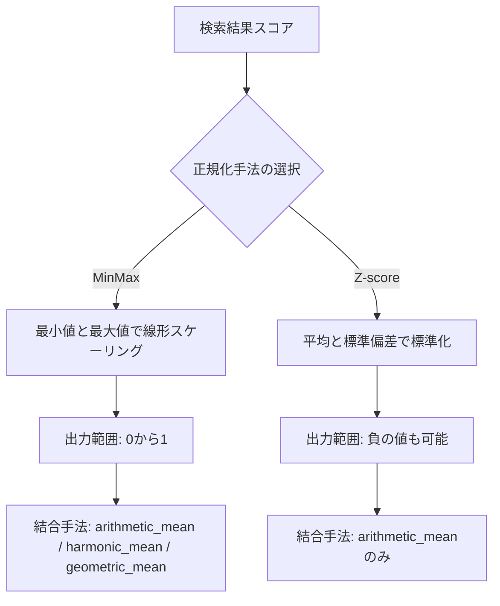
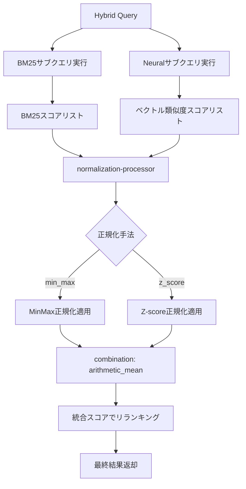

## ブログ概要（Summary）

本記事は [https://opensearch.org/blog/introducing-the-z-score-normalization-technique-for-hybrid-search/](https://opensearch.org/blog/introducing-the-z-score-normalization-technique-for-hybrid-search/) の解説記事です。

OpenSearchの公式ブログにおいて、Minal Shah、Martin Gaievski、Owais Kazi、Fanit Kolchinaの4名は、OpenSearch 3.0-beta1で導入されたZ-score正規化手法のハイブリッド検索への適用と、BEIRベンチマークにおけるMinMax正規化との比較結果を報告している。開発環境（1シャード）では平均+2.08%のNDCG@10改善が確認された一方、本番環境（12シャード）では逆に-0.53%と性能が低下する結果が示されており、正規化手法の選択がデータセットとインフラ構成に強く依存することを実データで明らかにした重要なベンチマーク記事である。

この記事は [Zenn記事: BM25×ベクトル検索ハイブリッドの本番パイプライン構築：スコア正規化・キャッシュ・品質モニタリング](https://zenn.dev/0h_n0/articles/fca0326faf7a05) の深掘りです。

## 情報源

- **種別**: 企業テックブログ（OpenSearch公式）
- **URL**: [https://opensearch.org/blog/introducing-the-z-score-normalization-technique-for-hybrid-search/](https://opensearch.org/blog/introducing-the-z-score-normalization-technique-for-hybrid-search/)
- **組織**: OpenSearch Project（The Linux Foundation）
- **著者**: Minal Shah, Martin Gaievski, Owais Kazi, Fanit Kolchina
- **発表日**: 2025年6月18日（最終更新）

## 技術的背景（Technical Background）

### ハイブリッド検索におけるスコア正規化の必要性

ハイブリッド検索は、BM25（語彙ベース）とベクトル検索（意味ベース）の2つの検索パスを組み合わせるアプローチである。このとき、BM25スコアとベクトル類似度スコアのスケールが大きく異なるため、単純な加算では一方のスコアが支配的になり、もう一方の寄与が事実上無視される。

この問題に対する標準的なアプローチがスコア正規化であり、OpenSearchでは従来MinMax正規化がデフォルトとして採用されてきた。MinMax正規化は各検索パスのスコアを $[0, 1]$ の範囲に線形変換する手法だが、外れ値に弱いという既知の問題がある。

### Z-score正規化の数学的定義

Z-score正規化（標準化）は、平均と標準偏差を用いてスコアを変換する手法である。変換式は以下の通り：

$$
Z = \frac{X - \mu}{\sigma}
$$

ここで、
- $X$: 元のスコア（BM25スコアまたはベクトル類似度スコア）
- $\mu$: スコアの平均値
- $\sigma$: スコアの標準偏差

対比として、MinMax正規化の変換式は以下の通り：

$$
\hat{s} = \frac{X - X_{\min}}{X_{\max} - X_{\min}}
$$

ここで、
- $X_{\min}$: 検索結果中のスコア最小値
- $X_{\max}$: 検索結果中のスコア最大値

### 両手法の理論的な違い



| 特性 | MinMax | Z-score |
|------|--------|---------|
| 出力範囲 | $[0, 1]$（固定） | 負の値を含む（非固定） |
| 外れ値の影響 | 大きい（最小値・最大値に依存） | 比較的小さい（平均・標準偏差で吸収） |
| スコア分布の仮定 | なし | 正規分布に近い場合に効果的 |
| 利用可能な結合手法 | arithmetic / harmonic / geometric mean | arithmetic meanのみ |
| OpenSearchでの導入バージョン | 初期から | 3.0-beta1 |

OpenSearchチームは、Z-score正規化が負の値を生成する可能性があるため、`harmonic_mean`や`geometric_mean`との組み合わせでは数値的に不安定になるとしており、`arithmetic_mean`のみに限定されると説明している。

## 実装アーキテクチャ（Architecture）

### OpenSearchにおけるハイブリッド検索パイプラインの構成

OpenSearchのハイブリッド検索は、Search Pipelineフレームワークの`normalization-processor`を通じて実装される。クエリは`hybrid`クエリタイプで複数のサブクエリ（BM25 + neural）を定義し、各サブクエリの結果が独立に実行された後、正規化プロセッサが一括してスコアを変換・結合する。

**Z-score正規化パイプラインの設定例:**

```json
PUT /_search/pipeline/z_score-pipeline
{
    "description": "Z-score processor for hybrid search",
    "phase_results_processors": [
        {
            "normalization-processor": {
                "normalization": {
                    "technique": "z_score"
                },
                "combination": {
                    "technique": "arithmetic_mean",
                    "parameters": {
                        "weights": [0.3, 0.7]
                    }
                }
            }
        }
    ]
}
```

**ハイブリッドクエリの実行例:**

```json
POST my_index/_search?search_pipeline=z_score-pipeline
{
    "query": {
        "hybrid": {
            "queries": [
                {
                    "match": {
                        "content": "ハイブリッド検索のスコア正規化"
                    }
                },
                {
                    "neural": {
                        "content_vector": {
                            "query_text": "ハイブリッド検索のスコア正規化",
                            "model_id": "my-embedding-model",
                            "k": 50
                        }
                    }
                }
            ]
        }
    }
}
```

### パイプラインの内部処理フロー



OpenSearchチームは、正規化と結合のステップが`phase_results_processors`として実装されており、検索パイプラインの一部として宣言的に設定できると説明している。これにより、アプリケーションコードを変更せずに正規化手法を切り替えることが可能である。

### 正規化手法の選定フロー

ブログでは、データセットの特性に基づく手法選定の方針を示している：

- **MinMaxが適する条件**: Top-k結果のスコアがクラスタリングされており、ドキュメント間の類似度が高い場合
- **Z-scoreが適する条件**: 結果がインデックス全体に均等に分散しており、スコア分布が正規分布に近い場合

ただし、OpenSearchチームは最終的に「ユースケース固有のテストに基づいて選択すべき」と結論づけており、万能な手法は存在しないことを強調している。

## Production Deployment Guide

### AWS実装パターン（コスト最適化重視）

ハイブリッド検索のスコア正規化を本番環境で運用する場合、OpenSearchクラスタのシャード構成とノードサイズが性能に直結する。以下にトラフィック量別の推奨構成を示す。

**トラフィック量別の推奨構成**:

| 規模 | 月間リクエスト | 推奨構成 | 月額コスト | 主要サービス |
|------|--------------|---------|-----------|------------|
| **Small** | ~3,000 (100/日) | Serverless | $80-200 | OpenSearch Serverless + Lambda |
| **Medium** | ~30,000 (1,000/日) | マネージド | $400-900 | Amazon OpenSearch Service (3ノード) |
| **Large** | 300,000+ (10,000/日) | マネージド大規模 | $2,500-6,000 | Amazon OpenSearch Service (6+ノード) |

**Small構成の詳細**（月額$80-200）:
- **OpenSearch Serverless**: 2 OCU（検索）+ 2 OCU（インデックス）（$175/月のベース）
- **Lambda**: 検索API（$10/月）
- **CloudWatch**: 基本監視（$5/月）
- **注意**: Serverlessはハイブリッド検索パイプラインの一部機能に制約がある場合があるため、事前にドキュメントで確認が必要

**Medium構成の詳細**（月額$400-900）:
- **Amazon OpenSearch Service**: r6g.large.search × 3ノード、1レプリカ（$450/月）
- **EBS**: gp3 100GB × 3（$24/月）
- **Lambda**: API Gateway + Lambda（$30/月）
- **CloudWatch**: 詳細監視（$15/月）

**Large構成の詳細**（月額$2,500-6,000）:
- **Amazon OpenSearch Service**: r6g.2xlarge.search × 6データノード + c6g.large.search × 3専用マスターノード（$2,400/月）
- **EBS**: gp3 500GB × 6（$180/月）
- **ElastiCache Redis**: キャッシュレイヤー cache.r6g.large（$200/月）
- **Application Load Balancer**: ($20/月）

**コスト試算の注意事項**:
- 上記は2026年11月時点のAWS ap-northeast-1（東京）リージョン料金に基づく概算値です
- OpenSearch Serviceの料金はインスタンスタイプ、ストレージ、データ転送量により変動します
- 最新料金は [AWS料金計算ツール](https://calculator.aws/) で確認してください

### Terraformインフラコード

**Medium構成: Amazon OpenSearch Service（3ノード、ハイブリッド検索対応）**

```hcl
# --- VPC基盤 ---
module "vpc" {
  source  = "terraform-aws-modules/vpc/aws"
  version = "~> 5.0"

  name = "opensearch-vpc"
  cidr = "10.0.0.0/16"
  azs  = ["ap-northeast-1a", "ap-northeast-1c", "ap-northeast-1d"]
  private_subnets = ["10.0.1.0/24", "10.0.2.0/24", "10.0.3.0/24"]

  enable_nat_gateway = false
  enable_dns_hostnames = true
}

# --- OpenSearch Serviceドメイン ---
resource "aws_opensearch_domain" "hybrid_search" {
  domain_name    = "hybrid-search"
  engine_version = "OpenSearch_2.17"

  cluster_config {
    instance_type          = "r6g.large.search"
    instance_count         = 3
    zone_awareness_enabled = true

    zone_awareness_config {
      availability_zone_count = 3
    }
  }

  ebs_options {
    ebs_enabled = true
    volume_type = "gp3"
    volume_size = 100
    throughput  = 125
    iops        = 3000
  }

  vpc_options {
    subnet_ids         = module.vpc.private_subnets
    security_group_ids = [aws_security_group.opensearch.id]
  }

  encrypt_at_rest {
    enabled = true
  }

  node_to_node_encryption {
    enabled = true
  }

  domain_endpoint_options {
    enforce_https       = true
    tls_security_policy = "Policy-Min-TLS-1-2-PFS-2023-10"
  }

  advanced_security_options {
    enabled                        = true
    internal_user_database_enabled = true

    master_user_options {
      master_user_name     = "admin"
      master_user_password = var.opensearch_master_password
    }
  }

  log_publishing_options {
    cloudwatch_log_group_arn = aws_cloudwatch_log_group.opensearch.arn
    log_type                 = "SEARCH_SLOW_LOGS"
  }
}

# --- セキュリティグループ ---
resource "aws_security_group" "opensearch" {
  name_prefix = "opensearch-"
  vpc_id      = module.vpc.vpc_id

  ingress {
    from_port   = 443
    to_port     = 443
    protocol    = "tcp"
    cidr_blocks = module.vpc.private_subnets_cidr_blocks
  }
}

# --- CloudWatchアラーム ---
resource "aws_cloudwatch_metric_alarm" "search_latency" {
  alarm_name          = "opensearch-search-latency-p99"
  comparison_operator = "GreaterThanThreshold"
  evaluation_periods  = 3
  metric_name         = "SearchLatency"
  namespace           = "AWS/ES"
  period              = 300
  statistic           = "p99"
  threshold           = 500
  alarm_description   = "OpenSearch検索レイテンシP99が500msを超過"

  dimensions = {
    DomainName = aws_opensearch_domain.hybrid_search.domain_name
    ClientId   = data.aws_caller_identity.current.account_id
  }
}

resource "aws_cloudwatch_log_group" "opensearch" {
  name              = "/aws/opensearch/hybrid-search"
  retention_in_days = 30
}

data "aws_caller_identity" "current" {}
```

**Large構成: 6ノード + 専用マスター + ElastiCache**

```hcl
resource "aws_opensearch_domain" "hybrid_search_large" {
  domain_name    = "hybrid-search-prod"
  engine_version = "OpenSearch_2.17"

  cluster_config {
    instance_type            = "r6g.2xlarge.search"
    instance_count           = 6
    dedicated_master_enabled = true
    dedicated_master_type    = "c6g.large.search"
    dedicated_master_count   = 3
    zone_awareness_enabled   = true

    zone_awareness_config {
      availability_zone_count = 3
    }
  }

  ebs_options {
    ebs_enabled = true
    volume_type = "gp3"
    volume_size = 500
    throughput  = 250
    iops        = 6000
  }

  vpc_options {
    subnet_ids         = module.vpc.private_subnets
    security_group_ids = [aws_security_group.opensearch.id]
  }

  encrypt_at_rest {
    enabled    = true
    kms_key_id = aws_kms_key.opensearch.arn
  }

  node_to_node_encryption {
    enabled = true
  }

  domain_endpoint_options {
    enforce_https       = true
    tls_security_policy = "Policy-Min-TLS-1-2-PFS-2023-10"
  }

  advanced_security_options {
    enabled                        = true
    internal_user_database_enabled = false
  }

  auto_tune_options {
    desired_state = "ENABLED"
  }
}

# --- ElastiCache Redis（検索結果キャッシュ用） ---
resource "aws_elasticache_replication_group" "search_cache" {
  replication_group_id = "search-cache"
  description          = "Search result cache for hybrid queries"
  node_type            = "cache.r6g.large"
  num_cache_clusters   = 2
  engine               = "redis"
  engine_version       = "7.1"
  port                 = 6379

  at_rest_encryption_enabled = true
  transit_encryption_enabled = true

  subnet_group_name  = aws_elasticache_subnet_group.cache.name
  security_group_ids = [aws_security_group.cache.id]
}

# --- KMS暗号化キー ---
resource "aws_kms_key" "opensearch" {
  description = "KMS key for OpenSearch encryption"
  enable_key_rotation = true
}

# --- AWS Budgets ---
resource "aws_budgets_budget" "opensearch_monthly" {
  name         = "opensearch-monthly-budget"
  budget_type  = "COST"
  limit_amount = "6000"
  limit_unit   = "USD"
  time_unit    = "MONTHLY"

  notification {
    comparison_operator       = "GREATER_THAN"
    threshold                 = 80
    threshold_type            = "PERCENTAGE"
    notification_type         = "ACTUAL"
    subscriber_email_addresses = ["ops@example.com"]
  }
}
```

### 運用・監視設定

**CloudWatch Logs Insights クエリ（検索レイテンシ分析）**:

```sql
-- 正規化手法別のレイテンシ分布
fields @timestamp, search_latency_ms, normalization_technique
| stats pct(search_latency_ms, 50) as p50,
        pct(search_latency_ms, 95) as p95,
        pct(search_latency_ms, 99) as p99
  by bin(5m)

-- スロークエリの検出（500ms超過）
fields @timestamp, query, search_latency_ms
| filter search_latency_ms > 500
| sort search_latency_ms desc
| limit 20
```

**CloudWatch アラーム設定（Python）**:

```python
import boto3

cloudwatch = boto3.client('cloudwatch')

cloudwatch.put_metric_alarm(
    AlarmName='opensearch-search-latency-spike',
    ComparisonOperator='GreaterThanThreshold',
    EvaluationPeriods=3,
    MetricName='SearchLatency',
    Namespace='AWS/ES',
    Period=300,
    ExtendedStatistic='p99',
    Threshold=500,
    ActionsEnabled=True,
    AlarmActions=['arn:aws:sns:ap-northeast-1:123456789:search-alerts'],
    AlarmDescription='OpenSearch検索レイテンシP99が500msを超過'
)

cloudwatch.put_metric_alarm(
    AlarmName='opensearch-cluster-red',
    ComparisonOperator='GreaterThanOrEqualToThreshold',
    EvaluationPeriods=1,
    MetricName='ClusterStatus.red',
    Namespace='AWS/ES',
    Period=60,
    Statistic='Maximum',
    Threshold=1,
    AlarmDescription='OpenSearchクラスタがRED状態'
)
```

**X-Ray トレーシング設定（Python）**:

```python
from aws_xray_sdk.core import xray_recorder, patch_all

patch_all()

@xray_recorder.capture('hybrid_search')
def execute_hybrid_search(query: str, pipeline: str = "z_score-pipeline") -> dict:
    """ハイブリッド検索をX-Rayトレースつきで実行"""
    xray_recorder.put_annotation('normalization', pipeline)
    xray_recorder.put_metadata('query_length', len(query))

    response = opensearch_client.search(
        index="my_index",
        body={"query": {"hybrid": {"queries": [...]}}},
        params={"search_pipeline": pipeline}
    )

    xray_recorder.put_metadata('hit_count', response['hits']['total']['value'])
    return response
```

**Cost Explorer自動レポート（Python）**:

```python
import boto3
from datetime import datetime, timedelta

ce = boto3.client('ce')

response = ce.get_cost_and_usage(
    TimePeriod={
        'Start': (datetime.now() - timedelta(days=1)).strftime('%Y-%m-%d'),
        'End': datetime.now().strftime('%Y-%m-%d')
    },
    Granularity='DAILY',
    Metrics=['UnblendedCost'],
    Filter={
        'Dimensions': {
            'Key': 'SERVICE',
            'Values': ['Amazon OpenSearch Service']
        }
    }
)

for result in response['ResultsByTime']:
    cost = float(result['Total']['UnblendedCost']['Amount'])
    if cost > 200:
        print(f"OpenSearchコスト異常: ${cost:.2f}/日")
```

### コスト最適化チェックリスト

**アーキテクチャ選択（トラフィック量で判断）**:
- [ ] ~100 req/日 → OpenSearch Serverless（$80-200/月）
- [ ] ~1,000 req/日 → マネージド3ノード（$400-900/月）
- [ ] 10,000+ req/日 → マネージド6ノード + 専用マスター（$2,500-6,000/月）

**リソース最適化**:
- [ ] インスタンスタイプ: Graviton (r6g) を選択（x86比で約20%安価）
- [ ] Reserved Instances: 1年コミットで約40%削減
- [ ] EBSボリューム: gp3を使用（gp2比でIOPS/スループットが設定可能）
- [ ] シャード数の最適化: 1シャードあたり10-50GBを目安に設計
- [ ] 不要なインデックスの定期削除: ISM（Index State Management）ポリシーで自動化

**検索パイプライン最適化**:
- [ ] 正規化手法のA/Bテスト: MinMax vs Z-scoreを本番データでベンチマーク
- [ ] 検索結果キャッシュ: ElastiCache Redisで頻出クエリをキャッシュ
- [ ] `k`パラメータの調整: Neural検索のk値を最小限に抑えてレイテンシ削減
- [ ] 検索パイプラインのウォームアップ: 初回クエリのレイテンシ対策

**監視・アラート**:
- [ ] AWS Budgets: OpenSearch Serviceの月額予算設定
- [ ] CloudWatch アラーム: SearchLatency P99、ClusterStatus
- [ ] スロークエリログの有効化と定期分析
- [ ] Cost Anomaly Detection: OpenSearch関連の異常検知

**セキュリティ**:
- [ ] VPC内配置（パブリックアクセス無効化）
- [ ] 保管時・転送中の暗号化を有効化
- [ ] Fine-grained access control（FGAC）の設定
- [ ] CloudTrailによるAPI呼び出しの監査ログ

## ベンチマーク結果の詳細分析（Performance）

### 開発環境ベンチマーク

OpenSearchチームは、以下の環境でベンチマークを実施したと報告している：

**ベンチマーク環境（開発）**:
- ノード構成: r6g.8xlarge × 1コーディネーター + r6g.8xlarge × 3データノード
- シャード数: **1シャード**
- データセット: BEIRベンチマークから5データセット（SciDocs, FiQA, NQ, ArguAna, Touche-2020）
- 測定指標: NDCG@10

**NDCG@10の比較（開発環境、ブログ記載値より）**:

| データセット | MinMax | Z-score | 差分 |
|-------------|--------|---------|------|
| SciDocs | 0.1591 | 0.1633 | **+2.45%** |
| FiQA | 0.2747 | 0.2768 | **+0.77%** |
| NQ | 0.3665 | 0.3740 | **+2.05%** |
| ArguAna | 0.4507 | 0.4670 | **+3.62%** |
| Touche-2020 | 0.8410 | 0.8542 | **+1.54%** |
| **平均** | | | **+2.08%** |

開発環境では、Z-scoreがすべてのデータセットでMinMaxを上回っている。最大の改善はArguAnaの+3.62%であり、最小はFiQAの+0.77%である。

### レイテンシへの影響（開発環境）

OpenSearchチームは、Z-score正規化のレイテンシオーバーヘッドについても以下の通り報告している（ブログ記載値より）：

| データセット | p50差分 | p90差分 | p99差分 |
|-------------|---------|---------|---------|
| SciDocs | +1.64% | +1.52% | +2.70% |
| FiQA | +1.25% | +0.48% | +0.62% |
| NQ | 0% | 0% | **-0.90%** |
| ArguAna | 0% | 0% | +0.12% |
| Touche-2020 | +0.64% | +0.50% | 0% |
| **平均** | **+0.70%** | **+0.50%** | **+0.50%** |

レイテンシの増加は平均0.50-0.70%と報告されており、実用上はほぼ無視可能な水準である。NQのp99で-0.90%とわずかに改善した例もある。

### 本番環境ベンチマーク — 開発環境との逆転

ここが本ブログの最も重要な知見である。OpenSearchチームは、本番に近い環境（12シャード構成）でのベンチマーク結果を別途報告しており、**開発環境での改善が本番環境では再現されなかった**ことを明示している。

**ベンチマーク環境（本番）**:
- ノード構成: 開発環境と同じハードウェア
- シャード数: **12シャード**
- データセット: 4データセット（FiQA, NQ, ArguAna, Touche-2020）
- 測定指標: NDCG@mean、P@mean

**NDCG@meanの比較（本番環境、ブログ記載値より）**:

| データセット | MinMax | Z-score | 差分 |
|-------------|--------|---------|------|
| FiQA | 0.3105 | 0.3120 | +0.48% |
| NQ | 0.4563 | 0.4540 | **-0.50%** |
| ArguAna | 0.4713 | 0.4700 | **-0.28%** |
| Touche-2020 | 0.3788 | 0.3719 | **-1.82%** |
| **平均** | | | **-0.53%** |

**P@meanの比較（本番環境、ブログ記載値より）**:

| データセット | MinMax | Z-score | 差分 |
|-------------|--------|---------|------|
| FiQA | 0.0921 | 0.0925 | +0.43% |
| NQ | 0.0943 | 0.0935 | **-0.85%** |
| ArguAna | 0.0878 | 0.0878 | 0% |
| Touche-2020 | 0.2364 | 0.2318 | **-1.95%** |
| **平均** | | | **-0.59%** |

本番環境（12シャード）ではFiQAのみがZ-scoreで改善し、残る3データセットではMinMaxの方が良い結果となっている。特にTouche-2020は最大の低下（NDCG -1.82%、P@mean -1.95%）を示している。

### 開発・本番の逆転が生じる原因

ブログでは逆転の原因について詳細な分析は提示されていないが、以下の要因が考えられる：

1. **シャード間のスコア分布の差異**: 12シャードに分散されたデータでは、各シャード内のスコア分布の平均と標準偏差が異なる。Z-scoreは各シャードのローカルな統計量に依存するため、シャード間でのスコアの比較可能性が低下する可能性がある
2. **集約時のスコアスケールの不整合**: 各シャードでZ-score正規化されたスコアは、シャード間で異なるスケールになる可能性がある。MinMaxは $[0, 1]$ の範囲に正規化するため、シャード間での整合性が維持されやすい
3. **データセット特性の影響**: Touche-2020は議論的なクエリが多く、スコア分布が正規分布から乖離しやすい。Z-score正規化は正規分布に近いスコア分布で効果を発揮するため、このようなデータセットでは不利になる

## 運用での学び（Production Lessons）

### 開発環境のベンチマーク結果を鵜呑みにしない

本ブログの最も重要な教訓は、**開発環境（1シャード）のベンチマーク結果が本番環境（マルチシャード）で再現されるとは限らない**という点である。OpenSearchチームは、開発環境で平均+2.08%のNDCG改善を示した後、本番環境で逆に-0.53%と低下した結果を率直に報告しており、この透明性は高く評価できる。

### 正規化手法のA/Bテストを推奨

ブログの結論は「ユースケース固有のテストに基づいて選択すべき」であり、汎用的な推奨はない。実運用では以下のアプローチが推奨される：

1. **ゴールデンクエリセットの構築**: 50-200件の代表的なクエリと正解ラベルを用意
2. **両手法でのNDCG@10計測**: 本番と同じシャード構成でベンチマーク
3. **統計的に有意な差の確認**: 対応のあるt検定やWilcoxon符号順位検定で差の有意性を検証
4. **レイテンシの許容確認**: 通常0.5-0.7%増加は許容範囲だが、P99で確認

### OpenSearchのバージョンと機能の進化

ブログの公開後（2025年6月時点）からOpenSearchは継続的に進化している。2026年11月時点で確認すべき点：

- OpenSearch 3.7ではHybrid Optimizerが66→82バリアントに拡張され、Z-scoreとRRFが追加された
- neural-search issue #994でカスタム正規化関数が開発中とされている
- 最新バージョンでは性能特性が変わっている可能性があるため、必ず使用バージョンでテストすること

## 学術研究との関連（Academic Connection）

### BEIR ベンチマークについて

ベンチマークに使用されたBEIR（Benchmarking IR）は、Thakur et al. (2021)が提案したゼロショット情報検索の標準ベンチマークスイートである。18の多様なデータセットで構成され、ドメイン転移性能の評価に広く使用されている。

### ハイブリッド検索の正規化に関する先行研究

- **Bruch et al. (2022)**: 凸結合の重みをNDCGで最適化する手法を提案。約40件のラベル付きクエリで重みを調整すればRRFを上回ることを示している
- **Wang et al. (arXiv 2508.01405)**: 11データセットでのハイブリッド検索ベンチマークにおいて、RRF・重み付き和・テンソルベース再ランキングの3手法を比較し、「弱いリンク効果」（弱い検索パスが全体精度を引き下げる現象）を報告している
- **OpenSearch RRF evaluation**: OpenSearch公式ベンチマークでは、6つのBEIRデータセットにおいてRRFのNDCG@10がスコアベースのハイブリッド融合より約3.86%低い一方、レイテンシは2%未満の改善があると報告されている

## まとめと実践への示唆

OpenSearchチームが公開したZ-score正規化のベンチマーク結果は、ハイブリッド検索の正規化手法選定に重要な知見を提供している。

**主要な知見**:
- Z-score正規化は開発環境（1シャード）でMinMaxを平均+2.08%（NDCG@10）上回った
- しかし本番環境（12シャード）では逆に-0.53%と低下し、MinMaxの方が信頼性が高かった
- レイテンシへの影響は平均0.50-0.70%増加であり、実用上は無視可能
- 正規化手法の選択はデータセット特性とインフラ構成に依存し、万能な手法は存在しない

**実践への示唆**:
- 本番導入前に、本番と同じシャード構成でのベンチマークが必須
- ゴールデンクエリセットを構築し、NDCG@10で定量的に比較すること
- Z-scoreは外れ値に強いという理論的な利点があるが、マルチシャード環境ではその利点が減殺される可能性がある
- 最初はMinMax（デフォルト）で開始し、十分なラベルデータが蓄積されてからZ-scoreとの比較を検討するのが安全なアプローチである

## 参考文献

- **Blog URL**: [Introducing the Z-Score Normalization Technique for Hybrid Search](https://opensearch.org/blog/introducing-the-z-score-normalization-technique-for-hybrid-search/)
- **OpenSearch Documentation**: [Hybrid search](https://opensearch.org/docs/latest/search-plugins/hybrid-search/)
- **Related Papers**: Thakur et al. "BEIR: A Heterogenous Benchmark for Zero-shot Evaluation of Information Retrieval Models" (NeurIPS 2021)
- **Related Zenn article**: [BM25×ベクトル検索ハイブリッドの本番パイプライン構築](https://zenn.dev/0h_n0/articles/fca0326faf7a05)

---

:::message
この記事はAI（Claude Code）により自動生成されました。内容の正確性については複数の情報源で検証していますが、実際の利用時は公式ドキュメントもご確認ください。
:::
