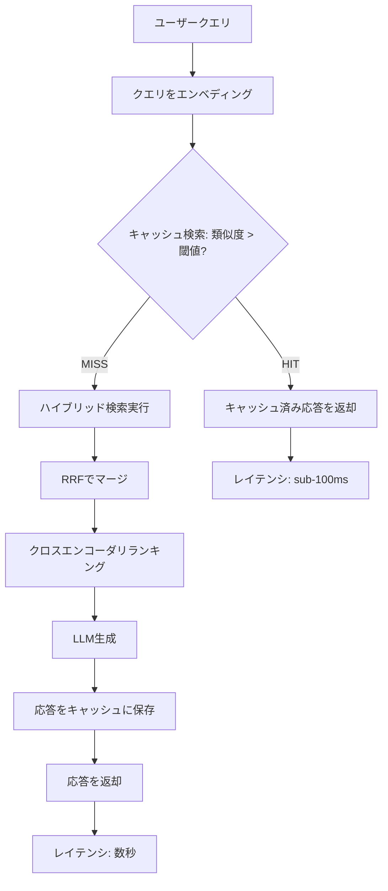
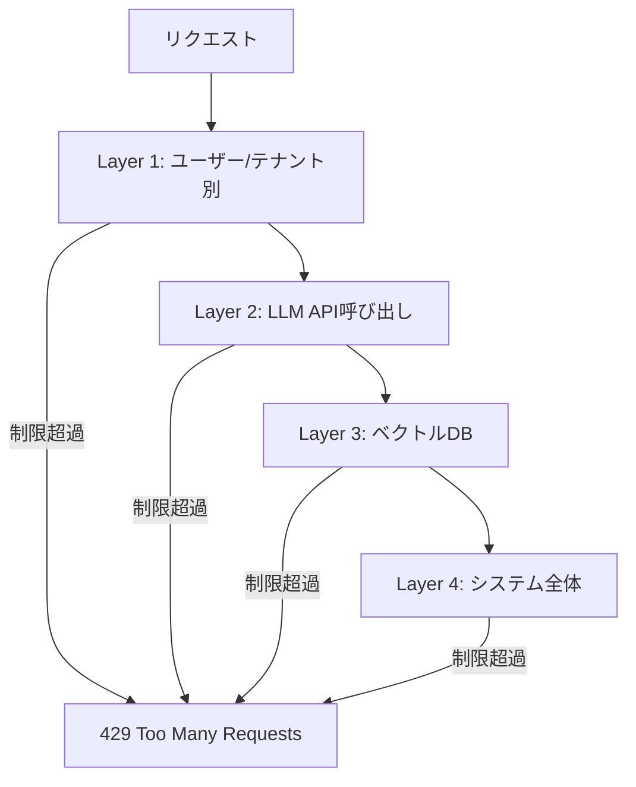

## ブログ概要（Summary）

本記事は [https://redis.io/blog/rag-at-scale/](https://redis.io/blog/rag-at-scale/) の解説記事です。

Redis公式ブログ "How to scale RAG from prototype to production"（著者: Jim Allen Wallace、2026年1月公開、2026年11月更新）は、RAG（Retrieval-Augmented Generation）パイプラインをプロトタイプから本番環境へスケーリングする際に直面する課題と、その解決策を体系的に整理している。セマンティックキャッシュによるLLMコスト削減、BM25とベクトル検索のハイブリッド検索によるrecall向上、CDCベースのキャッシュ無効化、そして4層レートリミットを含む本番運用設計が主要なテーマである。

この記事は [Zenn記事: BM25×ベクトル検索ハイブリッドの本番パイプライン構築：スコア正規化・キャッシュ・品質モニタリング](https://zenn.dev/0h_n0/articles/fca0326faf7a05) の深掘りです。

> **注意**: 本ブログはRedis社が自社製品のコンテキストで執筆したものであり、ベンダー固有の推奨事項が含まれている。技術的な知見は汎用的に適用可能だが、製品選定に関する記述はベンダーバイアスの可能性を考慮して読む必要がある。

## 情報源

- **種別**: 企業テックブログ
- **URL**: [https://redis.io/blog/rag-at-scale/](https://redis.io/blog/rag-at-scale/)
- **組織**: Redis, Inc.
- **著者**: Jim Allen Wallace
- **初回公開日**: 2026年1月21日
- **最終更新日**: 2026年11月13日

## 技術的背景（Technical Background）

RAGパイプラインのプロトタイプから本番環境への移行では、以下の課題が顕在化する。

**レイテンシの壁**: プロトタイプではLLM呼び出しのレイテンシ（数秒〜十数秒）が許容されるが、本番ではTTFT（Time To First Token）のp90を2秒以内に収める必要がある。ブログでは、この閾値を超えた場合にオートスケーリングをトリガーすることを推奨している。

**コストの爆発**: クエリ数が増加するとLLM APIコストが線形に増加する。同一または類似のクエリに対して毎回LLMを呼び出す非効率が、プロトタイプでは見えにくい。

**検索品質の限界**: 単一のベクトル検索では、固有名詞・型番・略語などの語彙的マッチが弱い。ブログでは「single-vector embeddings can't represent overlapping relationships」と指摘している。

**データ鮮度の維持**: ドキュメントの追加・更新に対して、ベクトルインデックスとキャッシュを同期させる運用が必要になる。

これらの課題に対して、ブログは**セマンティックキャッシュ**、**ハイブリッド検索**、**キャッシュ無効化戦略**、**監視設計**の4つの柱で解決策を提示している。

### 学術研究との関連

ブログ中のコスト削減数値（最大68.8%のLLMコスト削減）はarXiv論文 2411.05276 を引用しており、recall改善（1〜9%）はarXiv論文 2410.20381 を引用している。ただし、これらの数値がRedis自身のベンチマークによるものか、引用先論文の独立した結果かはブログ本文からは判別できない。

## 実装アーキテクチャ（Architecture）

### セマンティックキャッシュの設計

セマンティックキャッシュは、クエリのエンベディング間のコサイン類似度に基づいて、過去の応答を再利用する仕組みである。



#### コサイン類似度による類似クエリ判定

セマンティックキャッシュのルックアップでは、新しいクエリのエンベディング $\mathbf{q}$ と、キャッシュ内の各クエリエンベディング $\mathbf{c}_i$ のコサイン類似度を計算する。

$$
\text{sim}(\mathbf{q}, \mathbf{c}_i) = \frac{\mathbf{q} \cdot \mathbf{c}_i}{\|\mathbf{q}\| \cdot \|\mathbf{c}_i\|}
$$

ここで、
- $\mathbf{q}$: 新規クエリのエンベディングベクトル
- $\mathbf{c}_i$: キャッシュ内 $i$ 番目のクエリのエンベディングベクトル
- $\|\cdot\|$: L2ノルム

ブログでは、この類似度の閾値について以下のガイダンスを示している。

| ユースケース | 推奨閾値範囲 | 特徴 |
|-------------|-------------|------|
| 高精度（医療、法律等） | 0.90–0.95 | 誤ヒットのリスクを最小化 |
| 高recall（FAQ、カスタマーサポート等） | 0.85–0.90 | ヒット率を優先 |

Redisチームはキャッシュヒット時のレイテンシをsub-100ms（通常のLLM呼び出しと比較して最大約65倍高速）と述べている。

```python
import hashlib
import numpy as np
from dataclasses import dataclass


@dataclass
class SemanticCacheConfig:
    """セマンティックキャッシュの設定"""
    similarity_threshold: float = 0.92
    ttl_seconds: int = 3600
    max_entries: int = 100_000


def cosine_similarity(q: np.ndarray, c: np.ndarray) -> float:
    """コサイン類似度を計算する

    Args:
        q: クエリのエンベディングベクトル
        c: キャッシュ内クエリのエンベディングベクトル

    Returns:
        コサイン類似度（-1.0 ~ 1.0）
    """
    norm_q = np.linalg.norm(q)
    norm_c = np.linalg.norm(c)
    if norm_q == 0 or norm_c == 0:
        return 0.0
    return float(np.dot(q, c) / (norm_q * norm_c))


class SemanticCache:
    """セマンティックキャッシュの実装例

    本番環境ではRedis Vector SearchやPgvector等の
    ベクトルDBを使用することを推奨する
    """

    def __init__(self, config: SemanticCacheConfig) -> None:
        self._config = config
        self._entries: list[tuple[np.ndarray, str, float]] = []

    def lookup(self, query_embedding: np.ndarray) -> str | None:
        """キャッシュをルックアップする"""
        import time

        best_score = -1.0
        best_response = None

        for emb, response, created_at in self._entries:
            if time.time() - created_at > self._config.ttl_seconds:
                continue
            score = cosine_similarity(query_embedding, emb)
            if score > self._config.similarity_threshold and score > best_score:
                best_score = score
                best_response = response

        return best_response

    def store(self, query_embedding: np.ndarray, response: str) -> None:
        """キャッシュにエントリを追加する"""
        import time

        self._entries.append((query_embedding, response, time.time()))
        if len(self._entries) > self._config.max_entries:
            self._entries = self._entries[-self._config.max_entries :]
```

**閾値設定の注意点**: ブログでは最適値はユースケースに依存するとしているが、閾値が低すぎると意味が異なるクエリに対して誤った応答を返すリスクがある。特にドメイン固有の用語や文脈依存性が高いクエリでは、一般的なガイダンスよりも高い閾値（0.93以上）を設定し、自身のデータで検証することを推奨する。

### ハイブリッド検索アーキテクチャ

ブログでは、ベクトル検索とBM25を並列に実行し、Reciprocal Rank Fusion（RRF）で結果をマージし、さらにクロスエンコーダでリランキングするパイプラインを推奨している。

$$
\text{RRF}(d) = \sum_{r \in R} \frac{1}{k + r(d)}
$$

ここで $R$ は各検索パスのランキング、$r(d)$ はドキュメント $d$ の順位、$k$ は平滑化定数（通常60）である。

Redisチームは、ハイブリッドアプローチによりベクトル検索単体と比較してrecall精度が1〜9%改善されると述べている（arXiv 2410.20381を引用）。ただし、この改善幅はデータセットとクエリの特性に大きく依存する。

```python
import asyncio
from dataclasses import dataclass


@dataclass
class SearchResult:
    """検索結果"""
    doc_id: str
    score: float
    content: str


async def hybrid_search_pipeline(
    query: str,
    bm25_client,
    vector_client,
    reranker,
    top_k: int = 10,
    rrf_k: int = 60,
) -> list[SearchResult]:
    """ハイブリッド検索パイプライン

    BM25とベクトル検索を並列実行し、RRFで融合後にリランキングする

    Args:
        query: 検索クエリ
        bm25_client: BM25検索クライアント
        vector_client: ベクトル検索クライアント
        reranker: クロスエンコーダリランカー
        top_k: 最終的に返す件数
        rrf_k: RRFの平滑化定数

    Returns:
        リランキング後の検索結果リスト
    """
    loop = asyncio.get_event_loop()

    # BM25とベクトル検索を並列実行
    bm25_results, vector_results = await asyncio.gather(
        loop.run_in_executor(None, bm25_client.search, query, 50),
        loop.run_in_executor(None, vector_client.search, query, 50),
    )

    # RRFでスコア融合
    rrf_scores: dict[str, float] = {}
    for rank, result in enumerate(bm25_results, start=1):
        rrf_scores[result.doc_id] = rrf_scores.get(result.doc_id, 0.0)
        rrf_scores[result.doc_id] += 1.0 / (rrf_k + rank)

    for rank, result in enumerate(vector_results, start=1):
        rrf_scores[result.doc_id] = rrf_scores.get(result.doc_id, 0.0)
        rrf_scores[result.doc_id] += 1.0 / (rrf_k + rank)

    # スコア降順でソート
    sorted_docs = sorted(rrf_scores.items(), key=lambda x: x[1], reverse=True)
    candidate_ids = [doc_id for doc_id, _ in sorted_docs[:top_k * 3]]

    # クロスエンコーダでリランキング
    reranked = reranker.rerank(query, candidate_ids, top_k=top_k)

    return reranked
```

**Redis 8.4の新機能**: ブログでは、Redis 8.4で追加された`FT.HYBRID`コマンドについて言及している。このコマンドは全文検索とベクトル検索の結果をRRFまたは線形結合で融合する機能を提供する。

### チャンキング戦略

ブログではページレベルチャンキングを開始点として推奨し、クエリの種類に応じたチャンクサイズの使い分けを提案している。

| クエリタイプ | 推奨チャンクサイズ | 理由 |
|-------------|------------------|------|
| ファクトイドクエリ（短い事実確認） | 256–512 トークン | 局所的な情報を正確に取得 |
| 分析的クエリ（長い説明を要する） | 1,024 トークン | 文脈の断片化を防ぐ |

ブログでは128トークンチャンクについて、「概念を途中で分割してしまう」として非推奨としている。

## Production Deployment Guide

### AWS実装パターン（コスト最適化重視）

セマンティックキャッシュ付きRAGパイプラインをAWS上に構築する場合の構成を、トラフィック量別に示す。

**トラフィック量別の推奨構成**:

| 規模 | 月間リクエスト | 推奨構成 | 月額コスト | 主要サービス |
|------|--------------|---------|-----------|------------|
| **Small** | ~3,000 (100/日) | Serverless | $80–200 | Lambda + ElastiCache + Bedrock |
| **Medium** | ~30,000 (1,000/日) | Hybrid | $400–1,000 | ECS Fargate + ElastiCache + Bedrock |
| **Large** | 300,000+ (10,000/日) | Container | $2,500–6,000 | EKS + Amazon MemoryDB + Bedrock Batch |

**Small構成の詳細** (月額$80–200):
- **Lambda**: 1GB RAM, 60秒タイムアウト ($25/月)
- **ElastiCache for Redis**: cache.t4g.micro, 1ノード ($15/月)
- **Bedrock**: Claude 3.5 Haiku, Prompt Caching有効 ($100/月)
- **OpenSearch Serverless**: 0.5 OCU ($90/月、ただしBM25検索用)
- **CloudWatch**: 基本監視 ($5/月)

**Medium構成の詳細** (月額$400–1,000):
- **ECS Fargate**: 0.5 vCPU, 1GB RAM × 2タスク ($120/月)
- **ElastiCache for Redis**: cache.r7g.large, 2ノード ($200/月)
- **Bedrock**: Claude 3.5 Sonnet ($400/月)
- **OpenSearch Managed**: r6g.large.search × 2 ($180/月)
- **ALB**: ($20/月)

**Large構成の詳細** (月額$2,500–6,000):
- **EKS**: コントロールプレーン ($72/月)
- **Amazon MemoryDB for Redis**: db.r7g.xlarge × 3ノード ($800/月)
- **EC2 Spot Instances**: r7g.xlarge × 2–4台 ($300/月)
- **Bedrock Batch**: 50%割引活用 ($2,500/月)
- **OpenSearch Managed**: r6g.2xlarge × 3 ($500/月)
- **CloudWatch + X-Ray**: 詳細監視 ($100/月)

**コスト削減テクニック**:
- セマンティックキャッシュでLLM APIコスト最大68.8%削減（ブログがarXiv 2411.05276を引用した値）
- Bedrock Batch API使用で50%割引（非リアルタイム処理）
- Spot Instances使用で最大90%削減（EKS + Karpenter）
- ElastiCache Reserved Nodes購入で最大55%削減（1年コミット）

**コスト試算の注意事項**:
- 上記は2026年11月時点のAWS ap-northeast-1（東京）リージョン料金に基づく概算値です
- 実際のコストはキャッシュヒット率、クエリパターン、LLMモデル選択により大きく変動します
- 最新料金は [AWS料金計算ツール](https://calculator.aws/) で確認してください

### Terraformインフラコード

**Small構成 (Serverless): Lambda + ElastiCache + Bedrock**

```hcl
# --- VPC基盤 ---
module "vpc" {
  source  = "terraform-aws-modules/vpc/aws"
  version = "~> 5.0"

  name = "rag-cache-vpc"
  cidr = "10.0.0.0/16"
  azs  = ["ap-northeast-1a", "ap-northeast-1c"]

  private_subnets      = ["10.0.1.0/24", "10.0.2.0/24"]
  elasticache_subnets  = ["10.0.101.0/24", "10.0.102.0/24"]

  enable_nat_gateway = false
  enable_dns_hostnames = true
}

# --- ElastiCache for Redis (セマンティックキャッシュ) ---
resource "aws_elasticache_replication_group" "semantic_cache" {
  replication_group_id = "rag-semantic-cache"
  description          = "Semantic cache for RAG pipeline"

  engine               = "redis"
  engine_version       = "7.1"
  node_type            = "cache.t4g.micro"
  num_cache_clusters   = 1
  port                 = 6379

  subnet_group_name    = aws_elasticache_subnet_group.cache.name
  security_group_ids   = [aws_security_group.cache.id]

  at_rest_encryption_enabled = true
  transit_encryption_enabled = true

  automatic_failover_enabled = false
}

resource "aws_elasticache_subnet_group" "cache" {
  name       = "rag-cache-subnet"
  subnet_ids = module.vpc.elasticache_subnets
}

# --- IAMロール（最小権限） ---
resource "aws_iam_role" "lambda_rag" {
  name = "lambda-rag-cache-role"

  assume_role_policy = jsonencode({
    Version = "2012-10-17"
    Statement = [{
      Action = "sts:AssumeRole"
      Effect = "Allow"
      Principal = { Service = "lambda.amazonaws.com" }
    }]
  })
}

resource "aws_iam_role_policy" "bedrock_invoke" {
  role = aws_iam_role.lambda_rag.id

  policy = jsonencode({
    Version = "2012-10-17"
    Statement = [{
      Effect   = "Allow"
      Action   = ["bedrock:InvokeModel", "bedrock:InvokeModelWithResponseStream"]
      Resource = "arn:aws:bedrock:ap-northeast-1::foundation-model/anthropic.claude-3-5-haiku*"
    }]
  })
}

# --- Lambda関数 ---
resource "aws_lambda_function" "rag_handler" {
  filename      = "lambda.zip"
  function_name = "rag-semantic-cache-handler"
  role          = aws_iam_role.lambda_rag.arn
  handler       = "index.handler"
  runtime       = "python3.12"
  timeout       = 60
  memory_size   = 1024

  vpc_config {
    subnet_ids         = module.vpc.private_subnets
    security_group_ids = [aws_security_group.lambda.id]
  }

  environment {
    variables = {
      REDIS_HOST          = aws_elasticache_replication_group.semantic_cache.primary_endpoint_address
      REDIS_PORT          = "6379"
      SIMILARITY_THRESHOLD = "0.92"
      CACHE_TTL_SECONDS   = "3600"
      BEDROCK_MODEL_ID    = "anthropic.claude-3-5-haiku-20241022-v1:0"
    }
  }
}

# --- CloudWatch アラーム ---
resource "aws_cloudwatch_metric_alarm" "cache_hit_rate" {
  alarm_name          = "rag-cache-hit-rate-low"
  comparison_operator = "LessThanThreshold"
  evaluation_periods  = 3
  metric_name         = "CacheHitRate"
  namespace           = "Custom/RAG"
  period              = 3600
  statistic           = "Average"
  threshold           = 20
  alarm_description   = "キャッシュヒット率が20%未満（閾値調整を検討）"
}
```

**Large構成 (Container): EKS + MemoryDB + OpenSearch**

```hcl
# --- EKSクラスタ ---
module "eks" {
  source  = "terraform-aws-modules/eks/aws"
  version = "~> 20.0"

  cluster_name    = "rag-pipeline-cluster"
  cluster_version = "1.31"

  vpc_id     = module.vpc.vpc_id
  subnet_ids = module.vpc.private_subnets

  cluster_endpoint_public_access = true
  enable_cluster_creator_admin_permissions = true
}

# --- Amazon MemoryDB for Redis ---
resource "aws_memorydb_cluster" "semantic_cache" {
  cluster_name       = "rag-semantic-cache"
  node_type          = "db.r7g.xlarge"
  num_shards         = 1
  num_replicas_per_shard = 2
  acl_name           = aws_memorydb_acl.cache.id
  subnet_group_name  = aws_memorydb_subnet_group.cache.name
  security_group_ids = [aws_security_group.memorydb.id]

  tls_enabled = true

  snapshot_retention_limit = 7
}

# --- Karpenter (自動スケーリング) ---
resource "kubectl_manifest" "karpenter_nodepool" {
  yaml_body = <<-YAML
    apiVersion: karpenter.sh/v1
    kind: NodePool
    metadata:
      name: rag-workers
    spec:
      template:
        spec:
          requirements:
            - key: karpenter.sh/capacity-type
              operator: In
              values: ["spot", "on-demand"]
              minValues: 1
            - key: node.kubernetes.io/instance-type
              operator: In
              values: ["r7g.large", "r7g.xlarge"]
          nodeClassRef:
            group: karpenter.k8s.aws
            kind: EC2NodeClass
            name: default
      limits:
        cpu: "32"
        memory: "128Gi"
      disruption:
        consolidationPolicy: WhenEmptyOrUnderutilized
        consolidateAfter: 30s
  YAML
}

# --- Cost Explorer予算アラート ---
resource "aws_budgets_budget" "rag_monthly" {
  name         = "rag-pipeline-monthly"
  budget_type  = "COST"
  limit_amount = "6000"
  limit_unit   = "USD"
  time_unit    = "MONTHLY"

  notification {
    comparison_operator        = "GREATER_THAN"
    threshold                  = 80
    threshold_type             = "PERCENTAGE"
    notification_type          = "ACTUAL"
    subscriber_email_addresses = ["ops-team@example.com"]
  }
}
```

### セキュリティベストプラクティス

**本番環境での推奨設定**:

1. **ネットワークセキュリティ**:
   - ElastiCache/MemoryDB: VPCプライベートサブネットのみ配置
   - EKS: `cluster_endpoint_public_access = false`（VPN経由アクセス）
   - セキュリティグループ: Redis 6379ポートはアプリケーション層からのみ許可

2. **認証・認可**:
   - ElastiCache: AUTH トークン必須、Redis ACL設定
   - MemoryDB: IAM認証有効化
   - Bedrock: IAMロール最小権限（InvokeModelのみ）

3. **シークレット管理**:
   - Redis AUTH トークン: AWS Secrets Manager管理
   - 環境変数へのハードコード禁止
   - シークレットローテーション: 90日ごと

4. **データ保護**:
   - 転送中暗号化: TLS 1.2以上（ElastiCache/MemoryDB共に対応）
   - 保管中暗号化: KMS暗号化有効化
   - キャッシュ内のPII: 保存前にマスキングまたは除外を推奨

### 運用・監視設定

**CloudWatch Logs Insights クエリ**:
```sql
-- キャッシュヒット率の推移
fields @timestamp, cache_hit, query_latency_ms
| stats avg(cache_hit) as hit_rate,
        count(*) as total_queries,
        avg(query_latency_ms) as avg_latency
  by bin(1h)
| filter total_queries > 10

-- セマンティックキャッシュの類似度スコア分布
fields @timestamp, similarity_score, cache_hit
| stats percentile(similarity_score, 50) as p50,
        percentile(similarity_score, 90) as p90,
        percentile(similarity_score, 99) as p99
  by bin(1d)
```

**CloudWatch アラーム（キャッシュ監視）**:
```python
import boto3

cloudwatch = boto3.client("cloudwatch")

# キャッシュヒット率低下アラート
cloudwatch.put_metric_alarm(
    AlarmName="rag-cache-hit-rate-low",
    ComparisonOperator="LessThanThreshold",
    EvaluationPeriods=3,
    MetricName="CacheHitRate",
    Namespace="Custom/RAG",
    Period=3600,
    Statistic="Average",
    Threshold=15.0,
    ActionsEnabled=True,
    AlarmActions=["arn:aws:sns:ap-northeast-1:123456789:rag-alerts"],
    AlarmDescription="キャッシュヒット率が15%未満（閾値またはTTL調整が必要）",
)

# LLMレイテンシスパイクアラート
cloudwatch.put_metric_alarm(
    AlarmName="rag-llm-latency-spike",
    ComparisonOperator="GreaterThanThreshold",
    EvaluationPeriods=2,
    MetricName="LLMLatency",
    Namespace="Custom/RAG",
    Period=300,
    Statistic="p95",
    Threshold=5000,
    AlarmDescription="LLMレイテンシp95が5秒超過",
)
```

**X-Ray トレーシング設定**:
```python
from aws_xray_sdk.core import xray_recorder, patch_all

patch_all()


@xray_recorder.capture("semantic_cache_lookup")
def cache_lookup(query_embedding, cache_client):
    """セマンティックキャッシュのルックアップをトレースする"""
    xray_recorder.put_annotation("cache_type", "semantic")

    result = cache_client.lookup(query_embedding)

    xray_recorder.put_metadata("cache_hit", result is not None)
    if result is not None:
        xray_recorder.put_annotation("cache_hit", "true")
    else:
        xray_recorder.put_annotation("cache_hit", "false")

    return result
```

**Cost Explorer自動レポート**:
```python
import boto3
from datetime import datetime, timedelta

ce = boto3.client("ce")


def get_daily_rag_cost() -> dict:
    """RAGパイプラインの日次コストを取得する"""
    response = ce.get_cost_and_usage(
        TimePeriod={
            "Start": (datetime.now() - timedelta(days=1)).strftime("%Y-%m-%d"),
            "End": datetime.now().strftime("%Y-%m-%d"),
        },
        Granularity="DAILY",
        Metrics=["UnblendedCost"],
        GroupBy=[{"Type": "SERVICE", "Key": "SERVICE"}],
        Filter={
            "Tags": {
                "Key": "Project",
                "Values": ["rag-pipeline"],
            }
        },
    )

    costs = {}
    for result in response["ResultsByTime"]:
        for group in result["Groups"]:
            service = group["Keys"][0]
            cost = float(group["Metrics"]["UnblendedCost"]["Amount"])
            costs[service] = cost

    return costs
```

### コスト最適化チェックリスト

**アーキテクチャ選択（トラフィック量で判断）**:
- [ ] ~100 req/日 → Lambda + ElastiCache (Serverless) — $80–200/月
- [ ] ~1,000 req/日 → ECS Fargate + ElastiCache (Hybrid) — $400–1,000/月
- [ ] 10,000+ req/日 → EKS + MemoryDB (Container) — $2,500–6,000/月

**セマンティックキャッシュ最適化**:
- [ ] キャッシュヒット率の目標設定（20%以上を推奨、ドメインにより変動）
- [ ] 類似度閾値のA/Bテスト（0.85–0.95の範囲で最適値を探索）
- [ ] TTL設定: データ更新頻度に応じて30分–24時間
- [ ] キャッシュサイズ: メモリ使用量を監視しevictionポリシー設定

**LLMコスト削減**:
- [ ] セマンティックキャッシュ導入（ブログはarXiv 2411.05276を引用し最大68.8%削減と記載）
- [ ] Bedrock Batch API使用で50%割引（非リアルタイム処理）
- [ ] Prompt Caching有効化（システムプロンプト固定部分）
- [ ] モデル選択: 簡易クエリにHaiku、複雑クエリにSonnet
- [ ] max_tokens設定で過剰生成防止

**リソース最適化**:
- [ ] ElastiCache Reserved Nodes購入で最大55%削減
- [ ] EC2 Spot Instances優先（Karpenter自動管理）
- [ ] ECS/EKS: アイドルタイムのスケールダウン
- [ ] Lambda: メモリサイズ最適化（Power Tuning）

**監視・アラート**:
- [ ] AWS Budgets: 月額予算設定（80%で警告）
- [ ] CloudWatch: キャッシュヒット率、LLMレイテンシp95監視
- [ ] Cost Anomaly Detection: 自動異常検知
- [ ] 日次コストレポート: SNS/Slackへ自動送信

**リソース管理**:
- [ ] 未使用キャッシュエントリの定期クリーンアップ
- [ ] タグ戦略: 環境別（dev/staging/prod）でコスト可視化
- [ ] ElastiCache: 開発環境は夜間停止検討
- [ ] ログ保持期間: CloudWatch Logsのライフサイクル設定

## パフォーマンス最適化（Performance）

### キャッシュ戦略の効果

ブログでは、セマンティックキャッシュのパフォーマンス効果について以下を述べている。

| 指標 | キャッシュなし | キャッシュあり | 備考 |
|------|-------------|-------------|------|
| レイテンシ（キャッシュヒット時） | 数秒 | sub-100ms | ブログの記載値 |
| LLMコスト | ベースライン | 最大68.8%削減 | arXiv 2411.05276引用 |
| recall改善（ハイブリッド検索） | ベクトル検索のみ | +1–9% | arXiv 2410.20381引用 |

**注意**: これらの数値はブログが引用した値であり、Redis自身のベンチマーク結果かは明記されていない。実際の効果はデータセット、クエリパターン、キャッシュヒット率に強く依存するため、自身の環境での計測が不可欠である。

### チューニングのポイント

**セマンティックキャッシュのヒット率向上**:
1. 類似度閾値を段階的に下げて、ヒット率と精度のトレードオフを探る
2. クエリの正規化（小文字化、ストップワード除去）をキャッシュキー計算前に適用
3. エンベディングモデルの選定: ドメイン固有の類似性を捉えるモデルを使用

**ハイブリッド検索のレイテンシ削減**:
1. BM25とベクトル検索の並列実行（`asyncio.gather`）
2. 候補リストサイズ（top-k × 3）の適正化
3. クロスエンコーダの軽量モデル選定（FlashRank等）

## 運用での学び（Production Lessons）

### キャッシュ無効化戦略

ブログでは、ドキュメント更新時のキャッシュ無効化について2つのアプローチを比較している。

| 戦略 | フレッシュネス | 運用複雑度 | 適用場面 |
|------|-------------|-----------|---------|
| 夜間バッチ再インデックス | 最大24時間遅延 | 低 | ドキュメント更新が日次以下 |
| CDC（Change Data Capture） | sub-minute | 高（約3倍の運用複雑度） | リアルタイム性が必要 |

Redisチームは「バッチパイプラインでは削除されたドキュメントのベクトルが数日間残存する可能性がある」と指摘し、明示的な削除追跡とクリーンアップジョブの実装を推奨している。

### レートリミットの4層設計

ブログでは本番環境で4層のレートリミットを推奨している。



### 監視すべきメトリクス

ブログでは以下の監視項目を挙げている。

| メトリクス | 目的 | 推奨閾値/目標 |
|-----------|------|-------------|
| ドキュメントタイプ別precision | 検索品質の粒度把握 | ドメインに依存 |
| チャンク関連度 | チャンキング戦略の評価 | — |
| キャッシュヒット率 | コスト削減効果の計測 | 20%以上（目安） |
| リランカー有効性 | リランキング投資対効果 | — |
| エンベディング品質の経時変化 | ドリフト検知 | — |
| ハルシネーション率 | 生成品質の監視 | 低いほど良い |
| TTFT p90 | ユーザー体験 | 2秒以内 |
| アベイラビリティ | SLA | 99.9% |

## 学術研究との関連（Academic Connection）

ブログが直接引用している学術文献は以下の2件である。

- **arXiv 2411.05276**: セマンティックキャッシュによるLLMコスト削減（最大68.8%）の根拠として引用。ブログはこの数値を「typical production workloads」での結果として紹介しているが、論文の実験条件（データセット、キャッシュヒット率、モデル等）はブログ本文には記載されていない。
- **arXiv 2410.20381**: ハイブリッド検索によるrecall改善（1〜9%）の根拠として引用。改善幅がデータセットと実装に依存することは、ブログ本文でも「depending on implementation」と注記されている。

これらの数値を自身のシステムに適用する際は、原論文の実験条件を確認し、自身のデータとクエリパターンでの検証を行うことを推奨する。

## まとめと実践への示唆

Redisチームのブログは、RAGパイプラインの本番スケーリングに必要な要素を包括的に整理している。特に以下の知見は、ベンダーに依存せず広く適用可能である。

1. **セマンティックキャッシュ**: コサイン類似度ベースのキャッシュは、繰り返しの多いクエリパターンでLLMコストを大幅に削減できる。ただし、類似度閾値の設定はドメインとリスク許容度に応じたチューニングが必須
2. **ハイブリッド検索**: BM25とベクトル検索の並列実行 + RRF融合は、実装が比較的容易で安定した改善が期待できる。Redis固有の`FT.HYBRID`に限らず、Elasticsearch/OpenSearchでも同様のパターンが適用可能
3. **キャッシュ無効化**: CDCとバッチ再インデックスのトレードオフを理解し、データ更新頻度に応じた戦略選択が必要
4. **監視**: キャッシュヒット率、エンベディング品質、ハルシネーション率の継続的モニタリングが長期的な品質維持に不可欠

ブログの推奨事項はRedis製品を前提としているが、セマンティックキャッシュの設計パターン（コサイン類似度ベースのルックアップ、TTLベースの無効化）やハイブリッド検索のアーキテクチャ（並列実行 + RRF + リランキング）は、ElastiCache、Pgvector、Qdrant等の他のベクトルストアでも同様に実装可能である。

## 参考文献

- **Blog URL**: [https://redis.io/blog/rag-at-scale/](https://redis.io/blog/rag-at-scale/)
- **Related Papers**: [arXiv 2411.05276](https://arxiv.org/abs/2411.05276)（セマンティックキャッシュコスト削減）、[arXiv 2410.20381](https://arxiv.org/abs/2410.20381)（ハイブリッド検索recall改善）
- **Related Zenn article**: [https://zenn.dev/0h_n0/articles/fca0326faf7a05](https://zenn.dev/0h_n0/articles/fca0326faf7a05)
