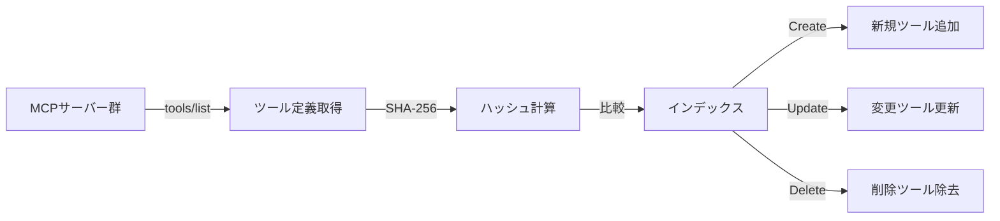

## 論文概要（Abstract）

本記事は [ScaleMCP: Dynamic and Auto-Synchronizing Model Context Protocol Tools for LLM Agents](https://arxiv.org/abs/2505.06416) の解説記事です。

ScaleMCPは、MCP（Model Context Protocol）サーバーのツールを動的に検索・同期するフレームワークである。著者らは、既存のツール選択手法がMCPサーバーとの統合を欠き、手動更新によるツールリポジトリの重複・非整合が課題であると指摘している。本論文では、（1）エージェントが自律的にMCPツールを検索・取得するリトリーバ機構、（2）CRUDオペレーションによる自動同期パイプライン、（3）Tool Document Weighted Average（TDWA）と呼ばれる新しい埋め込み手法を提案している。5,000の金融系MCPサーバー、10のLLM、5つの埋め込みモデルで評価を行っている。

この記事は [Zenn記事: MCPサーバーのツール設計パターン：数・スキーマ・認可の実践ガイド](https://zenn.dev/0h_n0/articles/c434eb97660610) の深掘りです。

## 情報源

- **arXiv ID**: 2505.06416
- **URL**: [https://arxiv.org/abs/2505.06416](https://arxiv.org/abs/2505.06416)
- **著者**: Elias Lumer, Anmol Gulati, Vamse Kumar Subbiah, Pradeep Honaganahalli Basavaraju, James A. Burke（PricewaterhouseCoopers, U.S.A.）
- **発表年**: 2025
- **分野**: cs.CL（計算言語学）
- **ライセンス**: CC BY 4.0

## 背景と動機（Background & Motivation）

MCPは2024年後半にAnthropicが公開した標準プロトコルであり、LLMエージェントが外部ツール・データにアクセスするためのインターフェースを規定する。しかし、MCPサーバーの数が増加するにつれ、エージェントが利用可能なツールの管理が課題となっている。

著者らは既存手法の2つの問題点を指摘している。第一に、従来のツール選択フレームワークはMCPサーバーとの統合を想定しておらず、ローカルなツールリポジトリを手動で更新する必要がある。第二に、ツール選択がエージェント呼び出し前に行われるため、マルチターン会話中にツールを再検索できない。モデルプロバイダーがリクエストあたりのツール数を128個程度に制限している点も、大規模ツール環境での検索型アプローチの必要性を裏付けている。

## 主要な貢献（Key Contributions）

- **MCP統合型ツール検索**: MCPサーバーをツールのsingle source of truthとし、エージェントがリトリーバツールを通じて動的にツールを取得する仕組み
- **自動同期パイプライン**: SHA-256ハッシュによるツール定義の変更検知と、CRUD操作によるインデックスの自動更新
- **TDWA埋め込み手法**: ツールドキュメントの各コンポーネント（名前、説明、パラメータ、合成質問）を重み付き平均で統合する新しい埋め込み方式
- **大規模評価データセット**: Fortune 1000企業にテンプレート展開した5,000のMCPサーバーと約140,000のクエリインスタンス

## 技術的詳細（Technical Details）

### 自動同期パイプライン

著者らが提案する同期パイプライン（Algorithm 1）は、MCPサーバーから`tools/list`でツール一覧を取得し、各ツールの名前・説明・引数をSHA-256でハッシュ化する。ハッシュ値をストレージインデックスと比較し、新規・変更・削除されたツールに対してCRUD操作を実行する。ストレージはベクトルDB、グラフDB、語彙検索のいずれにも対応可能である。



### TDWA（Tool Document Weighted Average）

TDWAは、ツールドキュメントの各コンポーネントを個別に埋め込み、重み付き平均で統合する手法である。従来のツール検索では、ツール名・説明・パラメータを単純に結合（concatenation）して1つの埋め込みベクトルを生成していた。TDWAはこれを改善し、各コンポーネントの重要度を反映させる。

ツールドキュメント $d$ が $C$ 個のコンポーネント $\{c_1, c_2, \ldots, c_C\}$ から構成されるとき、TDWA埋め込み $\mathbf{e}_d$ は以下で定義される：

$$
\mathbf{e}_d = \frac{\sum_{i=1}^{C} w_i \cdot \text{Embed}(c_i)}{\left\| \sum_{i=1}^{C} w_i \cdot \text{Embed}(c_i) \right\|}
$$

ここで、
- $C$: コンポーネント数（名前、説明、パラメータ、合成質問の4種）
- $w_i$: 各コンポーネントの重み（$w_i \geq 0$、$\sum_{i=1}^{C} w_i = 1$）
- $\text{Embed}(c_i)$: コンポーネント $c_i$ の埋め込みベクトル

著者らはvar-1 $[0.2, 0.2, 0.2, 0.4]$ とvar-2 $[0.2, 0.3, 0, 0.5]$ の2つの重み設定を評価している。var-2では合成質問（Synthetic Questions）に最大の重み0.5を与え、パラメータの重みを0にしている。

### エージェント駆動型ツール検索

著者らのフレームワークでは、エージェントに「MCP Retrieval」ツールが付与される。エージェントはキーワードを渡してツールを検索し、取得されたMCPツールがファンクションコーリングを通じてモデルにバインドされる。この仕組みにより、エージェントはマルチターン会話中に必要に応じてツールを再検索できる。

```python
from dataclasses import dataclass
from typing import Optional

@dataclass
class MCPToolDocument:
    """MCPツールのドキュメント表現"""
    name: str
    description: str
    parameters: dict
    synthetic_questions: list[str]

def compute_tdwa_embedding(
    tool: MCPToolDocument,
    embed_fn: callable,
    weights: list[float],
) -> list[float]:
    """TDWA埋め込みを計算する

    Args:
        tool: MCPツールドキュメント
        embed_fn: 埋め込み関数
        weights: 各コンポーネントの重み [name, desc, params, sq]

    Returns:
        正規化されたTDWA埋め込みベクトル
    """
    import numpy as np

    components = [
        tool.name,
        tool.description,
        str(tool.parameters),
        " ".join(tool.synthetic_questions),
    ]

    embeddings = [embed_fn(c) for c in components]
    weighted_sum = sum(
        w * np.array(e) for w, e in zip(weights, embeddings)
    )
    norm = np.linalg.norm(weighted_sum)
    if norm > 0:
        weighted_sum = weighted_sum / norm
    return weighted_sum.tolist()
```

### 合成質問の生成

各ツールに対して、LLMが0、5、または10個の合成質問を生成する。合成質問とは、そのツールを使って回答できるユーザークエリの例である。著者らは、合成質問を追加するとベクトル検索のRecallが改善することを報告している（Table 2より：text-embedding-3-large でSQ=0のRecall 0.83 → SQ=10のRecall 0.91）。

## 実験結果（Results）

### ツール検索性能

著者らは5,000のMCPサーバーを用いた検索実験の結果をTable 2に報告している。ベクトル検索単体ではMAP@5が約0.50にとどまるが、リランキングの追加で大幅に改善する。

| 手法 | NDCG@5 | Recall@5 | MAP@5 |
|------|--------|----------|-------|
| text-embedding-3-large（SQ=0） | 0.62 | 0.83 | 0.50 |
| text-embedding-3-large（SQ=10） | 0.63 | 0.91 | 0.50 |
| text-embedding-3-small（SQ=0） | 0.64 | 0.82 | 0.53 |
| BM25（SQ=0） | 0.42 | 0.57 | 0.32 |
| BM25（SQ=10） | 0.51 | 0.66 | 0.42 |
| VertexAI + GPT-4oリランキング | — | 0.94 | — |
| VertexAI + Claudeリランキング | — | — | 0.59 |

著者らの報告によると（Table 2より）、BM25は全メトリクスで最も低い性能を示し、ベクトル検索がMCPツール検索に適していることを示唆している。合成質問（SQ=10）の追加は一貫して検索品質を向上させる。LLMリランカー（GPT-4oおよびClaude Sonnet 3.7）はCohere v3-englishリランカーを上回る性能を示した。

### エンドツーエンドのエージェント評価

著者らはDeepEvalフレームワークを用いたエージェント評価をTable 4で報告している。ベクトル検索 + Cohereリランカー構成での結果を以下に示す。

| モデル | Tool Correctness | Task Completion |
|--------|-----------------|-----------------|
| GPT o3 | 36.1% | 94.4% |
| GPT-4o-mini | 54.0% | 86.7% |
| GPT-4.1 | 44.8% | 85.8% |
| Claude 3.7 Sonnet | 23.1% | 69.4% |

著者らの主要な知見として、**Task Completion（タスク完了率）とTool Correctness（ツール正確性）の間に大きな乖離**がある点が指摘されている。多くのエージェントがリランキングにより80%超のTask Completionを達成するが、Tool Correctnessは23%〜54%にとどまる。これは、エージェントが誤ったツール呼び出しを行いながらも最終的に妥当な回答を生成するケースが多いことを意味する。

### TDWA重み設定の比較

著者らはTDWAの重み設定による影響を検証している。K=5のベクトル検索において、単純結合（concatenation）が最高のNDCG（0.634）とRecall（0.912）を示したのに対し、TDWA var-1はCohereリランキングとの組み合わせで最高のMAP（0.528）を達成した。著者らはTDWAがリランキングとの併用で結合方式との差を縮めると報告しているが、ベクトル検索単体では結合方式を上回っていない。

## 実装のポイント（Implementation）

### 自動同期の実装

自動同期パイプラインは、各MCPツールの定義（名前、説明、引数）をSHA-256でハッシュ化し、ストレージのハッシュと比較する。差分がある場合のみインデックスを更新するため、変更のないツールの再インデックスを回避できる。

```python
import hashlib
import json
from typing import Any

def compute_tool_hash(tool_definition: dict[str, Any]) -> str:
    """MCPツール定義のハッシュを計算する

    Args:
        tool_definition: ツールの名前・説明・パラメータを含む辞書

    Returns:
        SHA-256ハッシュ値（16進数文字列）
    """
    canonical = json.dumps(
        {
            "name": tool_definition["name"],
            "description": tool_definition["description"],
            "inputSchema": tool_definition.get("inputSchema", {}),
        },
        sort_keys=True,
        ensure_ascii=False,
    )
    return hashlib.sha256(canonical.encode()).hexdigest()


def sync_tool_index(
    live_tools: list[dict[str, Any]],
    stored_hashes: dict[str, str],
    index_store: Any,
) -> dict[str, int]:
    """ライブツールとストレージインデックスを同期する

    Args:
        live_tools: MCPサーバーから取得したツール定義のリスト
        stored_hashes: ストレージ内の {tool_name: hash} マッピング
        index_store: ベクトルDBなどのストレージインスタンス

    Returns:
        {"created": N, "updated": N, "deleted": N} の変更サマリ
    """
    stats = {"created": 0, "updated": 0, "deleted": 0}
    live_map = {t["name"]: t for t in live_tools}

    for name, tool in live_map.items():
        new_hash = compute_tool_hash(tool)
        if name not in stored_hashes:
            index_store.create(tool, new_hash)
            stats["created"] += 1
        elif stored_hashes[name] != new_hash:
            index_store.update(tool, new_hash)
            stats["updated"] += 1

    for name in stored_hashes:
        if name not in live_map:
            index_store.delete(name)
            stats["deleted"] += 1

    return stats
```

### マルチホップクエリの課題

著者らは、1クエリあたり平均5.0のツール呼び出しが必要な金融ドメインでは、単一のクエリ埋め込みでは複数のツール意図を捕捉しきれないと報告している。この課題に対して、LLMリランカーの追加やエージェントによる段階的な検索が解決策として提案されている。

## Production Deployment Guide

### AWS実装パターン（コスト最適化重視）

ScaleMCPのアーキテクチャ（ツール検索 → リランキング → エージェント実行）をAWS上に構築する場合の構成を以下に示す。

| 規模 | 月間リクエスト | 推奨構成 | 月額コスト | 主要サービス |
|------|--------------|---------|-----------|------------|
| **Small** | ~3,000 (100/日) | Serverless | $80-200 | Lambda + Bedrock + OpenSearch Serverless |
| **Medium** | ~30,000 (1,000/日) | Hybrid | $400-1,000 | Lambda + ECS Fargate + OpenSearch Serverless |
| **Large** | 300,000+ (10,000/日) | Container | $2,500-6,000 | EKS + OpenSearch + ElastiCache Redis |

**Small構成の詳細**（月額$80-200）:
- **Lambda**: ツール検索・同期処理、1GB RAM ($20/月)
- **Bedrock**: Claude 3.5 Haiku、リランキング・エージェント実行 ($100/月)
- **OpenSearch Serverless**: ベクトルインデックス、2 OCU最小 ($50/月)
- **DynamoDB**: ツールハッシュ・メタデータ管理 ($5/月)
- **EventBridge**: 定期同期スケジュール ($5/月)

**コスト削減テクニック**:
- Prompt Caching有効化でBedrock APIコスト30-90%削減
- OpenSearch Serverlessの自動スケーリングで非ピーク時コスト低減
- Bedrock Batch APIで非リアルタイムのリランキング処理を50%割引

**コスト試算の注意事項**: 上記は2026年11月時点のAWS ap-northeast-1（東京）リージョン料金に基づく概算値です。実際のコストはトラフィックパターン、埋め込みモデルの選択、リランキング回数により変動します。最新料金は [AWS料金計算ツール](https://calculator.aws/) で確認してください。

### Terraformインフラコード

**Small構成（Serverless）: Lambda + Bedrock + OpenSearch Serverless**

```hcl
# --- OpenSearch Serverless（ベクトル検索） ---
resource "aws_opensearchserverless_collection" "tool_index" {
  name = "mcp-tool-index"
  type = "VECTORSEARCH"
}

resource "aws_opensearchserverless_security_policy" "encryption" {
  name = "mcp-tool-encryption"
  type = "encryption"
  policy = jsonencode({
    Rules = [{
      Resource     = ["collection/mcp-tool-index"]
      ResourceType = "collection"
    }]
    AWSOwnedKey = true
  })
}

# --- IAMロール（最小権限） ---
resource "aws_iam_role" "tool_sync_lambda" {
  name = "mcp-tool-sync-role"

  assume_role_policy = jsonencode({
    Version = "2012-10-17"
    Statement = [{
      Action = "sts:AssumeRole"
      Effect = "Allow"
      Principal = { Service = "lambda.amazonaws.com" }
    }]
  })
}

resource "aws_iam_role_policy" "tool_sync_policy" {
  role = aws_iam_role.tool_sync_lambda.id
  policy = jsonencode({
    Version = "2012-10-17"
    Statement = [
      {
        Effect   = "Allow"
        Action   = ["aoss:APIAccessAll"]
        Resource = [aws_opensearchserverless_collection.tool_index.arn]
      },
      {
        Effect   = "Allow"
        Action   = ["bedrock:InvokeModel"]
        Resource = ["arn:aws:bedrock:ap-northeast-1::foundation-model/anthropic.claude-3-5-haiku*"]
      },
      {
        Effect   = "Allow"
        Action   = ["dynamodb:GetItem", "dynamodb:PutItem", "dynamodb:DeleteItem", "dynamodb:Scan"]
        Resource = [aws_dynamodb_table.tool_hashes.arn]
      }
    ]
  })
}

# --- Lambda（ツール同期） ---
resource "aws_lambda_function" "tool_sync" {
  filename      = "tool_sync.zip"
  function_name = "mcp-tool-sync"
  role          = aws_iam_role.tool_sync_lambda.arn
  handler       = "sync.handler"
  runtime       = "python3.12"
  timeout       = 120
  memory_size   = 1024

  environment {
    variables = {
      OPENSEARCH_ENDPOINT = aws_opensearchserverless_collection.tool_index.collection_endpoint
      DYNAMODB_TABLE      = aws_dynamodb_table.tool_hashes.name
      BEDROCK_MODEL_ID    = "anthropic.claude-3-5-haiku-20241022-v1:0"
    }
  }
}

# --- DynamoDB（ツールハッシュ管理） ---
resource "aws_dynamodb_table" "tool_hashes" {
  name         = "mcp-tool-hashes"
  billing_mode = "PAY_PER_REQUEST"
  hash_key     = "tool_name"

  attribute {
    name = "tool_name"
    type = "S"
  }
}

# --- EventBridge（定期同期） ---
resource "aws_cloudwatch_event_rule" "sync_schedule" {
  name                = "mcp-tool-sync-schedule"
  schedule_expression = "rate(1 hour)"
}

resource "aws_cloudwatch_event_target" "sync_lambda" {
  rule = aws_cloudwatch_event_rule.sync_schedule.name
  arn  = aws_lambda_function.tool_sync.arn
}
```

### 運用・監視設定

**CloudWatch Logs Insights クエリ**:

```sql
-- ツール同期の変更検知
fields @timestamp, stats.created, stats.updated, stats.deleted
| filter function_name = "mcp-tool-sync"
| stats sum(stats.created) as new_tools, sum(stats.updated) as updated_tools by bin(1h)

-- ツール検索のレイテンシ分析
fields @timestamp, retrieval_latency_ms, reranking_latency_ms
| stats pct(retrieval_latency_ms, 95) as p95_retrieval,
        pct(reranking_latency_ms, 95) as p95_reranking by bin(5m)
```

**CloudWatch アラーム（Python）**:

```python
import boto3

cloudwatch = boto3.client("cloudwatch")

cloudwatch.put_metric_alarm(
    AlarmName="mcp-tool-sync-failure",
    ComparisonOperator="GreaterThanThreshold",
    EvaluationPeriods=1,
    MetricName="Errors",
    Namespace="AWS/Lambda",
    Period=3600,
    Statistic="Sum",
    Threshold=0,
    AlarmDescription="MCPツール同期Lambda実行エラー検知",
    Dimensions=[{"Name": "FunctionName", "Value": "mcp-tool-sync"}],
)
```

### コスト最適化チェックリスト

**アーキテクチャ選択**:
- [ ] ~100 req/日 → Lambda + OpenSearch Serverless（$80-200/月）
- [ ] ~1000 req/日 → ECS Fargate + OpenSearch Serverless（$400-1,000/月）
- [ ] 10000+ req/日 → EKS + OpenSearch Managed + ElastiCache（$2,500-6,000/月）

**ツール検索最適化**:
- [ ] 合成質問（SQ=10）追加でRecall向上（本論文Table 2より0.83→0.91）
- [ ] Cohereリランカーで十分な場合はLLMリランキング不要（コスト削減）
- [ ] OpenSearch k-NNインデックスのefSearch値を用途に応じて調整

**LLMコスト削減**:
- [ ] Bedrock Batch API: 非リアルタイム処理に50%割引適用
- [ ] Prompt Caching: システムプロンプト固定で30-90%削減
- [ ] モデル選択: 検索にHaiku、リランキングにSonnet（コスト・精度トレードオフ）

**監視・アラート**:
- [ ] ツール同期Lambdaのエラー検知
- [ ] OpenSearch Serverless OCU使用量モニタリング
- [ ] Bedrock APIトークン使用量スパイク検知
- [ ] AWS Budgets月額予算設定

**リソース管理**:
- [ ] DynamoDB TTLで古いハッシュエントリ自動削除
- [ ] OpenSearch Serverlessの自動スケーリング設定確認
- [ ] Lambda Insightsで実行時間・メモリ使用量を最適化

## 実運用への応用（Practical Applications）

著者らの提案するScaleMCPフレームワークは、Zenn記事で紹介した「Tool Registryパターン」および「遅延読み込みパターン」の実装基盤として位置づけられる。MCP仕様ではツールのフィルタリング機構が標準化されていないため、ScaleMCPが提案するリトリーバ型のアプローチはこのギャップを埋める有力な選択肢となる。

ただし、著者ら自身が指摘するように、現在の実験ではエージェントが単一の`get_mcp_servers`検索呼び出しを行う設定であり、反復的な検索ループ（agentic retrieval）は将来課題として挙げられている。Tool CorrectnessとTask Completionの乖離（23-54% vs 69-94%）は、ツール検索精度の改善がエージェント全体の信頼性向上に直結することを示唆している。

## 関連研究（Related Work）

- **AutoTool（arXiv 2512.13278）**: 埋め込みアンカーによる動的ツール選択を提案。数千のツールセットにスケール可能と報告されており、ScaleMCPのTDWAとは異なるアプローチ。
- **ToolChoiceConfusion（arXiv 2606.06284）**: 因果的最小ツールフィルタリング（CMTF）を提案。意味的類似性ではなく、タスク状態に基づく因果構造でツール選択を行う点で、ScaleMCPの検索ベースアプローチと補完的。
- **Claude Code v2.1.7+**: MCPツール説明がコンテキストの10%を超えると遅延読み込み（Tool Search）に自動切替。ScaleMCPの検索メカニズムと同様の設計思想。

## まとめと今後の展望

ScaleMCPは、MCPサーバーのツールを動的に検索・同期するための体系的なフレームワークを提示している。TDWA埋め込みと自動同期パイプラインにより、大規模なMCPサーバー環境でのツール管理を自動化する。

著者らの実験では、ベクトル検索単体のMAP@5が約0.50にとどまるのに対し、LLMリランキングの追加でRecall@10が0.94に達する。一方でTool Correctnessは最高でも54%であり、高いTask Completionが必ずしもツール選択の正確性を反映しないことが明らかになっている。今後の課題として、反復的なエージェント検索、ファインチューニングによるツール発見の改善、金融以外のドメインへの展開が挙げられている。

## 参考文献

- **arXiv**: [https://arxiv.org/abs/2505.06416](https://arxiv.org/abs/2505.06416)
- **Related Zenn article**: [https://zenn.dev/0h_n0/articles/c434eb97660610](https://zenn.dev/0h_n0/articles/c434eb97660610)
