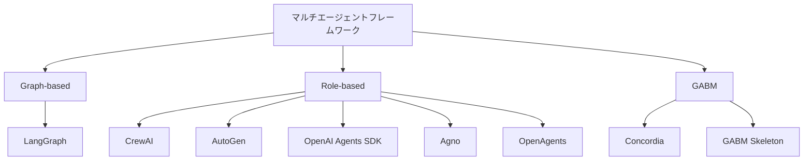

本記事は [https://arxiv.org/abs/2602.03128](https://arxiv.org/abs/2602.03128) の解説記事です。

## 論文概要（Abstract）

マルチエージェントLLMフレームワーク（LangGraph、CrewAI、AutoGenなど）はタスクのオーケストレーション、状態管理、意思決定の協調方法をアーキテクチャレベルで決定するデータ集約型システムである。著者らは、これらの設計選択が実行オーバーヘッド、メモリ挙動、計画の有効性、協調のスケーラビリティに与える影響が十分に解明されていないと指摘している。本論文では5次元のアーキテクチャ分類体系、統一ベンチマークスイートMAFBench、9つのフレームワークの制御実験、および6つのエビデンスに基づく設計原則を提案している。

この記事は [Zenn記事: AutoGenからAgent Frameworkへ：自律エージェント移行実践ガイド](https://zenn.dev/0h_n0/articles/c5509c723c2670) の深掘りです。Zenn記事ではAutoGenからMicrosoft Agent Frameworkへの移行を中心に議論していますが、本論文はフレームワーク選択をより科学的に行うための定量的な根拠を提供します。

## 情報源

- **arXiv ID**: 2602.03128
- **URL**: [https://arxiv.org/abs/2602.03128](https://arxiv.org/abs/2602.03128)
- **著者**: Abdelghny Orogat, Ana Rostam, Essam Mansour（Concordia University）
- **発表年**: 2026年2月（SIGMOD 2027に採択）
- **分野**: cs.AI（Artificial Intelligence）

## 背景と動機（Background & Motivation）

マルチエージェントLLMシステムの研究は近年急速に発展しているが、著者らはその評価方法に構造的な問題があると指摘している。既存のベンチマーク（GAIA、WebArena、AgentBench等）はエージェントの能力を単体で評価しており、フレームワークレベルの設計選択が性能に与える影響を分離できない。

著者らは3つのギャップを特定している：

1. **アーキテクチャ次元の未整理**: オーケストレーション、メモリ、計画インターフェースなどの設計次元が体系的に分類されていない
2. **統一ベンチマークの欠如**: 異なるフレームワークをフェアに比較するための共通実行パイプラインが存在しない
3. **制御された実証の不在**: LLMを固定してアーキテクチャのみを変化させる実験が行われていない

この問題意識はZenn記事で取り上げたフレームワーク選択の課題と直結する。AutoGenからAgent Frameworkへの移行を検討する際、「どのフレームワークが性能的に優れているか」という問いに対して、モデル能力とフレームワーク設計の寄与を分離して評価する手段がなかった。

## 主要な貢献（Key Contributions）

- **貢献1**: マルチエージェントフレームワークを5次元（オーケストレーション、メモリ、計画インターフェース、専門化、通信トポロジー）で分類するアーキテクチャ分類体系を定義
- **貢献2**: 既存ベンチマークを統一実行パイプラインに統合したMAFBenchスイートを構築
- **貢献3**: 9つのフレームワークをLLM固定で比較する制御実験を実施し、6つの設計原則を導出
- **貢献4**: オーケストレーションのオーバーヘッドが最大62倍に達すること、スキーマ制約が精度を最大32ポイント低下させることなど、定量的なエビデンスを提示

## 技術的詳細（Technical Details）

### アーキテクチャ分類体系

著者らはマルチエージェントフレームワークを3つのパラダイムに分類している。



**Graph-based（グラフベース）**: 開発者が明示的にノードとエッジを定義し、制御フローを構成する。LangGraphが代表例で、ワークフローグラフ上の著者定義エッジによってエージェント間のデータフローが決定される。

**Role-based（ロールベース）**: エージェントにロール（役割）を付与し、タスク委任によって協調する。CrewAI、AutoGen、OpenAI Agents SDK、Agno、OpenAgentsがこのカテゴリに属する。

**GABM（Game-master Agent-Based Model）**: ゲームマスターが環境を介してエージェントを仲介する。Concordiaが唯一の本番GABMフレームワークである。

著者らは形式的定義（Definition 2.1〜2.6）を与えている。エージェントは以下のタプルとして定義される：

$$
\text{Agent} = (\text{role}, \text{objectives}, \text{planning}, \text{storage}, \text{tools}, f)
$$

ここで、$f$はLLMによる推論関数である。汎用フレームワークは以下のように定義される：

$$
\text{Framework} = (\{a_i\}, O, C, E)
$$

ここで、$\{a_i\}$はエージェント集合、$O$はオーケストレーション、$C$は通信、$E$は共有環境である。

GABMの遷移関数は$T: E \times \{a_i\} \to E$であり、ワールド状態とエージェントアクションから次のワールド状態へのマッピングを定義する。

### 5つの評価次元

| 次元 | 評価対象 | 代表的な指標 |
|------|----------|-------------|
| オーケストレーション | 実行構造のオーバーヘッド | レイテンシ倍率、スループット |
| メモリ | 記憶・検索・学習能力 | リコール率、スケーラビリティ |
| 計画インターフェース | 計画の注入形式と効果 | 精度変化、スキーマ違反率 |
| 専門化 | ロールとプロシージャの効果 | F1スコア変化 |
| 通信トポロジー | エージェント間の情報フロー | 協調成功率、スケーリング挙動 |

### 評価対象フレームワーク

論文Table 2より、以下の9フレームワークが評価対象である。

| フレームワーク | パラダイム | GitHub Stars |
|---------------|-----------|-------------|
| LangGraph | Graph | 18.9k |
| CrewAI | Role | 38.4k |
| AutoGen | Role | 50.0k |
| OpenAI Agents SDK | Role | 14.9k |
| Agno | Role | 4.2k |
| OpenAgents | Role | 1.1k |
| Concordia | GABM | 1.0k |
| OpenHands | Task-specific | 82.2k |
| GABM Skeleton | GABM | 著者実装 |

### MAFBenchの設計

MAFBenchは以下の要素を統合した統一ベンチマークスイートである：

```python
class MAFBench:
    """Multi-Agent Framework Benchmark Suite

    統一実行パイプラインにより、フレームワーク間の
    フェアな比較を可能にする。
    """
    def __init__(self, llm_backend: str, config_parity: bool = True):
        self.llm_backend = llm_backend
        self.config_parity = config_parity
        self.scorer = LLMSemanticScorer()

    def evaluate_dimension(
        self, framework: str, dimension: str, benchmark: str
    ) -> dict[str, float]:
        """指定次元でフレームワークを評価する

        Args:
            framework: 評価対象フレームワーク名
            dimension: 評価次元（orchestration/memory/planning/specialization/topology）
            benchmark: 使用するベンチマーク名

        Returns:
            指標名と値のマッピング
        """
        config = self._ensure_parity(framework)
        results = self._run_pipeline(framework, dimension, benchmark, config)
        return self.scorer.evaluate(results)
```

MAFBenchの設計上の特徴として、LLMベースのセマンティックスコアリング、設定パリティの保証、バックエンドルーティングが挙げられる。LLMを固定することで、フレームワーク設計の寄与のみを分離できる。

## 実験結果（Results）

### オーケストレーションオーバーヘッド

著者らは「2+2は？」という自明なタスク（gpt-4o-mini、50試行）でオーバーヘッドを測定している（論文Table 1およびSection 4.1.1より）。

| フレームワーク | p50レイテンシ(ms) | スループット(req/s) | 残余時間(ms) |
|---------------|------------------|-------------------|-------------|
| Direct LLM | 495 | 7.0 | — |
| OpenAgents | 527 | — | — |
| LangGraph | 548 | — | — |
| CrewAI | 741 | — | — |
| Agno | 902 | — | 39.3% |
| AutoGen | 964 | — | — |
| OpenAI SDK | 1,275 | — | — |
| Concordia | 30,564 | 0.12 | 91.5% (28,643ms) |
| GABM Skeleton | 522 | — | 13.7ms |

著者らが注目しているのは、Concordiaの62倍のオーバーヘッドに対し、同じGABMパラダイムの最小実装（GABM Skeleton）が522msにとどまる点である。著者らはこのギャップを「パラダイムのコストではなく実装のコスト」と解釈している。

### 計画インターフェースの影響

計画インターフェースのフォーマットがLLM性能に与える影響が最も顕著な結果の一つである（論文Section 4.1.3より）。

| ベンチマーク | モデル | 計画なし | CrewAI Schema | Free-form |
|-------------|--------|---------|---------------|-----------|
| GSM8K | Qwen-7B | 13.0 | 3.4 | 28.7 |
| CSQA | Qwen-7B | 69.9 | 37.6 | 74.0 |
| MATH-100 | GPT-OSS-20B | 80.0 | 48.0 | 76.0 |
| GSM8K | Llama-3.1-8B | 65.6 | — | 71.9 |

CrewAIのスキーマ制約によるスキーマ違反率は、Qwen-7BでGSM8Kにおいて84.7%、MATH-100で70.0%に達する。著者らはこれを「推論エラーではなくフォーマッティングの失敗」と分析している。一方、自由形式の計画では違反率は0.0%であった。

フロンティアモデル（GPT-5.6、Claude Opus 5）ではスキーマ違反は発生しないが、実行時間のオーバーヘッドは2.5〜15.0倍に達すると報告されている。

### メモリアーキテクチャ

MemoryAgentBench（gpt-oss-20b）での評価結果（論文Section 4.1.2より）：

- **正確な検索**: LangGraph hybrid（W=512）が44.9で最高スコア、retrieval-onlyで33.2
- **テスト時学習**: OpenAI SDKはW=50で1.2からW=8192で20.7に上昇。LangGraph hybrid（W=1024）が28.9で最高
- **長距離理解**: LangGraph retrieval-onlyが30.4で最高
- **選択的忘却**: 単一ホップで最高20.2。マルチホップは全アーキテクチャで5.0以下

著者らは「評価対象のいずれのフレームワークも制御された知識改訂をネイティブにサポートしていない」と指摘している。

### 通信トポロジーと協調

AgentsNet（エージェント数$n = 4$〜$100$）での協調タスク評価（論文Section 4.2.1より）：

- **グラフ彩色**: 全トポロジーで成功
- **マッチング**: グラフベースで$n < 50$まで0.5以上を維持
- **頂点被覆**: スケールフリーグラフが大規模で最良
- **リーダー選出**: スモールワールドとスケールフリーが全サイズで失敗
- **合意形成**: 完全連結トポロジー（GABM型）のみが一貫して成功し、3ラウンドで収束。グラフベースのトポロジーは全て失敗

この結果は、タスクの情報フロー要件とトポロジーの整合が重要であることを示している。

## 6つの設計原則

著者らが実験結果から導出した6つの設計原則（論文Section 5より）：

1. **オーケストレーションオーバーヘッドが主要なスケーラビリティ制約である**: フレームワークの実行構造で判断し、パラダイムのコストと実装のコストを区別せよ
2. **メモリはコンテキストサイズではなくタスクセマンティクスに基づいて設計せよ**: 知識集約タスクにはretrieval、セッションタスクにはbounded accumulationを使用する。知識改訂は未解決
3. **計画インターフェースは許容的に保ち、必要な場合のみ計画せよ**: スキーマ制約は弱いモデルでフォーマッティング失敗を引き起こし、フロンティアモデルでは計画の恩恵が小さい
4. **専門化はプロシージャルに行い、ロールラベルは補助的に扱え**: エージェントが手法を欠く場合はプロシージャを、情報を欠く場合はツールを提供する
5. **通信トポロジーはタスクが必要とする情報フローから選択せよ**: 局所タスクにはスパースグラフ、全体合意には完全連結を。完全連結は二次の通信コストを要する
6. **プロンプトやモデルのチューニングの前にシステムインターフェースを整備せよ**: アーキテクチャのボトルネックはモデル世代を超えて持続する

## 実装のポイント（Implementation）

MAFBenchの実装から得られる実践的知見：

- **LLM固定による制御実験**: フレームワーク比較を行う際は、同一のLLMバックエンドを使用し、設定パリティを確保することが必須。モデルとフレームワークの寄与が混在すると結論が無効になる
- **残余時間（Residual）の測定**: LLM呼び出し時間を除いたフレームワーク固有のオーバーヘッドを分離して計測すべき。Concordiaの91.5%という残余はシミュレーション機構に起因する
- **スキーマ違反の検出**: 計画インターフェースを導入する際は、スキーマ違反率をモニタリングし、モデル能力に応じて自由形式にフォールバックする設計が有効
- **トポロジーの選択**: 合意形成が必要なタスクでは完全連結が必須だが、通信コストが$O(n^2)$でスケールすることを考慮し、エージェント数の上限を設定する

## Production Deployment Guide

### AWS実装パターン（コスト最適化重視）

MAFBenchのようなフレームワーク評価パイプラインをAWS上に構築する場合の推奨構成を示す。

| 規模 | 月間評価回数 | 推奨構成 | 月額コスト | 主要サービス |
|------|------------|---------|-----------|------------|
| **Small** | ~100回 | Serverless | $80-200 | Lambda + Bedrock + DynamoDB |
| **Medium** | ~1,000回 | Hybrid | $500-1,200 | ECS Fargate + Bedrock + ElastiCache |
| **Large** | 10,000回+ | Container | $3,000-8,000 | EKS + Karpenter + EC2 Spot |

**注意**: 上記は2026年11月時点のAWS ap-northeast-1（東京）リージョン料金に基づく概算値です。実際のコストはフレームワーク数、ベンチマークサイズ、LLMモデル選択により変動します。最新料金は [AWS料金計算ツール](https://calculator.aws/) で確認してください。

**Small構成の詳細**（月額$80-200）:
- **Lambda**: 2GB RAM, 300秒タイムアウト（$30/月）
- **Bedrock**: Claude 3.5 Haiku、Prompt Caching有効（$100/月）
- **DynamoDB**: On-Demand（$10/月）
- **S3**: ベンチマーク結果保存（$5/月）
- **Step Functions**: パイプラインオーケストレーション（$5/月）

**コスト削減テクニック**:
- Bedrock Batch APIで非リアルタイム評価を50%削減
- Prompt Cachingでシステムプロンプト固定部分を30-90%削減
- Spot Instances活用（EKS構成）で最大90%削減
- Reserved Instances購入で最大72%削減（1年コミット）

### Terraformインフラコード

**Small構成（Serverless）: Lambda + Bedrock + Step Functions**

```hcl
module "vpc" {
  source  = "terraform-aws-modules/vpc/aws"
  version = "~> 5.0"

  name = "mafbench-vpc"
  cidr = "10.0.0.0/16"
  azs  = ["ap-northeast-1a", "ap-northeast-1c"]
  private_subnets = ["10.0.1.0/24", "10.0.2.0/24"]

  enable_nat_gateway   = false
  enable_dns_hostnames = true
}

resource "aws_iam_role" "lambda_mafbench" {
  name = "mafbench-lambda-role"

  assume_role_policy = jsonencode({
    Version = "2012-10-17"
    Statement = [{
      Action    = "sts:AssumeRole"
      Effect    = "Allow"
      Principal = { Service = "lambda.amazonaws.com" }
    }]
  })
}

resource "aws_iam_role_policy" "bedrock_invoke" {
  role = aws_iam_role.lambda_mafbench.id
  policy = jsonencode({
    Version = "2012-10-17"
    Statement = [{
      Effect   = "Allow"
      Action   = ["bedrock:InvokeModel", "bedrock:InvokeModelWithResponseStream"]
      Resource = "arn:aws:bedrock:ap-northeast-1::foundation-model/anthropic.claude-*"
    }]
  })
}

resource "aws_lambda_function" "benchmark_runner" {
  filename      = "benchmark.zip"
  function_name = "mafbench-runner"
  role          = aws_iam_role.lambda_mafbench.arn
  handler       = "index.handler"
  runtime       = "python3.12"
  timeout       = 300
  memory_size   = 2048

  environment {
    variables = {
      BEDROCK_MODEL_ID    = "anthropic.claude-3-5-haiku-20241022-v1:0"
      DYNAMODB_TABLE      = aws_dynamodb_table.results.name
      ENABLE_PROMPT_CACHE = "true"
    }
  }
}

resource "aws_dynamodb_table" "results" {
  name         = "mafbench-results"
  billing_mode = "PAY_PER_REQUEST"
  hash_key     = "run_id"
  range_key    = "dimension"

  attribute {
    name = "run_id"
    type = "S"
  }
  attribute {
    name = "dimension"
    type = "S"
  }

  ttl {
    attribute_name = "expire_at"
    enabled        = true
  }
}

resource "aws_cloudwatch_metric_alarm" "lambda_cost" {
  alarm_name          = "mafbench-cost-spike"
  comparison_operator = "GreaterThanThreshold"
  evaluation_periods  = 1
  metric_name         = "Duration"
  namespace           = "AWS/Lambda"
  period              = 3600
  statistic           = "Sum"
  threshold           = 300000
  alarm_description   = "MAFBench Lambda実行時間異常"

  dimensions = {
    FunctionName = aws_lambda_function.benchmark_runner.function_name
  }
}
```

**Large構成（Container）: EKS + Karpenter + Spot**

```hcl
module "eks" {
  source  = "terraform-aws-modules/eks/aws"
  version = "~> 20.0"

  cluster_name    = "mafbench-cluster"
  cluster_version = "1.31"
  vpc_id          = module.vpc.vpc_id
  subnet_ids      = module.vpc.private_subnets

  cluster_endpoint_public_access = true
  enable_cluster_creator_admin_permissions = true
}

resource "kubectl_manifest" "karpenter_provisioner" {
  yaml_body = <<-YAML
    apiVersion: karpenter.sh/v1
    kind: NodePool
    metadata:
      name: benchmark-spot
    spec:
      template:
        spec:
          requirements:
            - key: karpenter.sh/capacity-type
              operator: In
              values: ["spot"]
            - key: node.kubernetes.io/instance-type
              operator: In
              values: ["m6i.xlarge", "m6i.2xlarge"]
          limits:
            cpu: "64"
            memory: "256Gi"
      disruption:
        consolidationPolicy: WhenEmptyOrUnderutilized
        consolidateAfter: 30s
  YAML
}

resource "aws_budgets_budget" "mafbench_monthly" {
  name         = "mafbench-monthly"
  budget_type  = "COST"
  limit_amount = "8000"
  limit_unit   = "USD"
  time_unit    = "MONTHLY"

  notification {
    comparison_operator        = "GREATER_THAN"
    threshold                  = 80
    threshold_type             = "PERCENTAGE"
    notification_type          = "ACTUAL"
    subscriber_email_addresses = ["ops@example.com"]
  }
}
```

### 運用・監視設定

```sql
-- CloudWatch Logs Insights: ベンチマーク実行時間の異常検知
fields @timestamp, framework, dimension, duration_ms
| stats avg(duration_ms) as avg_dur, pct(duration_ms, 95) as p95, pct(duration_ms, 99) as p99
  by framework, dimension, bin(1h)
| filter p99 > 60000
```

```python
import boto3

cloudwatch = boto3.client('cloudwatch')

cloudwatch.put_metric_alarm(
    AlarmName='mafbench-bedrock-token-spike',
    ComparisonOperator='GreaterThanThreshold',
    EvaluationPeriods=1,
    MetricName='TokenUsage',
    Namespace='Custom/MAFBench',
    Period=3600,
    Statistic='Sum',
    Threshold=1000000,
    ActionsEnabled=True,
    AlarmActions=['arn:aws:sns:ap-northeast-1:123456789:cost-alerts'],
    AlarmDescription='MAFBenchトークン使用量異常'
)
```

```python
from aws_xray_sdk.core import xray_recorder, patch_all

patch_all()

@xray_recorder.capture('benchmark_evaluation')
def run_benchmark(framework: str, dimension: str) -> dict:
    """ベンチマーク実行をX-Rayでトレースする"""
    xray_recorder.put_annotation('framework', framework)
    xray_recorder.put_annotation('dimension', dimension)
    result = execute_benchmark(framework, dimension)
    xray_recorder.put_metadata('metrics', result)
    return result
```

### コスト最適化チェックリスト

**アーキテクチャ選択**:
- [ ] ~100評価/月 → Lambda + Bedrock（Serverless）$80-200/月
- [ ] ~1,000評価/月 → ECS Fargate + Bedrock（Hybrid）$500-1,200/月
- [ ] 10,000+評価/月 → EKS + Spot Instances（Container）$3,000-8,000/月

**リソース最適化**:
- [ ] EC2: Spot Instances優先（Karpenter自動管理で最大90%削減）
- [ ] Reserved Instances: 1年コミットで最大72%削減
- [ ] Savings Plans: Compute Savings Plans検討
- [ ] Lambda: メモリサイズ最適化（2GB推奨、CloudWatch Insights分析）
- [ ] ECS/EKS: アイドル時スケールダウン（夜間0台）

**LLMコスト削減**:
- [ ] Bedrock Batch API: 非リアルタイム評価で50%削減
- [ ] Prompt Caching: システムプロンプト固定で30-90%削減
- [ ] モデル選択: 評価用はHaiku($0.25/MTok)、検証用はSonnet($3/MTok)
- [ ] max_tokens設定: 評価応答の過剰生成防止

**監視・アラート**:
- [ ] AWS Budgets: 月額予算設定（80%警告、100%アラート）
- [ ] CloudWatch: トークン使用量スパイク検知
- [ ] Cost Anomaly Detection: 自動異常検知
- [ ] 日次コストレポート: SNS/Slack自動送信

**リソース管理**:
- [ ] 未使用リソース削除: Trusted Advisor活用
- [ ] タグ戦略: 環境別（dev/staging/prod）でコスト可視化
- [ ] S3ライフサイクル: 古いベンチマーク結果を30日で削除
- [ ] 開発環境: 夜間自動停止

## 実運用への応用（Practical Applications）

本論文の知見はZenn記事で議論したAutoGenからAgent Frameworkへの移行判断に直接適用できる。

**フレームワーク選択への示唆**: 著者らの実験結果は、フレームワーク選択において「人気」や「機能の多さ」ではなく、自プロジェクトのタスク特性に合ったアーキテクチャ設計を優先すべきことを示唆している。AutoGen（50.0k stars）は人気が高いが、オーケストレーションオーバーヘッドは964msでLangGraph（548ms）より大きい。

**移行時の評価指針**: AutoGenからAgent Frameworkへ移行する際、MAFBenchの手法を参考にLLMを固定した制御実験を行うことで、フレームワーク変更の純粋な影響を定量化できる。残余時間（Residual）の測定は、移行前後のオーバーヘッド比較に有効である。

**計画インターフェースの設計**: Agent Frameworkのワークフロー設計において、スキーマ制約の強度はモデル能力に応じて調整すべきである。弱いモデルにはFree-formを、フロンティアモデルでもスキーマのオーバーヘッドを考慮する必要がある。

## 関連研究（Related Work）

- **AutoGen (Wu et al., 2023)**: マルチエージェント会話フレームワーク。本論文ではRole-basedパラダイムのフレームワークとして評価対象に含まれている
- **AgentBench (Liu et al., 2023)**: LLMをエージェントとして評価するベンチマーク。本論文はこれをフレームワークレベルの評価に拡張する位置づけ
- **GAIA (Mialon et al., 2023)**: 汎用AIアシスタントのベンチマーク。個々のエージェント能力を測定するが、フレームワーク設計を分離しない点が本論文と異なる
- **LongMemEval**: 長期記憶の評価。本論文のメモリ次元評価はMemoryAgentBenchに基づくが、LongMemEvalの知見も参照している

## まとめと今後の展望

著者らは「アーキテクチャ設計がモデル知能を凌駕する」という命題を9フレームワークの制御実験で実証した。オーケストレーションオーバーヘッド（最大62倍）、スキーマ制約による精度低下（最大32ポイント）、トポロジー不整合による協調失敗（90%超→30%未満）という具体的な数値は、フレームワーク選択の重要性を裏付けている。

今後の研究方向として、MAFBenchの拡張、知識改訂のためのメモリ編集機構、データ集約型アプリケーションへの適用、安全性評価が挙げられている。

本論文の制約として、GABMパラダイムの評価がConcordiaという単一の本番フレームワークに依存している点がある。著者らはGABM Skeletonを構築して実装コストとパラダイムコストを分離しているが、より多様なGABM実装での検証が今後必要である。

## 参考文献

- **arXiv**: [https://arxiv.org/abs/2602.03128](https://arxiv.org/abs/2602.03128)
- **Related Zenn article**: [https://zenn.dev/0h_n0/articles/c5509c723c2670](https://zenn.dev/0h_n0/articles/c5509c723c2670)

---

:::message
この記事はAI（Claude Code）により自動生成されました。内容の正確性については原論文で検証していますが、実際の利用時は原論文もご確認ください。
:::
