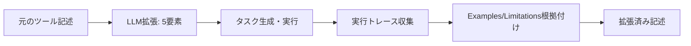

## 論文概要（Abstract）

本記事は [Model Context Protocol (MCP) Tool Descriptions Are Smelly! Towards Improving AI Agent Efficiency with Augmented MCP Tool Descriptions](https://arxiv.org/abs/2602.14878) の解説記事です。

MCPサーバーが公開するツール記述（description）は、LLMエージェントがツールを選択・呼び出す際の唯一のインターフェース仕様である。著者らは103のMCPサーバーから856個のツールを収集し、6要素のルーブリックで品質を評価した結果、97.1%のツールに少なくとも1つの品質問題（「スメル」）があると報告している。LLMベースの記述拡張（Augmentation）を適用したところ、タスク成功率が中央値で+5.85ポイント、部分目標達成スコアが+15.12%改善した一方、実行ステップ数は67.46%増加した。コンポーネント別のアブレーション実験では、コンパクトな記述の組み合わせが完全拡張と同等の性能を示すケースが確認されている。

この記事は [Zenn記事: MCPサーバーのツール設計パターン：数・スキーマ・認可の実践ガイド](https://zenn.dev/0h_n0/articles/c434eb97660610) の深掘りです。

## 情報源

- **arXiv ID**: 2602.14878
- **URL**: [https://arxiv.org/abs/2602.14878](https://arxiv.org/abs/2602.14878)
- **著者**: Mohammed Mehedi Hasan, Hao Li, Gopi Krishnan Rajbahadur, Bram Adams, Ahmed E. Hassan（Queen's University, Canada）
- **発表年**: 2026（v1: 2026-02-16, v3: 2026-05-31）
- **分野**: cs.SE, cs.ET

## 背景と動機（Background & Motivation）

MCP（Model Context Protocol）はAIエージェントが外部ツールやデータソースに接続するための標準プロトコルであり、2026年初頭時点で10,000以上のアクティブサーバーが稼働している。MCPサーバーはツールの名前・記述・入力スキーマを`tools/list`エンドポイントで公開し、LLMはこの情報を基にどのツールをどのパラメータで呼び出すかを決定する。

しかし、ツール記述の品質に関する体系的な調査はこれまで行われていなかった。コードスメルの概念がソフトウェア品質の向上に寄与したように、ツール記述にも「スメル」（品質上の問題パターン）が存在し、エージェントの性能を制約している可能性がある。著者らはこの仮説を検証するため、MCPエコシステム全体を対象とした大規模な品質評価を実施した。

## 主要な貢献（Key Contributions）

- **貢献1**: ベストプラクティス文献に基づく6要素スコアリングルーブリックの構築
- **貢献2**: LLM-as-Juryによるスメル自動検出スキャナ（再現パッケージ公開済み）
- **貢献3**: LLMベースのツール記述拡張器（Tool Description Augmentor）
- **貢献4**: 実行時にA/Bテスト可能なTool Description Router
- **貢献5**: スメルの蔓延度・拡張効果・コンポーネント別影響に関する実証的知見

## 技術的詳細（Technical Details）

### 6要素ルーブリック

著者らは、既存のツール設計ガイドライン（Anthropic、AWS、Google等）から抽出した6つの品質要素を定義している。各要素は1〜5のスケールで評価され、3名のLLM審査員（gpt-4.1-mini、claude-haiku-3.5、qwen3-30b-a3b）の平均スコアが3未満の場合に「スメル」と判定される。

| 要素 | 評価対象 | ICC(2,1) |
|------|---------|----------|
| **Purpose（目的）** | ツールが何をするか明確に記述されているか | 0.76 |
| **Guidelines（使用指針）** | いつ使うべきか・使うべきでないかの指示があるか | 0.72 |
| **Limitations（制約）** | 既知の制約や制限事項が明記されているか | 0.65 |
| **Parameter Explanation（パラメータ説明）** | パラメータの型・範囲・意味が説明されているか | 0.90 |
| **Length and Completeness（長さと完全性）** | 適切な長さで必要な情報を網羅しているか | 0.71 |
| **Examples（使用例）** | 具体的な入出力例が含まれているか | 0.62 |

著者らはICC(2,1)（級内相関係数）が0.62〜0.90の範囲であり、90件のサンプルを用いた人手検証では重み付きCohenのκが0.72〜0.89であったと報告している。

### スメルの定義と検出

スメルスキャナはLLM-as-Juryパターンで実装されている。3つの異なるLLMがそれぞれ独立にスコアリングを行い、その平均を最終スコアとする。

```python
from dataclasses import dataclass
from enum import Enum

class SmellType(str, Enum):
    UNCLEAR_PURPOSE = "unclear_purpose"
    MISSING_GUIDELINES = "missing_guidelines"
    UNSTATED_LIMITATIONS = "unstated_limitations"
    OPAQUE_PARAMETERS = "opaque_parameters"
    UNDERSPECIFIED = "underspecified"
    EXEMPLAR_ISSUES = "exemplar_issues"

@dataclass
class SmellScore:
    component: SmellType
    scores: list[float]  # 3名の審査員のスコア

    @property
    def mean_score(self) -> float:
        return sum(self.scores) / len(self.scores)

    @property
    def has_smell(self) -> bool:
        return self.mean_score < 3.0
```

### 記述拡張（Augmentation）パイプライン

記述拡張はGPT-4.1-miniを用いて、Purpose、Guidelines、Limitations、Parameter Explanation、Lengthの5要素を自動で書き換える。ExamplesとLimitationsは実行トレースからの根拠付けが必要なため、2段階目で処理される。



拡張前後のルーブリックスコアの変化（Wilcoxon検定 p < 0.001）は以下の通りである。

| 要素 | 拡張前（中央値） | 拡張後（中央値） |
|------|---------------|---------------|
| Purpose | 2.0 | 5.0 |
| Guidelines | 1.0 | 5.0 |
| Limitations | 1.0 | 5.0 |
| Parameter Explanation | 1.0 | 4.7 |
| Examples | 1.0 | 5.0 |
| Length & Completeness | 1.3 | 5.0 |

## 実験結果（Results）

### RQ1: スメルの蔓延度

著者らが856ツール（公式23サーバー＋コミュニティ80サーバー）を評価した結果、スメル別の発生率は以下の通りであった。

| スメル | 発生率 |
|--------|--------|
| Unstated Limitations（制約未記載） | 89.8% |
| Missing Usage Guidance（使用指針欠如） | 89.3% |
| Opaque Parameters（不透明なパラメータ） | 84.3% |
| Underspecified/Incomplete（不完全な記述） | 79.1% |
| Exemplar Issues（使用例の問題） | 77.9% |
| Unclear Purpose（目的不明確） | 56.0% |

著者らは、公式サーバーとコミュニティサーバーの間で統計的に有意な差は見られなかったと報告している。これは、ツール記述の品質問題がエコシステム全体に及んでいることを示唆する。

### RQ2: 記述拡張の効果

MCP-Universeベンチマーク（231タスク、6ドメイン、202ツール、18サーバー）を用いた評価結果は以下の通りである。

**成功率の変化（全体）**:

| モデル | 拡張前 | 拡張後 | 変化 |
|--------|-------|-------|------|
| GPT-4.1 | 18.18% | 29.44% | +11.26pp |
| Qwen3-Coder | 19.91% | 25.97% | +6.06pp |
| GLM-4.5 | 24.68% | 25.25% | +0.57pp |
| Qwen3-Next | 15.58% | 21.21% | +5.63pp |

24のモデル×ドメインの組み合わせのうち、54.17%が改善、29.16%が不変または失敗、16.67%が退行を示した（McNemar検定 p = 0.02）。

著者らは、部分目標達成スコア（Evaluator Score）の改善も報告している。GPT-4.1では0.41から0.47へ、Qwen3-Coderでは0.38から0.43へと上昇した。しかし、実行ステップ数は中央値で67.46%増加しており、GPT-4.1で5.24→8.08、Qwen3-Coderで7.78→14.06と顕著な増加が見られた。著者らは、記述が詳細になることでエージェントがより多くのツール操作を試みるようになったと分析している。

**トークン使用量の増加**:

Qwen3-Nextでは入力トークンが21.85%（Finance）〜41.43%（3D Design）増加し、出力トークンも30.35%〜69.00%増加したと報告されている。これは記述拡張のコスト面でのトレードオフを示す。

### RQ3: コンポーネント別アブレーション

著者らは、どのコンポーネントの組み合わせが最も効果的かをドメイン×モデルごとに検証した。

- **Finance × GPT-4.1**: Purpose+Guidelinesのみで67.50%（完全拡張の57.50%を上回る）
- **Repo × Qwen3-Coder**: Examplesを除外して21.21%（完全拡張の18.20%を上回る）
- **3D Design × Qwen3-Coder**: Purpose+Examplesで26.32%（完全拡張の21.10%を上回る）

χ二乗検定では、3D Design、Finance、Repoドメインで有意な依存関係が確認された（p < 0.01、φ ≈ 0.5–0.9）。Examplesの除外はいずれのドメイン×モデルの組み合わせでも性能を有意に低下させなかった。

## 実装のポイント（Implementation）

著者らの知見をMCPサーバー開発に適用する際の要点を整理する。

**優先すべきコンポーネント**:
1. **Purpose（目的）**: 56%が不明確。「何をするか」を1文で明記する
2. **Guidelines（使用指針）**: 89.3%が欠如。「いつ使うべきか」「いつ使うべきでないか」を記述する
3. **Parameter Explanation**: 84.3%が不透明。型・範囲・enum値を明記する

**トークン効率を意識した記述**:
- 完全拡張は入力トークンを20〜40%増加させるため、コンテキストウィンドウの制約がある場合はPurpose+Guidelinesの最小構成が有効
- Examplesは実行トレースに基づく根拠がない場合、ハルシネーションのリスクがある

```python
from pydantic import BaseModel, Field
from typing import Optional

class ToolDescription(BaseModel):
    """スメルフリーなツール記述テンプレート"""
    purpose: str = Field(
        ...,
        description="ツールの目的を1文で記述（Unclear Purpose対策）"
    )
    guidelines: str = Field(
        ...,
        description="使用すべき状況と使用すべきでない状況（Missing Guidelines対策）"
    )
    limitations: Optional[str] = Field(
        default=None,
        description="既知の制約（Unstated Limitations対策）"
    )
    parameter_details: dict[str, str] = Field(
        default_factory=dict,
        description="パラメータ名→説明のマッピング（Opaque Parameters対策）"
    )
```

## Production Deployment Guide

### AWS実装パターン（コスト最適化重視）

ツール記述の品質管理を自動化するAWS構成を、トラフィック規模別に示す。

| 規模 | 月間リクエスト | 推奨構成 | 月額コスト | 主要サービス |
|------|--------------|---------|-----------|------------|
| **Small** | ~3,000 (100/日) | Serverless | $50-120 | Lambda + Bedrock + DynamoDB |
| **Medium** | ~30,000 (1,000/日) | Hybrid | $250-600 | Lambda + ECS Fargate + ElastiCache |
| **Large** | 300,000+ (10,000/日) | Container | $1,500-4,000 | EKS + Karpenter + EC2 Spot |

**Small構成の詳細**（月額$50-120）:
- **Lambda**: ツール記述のスメルスキャン処理、1GB RAM、30秒タイムアウト ($15/月)
- **Bedrock**: Claude 3.5 Haiku でスメル判定（3審査員のうち1つを担当）($60/月)
- **DynamoDB**: スメルスコアとスキャン履歴の保存、On-Demand ($10/月)
- **S3**: 拡張済み記述のバージョン管理 ($5/月)
- **CloudWatch**: スメル検出率の監視 ($5/月)

**コスト削減テクニック**:
- Bedrock Batch APIで非リアルタイムのスメルスキャンを50%割引で実行
- DynamoDB TTLで古いスキャン結果を自動削除（90日）
- Lambda Reserved Concurrencyで過剰実行を防止

**コスト試算の注意事項**:
- 上記は2026年11月時点のAWS ap-northeast-1（東京）リージョン料金に基づく概算値
- 実際のコストはスキャン頻度・ツール数・モデル選択により変動
- 最新料金は [AWS料金計算ツール](https://calculator.aws/) で確認

### Terraformインフラコード

**Small構成（Serverless）: スメルスキャナ + 記述拡張パイプライン**

```hcl
resource "aws_iam_role" "smell_scanner" {
  name = "mcp-smell-scanner-role"

  assume_role_policy = jsonencode({
    Version = "2012-10-17"
    Statement = [{
      Action = "sts:AssumeRole"
      Effect = "Allow"
      Principal = { Service = "lambda.amazonaws.com" }
    }]
  })
}

resource "aws_iam_role_policy" "bedrock_invoke" {
  role = aws_iam_role.smell_scanner.id
  policy = jsonencode({
    Version = "2012-10-17"
    Statement = [{
      Effect   = "Allow"
      Action   = ["bedrock:InvokeModel"]
      Resource = "arn:aws:bedrock:ap-northeast-1::foundation-model/anthropic.claude-3-5-haiku*"
    }]
  })
}

resource "aws_lambda_function" "smell_scanner" {
  filename      = "smell_scanner.zip"
  function_name = "mcp-smell-scanner"
  role          = aws_iam_role.smell_scanner.arn
  handler       = "index.handler"
  runtime       = "python3.12"
  timeout       = 60
  memory_size   = 1024

  environment {
    variables = {
      BEDROCK_MODEL_ID = "anthropic.claude-3-5-haiku-20241022-v1:0"
      DYNAMODB_TABLE   = aws_dynamodb_table.smell_scores.name
      SMELL_THRESHOLD  = "3.0"
    }
  }
}

resource "aws_dynamodb_table" "smell_scores" {
  name         = "mcp-tool-smell-scores"
  billing_mode = "PAY_PER_REQUEST"
  hash_key     = "tool_id"
  range_key    = "scan_timestamp"

  attribute {
    name = "tool_id"
    type = "S"
  }
  attribute {
    name = "scan_timestamp"
    type = "S"
  }

  ttl {
    attribute_name = "expire_at"
    enabled        = true
  }
}

resource "aws_cloudwatch_metric_alarm" "smell_rate" {
  alarm_name          = "mcp-high-smell-rate"
  comparison_operator = "GreaterThanThreshold"
  evaluation_periods  = 1
  metric_name         = "SmellDetectionRate"
  namespace           = "MCP/ToolQuality"
  period              = 86400
  statistic           = "Average"
  threshold           = 0.9
  alarm_description   = "スメル検出率90%超過（品質劣化の可能性）"
}
```

### セキュリティベストプラクティス

- IAMロール: Bedrock InvokeModelのみ許可（最小権限）
- DynamoDB: KMS暗号化有効化、VPCエンドポイント経由アクセス
- Lambda: VPC内配置、パブリックアクセス不可
- Secrets Manager: APIキー等のハードコード禁止

### 運用・監視設定

**CloudWatch Logs Insights クエリ**:

```sql
-- スメル検出率の推移（日別）
fields @timestamp, tool_id, smell_count, total_components
| stats avg(smell_count / total_components) as smell_rate by bin(1d)
| filter smell_rate > 0.5

-- 拡張前後の成功率比較
fields @timestamp, tool_id, original_success, augmented_success
| stats avg(augmented_success - original_success) as improvement by bin(1w)
```

**コスト最適化チェックリスト**:

- [ ] スメルスキャンはBatch APIで50%割引を活用
- [ ] 未変更ツールはスキャンスキップ（SHA-256ハッシュ比較）
- [ ] DynamoDB古いスキャン結果はTTLで自動削除
- [ ] Lambda: メモリサイズをCloudWatch Insightsで最適化
- [ ] CloudWatch: 不要なメトリクスの収集を無効化
- [ ] AWS Budgets: 月額予算設定（80%で警告）

## 実運用への応用（Practical Applications）

本論文の知見は、MCPサーバーの運用において以下のように応用できる。

**CI/CDパイプラインへの統合**: ツール記述のスメルスキャンをプルリクエスト時の自動チェックとして組み込むことで、品質の低い記述がデプロイされることを防止できる。著者らが公開したスキャナの再現パッケージを活用すれば、既存のCI/CDワークフローに数時間で統合可能である。

**記述拡張の段階的適用**: RQ3のアブレーション結果が示すように、すべてのコンポーネントを一度に拡張する必要はない。まずPurposeとGuidelinesの2要素から着手し、効果を計測した上でParameter ExplanationやExamplesを追加する段階的アプローチが実践的である。

**トークン予算との両立**: 記述拡張は入力トークンを20〜40%増加させるため、コンテキストウィンドウが限られた環境では選択的適用が重要である。著者らのTool Description Routerを使えば、ランタイムでの切り替えが可能になる。

## 関連研究（Related Work）

- **ScaleMCP（arXiv 2505.06416）**: MCPツールの動的取得と自動同期に焦点を当てた研究。ツール記述の埋め込み品質が検索精度に影響することを示しており、本論文の「記述品質がエージェント性能を左右する」という主張と整合する。
- **Anthropic "Advanced Tool Use"**: ツール定義にworked例を追加することで複雑なパラメータ処理の精度が72%から90%に改善したと報告。本論文のRQ3でExamples単体の除外が性能を有意に低下させなかった点は興味深い対比である。
- **Google Connected App Standards**: 厳密なスキーマとパラメータ最小化を推奨しており、本論文のParameter Explanationコンポーネントと方向性が一致する。

## まとめと今後の展望

本論文は、MCPエコシステムにおけるツール記述の品質問題を定量的に明らかにした点で重要な貢献である。97.1%のツールにスメルが存在するという結果は、ツール設計において記述品質が見過ごされがちであることを示している。

記述拡張による成功率の改善（中央値+5.85pp）は統計的に有意であるが、実行ステップの67.46%増加とトークンコストの増大は無視できないトレードオフである。コンポーネント別アブレーションの結果は、ドメインとモデルに応じた最適な記述構成が異なることを示しており、一律の拡張よりも選択的適用が実践的である。

今後は、より大規模なベンチマークでの検証、リアルタイムの記述最適化フィードバックループ、およびマルチエージェント環境での記述品質の影響評価が期待される。

## 参考文献

- **arXiv**: [https://arxiv.org/abs/2602.14878](https://arxiv.org/abs/2602.14878)
- **ベンチマーク**: MCP-Universe（231タスク、6ドメイン、202ツール、18サーバー）
- **Related Zenn article**: [https://zenn.dev/0h_n0/articles/c434eb97660610](https://zenn.dev/0h_n0/articles/c434eb97660610)

---

:::message
この記事はAI（Claude Code）により自動生成されました。内容の正確性については原論文をご確認ください。
:::
