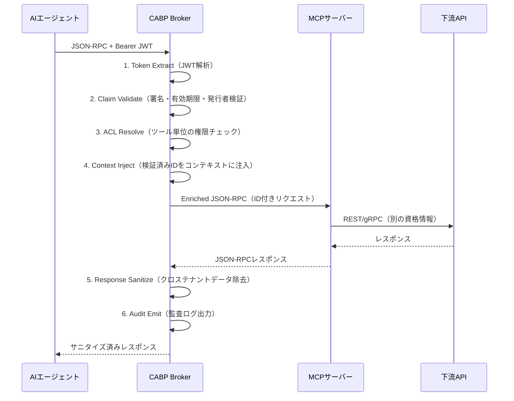

## 論文概要（Abstract）

本記事は [Bridging Protocol and Production: Design Patterns for Deploying AI Agents with Model Context Protocol](https://arxiv.org/abs/2603.13417) の解説記事です。

MCP（Model Context Protocol）は2026年初頭時点で10,000以上のアクティブサーバーと月間9,700万回のSDKダウンロードを記録しているが、ツールの発見と呼び出しを標準化する一方で、**本番環境でエージェントがツールを安全かつ確実に運用するための仕組み**はプロトコル仕様に含まれていない。著者はエンタープライズ環境でのMCPデプロイ経験に基づき、プロトコルレベルで欠落している3つのプリミティブ（認証伝播・適応的ツール予算配分・構造化エラーセマンティクス）を特定し、それぞれに対する設計パターンを提案している。

**重要な注記**: 本論文は実測データに基づく検証結果を報告していない。提案される3つのパターン（CABP・ATBA・SERF）は仮説と設計パターンの提案であり、定量的な効果はベンチマーク計画として示されているにとどまる。

この記事は [Zenn記事: MCPサーバーのツール設計パターン：数・スキーマ・認可の実践ガイド](https://zenn.dev/0h_n0/articles/c434eb97660610) の深掘りです。

## 情報源

- **arXiv ID**: 2603.13417
- **URL**: [https://arxiv.org/abs/2603.13417](https://arxiv.org/abs/2603.13417)
- **著者**: Vasundra Srinivasan（独立研究、AI Architect）
- **発表年**: 2026年
- **分野**: cs.SE, cs.AI, cs.MA
- **ページ数**: 23ページ、5図、4表

## 背景と動機（Background & Motivation）

MCPはJSON-RPCベースのプロトコルとして、AIエージェントがツールを発見・呼び出しするための標準を提供している。しかし著者は、プロトコルの標準化と本番運用の間には以下の3つのギャップが存在すると指摘している。

1. **認証情報の伝播**: MCPにはユーザーのアイデンティティ（テナント、権限）をツール呼び出しに付随させる標準的な手段がない。これにより、あるユーザーのリクエストが別のテナントのデータを返す可能性がある。
2. **タイムアウト管理**: プランナーが持つターン全体の予算（例: 100秒）を、連続するツール呼び出しチェーンにどう配分するかの仕組みがない。静的な均等配分ではレイテンシの差を吸収できない。
3. **エラーセマンティクス**: ツールのエラー応答（`isError: true`）はエージェントのコンテキストに注入されるが、エラーの種別やリトライ可否を機械可読に伝える標準フォーマットがない。

著者はこれらのギャップを、クラウド利用制限リクエストを管理する社内向けエージェントの実デプロイから観察したと述べている。

## 主要な貢献（Key Contributions）

- **5次元の障害分類体系**: サーバー契約、ユーザーコンテキスト、タイムアウト、エラー、可観測性の5つの次元で本番MCPの障害モードを分類
- **CABP（Context-Aware Broker Pattern）**: JWT検証とACL適用によるユーザーコンテキスト伝播のブローカーパターン
- **ATBA（Adaptive Tool Budget Allocation）**: p99レイテンシに基づく適応的なツール実行予算配分
- **SERF（Structured Error Response Format）**: エージェントの自律回復を支援する6カテゴリの構造化エラーフォーマット
- **レディネスチェックリスト**: 本番デプロイ前の確認項目

## 技術的詳細（Technical Details）

### CABP: Context-Aware Broker Pattern（認証伝播）

MCPサーバーの前段にブローカー/ゲートウェイを配置し、すべてのJSON-RPCリクエストが6つのステージを通過する設計である。



**6つのステージの詳細:**

| ステージ | 処理内容 | 失敗時の動作 |
|---------|---------|------------|
| Token Extract | AuthorizationヘッダからJWTを解析 | -32600エラー返却 |
| Claim Validate | 署名、有効期限、発行者を検証 | -32600エラー返却 |
| ACL Resolve | ツール×ロールの権限テーブルで検査 | 権限エラー返却 |
| Context Inject | 検証済みIDをリクエストコンテキストに注入 | — |
| Response Sanitize | クロステナント・未認可フィールドを除去 | — |
| Audit Emit | ID、ツール名、入出力、レイテンシ、ステータスをログ | — |

著者は以下の運用原則を述べている:

- JWTはリクエストごとに検証し、**トークンのキャッシュは禁止**
- サービスアカウントには人間ユーザーより狭いACL（例: バッチジョブには書き込みツール不可）
- OAuthトークンを上流APIに転送せず、バックエンドへは別の資格情報を使用
- 規模に応じた実装: 1-3サーバーならFlask/Express middleware、10以上ならKongやEnvoy AI Gatewayを推奨

著者の仮説: H1ではクロステナント漏洩をゼロに、H2ではCABPの追加レイテンシ中央値を15ms以下にできると予測しているが、これらは未検証である。

### ATBA: Adaptive Tool Budget Allocation（適応的予算配分）

プランナーが持つターン全体の実行予算（例: $B = 100$秒）を、連続するツール呼び出しチェーンに適応的に配分する手法である。

**定式化:**

ツールチェーン $t_1, t_2, \ldots, t_n$ に対し、全体予算 $B$ から予約分 $r$（著者は10%を推奨）を差し引いた利用可能予算を配分する:

$$
B_{\text{avail}} = B \times (1 - r)
$$

各ツール $t_i$ への配分は、過去約100回の観測に基づくp99レイテンシ $L_i^{p99}$ の比率で決定される:

$$
b_i = \frac{L_i^{p99}}{\sum_{j=1}^{n} L_j^{p99}} \times B_{\text{avail}}
$$

ここで、
- $B$: プランナーのターン全体予算（秒）
- $r$: プランナーオーバーヘッド予約率（推奨10%）
- $B_{\text{avail}}$: 利用可能予算
- $L_i^{p99}$: ツール $t_i$ のp99レイテンシ（直近約100回の観測ウィンドウ）
- $b_i$: ツール $t_i$ への配分予算

**カスケード機構:** あるツールが配分予算を使い切らなかった場合、残余を後続のツールに均等分配する。これにより、レイテンシスパイクが発生したツールにも追加の実行時間が確保される。

**具体例（著者が示す4ツールチェーン）:**

| ツール | 静的配分（均等） | ATBA配分 |
|--------|----------------|---------|
| FetchResources | 25秒 | 約10秒 |
| FetchServices | 25秒 | 約8秒 |
| FetchUsageLimits | 25秒 | 約42秒 |
| CreateLimitRequest | 25秒 | 約30秒 |
| 予約（プランナー） | 0秒 | 10秒 |
| **合計** | **100秒** | **100秒** |

著者の仮説: H3ではチェーンタイムアウトを静的配分比で40%以上削減、H4ではカスケードにより25%以上のチェーンを救済できると予測している。いずれも未検証である。

### SERF: Structured Error Response Format（構造化エラー）

MCPのエラー応答を2層に分離し、エージェントの自律回復を支援するフォーマットである。

**2層モデル:**
- **Tier 1**: JSON-RPCプロトコルエラー（フレームワークが処理、エージェントのコンテキストに入らない）
- **Tier 2**: ツールエラー（`isError: true`、エージェントのコンテキストに注入される）

SERFはTier 2エラーに `serf` オブジェクトを追加し、以下のフィールドを持つ:

```python
from dataclasses import dataclass
from typing import Optional

@dataclass
class SerfError:
    """SERF構造化エラーレスポンス"""
    category: str        # 6カテゴリのいずれか
    retryable: bool      # リトライ可否
    retry_after_ms: Optional[int]  # リトライ待機時間（ms）
    suggested_actions: list[str]   # 推奨アクション（優先順）
    context: dict        # 追加コンテキスト情報
```

**6つのエラーカテゴリと推奨回復アクション:**

| カテゴリ | 意味 | リトライ可否 | 推奨回復 |
|---------|------|------------|---------|
| `INVALID_INPUT` | 入力パラメータの不正 | No | リクエストを再構成 |
| `RESOURCE_NOT_FOUND` | リソースが存在しない | No | パラメータを検証 |
| `RESOURCE_EXHAUSTED` | クォータ・レート制限超過 | Yes | リソース切替またはユーザーエスカレーション |
| `PERMISSION_DENIED` | 権限不足 | No | ユーザーにエスカレーション |
| `UPSTREAM_FAILURE` | 上流サービスの一時障害 | Yes | 指数バックオフでリトライ |
| `INTERNAL_ERROR` | MCPサーバー内部エラー | No | リトライせずエスカレーション |

著者の仮説: H5ではSERFにより自律回復率が60%以上（非構造化エラーでは25%以下）、H6ではエラー後のハルシネーションを70%以上削減できると予測している。

## 実装のポイント（Implementation）

### サーバー契約の設計原則

著者は `tools/list` をAPIコントラクトとして扱うことを推奨している:

- **命名規則**: アクション指向の名前（`FetchUsageLimits`、`get_data` ではなく）
- **説明文**: 2-4文で「いつ呼ぶか」「何が返るか」「副作用」を記述
- **冪等性の宣言**: 書き込みツールには冪等性キー（24時間TTL）を設定
- **バージョニング回避**: `_v2` 付きの名前ではなく、オプショナルな入出力フィールドの追加で進化させる
- **初期化前リクエストの拒否**: `initialize` 前のリクエストは `-32600` で拒否

### タイムアウト目標値

著者は以下のp99目標値を提示している:

| 操作種別 | p99目標 |
|---------|--------|
| 読み取り | 500ms以下 |
| 中規模クエリ | 2秒以下 |
| 書き込み | 5秒以下 |
| 長時間処理 | MCP Tasks（10秒超はポーリング） |

### 障害事例（Failure Vignettes）

著者は実デプロイから3つの障害事例を報告している:

1. **Phantom Tool**: 曖昧な名前のツールがエージェントに選択されなかった。ツール名の変更と説明文の拡充（コード変更なし）で解決
2. **Silent Egress Failure**: ネットワークポリシーがMCPサーバーの外部API通信をブロック。ヘルスチェックがなく2日間ダッシュボードは正常表示のまま、エージェントは「プロジェクトなし」と報告
3. **Retry Storm**: 上流の一時障害でエージェントが `CreateLimitRequest` を3回リトライし、重複リクエストを3件作成。冪等性キーと `retryable: false` で防止可能

## Production Deployment Guide

### AWS実装パターン（コスト最適化重視）

CABP・ATBA・SERFの3パターンをAWS上で実装する場合の構成を示す。

**トラフィック量別の推奨構成:**

| 規模 | 月間リクエスト | 推奨構成 | 月額コスト | 主要サービス |
|------|--------------|---------|-----------|------------|
| **Small** | ~3,000 (100/日) | Serverless | $80-200 | API Gateway + Lambda + DynamoDB |
| **Medium** | ~30,000 (1,000/日) | Hybrid | $400-900 | ALB + ECS Fargate + ElastiCache |
| **Large** | 300,000+ (10,000/日) | Container | $2,500-6,000 | EKS + Karpenter + EC2 Spot |

**Small構成の詳細**（月額$80-200）:
- **API Gateway**: CABP Brokerとして機能。Lambda Authorizerで JWT検証（$5/月）
- **Lambda（Broker）**: CABP 6ステージ処理、1GB RAM、30秒タイムアウト（$30/月）
- **Lambda（MCP Server）**: ツール実行、1GB RAM、60秒タイムアウト（$40/月）
- **DynamoDB**: 冪等性キー保存（TTL付き）、ACLテーブル（$10/月）
- **CloudWatch**: ATBA用p99メトリクス収集、SERFエラーログ（$10/月）
- **Secrets Manager**: 下流API資格情報（$5/月）

**Medium構成の詳細**（月額$400-900）:
- **ALB**: CABPのエントリポイント（$25/月）
- **ECS Fargate（Broker）**: 0.5 vCPU × 1GB × 2タスク。JWTライブラリをプリロード（$80/月）
- **ECS Fargate（MCP Server）**: 1 vCPU × 2GB × 2-4タスク（$200/月）
- **ElastiCache Redis**: ATBA p99レイテンシウィンドウ保持、ACLキャッシュ（$15/月）
- **DynamoDB**: 冪等性キー、SERFエラー履歴（$20/月）
- **CloudWatch + X-Ray**: 分散トレーシング（$30/月）

**Large構成の詳細**（月額$2,500-6,000）:
- **EKS**: コントロールプレーン（$72/月）
- **EC2 Spot（g5.xlarge）**: 2-4台。Karpenter自動スケーリング（平均$900/月）
- **Kong / Envoy AI Gateway**: CABPブローカー。ルートごとにJWT検証とACLポリシー適用（$100/月）
- **Redis Cluster**: ATBAメトリクス、ACL、セッション（$150/月）
- **CloudWatch + X-Ray + Cost Explorer**: 包括的監視（$150/月）

**コスト試算の注意事項:**
- 上記は2026年11月時点のAWS ap-northeast-1（東京）リージョン料金に基づく概算値です
- 実際のコストはトラフィックパターン、リージョン、バースト使用量により変動します
- 最新料金は [AWS料金計算ツール](https://calculator.aws/) で確認してください

### Terraformインフラコード

**Small構成（Serverless）: API Gateway + Lambda（CABP Broker）**

```hcl
# --- CABP Broker Lambda ---
resource "aws_iam_role" "cabp_broker" {
  name = "cabp-broker-role"

  assume_role_policy = jsonencode({
    Version = "2012-10-17"
    Statement = [{
      Action = "sts:AssumeRole"
      Effect = "Allow"
      Principal = { Service = "lambda.amazonaws.com" }
    }]
  })
}

resource "aws_iam_role_policy" "cabp_broker_policy" {
  role = aws_iam_role.cabp_broker.id

  policy = jsonencode({
    Version = "2012-10-17"
    Statement = [
      {
        Effect   = "Allow"
        Action   = ["dynamodb:GetItem", "dynamodb:PutItem", "dynamodb:Query"]
        Resource = [aws_dynamodb_table.acl.arn, aws_dynamodb_table.idempotency.arn]
      },
      {
        Effect   = "Allow"
        Action   = ["secretsmanager:GetSecretValue"]
        Resource = aws_secretsmanager_secret.jwt_public_key.arn
      },
      {
        Effect   = "Allow"
        Action   = ["lambda:InvokeFunction"]
        Resource = aws_lambda_function.mcp_server.arn
      }
    ]
  })
}

resource "aws_lambda_function" "cabp_broker" {
  filename      = "cabp_broker.zip"
  function_name = "cabp-broker"
  role          = aws_iam_role.cabp_broker.arn
  handler       = "handler.main"
  runtime       = "python3.12"
  timeout       = 30
  memory_size   = 1024

  environment {
    variables = {
      ACL_TABLE        = aws_dynamodb_table.acl.name
      IDEMPOTENCY_TABLE = aws_dynamodb_table.idempotency.name
      JWT_SECRET_ARN   = aws_secretsmanager_secret.jwt_public_key.arn
      MCP_SERVER_ARN   = aws_lambda_function.mcp_server.arn
    }
  }
}

# --- ACLテーブル（ツール×ロール権限） ---
resource "aws_dynamodb_table" "acl" {
  name         = "cabp-acl"
  billing_mode = "PAY_PER_REQUEST"
  hash_key     = "role"
  range_key    = "tool_name"

  attribute {
    name = "role"
    type = "S"
  }
  attribute {
    name = "tool_name"
    type = "S"
  }
}

# --- 冪等性キーテーブル ---
resource "aws_dynamodb_table" "idempotency" {
  name         = "cabp-idempotency"
  billing_mode = "PAY_PER_REQUEST"
  hash_key     = "idempotency_key"

  attribute {
    name = "idempotency_key"
    type = "S"
  }

  ttl {
    attribute_name = "expire_at"
    enabled        = true
  }
}

# --- JWT公開鍵（Secrets Manager） ---
resource "aws_secretsmanager_secret" "jwt_public_key" {
  name = "cabp-jwt-public-key"
}

# --- CloudWatch: ATBAメトリクス収集用アラーム ---
resource "aws_cloudwatch_metric_alarm" "tool_latency_spike" {
  alarm_name          = "mcp-tool-latency-p99-spike"
  comparison_operator = "GreaterThanThreshold"
  evaluation_periods  = 2
  metric_name         = "ToolLatencyP99"
  namespace           = "MCP/ATBA"
  period              = 300
  statistic           = "Maximum"
  threshold           = 5000
  alarm_description   = "MCPツールp99レイテンシが5秒を超過（ATBA予算再配分が必要）"

  dimensions = {
    FunctionName = aws_lambda_function.mcp_server.function_name
  }
}
```

**Large構成（Container）: EKS + Kong Gateway（CABP Broker）**

```hcl
module "eks" {
  source  = "terraform-aws-modules/eks/aws"
  version = "~> 20.0"

  cluster_name    = "mcp-cabp-cluster"
  cluster_version = "1.31"

  vpc_id     = module.vpc.vpc_id
  subnet_ids = module.vpc.private_subnets

  cluster_endpoint_public_access = true
  enable_cluster_creator_admin_permissions = true
}

# --- Karpenter（Spot優先） ---
resource "kubectl_manifest" "karpenter_provisioner" {
  yaml_body = <<-YAML
    apiVersion: karpenter.sh/v1alpha5
    kind: Provisioner
    metadata:
      name: mcp-spot-provisioner
    spec:
      requirements:
        - key: karpenter.sh/capacity-type
          operator: In
          values: ["spot"]
        - key: node.kubernetes.io/instance-type
          operator: In
          values: ["m6i.large", "m6i.xlarge", "c6i.large"]
      limits:
        resources:
          cpu: "32"
          memory: "64Gi"
      providerRef:
        name: default
      ttlSecondsAfterEmpty: 30
  YAML
}

# --- Kong Gatewayの設定（CABP Broker） ---
resource "kubectl_manifest" "kong_jwt_plugin" {
  yaml_body = <<-YAML
    apiVersion: configuration.konghq.com/v1
    kind: KongPlugin
    metadata:
      name: cabp-jwt-validator
    config:
      uri_param_names: []
      claims_to_verify:
        - exp
        - iss
      maximum_expiration: 3600
    plugin: jwt
  YAML
}

# --- AWS Budgets（コスト監視） ---
resource "aws_budgets_budget" "mcp_monthly" {
  name         = "mcp-cabp-monthly"
  budget_type  = "COST"
  limit_amount = "6000"
  limit_unit   = "USD"
  time_unit    = "MONTHLY"

  notification {
    comparison_operator        = "GREATER_THAN"
    threshold                  = 80
    threshold_type             = "PERCENTAGE"
    notification_type          = "ACTUAL"
    subscriber_email_addresses = ["ops@example.com"]
  }
}
```

### 運用・監視設定

**CloudWatch Logs Insights: SERFエラー分析**

```sql
-- SERFカテゴリ別エラー頻度（直近24時間）
fields @timestamp, serf.category, serf.retryable, tool_name
| filter serf.category IS NOT NULL
| stats count(*) as error_count by serf.category, serf.retryable
| sort error_count desc

-- ATBA予算超過の検出
fields @timestamp, tool_name, duration_ms, budget_ms
| filter duration_ms > budget_ms
| stats count(*) as overruns, avg(duration_ms - budget_ms) as avg_overrun_ms by tool_name, bin(1h)
```

**CABP監査ログ + SERFエラーアラーム（Python）:**

```python
import boto3

cloudwatch = boto3.client('cloudwatch')

cloudwatch.put_metric_alarm(
    AlarmName='cabp-cross-tenant-violation',
    ComparisonOperator='GreaterThanThreshold',
    EvaluationPeriods=1,
    MetricName='CrossTenantViolation',
    Namespace='MCP/CABP',
    Period=60,
    Statistic='Sum',
    Threshold=0,
    ActionsEnabled=True,
    AlarmActions=['arn:aws:sns:ap-northeast-1:123456789:security-alerts'],
    AlarmDescription='CABPクロステナント違反検出（即時対応必要）'
)

cloudwatch.put_metric_alarm(
    AlarmName='serf-autonomous-recovery-rate',
    ComparisonOperator='LessThanThreshold',
    EvaluationPeriods=3,
    MetricName='AutonomousRecoveryRate',
    Namespace='MCP/SERF',
    Period=300,
    Statistic='Average',
    Threshold=0.5,
    AlarmDescription='SERF自律回復率が50%を下回った（エラー処理の見直し必要）'
)
```

**X-Ray: CABP 6ステージのトレーシング:**

```python
from aws_xray_sdk.core import xray_recorder, patch_all

patch_all()

@xray_recorder.capture('cabp_broker')
def cabp_pipeline(request: dict) -> dict:
    with xray_recorder.in_subsegment('token_extract') as seg:
        token = extract_jwt(request)
        seg.put_annotation('has_token', token is not None)

    with xray_recorder.in_subsegment('claim_validate') as seg:
        claims = validate_claims(token)
        seg.put_annotation('issuer', claims.get('iss', 'unknown'))

    with xray_recorder.in_subsegment('acl_resolve') as seg:
        tool_name = request.get('method', '')
        allowed = check_acl(claims['role'], tool_name)
        seg.put_annotation('tool', tool_name)
        seg.put_annotation('allowed', allowed)

    with xray_recorder.in_subsegment('context_inject'):
        enriched = inject_identity(request, claims)

    response = invoke_mcp_server(enriched)

    with xray_recorder.in_subsegment('response_sanitize'):
        sanitized = sanitize_response(response, claims['tenant_id'])

    with xray_recorder.in_subsegment('audit_emit'):
        emit_audit_log(claims, tool_name, sanitized)

    return sanitized
```

### コスト最適化チェックリスト

**アーキテクチャ選択（トラフィック量で判断）:**
- [ ] ~100 req/日 → API Gateway + Lambda（CABP Broker）- $80-200/月
- [ ] ~1,000 req/日 → ALB + ECS Fargate + ElastiCache - $400-900/月
- [ ] 10,000+ req/日 → EKS + Kong Gateway + Spot Instances - $2,500-6,000/月

**CABP最適化:**
- [ ] JWT検証ライブラリをLambda Layer化（コールドスタート短縮）
- [ ] ACLテーブルをElastiCacheでキャッシュ（DynamoDB読み取り削減）
- [ ] Lambda Provisioned Concurrencyの検討（レイテンシ重視時）
- [ ] Kong/Envoy: JWTプラグインでLambda呼び出し回避（Large構成）

**ATBA最適化:**
- [ ] p99メトリクス収集をCloudWatch Embedded Metricsで統合
- [ ] ElastiCacheにスライディングウィンドウ（100観測）を保持
- [ ] カスケード配分ロジックをLambda Edge/Fargate Sidecarで実装
- [ ] タイムアウト予算を環境変数化（開発: 200秒、本番: 100秒）

**SERF最適化:**
- [ ] SERFエラーカテゴリ別のCloudWatchメトリクス自動生成
- [ ] `UPSTREAM_FAILURE` の自動リトライにStep Functions活用
- [ ] `RESOURCE_EXHAUSTED` 時のCircuit Breaker実装
- [ ] エラー分析ダッシュボード（SERF category × tool × 時間帯）

**監視・アラート:**
- [ ] AWS Budgets: 月額予算設定（80%で警告、100%でアラート）
- [ ] CloudWatch: クロステナント違反即時アラート
- [ ] X-Ray: CABP 6ステージの個別レイテンシ可視化
- [ ] Cost Anomaly Detection: 自動異常検知

**セキュリティ:**
- [ ] JWT公開鍵をSecrets Managerで管理（ローテーション90日）
- [ ] OAuthトークンを下流APIに転送しない（別資格情報使用）
- [ ] サービスアカウントACLを人間ユーザーより制限
- [ ] CloudTrail全リージョン有効化

## 実験結果（Results）

本論文は実測データに基づく実験結果を報告していない。著者は以下の仮説を提示し、ベンチマーク計画として記述している:

| 仮説 | 予測 | 検証状況 |
|------|------|---------|
| H1 | CABPによりクロステナント漏洩ゼロ | 未検証 |
| H2 | CABP追加レイテンシ中央値15ms以下 | 未検証 |
| H3 | ATBAによりチェーンタイムアウト40%以上削減 | 未検証 |
| H4 | カスケードにより25%以上のチェーン救済 | 未検証 |
| H5 | SERFにより自律回復率60%以上 | 未検証 |
| H6 | エラー後ハルシネーション70%以上削減 | 未検証 |

ベンチマーク計画として、合成MCPサーバー（レイテンシ・障害注入付き）、JWT検証ブローカー、負荷生成器によるテストスイートを予定しており、オープンソースとして公開される予定とされている。

## 実運用への応用（Practical Applications）

**MCPサーバー運用者にとっての示唆:**

1. **マルチテナント環境**: CABPの設計はZenn記事で触れたOAuth 2.1 + PKCEの認可フローと補完的である。MCP仕様がOAuth認可フロー自体を定義する一方、CABP はリクエストごとの認証検証とテナント分離の実装パターンを提供する
2. **SLA管理**: ATBAの予算配分はZenn記事のマルチサーバー構成と関連する。Gateway/Proxy構成でツールチェーンの総レイテンシをSLA内に収めるには、ツールごとの予算管理が必要になる
3. **エラーハンドリング**: SERFのカテゴリ体系はZenn記事で触れた「ツール説明文の質」と連動する。ツールが返すエラーの構造が明確であれば、エージェントの自律回復が可能になり、ツール選択の誤りからの復帰も容易になる

**制約と限界:**
- 本論文は単一のエンタープライズデプロイ（クラウド利用制限リクエスト管理）からの知見に限定される
- CABP・ATBA・SERFはいずれもMCP仕様の機能ではなく、著者独自の提案である
- 定量的な効果検証がなく、仮説の妥当性は読者自身の環境で確認する必要がある

## 関連研究（Related Work）

- **MCP仕様（2026-07-28版）**: OAuth 2.1による認可フローを標準化しているが、リクエストごとのユーザーコンテキスト伝播は規定していない。CABPはこのギャップを補完する
- **ScaleMCP（arXiv 2505.06416）**: 動的ツール検索と自動同期を提案しており、ATBAの予算配分と組み合わせることで大規模ツールセットの効率的な管理が期待される
- **Astrix Security調査**: MCPサーバーの53%が長寿命の静的シークレットを使用しているとの報告があり、CABPのJWT検証アプローチの必要性を裏付けている

## まとめと今後の展望

著者はMCPの本番運用において、プロトコル仕様がカバーしない3つの領域（認証伝播・タイムアウト管理・エラー構造化）に対し、CABP・ATBA・SERFの3つの設計パターンを提案した。これらは現時点では未検証の仮説であるが、エンタープライズデプロイでの障害事例（Phantom Tool、Silent Egress Failure、Retry Storm）に対する具体的な対策を示している。

MCPエコシステムが成熟するにつれ、これらのパターンがプロトコル仕様に取り込まれる可能性があるが、現時点ではサーバー開発者がインフラ層で独自に実装する必要がある。

## 参考文献

- **arXiv**: [https://arxiv.org/abs/2603.13417](https://arxiv.org/abs/2603.13417)
- **MCP仕様（Authorization）**: [https://modelcontextprotocol.io/specification/2026-07-28/basic/authorization](https://modelcontextprotocol.io/specification/2026-07-28/basic/authorization)
- **Related Zenn article**: [https://zenn.dev/0h_n0/articles/c434eb97660610](https://zenn.dev/0h_n0/articles/c434eb97660610)

---

:::message
この記事はAI（Claude Code）により自動生成されました。内容の正確性については情報源の論文と照合していますが、実際の利用時は原論文もご確認ください。
:::
