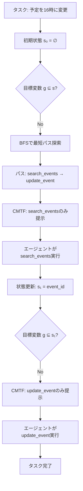

本記事は [ToolChoiceConfusion: Causal Minimal Tool Filtering for Reliable LLM Agents](https://arxiv.org/abs/2606.06284) の解説記事です。

この記事は [Zenn記事: MCPサーバーのツール設計パターン：数・スキーマ・認可の実践ガイド](https://zenn.dev/0h_n0/articles/c434eb97660610) の深掘りです。

## 論文概要（Abstract）

LLMエージェントに提示するツール数が増えると、誤ったツールの呼び出し、早すぎるアクション実行、トークンコストの増大といった問題が生じる。既存のツール選択手法はセマンティックな関連性に基づくものが多いが、タスクに関連するツールであっても現在のステップで因果的に不要な場合がある。著者らはCausal Minimal Tool Filtering（CMTF）と呼ばれるtraining-freeな手法を提案し、前提条件と効果の契約（contract）に基づいて、各ステップで因果的に必要な最小限のツールのみをエージェントに提示する。102タスク・100ツール・4種のLLMバックエンドによる2,448回の実行で評価が行われた。

## 情報源

- **arXiv ID**: 2606.06284
- **URL**: [https://arxiv.org/abs/2606.06284](https://arxiv.org/abs/2606.06284)
- **著者**: Rahul Suresh Babu, Laxmipriya Ganesh Iyer（独立研究者、United States）
- **発表年**: 2026
- **分野**: cs.AI

## 背景と動機（Background & Motivation）

MCPサーバーのツール設計において「サーバーあたりのツール数を10〜20個に抑える」という経験則は広く共有されている。しかし、なぜツール数の増加がエージェント性能を劣化させるのか、そしてどのようにツールを絞り込むべきかについて、体系的な分析は限られていた。

従来のツール選択手法は主にセマンティック類似度に基づくretrieval（キーワードマッチングやベクトル検索によるtop-k選択）を採用していた。しかし、著者らはこのアプローチの根本的な問題を指摘している。セマンティックに類似するツールが必ずしも現在のステップで実行可能または必要とは限らない。たとえば、カレンダーの予定を更新するタスクにおいて、`create_event`は意味的に関連するが、既存のイベントIDが未取得の段階で提示されるとエージェントの混乱を招く。

著者らはこの問題を「ToolChoiceConfusion」と命名し、プロンプトに含まれるツールの集合（tool exposure）自体がエージェントの信頼性を決定する要因であると主張している。

## 主要な貢献（Key Contributions）

- **ToolChoiceConfusionの定式化**: セマンティックに妥当だが因果的に不要なツールがマルチステップのエージェント動作を劣化させる問題を、ツール露出の問題として定式化
- **CMTFの提案**: 前提条件・効果・現在状態・目標状態に基づく、training-freeな因果的ツールフィルタリング手法
- **包括的なメトリクスの定義**: wrong-tool rate、premature-action rate、tool exposure、trajectory length、token costなど多面的な評価指標
- **制御された合成ベンチマーク**: カレンダー・メール・ファイルドメインにわたる102タスク・100ツールのベンチマーク構築
- **6手法の比較実験**: all-tools、keyword retrieval（top-5/top-10）、state-aware filtering、full causal path、CMTFの定量比較

## 技術的詳細（Technical Details）

### CMTFの形式的定義

CMTFでは各ツールを以下の契約（contract）として定義する。

$$
t = (d, R, E, c, r)
$$

ここで、
- $d$: ツールの自然言語による説明（description）
- $R$: 前提条件として必要な変数の集合（required variables）
- $E$: ツール実行後に生成される変数の集合（produced variables / effects）
- $c$: 実行コスト（optional）
- $r$: リスクレベル（optional）

ツール $t$ が現在の状態 $s$ で**実行可能**（applicable）である条件は次のとおりである。

$$
R \subseteq s
$$

ツール $t$ を状態 $s$ で実行した後の状態は以下で定義される。

$$
s' = s \cup E
$$

### 因果的パス探索アルゴリズム

CMTFは初期状態 $s_0$ から目標状態 $g$ への最短パスを、ツール空間上の幅優先探索（BFS）で求める。

```python
from collections import deque
from typing import NamedTuple

class ToolContract(NamedTuple):
    name: str
    required: frozenset[str]
    effects: frozenset[str]

def find_causal_path(
    initial_state: frozenset[str],
    goal_state: frozenset[str],
    tools: list[ToolContract],
) -> list[ToolContract]:
    """BFSで初期状態から目標状態への最短ツールチェーンを探索する。

    Args:
        initial_state: 現在保持している変数の集合
        goal_state: タスク完了に必要な変数の集合
        tools: 利用可能なツール契約のリスト

    Returns:
        最短パス上のツールチェーン（順序付き）
    """
    if goal_state.issubset(initial_state):
        return []

    queue: deque[tuple[frozenset[str], list[ToolContract]]] = deque()
    queue.append((initial_state, []))
    visited: set[frozenset[str]] = {initial_state}

    while queue:
        current_state, path = queue.popleft()
        for tool in sorted(tools, key=lambda t: t.name):
            if tool.required.issubset(current_state):
                next_state = current_state | tool.effects
                if next_state not in visited:
                    new_path = path + [tool]
                    if goal_state.issubset(next_state):
                        return new_path
                    visited.add(next_state)
                    queue.append((next_state, new_path))

    return []
```

### CMTFフィルタリング

BFSで得られたパスの先頭ツール（最初に実行すべきツール）のみをエージェントに提示する。

$$
\text{CMTF}(s, g, \mathcal{T}) = \{\text{path}[0]\} \quad \text{where } \text{path} = \text{BFS}(s, g, \mathcal{T})
$$

これにより、100ツール環境でもエージェントが各ステップで見るツール数は1個に制限される。タイブレーキングは決定論的（ツール名のアルファベット順）に処理される。



### 比較手法

著者らは以下の6手法を比較している。

1. **All tools**: 全100ツールをプロンプトに含める
2. **Keyword top-5**: タスク記述からキーワードでツールを検索し上位5件を提示
3. **Keyword top-10**: 同上、上位10件
4. **State-aware**: 現在の状態で実行可能（$R \subseteq s$）なすべてのツールを提示
5. **Full causal path**: BFSで求めたパス上の全ツール（将来ステップのものも含む）を提示
6. **CMTF**: パスの先頭ツールのみ提示

## 実験結果（Results）

### ベンチマーク構成

- **タスク数**: 102（カレンダー・メール・ファイルドメイン）
- **ツール数**: 100（正解ツール＋ディストラクタ＋ニアデュプリケート＋高リスクツール）
- **モデル**: Amazon Nova 2 Lite、Amazon Nova 2 Pro Preview、Claude 3.5 Haiku、Claude Sonnet 4
- **ステップ上限**: 6
- **総実行数**: 2,448（102 × 4モデル × 6手法）
- **ツール出力**: 決定論的なモック

### 主要結果（論文Table 4より）

著者らは以下の集約結果を報告している。

| 手法 | 成功率 | 誤ツール/タスク | 早期実行/タスク | ツール/ステップ | トークン/タスク |
|------|--------|----------------|----------------|----------------|----------------|
| All tools | 0.83 | 1.25 | 0.03 | 100.00 | 24,569 |
| Keyword top-5 | 0.61 | 2.36 | 0.03 | 5.00 | 4,407 |
| Keyword top-10 | 0.72 | 1.93 | 0.06 | 10.00 | 5,039 |
| State-aware | 0.65 | 1.98 | 0.00 | 5.73 | 4,354 |
| Full causal path | 0.99 | 0.03 | 0.01 | 1.90 | 2,555 |
| **CMTF** | **0.99** | **0.01** | **0.00** | **1.00** | **2,405** |

### 結果の分析

**ツール数を減らすだけでは不十分**。Keyword top-5は5ツールしか提示しないにもかかわらず成功率0.61と、全ツール提示（0.83）よりも低い。セマンティックに類似するが因果的に誤ったツールが含まれるためである。誤ツール率は2.36と最悪の結果を示している。

**実行可能性だけでも不十分**。State-awareフィルタリングは前提条件を満たすツールのみを提示するが、成功率は0.65にとどまる。現在実行可能だが目標達成に不要なツールが含まれるためと著者らは分析している。

**因果構造が鍵**。Full causal pathとCMTFはともに成功率0.99を達成している。ただしFull causal pathは将来ステップのツールも提示するため、わずかに誤ツール（0.03）と早期実行（0.01）が発生する。CMTFは現在ステップの1ツールのみに制限することで、これらをほぼゼロに抑えている。

**トークン削減**。CMTFは全ツール提示と比較してトークン使用量を24,569から2,405へ約90%削減している。

### モデル別の結果

著者らは個別モデルの結果として以下を報告している。

- **Claude 3.5 Haiku**: 全ツール提示で成功率0.48に対し、CMTFで0.94。誤ツール率も2.62から0.06へ改善。小規模モデルほど恩恵が大きいことを示唆
- **Nova 2 Pro Preview**: 全ツール提示で0.83からCMTFで1.00へ改善
- **Nova 2 Lite**: CMTFにより誤ツールおよび早期実行を完全に排除
- **Claude Sonnet 4**: 全ツール提示で既に成功率1.00。CMTFは残存する誤ツールを除去し、トークンを約24,858から1,819に削減

## 実装のポイント（Implementation）

CMTFの実装にあたって留意すべき点を以下に整理する。

**ツール契約の設計**: CMTFの精度はツール契約（前提条件と効果の定義）の正確さに直接依存する。誤った前提条件を設定すると、必要なツールがフィルタリングされてしまう（over-filtering）。MCPサーバーにツールを登録する際、各ツールの`required`と`effects`を明示的に定義する設計が求められる。

**BFS探索のコスト**: 状態空間が大きい場合、BFS探索のコストが問題になりうる。ただし実用的なMCPシナリオでは、ツール数は数十〜数百程度であり、各ツールが生成する変数も限定的なため、探索は高速に完了する。著者らの実験では100ツール環境で評価されている。

**動的な目標状態**: オープンエンドなタスクや複数の目標を持つタスクでは、明示的なゴール状態の定義が困難な場合がある。著者ら自身もこの点を制約として認めている。

**モック出力の限界**: 本論文のベンチマークはすべてモック出力を使用しているため、実際のAPIエラー、レイテンシ、認証の問題は評価されていない。本番環境への適用には追加の検証が必要である。

## Production Deployment Guide

### AWS実装パターン（コスト最適化重視）

CMTFに基づくツールフィルタリングシステムをAWS上に構築する場合の構成を示す。以下のコスト試算は2026年11月時点のAWS ap-northeast-1（東京）リージョン料金に基づく概算値であり、実際のコストはトラフィックパターン等により変動する。最新料金は [AWS料金計算ツール](https://calculator.aws/) で確認されたい。

| 規模 | 月間リクエスト | 推奨構成 | 月額コスト | 主要サービス |
|------|--------------|---------|-----------|------------|
| **Small** | ~3,000 (100/日) | Serverless | $50-150 | Lambda + DynamoDB + Bedrock |
| **Medium** | ~30,000 (1,000/日) | Hybrid | $300-800 | Lambda + ECS Fargate + ElastiCache |
| **Large** | 300,000+ (10,000/日) | Container | $2,000-5,000 | EKS + Karpenter + EC2 Spot |

**Small構成の詳細**（月額$50-150）:
- **Lambda**: ツール契約管理＋BFS探索、1GB RAM、30秒タイムアウト（$20/月）
- **DynamoDB**: ツール契約・状態キャッシュ格納、On-Demand（$10/月）
- **Bedrock**: Claude 3.5 Haiku、フィルタ済みツールのみ送信でトークン90%削減（$80/月）
- **API Gateway**: REST API（$5/月）

**コスト削減テクニック**:
- CMTF自体がトークン90%削減を実現するため、Bedrock API呼び出しコストが大幅に低減
- Spot Instances使用で最大90%削減（EKS + Karpenter、Large構成）
- Bedrock Batch API使用で50%削減（非リアルタイム処理）
- DynamoDB On-Demandモードで低トラフィック時のコストを最小化

### Terraformインフラコード

**Small構成（Serverless）: Lambda + DynamoDB**

```hcl
module "vpc" {
  source  = "terraform-aws-modules/vpc/aws"
  version = "~> 5.0"

  name = "cmtf-vpc"
  cidr = "10.0.0.0/16"
  azs  = ["ap-northeast-1a", "ap-northeast-1c"]
  private_subnets = ["10.0.1.0/24", "10.0.2.0/24"]

  enable_nat_gateway   = false
  enable_dns_hostnames = true
}

resource "aws_iam_role" "lambda_cmtf" {
  name = "lambda-cmtf-role"

  assume_role_policy = jsonencode({
    Version = "2012-10-17"
    Statement = [{
      Action = "sts:AssumeRole"
      Effect = "Allow"
      Principal = { Service = "lambda.amazonaws.com" }
    }]
  })
}

resource "aws_iam_role_policy" "bedrock_invoke" {
  role = aws_iam_role.lambda_cmtf.id

  policy = jsonencode({
    Version = "2012-10-17"
    Statement = [{
      Effect   = "Allow"
      Action   = ["bedrock:InvokeModel", "bedrock:InvokeModelWithResponseStream"]
      Resource = "arn:aws:bedrock:ap-northeast-1::foundation-model/anthropic.claude-3-5-haiku*"
    }]
  })
}

resource "aws_lambda_function" "cmtf_handler" {
  filename      = "lambda.zip"
  function_name = "cmtf-tool-filter"
  role          = aws_iam_role.lambda_cmtf.arn
  handler       = "index.handler"
  runtime       = "python3.12"
  timeout       = 30
  memory_size   = 1024

  environment {
    variables = {
      DYNAMODB_TABLE   = aws_dynamodb_table.tool_contracts.name
      BEDROCK_MODEL_ID = "anthropic.claude-3-5-haiku-20241022-v1:0"
    }
  }
}

resource "aws_dynamodb_table" "tool_contracts" {
  name         = "cmtf-tool-contracts"
  billing_mode = "PAY_PER_REQUEST"
  hash_key     = "tool_name"

  attribute {
    name = "tool_name"
    type = "S"
  }

  ttl {
    attribute_name = "expire_at"
    enabled        = true
  }
}

resource "aws_cloudwatch_metric_alarm" "lambda_cost" {
  alarm_name          = "cmtf-lambda-cost-spike"
  comparison_operator = "GreaterThanThreshold"
  evaluation_periods  = 1
  metric_name         = "Duration"
  namespace           = "AWS/Lambda"
  period              = 3600
  statistic           = "Sum"
  threshold           = 100000
  alarm_description   = "Lambda実行時間異常（コスト急増の可能性）"

  dimensions = {
    FunctionName = aws_lambda_function.cmtf_handler.function_name
  }
}
```

**Large構成（Container）: EKS + Karpenter + Spot**

```hcl
module "eks" {
  source  = "terraform-aws-modules/eks/aws"
  version = "~> 20.0"

  cluster_name    = "cmtf-cluster"
  cluster_version = "1.31"
  vpc_id          = module.vpc.vpc_id
  subnet_ids      = module.vpc.private_subnets

  cluster_endpoint_public_access = true
  enable_cluster_creator_admin_permissions = true
}

resource "kubectl_manifest" "karpenter_provisioner" {
  yaml_body = <<-YAML
    apiVersion: karpenter.sh/v1alpha5
    kind: Provisioner
    metadata:
      name: cmtf-spot
    spec:
      requirements:
        - key: karpenter.sh/capacity-type
          operator: In
          values: ["spot"]
        - key: node.kubernetes.io/instance-type
          operator: In
          values: ["m6i.xlarge", "m6i.2xlarge"]
      limits:
        resources:
          cpu: "32"
          memory: "128Gi"
      ttlSecondsAfterEmpty: 30
  YAML
}

resource "aws_budgets_budget" "cmtf_monthly" {
  name         = "cmtf-monthly-budget"
  budget_type  = "COST"
  limit_amount = "5000"
  limit_unit   = "USD"
  time_unit    = "MONTHLY"

  notification {
    comparison_operator        = "GREATER_THAN"
    threshold                  = 80
    threshold_type             = "PERCENTAGE"
    notification_type          = "ACTUAL"
    subscriber_email_addresses = ["ops@example.com"]
  }
}
```

### セキュリティベストプラクティス

- **IAMロール**: 最小権限の原則。Lambda→Bedrock/DynamoDBのみ許可
- **ネットワーク**: EKSの場合は`cluster_endpoint_public_access = false`を推奨（VPN経由）
- **シークレット**: Secrets Manager使用、環境変数へのハードコード禁止
- **暗号化**: DynamoDB・S3ともにKMS暗号化有効化
- **監査**: CloudTrail全リージョン有効化

### 運用・監視設定

```python
import boto3

cloudwatch = boto3.client('cloudwatch')

cloudwatch.put_metric_alarm(
    AlarmName='cmtf-bedrock-token-spike',
    ComparisonOperator='GreaterThanThreshold',
    EvaluationPeriods=1,
    MetricName='TokenUsage',
    Namespace='AWS/Bedrock',
    Period=3600,
    Statistic='Sum',
    Threshold=500000,
    ActionsEnabled=True,
    AlarmActions=['arn:aws:sns:ap-northeast-1:123456789:cost-alerts'],
    AlarmDescription='Bedrockトークン使用量異常（コスト急増）'
)
```

### コスト最適化チェックリスト

- [ ] ~100 req/日 → Lambda + Bedrock (Serverless) - $50-150/月
- [ ] ~1000 req/日 → ECS Fargate + Bedrock (Hybrid) - $300-800/月
- [ ] 10000+ req/日 → EKS + Spot (Container) - $2,000-5,000/月
- [ ] CMTF導入によるトークン90%削減を活用
- [ ] Spot Instances優先（最大90%削減）
- [ ] Bedrock Batch API使用（50%削減）
- [ ] DynamoDB On-Demand（低トラフィック時最適）
- [ ] AWS Budgets月額予算設定（80%警告）
- [ ] CloudWatchアラーム設定（トークンスパイク検知）
- [ ] Cost Anomaly Detection有効化
- [ ] タグ戦略（環境別・プロジェクト別）
- [ ] S3ライフサイクルポリシー（30日自動削除）

## 実運用への応用（Practical Applications）

CMTFのアプローチは、MCPサーバーのツール設計に直接的な示唆を与える。

**MCPサーバーへのツール契約導入**: 現在のMCP仕様ではツールの`inputSchema`が定義されているが、前提条件（required variables）と効果（produced variables）の明示的な記述は標準化されていない。CMTFの知見は、ツール定義にこれらのメタデータを追加することの有効性を示唆している。

**動的ツールフィルタリングの実装**: MCPゲートウェイ層にCMTFを組み込むことで、エージェントに提示するツールを動的に制御できる。これはZenn記事で述べられている「遅延読み込み」パターンの因果的な拡張と位置づけられる。

**コスト最適化**: トークン使用量の90%削減は、Bedrock等のLLM API呼び出しコストに直結する。特にリクエスト量が多い本番環境では、CMTF導入による費用対効果が大きいと考えられる。

**制約と注意点**: CMTFは明示的な目標状態の定義を前提としており、探索的・対話的なタスクには直接適用が困難である。また、ツール契約の正確な定義がシステム全体の正しさを左右するため、契約設計のプロセスとテストが重要になる。

## 関連研究（Related Work）

- **ScaleMCP (Lumer et al., 2025)**: MCP環境でのツール検索にベクトル検索＋リランキングを用いる手法。セマンティック検索ベースであり、CMTFの因果的アプローチとは相補的な関係にある
- **AutoTool (arXiv 2512.13278)**: 埋め込みベースのアンカー選択で数千ツールへのスケーラビリティを実現。CMTFとは異なりトレーニングベースのアプローチ
- **Less-is-More (arXiv 2411.15399)**: エッジデバイスでのファインチューニングなしツール削減。CMTFと同じ「少ないツールが良い」という知見を共有するが、因果構造は利用していない

## まとめと今後の展望

CMTFは「ツール数を減らすだけでは不十分であり、因果構造に基づく露出制御が必要」という重要な知見を提供している。全ツール提示（成功率0.83）からCMTFへの切り替えにより成功率が0.99に向上し、トークンは約90%削減された（論文Table 4より）。特にClaude 3.5 Haikuのような小規模モデルでは成功率が0.48から0.94へ改善されたと報告されている。

ただし、ベンチマークは合成タスクかつモック出力であり、実際のAPIの非決定性やエラーは評価されていない。また、ツール契約の正確な設計がシステムの前提条件であり、4モデル・2ファミリーのみの評価である点も注意が必要である。MCPサーバーの実環境における検証が今後の課題として残されている。

## 参考文献

- **arXiv**: [https://arxiv.org/abs/2606.06284](https://arxiv.org/abs/2606.06284)
- **Related Zenn article**: [https://zenn.dev/0h_n0/articles/c434eb97660610](https://zenn.dev/0h_n0/articles/c434eb97660610)
