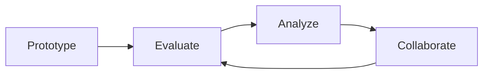

## ブログ概要（Summary）

本記事は [Writing effective tools for AI agents](https://www.anthropic.com/engineering/writing-tools-for-agents) の解説記事です。

Anthropicのエンジニア Ken Aizawa が2025年9月に公開したこの記事は、AIエージェント向けのツール設計を**Prototype → Evaluate → Analyze → Collaborate**の4段階プロセスとして体系化したものである。従来のAPI設計がソフトウェア間の確定的な契約であるのに対し、エージェント向けツールは「確定的なシステムと非確定的なエージェントの間の契約」であり、設計アプローチが根本的に異なると同記事は主張している。

この記事は [Zenn記事: MCPサーバーのツール設計パターン：数・スキーマ・認可の実践ガイド](https://zenn.dev/0h_n0/articles/c434eb97660610) の深掘りです。

## 情報源

- **種別**: 企業テックブログ
- **URL**: [https://www.anthropic.com/engineering/writing-tools-for-agents](https://www.anthropic.com/engineering/writing-tools-for-agents)
- **組織**: Anthropic Engineering
- **著者**: Ken Aizawa
- **発表日**: 2025年9月11日

## 技術的背景（Technical Background）

エージェントがツールを呼び出す仕組みでは、ツール定義（名前・説明・パラメータスキーマ）がコンテキストウィンドウに注入され、モデルが自律的にどのツールをどのパラメータで呼ぶかを決定する。このとき、ツールの設計品質がエージェントの成功率を直接左右する。

Anthropicは同記事で、ツール設計を従来のAPI設計と明確に区別している。APIは開発者が仕様書を読んで正確に呼び出すことを前提とするが、エージェント向けツールはLLMが説明文から推論して呼び出す。したがって、ツール名や説明文の微細な違いがエージェントの挙動に大きな影響を与える。同記事によると、Claude Sonnet 3.5のSWE-bench Verifiedベンチマークにおいて、ツール説明文の改良がState-of-the-art達成に貢献したと述べられている。

Zenn記事ではJSON Schemaベースのパラメータ設計やenum制約について整理しているが、本記事ではそれらの設計判断に至る**プロセス自体**をどう体系化するかに焦点を当てる。

## 4段階プロセスの詳細（Architecture）

Anthropicが提唱する4段階プロセスは以下のとおりである。



### Stage 1: Prototype（プロトタイピング）

同記事によると、まずはツールの最小限の実装を素早く作成し、手動で動作確認を行う。Claude CodeにライブラリやSDKのドキュメント（`llms.txt`ファイル含む）を渡せば、ワンショットでMCPツールを生成できると述べられている。

テスト環境としては以下が推奨されている：

- **Claude Code**: `claude mcp add <name> <command> [args...]` でローカルMCPサーバーを登録
- **Claude Desktop**: Settings > Developer または Settings > Extensions から登録
- **Anthropic API**: ツール定義を直接APIに渡す

### Stage 2: Evaluate（評価）

Anthropicは評価タスクの設計に特に重点を置いている。同記事が挙げる「強いタスク」と「弱いタスク」の対比は以下のとおりである。

**強いタスク例（推奨）**: 名前付き同僚とのミーティングをスケジュールし、過去のノートを添付し、会議室を予約する

**弱いタスク例（非推奨）**: jane@acme.corpと来週ミーティングをスケジュールする

強いタスクは、エージェントが複数のツールを組み合わせて解決する必要があり、実環境に近い。同記事は「単純なサンドボックスを避け、実データ・実サービスに基づいたタスクを多数生成すること」を推奨している。

評価のポイント：

1. **検証可能な成果物**: 各タスクにexact string matchまたはLLMジャッジで検証可能な期待結果を設定する
2. **プログラマティック実行**: シンプルな`while`ループで各タスクを実行する
3. **推論の可視化**: ツール呼び出し前にreasoningとfeedbackブロックを出力させ、chain-of-thoughtを促す
4. **メトリクス収集**: 精度だけでなく、ツール呼び出しごとの実行時間、タスクあたりの呼び出し回数、トークン使用量、ツールエラーを記録する

```python
from dataclasses import dataclass
from typing import Optional


@dataclass
class EvalMetrics:
    """ツール評価メトリクス"""
    task_id: str
    success: bool
    tool_calls: int
    total_tokens: int
    runtime_ms: float
    tool_errors: int
    reasoning_quality: Optional[float] = None


def run_eval_loop(
    tasks: list[dict],
    agent: "Agent",
    max_steps: int = 50,
) -> list[EvalMetrics]:
    """タスクリストに対してエージェントを評価する

    Args:
        tasks: 評価タスクのリスト
        agent: 評価対象のエージェント
        max_steps: 1タスクあたりの最大ステップ数
    """
    results = []
    for task in tasks:
        metrics = agent.run_task(
            task["prompt"],
            max_steps=max_steps,
            collect_metrics=True,
        )
        result = EvalMetrics(
            task_id=task["id"],
            success=task["verifier"](metrics.final_output),
            tool_calls=metrics.tool_call_count,
            total_tokens=metrics.total_tokens,
            runtime_ms=metrics.runtime_ms,
            tool_errors=metrics.error_count,
        )
        results.append(result)
    return results
```

### Stage 3: Analyze（分析）

同記事は「エージェントが**省略した**ものが、エージェントが**述べた**ものより重要な場合がある」と述べている。分析対象は以下の3つである：

1. **エージェントの推論ログ**: なぜそのツールを選んだかの根拠
2. **冗長な呼び出しパターン**: 同じツールの繰り返し呼び出しは、ページネーションやトークン制限の調整が必要なサイン
3. **無効パラメータエラーの反復**: 説明文の不明確さや例示の不足を示唆

同記事が紹介する具体例として、Claudeがウェブ検索ツールの`query`パラメータに自動的に「2025」を付加して検索結果を偏らせていた事例がある。この問題はツール説明文の改善で解決されたという。

### Stage 4: Collaborate（協働最適化）

評価トランスクリプトをClaude Codeに渡し、ツールのリファクタリングを行う。同記事によると、このプロセスにより専門家が手書きしたツール（研究者やClaudeが作成したもの含む）を超える改善が見られたと述べられている。過学習を防ぐためheld-outテストセットの使用が推奨されている。

## ツール選択の設計原則

### 適切なツールの選定

Anthropicは「ツールを増やせば良いわけではない」と明確に述べている。よくある間違いは、既存のAPIエンドポイントを1対1でツールにラップすることである。

```python
from enum import Enum
from pydantic import BaseModel, Field


class ResponseFormat(str, Enum):
    """レスポンス粒度の切り替え"""
    CONCISE = "concise"
    DETAILED = "detailed"


class SearchContactsInput(BaseModel):
    """連絡先を検索するパラメータ

    list_contactsで全件ダンプするのではなく、
    search_contactsで必要な情報のみを返す
    """
    query: str = Field(
        ...,
        description="検索キーワード（名前、メール、部署）"
    )
    response_format: ResponseFormat = Field(
        default=ResponseFormat.CONCISE,
        description="concise: 名前とIDのみ / detailed: 全フィールド"
    )
    limit: int = Field(
        default=10,
        ge=1,
        le=50,
        description="取得件数の上限"
    )
```

**統合すべきケースの具体例**（同記事より）：

| 分割ツール（非推奨） | 統合ツール（推奨） |
|---|---|
| `list_users` + `list_events` + `create_event` | `schedule_event`（空き確認＋作成を一括） |
| `read_logs`（全件ダンプ） | `search_logs`（関連行＋前後コンテキスト） |
| `get_customer_by_id` + `list_transactions` + `list_notes` | `get_customer_context`（顧客情報集約） |

### レスポンスのトークン効率

同記事は、Slackツールの実装例で`response_format`パラメータによるトークン削減効果を報告している。detailedレスポンスが206トークン、conciseレスポンスが72トークンであり、conciseは約3分の1のトークン消費である。Claude Codeはデフォルトでツールレスポンスを25,000トークンに制限していると述べられている。

レスポンス設計の推奨事項：

- **高シグナルフィールドを返す**: `name`, `image_url`, `file_type` など
- **低レベル識別子を避ける**: `uuid`, `256px_image_url`, `mime_type` ではなく自然言語名やゼロインデックス方式を使用
- **UUIDの解決**: 任意のUUIDを自然言語名やゼロインデックス方式に変換すると、ハルシネーションが減少し検索精度が向上したと同記事は報告している

### 名前空間設計

同記事は、ツール名にサービスとリソースのプレフィックスを付けることを推奨している。

```
asana_search, jira_search            # サービスプレフィックス
asana_projects_search, asana_users_search  # サービス＋リソース
```

プレフィックス方式とサフィックス方式で評価結果に「非自明な差」が出たと述べられており、その効果はLLMによって異なるため、自環境での評価が必要であるとしている。

### ツール説明文の最適化

同記事は、ツール説明文を「新入社員のオンボーディング」のように書くことを推奨している。暗黙的なコンテキスト（クエリフォーマット、ニッチな用語、リソース間の関係）を明示的にする。

また、MCPサーバーではtool annotationsを使って、オープンワールドアクセスが必要なツールや破壊的操作を行うツールを開示できると述べられている。

## パフォーマンス最適化（Performance）

### トークン効率化の実測値

同記事から得られる実測値は以下のとおりである。

| メトリクス | 値 | 条件 |
|---|---|---|
| Detailedレスポンストークン | 206 | Slackツール |
| Conciseレスポンストークン | 72 | Slackツール（約1/3） |
| ツールレスポンス上限 | 25,000トークン | Claude Codeデフォルト |

### チューニング手法

1. **ページネーション**: デフォルトの取得件数を設定し、必要に応じて追加取得
2. **範囲選択**: 日付範囲やフィルタ条件のパラメータ化
3. **トランケーション**: 上限超過時にエージェントを誘導する（フィルタ・ページネーション・複数の小さな検索を提案）
4. **エラーの実行可能化**: 不透明なコードやトレースバックではなく、具体的な修正方法や正しいフォーマットの例を返す

## 運用での学び（Production Lessons）

### eval駆動型改善の有効性

同記事が最も強調するのは、固定ルールよりも**評価駆動の改善プロセス**の重要性である。ツールの操作メカニズムは将来変化するため、特定のルールに固執するよりも、評価→分析→改善のループを回す能力が重要であると述べている。

### 発見された具体的な問題パターン

1. **暗黙的なバイアス注入**: 検索ツールの`query`パラメータにモデルが年号を自動付加し、結果を偏らせる
2. **冗長な呼び出しチェーン**: 複数ステップのAPIを個別に呼ぶことによる非効率
3. **識別子のハルシネーション**: UUIDの推測による誤ったツール呼び出し
4. **レスポンスのコンテキスト圧迫**: 不要なフィールドによるトークン浪費

### held-outテストによる過学習防止

同記事はeval最適化の際にheld-outテストセットの使用を推奨している。これは、特定のタスクへの過学習を防ぎ、汎用的なツール設計を維持するためである。

## 学術研究との関連（Academic Connection）

### 関連論文との位置づけ

同記事はAnthropicの「Advanced Tool Use」（同社の別のエンジニアリングブログ記事）を補完する位置づけにある。Advanced Tool Useがworked例の追加で精度72%→90%という改善を報告しているのに対し、本記事はツール設計の**プロセス全体**を体系化している。

Zenn記事で紹介されているSpeakeasyの検証（ツール数10個以下でエラーなし、100超で選択失敗）やGMI Cloudのスキーマ設計パターンとも整合する。本記事の「ツールを増やせば良いわけではない」という主張は、ツール統合によってツール数を削減し、各ツールの目的を明確にすべきという具体的なガイダンスを提供する。

## Production Deployment Guide

### AWS実装パターン（コスト最適化重視）

以下は、本記事で紹介されているeval駆動型のMCPツール設計ワークフローをAWS上で構築する場合の推奨構成である。コスト試算は2026年11月時点のAWS ap-northeast-1（東京）リージョン料金に基づく概算値であり、実際のコストはトラフィックパターンやバースト使用量により変動する。最新料金は [AWS料金計算ツール](https://calculator.aws/) で確認されたい。

| 規模 | 月間リクエスト | 推奨構成 | 月額コスト | 主要サービス |
|------|--------------|---------|-----------|------------|
| **Small** | ~3,000 (100/日) | Serverless | $50-150 | Lambda + Bedrock + DynamoDB |
| **Medium** | ~30,000 (1,000/日) | Hybrid | $300-800 | Lambda + ECS Fargate + ElastiCache |
| **Large** | 300,000+ (10,000/日) | Container | $2,000-5,000 | EKS + Karpenter + EC2 Spot |

**Small構成の詳細**（月額$50-150）:
- **Lambda**: MCPサーバーの各ツールをハンドラとして実装、1GB RAM、30秒タイムアウト ($20/月)
- **Bedrock**: Claude 3.5 Haiku、Prompt Caching有効 ($80/月)
- **DynamoDB**: eval結果・ツール定義キャッシュ、On-Demand ($10/月)
- **CloudWatch**: eval実行メトリクス ($5/月)
- **API Gateway**: REST API ($5/月)

**Medium構成の詳細**（月額$300-800）:
- **Lambda**: イベント処理・eval実行 ($50/月)
- **ECS Fargate**: MCPサーバー常駐、0.5 vCPU × 1GB RAM × 2タスク ($120/月)
- **Bedrock**: Claude 3.5 Sonnet、Batch API活用 ($400/月)
- **ElastiCache Redis**: ツール定義・レスポンスキャッシュ、cache.t3.micro ($15/月)
- **ALB**: ロードバランシング ($20/月)

**コスト削減テクニック**:
- Spot Instances使用で最大90%削減（EKS + Karpenter）
- Bedrock Batch API使用で50%削減（非リアルタイムeval実行）
- Prompt Caching有効化で30-90%削減（ツール定義は共通システムプロンプト）
- アイドルタイムのAuto Scaling to Zero（Fargate/Lambda）

### Terraformインフラコード

**Small構成（Serverless）: Lambda + Bedrock + DynamoDB**

```hcl
module "vpc" {
  source  = "terraform-aws-modules/vpc/aws"
  version = "~> 5.0"

  name = "mcp-tool-eval-vpc"
  cidr = "10.0.0.0/16"
  azs  = ["ap-northeast-1a", "ap-northeast-1c"]
  private_subnets = ["10.0.1.0/24", "10.0.2.0/24"]

  enable_nat_gateway   = false
  enable_dns_hostnames = true
}

resource "aws_iam_role" "lambda_mcp" {
  name = "lambda-mcp-tool-eval-role"

  assume_role_policy = jsonencode({
    Version = "2012-10-17"
    Statement = [{
      Action    = "sts:AssumeRole"
      Effect    = "Allow"
      Principal = { Service = "lambda.amazonaws.com" }
    }]
  })
}

resource "aws_iam_role_policy" "bedrock_invoke" {
  role = aws_iam_role.lambda_mcp.id

  policy = jsonencode({
    Version = "2012-10-17"
    Statement = [{
      Effect   = "Allow"
      Action   = ["bedrock:InvokeModel", "bedrock:InvokeModelWithResponseStream"]
      Resource = "arn:aws:bedrock:ap-northeast-1::foundation-model/anthropic.claude-3-5-haiku*"
    }]
  })
}

resource "aws_lambda_function" "mcp_eval_runner" {
  filename      = "lambda.zip"
  function_name = "mcp-tool-eval-runner"
  role          = aws_iam_role.lambda_mcp.arn
  handler       = "index.handler"
  runtime       = "python3.12"
  timeout       = 60
  memory_size   = 1024

  environment {
    variables = {
      BEDROCK_MODEL_ID    = "anthropic.claude-3-5-haiku-20241022-v1:0"
      DYNAMODB_TABLE      = aws_dynamodb_table.eval_results.name
      ENABLE_PROMPT_CACHE = "true"
    }
  }
}

resource "aws_dynamodb_table" "eval_results" {
  name         = "mcp-tool-eval-results"
  billing_mode = "PAY_PER_REQUEST"
  hash_key     = "eval_run_id"
  range_key    = "task_id"

  attribute {
    name = "eval_run_id"
    type = "S"
  }

  attribute {
    name = "task_id"
    type = "S"
  }

  ttl {
    attribute_name = "expire_at"
    enabled        = true
  }
}

resource "aws_cloudwatch_metric_alarm" "eval_cost_spike" {
  alarm_name          = "mcp-eval-cost-spike"
  comparison_operator = "GreaterThanThreshold"
  evaluation_periods  = 1
  metric_name         = "Duration"
  namespace           = "AWS/Lambda"
  period              = 3600
  statistic           = "Sum"
  threshold           = 100000
  alarm_description   = "Eval実行時間異常（コスト急増の可能性）"

  dimensions = {
    FunctionName = aws_lambda_function.mcp_eval_runner.function_name
  }
}
```

**Large構成（Container）: EKS + Karpenter + Spot Instances**

```hcl
module "eks" {
  source  = "terraform-aws-modules/eks/aws"
  version = "~> 20.0"

  cluster_name    = "mcp-tool-eval-cluster"
  cluster_version = "1.31"

  vpc_id     = module.vpc.vpc_id
  subnet_ids = module.vpc.private_subnets

  cluster_endpoint_public_access = true
  enable_cluster_creator_admin_permissions = true
}

resource "kubectl_manifest" "karpenter_provisioner" {
  yaml_body = <<-YAML
    apiVersion: karpenter.sh/v1alpha5
    kind: Provisioner
    metadata:
      name: mcp-eval-spot
    spec:
      requirements:
        - key: karpenter.sh/capacity-type
          operator: In
          values: ["spot"]
        - key: node.kubernetes.io/instance-type
          operator: In
          values: ["m6i.xlarge", "m6i.2xlarge"]
      limits:
        resources:
          cpu: "32"
          memory: "128Gi"
      providerRef:
        name: default
      ttlSecondsAfterEmpty: 30
  YAML
}

resource "aws_budgets_budget" "eval_monthly" {
  name         = "mcp-eval-monthly-budget"
  budget_type  = "COST"
  limit_amount = "5000"
  limit_unit   = "USD"
  time_unit    = "MONTHLY"

  notification {
    comparison_operator        = "GREATER_THAN"
    threshold                  = 80
    threshold_type             = "PERCENTAGE"
    notification_type          = "ACTUAL"
    subscriber_email_addresses = ["ops@example.com"]
  }
}
```

### セキュリティベストプラクティス

- **IAMロール**: 最小権限原則。Bedrock InvokeModelのみ許可し、モデルARNをリソースレベルで制限
- **シークレット管理**: AWS Secrets Manager使用。環境変数へのハードコード禁止
- **ネットワーク**: EKSの`cluster_endpoint_public_access = false`設定（本番環境）
- **暗号化**: S3/DynamoDB/EBS全てKMS暗号化。転送中はTLS 1.2以上

### 運用・監視設定

```python
import boto3

cloudwatch = boto3.client("cloudwatch")

cloudwatch.put_metric_alarm(
    AlarmName="mcp-eval-token-spike",
    ComparisonOperator="GreaterThanThreshold",
    EvaluationPeriods=1,
    MetricName="TokenUsage",
    Namespace="Custom/MCPEval",
    Period=3600,
    Statistic="Sum",
    Threshold=500000,
    ActionsEnabled=True,
    AlarmActions=["arn:aws:sns:ap-northeast-1:123456789:cost-alerts"],
    AlarmDescription="MCPツール評価のトークン使用量異常",
)
```

```sql
-- CloudWatch Logs Insights: eval実行コスト分析
fields @timestamp, model_id, input_tokens, output_tokens, tool_name
| stats sum(input_tokens + output_tokens) as total_tokens by bin(1h)
| filter total_tokens > 100000
```

### コスト最適化チェックリスト

**アーキテクチャ選択**:
- [ ] ~100 req/日 → Lambda + Bedrock（Serverless）$50-150/月
- [ ] ~1,000 req/日 → ECS Fargate + Bedrock（Hybrid）$300-800/月
- [ ] 10,000+ req/日 → EKS + Spot Instances（Container）$2,000-5,000/月

**リソース最適化**:
- [ ] EC2: Spot Instances優先（Karpenter自動管理）
- [ ] Reserved Instances: 1年コミットで最大72%削減
- [ ] Lambda: メモリサイズ最適化（CloudWatch Insights分析）
- [ ] ECS/EKS: アイドルタイムのスケールダウン

**LLMコスト削減**:
- [ ] Bedrock Batch API: 50%割引（非リアルタイムeval実行）
- [ ] Prompt Caching: ツール定義の共通部分をキャッシュ
- [ ] モデル選択: eval実行はHaiku、本番推論はSonnet
- [ ] response_format: conciseデフォルトでトークン消費を1/3に

**監視・アラート**:
- [ ] AWS Budgets: 月額予算設定
- [ ] CloudWatch: トークン使用量スパイク検知
- [ ] Cost Anomaly Detection: 自動異常検知
- [ ] 日次コストレポート: SNS/Slack通知

**リソース管理**:
- [ ] DynamoDB TTL: 古いeval結果の自動削除
- [ ] タグ戦略: 環境別コスト可視化
- [ ] S3ライフサイクル: 30日でeval成果物を自動削除
- [ ] 開発環境: 夜間停止（Auto Start/Stop）

## まとめと実践への示唆

Anthropicが公開した本記事の核心は、ツール設計を**反復的な評価プロセス**として捉えることにある。固定ルール（「パラメータは5個以下」「enumを使え」等）も有用だが、同記事はそれらのルール自体をevalの結果から導き方法を示している。

Zenn記事で整理されているスキーマ設計パターン（enumの使用、ネストの回避、worked例の追加）は、本記事の4段階プロセスにおけるStage 2（Evaluate）とStage 3（Analyze）の成果物として位置づけられる。同記事は、ツール設計において「対話メカニズムは将来変わるが、評価駆動の改善プロセスは普遍的に重要」と結論づけている。

## 参考文献

- **Blog URL**: [https://www.anthropic.com/engineering/writing-tools-for-agents](https://www.anthropic.com/engineering/writing-tools-for-agents)
- **Related**: [Anthropic - Advanced Tool Use](https://www.anthropic.com/engineering/advanced-tool-use)
- **Related Zenn article**: [https://zenn.dev/0h_n0/articles/c434eb97660610](https://zenn.dev/0h_n0/articles/c434eb97660610)
