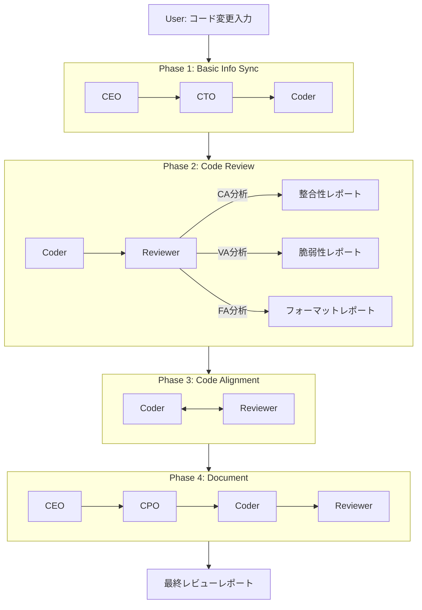

## 論文概要（Abstract）

本記事は [CodeAgent: Autonomous Communicative Agents for Code Review（arXiv:2402.02172）](https://arxiv.org/abs/2402.02172) の解説記事です。

CodeAgentは、コードレビューを複数のLLMエージェントの協調作業として自動化するマルチエージェントフレームワークである。著者らは、既存のコードレビュー自動化が単一の入出力生成モデルに依存しており、実際のレビューが持つ協調的・反復的な性質を捉えきれていない点を課題として提起している。本論文では、CEO・CTO・CPO・Reviewer・Coderなど6つの役割を持つエージェント群と、会話の品質を監督するQA-Checker機構を提案し、4つのコードレビュータスク（コミットメッセージ整合性検出、脆弱性導入検出、フォーマット一貫性検証、コード修正提案）で評価を行っている。

この記事は [Zenn記事: Claude Code Agent SDKで開発タスクを自動化するカスタムAIエージェント構築](https://zenn.dev/0h_n0/articles/54434fcee9091e) の深掘りです。Agent SDKによるCI/CDパイプラインでのコードレビュー自動化を検討する際に、マルチエージェント設計の学術的基盤として参考になる。

## 情報源

- **arXiv ID**: 2402.02172
- **URL**: [https://arxiv.org/abs/2402.02172](https://arxiv.org/abs/2402.02172)
- **著者**: Xunzhu Tang, Kisub Kim, Yewei Song, Cedric Lothritz, Bei Li, Saad Ezzini, Haoye Tian, Jacques Klein, Tegawende F. Bissyande（University of Luxembourg, SnT）
- **発表年**: 2024（v1: 2024年2月、v5: 2024年9月）
- **分野**: cs.SE（ソフトウェア工学）
- **コード**: [https://github.com/Code4Agent/codeagent](https://github.com/Code4Agent/codeagent)

## 背景と動機（Background & Motivation）

コードレビューはソフトウェア品質を維持するための中核プラクティスであるが、人手によるレビューはコストが高く、大規模プロジェクトではボトルネックとなる。近年、LLMを用いたコードレビュー自動化の研究が進んでいるが、著者らは既存手法に2つの根本的な限界があると指摘している。

第一に、CodeBERTやGPT-4を直接利用する手法は「単一の入出力生成」パラダイムに基づいており、コード変更を入力として受け取り、一度にレビューコメントを生成する。しかし実際のコードレビューは、複数のレビュアーが異なる観点（セキュリティ、パフォーマンス、可読性等）から指摘し、開発者と対話的にやり取りする協調プロセスである。

第二に、単一モデルでは文脈窓の制限により、大規模なdiffの全体を一度に処理することが困難である。GPT-3.5のコンテキスト長は4,096トークンであるのに対し、GPT-4は32,768トークンを扱えるが、それでもモノレポの大規模PRには不十分なケースがある。

これらの課題に対し、著者らは「ソフトウェア開発チームのコードレビュープロセスをシミュレートする」というアプローチを取り、マルチエージェントシステムによる解決を提案している。

## 主要な貢献（Key Contributions）

- **マルチエージェントアーキテクチャ**: CEO・CTO・CPO・Reviewer・Coderの6役割によるコードレビューシミュレーション。4つのフェーズ（Basic Info Sync → Code Review → Code Alignment → Document）で段階的に処理
- **QA-Checker監督機構**: エージェント間の会話品質を監視し、タスクからの逸脱（プロンプトドリフト）を検出・補正する品質保証メカニズム
- **4タスクの統合評価**: コミットメッセージ整合性（CA）、脆弱性導入（VA）、フォーマット一貫性（FA）、コード修正提案（CR）を統合的に評価
- **大規模データセット**: 180以上のプロジェクト、9言語、3,545コミット・約2,933プルリクエストからなる新規データセットを構築（2023年4月以降のリポジトリに限定し、学習データとの重複を回避）

## 技術的詳細（Technical Details）

### マルチエージェントアーキテクチャ

CodeAgentは、ソフトウェア開発チームのレビュープロセスを模倣する6つのエージェントで構成される。



**Phase 1: Basic Info Sync** — CEO、CTO、Coderが入力の基本情報（コード言語、ドキュメント形式等）を同期する。

**Phase 2: Code Review** — CoderとReviewerが3つの分析を実施する。CA（Consistency Analysis）ではコミットメッセージとコード変更の整合性を検査し、VA（Vulnerability Analysis）では変更によるセキュリティ脆弱性の導入を検出し、FA（Format Analysis）ではコーディングスタイルの一貫性を検証する。

**Phase 3: Code Alignment** — Phase 2で検出された問題について、CoderがReviewerの指摘をもとにコード修正案を作成する。

**Phase 4: Document** — CEO、CPO、Coder、Reviewerが協力して最終的なレビューレポートを生成する。

各フェーズは、2エージェント間のアトミックな会話に分解される。一方がインストラクター（指示者）、他方がアシスタント（実行者）となるinstruction-followingパターンで、最大10ラウンドの会話が許容される（論文Appendix Cより）。

### QA-Checker監督機構

QA-Checkerは、エージェント間の会話が元のタスクから逸脱する「プロンプトドリフト」を防ぐための品質保証機構である。

初期のタスク指示を $q_0$、最初の応答を $a_0$ とする。QA-Checkerが $a_0$ を不適切と判断した場合、追加指示 $aai_0$ を付与して新たな質問 $q_1 = \text{CB}(q_0 + aai_0)$ を形成し、再度応答を要求する。このループは応答が承認されるか、ターン制限に達するまで繰り返される。

品質評価関数 $Q$ は以下の3要素から構成される（論文Appendix Aより）：

$$
Q(Q_i, A_i) = \alpha \cdot \text{Relevance} + \beta \cdot \text{Specificity} + \gamma \cdot \text{Coherence}
$$

ここで、
- $\text{Relevance}$: 質問と応答のコサイン類似度
- $\text{Specificity}$: 専門用語の技術的スコアの平均
- $\text{Coherence}$: 談話接続詞、共参照一貫性、回答パターン適合度
- $\alpha = \beta = \gamma = \frac{1}{3}$（等重み）

品質スコア $Q$ が閾値 $\tau$ を下回った場合に追加指示が生成される。著者らはLemma A.1でこの更新がNewton法的な収束を持つと主張しているが、これは2回微分可能性や正定値Hessianを前提とした理論的スケッチであり、厳密な証明ではない点に注意が必要である。

### エージェント間通信プロトコル

各フェーズ内のエージェント間通信は、以下のプロトコルに従う：

1. **ロールカード**: 各エージェントにCEO、Reviewer等の役割を記述したプロンプトが付与される
2. **Instructor-Assistant パターン**: 2エージェント間の会話で、一方が指示、他方が応答する
3. **QA-Checker介入**: 各会話ラウンドで品質チェックが実行され、必要に応じて補正指示が挿入される
4. **フェーズ間引き継ぎ**: 前フェーズの出力が次フェーズの入力コンテキストに組み込まれる

## 実装のポイント（Implementation）

### LLMモデルの選択

著者らはGPT-3.5（CodeAgent-3.5）とGPT-4（CodeAgent-4.0）の2構成で評価を行っている。論文Table 12によると、1レビューあたりの実行時間とコストは以下の通りである：

| モデル | 実行時間（分） | コスト（USD） |
|--------|----------------|---------------|
| CodeAgent-3.5 | 3 | $0.017 |
| CodeAgent-4.0 | 5 | $0.122 |

GPT-4.0はコンテキスト長32,768トークンにより大規模diffの処理に優れるが、GPT-3.5の約7倍のコストとなる。

### 実装時の注意点

- **会話ラウンド制限**: QA-Checkerの介入ループは最大10ラウンドに制限されており、無限ループを防止している
- **言語対応**: 9言語（Python、Java、Go、C++、JavaScript、C、C#、PHP、Ruby）に対応。言語ごとの検出精度には差異があり、論文Table 9によるとC++が最も高い確認率（16.49%）、Rubyが最も低い（9.73%）と報告されている
- **QA-Checker閾値の調整**: 品質閾値 $\tau$ の設定が精度と実行時間のトレードオフに影響する。閾値が低すぎると不十分なレビューが通過し、高すぎると会話ラウンドが増加してコストが増大する

## Production Deployment Guide

### AWS実装パターン（コスト最適化重視）

CodeAgent的なマルチエージェントコードレビューをAWS上で構築する場合の推奨構成を示す。以下のコスト試算は2026年11月時点のAWS ap-northeast-1（東京）リージョン料金に基づく概算値であり、実際のコストはトラフィックパターンやバースト使用量により変動する。最新料金は [AWS料金計算ツール](https://calculator.aws/) で確認されたい。

**トラフィック量別の推奨構成**:

| 規模 | 月間レビュー数 | 推奨構成 | 月額コスト | 主要サービス |
|------|--------------|---------|-----------|------------|
| **Small** | ~100（3-4/日） | Serverless | $80-200 | Lambda + Bedrock + DynamoDB |
| **Medium** | ~1,000（30/日） | Hybrid | $500-1,200 | Lambda + ECS Fargate + ElastiCache |
| **Large** | 10,000+（300/日） | Container | $3,000-7,000 | EKS + Karpenter + EC2 Spot |

**Small構成の詳細**（月額$80-200）:
- **Lambda**: 2GB RAM、60秒タイムアウト（マルチエージェント会話に対応）（$30/月）
- **Bedrock**: Claude 3.5 Haiku（Reviewer/Coder用）、Prompt Caching有効（$100/月）
- **DynamoDB**: On-Demand、レビュー結果キャッシュ用（$10/月）
- **SQS**: PRイベントキュー（$5/月）
- **CloudWatch**: 基本監視（$5/月）

**Medium構成の詳細**（月額$500-1,200）:
- **Lambda**: PRイベント受信・ディスパッチ（$30/月）
- **ECS Fargate**: 1 vCPU、2GB RAM × 2タスク（エージェントオーケストレーター）（$180/月）
- **Bedrock**: Claude 3.5 Sonnet（複雑なレビュー用）+ Haiku（簡易チェック用）（$700/月）
- **ElastiCache Redis**: cache.t3.micro、QA-Checker状態管理（$15/月）
- **ALB**: Application Load Balancer（$20/月）

**Large構成の詳細**（月額$3,000-7,000）:
- **EKS**: コントロールプレーン（$72/月）
- **EC2 Spot**: g5.xlarge × 2-4台（$800/月、Spot利用で最大90%削減）
- **Karpenter**: 自動スケーリング（追加コストなし）
- **Bedrock Batch**: 50%割引活用（$4,000/月）
- **S3**: レビュー結果・diff保存（$20/月）
- **CloudWatch + X-Ray**: 詳細監視（$100/月）

**コスト削減テクニック**:
- Spot Instances使用で最大90%削減（EKS + Karpenter）
- Reserved Instances購入で最大72%削減（1年コミット）
- Bedrock Batch API使用で50%削減（非リアルタイムレビュー）
- Prompt Caching有効化で30-90%削減（システムプロンプト固定）

### Terraformインフラコード

**Small構成（Serverless）: Lambda + Bedrock + DynamoDB**

```hcl
module "vpc" {
  source  = "terraform-aws-modules/vpc/aws"
  version = "~> 5.0"

  name = "code-review-vpc"
  cidr = "10.0.0.0/16"
  azs  = ["ap-northeast-1a", "ap-northeast-1c"]
  private_subnets = ["10.0.1.0/24", "10.0.2.0/24"]

  enable_nat_gateway   = false
  enable_dns_hostnames = true
}

resource "aws_iam_role" "review_lambda" {
  name = "code-review-lambda-role"

  assume_role_policy = jsonencode({
    Version = "2012-10-17"
    Statement = [{
      Action    = "sts:AssumeRole"
      Effect    = "Allow"
      Principal = { Service = "lambda.amazonaws.com" }
    }]
  })
}

resource "aws_iam_role_policy" "bedrock_invoke" {
  role = aws_iam_role.review_lambda.id

  policy = jsonencode({
    Version = "2012-10-17"
    Statement = [{
      Effect   = "Allow"
      Action   = ["bedrock:InvokeModel", "bedrock:InvokeModelWithResponseStream"]
      Resource = "arn:aws:bedrock:ap-northeast-1::foundation-model/anthropic.claude-3-5-haiku*"
    }]
  })
}

resource "aws_lambda_function" "code_reviewer" {
  filename      = "reviewer.zip"
  function_name = "multi-agent-code-reviewer"
  role          = aws_iam_role.review_lambda.arn
  handler       = "index.handler"
  runtime       = "python3.12"
  timeout       = 120
  memory_size   = 2048

  environment {
    variables = {
      BEDROCK_MODEL_ID    = "anthropic.claude-3-5-haiku-20241022-v1:0"
      DYNAMODB_TABLE      = aws_dynamodb_table.review_cache.name
      MAX_CONVERSATION_ROUNDS = "10"
      QA_CHECKER_THRESHOLD    = "0.6"
    }
  }
}

resource "aws_dynamodb_table" "review_cache" {
  name         = "code-review-cache"
  billing_mode = "PAY_PER_REQUEST"
  hash_key     = "review_id"

  attribute {
    name = "review_id"
    type = "S"
  }

  ttl {
    attribute_name = "expire_at"
    enabled        = true
  }
}

resource "aws_cloudwatch_metric_alarm" "review_duration" {
  alarm_name          = "code-review-duration-spike"
  comparison_operator = "GreaterThanThreshold"
  evaluation_periods  = 1
  metric_name         = "Duration"
  namespace           = "AWS/Lambda"
  period              = 3600
  statistic           = "Average"
  threshold           = 60000
  alarm_description   = "レビュー実行時間異常（QA-Checkerループ過多の可能性）"

  dimensions = {
    FunctionName = aws_lambda_function.code_reviewer.function_name
  }
}
```

**Large構成（Container）: EKS + Karpenter + Spot Instances**

```hcl
module "eks" {
  source  = "terraform-aws-modules/eks/aws"
  version = "~> 20.0"

  cluster_name    = "code-review-cluster"
  cluster_version = "1.31"

  vpc_id     = module.vpc.vpc_id
  subnet_ids = module.vpc.private_subnets

  cluster_endpoint_public_access = true
  enable_cluster_creator_admin_permissions = true
}

resource "kubectl_manifest" "karpenter_provisioner" {
  yaml_body = <<-YAML
    apiVersion: karpenter.sh/v1alpha5
    kind: Provisioner
    metadata:
      name: review-spot-provisioner
    spec:
      requirements:
        - key: karpenter.sh/capacity-type
          operator: In
          values: ["spot"]
        - key: node.kubernetes.io/instance-type
          operator: In
          values: ["m5.xlarge", "m5.2xlarge"]
      limits:
        resources:
          cpu: "32"
          memory: "128Gi"
      ttlSecondsAfterEmpty: 60
  YAML
}

resource "aws_budgets_budget" "review_monthly" {
  name         = "code-review-monthly-budget"
  budget_type  = "COST"
  limit_amount = "7000"
  limit_unit   = "USD"
  time_unit    = "MONTHLY"

  notification {
    comparison_operator        = "GREATER_THAN"
    threshold                  = 80
    threshold_type             = "PERCENTAGE"
    notification_type          = "ACTUAL"
    subscriber_email_addresses = ["ops@example.com"]
  }
}
```

### セキュリティベストプラクティス

**本番環境での推奨設定**:

1. **ネットワーク**: EKS `cluster_endpoint_public_access = false`（VPN経由）、Lambda VPC内配置
2. **認証・認可**: IAM最小権限、MFA必須、IRSA（IAM Roles for Service Accounts）
3. **シークレット**: AWS Secrets Manager使用、90日ローテーション
4. **監査**: CloudTrail全リージョン有効化、Config変更追跡
5. **データ保護**: TLS 1.2以上、KMS暗号化（S3/DynamoDB/EBS）

### 運用・監視設定

**CloudWatch Logs Insights クエリ**:

```sql
-- QA-Checkerの介入頻度分析
fields @timestamp, review_id, qa_checker_rounds, total_duration_ms
| stats avg(qa_checker_rounds) as avg_rounds, max(qa_checker_rounds) as max_rounds by bin(1h)
| filter qa_checker_rounds > 5

-- エージェント別レイテンシ分析
fields @timestamp, agent_role, duration_ms
| stats pct(duration_ms, 95) as p95, pct(duration_ms, 99) as p99 by agent_role
```

**CloudWatch アラーム（コスト重視）**:

```python
import boto3

cloudwatch = boto3.client('cloudwatch')

cloudwatch.put_metric_alarm(
    AlarmName='bedrock-review-token-spike',
    ComparisonOperator='GreaterThanThreshold',
    EvaluationPeriods=1,
    MetricName='TokenUsage',
    Namespace='Custom/CodeReview',
    Period=3600,
    Statistic='Sum',
    Threshold=500000,
    ActionsEnabled=True,
    AlarmActions=['arn:aws:sns:ap-northeast-1:123456789:cost-alerts'],
    AlarmDescription='レビュートークン使用量異常（QA-Checkerループ増加の可能性）'
)
```

**X-Ray トレーシング設定**:

```python
from aws_xray_sdk.core import xray_recorder, patch_all

patch_all()

@xray_recorder.capture('multi_agent_review')
def run_code_review(diff: str, commit_msg: str) -> dict:
    xray_recorder.put_annotation('phase', 'code_review')
    xray_recorder.put_metadata('diff_length', len(diff))
    xray_recorder.put_metadata('agent_count', 6)

    result = orchestrate_agents(diff, commit_msg)

    xray_recorder.put_metadata('qa_rounds', result['qa_checker_rounds'])
    xray_recorder.put_metadata('total_tokens', result['token_usage'])
    return result
```

### コスト最適化チェックリスト

**アーキテクチャ選択**:
- [ ] ~3 レビュー/日 → Lambda + Bedrock（Serverless）$80-200/月
- [ ] ~30 レビュー/日 → ECS Fargate + Bedrock（Hybrid）$500-1,200/月
- [ ] 300+ レビュー/日 → EKS + Spot（Container）$3,000-7,000/月

**リソース最適化**:
- [ ] Spot Instances優先（最大90%削減、Karpenter自動管理）
- [ ] Reserved Instances: 1年コミットで72%削減
- [ ] Lambda: メモリサイズ最適化（CloudWatch Insights分析）
- [ ] ECS/EKS: 夜間・週末のスケールダウン
- [ ] QA-Checkerラウンド上限の適切な設定（コスト直結）

**LLMコスト削減**:
- [ ] Bedrock Batch API: 50%割引（非リアルタイムレビュー）
- [ ] Prompt Caching: ロールカードプロンプトの固定化で30-90%削減
- [ ] モデル選択: 簡易チェック→Haiku（$0.25/MTok）、複雑レビュー→Sonnet（$3/MTok）
- [ ] トークン制限: diff分割による入力トークン最適化

**監視・アラート**:
- [ ] AWS Budgets: 月額予算設定（80%警告、100%アラート）
- [ ] CloudWatch: QA-Checkerラウンド数・トークン使用量監視
- [ ] Cost Anomaly Detection: 自動異常検知
- [ ] 日次コストレポート: SNS/Slack自動送信

**リソース管理**:
- [ ] 未使用リソース削除: Trusted Advisor活用
- [ ] タグ戦略: 環境別（dev/staging/prod）コスト可視化
- [ ] S3ライフサイクル: 古いレビュー結果自動削除（90日）
- [ ] DynamoDB TTL: レビューキャッシュ自動期限切れ

## 実験結果（Results）

著者らは4つのタスクで評価を行い、CodeBERT、GPT-3.5、GPT-4.0、Chain-of-Thought（COT）、ReActをベースラインとしている。データセットは180以上のプロジェクト、9言語から構成され、2023年4月以降のリポジトリに限定することでデータリークを回避している。

### 脆弱性導入検出（VA）

論文Table 2によると、3,545サンプル全体での結果は以下の通りである：

| 手法 | 発見数 | 確認数 | 確認率（Ratecr） | 全体確認率（Rateca） |
|------|--------|--------|-------------------|---------------------|
| CodeBERT | 1,063 | 212 | 19.94% | 5.98% |
| GPT-3.5 | 864 | 317 | 36.69% | 8.94% |
| GPT-4.0 | 671 | 345 | 51.42% | 9.73% |
| COT | 752 | 371 | 49.34% | 10.46% |
| ReAct | 693 | 359 | 51.80% | 10.13% |
| **CodeAgent** | **483** | **449** | **92.96%** | **12.67%** |
| CodeAgent w/o QA | 564 | 413 | 73.23% | 11.65% |

CodeAgentは発見数は少ないが確認率（precision相当）が突出して高く、GPT-4.0の51.42%に対して92.96%を達成している。QA-Checkerを除去した場合は73.23%に低下しており、監督機構が精度向上に寄与していることが示されている。

### コミットメッセージ整合性検出（CA）

論文Table 3によると、CodeAgentはmergedリポジトリでRecall 90.11%、F1 93.89%を達成し、ベースライン最良のGPT-4.0（Recall 84.27%、F1 90.12%）に対してそれぞれ+5.84pp、+3.77ppの改善を報告している。closedリポジトリでもRecall 87.15%、F1 92.40%と同様の傾向を示している。

### フォーマット一貫性検証（FA）

論文Table 4によると、CodeAgentはmergedリポジトリでRecall 89.34%、F1 94.01%を報告している。特にGPT-4.0の78.53%に対して+10.81ppの改善が見られる。closedリポジトリではRecall 89.57%、F1 94.13%であり、mergedとclosedで安定した精度を維持している。

### コード修正提案（CR）

論文Table 5のEdit Progress（EP）指標では、CodeAgentの平均EPは31.6%であり、AutoTransformの29.8%をわずかに上回っている。ただし、Trans-Reviewベンチマーク単体ではCodeBERT（49.8%）やGraphCodeBERT（50.6%）がCodeAgent（42.7%）を上回っており、修正提案タスクではマルチエージェントアーキテクチャの優位性が限定的である点に注意が必要である。

### QA-Checkerのアブレーション

QA-Checkerを除去した場合（CodeAgent w/o QA）、VAタスクで確認率が92.96%から73.23%へ約20pp低下し（論文Table 2）、CA・FAでも一貫して精度が低下している。この結果は、監督機構がプロンプトドリフトの抑制に有効であることを示唆している。

## 実運用への応用（Practical Applications）

### Agent SDKとの統合

Zenn記事で解説されているClaude Code Agent SDKとCodeAgentのアーキテクチャを組み合わせることで、以下のようなCI/CDパイプラインが構築可能である：

1. **PR作成トリガー**: GitHub ActionsでPRイベントを検知
2. **diff取得**: Agent SDKの`query()`でdiffを取得
3. **マルチエージェントレビュー**: CodeAgentのフェーズ設計に基づき、MCPカスタムツールとして各エージェント（lint_check、coverage_check等）を実装
4. **QA-Checker**: Agent SDKの`query()`結果を品質評価し、必要に応じて再レビューを要求
5. **レビューコメント投稿**: `gh pr review`で結果を投稿

### 実運用での課題

- **レイテンシ**: マルチエージェントの逐次処理により、単一モデルの3-5倍の実行時間が見込まれる（論文Table 12より、CodeAgent-4.0で1レビュー約5分）
- **コスト**: 6エージェント×複数ラウンドのLLM呼び出しにより、単一query比で2-4倍のトークン消費が想定される
- **スケーリング**: 大規模モノレポでは、diffを分割して複数のCodeAgentインスタンスを並列実行する戦略が有効

## 関連研究（Related Work）

- **ChatDev**（Qian et al., 2023）: ソフトウェア開発の各フェーズをマルチエージェントで自動化するフレームワーク。CodeAgentはレビュー特化であるのに対し、ChatDevは開発全体をカバーするが、QA-Checker的な品質保証機構は持たない
- **MetaGPT**（Hong et al., 2023）: 標準作業手順（SOP）をマルチエージェントに組み込むフレームワーク。CodeAgentのフェーズ設計はMetaGPTのSOP的アプローチと類似する
- **BitsAI-CR**（Sun et al., 2025）: ByteDanceで実運用されている産業規模のLLMコードレビューシステム。RuleCheckerとReviewFilterの2段パイプラインで精度75%を報告しており、CodeAgentのマルチエージェント方式とは異なるアプローチで産業展開に成功している
- **SWE-agent**（Yang et al., 2024）: GitHub Issueの自動解決に特化したLLMエージェント。コードレビューではなくバグ修正に焦点を当てている

## まとめと今後の展望

CodeAgentは、コードレビューを単一モデルの入出力問題ではなく、複数エージェントの協調プロセスとして再定義したフレームワークである。QA-Checker監督機構による品質保証は、特に脆弱性検出タスクで顕著な精度改善（確認率92.96%、論文Table 2）をもたらしている。

ただし、コード修正提案タスクではベースラインを大きく上回っておらず、マルチエージェントアーキテクチャの恩恵は分析・検出系タスクにおいてより顕著である。また、1レビューあたりの実行時間（5分）とコスト（$0.122）は、大規模展開時にスケーラビリティの課題となりうる。

Agent SDKを用いたCI/CDパイプライン構築においては、CodeAgentのフェーズ設計（Basic Info Sync → Code Review → Code Alignment → Document）とQA-Checkerの品質保証アプローチが、MCPカスタムツールとの組み合わせで参考になる設計パターンとなる。

## 参考文献

- **arXiv**: [https://arxiv.org/abs/2402.02172](https://arxiv.org/abs/2402.02172)
- **Code**: [https://github.com/Code4Agent/codeagent](https://github.com/Code4Agent/codeagent)
- **Related Zenn article**: [Claude Code Agent SDKで開発タスクを自動化するカスタムAIエージェント構築](https://zenn.dev/0h_n0/articles/54434fcee9091e)
