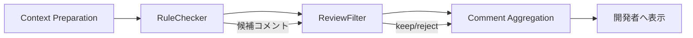

## 論文概要（Abstract）

本記事は [BitsAI-CR: Automated Code Review via LLM in Practice](https://arxiv.org/abs/2501.15134)（arXiv:2501.15134, 2025年1月）の解説記事です。

BitsAI-CRは、ByteDanceが開発・運用するLLMベースのコードレビュー自動化システムである。著者らは、既存のLLMベースレビューツールが精度（Precision）と実用性の両面で限界を抱えていることを指摘し、RuleChecker（検出）とReviewFilter（精度検証）の2段階パイプラインを提案している。219のレビュールールからなる分類体系、開発者フィードバックを継続的に取り込むデータフライホイール、開発者の実際のコメント採択率を推定するOutdated Rate指標を組み合わせることで、論文Table 2によればオフライン全体精度65.59%を達成し、オンラインではピーク精度75.0%に到達したと報告されている。ByteDance社内で12,000人以上の週間アクティブユーザーに展開されている。

この記事は [Zenn記事: Claude Code Agent SDKで開発タスクを自動化するカスタムAIエージェント構築](https://zenn.dev/0h_n0/articles/54434fcee9091e) の深掘りです。Agent SDKを使ったCI/CDパイプラインでのコードレビュー自動化を検討する際、BitsAI-CRの2段階検証アプローチとルール分類体系は実装設計の参考になる。

## 情報源

- **arXiv ID**: 2501.15134
- **URL**: [https://arxiv.org/abs/2501.15134](https://arxiv.org/abs/2501.15134)
- **著者**: Tao Sun, Jian Xu, Yuanpeng Li, Zhao Yan, Ge Zhang, Lintao Xie, Lu Geng, Zheng Wang, Yueyan Chen, Qin Lin, Wenbo Duan, Kaixin Sui（ByteDance）
- **発表年**: 2025
- **分野**: cs.SE（ソフトウェア工学）
- **ライセンス**: CC BY 4.0

## 背景と動機（Background & Motivation）

コードレビューはソフトウェア品質を維持するための重要なプラクティスであるが、産業規模の組織では大きなコストがかかる。著者らは、既存のLLMベースレビューツールには以下の問題があると指摘している。

第一に、**精度の不足**である。汎用LLMをコードレビューに直接適用した場合、著者らの評価（論文Table 2）ではQwen2.5-Coder-32bでも全体精度10.14%、DeepSeek-v2.5で9.27%、Doubao-Pro-32K-0828で7.65%にとどまっている。LLMの生成するレビューコメントの大半が誤検出（false positive）であり、開発者にとってノイズとなる。

第二に、**スケーラビリティの課題**である。GoogleのAutoCommenterはベストプラクティスURLの提示に限定されコード修正提案を含まないと著者らは述べている。Tencent（Yu et al., 2024）のシステムは保守性に焦点を当てており、セキュリティやパフォーマンスを含む包括的なレビューには対応していない。

第三に、**品質計測の困難さ**である。オフライン評価（Precision/Recall）だけでは開発者が実際にコメントを採択するかどうかを把握できない。精度が高くても開発者にとって不要なコメントであれば実用上の価値は低い。

## 主要な貢献（Key Contributions）

- **2段階パイプライン**: RuleChecker（検出LLM）とReviewFilter（検証LLM）を分離し、検出の網羅性と精度を両立する設計
- **レビュールール分類体系**: 4次元（Code Defect、Security Vulnerability、Maintainability and Readability、Performance Issue）・219ルールの構造化された分類体系
- **データフライホイール**: 手動精度アノテーション、ユーザーフィードバック、Outdated Rateモニタリングを組み合わせた継続的改善メカニズム
- **Outdated Rate指標**: 開発者のコメント採択率を後続コミットの差分から自動推定する運用指標
- **産業規模の実証**: ByteDance社内12,000人超の週間アクティブユーザーへの展開と18週間にわたるオンライン評価

## 技術的詳細（Technical Details）

### 全体アーキテクチャ

BitsAI-CRの生成パイプラインは4つのステージで構成される。



### Context Preparation（コンテキスト準備）

差分（diff）をhunkヘッダで分析単位に分割し、各単位をtree-sitterで関数境界まで拡張する。著者らによれば、拡張上限は元のdiffサイズの4倍（関数定義が見つかる場合）または3倍（見つからない場合）である。各行には削除/変更前、追加/変更後、未変更の区分と行番号が付与される。

### RuleChecker（検出ステージ）

RuleCheckerは、ファインチューニングされたLLMがレビュールール分類体系と社内コーディング規約を組み合わせてコード上の問題を検出するコンポーネントである。出力は、検出された問題、カテゴリ、コード上の位置、修正提案の構造化データである。

著者らは、**ルールカテゴリブロッカー**と呼ばれるランタイム機構を導入しており、再学習なしに特定カテゴリの検出を無効化できる。これにより、精度が低いルールカテゴリをオンラインで即座に停止できる。

ベースモデルにはDoubao-Pro-32K-0828が使用されている。著者らはエンタープライズセキュリティとデータプライバシーコンプライアンスを選定理由として挙げている。ファインチューニングにはLoRA（rank=128, alpha=256）が使用され、学習率0.00005、5エポック、バッチサイズ8、シーケンス長8192で訓練されている。著者らによれば、レビューサンプルの99%が8192トークン以内に収まる。

### ReviewFilter（検証ステージ）

ReviewFilterは、RuleCheckerが生成した候補コメントを1件ずつ受け取り、keep（保持）またはreject（棄却）の判定を行う検証LLMである。著者らは、SFT（Supervised Fine-Tuning）とRL（Reinforcement Learning）だけではRuleCheckerのハルシネーション（幻覚）と事実誤認を十分に抑制できなかったと述べており、独立した検証ステージの必要性を強調している。

ReviewFilterの出力形式について、著者らは3つのパターンを比較している（論文Table 3）：

| 出力パターン | 精度 | 再現率 | フィルタ率 | 推論時間(秒/件) |
|------------|------|-------|----------|--------------|
| Direct Conclusion | 63.27% | 77.50% | 38.75% | 1.7 |
| Reasoning-First（CoT） | 65.80% | 81.80% | 30.00% | 31.0 |
| **Conclusion-First** | **77.09%** | 69.00% | **55.25%** | **1.7** |

著者らはConclusion-First（結論を先に出力し、理由を後述する形式）を採用している。精度を最優先としつつ、推論レイテンシをReasoning-First（31.0秒）の18分の1（1.7秒）に抑えている点が選定理由である。

### Comment Aggregation（コメント集約）

社内の埋め込みモデル（Doubao-embedding-large、512次元）で各コメントをベクトル化し、コサイン類似度で重複グループを形成する。各グループから1件のコメントを選択して開発者に提示する。類似度の閾値は論文中に明記されていない。

### レビュールール分類体系

ルール分類は3層構造を取る：**レビュー次元** → **レビューカテゴリ** → **レビュールール**。各ルールには問題タイプ、重大度、説明、良い/悪いコード例が定義されている。

**4つのレビュー次元と主要カテゴリ**：

| 次元 | 主要カテゴリ例 | 分布（論文Table 1より） |
|------|-------------|------------------|
| Code Defect | Null Pointer Exception, Conditional Logic Error | 22.79%, 3.48% |
| Security | SQL Injection, XSS, Memory Leak | 0.08%, 0.07%, 0.05% |
| Maintainability | Magic Numbers/Strings, Spelling Error, Code Duplication | 20.62%, 7.97%, 7.23% |
| Performance | Inappropriate Data Structures, Unoptimized Loops | 0.38%, 0.14% |

著者らによれば、219ルールが5言語（Go, JavaScript, TypeScript, Python, Java）に対して定義されている。ルールのソースは、（1）高推奨・高受容率の社内静的解析ルール、（2）静的解析が捕捉できない手動レビューコメントのカテゴリ化（スペルミス、重複コード、不明確なコメント等）の2系統である。

### データフライホイール

データフライホイールは、以下の3つのフィードバック源を週次で統合する継続的改善メカニズムである。

**1. データセット構築**（初期）：社内リポジトリから約120,000件のMR（Merge Request）コメントを抽出し、Doubao-Pro-32K-0828で非実質的コンテンツのフィルタリング、ルール分類、修正提案の拡張を行う。結果として、GoとフロントエンドLanguagesで各約18,000サンプル、その他の言語で各約5,000サンプルの訓練データセットが構築されている。

**2. 手動精度アノテーション**：オンライントラフィックの最大10%を日次でサンプリングし、週次でコンパイルする。精度が低いルールのサンプルが再学習に使用される。著者らは、ReviewFilterの訓練データの主要ソースがこの手動アノテーションであると述べている。

**3. Outdated Rateモニタリング**：ルールごとの週次Outdated Rateを追跡する。高精度だが一貫してOutdated Rateが低い（開発者が修正行動を取らない）ルールは廃止検討の対象となる。

**ルールの保持基準**：著者らは14日間の評価期間を設け、Outdated Rate約25%（±5%）かつ精度約65%（±5%）を基準としている。

### Outdated Rate指標

Outdated Rateは、開発者がレビューコメントを実際に採択したかを後続コミットから推定する指標である。

$$
\text{Outdated Rate} = \frac{|\{c \in C_{\text{seen}} : \text{isOutdated}(c)\}|}{|C_{\text{seen}}|} \times 100\%
$$

ここで、
- $C_{\text{seen}}$: 1週間のウィンドウ内でコード提出者が確認したコメントの集合
- $\text{isOutdated}(c)$: コメント $c$ が指摘したコード範囲内の行が後続コミットで変更された場合に真

著者らは、変更がコメントに応答したものであることを証明するものではないが、大規模での傾向把握に有用であると述べている。参考値として、ByteDanceにおける人間のレビューアーのOutdated Rateは35%〜46%である。

## 実装のポイント（Implementation）

BitsAI-CRの設計から得られる実装上の示唆をまとめる。

**2段階パイプラインの設計原則**：検出（高再現率志向）と検証（高精度志向）を分離することで、単一モデルでは達成困難な精度と網羅性のバランスを実現している。Agent SDKでコードレビューエージェントを構築する場合も、query()1回で全てを処理するのではなく、検出用query()と検証用query()を分けるアプローチが有効である。

**ルールカテゴリブロッカー**：ランタイムでルールカテゴリを無効化できる仕組みは、Agent SDKの`disallowed_tools`に類似する概念である。再学習なしに振る舞いを制御できるため、本番運用での即時対応が可能になる。

**Conclusion-First出力形式**：ReviewFilterで精度とレイテンシの最適なバランスを見出したConclusion-First形式は、Agent SDKのsystem_promptで「結論を先に述べ、理由を後述してください」と指示する設計に直接応用できる。

**tree-sitterによるコンテキスト拡張**：差分を関数境界まで拡張することで、LLMがコードの意味を正しく把握できる。Agent SDKのカスタムMCPツールとしてtree-sitterベースのコンテキスト拡張ツールを実装することが考えられる。

**品質と関数レベルの制約**：著者らは、現在のシステムがファイル間（cross-file）のレビューに対応していないことを今後の課題として挙げている。Agent SDKで構築する場合も、query()のコンテキストウィンドウとの兼ね合いでスコープ設計が重要になる。

## Production Deployment Guide

### AWS実装パターン（コスト最適化重視）

BitsAI-CRの2段階パイプラインをAWS上で再現する構成を検討する。なお、以下のコスト試算は2026年11月時点のAWS ap-northeast-1（東京）リージョン料金に基づく概算値であり、実際のコストはトラフィックパターンやバースト使用量により変動する。最新料金は [AWS料金計算ツール](https://calculator.aws/) で確認されたい。

**トラフィック量別の推奨構成**：

| 規模 | 月間レビュー数 | 推奨構成 | 月額コスト | 主要サービス |
|------|-------------|---------|-----------|------------|
| **Small** | ~3,000 (100/日) | Serverless | $80-200 | Lambda + Bedrock + DynamoDB |
| **Medium** | ~30,000 (1,000/日) | Hybrid | $500-1,200 | Lambda + ECS Fargate + ElastiCache |
| **Large** | 300,000+ (10,000/日) | Container | $3,000-7,000 | EKS + Karpenter + EC2 Spot |

**Small構成の詳細**（月額$80-200）：
- **Lambda**: RuleChecker用（1GB RAM, 60秒タイムアウト, $25/月）+ ReviewFilter用（512MB RAM, 30秒タイムアウト, $10/月）
- **Bedrock**: Claude 3.5 Haiku（RuleChecker）+ Claude 3.5 Haiku（ReviewFilter）、Prompt Caching有効（$100/月）
- **DynamoDB**: ルール分類体系ストレージ、On-Demand（$10/月）
- **SQS**: RuleChecker→ReviewFilterのメッセージキュー（$5/月）
- **CloudWatch**: 基本監視（$5/月）

**Medium構成の詳細**（月額$500-1,200）：
- **Lambda**: イベントトリガー + SQSキュー処理（$50/月）
- **ECS Fargate**: RuleChecker 0.5vCPU×1GB×2タスク + ReviewFilter 0.25vCPU×512MB×2タスク（$150/月）
- **Bedrock**: Claude 3.5 Sonnet（RuleChecker）+ Claude 3.5 Haiku（ReviewFilter）、Batch API活用（$600/月）
- **ElastiCache Redis**: Comment Aggregation用埋め込みキャッシュ、cache.t3.micro（$15/月）
- **OpenSearch Serverless**: ルール検索用ベクトルDB（$100/月）

**コスト削減テクニック**：
- Bedrock Batch API使用で非リアルタイム処理を50%割引
- Prompt Caching有効化でシステムプロンプト（ルール定義）のキャッシュにより30-90%削減
- ReviewFilterでConclusion-First形式を採用し推論時間を1/18に短縮（トークン消費削減）
- ルールカテゴリブロッカーで不要な検出を事前にスキップしAPI呼び出し自体を削減

### Terraformインフラコード（Small構成抜粋）

```hcl
resource "aws_lambda_function" "rulechecker" {
  filename      = "rulechecker.zip"
  function_name = "bitsai-cr-rulechecker"
  role          = aws_iam_role.rulechecker_lambda.arn
  handler       = "index.handler"
  runtime       = "python3.12"
  timeout       = 60
  memory_size   = 1024

  environment {
    variables = {
      BEDROCK_MODEL_ID     = "anthropic.claude-3-5-haiku-20241022-v1:0"
      DYNAMODB_RULES_TABLE = aws_dynamodb_table.rules.name
      SQS_QUEUE_URL        = aws_sqs_queue.review_pipeline.url
      ENABLE_PROMPT_CACHE  = "true"
    }
  }
}

resource "aws_lambda_function" "reviewfilter" {
  filename      = "reviewfilter.zip"
  function_name = "bitsai-cr-reviewfilter"
  role          = aws_iam_role.rulechecker_lambda.arn
  handler       = "index.handler"
  runtime       = "python3.12"
  timeout       = 30
  memory_size   = 512

  environment {
    variables = {
      BEDROCK_MODEL_ID    = "anthropic.claude-3-5-haiku-20241022-v1:0"
      OUTPUT_FORMAT       = "conclusion_first"
      ENABLE_PROMPT_CACHE = "true"
    }
  }
}

resource "aws_sqs_queue" "review_pipeline" {
  name                       = "bitsai-cr-pipeline"
  visibility_timeout_seconds = 120
  message_retention_seconds  = 86400
}
```

RuleCheckerとReviewFilterを個別のLambda関数として分離し、SQSでパイプライン接続する。RuleCheckerは検出処理のため1024MB RAM・60秒タイムアウト、ReviewFilterは検証のみのため512MB・30秒と軽量に設定している。Large構成ではEKS + Karpenter（Spot Instances優先、c6i.xlarge/c6i.2xlarge）とAWS Budgets予算アラートを追加する。

### 運用・監視設定

**CloudWatch Logs Insights クエリ**：
```sql
-- レビュー精度のリアルタイム監視
fields @timestamp, rule_category, is_accepted
| stats count(*) as total,
        sum(case when is_accepted = 1 then 1 else 0 end) as accepted
  by bin(1h), rule_category
| sort total desc
```

**CloudWatch アラーム（精度監視）**：精度60%未満アラーム、トークン使用量50万/時間アラートを設定する。コードレビュー固有の注意点として、レビュー対象コードに機密情報が含まれる可能性があるため、Bedrockとの通信はPrivateLink経由で暗号化し、ログにコード内容を含めない。IAMロールは最小権限原則に従い、Secrets Managerでモデル設定を管理する。

**Outdated Rate自動計算**：DynamoDBに保存されたレビュー履歴から、論文Eq.2に基づき週次でOutdated Rateを計算する。`is_outdated`フラグは後続コミットで指摘行が変更されたかで判定する。

### コスト最適化チェックリスト

**アーキテクチャ選択**：
- [ ] ~100レビュー/日 → Lambda + Bedrock（Serverless）$80-200/月
- [ ] ~1,000レビュー/日 → ECS Fargate + Bedrock（Hybrid）$500-1,200/月
- [ ] 10,000+レビュー/日 → EKS + Spot（Container）$3,000-7,000/月

**リソース最適化**：
- [ ] ReviewFilterのメモリサイズをRuleCheckerより小さく設定（検証は軽量）
- [ ] Spot Instances優先（コードレビューは中断耐性あり）
- [ ] ルールカテゴリブロッカーで低精度カテゴリを無効化しAPI呼び出し削減
- [ ] Comment Aggregationの埋め込みキャッシュでモデル呼び出し削減
- [ ] 夜間・週末のスケールダウン（レビューリクエストは営業時間に集中）

**LLMコスト削減**：
- [ ] Bedrock Batch APIで非同期レビューを50%割引
- [ ] Prompt Cachingでルール定義のキャッシュ（30-90%削減）
- [ ] RuleChecker: Haiku、ReviewFilter: Haikuのモデル選択（コスト効率重視）
- [ ] Conclusion-First形式で出力トークンを最小化
- [ ] max_tokens設定でレビューコメントの長さを制限

**監視・アラート**：
- [ ] AWS Budgets月額予算（80%警告、100%アラート）
- [ ] CloudWatch精度アラーム（60%閾値）
- [ ] Outdated Rate週次レポート自動生成
- [ ] Cost Anomaly Detectionで異常コスト検知
- [ ] トークン使用量/レビュー件数のダッシュボード

**リソース管理**：
- [ ] 未使用ルールの自動廃止（Outdated Rate基準）
- [ ] タグ戦略（環境別・チーム別コスト可視化）
- [ ] DynamoDBのTTLでキャッシュ自動削除
- [ ] Lambda Insightsでメモリ・実行時間の最適化分析

## 実験結果（Results）

### オフライン評価

著者らは1,397件の本番コード（767件の違反コード、630件の適合コード）でオフライン評価を実施している。評価にはLLM-as-a-judge（Doubao-Pro-32K-0828）が使用されている。

**主要結果（論文Table 2より、全体 "ALL" の数値）**：

| モデル | 精度（RC単体） | 再現率 | 精度（RF付き） | 再現率 |
|-------|-------------|-------|-------------|-------|
| Qwen2.5-Coder-32b | 10.14% | 21.90% | 10.62% | 20.86% |
| DeepSeek-v2.5 | 9.27% | 16.30% | 9.50% | 16.17% |
| Doubao-Pro-32K-0828 | 7.65% | 13.56% | 7.70% | 13.56% |
| BitsAI-CR w/o Taxonomy | 16.83% | 31.55% | 30.92% | 22.29% |
| **BitsAI-CR** | **57.03%** | 45.50% | **65.59%** | 39.77% |

汎用LLMとの差は顕著であり、著者らはルール分類体系とファインチューニングの組み合わせが精度向上の主因であると分析している。ReviewFilterの追加により、全体精度が57.03%から65.59%に向上する一方、再現率は45.50%から39.77%に低下している。著者らは産業利用では精度を再現率より優先すべきとの立場を取っている。

**分野別のBitsAI-CR精度（ReviewFilter付き、論文Table 2より）**：
- Security: 61.29%
- Code Defect: 68.92%
- Maintainability and Readability: 63.60%
- Performance: 72.00%

### オンライン評価（18週間）

著者らは18週間にわたるオンライン精度の推移を報告している（論文Figure 6）。初期3週間の全体精度は約25%であったが、分類体系と2段階パイプラインの導入後、RuleCheckerは27.9%から62.6%に、ReviewFilter込みでは35.6%からピーク75.0%に到達したと報告されている。

Go言語のOutdated Rateは（論文Figure 7）、ルール追加フェーズ（〜10週目）では約15%で安定していたが、73ルールへの拡大後に約20%に上昇している。14週目以降、低精度ルールの削除により最終的にOutdated Rate 26.7%に到達したと報告されている。人間レビューアーのOutdated Rate（35%〜46%）と比較すると、自動レビューの方が開発者による修正行動を引き起こしにくい傾向があるが、これはコメントの性質の違い（人間は設計レベル、自動は定型的パターン検出が中心）も反映していると考えられる。

### ユーザー調査

著者らは137名のユーザーへのアンケートと12名の専門家インタビューを実施している。74.5%（102/137）が肯定的な評価であった。否定的フィードバックの内訳は、正しいが不要なコメント12.4%（17名）、誤検出10.9%（15名）、無関係なフィードバック1.5%（2名）であった。

専門家インタビューでは、全12名がツールの有用性を認めている一方、カスタマイズ可能なルール（11/12）、ワンクリック修正適用（11/12）、レイテンシ改善（7/12）が主要な要望として挙げられている。

### リテンション

著者らはリテンション率を報告しており、2週目で61.64%、8週目で約48%である。著者らはこれを大規模コードインテリジェンスツールとしての初のリテンションベンチマークであると主張している。

## 実運用への応用（Practical Applications）

### Agent SDKとの統合パターン

Zenn記事で紹介されたClaude Code Agent SDKを用いたCIコードレビューに、BitsAI-CRの設計パターンを適用する方法を考える。

**2段階query()パイプライン**：Agent SDKの`query()`を2回に分けて呼び出す。第1 query()でRuleCheckerに相当する検出を行い、第2 query()でReviewFilterに相当する検証を行う。これにより、単一query()での幻覚リスクを低減できる。

**MCPカスタムツールとしてのルール管理**：219ルールの分類体系をMCPサーバーとして実装し、`disallowed_tools`でプロジェクトに不要なルールカテゴリを除外する。Zenn記事で解説されたin-process MCPサーバーの仕組みを使えば、ルール定義をツールのdescriptionに埋め込むことができる。

**Outdated Rate相当のフィードバックループ**：GitHub ActionsでPRコメントの「Resolve」状態を追跡し、Outdated Rate相当の指標を週次で計算する。この指標でルールの有効性を評価し、低効果ルールを自動無効化するフライホイールを構築できる。

## 関連研究（Related Work）

- **Google AutoCommenter**: 著者らによれば、ベストプラクティスURLの提示に限定されコード修正提案を含まない。BitsAI-CRは具体的な修正提案を生成する点で異なる
- **CodeAgent**（Tang et al., 2024, arXiv:2402.02172）: マルチエージェントLLMによるコードレビュー自動化。QA-Checkerによる品質保証エージェントを導入。BitsAI-CRは産業規模の展開と継続的改善メカニズムに焦点を当てている
- **CodeReviewer**（Li et al., 2022）: 事前学習ベースのコードレビューモデル。BitsAI-CRはLLMのファインチューニングとルール分類体系の組み合わせというアプローチを取っている

## まとめと今後の展望

BitsAI-CRは、LLMベースコードレビュー自動化を産業規模で展開するための設計パターンを示した論文である。2段階パイプライン（RuleChecker + ReviewFilter）、219ルールの分類体系、データフライホイール、Outdated Rate指標の4つの要素が統合されている。

著者らは今後の課題として、ファイル間（cross-file）レビューへの対応、より多くの言語のサポート、カスタマイズ可能なルールの提供を挙げている。Agent SDKを用いたコードレビューエージェントの設計において、BitsAI-CRの2段階検証とルール分類体系のアプローチは実装の出発点となる。

## 参考文献

- **arXiv**: [https://arxiv.org/abs/2501.15134](https://arxiv.org/abs/2501.15134)
- **Related Zenn article**: [https://zenn.dev/0h_n0/articles/54434fcee9091e](https://zenn.dev/0h_n0/articles/54434fcee9091e)
- **Google AutoCommenter**: Vijayvergiya et al., "AutoCommenter: AI-Assisted Code Review at Google Scale"
- **CodeAgent**: Tang et al., "CodeAgent: Autonomous Communicative Agents for Code Review" (arXiv:2402.02172)
