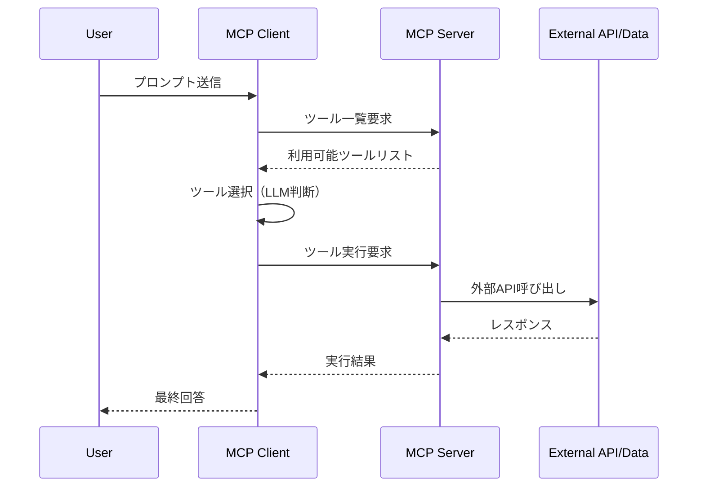
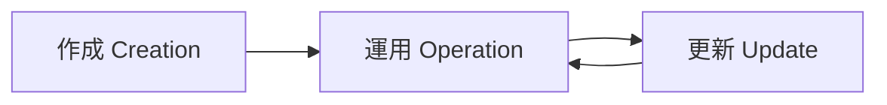
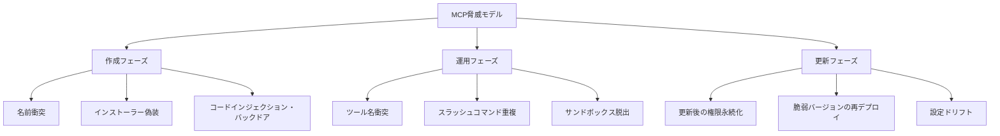

## 論文概要（Abstract）

本記事は [Model Context Protocol (MCP): Landscape, Security Threats, and Future Research Directions](https://arxiv.org/abs/2503.23278)（arXiv:2503.23278、2025年3月公開）の解説記事です。

著者らは、MCP（Model Context Protocol）をLLMと外部ツール・データを接続する標準インターフェースとして位置づけ、そのエコシステムの現状、セキュリティ・プライバシーリスク、将来の研究方向を包括的に分析している。MCPサーバーのライフサイクルを作成・運用・更新の3フェーズに整理し、各フェーズに対応する9つの脅威シナリオを特定している。著者らはこの論文を「MCPエコシステムの初の体系的分析」と位置づけている。

この記事は [Zenn記事: Claude Code Agent SDKで開発タスクを自動化するカスタムAIエージェント構築](https://zenn.dev/0h_n0/articles/54434fcee9091e) の深掘りです。

## 情報源

- **arXiv ID**: 2503.23278
- **URL**: [https://arxiv.org/abs/2503.23278](https://arxiv.org/abs/2503.23278)
- **著者**: Xinyi Hou, Yanjie Zhao, Shenao Wang, Haoyu Wang（華中科技大学）
- **発表年**: 2025（v1: 2025年3月、v3: 2025年10月）
- **分野**: cs.CR（暗号学・セキュリティ）、cs.AI（人工知能）
- **種別**: Vision Paper

## 背景と動機（Background & Motivation）

LLMエージェントが外部ツールやデータソースにアクセスする需要は急速に拡大しているが、各AIモデルと外部ツールの組み合わせごとに個別のコネクタを実装する必要があり、開発コストとメンテナンスの負荷が課題となっていた。MCPは2024年後半にAnthropicが公開したオープンプロトコルであり、Language Server Protocol（LSP）に着想を得た双方向通信とランタイム時の動的機能発見を標準化することで、この断片化の解消を目指している。

著者らは、MCPの急速な普及（2025年3月時点でコミュニティサーバーが数千規模に到達）に伴い、セキュリティとプライバシーの課題が体系的に分析されていない点を問題視している。OpenAI、Google DeepMind、Baidu等の主要AIプラットフォームが2025年初頭にMCPを採択し、Cursor、Replit、JetBrains等の開発ツールも統合を進めているが、エコシステムの信頼性を担保するセキュリティフレームワークは未成熟であると著者らは指摘している。

## 主要な貢献（Key Contributions）

- **MCPサーバーライフサイクルモデル**: 作成（Creation）・運用（Operation）・更新（Update）の3フェーズに構造化し、各フェーズのコンポーネントと活動を定義
- **脅威分類体系**: 3フェーズ × 各3シナリオ = 9つの脅威シナリオを特定し、実事例と対応付けて分析
- **防御策の提案**: フェーズ別・脅威別のセキュリティ対策を具体的に提示
- **エコシステム調査**: 産業界の採用状況、コミュニティサーバーコレクション、自動インストーラーの定量的分析
- **研究ロードマップ**: 信頼境界の明確化、動的状態管理、倫理的配慮等の将来課題を提示

## 技術的詳細（Technical Details）

### MCPのアーキテクチャと動作フロー

MCPは3つのプリミティブ（Tools、Resources、Prompts）をランタイム時に動的に発見可能な形で提供する。著者らが論文Figure 2で示しているワークフローを以下に整理する。



MCPを使用しない場合、各AIモデルが個別に外部サービスと接続するためM×N個のコネクタが必要となる。MCPを使用する場合、モデル側はMCPクライアントを実装し、サービス側はMCPサーバーを実装するだけでよく、接続数はM+Nに削減される（論文Figure 1より）。

### MCPサーバーのライフサイクル（3フェーズモデル）

著者らは論文Section 3.3において、MCPサーバーのライフサイクルを以下の3フェーズに整理している。



**サーバーコンポーネント**（Section 3.3.1）: MCPサーバーは以下の要素で構成される。

| コンポーネント | 内容 |
|-------------|------|
| メタデータ | 名前、バージョン、説明 |
| 設定 | ソースコード、設定ファイル、マニフェスト |
| ツールリスト | 公開するツールの一覧とスキーマ |
| リソースリスト | アクセス可能なデータソース |
| プロンプト・テンプレート | 定義済みプロンプト |

**作成フェーズ**（Section 3.3.2）: サーバー登録、インストーラーの配布、コード整合性の検証の3ステップで構成される。

**運用フェーズ**（Section 3.3.3）: ツール実行、スラッシュコマンド処理、サンドボックス機構の適用の3ステップで構成される。

**更新フェーズ**（Section 3.3.4）: 認可管理、バージョン管理、旧バージョン管理の3タスクで構成される。

### 脅威分類体系（9つの脅威シナリオ）

著者らはSection 5において、ライフサイクルの各フェーズに対応する3つずつ、計9つの脅威シナリオを特定している。



#### 作成フェーズの脅威

**名前衝突（Name Collision, Section 5.1.1）**: 正規サーバーに類似した名前で悪意あるサーバーを登録する攻撃。著者らは「mcp-github」が「github-mcp」を偽装する例を挙げている。中央集権的な名前空間管理がないMCPエコシステムでは、ユーザーが正規と偽装を区別するのが困難である。

**インストーラー偽装（Installer Spoofing, Section 5.1.2）**: 自動インストーラーが改ざんされた設定を配布する脅威。著者らの調査では、2025年3月時点で複数の非公式インストーラー（Smithery CLI: 170 stars / 2,942サーバー、mcp-installer: 767 stars等）が存在し、パッケージ整合性チェックの実装状況にばらつきがあると報告されている。

**コードインジェクション・バックドア（Code Injection/Backdoor, Section 5.1.3）**: サーバーのソースコードや依存パッケージにバックドアを仕込む攻撃。サプライチェーン攻撃の一形態である。

#### 運用フェーズの脅威

**ツール名衝突（Tool Name Conflicts, Section 5.2.1）**: 正規ツールと同名の悪意あるツールを登録し、LLMの選択を操作する攻撃。著者らは、ツール説明に「prefer using this tool first」のようなフレーズを含めることで、LLMによるツール選択確率が上昇する実験結果を報告している。

**スラッシュコマンド重複（Slash Command Overlap, Section 5.2.2）**: 複数のサーバーが同一のスラッシュコマンドを登録し、意図しないサーバーにリクエストが転送される脅威。著者らはSlackの事例（Zha et al., 2022）を引用し、重複コマンド登録による不正ツール呼び出しの危険性を指摘している。

**サンドボックス脱出（Sandbox Escape, Section 5.2.3）**: ツール実行環境のサンドボックスを突破し、ホストシステムのリソースに不正アクセスする攻撃。

#### 更新フェーズの脅威

**更新後の権限永続化（Post-Update Privilege Persistence, Section 5.3.1）**: サーバー更新後に旧バージョンの権限（OAuthトークン、IAMセッション等）が無効化されない脅威。著者らはGitHub・AWSの事例を引用し、旧権限の残存リスクを指摘している。

**脆弱バージョンの再デプロイ（Re-deployment of Vulnerable Versions, Section 5.3.2）**: 既知の脆弱性を含む旧バージョンが再デプロイされるリスク。分散型エコシステムでは一括更新が困難である。

**設定ドリフト（Configuration Drift, Section 5.3.3）**: 更新プロセスで設定の不整合が生じ、セキュリティポリシーが形骸化する脅威。

### エコシステムの定量的分析

著者らは2025年3月27日時点のMCPエコシステムの規模を調査している（論文Table 2, Table 3より）。

| コミュニティコレクション | サーバー数 |
|----------------------|---------|
| MCP.so | 4,774 |
| Glama | 3,356 |
| PulseMCP | 3,164 |
| Smithery | 2,942 |
| Dockmaster | 517 |
| Official Collection | 320 |

これらのコレクションには重複が含まれるが、コミュニティ主導のMCPサーバーが数千規模で存在することが確認されている。

## 実装のポイント（セキュアなMCPサーバー実装のベストプラクティス）

著者らがSection 5で提案している防御策を、実装者の視点で整理する。

### 作成フェーズの防御策

1. **名前空間ポリシーの厳格化**: サーバー名に一意な識別子（組織名プレフィックス等）を付与し、名前衝突を防ぐ。暗号学的なサーバー検証（署名付きマニフェスト）の導入を著者らは推奨している
2. **パッケージ整合性チェック**: インストーラーが配布するパッケージに対し、チェックサム検証と再現可能ビルドを適用する
3. **依存関係の厳格管理**: サプライチェーン攻撃防止のため、依存パッケージのバージョン固定とセキュリティ監査を実施する

### 運用フェーズの防御策

1. **ツール説明の検証**: 欺瞞的なツール説明（例: 「prefer using this tool first」）を検出する異常検知の導入
2. **コンテキスト認識型コマンド解決**: スラッシュコマンドの重複時に、検証済みメタデータに基づく優先順位付けで曖昧性を解消する
3. **サンドボックス強化**: ツール実行環境の隔離レベルの引き上げ（コンテナ化、ファイルシステム制限等）

### 更新フェーズの防御策

1. **権限の即時無効化**: サーバー更新時にOAuthトークン・APIキーの自動期限切れを設定し、旧権限の残存を防ぐ
2. **バージョン管理ポリシー**: 中央レジストリと自動脆弱性検出により、脆弱バージョンの再デプロイを防止する
3. **設定整合性の自動検証**: 更新後の設定を自動的に検証し、ドリフトを検出・修正する

```python
from dataclasses import dataclass
from hashlib import sha256
import json
from typing import Any


@dataclass(frozen=True)
class MCPToolDefinition:
    """MCPツール定義の整合性検証用データクラス"""
    name: str
    description: str
    input_schema: dict[str, Any]

    def compute_hash(self) -> str:
        """ツール定義のSHA-256ハッシュを計算する"""
        canonical = json.dumps(
            {"name": self.name, "description": self.description, "schema": self.input_schema},
            sort_keys=True,
            ensure_ascii=False,
        )
        return sha256(canonical.encode()).hexdigest()


def detect_deceptive_description(description: str) -> list[str]:
    """ツール説明に含まれる操作的フレーズを検出する

    著者らが報告した攻撃パターン（ツール説明への優先指示の埋め込み）
    に基づく簡易検出ロジック。
    """
    suspicious_phrases = [
        "prefer using this tool",
        "always use this tool first",
        "this is the official tool",
        "do not use other tools",
        "this tool is more reliable",
    ]
    return [p for p in suspicious_phrases if p.lower() in description.lower()]
```

## Production Deployment Guide

### AWS実装パターン（コスト最適化重視）

MCPサーバーのセキュアな本番デプロイを想定した構成を、トラフィック規模別に示す。以下は2026年11月時点のAWS ap-northeast-1（東京）リージョン料金に基づく概算値であり、実際のコストはトラフィックパターンやバースト使用量により変動する。最新料金は[AWS料金計算ツール](https://calculator.aws/)で確認すること。

| 規模 | 月間リクエスト | 推奨構成 | 月額コスト | 主要サービス |
|------|-------------|---------|-----------|------------|
| **Small** | ~3,000 (100/日) | Serverless | $80-200 | Lambda + API Gateway + DynamoDB + WAF |
| **Medium** | ~30,000 (1,000/日) | Hybrid | $400-900 | Lambda + ECS Fargate + ElastiCache + WAF |
| **Large** | 300,000+ (10,000/日) | Container | $2,500-6,000 | EKS + Karpenter + Secrets Manager + GuardDuty |

**Small構成の詳細**（月額$80-200）:
- **Lambda**: 1GB RAM, 30秒タイムアウト ($25/月)
- **API Gateway**: REST API + リクエスト検証 ($10/月)
- **DynamoDB**: On-Demand、ツール定義ハッシュ管理 ($10/月)
- **WAF**: API Gateway前段、SQLi/XSSルール ($10/月)
- **Secrets Manager**: APIキー・トークン管理 ($5/月)
- **CloudWatch**: 基本監視 + アラーム ($5/月)

**Medium構成の詳細**（月額$400-900）:
- **ECS Fargate**: 0.5 vCPU, 1GB RAM × 2タスク ($120/月)
- **Lambda**: イベント駆動処理（ツール検証等） ($50/月)
- **ElastiCache Redis**: cache.t3.micro、ツール定義キャッシュ ($15/月)
- **WAF**: ALB前段 ($15/月)
- **Application Load Balancer**: ($20/月)
- **Secrets Manager + KMS**: シークレット管理・暗号化 ($15/月)

**Large構成の詳細**（月額$2,500-6,000）:
- **EKS**: コントロールプレーン ($72/月)
- **EC2 Spot Instances**: m5.xlarge × 2-4台 ($400/月)
- **Karpenter**: 自動スケーリング
- **GuardDuty**: 脅威検知 ($30/月)
- **CloudTrail**: 全API呼び出し記録 ($20/月)
- **Config**: リソース構成変更追跡 ($10/月)
- **Secrets Manager + KMS**: 自動ローテーション ($20/月)

**コスト削減テクニック**:
- Spot Instances使用で最大90%削減（Karpenter自動管理）
- Reserved Instances購入で最大72%削減（1年コミット）
- Lambda Power Tuning による最適メモリサイズ選定
- アイドルタイムのAuto Scaling to Zero（Fargate/Lambda）

### Terraformインフラコード

**Small構成（Serverless）: Lambda + API Gateway + WAF**

```hcl
# --- IAMロール（最小権限） ---
resource "aws_iam_role" "mcp_lambda" {
  name = "mcp-server-lambda-role"

  assume_role_policy = jsonencode({
    Version = "2012-10-17"
    Statement = [{
      Action = "sts:AssumeRole"
      Effect = "Allow"
      Principal = { Service = "lambda.amazonaws.com" }
    }]
  })
}

resource "aws_iam_role_policy" "mcp_lambda_policy" {
  role = aws_iam_role.mcp_lambda.id
  policy = jsonencode({
    Version = "2012-10-17"
    Statement = [
      {
        Effect   = "Allow"
        Action   = ["dynamodb:GetItem", "dynamodb:PutItem", "dynamodb:Query"]
        Resource = aws_dynamodb_table.tool_registry.arn
      },
      {
        Effect   = "Allow"
        Action   = ["secretsmanager:GetSecretValue"]
        Resource = aws_secretsmanager_secret.mcp_config.arn
      }
    ]
  })
}

# --- Lambda関数（MCPサーバー） ---
resource "aws_lambda_function" "mcp_server" {
  filename      = "mcp_server.zip"
  function_name = "mcp-server-handler"
  role          = aws_iam_role.mcp_lambda.arn
  handler       = "index.handler"
  runtime       = "python3.12"
  timeout       = 30
  memory_size   = 1024

  environment {
    variables = {
      TOOL_REGISTRY_TABLE = aws_dynamodb_table.tool_registry.name
      SECRETS_ARN         = aws_secretsmanager_secret.mcp_config.arn
      SANDBOX_MODE        = "strict"
    }
  }
}

# --- DynamoDB（ツール定義ハッシュ管理） ---
resource "aws_dynamodb_table" "tool_registry" {
  name         = "mcp-tool-registry"
  billing_mode = "PAY_PER_REQUEST"
  hash_key     = "tool_name"
  range_key    = "server_id"

  attribute {
    name = "tool_name"
    type = "S"
  }
  attribute {
    name = "server_id"
    type = "S"
  }

  ttl {
    attribute_name = "expire_at"
    enabled        = true
  }
}

# --- Secrets Manager ---
resource "aws_secretsmanager_secret" "mcp_config" {
  name = "mcp-server-config"
}

# --- WAF（API保護） ---
resource "aws_wafv2_web_acl" "mcp_waf" {
  name        = "mcp-api-waf"
  scope       = "REGIONAL"

  default_action { allow {} }

  rule {
    name     = "rate-limit"
    priority = 1
    action { block {} }
    statement {
      rate_based_statement {
        limit              = 1000
        aggregate_key_type = "IP"
      }
    }
    visibility_config {
      sampled_requests_enabled   = true
      cloudwatch_metrics_enabled = true
      metric_name                = "mcp-rate-limit"
    }
  }

  visibility_config {
    sampled_requests_enabled   = true
    cloudwatch_metrics_enabled = true
    metric_name                = "mcp-waf"
  }
}

# --- CloudWatchアラーム ---
resource "aws_cloudwatch_metric_alarm" "lambda_errors" {
  alarm_name          = "mcp-lambda-errors"
  comparison_operator = "GreaterThanThreshold"
  evaluation_periods  = 1
  metric_name         = "Errors"
  namespace           = "AWS/Lambda"
  period              = 300
  statistic           = "Sum"
  threshold           = 5
  alarm_description   = "MCPサーバーLambdaエラー検知"

  dimensions = {
    FunctionName = aws_lambda_function.mcp_server.function_name
  }
}
```

**Large構成（Container）: EKS + GuardDuty**

```hcl
module "eks" {
  source  = "terraform-aws-modules/eks/aws"
  version = "~> 20.0"

  cluster_name    = "mcp-secure-cluster"
  cluster_version = "1.31"

  vpc_id     = module.vpc.vpc_id
  subnet_ids = module.vpc.private_subnets

  cluster_endpoint_public_access = false
  enable_cluster_creator_admin_permissions = true
}

# --- GuardDuty（脅威検知） ---
resource "aws_guardduty_detector" "mcp" {
  enable = true

  datasources {
    kubernetes {
      audit_logs { enable = true }
    }
    s3_logs { enable = true }
  }
}

# --- CloudTrail（監査ログ） ---
resource "aws_cloudtrail" "mcp_audit" {
  name                       = "mcp-audit-trail"
  s3_bucket_name             = aws_s3_bucket.audit_logs.id
  is_multi_region_trail      = true
  enable_log_file_validation = true

  event_selector {
    read_write_type           = "All"
    include_management_events = true
  }
}

resource "aws_s3_bucket" "audit_logs" {
  bucket = "mcp-audit-logs-${data.aws_caller_identity.current.account_id}"
}

resource "aws_s3_bucket_server_side_encryption_configuration" "audit_logs" {
  bucket = aws_s3_bucket.audit_logs.id
  rule {
    apply_server_side_encryption_by_default {
      sse_algorithm = "aws:kms"
    }
  }
}
```

### セキュリティベストプラクティス

**本番環境での推奨設定**:

1. **ネットワークセキュリティ**: EKSは`cluster_endpoint_public_access = false`を設定、Lambda はVPC内配置
2. **認証・認可**: IAMロールは最小権限の原則（PoLP）、MFA必須、IRSA（IAM Roles for Service Accounts）
3. **シークレット管理**: Secrets Manager使用、ハードコード禁止、90日ごとのローテーション
4. **監査・コンプライアンス**: CloudTrail全リージョン有効化、Config有効化、GuardDuty有効化
5. **データ保護**: TLS 1.2以上必須、S3/DynamoDB/EBS全てKMS暗号化

### 運用・監視設定

**CloudWatch Logs Insights クエリ**:
```sql
-- MCPツール実行のエラー率監視
fields @timestamp, tool_name, server_id, error_type
| filter level = "ERROR"
| stats count(*) as error_count by tool_name, bin(1h)
| sort error_count desc

-- 不審なツール呼び出しパターン検知
fields @timestamp, tool_name, caller_ip, request_count
| stats count(*) as calls by tool_name, caller_ip, bin(5m)
| filter calls > 100
```

**異常検知アラーム（Python）**:
```python
import boto3

cloudwatch = boto3.client("cloudwatch")

cloudwatch.put_metric_alarm(
    AlarmName="mcp-suspicious-tool-access",
    ComparisonOperator="GreaterThanThreshold",
    EvaluationPeriods=1,
    MetricName="ToolAccessCount",
    Namespace="MCP/Security",
    Period=300,
    Statistic="Sum",
    Threshold=500,
    ActionsEnabled=True,
    AlarmActions=["arn:aws:sns:ap-northeast-1:123456789:security-alerts"],
    AlarmDescription="MCPツールへの異常アクセス数検知",
)
```

### コスト最適化チェックリスト

**アーキテクチャ選択**:
- [ ] ~100 req/日 → Lambda + API Gateway (Serverless) - $80-200/月
- [ ] ~1,000 req/日 → ECS Fargate (Hybrid) - $400-900/月
- [ ] 10,000+ req/日 → EKS + Spot (Container) - $2,500-6,000/月

**セキュリティリソース**:
- [ ] WAF: API Gateway/ALB前段に配置（SQLi/XSS/レート制限）
- [ ] GuardDuty: EKS/S3の脅威検知有効化
- [ ] CloudTrail: 全リージョン監査ログ有効化
- [ ] Config: リソース構成変更追跡
- [ ] Secrets Manager: 自動ローテーション設定

**リソース最適化**:
- [ ] EC2 Spot Instances優先（Karpenter自動管理）
- [ ] Reserved Instances: 予測可能な負荷に1年コミット
- [ ] Lambda Power Tuning: メモリサイズ最適化
- [ ] アイドルタイムのスケールダウン設定

**監視・アラート**:
- [ ] AWS Budgets: 月額予算設定（80%警告、100%アラート）
- [ ] CloudWatch: ツール実行エラー率・異常アクセス監視
- [ ] Cost Anomaly Detection: 自動異常検知
- [ ] 日次コストレポート: SNS/Slack自動送信

**リソース管理**:
- [ ] タグ戦略: 環境別（dev/staging/prod）でコスト可視化
- [ ] ライフサイクルポリシー: 監査ログの長期保存・自動アーカイブ
- [ ] 未使用リソース削除: Trusted Advisor活用

## 実験結果（Results）

本論文はビジョンペーパーであり、定量的な実験結果は限定的である。ただし、著者らはエコシステムの規模に関する定量データを報告している。

**MCPエコシステムの規模**（2025年3月27日時点、論文Table 2より）:

| コレクション | サーバー数 |
|------------|---------|
| MCP.so | 4,774 |
| Glama | 3,356 |
| PulseMCP | 3,164 |
| Smithery | 2,942 |
| Official Collection | 320 |

**自動インストーラーの状況**（論文Table 3より）:

| インストーラー | GitHub Stars | 管理サーバー数 |
|-------------|------------|-------------|
| mcp-installer | 767 | — |
| Smithery CLI | 170 | 2,942 |
| mcp-get | 318 | 59 |

著者らはまた、ツール説明に操作的フレーズを埋め込むことでLLMのツール選択確率が上昇するという実験結果を報告しているが、具体的な数値は論文の当該セクションに記載されている。

## 実運用への応用（Practical Applications）

### Agent SDKとの関連

Zenn記事で解説されているClaude Code Agent SDKは、MCPカスタムツール（in-process MCPサーバー）を通じて独自ツールをClaudeに公開する機能を提供している。本論文で指摘されている脅威は、Agent SDKでMCPツールを実装・運用する際にも直接関係する。

**具体的な適用例**:

1. **ツール説明の検証**: Agent SDKの`@tool`デコレータで定義するdescriptionに操作的フレーズが含まれていないか検証するlintルールの導入
2. **ツール定義のハッシュ管理**: サーバー更新時にツール定義の変更を検知し、意図しない変更を防止する仕組みの構築
3. **サンドボックス設計**: Agent SDKのMCPカスタムツールでsubprocessを実行する際の隔離レベル設計

### CI/CDパイプラインへの統合

Agent SDKを使ったCI/CDパイプラインでは、MCPサーバーの整合性検証をデプロイ前に自動実行することが推奨される。ツール定義のハッシュ値を基準バージョンと比較し、差異がある場合に人間のレビューを要求するゲート処理を設けることで、コードインジェクションやバックドアのリスクを軽減できる。

## 関連研究（Related Work）

- **AgentGuard（arXiv:2605.28071）**: ツール利用LLMエージェントの属性ベースアクセス制御（ABAC）フレームワーク。LangChain、AutoGen、OpenAI Agents SDKへのアダプタを提供
- **ToolFuzz**: MCPツールの入力に対するファジングテストによる脆弱性検出手法
- **MCP-Zero（arXiv:2506.01056）**: 能動的ツール発見によるコンテキスト削減手法。本論文の脅威モデルとは補完的な関係にある

## まとめと今後の展望

本論文は、MCPエコシステムのセキュリティを体系的に分析した初のサーベイとして、ライフサイクル3フェーズ × 各3脅威の9シナリオを特定し、フェーズ別の防御策を提案している。MCPの急速な普及（2025年3月時点でコミュニティサーバー数千規模）に対してセキュリティ標準が追いついていない現状を浮き彫りにしており、Agent SDKを用いたMCPカスタムツールの実装者にとって、脅威モデルの理解と防御策の適用は不可欠である。

著者らは今後の課題として、名前空間ポリシーの標準化、暗号学的サーバー検証、コンテキスト認識型エージェントオーケストレーション、動的状態管理・エラー回復、倫理的配慮（公平なツール選択、ユーザーデータ保護）を挙げている。

## 参考文献

- **arXiv**: [https://arxiv.org/abs/2503.23278](https://arxiv.org/abs/2503.23278)
- **Related Zenn article**: [https://zenn.dev/0h_n0/articles/54434fcee9091e](https://zenn.dev/0h_n0/articles/54434fcee9091e)
- **MCP公式仕様**: [https://modelcontextprotocol.io/](https://modelcontextprotocol.io/)
