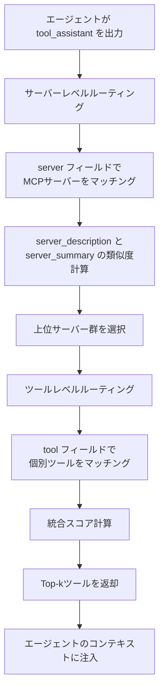

## 論文概要（Abstract）

本記事は [MCP-Zero: Active Tool Discovery for Autonomous LLM Agents](https://arxiv.org/abs/2506.01056)（Fei, Zheng, Feng, 2025）の解説記事です。

現在のLLMエージェントフレームワークでは、利用可能なすべてのツールスキーマをプロンプトに注入し、モデルが受動的に選択する「パッシブ選択」が主流である。著者らはこの方式がコンテキストコストの増大とスケーラビリティの限界を招くと指摘し、エージェント自身が実行中に必要なツールを発見する「能動的ツール発見（Active Tool Discovery）」パラダイムを提案している。MCP-Zeroは、（1）能動的ツール要求、（2）階層的セマンティックルーティング、（3）反復的能力拡張の3機構で構成され、308のMCPサーバー・2,797ツールからなるデータセットを構築して評価を行っている。APIBankベンチマークのフルプール設定において、著者らは精度を維持しながら98.24%のトークン削減を報告している。

この記事は [Zenn記事: Claude Code Agent SDKで開発タスクを自動化するカスタムAIエージェント構築](https://zenn.dev/0h_n0/articles/54434fcee9091e) の深掘りです。

## 情報源

- **arXiv ID**: 2506.01056
- **URL**: [https://arxiv.org/abs/2506.01056](https://arxiv.org/abs/2506.01056)
- **著者**: Xiang Fei, Xiawu Zheng, Hao Feng
- **発表年**: 2025（v1: 2025年6月1日、v4: 2025年6月24日）
- **分野**: cs.AI（人工知能）、cs.SE（ソフトウェア工学）
- **ライセンス**: CC BY 4.0

## 背景と動機（Background & Motivation）

LLMエージェントの外部ツール利用において、Model Context Protocol（MCP）はツールとの標準的なインターフェースを提供する。しかし、ツールエコシステムの拡大に伴い、ツール管理のスケーラビリティが課題となっている。

現在の主流アプローチでは、エージェントが利用可能なすべてのツールスキーマをシステムプロンプトに注入する。著者らはこれを「パッシブ選択」と呼び、2つの問題を指摘している。第一に、ツール数の増加に伴いコンテキスト消費量が線形に増大する。APIBankのフルプール設定では、全ツール注入時に約6,300トークンを消費する（論文Table 1より）。第二に、モデルが大量のツールスキーマから適切なツールを選択する精度が低下する。フルプールでのClaude-3.5の標準注入精度は69.23%まで低下するのに対し、ドメイン限定では97.60%を維持している（論文Table 1より）。

この問題はClaude Code Agent SDKにおいても実践的に重要である。Agent SDKでは`disallowed_tools`によるツール除外や、ツール検索（tool search）のデフォルトON設定でコンテキストを節約するが、これらは開発者による静的な設定であり、タスクに応じた動的な最適化ではない。MCP-Zeroはこの限界を、エージェント主導の能動的発見で解決しようとする試みである。

## 主要な貢献（Key Contributions）

- **能動的ツール発見パラダイム**: モデルが自らの能力ギャップを認識し、構造化されたリクエストでツールを要求する仕組み
- **階層的セマンティックルーティング**: MCPサーバーレベル→ツールレベルの2段階検索で、コサイン類似度に基づく独自のスコアリング関数を導入
- **MCP-toolsデータセット**: 公式MCPリポジトリから308サーバー・2,797ツールを構造化抽出した評価用データセット
- **大幅なトークン削減**: APIBankフルプール設定でのシングルターン98.24%、マルチターン97.52%のトークン削減（論文Table 1より）

## 技術的詳細（Technical Details）

### パッシブ選択 vs. 能動的選択の理論的枠組み

著者らはまず、ツール選択の2つのパラダイムを確率的に定式化している。

パッシブ選択では、ユーザクエリ $q$ とツール集合 $T$ が与えられたとき、最適ツール $t^*$ の選択確率をベイズの枠組みで表現する：

$$
P_{\text{passive}}(t^* \mid q, T) = \frac{P(q \mid t^*, T) P(t^* \mid T)}{\sum_{i} P(q \mid t_i, T) P(t_i \mid T)}
$$

ここで $P(t^* \mid T)$ は事前分布、$P(q \mid t^*, T)$ はクエリとツールの適合度である。全ツールのスキーマがコンテキストに含まれるため、$T$ のサイズに比例してコンテキストコストが増大する。

一方、能動的選択では、エージェントの状態 $s_t$ から中間リクエスト $r$ を経由してツールを発見する：

$$
P_{\text{active}}(t^* \mid s_t) = \sum_r P(t^* \mid r) P(r \mid s_t)
$$

リクエスト $r^*$ は相互情報量を最大化するように選択される：

$$
r^* = \arg\max_r I(T^*; r \mid s_t)
$$

著者らは、能動的リクエストの埋め込み $\mathbf{e}_r$ がユーザクエリの埋め込み $\mathbf{e}_q$ よりもツール埋め込み $\mathbf{e}_t$ との類似度が高くなると主張している（$\cos(\mathbf{e}_r, \mathbf{e}_t) > \cos(\mathbf{e}_q, \mathbf{e}_t)$）。ただし、この不等式は実験的に検証されていない点に注意が必要である。

### 能動的ツール要求（Active Tool Request）

エージェントが外部ツールを必要と判断した場合、以下の構造化ブロックを出力する：

```xml
<tool_assistant>
   server: ...  <!-- プラットフォーム/権限ドメイン -->
   tool: ...    <!-- 操作タイプ + 対象 -->
</tool_assistant>
```

システムプロンプトには「現在のタスクを自身の知識では解決できない場合、`<tool_assistant>`ブロックを出力してサーバードメインとツール操作を指定せよ」という指示が含まれる（論文Section 7.1より）。著者らによれば、1つのin-contextサンプルを追加することでモデルの出力がより具体的になる（例: `filesystem_read`のように明確化される、論文Section 7.2より）。

### 階層的セマンティックルーティング（Hierarchical Semantic Routing）

ツール要求を受け取った後、MCP-Zeroは2段階のルーティングでツールを特定する。



**サーバーレベル**: `server`フィールドの埋め込みを、各MCPサーバーの`server_description`および`server_summary`の埋め込みとコサイン類似度で比較する。サーバーの説明文が短い場合を考慮し、要約（`server_summary`）も生成しておき、2つの類似度の高い方を採用する。

**ツールレベル**: 選択されたサーバー内のツールについて、`tool`フィールドの埋め込みと各ツールの`description`の埋め込みのコサイン類似度を計算する。

**統合スコア（論文Eq. 1）**: サーバーレベルの類似度 $s_{\text{server}}$ とツールレベルの類似度 $s_{\text{tool}}$ を以下の式で統合する：

$$
\text{score} = (s_{\text{server}} \times s_{\text{tool}}) \times \max(s_{\text{server}}, s_{\text{tool}})
$$

この式により、一方の類似度が高い場合に最終スコアを引き上げる効果がある。ただし、このスコアリング関数はヒューリスティックであり、論文中にアブレーション分析は提示されていない。埋め込みにはOpenAI text-embedding-3-largeが使用されている。

### 反復的能力拡張（Iterative Capability Extension）

MCP-Zeroはシングルショットではなく、反復的にツールを発見・追加できる。著者らが論文Section 3.1で記述しているフローは以下の通りである：

1. モデルがクエリを受け取り、外部ツールが必要かを判断
2. 必要な場合、`<tool_assistant>`リクエストを出力
3. 階層的ルーティングがツールを返却し、コンテキストに注入
4. モデルが返却されたツールの適合性を判断。不適合な場合、リクエストを修正して再検索
5. 適切なツールが見つかるか、パラメトリック知識にフォールバックするまで繰り返し

さらに、論文Section 7.3ではAlita（Qiu et al., 2025）との統合が示されている。検索で適切なツールが見つからない場合、Alitaのワークフローで新しいツールを構築し登録するという拡張が可能であると述べられている。

### MCP-toolsデータセット

著者らは公式MCPリポジトリ（modelcontextprotocol/servers、タグ2025.4.28、コミットad2d4e6）から以下の手順でデータセットを構築している：

1. **収集**: 396サーバーを取得（リファレンス実装20、サードパーティ公式114、コミュニティ262）
2. **フィルタリング**: MCP準拠のツール定義、十分なドキュメント、検索評価に耐える詳細度の3条件で308サーバーに絞り込み
3. **構造化抽出**: Qwen2.5-72B-Instructによるfew-shot抽出で、`server_name`、`server_description`、`server_summary`、`tools[]`（各ツールの`name`、`description`、`parameter`）を取得
4. **統計**: 2,797ツール、サーバーあたり平均9.08ツール（中央値5.0、標準偏差11.40）。162サーバーが5ツール以下

事前計算済みの埋め込みベクトルも公開されている。

## 実装のポイント（Implementation）

MCP-Zeroの実装において注意すべき点を整理する。

**埋め込みモデルの選択**: 論文ではOpenAI text-embedding-3-largeが使用されている。サーバー記述文とツール記述文の埋め込みは事前計算可能であるため、推論時のコストはリクエストの埋め込み計算のみとなる。

**サーバー要約の生成**: 多くのMCPサーバーは簡潔な説明文しか持たないため、`server_summary`の事前生成が検索精度に影響する。著者らはQwen2.5-72B-Instructで生成しているが、実運用ではサーバー登録時に自動生成するパイプラインが考えられる。

**トップk選択の調整**: 論文ではAPIBankでk=1が使用されているが、MCP-toolsの2,797ツール規模では適切なkの値が異なる可能性がある。著者らは「類似度スコアが密集している場合の動的調整」に言及しているが、具体的なアルゴリズムは示されていない。

**Agent SDKとの関連**: Claude Code Agent SDKではツール検索（tool search）がデフォルトでONになっており、MCPツールのスキーマは必要時に遅延ロードされる。MCP-Zeroの能動的発見はこのツール検索をさらに発展させたものと解釈でき、`alwaysLoad: true`の設定判断やツール数が多い環境での最適化に示唆を与える。

## Production Deployment Guide

### AWS実装パターン（コスト最適化重視）

MCP-Zeroの能動的ツール発見は、大量のMCPツールを管理するエージェントシステムのデプロイに適用できる。以下は2026年11月時点のAWS ap-northeast-1（東京）リージョン料金に基づく概算である。

**トラフィック量別の推奨構成**:

| 規模 | 月間リクエスト | 推奨構成 | 月額コスト | 主要サービス |
|------|--------------|---------|-----------|------------|
| **Small** | ~3,000 (100/日) | Serverless | $80-200 | Lambda + Bedrock + OpenSearch Serverless |
| **Medium** | ~30,000 (1,000/日) | Hybrid | $400-1,000 | Lambda + ECS Fargate + OpenSearch |
| **Large** | 300,000+ (10,000/日) | Container | $2,500-6,000 | EKS + Karpenter + OpenSearch + ElastiCache |

**Small構成の詳細**（月額$80-200）:
- **Lambda**: 1GB RAM、60秒タイムアウト（$25/月）
- **Bedrock**: Claude 3.5 Haiku、エージェント推論用（$100/月）
- **OpenSearch Serverless**: 埋め込みベクトル検索用（$30/月）
- **S3**: 埋め込みキャッシュ（$5/月）
- **CloudWatch**: 基本監視（$5/月）

**コスト削減テクニック**:
- 埋め込みベクトルの事前計算とキャッシュ（S3/DynamoDB）でリアルタイム埋め込みAPI呼び出しを削減
- Bedrock Batch APIで非リアルタイムのツール要約生成を50%割引で実行
- OpenSearch Serverlessのauto-scaling設定で、アイドル時のOCU（OpenSearch Compute Unit）を最小化

**コスト試算の注意事項**: 上記は2026年11月時点のAWS ap-northeast-1リージョン料金に基づく概算値です。実際のコストはトラフィックパターンやバースト使用量により変動します。最新料金は[AWS料金計算ツール](https://calculator.aws/)で確認してください。

### Terraformインフラコード

**Small構成（Serverless）: Lambda + Bedrock + OpenSearch Serverless**

```hcl
# --- IAMロール（最小権限） ---
resource "aws_iam_role" "lambda_tool_discovery" {
  name = "lambda-tool-discovery-role"

  assume_role_policy = jsonencode({
    Version = "2012-10-17"
    Statement = [{
      Action = "sts:AssumeRole"
      Effect = "Allow"
      Principal = { Service = "lambda.amazonaws.com" }
    }]
  })
}

resource "aws_iam_role_policy" "bedrock_and_opensearch" {
  role = aws_iam_role.lambda_tool_discovery.id

  policy = jsonencode({
    Version = "2012-10-17"
    Statement = [
      {
        Effect   = "Allow"
        Action   = ["bedrock:InvokeModel"]
        Resource = "arn:aws:bedrock:ap-northeast-1::foundation-model/anthropic.claude-3-5-haiku*"
      },
      {
        Effect   = "Allow"
        Action   = ["aoss:APIAccessAll"]
        Resource = aws_opensearchserverless_collection.tool_embeddings.arn
      }
    ]
  })
}

# --- OpenSearch Serverless（ベクトル検索） ---
resource "aws_opensearchserverless_collection" "tool_embeddings" {
  name = "mcp-tool-embeddings"
  type = "VECTORSEARCH"
}

# --- Lambda関数（階層的ルーティング） ---
resource "aws_lambda_function" "tool_discovery" {
  filename      = "tool_discovery.zip"
  function_name = "mcp-zero-tool-discovery"
  role          = aws_iam_role.lambda_tool_discovery.arn
  handler       = "index.handler"
  runtime       = "python3.12"
  timeout       = 60
  memory_size   = 1024

  environment {
    variables = {
      OPENSEARCH_ENDPOINT  = aws_opensearchserverless_collection.tool_embeddings.collection_endpoint
      BEDROCK_MODEL_ID     = "anthropic.claude-3-5-haiku-20241022-v1:0"
      EMBEDDING_MODEL      = "amazon.titan-embed-text-v2:0"
      ROUTING_TOP_K        = "5"
    }
  }
}

# --- CloudWatchアラーム（コスト監視） ---
resource "aws_cloudwatch_metric_alarm" "discovery_latency" {
  alarm_name          = "tool-discovery-latency-high"
  comparison_operator = "GreaterThanThreshold"
  evaluation_periods  = 2
  metric_name         = "Duration"
  namespace           = "AWS/Lambda"
  period              = 300
  statistic           = "p99"
  threshold           = 10000
  alarm_description   = "ツール発見のP99レイテンシが10秒を超過"

  dimensions = {
    FunctionName = aws_lambda_function.tool_discovery.function_name
  }
}
```

### セキュリティベストプラクティス

- **IAMロール**: Bedrock InvokeModelとOpenSearch APIAccessAllのみに限定
- **ネットワーク**: OpenSearch ServerlessはVPCエンドポイント経由のアクセスを推奨
- **シークレット管理**: 埋め込みAPIキーはSecrets Managerで管理
- **データ保護**: OpenSearch Serverlessは保管時暗号化がデフォルト有効

### 運用・監視設定

**CloudWatch Logs Insightsクエリ**:

```sql
-- ツール発見の精度モニタリング: 要求されたツールと実際に使用されたツールの一致率
fields @timestamp, requested_tool, matched_tool, similarity_score
| stats avg(similarity_score) as avg_score, count(*) as total by bin(1h)
| filter avg_score < 0.7

-- トークン使用量の推移（MCP-Zero効果の検証）
fields @timestamp, total_tokens, tool_schemas_tokens
| stats sum(total_tokens) as total, sum(tool_schemas_tokens) as schema_tokens by bin(1d)
```

**CloudWatchアラーム（コスト重視）**:

```python
import boto3

cloudwatch = boto3.client('cloudwatch')

cloudwatch.put_metric_alarm(
    AlarmName='embedding-api-cost-spike',
    ComparisonOperator='GreaterThanThreshold',
    EvaluationPeriods=1,
    MetricName='EmbeddingAPICallCount',
    Namespace='Custom/MCPZero',
    Period=3600,
    Statistic='Sum',
    Threshold=10000,
    AlarmDescription='埋め込みAPI呼び出し数が1万回/時間を超過（キャッシュミス急増の可能性）'
)
```

### コスト最適化チェックリスト

**アーキテクチャ選択**:
- [ ] ~100 req/日 → Lambda + OpenSearch Serverless（$80-200/月）
- [ ] ~1,000 req/日 → ECS Fargate + OpenSearch Managed（$400-1,000/月）
- [ ] 10,000+ req/日 → EKS + OpenSearch + ElastiCache Redis（$2,500-6,000/月）

**埋め込み最適化**:
- [ ] サーバー/ツール埋め込みの事前計算とS3キャッシュ
- [ ] Amazon Titan Embed Text v2使用（Bedrock内で完結、外部API不要）
- [ ] バッチ埋め込み更新（MCP-Zeroの同期パイプラインに対応）
- [ ] 埋め込み次元数の削減（text-embedding-3-largeの3072次元 → 1024次元）

**LLMコスト削減**:
- [ ] ツール要約生成にBedrock Batch API使用（50%割引）
- [ ] Prompt Caching有効化（システムプロンプトの`<tool_assistant>`指示部分）
- [ ] 能動的発見による動的ツール注入でコンテキストコスト削減（論文報告: 最大98%）
- [ ] 小規模タスクにはClaude 3.5 Haiku選択

**監視・アラート**:
- [ ] AWS Budgets月額予算設定
- [ ] 埋め込みAPI呼び出し数の異常検知
- [ ] ツール発見精度（類似度スコア平均）の監視
- [ ] Cost Anomaly Detection有効化

## 実験結果（Results）

### APIBankベンチマーク

著者らはAPIBank level-1セットで評価を行っている。3つのモデル（Claude-3.5、GPT-4.1、Gemini-2.5）を比較し、Standard（全ツール注入）、Q.Retrieval（クエリベース検索）、MCP-Zeroの3手法を比較している。

**シングルターン・フルプール設定（論文Table 1より）**:

| 手法 | Claude-3.5 | GPT-4.1 | Gemini-2.5 | 平均トークン | トークン削減率 |
|------|-----------|---------|-----------|------------|-------------|
| Standard | 69.23% | 94.71% | 94.23% | 6,308.2 | — |
| Q.Retrieval | 71.63% | — | — | — | — |
| MCP-Zero | 95.19% | 95.19% | 96.63% | 111.0 | -98.24% |

**マルチターン・フルプール設定（論文Table 1より）**:

| 手法 | Claude-3.5 | GPT-4.1 | Gemini-2.5 | 平均トークン | トークン削減率 |
|------|-----------|---------|-----------|------------|-------------|
| Standard | 60.22% | 93.01% | 92.47% | 6,402.2 | — |
| Q.Retrieval | 65.05% | — | — | — | — |
| MCP-Zero | 90.32% | 92.47% | 94.62% | 159.0 | -97.52% |

フルプール設定では、Standard手法がClaude-3.5で大幅な精度低下（シングルターン69.23%、マルチターン60.22%）を示すのに対し、MCP-Zeroは95.19%および90.32%と安定した精度を維持している。トークン消費量は6,308トークンから111トークンへと98.24%の削減を達成している。

**ドメイン限定プール設定での注意点**: ドメイン限定プールでは、Standardが高精度を維持する場合がある。Claude-3.5のシングルターンではStandard 97.60%に対しMCP-Zero 96.15%、マルチターンではStandard 100.00%に対しMCP-Zero 91.40%と、Standardが上回るケースが存在する（論文Table 1より）。これは、ツール数が少ない場合は全注入方式の方が情報量で有利になることを示唆している。

### MCP-toolsデータセット上のスケーラビリティ

著者らはMCP-toolsの2,797ツールを用いたneedle-in-a-haystack実験（論文Figure 5, 6）で、ツール数が1から2,797まで増加した場合のスケーラビリティを評価している。論文中にこの実験の数値テーブルは提示されていないが、チャートからはツール数増加に対して精度が大きく低下しないことが示されている。

## 実運用への応用（Practical Applications）

MCP-Zeroの能動的ツール発見は、以下の実運用シナリオに応用可能である。

**Agent SDKでのツール管理**: Claude Code Agent SDKの`disallowed_tools`や`allowed_tools`は静的な設定である。MCP-Zeroの手法を応用すれば、タスクごとに必要なツールのみをコンテキストにロードする動的な管理が実現できる。特に、MCPサーバーを多数接続する大規模プロジェクトで、ツール検索の遅延ロード（`alwaysLoad: true`を使わないデフォルト設定）の最適化に直接関連する。

**CI/CDパイプラインでのコスト最適化**: PRレビューやテスト実行など、タスクごとに必要なツールが異なる場合、MCP-Zeroの階層的ルーティングでツール注入量を削減し、トークンコストを抑制できる。論文の報告値に基づけば、フルプール設定で98%のトークン削減が期待できる。

**マルチMCPサーバー環境**: 企業環境で数十〜数百のMCPサーバーを運用する場合、全ツールスキーマの注入は現実的でない。MCP-Zeroのサーバーレベル→ツールレベルの2段階検索は、このスケールでの実用的な解法を提供する。

## 関連研究（Related Work）

- **ToolLLM（Qin et al., 2023）**: LLMにツール使用能力を教えるための学習フレームワーク。ツール検索にはAPIRetrieverを使用するが、能動的発見の概念はない
- **RAG-MCP（Gan & Sun, 2025）**: MCP環境でのRAGベースのツール選択。MCP-Zeroとの比較実験は論文中に含まれていない
- **AnyTool（Du et al., 2024）**: 大規模APIプール（16,000以上）からの階層的ツール選択。MCP-Zeroと同様の階層的アプローチだが、エージェント主導の能動的要求ではなくクエリベース
- **ScaleMCP（Lumer et al., 2025）**: TDWA埋め込みによるMCPツール検索と自動同期パイプライン。MCP-Zeroの能動的発見と相補的な関係にある

## まとめと今後の展望

MCP-Zeroは、LLMエージェントのツール利用において「パッシブ選択」から「能動的発見」へのパラダイムシフトを提案している。APIBankフルプール設定での98%トークン削減は実用上のインパクトが大きいが、ドメイン限定プールでは全注入方式が上回るケースもあり、ツール数やタスク特性に応じた使い分けが重要である。

スコアリング関数のアブレーション分析が不在である点、MCP-toolsデータセット上での定量的な精度評価が不十分である点は、今後の研究で補完が期待される。Agent SDKのツール検索機能との統合や、企業規模でのMCPサーバー管理への応用が実践的な次のステップとなるだろう。

## 参考文献

- **arXiv**: [https://arxiv.org/abs/2506.01056](https://arxiv.org/abs/2506.01056)
- **MCP-tools Dataset**: 公式MCPリポジトリ modelcontextprotocol/servers（タグ2025.4.28）から構築
- **Related Zenn article**: [Claude Code Agent SDKで開発タスクを自動化するカスタムAIエージェント構築](https://zenn.dev/0h_n0/articles/54434fcee9091e)
