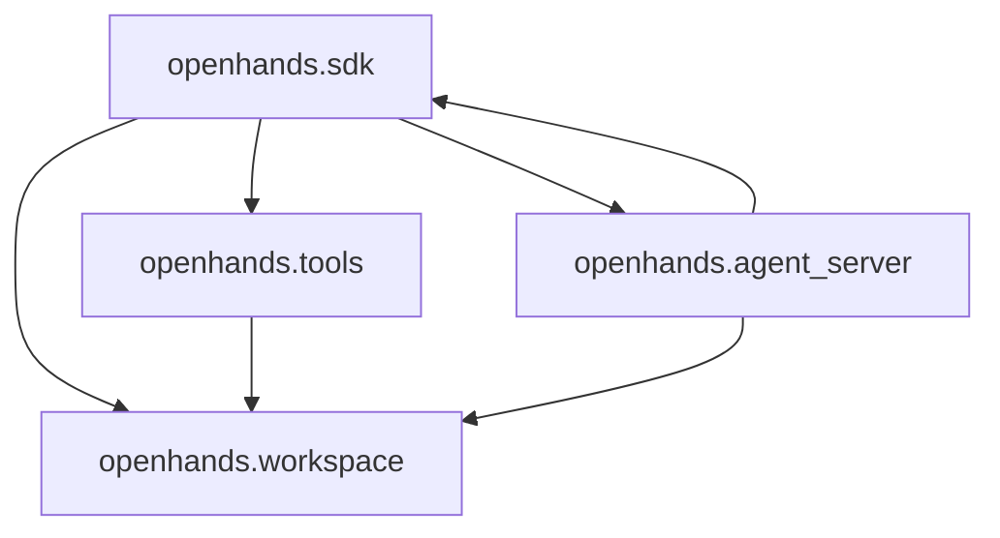
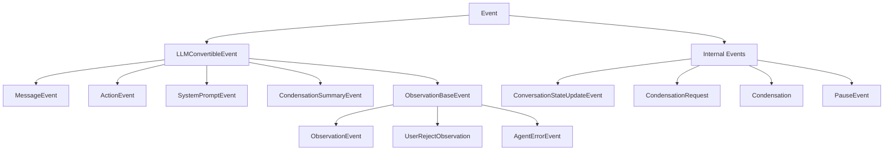

## 論文概要（Abstract）

本記事は [The OpenHands Software Agent SDK: A Composable and Extensible Foundation for Production Agents](https://arxiv.org/abs/2511.03690) の解説記事です。

OpenHands Software Agent SDKは、ソフトウェアエンジニアリングタスクを自動化するエージェントの構築基盤を提供するオープンソースSDKである。著者らは、既存のエージェントSDK（Claude Agent SDK、OpenAI Agents SDK、Google ADK、LangChain）が本番運用で必要となるサンドボックス実行・マルチLLMルーティング・セキュリティ分析といった機能を統合的に備えていない点を課題として指摘し、イベントソーシングに基づくモジュラーアーキテクチャでこれらを解決するSDKを提案している。MLSys 2026に採択された本論文では、SWE-Bench Verifiedで76.6%、GAIA（テスト分割）で80.0%を達成し、5つのベンチマークカテゴリ中3つで既存の公開最高スコアを上回ったと報告されている。

この記事は [Zenn記事: Claude Code Agent SDKで開発タスクを自動化するカスタムAIエージェント構築](https://zenn.dev/0h_n0/articles/54434fcee9091e) の深掘りです。

## 情報源

- **arXiv ID**: 2511.03690
- **URL**: [https://arxiv.org/abs/2511.03690](https://arxiv.org/abs/2511.03690)
- **著者**: Xingyao Wang, Simon Rosenberg, Juan Michelini, Calvin Smith, Hoang Tran, Engel Nyst, Rohit Malhotra, Xuhui Zhou, Valerie Chen, Robert Brennan, Graham Neubig
- **発表年**: 2025年11月（v1）、2026年4月（v2改訂）。MLSys 2026に採択
- **分野**: cs.SE（ソフトウェア工学）、cs.AI（人工知能）
- **コード**: [https://github.com/OpenHands/software-agent-sdk](https://github.com/OpenHands/software-agent-sdk)（MITライセンス）

## 背景と動機（Background & Motivation）

ソフトウェアエンジニアリングタスクを自律的に解決するLLMエージェントの実用化が進む中、エージェントの構築基盤となるSDKの設計が重要な課題となっている。著者らは、既存SDKの制約を以下のように整理している。

第一に、Claude Agent SDKやOpenAI Agents SDKはライブラリとして提供されるが、REST/WebSocketサーバーやサンドボックス実行環境を組み込んでいない。これにより、本番デプロイでは追加のインフラ構築が必要となる。第二に、マルチLLMルーティングやfunctionコーリング非対応モデルへの対応は各SDKで限定的であり、100以上のLLMプロバイダを横断的に使うユースケースに制約がある。第三に、エージェントの安全性を担保するセキュリティ分析とアクション確認ポリシーの統合が不十分であると指摘されている。

これらの課題に対し、OpenHands SDKはOpenHandsフレームワークのエージェントコンポーネントを全面的に再設計し、コンポーザブルかつ拡張可能な本番品質のSDKとして公開したものである。

## 主要な貢献（Key Contributions）

- **モジュラー4パッケージ構成**: SDK核・ツール・ワークスペース・サーバーの分離設計により、ローカル開発からリモートコンテナ実行まで同一コードで対応
- **イベントソーシング基盤**: すべてのエージェントインタラクションを不変イベントとして記録し、クラッシュ回復を中央値7.4msで実現
- **セキュリティ分析器**: ツール呼び出しごとにリスクレベルを評価し、確認ポリシーと組み合わせてユーザー承認フローを制御
- **主要SDK比較**: Claude Agent SDK、OpenAI Agents SDK、Google ADK、LangChainとの24項目にわたる機能比較を提供（論文Table 6）
- **5カテゴリベンチマーク**: SWE-Bench Verified、Commit0、SWE-Bench Multimodal、SWT-Bench、GAIAの5つで14モデルを評価

## 技術的詳細（Technical Details）

### 4パッケージアーキテクチャ

著者らはSDKを4つのパッケージに分割している（論文Section 4.1）。



- **openhands.sdk**: Agent、Conversation、LLM、Tool、MCPなどのコア抽象化とイベントシステムを提供。軽量に保たれ、他パッケージの基盤となる
- **openhands.tools**: SDK抽象化上に構築された具体的なツール実装群。テスト速度を維持するためコアと分離されている
- **openhands.workspace**: 実行環境の抽象化。`BaseWorkspace`（ABC）が`execute_command`、`file_upload`、`file_download`を定義し、`LocalWorkspace`（インプロセス）と`RemoteWorkspace`（HTTP委譲）、さらに`DockerWorkspace`と`APIRemoteWorkspace`が具象クラスとなる
- **openhands.agent_server**: REST/WebSocket APIを公開するWebサーバー。`POST /conversations`、`GET /conversations/id`などのエンドポイントとリアルタイムイベントストリーミングを提供

著者らは設計原則として「Agent、Tool、LLMは不変（immutable）かつシリアライズ可能で、`ConversationState`のみが可変」というステートレスモデルを採用したと述べている。ローカルからリモートへの移行はワークスペースの切り替え1行で可能であると説明されている（論文Figure 5）。

### イベントソーシング機構

すべてのインタラクションは不変イベントとして追記専用ログに記録される（論文Section 4.2）。

**イベント階層**（論文Table 1）:



`LLMConvertibleEvent`は`to_llm_message()`メソッドを持ち、LLMへの送信形式に変換できるイベントの基底クラスである。`ActionEvent`はツール呼び出しの入力スキーマと思考過程を、`ObservationEvent`はツールの実行結果を格納する。

**永続化と回復**: メタデータは`base_state.json`に各変更時に書き込まれ、`EventStore`は各イベントを個別のJSONファイルとして保存する。再開時は`base_state.json`をロードし、ディレクトリからイベントをリプレイすることで状態を復元する。クラッシュ回復ではさらに未完了アクションのスキャンが行われる。

著者らが報告するイベントソーシングのオーバーヘッド（論文Table 3、SWE-Bench Verifiedの433会話・39,870イベントで計測）:

| 指標 | 中央値 | P95 | 最大（358イベント時） |
|------|--------|-----|----------------------|
| イベント永続化レイテンシ | 0.20 ms | 0.31 ms | — |
| アクションサイクル永続化 | 0.40 ms | 0.56 ms | — |
| 完全状態リプレイ | 4.1 ms | 9.7 ms | 18.9 ms |
| クラッシュ回復 | 7.4 ms | 14.9 ms | 32.1 ms |
| 会話あたりストレージ | 380 KB | 1.4 MB | 3.4 MB |

LLMの応答時間が1〜30秒であることを考えると、イベントソーシングのオーバーヘッドは無視できる水準であると著者らは述べている。

### ツールシステム: Action-Execution-Observation パターン

各ツールは3つの要素で構成される（論文Section 4.4）。

1. **Action**: 入力スキーマ。LLMが生成した引数はPydanticモデルでバリデーションされる
2. **Execution**: `ToolExecutor`（ABC）が`__call__(action) -> observation`を実装。バリデーション済みActionを受け取り処理を実行する
3. **Observation**: 構造化された返却スキーマ。`to_llm_content()`でLLM互換のコンテンツに変換される

`ToolDefinition[ActionT, ObservationT]`は`to_mcp_tool()`、`to_openai_tool()`（Chat Completions形式）、`to_responses_tool()`（Responses API形式）へのエクスポートを提供し、異なるLLMプロバイダへの互換性を確保している。

**MCP統合**: MCPのJSONスキーマは自動的にActionモデルに変換される。`MCPToolDefinition`が`ToolDefinition`を拡張し、`MCPToolExecutor`がFastMCPの`MCPClient`に処理を委譲する。外部MCPツールもネイティブツールと同様にバリデーション・型チェック・シリアライズが適用される。

**分散実行のためのツールレジストリ**: エグゼキュータはシリアライズ不可能なため、ツール仕様は登録名とJSON直列化可能なパラメータのみで構成される。`register_tool(name, ToolDefinition)`が名前をリゾルバに紐付け、実行時にConversationコンテキストからToolDefinition（エグゼキュータを含む）を再構築する。

### セキュリティ分析器

著者らはエージェントの安全性を2層で設計している（論文Section 4.9）。

1. **SecurityAnalyzer**: 各ツール呼び出しのリスクを**low、medium、high、unknown**の4段階で評価する
2. **ConfirmationPolicy**: アクション詳細と評価されたリスクに基づき、ユーザー承認の要否を判断する

承認が必要な場合、エージェントは`WAITING_FOR_CONFIRMATION`状態に遷移し、ユーザーの承認または拒否を待つ。拒否後はより安全な代替手段を試行する場合がある。ポリシーはセッション中に動的に変更可能であり、例えばgrep等の読み取り専用操作ではルールを緩和できる。

組み込み実装として、**LLMSecurityAnalyzer**はツール呼び出しに`security_risk`フィールドを追加してLLM自身にリスクを分類させる方式を採る。**ConfirmRisky**ポリシーは設定可能な閾値（デフォルトはhigh）を超えるアクションをブロックする。

著者らは制約として、LLMベースのセキュリティ分析は敵対的プロンプトや一貫性のない分類に対して脆弱であり、包括的なマルチテナントセキュリティ監査は将来の課題であると明記している（論文Section 7）。

### マルチLLMルーティング

`RouterLLM(LLM)`は抽象メソッド`select_llm(messages)`を持ち、メッセージ内容に応じて適切なモデルにリクエストをルーティングする。著者らが示す`MultimodalRouter`の例では、画像を含むメッセージはマルチモーダルモデルに、テキストのみのメッセージは低コストモデルに振り分けられる（論文Figure 3）。

基盤としてLiteLLMを採用し、100以上のLLMプロバイダをサポートしている。さらに`NonNativeToolCallingMixin`により、functionコーリングをサポートしないモデルでもツールスキーマをテキストプロンプトに変換し、正規表現でツール呼び出しを解析することで対応可能としている。

## 実装のポイント（Implementation）

**ローカルからリモートへの移行**: `Conversation(agent, workspace)`ファクトリは、パスまたは`LocalWorkspace`を受け取ると`LocalConversation`を、`RemoteWorkspace`を受け取ると`RemoteConversation`を返す。ローカル開発からDockerコンテナベースの本番環境への切り替えは、ワークスペースの引数を`DockerWorkspace(...)`に変更するだけで完了すると説明されている。

**コンテキスト圧縮（Condensation）**: `LLMSummarizingCondenser`はデフォルトの圧縮機構で、APIコストを最大2倍削減すると報告されている（Smith, 2025を引用）。圧縮結果は`CondensationEvent`として保存され、各LLM呼び出し前に適用される。元のイベントログは完全に保持され、圧縮器はステートレスに動作する。

**サブエージェント委譲**: サブエージェントは通常のツールとして実装されており、親の会話からモデル設定とワークスペースを継承する独立した会話として動作する。現行バージョンではブロッキング型の並列実行であり、親は全サブエージェントの完了を待つ。

**シークレット管理**: `SecretRegistry`は会話ごとの遅延バインディング型シークレット管理を提供する。出力値は`<secret-hidden>`としてマスクされ、シリアライズ時に自動的に除去される。セッション中のシークレットローテーションにも対応している。

## Production Deployment Guide

### AWS実装パターン（コスト最適化重視）

OpenHands SDKの公式Dockerイメージには、APIサーバー、VSCode Web、VNCデスクトップ、Chromiumがバンドルされている。以下はこのイメージをAWS上でデプロイする際のトラフィック量別推奨構成である。

| 規模 | 月間リクエスト | 推奨構成 | 月額コスト | 主要サービス |
|------|--------------|---------|-----------|------------|
| **Small** | ~3,000 (100/日) | Serverless | $50-150 | Lambda + Bedrock + DynamoDB |
| **Medium** | ~30,000 (1,000/日) | Hybrid | $300-800 | ECS Fargate + Bedrock + ElastiCache |
| **Large** | 300,000+ (10,000/日) | Container | $2,000-5,000 | EKS + Karpenter + EC2 Spot |

**Small構成の詳細**（月額$50-150）:
- **Lambda**: 1GB RAM、60秒タイムアウト（$20/月）
- **Bedrock**: Claude 3.5 Haiku、Prompt Caching有効（$80/月）
- **DynamoDB**: On-Demand、イベントログ保存（$10/月）
- **CloudWatch**: 基本監視（$5/月）
- **API Gateway**: REST API（$5/月）

**Medium構成の詳細**（月額$300-800）:
- **ECS Fargate**: 1 vCPU、2GB RAM × 2タスク（$150/月）。OpenHands Dockerイメージを直接実行
- **Bedrock**: Claude 3.5 Sonnet、Batch API活用（$400/月）
- **ElastiCache Redis**: cache.t3.micro、イベントキャッシュ（$15/月）
- **Application Load Balancer**: WebSocketサポート（$20/月）

**Large構成の詳細**（月額$2,000-5,000）:
- **EKS**: コントロールプレーン（$72/月）
- **EC2 Spot Instances**: g5.xlarge × 2-4台（平均$800/月、最大90%削減）
- **Karpenter**: 自動スケーリング（追加コストなし）
- **Bedrock Batch**: 50%割引活用（$2,000/月）
- **S3**: イベントログ長期保存（$20/月）

**コスト試算の注意事項**: 上記は2026年11月時点のAWS ap-northeast-1（東京）リージョン料金に基づく概算値です。実際のコストはトラフィックパターン、リージョン、バースト使用量により変動します。最新料金は [AWS料金計算ツール](https://calculator.aws/) で確認してください。

### Terraformインフラコード

**Small構成（Serverless）: Lambda + Bedrock + DynamoDB**

```hcl
module "vpc" {
  source  = "terraform-aws-modules/vpc/aws"
  version = "~> 5.0"

  name = "openhands-vpc"
  cidr = "10.0.0.0/16"
  azs  = ["ap-northeast-1a", "ap-northeast-1c"]
  private_subnets = ["10.0.1.0/24", "10.0.2.0/24"]

  enable_nat_gateway   = false
  enable_dns_hostnames = true
}

resource "aws_iam_role" "lambda_bedrock" {
  name = "openhands-lambda-bedrock-role"
  assume_role_policy = jsonencode({
    Version = "2012-10-17"
    Statement = [{
      Action    = "sts:AssumeRole"
      Effect    = "Allow"
      Principal = { Service = "lambda.amazonaws.com" }
    }]
  })
}

resource "aws_iam_role_policy" "bedrock_invoke" {
  role = aws_iam_role.lambda_bedrock.id
  policy = jsonencode({
    Version = "2012-10-17"
    Statement = [{
      Effect   = "Allow"
      Action   = ["bedrock:InvokeModel", "bedrock:InvokeModelWithResponseStream"]
      Resource = "arn:aws:bedrock:ap-northeast-1::foundation-model/anthropic.claude-3-5-haiku*"
    }]
  })
}

resource "aws_lambda_function" "agent_handler" {
  filename      = "lambda.zip"
  function_name = "openhands-agent-handler"
  role          = aws_iam_role.lambda_bedrock.arn
  handler       = "index.handler"
  runtime       = "python3.12"
  timeout       = 60
  memory_size   = 1024

  environment {
    variables = {
      BEDROCK_MODEL_ID    = "anthropic.claude-3-5-haiku-20241022-v1:0"
      DYNAMODB_TABLE      = aws_dynamodb_table.event_store.name
      ENABLE_PROMPT_CACHE = "true"
    }
  }
}

resource "aws_dynamodb_table" "event_store" {
  name         = "openhands-event-store"
  billing_mode = "PAY_PER_REQUEST"
  hash_key     = "conversation_id"
  range_key    = "event_id"

  attribute {
    name = "conversation_id"
    type = "S"
  }
  attribute {
    name = "event_id"
    type = "N"
  }

  ttl {
    attribute_name = "expire_at"
    enabled        = true
  }
}

resource "aws_cloudwatch_metric_alarm" "lambda_cost" {
  alarm_name          = "openhands-lambda-cost-spike"
  comparison_operator = "GreaterThanThreshold"
  evaluation_periods  = 1
  metric_name         = "Duration"
  namespace           = "AWS/Lambda"
  period              = 3600
  statistic           = "Sum"
  threshold           = 100000
  alarm_description   = "Lambda実行時間異常（コスト急増の可能性）"
  dimensions = {
    FunctionName = aws_lambda_function.agent_handler.function_name
  }
}
```

**Large構成（Container）: EKS + Karpenter + Spot Instances**

```hcl
module "eks" {
  source  = "terraform-aws-modules/eks/aws"
  version = "~> 20.0"

  cluster_name    = "openhands-cluster"
  cluster_version = "1.31"
  vpc_id          = module.vpc.vpc_id
  subnet_ids      = module.vpc.private_subnets

  cluster_endpoint_public_access = true
  enable_cluster_creator_admin_permissions = true
}

resource "kubectl_manifest" "karpenter_provisioner" {
  yaml_body = <<-YAML
    apiVersion: karpenter.sh/v1alpha5
    kind: Provisioner
    metadata:
      name: openhands-spot
    spec:
      requirements:
        - key: karpenter.sh/capacity-type
          operator: In
          values: ["spot"]
        - key: node.kubernetes.io/instance-type
          operator: In
          values: ["m6i.xlarge", "m6i.2xlarge", "c6i.xlarge"]
      limits:
        resources:
          cpu: "32"
          memory: "128Gi"
      ttlSecondsAfterEmpty: 30
  YAML
}

resource "aws_budgets_budget" "monthly" {
  name         = "openhands-monthly-budget"
  budget_type  = "COST"
  limit_amount = "5000"
  limit_unit   = "USD"
  time_unit    = "MONTHLY"

  notification {
    comparison_operator        = "GREATER_THAN"
    threshold                  = 80
    threshold_type             = "PERCENTAGE"
    notification_type          = "ACTUAL"
    subscriber_email_addresses = ["ops@example.com"]
  }
}
```

### セキュリティベストプラクティス

1. **ネットワーク**: 本番環境では`cluster_endpoint_public_access = false`に設定しVPN経由アクセス
2. **IAM**: 最小権限の原則。Bedrock呼び出しは特定モデルARNに限定
3. **シークレット**: AWS Secrets Manager使用。OpenHands SDKの`SecretRegistry`と連携
4. **暗号化**: S3/DynamoDB/EBSはKMS暗号化必須
5. **監査**: CloudTrail全リージョン有効化

### 運用・監視設定

**CloudWatch Logs Insights クエリ**:

```sql
fields @timestamp, conversation_id, event_type, duration_ms
| stats count() as event_count, avg(duration_ms) as avg_duration by bin(1h)
| filter event_count > 1000

fields @timestamp, model_id, input_tokens, output_tokens
| stats sum(input_tokens + output_tokens) as total_tokens by bin(1h)
| filter total_tokens > 100000
```

**CloudWatch アラーム（Python）**:

```python
import boto3

cloudwatch = boto3.client('cloudwatch')

cloudwatch.put_metric_alarm(
    AlarmName='openhands-token-spike',
    ComparisonOperator='GreaterThanThreshold',
    EvaluationPeriods=1,
    MetricName='TokenUsage',
    Namespace='Custom/OpenHands',
    Period=3600,
    Statistic='Sum',
    Threshold=500000,
    ActionsEnabled=True,
    AlarmActions=['arn:aws:sns:ap-northeast-1:123456789:cost-alerts'],
    AlarmDescription='トークン使用量異常（コスト急増）'
)
```

**X-Ray トレーシング設定**:

```python
from aws_xray_sdk.core import xray_recorder, patch_all

patch_all()

@xray_recorder.capture('agent_conversation')
def run_conversation(prompt: str) -> dict:
    """OpenHands SDKの会話実行をトレース"""
    xray_recorder.put_annotation('sdk_version', 'v1.0.0')
    xray_recorder.put_metadata('prompt_length', len(prompt))
    # Conversation実行ロジック
    return result
```

### コスト最適化チェックリスト

**アーキテクチャ選択**:
- [ ] ~100 req/日 → Lambda + Bedrock（Serverless）$50-150/月
- [ ] ~1,000 req/日 → ECS Fargate + Bedrock（Hybrid）$300-800/月
- [ ] 10,000+ req/日 → EKS + Spot Instances（Container）$2,000-5,000/月

**リソース最適化**:
- [ ] EC2: Spot Instances優先（Karpenter自動管理）
- [ ] Reserved Instances: 1年コミットで最大72%削減
- [ ] Lambda: メモリサイズ最適化（CloudWatch Insights分析）
- [ ] ECS/EKS: アイドルタイムのスケールダウン

**LLMコスト削減**:
- [ ] Bedrock Batch API: 50%割引（非リアルタイム処理）
- [ ] Prompt Caching: 30-90%削減
- [ ] モデルルーティング: OpenHands RouterLLMで低コストモデルを自動選択
- [ ] Condensation: LLMSummarizingCondenserで最大2倍のコスト削減

**監視・アラート**:
- [ ] AWS Budgets: 月額予算設定
- [ ] CloudWatch アラーム: トークン使用量スパイク検知
- [ ] Cost Anomaly Detection: 自動異常検知
- [ ] 日次コストレポート: SNS/Slack通知

**リソース管理**:
- [ ] DynamoDBイベントログ: TTL設定で古いイベント自動削除
- [ ] S3: ライフサイクルポリシーで30日後にGlacier移行
- [ ] タグ戦略: 環境別（dev/staging/prod）でコスト可視化
- [ ] 開発環境: 夜間停止（ECS/EKS Auto Scaling to Zero）

## 実験結果（Results）

### SDK比較（Table 6）

著者らは5つのSDKを24項目で比較している（論文Table 6、2025年10月時点のバージョンで評価）。

| 機能 | OpenAI Agents SDK | Claude Agent SDK | Google ADK | LangChain | OpenHands SDK |
|------|:-:|:-:|:-:|:-:|:-:|
| MCPサポート | ✓ | ✓ | ✓ | ✓ | ✓ |
| モデル非依存（100+ LLM） | ✓ | × | ✓ | ✓ | ✓ |
| マルチLLMルーティング | × | × | × | ∼ | ✓ |
| セキュリティ分析器 | × | × | ✓ | × | ✓ |
| コンテキストファイル | × | ✓ | × | × | ✓ |
| エージェントスキル | × | ✓ | × | × | ✓ |
| コンテキスト圧縮 | × | ✓ | × | ✓ | ✓ |
| シークレット自動マスク | × | × | × | × | ✓ |
| スタック検出 | × | × | × | × | ✓ |
| REST+WSサーバー内蔵 | × | × | × | ✓ | ✓ |
| サンドボックス実行 | × | × | ∼ | × | ✓ |

Claude Agent SDKはコンテキストファイル、エージェントスキル、コンテキスト圧縮で固有の強みを持つ一方、OpenHands SDKはサンドボックス実行、マルチLLMルーティング、シークレット管理で差別化されていると整理できる。なお、∼は「大幅な外部セットアップまたはコミュニティ拡張が必要」を意味する。

### ベンチマーク結果（Table 5）

著者らは5カテゴリのベンチマークで14モデルを評価し、以下の結果を報告している（論文Table 5）。

| ベンチマーク | 公開SOTA | SDK最良 | SDK 2位 |
|-------------|---------|--------|---------|
| SWE-Bench Verified（Issue解決） | 79.2% | 76.6% | 75.6% |
| Commit0（新規開発） | 12.5% | **56.2%** | 56.2% |
| SWE-Bench Multimodal（フロントエンド） | — | **44.1%** | 41.8% |
| SWT-Bench Verified（テスト） | 84.0% | 78.8% | 78.5% |
| GAIA（情報収集） | 74.6% | **80.0%** | 78.8% |

太字はSDKが公開SOTAを上回ったケースである。著者らは5カテゴリ中3つで既存の公開最高スコアを上回り、SWE-Bench Verifiedでは2.6ポイント差、SWT-Benchでは5.2ポイント差であったと報告している。

### V0→V1の改善（Table 4）

同一モデルでの比較（論文Table 4）:

| モデル | V0 | V1（SDK） | 差分 |
|--------|-----|---------|------|
| Claude Sonnet 4.5 | 64.6% | 72.8% | +8.2 |
| Claude Sonnet 4 | 68.0% | 68.0% | ±0 |

著者らはSonnet 4.5の+8.2ポイントの改善を、V1のイベントソーシング設計がextended thinkingサポートをより容易に統合できたことに帰着させている。

### 本番デプロイ結果（Table 2）

15日間のV0/V1並行ロールアウト（論文Table 2）:

| 指標 | V0（レガシー） | V1（SDK） |
|------|--------------|----------|
| インフラエラー | 69.8 / 1k会話 | 0.0 / 1k会話 |
| SDKエラー | N/A | 29.7 / 1k会話 |
| **システム起因合計** | **78.0 / 1k会話** | **30.0 / 1k会話** |

システム起因エラーが61%削減されている。V0のインフラエラーはHTTPStatusError（401）が43.0、AgentRuntimeNotReadyErrorが18.8と大半を占めていた。著者らはこれを、V0の会話マネージャとランタイム間のポッド間HTTP呼び出しに起因するものであり、V1のコロケーション設計で解消されたと説明している。V1の残存SDKエラー29.7の大部分はextended thinkingロールアウト時のコンデンセーションバグであり、修正済みと報告されている。

## 実運用への応用（Practical Applications）

本論文の成果は、Zenn記事で解説したClaude Code Agent SDKによる開発タスク自動化と密接に関連する。

**CI/CDパイプラインでの活用**: OpenHands SDKのREST/WebSocket APIサーバーは、GitHub ActionsなどのCIから直接呼び出し可能な設計となっている。Agent SDKを用いたPRレビュー自動化においても、Zenn記事で示したような`query()`ベースのアプローチに加え、OpenHands SDKのようなサーバーベースのアプローチが選択肢となる。

**マルチモデル戦略**: RouterLLMによるモデル切り替えは、コストと品質のバランス最適化に有効である。コードレビューにはSonnet、テストカバレッジ確認にはHaikuといった使い分けが、Zenn記事で論じたコスト最適化パターンの発展形として位置づけられる。

**セキュリティ設計の参考**: SecurityAnalyzerとConfirmationPolicyの2層分離設計は、自社エージェントの安全性設計のリファレンスとなる。ただし、LLMベースのリスク分類の限界は著者ら自身が認めている点に注意が必要である。

## 関連研究（Related Work）

- **SWE-agent**（Yang et al., 2024）: LLMに少数のツールを与えてGitHub Issueを解決するアプローチの先駆的研究。OpenHands SDKの前身であるOpenHandsフレームワークもこの系譜に位置する
- **Agentless**（arXiv 2407.01489, 2024）: ツールループを使わず構造化プロンプティングのみでSWE-Benchタスクを解決できることを示した研究。Agent SDKの必要性を問い直す対照的アプローチ
- **Claude Agent SDK**: Anthropicが提供するAgent SDK。コンテキストファイル、エージェントスキル、コンテキスト圧縮に強みを持つが、サンドボックス実行やマルチLLMルーティングはOpenHands SDKが先行している

## まとめと今後の展望

OpenHands Software Agent SDKは、イベントソーシング・4パッケージモジュラー設計・セキュリティ分析器を統合した本番品質のエージェントSDKである。著者らは5カテゴリ中3つのベンチマークで公開SOTAを上回り、本番デプロイでシステム起因エラーを61%削減したと報告している。Claude Agent SDKとの比較では、両者が異なる強みを持つことが明確であり、プロジェクトの要件に応じた選択が重要となる。今後の課題として、マルチテナントセキュリティ監査、並列サブエージェント実行、非ブロッキング型の委譲メカニズムが挙げられている。

## 参考文献

- **arXiv**: [https://arxiv.org/abs/2511.03690](https://arxiv.org/abs/2511.03690)
- **Code**: [https://github.com/OpenHands/software-agent-sdk](https://github.com/OpenHands/software-agent-sdk)
- **OpenHands Index**: [https://index.openhands.dev](https://index.openhands.dev)
- **Related Zenn article**: [https://zenn.dev/0h_n0/articles/54434fcee9091e](https://zenn.dev/0h_n0/articles/54434fcee9091e)
