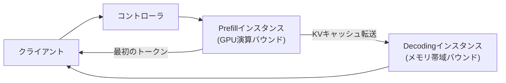

## 論文概要（Abstract）

本記事は [https://arxiv.org/abs/2401.09670](https://arxiv.org/abs/2401.09670) の解説記事です。

DistServeは、LLM（大規模言語モデル）推論における**prefill（プロンプト処理）フェーズとdecoding（トークン生成）フェーズを異なるGPUに分離**し、各フェーズのリソース割り当てと並列化戦略を独立に最適化するサービングシステムである。著者らは、既存システムにおけるprefill-decoding干渉とリソース結合の問題を特定し、分離アーキテクチャによってこれらを解消する手法を提案している。論文の評価では、vLLMに対して最大7.4倍のリクエスト処理能力、または12.6倍厳格なSLO（サービスレベル目標）の達成が報告されている。

この記事は [Zenn記事: Azure OpenAI負荷分散の負荷テスト戦略：Locust×Azure Load Testingで本番品質を検証する](https://zenn.dev/0h_n0/articles/25e17663c0f245) の深掘りです。

## 情報源

- **会議名**: OSDI 2024（18th USENIX Symposium on Operating Systems Design and Implementation）
- **開催日**: 2024年7月10日〜12日（Santa Clara, CA）
- **URL**: [https://arxiv.org/abs/2401.09670](https://arxiv.org/abs/2401.09670)
- **著者**: Yinmin Zhong, Shengyu Liu, Junda Chen, Jianbo Hu, Yibo Zhu, Xuanzhe Liu, Xin Jin, Hao Zhang
- **所属**: Peking University, StepFun, UC San Diego

## カンファレンス情報

**OSDI（Operating Systems Design and Implementation）について**:
OSDIはUSENIXが主催するシステム系の主要国際会議で、分散システム・OS・ネットワーキング等をカバーしている。採択率は例年15〜20%程度である。DistServeはOSDI 2024に採択された。

## 背景と動機（Background & Motivation）

LLM推論には2つの異なるフェーズが存在する。**prefillフェーズ**ではユーザーのプロンプト全体を処理して最初のトークンを生成し、**decodingフェーズ**では後続のトークンを逐次生成する。これら2つのフェーズは計算特性が根本的に異なっている。

prefillフェーズはGPU演算バウンドであり、プロンプト長に応じて処理時間が大きく変動する。一方、decodingフェーズはメモリ帯域バウンドであり、1トークンの生成は比較的軽量だがバッチサイズを大きくすることでGPU利用効率が向上する。

著者らは、既存のサービングシステム（vLLM、DeepSpeed-MII等）が両フェーズを同一GPUで処理することで、以下の2つの問題が発生していると指摘している：

1. **Prefill-Decoding干渉**: prefillの重い演算がdecodingのイテレーションを遅延させ、TPOT（Time Per Output Token）が悪化する
2. **リソース結合**: prefillとdecodingで異なる並列化戦略が最適であるにもかかわらず、同一インスタンスでは同じ設定を共有せざるを得ない

これらの問題により、既存システムではTTFT（Time To First Token）とTPOTの両方を同時に厳格なSLOで達成することが困難であり、GPU資源の過剰プロビジョニングが必要になるとしている。

## 主要な貢献（Key Contributions）

- **貢献1**: LLM推論におけるprefill-decoding干渉とリソース結合の問題を体系的に分析し、両フェーズを異なるGPUに分離するアーキテクチャを提案
- **貢献2**: アプリケーションのTTFT/TPOTターゲットに基づき、prefillとdecodingの最適なリソース配置を自動決定するplacement algorithm（配置アルゴリズム）を設計
- **貢献3**: 現実的なワークロードにおける包括的な評価を実施し、既存システムに対する大幅な性能向上を実証

## 技術的詳細（Technical Details）

### アーキテクチャ: Prefill/Decode分離

DistServeの中核的なアイデアは、LLM推論パイプラインを2種類の専用インスタンスに分離することである。



- **Prefillインスタンス**: プロンプト全体を処理し、最初のトークンとKVキャッシュを生成する。GPU演算能力を最大限に活用するよう最適化される。
- **Decodingインスタンス**: KVキャッシュを受け取り、後続のトークンを逐次生成する。大きなバッチサイズでメモリ帯域を効率的に使用する。
- **コントローラ**: リクエストをキューの最も短いprefillインスタンスに送信し、KVキャッシュは最も負荷の低いdecodingインスタンスがpullする。

著者らによると、decodingは一般にGPU利用率が低いため、**複数のprefillインスタンスが1つのdecodingインスタンスにフィードする構成**が可能であり、decodingのバッチサイズを大きくしてもTPOTを悪化させないとしている。

### 待ち行列モデルによる分析

著者らはprefillフェーズをM/D/1待ち行列（ポアソン到着・確定的サービス時間・単一サーバー）としてモデル化し、並列化戦略の効果を理論的に分析している。

**単一GPUの場合（論文 Eq. 1）：**

$$
\text{Avg\_TTFT} = D + \frac{RD^2}{2(1 - RD)}
$$

ここで、
- $D$: 1リクエストのprefill実行時間（秒）
- $R$: リクエスト到着率（req/秒、ポアソン分布）
- $RD < 1$（安定条件: 利用率が1未満）

第1項 $D$ はサービス時間そのもの、第2項はキューイング遅延を表す。利用率 $RD$ が1に近づくと待ち時間が急増する。

**2-way Inter-op並列の場合（論文 Eq. 2）：**

$$
\text{Avg\_TTFT}_{\text{inter}} = D + \frac{RD^2}{4(2 - RD)}
$$

Inter-op並列（パイプライン並列）では、モデルを2つのステージに分割し、各ステージの実行時間 $D_m \approx D/2$ となる。パイプラインのスループットはステージ単位で決まるため、キューイング項が改善される。

**2-way Intra-op並列の場合（論文 Eq. 3）：**

$$
\text{Avg\_TTFT}_{\text{intra}} = \frac{D}{K} + \frac{RD^2}{2K(K - RD)}
$$

ここで、
- $K$: 高速化係数（$1 < K < 2$、通信オーバーヘッドにより線形以下）

Intra-op並列（テンソル並列）では、個々のリクエストの実行時間が $D/K$ に短縮される。

著者らは、**低負荷時にはintra-op並列がTTFTで有利**（実行時間の短縮効果が大きい）であり、**高負荷時にはinter-op並列がTTFTで有利**（キューイング遅延の軽減効果が大きい）であると分析している。この分析結果は、OPT-66BモデルをA100 2台で実行した実測値（論文 Figure 4）と一致していると報告されている。

### レイテンシモデルと配置アルゴリズム

DistServeは、各GPU構成でのレイテンシを予測するフィッティングモデルを使用している。

**Prefillレイテンシモデル（論文 Appendix A）：**

$$
T_{\text{Prefill}} = C_1 \cdot (4th^2 + 2thm) + C_2 \cdot \frac{3ht^2}{b} + C_3
$$

ここで、
- $t$: トークン数
- $h$: hidden dimension
- $m$: intermediate dimension
- $b$: FlashAttentionのブロックサイズ
- $C_1, C_2, C_3$: プロファイリングによるフィッティング係数

**配置アルゴリズム**: 2つのアルゴリズムが提案されている。

**Algorithm 1（高ノードアフィニティクラスタ向け）**: NVLinkなどの高速インターコネクトがある環境で使用する。prefillとdecodingのintra-op/inter-op構成をそれぞれ独立に列挙し、シミュレータでSLO達成率を評価する。最良のper-GPU goodputを持つ構成を選択し、必要なレプリカ数を算出する。計算量は $O(NM^2)$（$N$: GPU数、$M$: ノードあたりGPU数）。

**Algorithm 2（低ノードアフィニティクラスタ向け）**: ノード間帯域が制約となる環境で使用する。同一ノード内にprefillとdecodingのセグメントを共置し、KVキャッシュ転送にNVLinkを活用する。ノード内のGPU配分を列挙し、シミュレータで最適構成を探索する。

シミュレータはワークロードのトレースデータからリサンプリングし、フィッティングしたレイテンシモデルを用いてSLO達成率を推定する。著者らは、シミュレータの誤差は実測比で**2%以下**であると報告している。

### Goodputメトリクス

著者らが定義するgoodputは以下の通りである：

> **per-GPU goodput** = SLO達成目標（例: 90%）を満たしつつサービング可能な最大リクエストレート ÷ プロビジョニングされたGPU数

この定義により、GPU効率を公平に比較できる。SLO達成とは、個々のリクエストのTTFTとTPOTがそれぞれターゲット値以内であることを指す。

## 実装のポイント（Implementation）

著者らの実装に関する報告は以下の通りである：

- **コード規模**: Python約6,500行 + C++/CUDA約8,100行
- **通信**: NCCL（GPU間通信）、Ray actors（分散オーケストレーション）
- **API**: OpenAI互換API
- **スケジューリング**: コントローラがキューの最も短いprefillインスタンスにリクエストを送信する集中管理方式
- **メモリ管理**: Prefill GPUのメモリをKVキャッシュのバッファとして使用
- **バッチング最適化**: Prefillバッチはプロファイリングで特定された飽和長付近でキャップし、パイプラインバブルを制限
- **ワークロードプロファイラ**: 入出力長や到着率の変化を検出し、再配置を起動する仕組み

**実装上の注意点**として、KVキャッシュの転送サイズが大きくなり得る点がある。例えば、OPT-66Bでプロンプト512トークンの場合、KVキャッシュは約1.13 GBとなる。毎秒10リクエストを処理する場合、約90 Gbpsの帯域が必要となるため、ノード間帯域が制約となる環境では配置アルゴリズム（Algorithm 2）による適切な配置が不可欠である。

## Production Deployment Guide

### AWS実装パターン（コスト最適化重視）

DistServeの分離アーキテクチャを参考にしたLLMサービング環境をAWS上に構築する場合の構成例を示す。

**コスト試算の注意事項**: 以下は2026年11月時点のAWS ap-northeast-1（東京）リージョン料金に基づく概算値です。実際のコストはトラフィックパターン、リージョン、バースト使用量により変動します。最新料金は [AWS料金計算ツール](https://calculator.aws/) で確認してください。

| 規模 | 月間リクエスト | 推奨構成 | 月額コスト | 主要サービス |
|------|--------------|---------|-----------|------------|
| **Small** | ~3,000 (100/日) | Serverless | $50-150 | Lambda + Bedrock + DynamoDB |
| **Medium** | ~30,000 (1,000/日) | Hybrid | $300-800 | Lambda + ECS Fargate + ElastiCache |
| **Large** | 300,000+ (10,000/日) | Container | $2,000-5,000 | EKS + Karpenter + EC2 Spot |

**Small構成の詳細**（月額$50-150）:
- **Lambda**: 1GB RAM, 30秒タイムアウト ($20/月)
- **Bedrock**: Claude 3.5 Haiku, Prompt Caching有効 ($80/月)
- **DynamoDB**: On-Demand ($10/月)
- **CloudWatch**: 基本監視 ($5/月)
- **API Gateway**: REST API ($5/月)

**Medium構成の詳細**（月額$300-800）:
- **Lambda**: イベント処理 ($50/月)
- **ECS Fargate**: 0.5 vCPU, 1GB RAM × 2タスク ($120/月)
- **Bedrock**: Claude 3.5 Sonnet, Batch API活用 ($400/月)
- **ElastiCache Redis**: cache.t3.micro ($15/月)
- **Application Load Balancer**: ($20/月)

**Large構成の詳細**（月額$2,000-5,000）:
- **EKS**: コントロールプレーン ($72/月)
- **EC2 Spot Instances**: g5.xlarge × 2-4台 (平均$800/月)
- **Karpenter**: 自動スケーリング（追加コストなし）
- **Bedrock Batch**: 50%割引活用 ($2,000/月)
- **S3**: プロンプトキャッシュストレージ ($20/月)
- **CloudWatch + X-Ray**: 詳細監視 ($100/月)

**コスト削減テクニック**:
- Spot Instances使用で最大90%削減（EKS + Karpenter）
- Reserved Instances購入で最大72%削減（1年コミット）
- Bedrock Batch API使用で50%削減
- Prompt Caching有効化で30-90%削減
- アイドルタイムのAuto Scaling to Zero（Fargate/Lambda）

### Terraformインフラコード

**Small構成 (Serverless): Lambda + Bedrock + DynamoDB**

```hcl
module "vpc" {
  source  = "terraform-aws-modules/vpc/aws"
  version = "~> 5.0"

  name = "llm-vpc"
  cidr = "10.0.0.0/16"
  azs  = ["ap-northeast-1a", "ap-northeast-1c"]
  private_subnets = ["10.0.1.0/24", "10.0.2.0/24"]

  enable_nat_gateway   = false
  enable_dns_hostnames = true
}

resource "aws_iam_role" "lambda_bedrock" {
  name = "lambda-bedrock-role"

  assume_role_policy = jsonencode({
    Version = "2012-10-17"
    Statement = [{
      Action = "sts:AssumeRole"
      Effect = "Allow"
      Principal = { Service = "lambda.amazonaws.com" }
    }]
  })
}

resource "aws_iam_role_policy" "bedrock_invoke" {
  role = aws_iam_role.lambda_bedrock.id

  policy = jsonencode({
    Version = "2012-10-17"
    Statement = [{
      Effect   = "Allow"
      Action   = ["bedrock:InvokeModel", "bedrock:InvokeModelWithResponseStream"]
      Resource = "arn:aws:bedrock:ap-northeast-1::foundation-model/anthropic.claude-3-5-haiku*"
    }]
  })
}

resource "aws_lambda_function" "llm_handler" {
  filename      = "lambda.zip"
  function_name = "llm-bedrock-handler"
  role          = aws_iam_role.lambda_bedrock.arn
  handler       = "index.handler"
  runtime       = "python3.12"
  timeout       = 60
  memory_size   = 1024

  environment {
    variables = {
      BEDROCK_MODEL_ID    = "anthropic.claude-3-5-haiku-20241022-v1:0"
      DYNAMODB_TABLE      = aws_dynamodb_table.cache.name
      ENABLE_PROMPT_CACHE = "true"
    }
  }
}

resource "aws_dynamodb_table" "cache" {
  name         = "llm-prompt-cache"
  billing_mode = "PAY_PER_REQUEST"
  hash_key     = "prompt_hash"

  attribute {
    name = "prompt_hash"
    type = "S"
  }

  ttl {
    attribute_name = "expire_at"
    enabled        = true
  }
}

resource "aws_cloudwatch_metric_alarm" "lambda_cost" {
  alarm_name          = "lambda-cost-spike"
  comparison_operator = "GreaterThanThreshold"
  evaluation_periods  = 1
  metric_name         = "Duration"
  namespace           = "AWS/Lambda"
  period              = 3600
  statistic           = "Sum"
  threshold           = 100000
  alarm_description   = "Lambda実行時間異常（コスト急増の可能性）"

  dimensions = {
    FunctionName = aws_lambda_function.llm_handler.function_name
  }
}
```

**Large構成 (Container)**: EKS + Karpenter + Spot Instancesを使用。Karpenter NodePoolでSpot優先・GPU インスタンス（g5.xlarge/g5.2xlarge）を指定し、アイドル30秒でスケールダウンする。Secrets ManagerでBedrock設定を管理し、AWS Budgetsで月額$5,000上限のアラートを設定する。

### 運用・監視設定

**CloudWatch Logs Insights クエリ**:

```sql
fields @timestamp, model_id, input_tokens, output_tokens
| stats sum(input_tokens + output_tokens) as total_tokens by bin(1h)
| filter total_tokens > 100000

fields @timestamp, duration_ms
| stats pct(duration_ms, 95) as p95, pct(duration_ms, 99) as p99 by bin(5m)
```

**CloudWatch アラーム設定（Python）**:

```python
import boto3

cloudwatch = boto3.client('cloudwatch')

cloudwatch.put_metric_alarm(
    AlarmName='bedrock-token-spike',
    ComparisonOperator='GreaterThanThreshold',
    EvaluationPeriods=1,
    MetricName='TokenUsage',
    Namespace='AWS/Bedrock',
    Period=3600,
    Statistic='Sum',
    Threshold=500000,
    ActionsEnabled=True,
    AlarmActions=['arn:aws:sns:ap-northeast-1:123456789:cost-alerts'],
    AlarmDescription='Bedrockトークン使用量異常'
)
```

**X-Ray トレーシング**: `aws_xray_sdk`の`patch_all()`でboto3を自動計装し、`@xray_recorder.capture()`デコレータでBedrock呼び出しにアノテーション（モデル名）とメタデータ（プロンプト長、トークン数）を記録する。

### コスト最適化チェックリスト

**アーキテクチャ選択**:
- [ ] ~100 req/日 → Lambda + Bedrock (Serverless) - $50-150/月
- [ ] ~1000 req/日 → ECS Fargate + Bedrock (Hybrid) - $300-800/月
- [ ] 10000+ req/日 → EKS + Spot Instances (Container) - $2,000-5,000/月

**リソース最適化**:
- [ ] EC2: Spot Instances優先（Karpenter自動管理）
- [ ] Reserved Instances: 1年コミットで最大72%削減
- [ ] Savings Plans: Compute Savings Plans検討
- [ ] Lambda: メモリサイズ最適化（CloudWatch Insights分析）
- [ ] ECS/EKS: アイドルタイムのスケールダウン

**LLMコスト削減**:
- [ ] Bedrock Batch API: 50%割引（非リアルタイム処理）
- [ ] Prompt Caching: 30-90%削減
- [ ] モデル選択: Haiku ($0.25/MTok) vs Sonnet ($3/MTok)
- [ ] トークン数制限: max_tokens設定

**監視・アラート**:
- [ ] AWS Budgets: 月額予算設定（80%警告、100%アラート）
- [ ] CloudWatch: トークン使用量スパイク検知
- [ ] Cost Anomaly Detection: 自動異常検知
- [ ] 日次コストレポート: SNS/Slack自動送信

**リソース管理**:
- [ ] 未使用リソース削除: Trusted Advisor活用
- [ ] タグ戦略: 環境別・プロジェクト別コスト可視化
- [ ] ライフサイクルポリシー: S3古いキャッシュ30日自動削除
- [ ] 開発環境: 夜間停止（Auto Start/Stop）

## 実験結果（Results）

### 実験設定

著者らの報告による実験環境は以下の通りである（論文 Section 6）：

- **ハードウェア**: 4ノード、NVIDIA A100-80GB GPU × 32台（ノードあたり8台）
- **ノード内接続**: NVLink
- **ノード間接続**: 25 Gbps
- **モデル**: OPT-13B、OPT-66B、OPT-175B（FP16精度）
- **ベースライン**: vLLM、DeepSpeed-MII（chunked prefill）

### ワークロードとSLO設定

| ワークロード | データセット | TTFT目標 | TPOT目標 | モデル |
|-------------|-------------|---------|---------|-------|
| **Chatbot** | ShareGPT | 0.25-4.0s | 0.1-0.2s | OPT-13B/66B/175B |
| **Code Completion** | HumanEval | 0.125s | 0.2s | OPT-66B |
| **Summarization** | LongBench | 15s | 0.15s | OPT-66B |

（論文 Table 1 より）

### 主要な実験結果

著者らは90% SLO達成率の条件で以下の結果を報告している：

**Chatbot（ShareGPT）**:
- vLLMに対して**2.0〜4.6倍**のリクエスト処理レート
- DeepSpeed-MIIに対して**1.6〜7.4倍**のリクエスト処理レート
- SLOを**1.8〜3.2倍**（vLLM比）、**1.7〜1.8倍**（MII比）厳格化可能

**Code Completion（OPT-66B）**:
- vLLMに対して**5.7倍**のリクエスト処理レート、**1.4倍**厳格なSLO達成
- MIIに対して**1.6倍**のリクエスト処理レート

**Summarization（OPT-66B）**:
- vLLMに対して**4.3倍**のリクエスト処理レート、**12.6倍**厳格なSLO達成
- MIIに対して**1.8倍**のリクエスト処理レート

Summarizationで特に大きな改善が見られる理由として、著者らは長い入力プロンプトに対するprefill処理がdecodingフェーズに与える干渉が大きいためと説明している。

### KVキャッシュ転送のオーバーヘッド

著者らは、KVキャッシュ転送のオーバーヘッドについて以下を報告している：
- 全リクエストの総レイテンシに占めるKV転送時間は**0.1%未満**
- 95%以上のリクエストで転送遅延は**30ms以下**

適切なネットワーク帯域が確保されていれば、分離アーキテクチャの通信オーバーヘッドは無視できる水準である。

### 99% SLO達成率での結果

より厳格な99% SLO達成率の条件（論文 Appendix）では、vLLMに対して**3〜8倍**のリクエスト処理レート、**1.24〜6.67倍**厳格なSLO達成が報告されている。

## 実運用への応用（Practical Applications）

DistServeの分離アーキテクチャは、Azure OpenAIやAWS BedrockなどのクラウドベースのLLMサービングにおける負荷テスト・キャパシティプランニングに重要な示唆を与えている。

**負荷テストにおける活用**: Zenn記事で解説されているLocustベースの負荷テストにおいて、TTFTとTPOTを個別に測定・評価することの重要性をDistServeの分析が裏付けている。両メトリクスは異なる計算リソースに依存するため、負荷テストでは以下を分離して評価すべきである：
- プロンプト長を変化させたprefill負荷テスト（TTFT評価）
- 同時リクエスト数を変化させたdecoding負荷テスト（TPOT評価）

**キャパシティプランニング**: DistServeの待ち行列モデルは、PTU（Provisioned Throughput Unit）のサイジングにも応用可能である。M/D/1モデルによるTTFTの推定は、Azure OpenAIのProvisioned-Managed Utilization V2メトリクスの挙動を理解するための理論的枠組みを提供している。

**スケーリング**: 著者らの評価では、レプリカ数を増やした場合にもper-GPU goodputが維持されることが確認されている。

## 関連研究（Related Work）

- **vLLM（Kwon et al., 2023）**: PagedAttentionによるKVキャッシュの効率的メモリ管理を導入。DistServeはvLLMの推論エンジンを基盤として利用しつつ、prefill/decoding分離レイヤーを追加している。
- **DeepSpeed-MII / Sarathi（Agrawal et al., 2024）**: Chunked prefillにより、長いprefillを小さなチャンクに分割してdecodingイテレーションへの干渉を軽減する。DistServeの著者らは、チャンク分割ではKVキャッシュの再読み込みが $O(N^2)$ になると指摘している。
- **Splitwise（Patel et al., ISCA 2024）**: 同時期に発表された同様のprefill/decoding分離手法。

## まとめと今後の展望

DistServeは、LLM推論における2つのフェーズ（prefillとdecoding）を異なるGPUに分離し、各フェーズのリソースと並列化戦略を独立に最適化するアプローチである。著者らの評価では、既存のvLLMに対して最大7.4倍のリクエスト処理レート、12.6倍厳格なSLO達成を実現しているとされる。

ただし、以下の制約がある：
- FCFSスケジューリングによるコンボイ効果（長いprefillが短いprefillをブロック）
- プリエンプション・フォールトトレランスの未実装
- 評価がOPTモデル（Multi-Head Attention）に限定されている点。GQA/MQAモデルではKVキャッシュサイズが小さいため、転送オーバーヘッドはさらに低減すると著者らは予測している

今後は、マルチテナント環境への拡張、フォールトトレランスの実装、GQA対応モデルでの評価が期待される。

## 参考文献

- **Conference URL**: [OSDI 2024 Proceedings](https://usenix.org/conference/osdi24/presentation/zhong-yinmin)
- **arXiv**: [https://arxiv.org/abs/2401.09670](https://arxiv.org/abs/2401.09670)
- **Related Zenn article**: [https://zenn.dev/0h_n0/articles/25e17663c0f245](https://zenn.dev/0h_n0/articles/25e17663c0f245)

---

:::message
この記事はAI（Claude Code）により自動生成されました。内容の正確性については論文の原文と照合の上ご確認ください。
:::
