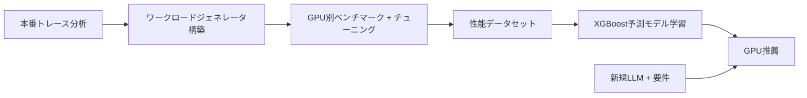
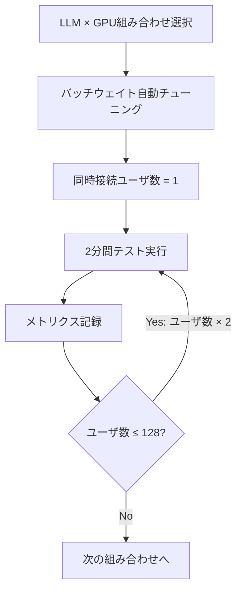

本記事は [https://arxiv.org/abs/2410.02425](https://arxiv.org/abs/2410.02425) の解説記事です。

## 論文概要（Abstract）

LLM推論サービスの性能は、利用するGPUハードウェアに大きく依存する。しかし、所与のパフォーマンス要件を満たすGPUタイプを事前に特定することは困難であり、多くの組織が試行錯誤を繰り返している。本論文で提案されるLLM-Pilotは、現実的なワークロードを用いてLLM推論サービスを複数のGPUタイプ上でベンチマークし、各GPU向けにサービス構成を自動チューニングした上で、未知のLLMに対してもコスト効率の高いGPUを推薦する予測モデルを構築するシステムである。

この記事は [Zenn記事: Azure OpenAI負荷分散の負荷テスト戦略：Locust×Azure Load Testingで本番品質を検証する](https://zenn.dev/0h_n0/articles/25e17663c0f245) の深掘りです。

## 情報源

- **arXiv ID**: 2410.02425
- **URL**: [https://arxiv.org/abs/2410.02425](https://arxiv.org/abs/2410.02425)
- **著者**: Małgorzata Łazuka (IBM Research / ETH Zurich), Andreea Anghel (IBM Research), Thomas Parnell (IBM Research)
- **発表年**: 2024
- **採択先**: SC '24（International Conference for High Performance Computing, Networking, Storage, and Analysis）
- **分野**: cs.DC, cs.CL, cs.LG
- **コード**: [github.com/fmperf-project/fmperf](https://github.com/fmperf-project/fmperf)、[github.com/IBM/LLM-performance-prediction](https://github.com/IBM/LLM-performance-prediction)

## 背景と動機（Background & Motivation）

LLM推論サービスを本番環境で運用する際、適切なGPUを選定することは重要な課題である。GPUのメモリ容量・演算性能・価格帯は多様であり、同じモデルであってもGPUタイプによってスループット・レイテンシ特性が大幅に異なる。

既存のアプローチには以下の問題がある。第一に、ベンチマークの際に各GPUプロファイルごとの構成チューニング（特にバッチサイズ）が行われず、不公平な比較になりやすい。第二に、テストに使用されるリクエスト分布が本番トレースの統計的特性を反映しておらず、パラメータ間の相関を無視した独立サンプリングでは、実際の性能と乖離した結果が得られる。第三に、新しいLLMが登場するたびに全GPU上でフルベンチマークを行うのは時間とコストの面で現実的ではない。

著者らはこれらの課題に対し、本番トレース分析に基づくワークロードジェネレータ、公平な構成チューニング、予測モデルによるGPU推薦という3つの要素を統合したLLM-Pilotを提案している。

## 主要な貢献（Key Contributions）

- **貢献1**: 本番トレースの統計的特性を保持しつつ、35倍高速に合成ワークロードを生成するノンパラメトリックジェネレータ
- **貢献2**: GPU間で公平な比較を実現するバッチウェイト自動チューニング手法
- **貢献3**: 未知のLLMに対して最適なGPUとポッド数を推薦するXGBoostベースの予測モデル。既存手法と比較して性能要件の充足率が33%向上し、コストが平均60%削減されると報告されている

## 技術的詳細（Technical Details）

### システムアーキテクチャ

LLM-Pilotは3つのフェーズからなるパイプラインで構成される。



**オフラインフェーズ**では、共有GPUクラスタの管理者がトレースを分析し、複数のLLM×GPU組み合わせでベンチマークを実行してデータセットを構築する。**オンラインフェーズ**では、ユーザが新しいLLMとレイテンシ要件を入力すると、予測モデルが最もコスト効率の良いGPU構成を推薦する。

### 本番トレース分析

著者らは内部TGISプラットフォームの17.3百万リクエスト（約2,500ユーザ、5.5ヶ月間、24のLLM、パラメータ数3B〜176B）を分析している（論文Section II-B）。ランダムフォレストによるパラメータ重要度分析の結果、以下の知見が得られたと報告されている：

1. **出力トークン数**が性能への影響が最も大きい
2. 次いで**入力トークン数**、**バッチサイズ**、サンプリングパラメータの順
3. バッチサイズと入出力トークン数の間に強いSpearman相関が存在

この分析結果は、ベンチマーク用ワークロードを設計する際にパラメータ間の相関を保持することの重要性を裏付けている。

### ワークロードジェネレータ

著者らが提案するジェネレータは、ノンパラメトリックな確率モデルに基づく（論文Section III-B）。

**アルゴリズム**:

1. 各リクエストパラメータ（入力トークン数、出力トークン数、バッチサイズ等）を64個のビンに分割。各ビンには概ね等しい数のリクエストが入るようにする（等頻度ビニング）
2. パラメータ間の**同時分布**をビンの組み合わせとして保持し、サンプリング時に相関構造を維持する
3. 入力テキストは、サンプリングされたトークン数に合わせてコーパスから切り出す

```python
from typing import Any
import numpy as np


class WorkloadGenerator:
    """LLM-Pilotのノンパラメトリックワークロードジェネレータ

    本番トレースの同時分布を等頻度ビニングで近似し、
    パラメータ間の相関を保持したまま合成ワークロードを生成する。
    """

    def __init__(self, n_bins: int = 64) -> None:
        self.n_bins = n_bins
        self.bin_edges: dict[str, np.ndarray] = {}
        self.joint_distribution: np.ndarray | None = None

    def fit(self, traces: dict[str, np.ndarray]) -> "WorkloadGenerator":
        """本番トレースから同時分布を学習する

        Args:
            traces: パラメータ名 -> 値配列のマッピング
        """
        binned: list[np.ndarray] = []
        for param_name, values in traces.items():
            edges = np.percentile(values, np.linspace(0, 100, self.n_bins + 1))
            self.bin_edges[param_name] = edges
            binned.append(np.digitize(values, edges[1:-1]))

        indices = np.column_stack(binned)
        self.joint_distribution = indices
        return self

    def sample(self, n_requests: int) -> list[dict[str, Any]]:
        """同時分布からn件のリクエストをサンプリングする"""
        assert self.joint_distribution is not None
        idx = np.random.choice(len(self.joint_distribution), size=n_requests)
        sampled_bins = self.joint_distribution[idx]

        requests: list[dict[str, Any]] = []
        for row in sampled_bins:
            req: dict[str, Any] = {}
            for i, param_name in enumerate(self.bin_edges):
                edges = self.bin_edges[param_name]
                lo, hi = edges[row[i]], edges[min(row[i] + 1, len(edges) - 1)]
                req[param_name] = np.random.uniform(lo, hi)
            requests.append(req)
        return requests
```

著者らの報告によると（論文Section IV-A）、このジェネレータは1,000リクエストのサンプリングに22msしかかからず、トレースからの直接読み込み（770ms）と比較して約35倍高速である。さらに、ジェネレータのサイズは1MB未満であるのに対し、元のトレースは1.6GBと報告されている。

**独立サンプリングとの比較**: Llama-2-13B / A100 80GBの構成で、パラメータを独立にサンプリングした場合、同時分布を保持した場合と比較してスループットが平均13%低下し、TTFT中央値が30%増加、ITL中央値は25%低下したと報告されている（論文Section IV-B）。これはパラメータ間の相関を無視したベンチマークが実際の性能を正確に反映しないことを示唆している。

### メトリクス定義

論文Section III-C3で以下の4つのメトリクスが定義されている：

| メトリクス | 定義 | 意味 |
|-----------|------|------|
| **TTFT** | 最初の出力トークンまでの中央値レイテンシ | キューイングとプロンプト処理を含む |
| **nTTFT** | TTFT / 入力トークン数 の中央値 | 入力長の影響を正規化 |
| **ITL** | 連続する出力トークン間の中央値レイテンシ（最初のトークンを除く） | デコーディング速度の指標 |
| **Throughput** | 実験中に生成された出力トークン総数 / 実験時間 | システム全体の処理能力 |

$$
\text{nTTFT} = \text{median}\left(\frac{\text{TTFT}_i}{n_{\text{input},i}}\right)
$$

ここで、$\text{TTFT}_i$ はリクエスト $i$ のTTFT、$n_{\text{input},i}$ はリクエスト $i$ の入力トークン数である。nTTFTはTTFTが入力長に強く依存する問題を緩和するために導入されたと述べられている。

### バッチウェイト自動チューニング

GPU間で公平にベンチマークを行うため、著者らはバイナリサーチによるバッチウェイトの自動チューニングを実施している（論文Section III-C2）。

各LLM×GPUプロファイルの組み合わせに対し、コーナーケースのバッチ（最大入力長 × 最大出力長のリクエストがバッチを埋め尽くすケース）でOOM（Out of Memory）が発生しない最大バッチウェイトをバイナリサーチで探索する。これにより、特定のGPUに有利なバッチサイズ設定を避け、各GPUが安全かつ最大限の能力を発揮する条件下で比較が行われる。

著者らの分析では（論文Section III-C2）、CPUコア数とメモリはバッチウェイトと比較して重要度が300倍以上低く、シンプルなルールで設定可能とされている。

### 負荷テスト実行

各LLM×GPUプロファイルの組み合わせに対し、同時接続ユーザ数を1, 2, 4, …, 128と段階的に増やしながら、各レベルで2分間のテストを実行する。テスト中にトークンの到着タイムスタンプを記録し、上記のメトリクスを算出する。



### GPU推薦モデル

性能予測と推薦にはXGBoostリグレッサが用いられている（論文Section III-D、概要は著者の要約に基づく）。

**特徴量**: LLMのパラメータ数、アーキテクチャ情報、GPUプロファイル（メモリ、演算性能）、同時接続ユーザ数

**工夫**:
- レイテンシ制限値の近傍のデータポイントに高い重みを付与するサンプルウェイト
- 同時接続ユーザ数に対する単調性制約（ユーザ数増加でレイテンシは単調非減少）
- Leave-one-LLM-outクロスバリデーションによるハイパーパラメータチューニング

**推薦ロジック**: 予測されたレイテンシが要件を満たすGPUプロファイルとポッド数の組み合わせのうち、最もコストが低いものを推薦する。コストにはAWSのオンデマンド価格が使用されている。

## 実装のポイント（Implementation）

LLM-Pilotの実装における注意点：

**ワークロードジェネレータの精度**: 等頻度ビニング（64ビン）は連続分布の近似精度とメモリ効率のバランスを取った選択である。ビン数を増やすと精度は上がるが、同時分布テーブルのサイズが指数的に増加する。

**バイナリサーチの安全マージン**: OOMを避けるため、バイナリサーチで見つけた最大バッチウェイトからさらに安全マージンを設ける必要がある。コーナーケースの定義が実際のワークロードと乖離していると、過度に保守的な設定になり得る。

**スケーリング特性**: Llama-2-13B / A100 80GBの構成で、ポッドあたりの同時接続ユーザ数を一定に保った場合、ポッド数を増やしてもポッドあたりスループットの相対標準偏差は最大5%（平均2%）に収まると報告されている（論文Section II-C）。これは、水平スケーリングの線形性を裏付ける。

**データセット構築コスト**: 10のLLM × 14のGPUプロファイル × 5のGPUタイプのデータセット構築に約8時間と見積もられている。

## Production Deployment Guide

### AWS実装パターン（コスト最適化重視）

LLM-Pilotのアプローチ（ベンチマーク → 予測 → 推薦）をAWS環境に適用する場合のアーキテクチャ構成を示す。

**コスト試算の注意事項**: 以下は2026年11月時点のAWS ap-northeast-1（東京）リージョン料金に基づく概算値です。実際のコストはトラフィックパターン、リージョン、バースト使用量により変動します。最新料金は [AWS料金計算ツール](https://calculator.aws/) で確認してください。

| 規模 | 月間リクエスト | 推奨構成 | 月額コスト | 主要サービス |
|------|--------------|---------|-----------|------------|
| **Small** | ~3,000 (100/日) | Serverless | $50-150 | Lambda + Bedrock + DynamoDB |
| **Medium** | ~30,000 (1,000/日) | Hybrid | $300-800 | Lambda + ECS Fargate + ElastiCache |
| **Large** | 300,000+ (10,000/日) | Container | $2,000-5,000 | EKS + Karpenter + EC2 Spot |

**Small構成の詳細** (月額$50-150):
- **Lambda**: 1GB RAM, 60秒タイムアウト ($20/月)
- **Bedrock**: Claude 3.5 Haiku, Prompt Caching有効 ($80/月)
- **DynamoDB**: On-Demand, ベンチマーク結果キャッシュ ($10/月)
- **CloudWatch**: 基本監視 ($5/月)
- **API Gateway**: REST API ($5/月)

**Medium構成の詳細** (月額$300-800):
- **Lambda**: イベント処理・ジョブディスパッチ ($50/月)
- **ECS Fargate**: 0.5 vCPU, 1GB RAM × 2タスク ($120/月)
- **Bedrock**: Claude 3.5 Sonnet, Batch API活用 ($400/月)
- **ElastiCache Redis**: cache.t3.micro, ベンチマーク結果キャッシュ ($15/月)
- **Application Load Balancer**: ($20/月)

**Large構成の詳細** (月額$2,000-5,000):
- **EKS**: コントロールプレーン ($72/月)
- **EC2 Spot Instances**: g5.xlarge × 2-4台 (平均$800/月)
- **Karpenter**: 自動スケーリング（追加コストなし）
- **Bedrock Batch**: 50%割引活用 ($2,000/月)
- **S3**: プロンプトキャッシュストレージ ($20/月)
- **CloudWatch + X-Ray**: 詳細監視 ($100/月)

**コスト削減テクニック**:
- Spot Instances使用で最大90%削減（EKS + Karpenter）
- Reserved Instances購入で最大72%削減（1年コミット）
- Bedrock Batch API使用で50%削減
- Prompt Caching有効化で30-90%削減
- アイドルタイムのAuto Scaling to Zero（Fargate/Lambda）

### Terraformインフラコード

**Small構成 (Serverless): Lambda + Bedrock + DynamoDB**

```hcl
module "vpc" {
  source  = "terraform-aws-modules/vpc/aws"
  version = "~> 5.0"
  name    = "llm-bench-vpc"
  cidr    = "10.0.0.0/16"
  azs     = ["ap-northeast-1a", "ap-northeast-1c"]
  private_subnets    = ["10.0.1.0/24", "10.0.2.0/24"]
  enable_nat_gateway = false
}

resource "aws_lambda_function" "llm_bench" {
  filename      = "lambda.zip"
  function_name = "llm-bench-handler"
  role          = aws_iam_role.lambda_bedrock.arn
  handler       = "index.handler"
  runtime       = "python3.12"
  timeout       = 60
  memory_size   = 1024
  environment {
    variables = {
      BEDROCK_MODEL_ID = "anthropic.claude-3-5-haiku-20241022-v1:0"
      DYNAMODB_TABLE   = aws_dynamodb_table.bench_cache.name
    }
  }
}

resource "aws_dynamodb_table" "bench_cache" {
  name         = "llm-bench-results-cache"
  billing_mode = "PAY_PER_REQUEST"
  hash_key     = "bench_key"
  attribute { name = "bench_key"; type = "S" }
  ttl { attribute_name = "expire_at"; enabled = true }
}
```

IAMロールはLambda実行ロールにBedrock InvokeModel権限のみを付与し、最小権限の原則に従う。CloudWatchアラームでLambda実行時間の異常（コスト急増）を検知する。

**Large構成 (Container)**: EKS + Karpenter + Spot Instancesの構成では、`terraform-aws-modules/eks/aws` (v20.x) でEKSクラスタを構築し、KarpenterのNodePoolでSpot GPU Instances（g5.xlarge/g5.2xlarge）を自動管理する。Secrets ManagerでBedrock設定を管理し、AWS Budgetsで月額$5,000上限のアラートを設定する。

### 運用・監視設定

**CloudWatch Logs Insights クエリ**:

```sql
-- ベンチマーク実行コスト: 1時間あたりのトークン使用量
fields @timestamp, model_id, input_tokens, output_tokens
| stats sum(input_tokens + output_tokens) as total_tokens by bin(1h)
| filter total_tokens > 100000

-- レイテンシ分析: P95, P99
fields @timestamp, duration_ms
| stats pct(duration_ms, 95) as p95, pct(duration_ms, 99) as p99 by bin(5m)
```

**CloudWatch アラーム設定（Python）**:

```python
import boto3

cloudwatch = boto3.client("cloudwatch")

cloudwatch.put_metric_alarm(
    AlarmName="bedrock-token-spike",
    ComparisonOperator="GreaterThanThreshold",
    EvaluationPeriods=1,
    MetricName="TokenUsage",
    Namespace="AWS/Bedrock",
    Period=3600,
    Statistic="Sum",
    Threshold=500000,
    ActionsEnabled=True,
    AlarmActions=["arn:aws:sns:ap-northeast-1:123456789:cost-alerts"],
    AlarmDescription="Bedrockトークン使用量異常（コスト急増）",
)

cloudwatch.put_metric_alarm(
    AlarmName="lambda-duration-spike",
    ComparisonOperator="GreaterThanThreshold",
    EvaluationPeriods=2,
    MetricName="Duration",
    Namespace="AWS/Lambda",
    Period=300,
    Statistic="Average",
    Threshold=30000,
    AlarmDescription="Lambda実行時間異常",
)
```

**X-Ray トレーシング**: `aws_xray_sdk.core` の `patch_all()` でboto3を自動計装し、`xray_recorder.capture` デコレータでベンチマーク実行をトレースする。アノテーションにmodel_id/gpu_profileを、メタデータにttft_p50/throughputを記録することで、性能劣化の原因特定が容易になる。

**Cost Explorer自動レポート**: `boto3.client("ce").get_cost_and_usage()` で日次コストをサービス別・使用量タイプ別に取得し、$100/日超過時にSNS通知を送信する。

### コスト最適化チェックリスト

**アーキテクチャ選択（トラフィック量で判断）**:
- [ ] ~100 req/日 → Lambda + Bedrock (Serverless) - $50-150/月
- [ ] ~1000 req/日 → ECS Fargate + Bedrock (Hybrid) - $300-800/月
- [ ] 10000+ req/日 → EKS + Spot Instances (Container) - $2,000-5,000/月

**リソース最適化**:
- [ ] EC2: Spot Instances優先（最大90%削減、Karpenter自動管理）
- [ ] Reserved Instances: 1年コミットで72%削減（予測可能な負荷）
- [ ] Savings Plans: Compute Savings Plans検討（柔軟性高）
- [ ] Lambda: メモリサイズ最適化（CloudWatch Insights分析）
- [ ] ECS/EKS: アイドルタイムのスケールダウン（夜間0台）

**LLMコスト削減**:
- [ ] Bedrock Batch API: 50%割引（非リアルタイム処理）
- [ ] Prompt Caching: 30-90%削減（システムプロンプト固定）
- [ ] モデル選択: 開発/テストにHaiku ($0.25/MTok)、本番複雑タスクにSonnet ($3/MTok)
- [ ] トークン数制限: max_tokens設定で過剰生成防止

**監視・アラート**:
- [ ] AWS Budgets: 月額予算設定（80%警告）
- [ ] CloudWatch: トークン使用量スパイク検知
- [ ] Cost Anomaly Detection: 自動異常検知

**リソース管理**:
- [ ] 未使用リソース削除: Trusted Advisor活用
- [ ] タグ戦略: 環境別・プロジェクト別でコスト可視化
- [ ] ライフサイクルポリシー: S3キャッシュ30日自動削除

## 実験結果（Results）

著者らは10のLLM、14のGPUプロファイル（5種類のGPUタイプ、シングルGPUまたは2/4 GPUのテンソル並列）で評価を実施したと報告している。

**GPU推薦の評価条件**（論文の要約に基づく）:
- 同時接続ユーザ数: 200
- nTTFT制限: 100ms
- ITL制限: 50ms
- 評価方法: Nested cross-validation over LLMs (Leave-one-LLM-out)

| 手法 | 成功率 | 平均コスト超過 |
|------|--------|--------------|
| **LLM-Pilot** | 80% | <20% |
| Static 4-pod | 50% | — |
| PARIS | 低い（詳細は論文参照） | — |
| Selecta | 低い（詳細は論文参照） | — |

著者らは、LLM-Pilotが既存手法と比較して性能要件を33%多く満たし、コストを平均60%削減すると報告している。静的な4ポッドポリシーが50%の成功率であるのに対し、LLM-Pilotは80%の成功率を達成したとされる。

## 実運用への応用（Practical Applications）

LLM-Pilotのアプローチは、Azure OpenAIの負荷テスト戦略と以下の点で関連がある：

**ワークロードの現実性**: Zenn記事で述べられているLocustによる負荷テストでは、テストプロンプトの設計がテスト精度に直結する。LLM-Pilotの知見——パラメータ間の相関を保持した同時分布サンプリング——は、より現実的なテストシナリオ設計に活用できる。独立サンプリングでは30%もTTFTが乖離するという報告は、テストデータ設計の重要性を裏付ける。

**メトリクス定義の標準化**: LLM-Pilotで定義されたTTFT/nTTFT/ITL/Throughputの4メトリクスは、Azure OpenAIのベンチマークツール（azure-openai-benchmark）で測定されるTTFT/TBT/TPMと対応関係にある。nTTFTの導入は、入力長が大きく異なるリクエスト混在環境でのベンチマークの公平性を高める。

**GPU/デプロイメント選定への応用**: Azure OpenAIでPTU（Provisioned Throughput）とPay-as-you-goの選択や、PTUのユニット数決定は、LLM-Pilotのアプローチと類似の問題構造を持つ。ベンチマーク → 予測モデル → 推薦という流れは、Azure環境でのキャパシティプランニングにも応用可能である。

## 関連研究（Related Work）

- **PARIS** (Patel et al., 2024): 推論サービスのレイテンシモデリングによるGPU割当最適化。LLM-Pilotはこれを包含し、ワークロードの現実性とチューニングの公平性で改善を主張している
- **Selecta** (Kang et al., 2017): 分析ワークロード向けのリソース選定フレームワーク。LLM特有のメトリクス（TTFT, ITL）には対応していない
- **S³** (Jin et al., 2023): 出力長予測によるLLMスケジューリング。LLM-Pilotのワークロードジェネレータ設計に影響を与えている

## まとめと今後の展望

LLM-Pilotは、本番トレースの統計的特性を保持するワークロードジェネレータ、公平なGPU間ベンチマーク、XGBoostベースのGPU推薦モデルを統合したシステムであり、既存手法と比較してコスト60%削減と性能要件充足率33%向上を達成したと報告されている。

著者らは今後の方向性として、マルチテナント環境への拡張——複数ユーザが同一ハードウェアを共有するケース——を挙げている。LLM推論サービスの需要が増大する中で、体系的なベンチマークとGPU推薦の重要性は今後も高まると考えられる。

## 参考文献

- **arXiv**: [https://arxiv.org/abs/2410.02425](https://arxiv.org/abs/2410.02425)
- **Benchmarking Tool (fmperf)**: [https://github.com/fmperf-project/fmperf](https://github.com/fmperf-project/fmperf)
- **Performance Prediction Dataset**: [https://github.com/IBM/LLM-performance-prediction](https://github.com/IBM/LLM-performance-prediction)
- **Related Zenn article**: [https://zenn.dev/0h_n0/articles/25e17663c0f245](https://zenn.dev/0h_n0/articles/25e17663c0f245)
