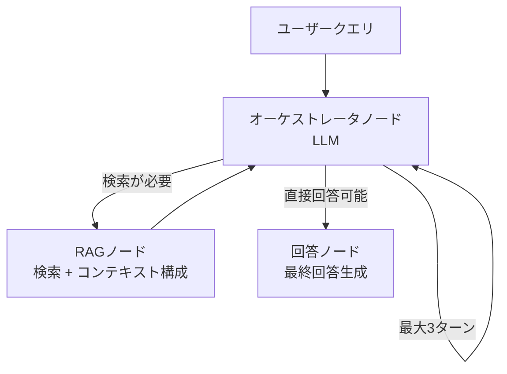

## 論文概要（Abstract）

本記事は [https://arxiv.org/abs/2601.07711](https://arxiv.org/abs/2601.07711) の解説記事です。

Ferrazzi et al. は、Retrieval-Augmented Generation（RAG）の3つのアプローチ — Naive RAG、Enhanced RAG、Agentic RAG — を体系的に比較した実験論文を発表した。基本的なRAGパイプラインが抱える4つの弱点（意図判定の欠如、クエリと文書の不一致、検索結果の質、生成コスト）に対し、Enhanced RAGは専用モジュール（セマンティックルーター、HyDE、クロスエンコーダ再順位付け）で対処し、Agentic RAGはLLMがオーケストレータとして検索・生成の各ステップを自律的に制御する。4つのデータセットでの評価結果として、どちらのアプローチも一方的に優れているわけではなく、ドメインやタスク特性に応じた選択が必要であると著者らは報告している。

この記事は [Zenn記事: Gemini 3.6 FlashでAgentic RAG検索ルーティングを実装する](https://zenn.dev/0h_n0/articles/74675f3607b023) の深掘りです。

## 情報源

- **arXiv ID**: 2601.07711
- **URL**: [https://arxiv.org/abs/2601.07711](https://arxiv.org/abs/2601.07711)
- **著者**: Pietro Ferrazzi（Fondazione Bruno Kessler / University of Padova）, Milica Cvjeticanin, Alessio Piraccini, Davide Giannuzzi
- **発表年**: 2025（v2: 2026年4月更新）、LREC2026 Industry Day投稿
- **分野**: cs.CL, cs.IR

## 背景と動機（Background & Motivation）

RAGは外部知識ベースから関連文書を検索し、LLMの生成に組み込むことで幻覚を抑制する手法として広く採用されている。しかし、基本的なNaive RAGパイプラインには以下の4つの弱点がある。

1. **意図判定の欠如**: 検索不要なクエリ（挨拶、雑談）にも検索を実行してしまう
2. **クエリと文書の不一致**: ユーザークエリがそのまま検索に適しているとは限らない
3. **検索結果の質**: 上位k件の文書が必ずしも最も関連性が高いわけではない
4. **生成コスト**: LLMの呼び出し回数とトークン消費量がコストに直結する

これらの弱点に対し、Enhanced RAGは各弱点に対応する専用モジュール（ルーター、クエリリライタ、リランカー）を静的パイプラインとして構成する。一方、Agentic RAGはLLMエージェントがどのツールをいつ使うかを動的に決定する。著者らは、両アプローチの定量的な比較がほとんど行われていないことを指摘し、4つの評価次元で体系的に比較している。

## 主要な貢献（Key Contributions）

- **貢献1**: RAGの4つの弱点それぞれについて、Enhanced RAGとAgentic RAGの対処法を整理した比較フレームワークの提案（論文Table 1）
- **貢献2**: 4つの公開データセット（NQ、FiQA、CQADupStack-EN、FEVER）を用いた多面的な実験評価
- **貢献3**: トークン消費量・処理時間を含むコスト分析により、Agentic RAGが平均3.3倍の入力トークンを消費することを定量的に示した

## 技術的詳細（Technical Details）

### 比較フレームワーク

著者らはNaive RAGの4つの弱点に対応する「次元」を設定し、Enhanced RAGとAgentic RAGそれぞれの対処法を以下のように整理している（論文Table 1より）。

| 次元 | Naive RAG | Enhanced RAG | Agentic RAG |
|------|-----------|-------------|-------------|
| 意図判定 | 全クエリを検索 | セマンティックルーター | エージェントが判断 |
| クエリ書換 | なし | HyDE（仮説文書生成） | エージェントが書換 |
| 文書精選 | Top-k取得のみ | クロスエンコーダ再順位付け | 再検索を自律判断 |
| LLM選択 | 固定モデル | 固定モデル | 固定モデル |

### Enhanced RAGの構成

Enhanced RAGパイプラインは以下の3つのモジュールで構成される。

**セマンティックルーター**: OpenAIの`text-embedding-3-small`で、有効クエリと無効クエリの例を埋め込みベクトルとして登録し、新規クエリの意図を分類する。ルールベースのキーワードマッチより柔軟だが、例示データの収集が必要になる。

**HyDE（Hypothetical Document Embeddings）**: クエリに対してgpt-4oで仮説的な回答文書を生成し、その埋め込みベクトルで検索する。元のクエリよりも検索対象の文書に近い表現が得られるため、語彙の不一致問題を緩和できる。

**クロスエンコーダ再順位付け**: ELECTRA系のクロスエンコーダモデルで、検索上位文書をクエリとの関連度でスコアリングし直す。bi-encoderの近似的な類似度計算に比べ、クエリ-文書ペアを同時にエンコードするため精度が高い。

### Agentic RAGの構成

Agentic RAGはPocketFlowフレームワーク上に構築され、以下の3つのノードで構成される。



オーケストレータノードのLLMが、クエリに対して「検索が必要か」「どのようにクエリを書き換えるか」「検索結果は十分か」を逐次判断する。最大3ターンまでの反復が許可されている。著者らによると、エージェントは約10%のケースで再検索を実行し、再検索時の文書の53%は前回と同一であったと報告されている。

### 評価指標

各次元で異なる指標を用いている。

- **意図判定**: Recall（検索すべきクエリを正しく検索に回した割合）とF1スコア
- **クエリ書換・文書精選**: NDCG@10（正規化割引累積利得）

$$
\text{NDCG@}k = \frac{\text{DCG@}k}{\text{IDCG@}k}, \quad \text{DCG@}k = \sum_{i=1}^{k} \frac{2^{rel_i} - 1}{\log_2(i + 1)}
$$

ここで $rel_i$ は位置 $i$ の文書の関連度、$\text{IDCG@}k$ は理想的な並び順での値である。

- **LLM選択**: FiQAではSelene-70Bによる二値分類、CQADupStack-ENではペアワイズ比較を使用。人間評価との一致率はCQADupStack-ENの312ペアで65.4%。

## 実装のポイント（Implementation）

この論文の知見を実装に活かす際の注意点を整理する。

**セマンティックルーターの設計**: Enhanced RAGの意図判定はセマンティックルーターに依存するため、有効/無効クエリの例示データの品質が性能を左右する。著者らの実験では各データセットに対し500件ずつの有効/無効クエリを用意している。実運用では、ルーティングログを蓄積して例示データを継続的に改善する運用設計が重要になる。

**HyDEのコスト**: クエリごとにLLM呼び出しが1回追加される。著者らの結果（論文Table 4）ではNDCG@10が平均2.5ポイント向上しているが、レイテンシとコストの増加とのトレードオフがある。

**再順位付けのボトルネック**: クロスエンコーダはクエリ-文書ペアごとにフォワードパスが必要なため、候補文書数に線形にスケールする。著者らはNQとFEVER（文書数が数百万件）では計算量の問題から再順位付け実験を省略している。

**エージェントのターン数制限**: Agentic RAGのターン数を3に制限しているが、これを増やすとトークン消費量がさらに増加する。ターン数の上限設定はコスト管理の重要なパラメータである。

## Production Deployment Guide

### AWS実装パターン（コスト最適化重視）

本論文の知見を踏まえ、Enhanced RAGとAgentic RAGのハイブリッド構成をAWS上に構築する場合のパターンを示す。

**トラフィック量別の推奨構成**:

| 規模 | 月間リクエスト | 推奨構成 | 月額コスト | 主要サービス |
|------|--------------|---------|-----------|------------|
| **Small** | ~3,000 (100/日) | Serverless | $50-150 | Lambda + Bedrock + OpenSearch Serverless |
| **Medium** | ~30,000 (1,000/日) | Hybrid | $300-800 | Lambda + ECS Fargate + ElastiCache |
| **Large** | 300,000+ (10,000/日) | Container | $2,000-5,000 | EKS + Karpenter + EC2 Spot |

**Small構成の詳細**（月額$50-150）:
- **Lambda**: 1GB RAM, 60秒タイムアウト（$20/月）
- **Bedrock**: Claude 3.5 Haiku、ルーティング+生成（$80/月）
- **OpenSearch Serverless**: ベクトル検索用（$25/月）
- **DynamoDB**: セマンティックルーターの例示データ保存（$5/月）

**Medium構成の詳細**（月額$300-800）:
- **ECS Fargate**: クロスエンコーダ再順位付け（0.5 vCPU, 2GB RAM × 2タスク、$140/月）
- **Bedrock**: Claude 3.5 Sonnet、Batch API活用（$400/月）
- **ElastiCache Redis**: HyDE結果キャッシュ（cache.t3.micro、$15/月）
- **OpenSearch**: マネージド型、BM25+ベクトルハイブリッド検索（$150/月）

**コスト試算の注意事項**:
- 上記は2026年11月時点のAWS ap-northeast-1（東京）リージョン料金に基づく概算値です
- 論文の知見（Agentic RAGは3.3倍の入力トークン消費）を踏まえ、ルーティングでAgentic RAGの使用を絞る構成が推奨されます
- 最新料金は [AWS料金計算ツール](https://calculator.aws/) で確認してください

### Terraformインフラコード

**Small構成（Serverless）: Lambda + Bedrock + OpenSearch Serverless**

```hcl
module "vpc" {
  source  = "terraform-aws-modules/vpc/aws"
  version = "~> 5.0"

  name = "rag-routing-vpc"
  cidr = "10.0.0.0/16"
  azs  = ["ap-northeast-1a", "ap-northeast-1c"]
  private_subnets = ["10.0.1.0/24", "10.0.2.0/24"]

  enable_nat_gateway   = false
  enable_dns_hostnames = true
}

resource "aws_iam_role" "lambda_rag" {
  name = "lambda-rag-routing-role"

  assume_role_policy = jsonencode({
    Version = "2012-10-17"
    Statement = [{
      Action    = "sts:AssumeRole"
      Effect    = "Allow"
      Principal = { Service = "lambda.amazonaws.com" }
    }]
  })
}

resource "aws_iam_role_policy" "bedrock_invoke" {
  role = aws_iam_role.lambda_rag.id
  policy = jsonencode({
    Version = "2012-10-17"
    Statement = [{
      Effect   = "Allow"
      Action   = ["bedrock:InvokeModel", "bedrock:InvokeModelWithResponseStream"]
      Resource = "arn:aws:bedrock:ap-northeast-1::foundation-model/anthropic.claude-3-5-haiku*"
    }]
  })
}

resource "aws_lambda_function" "rag_router" {
  filename      = "lambda.zip"
  function_name = "rag-routing-handler"
  role          = aws_iam_role.lambda_rag.arn
  handler       = "index.handler"
  runtime       = "python3.12"
  timeout       = 60
  memory_size   = 1024

  environment {
    variables = {
      BEDROCK_MODEL_ID    = "anthropic.claude-3-5-haiku-20241022-v1:0"
      OPENSEARCH_ENDPOINT = aws_opensearchserverless_collection.rag.collection_endpoint
      ROUTING_MODE        = "enhanced"
    }
  }
}

resource "aws_dynamodb_table" "router_examples" {
  name         = "rag-router-examples"
  billing_mode = "PAY_PER_REQUEST"
  hash_key     = "intent_category"
  range_key    = "example_id"

  attribute {
    name = "intent_category"
    type = "S"
  }
  attribute {
    name = "example_id"
    type = "S"
  }
}

resource "aws_cloudwatch_metric_alarm" "lambda_cost" {
  alarm_name          = "rag-router-cost-spike"
  comparison_operator = "GreaterThanThreshold"
  evaluation_periods  = 1
  metric_name         = "Duration"
  namespace           = "AWS/Lambda"
  period              = 3600
  statistic           = "Sum"
  threshold           = 100000
  alarm_description   = "Lambda実行時間異常（コスト急増の可能性）"
  dimensions = {
    FunctionName = aws_lambda_function.rag_router.function_name
  }
}
```

**Large構成（Container）: EKS + Karpenter + Spot Instances**

```hcl
module "eks" {
  source  = "terraform-aws-modules/eks/aws"
  version = "~> 20.0"

  cluster_name    = "rag-routing-cluster"
  cluster_version = "1.31"
  vpc_id          = module.vpc.vpc_id
  subnet_ids      = module.vpc.private_subnets

  cluster_endpoint_public_access = true
  enable_cluster_creator_admin_permissions = true
}

resource "kubectl_manifest" "karpenter_provisioner" {
  yaml_body = <<-YAML
    apiVersion: karpenter.sh/v1alpha5
    kind: Provisioner
    metadata:
      name: rag-spot-provisioner
    spec:
      requirements:
        - key: karpenter.sh/capacity-type
          operator: In
          values: ["spot"]
        - key: node.kubernetes.io/instance-type
          operator: In
          values: ["g5.xlarge", "g5.2xlarge"]
      limits:
        resources:
          cpu: "32"
          memory: "128Gi"
      ttlSecondsAfterEmpty: 30
  YAML
}

resource "aws_budgets_budget" "rag_monthly" {
  name         = "rag-routing-monthly"
  budget_type  = "COST"
  limit_amount = "5000"
  limit_unit   = "USD"
  time_unit    = "MONTHLY"

  notification {
    comparison_operator        = "GREATER_THAN"
    threshold                  = 80
    threshold_type             = "PERCENTAGE"
    notification_type          = "ACTUAL"
    subscriber_email_addresses = ["ops@example.com"]
  }
}
```

### セキュリティベストプラクティス

- **IAMロール**: 最小権限の原則。Bedrock呼び出し権限はモデル単位で制限
- **ネットワーク**: OpenSearch ServerlessはVPCエンドポイント経由でアクセス
- **シークレット管理**: API鍵はSecrets Managerに保存、環境変数ハードコード禁止
- **暗号化**: S3/DynamoDB/OpenSearchすべてKMS暗号化
- **監査**: CloudTrail全リージョン有効化

### 運用・監視設定

**CloudWatch Logs Insights クエリ**:

```sql
-- ルーティング判定別のトークン使用量
fields @timestamp, routing_mode, input_tokens, output_tokens
| stats sum(input_tokens) as total_in, sum(output_tokens) as total_out by routing_mode, bin(1h)
| filter total_in > 100000

-- レイテンシ分析（ルーティング層とRAG層を分離）
fields @timestamp, routing_latency_ms, rag_latency_ms, total_latency_ms
| stats pct(total_latency_ms, 95) as p95, pct(total_latency_ms, 99) as p99 by bin(5m)
```

**CloudWatch アラーム（コスト重視）**:

```python
import boto3

cloudwatch = boto3.client('cloudwatch')

cloudwatch.put_metric_alarm(
    AlarmName='bedrock-rag-token-spike',
    ComparisonOperator='GreaterThanThreshold',
    EvaluationPeriods=1,
    MetricName='TokenUsage',
    Namespace='AWS/Bedrock',
    Period=3600,
    Statistic='Sum',
    Threshold=500000,
    ActionsEnabled=True,
    AlarmActions=['arn:aws:sns:ap-northeast-1:123456789:cost-alerts'],
    AlarmDescription='Bedrockトークン使用量異常（Agentic RAGのトークン膨張の可能性）'
)
```

**X-Ray トレーシング設定**:

```python
from aws_xray_sdk.core import xray_recorder, patch_all

patch_all()

@xray_recorder.capture('rag_routing')
def route_and_retrieve(query: str) -> dict:
    xray_recorder.put_annotation('routing_mode', 'enhanced')
    route_result = router.route(query)
    xray_recorder.put_annotation('intent', route_result.intent.value)
    xray_recorder.put_metadata('input_tokens', route_result.token_usage)
    results = strategy.search(route_result.rewritten_query)
    return results
```

### コスト最適化チェックリスト

**アーキテクチャ選択（トラフィック量で判断）**:
- [ ] ~100 req/日 → Lambda + Bedrock（Serverless）$50-150/月
- [ ] ~1,000 req/日 → ECS Fargate + Bedrock（Hybrid）$300-800/月
- [ ] 10,000+ req/日 → EKS + Spot Instances（Container）$2,000-5,000/月

**リソース最適化**:
- [ ] Spot Instances使用で最大90%削減（Karpenter自動管理）
- [ ] Reserved Instances: 1年コミットで最大72%削減
- [ ] Lambda: メモリサイズ最適化（CloudWatch Insights分析）
- [ ] ECS/EKS: アイドルタイムのスケールダウン（夜間0台）
- [ ] OpenSearch Serverless: OCU最小設定

**論文知見に基づくRAGコスト削減**:
- [ ] ルーティング層導入: Agentic RAGの3.3倍トークン消費を回避
- [ ] Enhanced RAGをデフォルト、複雑クエリのみAgentic RAGにフォールバック
- [ ] HyDEキャッシュ: 類似クエリの仮説文書を再利用
- [ ] 再順位付け候補数の制限: Top-20以下に絞る
- [ ] エージェントターン数上限: 3ターン以下に設定

**監視・アラート（コスト異常の即時検知）**:
- [ ] AWS Budgets: 月額予算設定（80%で警告、100%でアラート）
- [ ] CloudWatch: ルーティング判定別トークン使用量監視
- [ ] Cost Anomaly Detection: 自動異常検知
- [ ] 日次コストレポート: SNS/Slackへ自動送信

## 実験結果（Results）

### 意図判定（Intent Handling）

著者らは各データセットで有効クエリ500件・無効クエリ500件を用意し、ルーティング精度を評価している（論文Table 3より）。

| 設定 | FiQA F1 | FEVER F1 | CQA-EN F1 |
|------|---------|----------|-----------|
| Naive RAG | 66.7 | 66.7 | 66.7 |
| Enhanced RAG | 95.7 | 87.9 | 96.6 |
| Agentic RAG | 98.8 | 64.6 | 99.8 |

Naive RAGはすべてのクエリを検索に回すためRecallは100%だがF1は66.7%に留まる。Enhanced RAGのセマンティックルーターは全データセットで安定した性能を示している。Agentic RAGはFiQAとCQADupStack-ENで高いF1を達成しているが、FEVERでは64.6%と大幅に低下している。著者らはこの差について、FEVERの事実検証クエリがエージェントにとって「検索すべきか直接回答すべきか」の判断が難しいドメインであると分析している。

### クエリ書換（Query Rewriting）

NDCG@10での検索精度比較（論文Table 4より）:

| 設定 | FiQA | NQ | FEVER | CQA-EN | 平均 |
|------|------|-----|-------|--------|------|
| Naive RAG | 45.3 | 43.7 | 66.2 | 45.8 | 50.3 |
| Enhanced RAG (HyDE) | 43.5 | 43.9 | 81.1 | 42.8 | 52.8 |
| Agentic RAG | 43.2 | 51.7 | 83.1 | 44.3 | 55.6 |

Agentic RAGはNQで+8.0ポイント、FEVERで+16.9ポイントとNaive RAGに対して大きな改善を示しているが、FiQAとCQA-ENではほぼ同等かわずかに低下している。Enhanced RAGのHyDEはFEVERで+14.9ポイントの改善を示す一方、FiQAでは-1.8ポイント低下している。

### 文書精選（Document Refinement）

FiQAとCQA-ENでの再順位付け評価（論文Table 5より）:

| 設定 | FiQA | CQA-EN | 平均 |
|------|------|--------|------|
| Naive RAG | 45.0 | 46.0 | 45.5 |
| Enhanced（書換なし） | 49.0 | 47.0 | 48.0 |
| Enhanced（書換あり） | 51.0 | 48.0 | 49.5 |
| Agentic RAG | 43.4 | 44.4 | 43.9 |

クロスエンコーダ再順位付けを用いたEnhanced RAGが最も高い精度を示している。Agentic RAGの再検索アプローチはNaive RAGよりも低い結果となった。著者らは、エージェントが再検索を実行した約10%のケースで文書の53%が前回と重複しており、再順位付けほど効果的ではないと分析している。

### コスト分析

著者らは、Agentic RAGがEnhanced RAGと比較して平均3.3倍の入力トークンと1.9倍の出力トークンを消費し、処理時間は1.5倍であると報告している。データセット別ではFiQAで入力トークン2.7倍・処理時間1.5倍、CQADupStack-ENで入力トークン3.6倍・処理時間1.4倍であった。コスト面では最大3.6倍のコスト増加になるとしている。

実験環境として、著者らはpgvectorにt3.largeインスタンス（$0.09/時間）、バックエンドにt2.mediumインスタンス（$0.05/時間）、オープンソースLLMに8×A40 GPUクラスタ（AWS換算でg4ad.8xlarge、$1.9/時間）を使用している。

## 実運用への応用（Practical Applications）

本論文の知見はZenn記事で紹介されている検索ルーティングの設計に直接関連する。

**ハイブリッド構成の推奨**: 著者らの結果は、Enhanced RAGとAgentic RAGの使い分けがコスト効率の観点で重要であることを示している。Zenn記事で実装されているLLMベースのルーターは、まずEnhanced RAGパイプラインにクエリを振り分け、低確信度の場合のみAgentic RAGにフォールバックする構成が合理的である。

**再順位付けの追加**: 著者らは結論部で「Agentic RAGパイプラインに明示的な再順位付けステップを追加すること」を推奨している。Zenn記事のハイブリッド検索（RRF）に加え、クロスエンコーダ再順位付けを組み合わせることで、さらなる精度向上が期待できる。

**コスト管理**: Agentic RAGの3.3倍のトークン消費は、本番環境では無視できないコスト要因である。ルーティングで不要なAgentic RAG呼び出しを削減することが、コスト最適化の中核となる。

## 関連研究（Related Work）

- **Adaptive-RAG (Jeong et al., 2024)**: クエリの複雑度に応じて、検索なし・単一ステップ検索・マルチステップ推論を切り替えるアプローチ。本論文のEnhanced RAGの意図判定と類似するが、3段階の粒度で分類する点が異なる。
- **RAGRouter-Bench (arXiv: 2604.03455)**: 7,727クエリのベンチマークで軽量分類器によるルーティングを評価。93.2%の精度で28.1%のトークン削減を達成しており、本論文のEnhanced RAGアプローチの有効性を裏付ける結果である。
- **CRAG (Corrective RAG, Yan et al., 2024)**: 検索結果の品質を評価し、不十分な場合にウェブ検索にフォールバックする手法。本論文のAgentic RAGの再検索メカニズムと関連する。
- **Self-RAG (Asai et al., 2024)**: LLM自身が検索の必要性を判断し、検索結果の関連性を反省的に評価する手法。Agentic RAGの自律判断メカニズムの先行研究に位置づけられる。

## まとめと今後の展望

本論文は、Enhanced RAGとAgentic RAGのどちらが優れているかという問いに対し、「ドメインとタスク特性に依存する」という実証的な回答を提供している。構造化されたクエリ分布を持つドメインではAgentic RAGが有効だが、ノイズの多いドメインではEnhanced RAGのルーターがより安定している。コスト面ではAgentic RAGが3.3倍の入力トークンを消費するため、ルーティングによる使い分けが実用上重要である。

今後の研究方向として、著者らはAgentic RAGへの再順位付けモジュールの統合、文書の要約・リパッキングの評価、マルチツールエージェントの比較を挙げている。

## 参考文献

- **arXiv**: [https://arxiv.org/abs/2601.07711](https://arxiv.org/abs/2601.07711)
- **Related**: Adaptive-RAG ([Jeong et al., 2024](https://arxiv.org/abs/2403.14403))
- **Related**: RAGRouter-Bench ([arXiv: 2604.03455](https://arxiv.org/abs/2604.03455))
- **Related**: Self-RAG ([Asai et al., 2024](https://arxiv.org/abs/2310.11511))
- **Related Zenn article**: [Gemini 3.6 FlashでAgentic RAG検索ルーティングを実装する](https://zenn.dev/0h_n0/articles/74675f3607b023)
