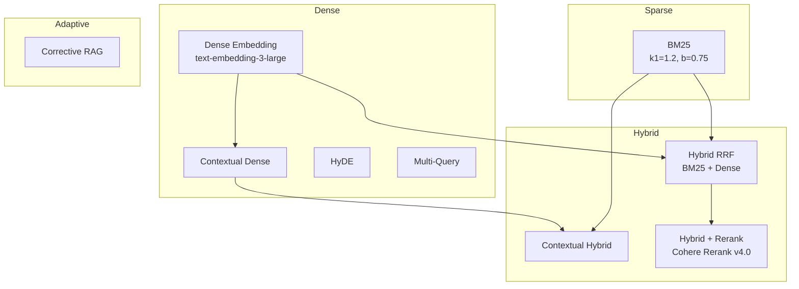

## 論文概要（Abstract）

本記事は [https://arxiv.org/abs/2604.01733](https://arxiv.org/abs/2604.01733) の解説記事です。

Akarsu, Karaman, Mierbach（2026）は、テキストとテーブルが混在する金融文書を対象に、BM25・Dense Retrieval・ハイブリッド検索（RRF）・クロスエンコーダリランキング・HyDE・Multi-Query・Contextual Retrieval・CRAGなど計10種の検索戦略を、23,088クエリ・7,318文書のベンチマーク（T2-RAGBench）で系統的に比較した論文である。著者らは、ハイブリッド検索＋クロスエンコーダリランキングがRecall@5で0.816・MRR@3で0.605に達し、全単一手法を大幅に上回ると報告している。また、金融ドメインではBM25が最先端のDense Retrievalを全指標で上回るという結果も示されている。

この記事は [Zenn記事: Gemini 3.6 FlashでAgentic RAG検索ルーティングを実装する](https://zenn.dev/0h_n0/articles/74675f3607b023) の深掘りです。

## 情報源

- **arXiv ID**: 2604.01733
- **URL**: [https://arxiv.org/abs/2604.01733](https://arxiv.org/abs/2604.01733)
- **著者**: Meftun Akarsu, Recep Kaan Karaman, Christopher Mierbach
- **発表年**: 2026
- **分野**: cs.IR（情報検索）
- **コード**: [https://doi.org/10.5281/zenodo.19382814](https://doi.org/10.5281/zenodo.19382814)

## 背景と動機（Background & Motivation）

RAG（Retrieval-Augmented Generation）の回答品質は検索（Retrieval）の質に大きく依存するが、検索手法の体系的な比較研究はこれまで十分に行われてこなかった。特にテキストとテーブルが混在する文書（SEC提出書類、年次報告書など）では、セマンティック検索が正確な数値を見逃し、キーワード検索が言い換え表現を取りこぼすという二律背反が生じる。

既存のベンチマーク（BEIR、KILT、RAGBench等）はテキスト文書に特化しており、テーブルを含む混在文書での検索比較が欠落していた。著者らはこのギャップを埋めるため、金融QAデータセットT2-RAGBenchを用いた10手法の横断的ベンチマークを実施した。

## 主要な貢献（Key Contributions）

- **貢献1**: スパース検索・密検索・ハイブリッド融合・リランキング・クエリ拡張・インデックス拡張・適応的検索の計10手法を、同一データセット・同一条件で比較した初めてのベンチマーク
- **貢献2**: Recall@k、MRR、nDCG、MAPの検索指標に加え、Number Matchによる生成品質評価、paired bootstrapによる統計的有意性検定（B=10,000、Bonferroni補正）を組み合わせた多面的評価
- **貢献3**: RRFと凸結合のフュージョン手法比較、リランカーの候補プールサイズのアブレーション実験
- **貢献4**: 実務向けの5段階意思決定フレームワークの提案

## 技術的詳細（Technical Details）

### 比較された検索手法

著者らが比較した10種の検索手法は以下のとおりである。



### BM25（Okapi BM25）

BM25のスコア計算式は以下のとおりである。

$$
\text{BM25}(q, d) = \sum_{t \in q} \text{IDF}(t) \cdot \frac{f(t, d) \cdot (k_1 + 1)}{f(t, d) + k_1 \cdot \left(1 - b + b \cdot \frac{|d|}{\text{avgdl}}\right)}
$$

ここで、
- $f(t, d)$: 文書 $d$ における語 $t$ の出現頻度
- $|d|$: 文書の長さ（トークン数）
- $\text{avgdl}$: コーパス全体の平均文書長
- $k_1 = 1.2$: 語頻度の飽和パラメータ
- $b = 0.75$: 文書長正規化パラメータ

著者らはrank_bm25ライブラリを使用し、ホワイトスペーストークナイゼーションを適用している。

### Reciprocal Rank Fusion（RRF）

ハイブリッド検索の核となるRRFのスコア計算式は以下のとおりである。

$$
\text{RRF}(d) = \sum_{i \in R} \frac{1}{k + r_i(d)}
$$

ここで、
- $R$: 各検索手法のランキング集合
- $r_i(d)$: 検索手法 $i$ における文書 $d$ の順位
- $k = 60$: スムージング定数（Cormack et al., SIGIR 2009の推奨値）

RRFはスコアの正規化が不要であり、順位ベースで異なるスケールの検索結果を直接統合できる点が利点である。著者らの実装では、各検索手法から全ランキングリストを取得し、和集合に対してRRFスコアを計算している。

### 実装の詳細

```python
from dataclasses import dataclass


@dataclass
class RetrievalConfig:
    """論文で使用された検索設定（Table Vより）"""

    bm25_k1: float = 1.2
    bm25_b: float = 0.75
    embedding_model: str = "text-embedding-3-large"
    embedding_dim: int = 3072
    rrf_k: int = 60
    reranker_model: str = "Cohere-rerank-v4.0-pro"
    reranker_top_n: int = 10
    reranker_candidate_pool: int = 50
    seed: int = 42
    temperature: float = 0.0
```

### Corrective RAG（CRAG）

CRAGは適応的検索手法の一種で、以下の手順で動作する。

1. ハイブリッドRRFで上位5件を取得
2. LLM（GPT-4.1-mini）が各文書をRELEVANT / AMBIGUOUS / IRRELEVANTに分類
3. 全文書がAMBIGUOUSまたはIRRELEVANTの場合、クエリを書き換えて再検索
4. 2ラウンドの検索結果のうち、より良い方を採用

著者らの実験では、23,088クエリ中14,569件（63%）でCRAGの再検索がトリガーされたと報告されている。

## 実装のポイント

**ハイブリッド検索の実装における注意点**:

1. **RRFの定数kの選択**: 著者らのアブレーションでは $k=10$ でRecall@5が0.716、$k=60$ で0.695となっており、小さい $k$ が必ずしも悪くない。ただし凸結合（$\alpha=0.5$）はRecall@5が0.726で、RRFを上回っている
2. **リランカーの候補プールサイズ**: 候補20件ではRecall@5が0.458と大幅に低下するが、50件で0.826、100件で0.888と急上昇する。著者らは50件をコスト・精度のバランス点として推奨している
3. **HyDEの落とし穴**: 金融ドメインではHyDE（Recall@5: 0.544）がプレーンなDense（0.587）を下回る。著者らは仮説パッセージ中の数値捏造が原因と分析している
4. **Contextual Retrievalの安定した効果**: Dense検索に+2.8pp、ハイブリッド検索に+2.2ppのRecall@5改善を一貫してもたらす

## Production Deployment Guide

### AWS実装パターン（コスト最適化重視）

**トラフィック量別の推奨構成**:

| 規模 | 月間リクエスト | 推奨構成 | 月額コスト | 主要サービス |
|------|--------------|---------|-----------|------------|
| **Small** | ~3,000 (100/日) | Serverless | $80-200 | Lambda + OpenSearch Serverless + Bedrock |
| **Medium** | ~30,000 (1,000/日) | Hybrid | $400-900 | Lambda + OpenSearch + ElastiCache |
| **Large** | 300,000+ (10,000/日) | Container | $2,500-6,000 | EKS + OpenSearch + ElastiCache + Bedrock Batch |

**Small構成の詳細** (月額$80-200):
- **Lambda**: 1GB RAM, 30秒タイムアウト ($20/月)
- **OpenSearch Serverless**: BM25 + kNN統合（2 OCU最小） ($50/月)
- **Bedrock Embedding**: Titan Embeddings V2 ($30/月)
- **Bedrock Generation**: Claude 3.5 Haiku ($60/月)
- **DynamoDB**: クエリキャッシュ、On-Demand ($10/月)

**Medium構成の詳細** (月額$400-900):
- **OpenSearch Service**: r6g.large.search × 2ノード（BM25 + kNNプラグイン） ($200/月)
- **Lambda**: BM25クエリ + ベクトルクエリ並列実行 ($50/月)
- **ElastiCache Redis**: RRFスコアキャッシュ ($30/月)
- **Bedrock**: Claude 3.5 Sonnet、Prompt Caching有効 ($400/月)
- **CloudWatch**: 詳細監視 ($20/月)

**Large構成の詳細** (月額$2,500-6,000):
- **EKS**: コントロールプレーン ($72/月)
- **OpenSearch Service**: r6g.xlarge × 3ノード + UltraWarm ($600/月)
- **EC2 Spot**: g5.xlarge × 2台（リランキング推論） ($400/月)
- **Bedrock Batch**: 50%割引、Embedding + Generation ($2,000/月)
- **S3 + Glue**: インデックス再構築パイプライン ($50/月)

**コスト削減テクニック**:
- OpenSearch Serverlessは低トラフィック時に自動スケール（最小2 OCU）
- BM25インデックスはOpenSearchネイティブ機能で追加コストなし
- RRFスコアのElastiCacheキャッシュで同一クエリの再計算を回避
- Bedrock Batch APIでバッチ処理時に50%削減
- リランキングはSpot Instancesで最大90%削減

**コスト試算の注意事項**:
- 上記は2026年11月時点のAWS ap-northeast-1（東京）リージョン料金に基づく概算値です
- OpenSearch Serverlessの最小コスト（2 OCU）は月額約$50で、低トラフィックでも発生します
- 実際のコストはドキュメント数、インデックスサイズ、クエリ複雑度により変動します
- 最新料金は [AWS料金計算ツール](https://calculator.aws/) で確認してください

### Terraformインフラコード

**Small構成 (Serverless): Lambda + OpenSearch Serverless**

```hcl
# --- OpenSearch Serverless（BM25 + kNN統合） ---
resource "aws_opensearchserverless_collection" "hybrid_search" {
  name = "hybrid-search-rag"
  type = "SEARCH"

  depends_on = [
    aws_opensearchserverless_security_policy.encryption,
    aws_opensearchserverless_security_policy.network
  ]
}

resource "aws_opensearchserverless_security_policy" "encryption" {
  name = "hybrid-search-encryption"
  type = "encryption"
  policy = jsonencode({
    Rules = [{
      ResourceType = "collection"
      Resource      = ["collection/hybrid-search-rag"]
    }]
    AWSOwnedKey = true
  })
}

resource "aws_opensearchserverless_security_policy" "network" {
  name = "hybrid-search-network"
  type = "network"
  policy = jsonencode([{
    Rules = [{
      ResourceType = "collection"
      Resource      = ["collection/hybrid-search-rag"]
    }]
    AllowFromPublic = false
  }])
}

# --- IAMロール（最小権限） ---
resource "aws_iam_role" "lambda_hybrid_search" {
  name = "lambda-hybrid-search-role"

  assume_role_policy = jsonencode({
    Version = "2012-10-17"
    Statement = [{
      Action    = "sts:AssumeRole"
      Effect    = "Allow"
      Principal = { Service = "lambda.amazonaws.com" }
    }]
  })
}

resource "aws_iam_role_policy" "opensearch_access" {
  role = aws_iam_role.lambda_hybrid_search.id
  policy = jsonencode({
    Version = "2012-10-17"
    Statement = [{
      Effect   = "Allow"
      Action   = ["aoss:APIAccessAll"]
      Resource = [aws_opensearchserverless_collection.hybrid_search.arn]
    }]
  })
}

# --- Lambda関数（ハイブリッド検索 + RRF） ---
resource "aws_lambda_function" "hybrid_search" {
  filename      = "hybrid_search.zip"
  function_name = "hybrid-search-rrf"
  role          = aws_iam_role.lambda_hybrid_search.arn
  handler       = "index.handler"
  runtime       = "python3.12"
  timeout       = 30
  memory_size   = 1024

  environment {
    variables = {
      OPENSEARCH_ENDPOINT = aws_opensearchserverless_collection.hybrid_search.collection_endpoint
      RRF_K               = "60"
      RERANKER_TOP_N      = "10"
      CANDIDATE_POOL_SIZE = "50"
    }
  }
}
```

**Large構成 (Container)**: EKS + OpenSearch Service（r6g.xlarge × 3ノード） + Karpenter（Spot GPU）で構成する。OpenSearchのencrypt_at_rest、node_to_node_encryption、TLS 1.2を有効化し、KarpenterでリランキングGPUノード（g5.xlarge Spot）を自動スケーリングする。AWS Budgetsで月額$6,000上限のアラートを設定する。

### セキュリティベストプラクティス

1. **ネットワーク**: OpenSearch Serverlessはパブリックアクセス無効化、VPCエンドポイント経由
2. **認証・認可**: IAMロール最小権限、OpenSearch Fine-Grained Access Control有効化
3. **暗号化**: 転送中TLS 1.2以上、保管中AWS管理キーまたはCMK
4. **監査**: CloudTrail全リージョン有効化、OpenSearchの監査ログ有効化

### 運用・監視設定

**CloudWatch Logs Insights クエリ**:

```sql
-- ハイブリッド検索レイテンシ分析: BM25 vs Dense vs RRF
fields @timestamp, bm25_latency_ms, dense_latency_ms, rrf_latency_ms
| stats avg(bm25_latency_ms) as avg_bm25,
        avg(dense_latency_ms) as avg_dense,
        avg(rrf_latency_ms) as avg_rrf,
        pct(rrf_latency_ms, 95) as p95_rrf
  by bin(5m)

-- リランキング候補プールサイズとRecall相関
fields @timestamp, candidate_pool_size, recall_at_5
| stats avg(recall_at_5) as avg_recall by candidate_pool_size
| sort candidate_pool_size asc
```

**CloudWatch アラーム（Python）**:

```python
import boto3

cloudwatch = boto3.client("cloudwatch")

cloudwatch.put_metric_alarm(
    AlarmName="hybrid-search-latency-spike",
    ComparisonOperator="GreaterThanThreshold",
    EvaluationPeriods=2,
    MetricName="SearchLatency",
    Namespace="HybridSearch/RAG",
    Period=300,
    Statistic="p95",
    Threshold=2000,
    AlarmDescription="ハイブリッド検索P95レイテンシが2秒超過",
    AlarmActions=["arn:aws:sns:ap-northeast-1:123456789:search-alerts"],
)

cloudwatch.put_metric_alarm(
    AlarmName="opensearch-cpu-spike",
    ComparisonOperator="GreaterThanThreshold",
    EvaluationPeriods=3,
    MetricName="CPUUtilization",
    Namespace="AWS/ES",
    Period=300,
    Statistic="Average",
    Threshold=80,
    AlarmDescription="OpenSearch CPU使用率80%超過",
)
```

**X-Ray トレーシング**: `aws_xray_sdk`の`patch_all()`でboto3を自動計装し、BM25検索・Dense検索・RRFフュージョンの各サブセグメントでレイテンシを個別計測する。`put_annotation`でRRFの $k$ 値、`put_metadata`で各検索の結果件数を記録する。

### コスト最適化チェックリスト

**アーキテクチャ選択**:
- [ ] ~100 req/日 → OpenSearch Serverless + Lambda - $80-200/月
- [ ] ~1,000 req/日 → OpenSearch Service + Lambda + ElastiCache - $400-900/月
- [ ] 10,000+ req/日 → EKS + OpenSearch + Spot GPUノード - $2,500-6,000/月

**リソース最適化**:
- [ ] OpenSearch: UltraWarmで古いインデックスをコスト削減
- [ ] リランキングGPU: Spot Instances優先（最大90%削減）
- [ ] Lambda: メモリサイズ最適化（Power Tuning実行）
- [ ] ElastiCache: RRFスコアキャッシュでOpenSearchクエリ削減
- [ ] EKS: Karpenterで夜間スケールダウン（リランカーノード0台）

**検索コスト削減**:
- [ ] BM25クエリ: OpenSearchネイティブ機能で追加コストなし
- [ ] Embedding API: バッチ処理でスループット最適化
- [ ] リランキング: 候補プール50件（論文推奨値）でコスト・精度バランス
- [ ] Contextual Retrieval: インデックス時の一回限りコスト（クエリ時コスト増なし）

**監視・アラート**:
- [ ] AWS Budgets: 月額予算設定（80%で警告）
- [ ] CloudWatch: 検索レイテンシP95アラーム
- [ ] OpenSearch: クラスタヘルスモニタリング
- [ ] Cost Anomaly Detection: 自動異常検知

**リソース管理**:
- [ ] OpenSearchインデックスローテーション（古いバージョン自動削除）
- [ ] タグ戦略: 環境別（dev/staging/prod）コスト可視化
- [ ] S3ライフサイクル: 古いEmbeddingキャッシュ30日削除
- [ ] 開発環境: OpenSearch Serverless停止（不使用時コレクション削除）

## 実験結果（Results）

### 検索性能の全体比較

著者らが報告した主要な検索指標を以下に示す（論文Table VIより）。

| 手法 | Recall@5 | Recall@10 | MRR@3 | nDCG@10 | MAP |
|------|---------|----------|-------|---------|-----|
| HyDE | 0.544 | 0.671 | 0.318 | 0.433 | 0.365 |
| Dense | 0.587 | 0.703 | 0.351 | 0.466 | 0.398 |
| Contextual Dense | 0.615 | 0.732 | 0.373 | 0.490 | 0.420 |
| Multi-Query | 0.640 | 0.734 | 0.397 | 0.506 | 0.439 |
| BM25 | 0.644 | 0.735 | 0.411 | 0.515 | 0.449 |
| CRAG | 0.658 | 0.788 | 0.415 | 0.536 | 0.456 |
| Hybrid RRF | 0.695 | 0.801 | 0.433 | 0.551 | 0.477 |
| Contextual Hybrid | 0.717 | 0.818 | 0.454 | 0.571 | 0.497 |
| **Hybrid + Rerank** | **0.816** | **0.861** | **0.605** | **0.683** | **0.625** |

著者らは、隣接手法間の差がすべて $p < 0.001$ で統計的に有意であると報告している（paired bootstrap, $B=10{,}000$, Bonferroni補正）。

### BM25 vs Dense Retrievalの逆転現象

金融ドメインでは、BM25がDense Retrievalを全指標（Recall@20を除く）で上回るという注目すべき結果が示されている。

| サブセット | 手法 | Recall@5 | MRR@3 |
|----------|------|---------|-------|
| FinQA | BM25 | 0.729 | 0.389 |
| FinQA | Dense | 0.611 | 0.308 |
| ConvFinQA | BM25 | 0.696 | 0.500 |
| ConvFinQA | Dense | 0.654 | 0.410 |
| TAT-DQA | BM25 | 0.566 | 0.400 |
| TAT-DQA | Dense | 0.549 | 0.364 |

著者らはこの原因を、金融用語の正確な文字列一致がBM25に有利に働くためと分析している。MTEBやBEIRのランキングが金融ドメインの検索性能を予測しなかったことも指摘されている。

### End-to-End生成品質

検索結果上位5件をコンテキストとして使用した場合のNumber Match（論文Table IIIより）:

| 検索手法 | GPT-4.1-mini | GPT-5.4 |
|---------|-------------|---------|
| BM25 | 0.251 | — |
| Dense | 0.257 | — |
| Hybrid RRF | 0.282 | 0.346 |
| Oracle（正解文書） | 0.350 | 0.403 |

Hybrid RRFからOracleへのギャップ（0.282→0.350）は、検索改善の余地がまだ大きいことを示している。

### エラー分析

著者らがHybrid RRF上位5件で失敗した100件をGPT-5.4で分類した結果（論文Table IVより）、73%がテーブル構造の不一致、20%が数値推論の失敗であった。全23,088クエリ中31.1%で正解文書がHybrid上位5件の外にあり、そのうち71.0%はBM25・Dense双方の上位5件にも存在しなかった。

## 実運用への応用（Practical Applications）

著者らは5段階の実務向け意思決定フレームワークを提案している。

1. **ベースライン**: ハイブリッド検索（BM25 + Dense、RRF）から開始する
2. **リランキング追加**: クロスエンコーダリランキングが単一で最大の精度向上要因（+12.1pp Recall@5）
3. **インデックス拡張**: Contextual Retrievalをインデックス構築時に適用（一度のコストで持続的改善）
4. **HyDE回避**: 数値・固有表現クエリが多いドメインではHyDEを避ける
5. **ドメイン評価**: MTEB/BEIRのランキングに頼らず、自分のドメインデータで評価する

Zenn記事で紹介されている検索ルーティングアーキテクチャと組み合わせる場合、ルーターが「code」意図と判定したクエリにはBM25を、「concept」意図にはDense Retrievalを、「procedure」意図にはハイブリッド検索+リランキングを割り当てるという戦略が、本論文の知見と整合する。

## 関連研究（Related Work）

- **Cormack, Clarke, Buettcher (SIGIR 2009)**: RRFの原論文。$k=60$ が平均的に最良と報告。本論文のハイブリッド検索はこの手法に基づいている
- **Yan et al. (2024, Corrective RAG)**: 検索結果の品質をLLMで判定し、低品質時にクエリを書き換えて再検索する適応的手法。本論文のCRAG実装はこの手法を再現したもの
- **Anthropic (2024, Contextual Retrieval)**: インデックス構築時に各チャンクにLLM生成の文脈情報を付与する手法。本論文では+2.2〜2.8ppの安定した改善が確認されている
- **Gao et al. (2023, HyDE)**: LLMに仮説的回答を生成させ、その埋め込みで検索する手法。本論文では金融ドメインで逆効果と報告

## まとめと今後の展望

本論文の主要な成果は、テキスト・テーブル混在文書において**ハイブリッド検索＋クロスエンコーダリランキング**が全手法中で最良であり、**BM25が金融ドメインでDense Retrievalを上回る**という知見である。

実務への示唆として、RAGシステムの検索パイプラインはハイブリッド検索をベースラインとし、リランキングを優先的に追加すべきである。ただし、本論文は金融文書のみを対象としており、数値回答に特化した評価指標を使用している点に留意が必要である。著者らは今後の研究方向として、ColBERT Late Interaction、RAPTOR、チャンキング戦略のアブレーション、複数埋め込みモデルの比較、非金融ドメインへの拡張を挙げている。

## 参考文献

- **arXiv**: [https://arxiv.org/abs/2604.01733](https://arxiv.org/abs/2604.01733)
- **Code**: [https://doi.org/10.5281/zenodo.19382814](https://doi.org/10.5281/zenodo.19382814)
- **Related Zenn article**: [Gemini 3.6 FlashでAgentic RAG検索ルーティングを実装する](https://zenn.dev/0h_n0/articles/74675f3607b023)
