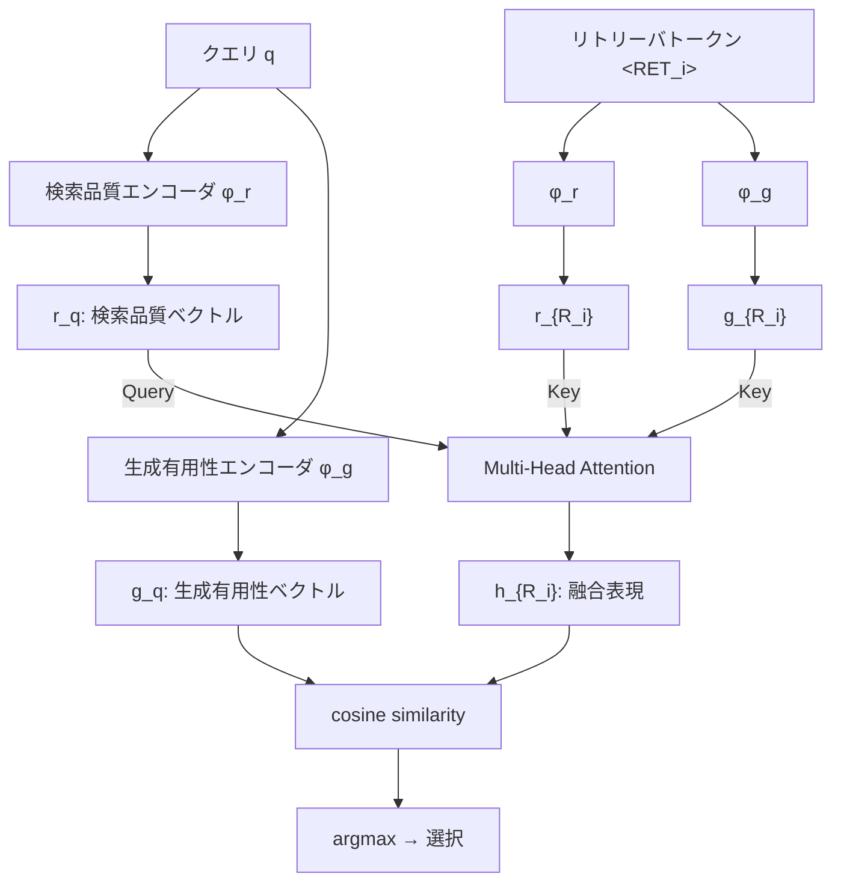

## 論文概要（Abstract）

本記事は [https://arxiv.org/abs/2604.22849](https://arxiv.org/abs/2604.22849) の解説記事です。

R3AG（Retriever Routing for Retrieval-Augmented Generation）は、RAGパイプラインにおいてクエリごとに最適なリトリーバを選択するルーティングフレームワークである。著者らは、既存のルーティング手法が検索の関連性のみでリトリーバを評価している点を課題として指摘し、**検索品質（Retrieval Quality）** と**生成有用性（Generation Utility）** の二軸でリトリーバの能力を分離・学習する手法を提案している。対比学習による二段階訓練とMulti-Head Attentionによるクエリ適応型の能力融合により、TriviaQA・NQ・HotpotQAの3データセットで既存手法を上回る結果が報告されている。

この記事は [Zenn記事: Gemini 3.6 FlashでAgentic RAG検索ルーティングを実装する](https://zenn.dev/0h_n0/articles/74675f3607b023) の深掘りです。

## 情報源

- **arXiv ID**: 2604.22849
- **URL**: [https://arxiv.org/abs/2604.22849](https://arxiv.org/abs/2604.22849)
- **著者**: Tong Zhao, Yutao Zhu, Yucheng Tian, Zhicheng Dou（Renmin University of China, South China University of Technology）
- **発表年**: 2026年（2026年4月22日投稿）
- **分野**: cs.IR（Information Retrieval）

## 背景と動機（Background & Motivation）

RAGシステムでは通常、単一のリトリーバ（BM25や特定のdenseモデル）を全クエリに対して使用する。しかし著者らは、**異なるクエリには異なるリトリーバが最適である**という前提に基づいている。例えば、固有名詞を含む事実確認クエリにはBM25のキーワードマッチが有効な一方、概念的な質問にはdense embeddingによるセマンティック検索が適している。

既存のルーティング手法（RouterRetriever、LTRR等）は、検索結果の関連性（relevance）のみに基づいてリトリーバを選択している。しかしRAGでは、検索されたドキュメントが**生成モデルの正確な回答にどれだけ貢献するか**（generation utility）も重要である。著者らは論文Figure 1で、検索結果の関連性が高くても生成品質が低い事例を示し、この二つの指標が独立した信号であることを実験的に裏付けている。

Zenn記事のLLMベースルーティングがプロンプト設計のみで動作するのに対し、R3AGは**学習ベース**で検索品質と生成有用性を陽に分離して学習する。

## 主要な貢献（Key Contributions）

- **二軸能力モデリング**: リトリーバの能力を「検索品質」と「生成有用性」の二つの独立した軸に分離し、それぞれを対比学習で獲得する
- **クエリ適応型融合**: Multi-Head Attentionにより、クエリの特性に応じて二軸の重みを動的に調整するルーティング機構を提案
- **No-retrieval選択**: 空集合を返す仮想リトリーバ $R_0$ を候補に含めることで、「検索しない」判断もルーティングの一部として統一的に扱う
- **軽量設計**: ルーティングの推論レイテンシが平均28.37msと報告されており（論文Table 8より）、実用的なオーバーヘッドに収まっている

## 技術的詳細（Technical Details）

### 問題定式化

リトリーバ候補集合 $\mathcal{R} = \{R_0, R_1, \ldots, R_K\}$（$R_0$ は空集合を返す仮想リトリーバ）に対し、ルーティングポリシー $\pi$ は各クエリ $q$ を最適なリトリーバのインデックスにマッピングする。最適化目標は以下のとおりである（論文Eq. 1より）。

$$
\max_{\pi} \mathbb{E}_{q \sim Q}\left[ s\left( M(q, R_{\pi(q)}(D, q)),\ y^* \right) \right]
$$

ここで、
- $M$: 生成モデル（LLaMA3-8B-Instruct）
- $D$: ドキュメントコーパス（Wikipedia）
- $s(y, y^*)$: 生成回答 $y$ と正解 $y^*$ の一致度（$[0, 1]$）
- $R_{\pi(q)}$: ポリシーが選択したリトリーバ

### アーキテクチャ

R3AGのアーキテクチャは3つのコンポーネントから構成される。



**1. 能力表現（Capability Representation）**

二つの共有エンコーダ $\phi_r$（検索品質）と $\phi_g$（生成有用性）が、クエリとリトリーバそれぞれの埋め込みを生成する（論文Eq. 2より）。

$$
r_q = \phi_r(q),\quad g_q = \phi_g(q),\quad r_{R_i} = \phi_r(R_i),\quad g_{R_i} = \phi_g(R_i)
$$

各リトリーバは専用の特殊トークン `<RET_i>` として表現される。エンコーダのバックボーンはqwen3-embedding-0.6b（埋め込み次元1024）であり、単語埋め込み層と最後の2つのTransformer層のみを訓練する。

**2. クエリ適応型能力融合（Capability Fusion）**

Multi-Head Attentionにより、クエリの検索品質ベクトル $r_q$ をQuery、リトリーバの二軸ベクトルの結合 $[r_{R_i}, g_{R_i}]$ をKey/Valueとして融合する（論文Eq. 3より）。

$$
h_{R_i} = \text{MHA}(r_q,\ [r_{R_i}, g_{R_i}],\ [r_{R_i}, g_{R_i}])
$$

この設計により、クエリの特性に応じて検索品質と生成有用性の重み付けが動的に変化する。

**3. 類似度ベースルーティング（Similarity-based Routing）**

融合表現 $h_{R_i}$ とクエリの生成有用性ベクトル $g_q$ のコサイン類似度を計算し、最大値のリトリーバを選択する（論文Eq. 4より）。

$$
\pi(q) = \arg\max_{R_i \in \mathcal{R}} \text{sim}(g_q,\ h_{R_i})
$$

### 訓練手法（二段階訓練）

**Stage 1: 能力エンコーダの対比学習**

検索品質エンコーダ $\phi_r$ は、外部LLMジャッジ（Qwen3-Next-80B-A3B-Instruct）による5次元評価（関連性・網羅性・正確性・ランキング品質・冗長性）の平均スコアに基づくラベルで訓練される。

生成有用性エンコーダ $\phi_g$ は、以下のユーティリティスコアに基づくラベルで訓練される（論文Eq. 5より）。

$$
u(q, R_i) = \text{EM}(q, R_i) + \beta \cdot \text{F1}(q, R_i) + \gamma \cdot \sigma(R_i)
$$

ここで $\sigma(R_i)$ はリトリーバの全体平均正答率、$\beta = \gamma = 0.2$ である。各エンコーダはInfoNCE損失で独立に訓練される。

**Stage 2: 融合モジュールの訓練**

Stage 1のエンコーダを凍結し、Multi-Head Attentionのみを分類損失と正則化項で訓練する（論文Eq. 9より）。

$$
\mathcal{L} = \mathcal{L}_{\text{cls}} + \lambda_{\text{reg}} \cdot \|h_{R_i} - g_{R_i}\|_2^2
$$

## 実装のポイント（Implementation）

**訓練環境**: 8× NVIDIA A100、AdamW（学習率 $2 \times 10^{-6}$）、実効バッチサイズ512、DeepSpeed ZeRO-3、10エポック。

**リトリーバ候補**: BM25に加え、E5-base-v2、E5-large、BGE-large、BGE-m3、DIVER-Retriever-0.6B、Qwen3-embedding-0.6B、Qwen3-embedding-4Bの計8種類。パラメータ数は0.11Bから4.02Bまで幅広い。

**新規リトリーバの追加**: 新しいリトリーバトークン `<RET_new>` を追加し、そのラベル（検索品質・生成有用性）を生成してStage 1のエンコーダをfine-tuneするだけでよい。アーキテクチャの変更は不要と著者らは述べている。

**推論パイプライン**:
1. クエリを $\phi_r$ と $\phi_g$ でエンコード
2. 各リトリーバトークンをエンコードし、MHAで融合
3. コサイン類似度のargmaxで選択
4. 選択されたリトリーバで検索を実行

論文Table 8より、R3AGの推論レイテンシは平均28.37ms（最小7.51ms、最大119.34ms）と報告されている。

**注意点**:
- 論文はLLaMA3-8B-Instructを生成モデルとして訓練している。異なる生成モデル（Qwen3-8B）でのテストでは、Oracle Single Bestに対して平均EMで-0.45ptの差が見られる（論文Table 5より）
- 検索品質ラベルの生成に80BパラメータのLLMジャッジを使用しているため、ラベル生成コストに注意が必要（約10,000件あたり$0.74、論文Table 6より）

## Production Deployment Guide

### AWS実装パターン（コスト最適化重視）

R3AGのルーティング推論は軽量（平均28.37ms）であり、既存のRAGパイプラインにルーティング層として追加できる。以下にトラフィック量別の推奨構成を示す。

**コスト試算の注意事項**: 以下は2026年11月時点のAWS ap-northeast-1（東京）リージョン料金に基づく概算値です。実際のコストはトラフィックパターン、リージョン、バースト使用量により変動します。最新料金は [AWS料金計算ツール](https://calculator.aws/) で確認してください。

| 規模 | 月間リクエスト | 推奨構成 | 月額コスト | 主要サービス |
|------|--------------|---------|-----------|------------|
| **Small** | ~3,000 (100/日) | Serverless | $50-150 | Lambda + SageMaker Serverless + DynamoDB |
| **Medium** | ~30,000 (1,000/日) | Hybrid | $300-800 | Lambda + ECS Fargate + ElastiCache |
| **Large** | 300,000+ (10,000/日) | Container | $2,000-5,000 | EKS + Karpenter + EC2 Spot |

**Small構成の詳細**（月額$50-150）:
- **Lambda**: ルーティングAPI、1GB RAM、30秒タイムアウト ($20/月)
- **SageMaker Serverless**: qwen3-embedding-0.6bモデルホスティング ($50/月)
- **DynamoDB**: ルーティングログ・キャッシュ、On-Demand ($10/月)
- **S3**: モデルアーティファクト保存 ($5/月)

**Medium構成の詳細**（月額$300-800）:
- **ECS Fargate**: ルーティングモデル常駐、0.5 vCPU × 1GB RAM × 2タスク ($120/月)
- **Lambda**: APIゲートウェイ ($50/月)
- **ElastiCache Redis**: 埋め込みキャッシュ、cache.t3.micro ($15/月)
- **Bedrock**: 生成モデル呼び出し ($400/月)

**Large構成の詳細**（月額$2,000-5,000）:
- **EKS**: コントロールプレーン ($72/月)
- **EC2 Spot Instances**: g5.xlarge × 2-4台、ルーティング+埋め込み推論 (平均$800/月)
- **Karpenter**: 自動スケーリング（追加コストなし）
- **Bedrock Batch**: 生成モデル、50%割引活用 ($2,000/月)

**コスト削減テクニック**:
- Spot Instances使用で最大90%削減（EKS + Karpenter）
- Prompt Caching有効化で30-90%削減
- ルーティング結果のキャッシュ（同一クエリパターンに対するリトリーバ選択を再利用）
- Reserved Instances購入で最大72%削減（1年コミット）

### Terraformインフラコード

**Small構成（Serverless）: Lambda + SageMaker Serverless + DynamoDB**

```hcl
module "vpc" {
  source  = "terraform-aws-modules/vpc/aws"
  version = "~> 5.0"

  name = "r3ag-router-vpc"
  cidr = "10.0.0.0/16"
  azs  = ["ap-northeast-1a", "ap-northeast-1c"]
  private_subnets = ["10.0.1.0/24", "10.0.2.0/24"]

  enable_nat_gateway   = false
  enable_dns_hostnames = true
}

resource "aws_iam_role" "lambda_r3ag" {
  name = "lambda-r3ag-router-role"

  assume_role_policy = jsonencode({
    Version = "2012-10-17"
    Statement = [{
      Action = "sts:AssumeRole"
      Effect = "Allow"
      Principal = { Service = "lambda.amazonaws.com" }
    }]
  })
}

resource "aws_iam_role_policy" "sagemaker_invoke" {
  role = aws_iam_role.lambda_r3ag.id

  policy = jsonencode({
    Version = "2012-10-17"
    Statement = [{
      Effect   = "Allow"
      Action   = ["sagemaker:InvokeEndpoint"]
      Resource = aws_sagemaker_endpoint.r3ag_router.arn
    }]
  })
}

resource "aws_lambda_function" "r3ag_router" {
  filename      = "lambda.zip"
  function_name = "r3ag-query-router"
  role          = aws_iam_role.lambda_r3ag.arn
  handler       = "index.handler"
  runtime       = "python3.12"
  timeout       = 30
  memory_size   = 1024

  environment {
    variables = {
      SAGEMAKER_ENDPOINT = aws_sagemaker_endpoint.r3ag_router.name
      DYNAMODB_TABLE     = aws_dynamodb_table.routing_cache.name
    }
  }
}

resource "aws_dynamodb_table" "routing_cache" {
  name         = "r3ag-routing-cache"
  billing_mode = "PAY_PER_REQUEST"
  hash_key     = "query_hash"

  attribute {
    name = "query_hash"
    type = "S"
  }

  ttl {
    attribute_name = "expire_at"
    enabled        = true
  }
}

resource "aws_cloudwatch_metric_alarm" "routing_latency" {
  alarm_name          = "r3ag-routing-latency-spike"
  comparison_operator = "GreaterThanThreshold"
  evaluation_periods  = 2
  metric_name         = "Duration"
  namespace           = "AWS/Lambda"
  period              = 300
  statistic           = "p99"
  threshold           = 5000
  alarm_description   = "ルーティングレイテンシP99が5秒超過"

  dimensions = {
    FunctionName = aws_lambda_function.r3ag_router.function_name
  }
}
```

**Large構成（Container）: EKS + Karpenter + Spot Instances**

```hcl
module "eks" {
  source  = "terraform-aws-modules/eks/aws"
  version = "~> 20.0"

  cluster_name    = "r3ag-inference-cluster"
  cluster_version = "1.31"
  vpc_id          = module.vpc.vpc_id
  subnet_ids      = module.vpc.private_subnets

  cluster_endpoint_public_access             = true
  enable_cluster_creator_admin_permissions    = true
}

resource "kubectl_manifest" "karpenter_provisioner" {
  yaml_body = <<-YAML
    apiVersion: karpenter.sh/v1alpha5
    kind: Provisioner
    metadata:
      name: r3ag-spot-provisioner
    spec:
      requirements:
        - key: karpenter.sh/capacity-type
          operator: In
          values: ["spot"]
        - key: node.kubernetes.io/instance-type
          operator: In
          values: ["g5.xlarge", "g5.2xlarge"]
      limits:
        resources:
          cpu: "32"
          memory: "128Gi"
      ttlSecondsAfterEmpty: 30
  YAML
}
```

### 運用・監視設定

**CloudWatch Logs Insights クエリ**:

```sql
-- ルーティング精度モニタリング: 選択されたリトリーバの分布
fields @timestamp, selected_retriever, confidence, latency_ms
| stats count(*) as cnt by selected_retriever
| sort cnt desc

-- レイテンシ分析: P95, P99
fields @timestamp, latency_ms
| stats pct(latency_ms, 95) as p95, pct(latency_ms, 99) as p99 by bin(5m)
```

**CloudWatch アラーム**: boto3の `put_metric_alarm` でルーティングレイテンシP99（閾値200ms）とリトリーバ選択偏りを監視し、SNS通知を設定する。

**X-Ray トレーシング**: `aws_xray_sdk` の `patch_all()` でboto3を自動計装し、ルーティング関数にアノテーション（クエリ長・選択リトリーバ名）とメタデータ（確信度）を記録する。

### コスト最適化チェックリスト

**アーキテクチャ選択**:
- [ ] ~100 req/日 → Lambda + SageMaker Serverless - $50-150/月
- [ ] ~1,000 req/日 → ECS Fargate + ElastiCache - $300-800/月
- [ ] 10,000+ req/日 → EKS + Spot Instances - $2,000-5,000/月

**リソース最適化**:
- [ ] EC2: Spot Instances優先（Karpenter自動管理）
- [ ] Reserved Instances: 1年コミットで72%削減
- [ ] Lambda: メモリサイズ最適化（CloudWatch Insights分析）
- [ ] ECS/EKS: アイドルタイムのスケールダウン（夜間0台）
- [ ] SageMaker: Serverless Inferenceで待機コスト削減

**LLMコスト削減**:
- [ ] Bedrock Batch API: 50%割引（非リアルタイム処理）
- [ ] Prompt Caching: 30-90%削減（システムプロンプト固定）
- [ ] モデル選択: ルーティング結果に応じた生成モデル切り替え
- [ ] トークン数制限: max_tokens設定で過剰生成防止

**監視・アラート**:
- [ ] AWS Budgets: 月額予算設定（80%で警告）
- [ ] CloudWatch: ルーティングレイテンシ・リトリーバ分布モニタリング
- [ ] Cost Anomaly Detection: 自動異常検知
- [ ] 日次コストレポート: SNS/Slackへ自動送信

**リソース管理**:
- [ ] 未使用リソース削除: Trusted Advisor活用
- [ ] タグ戦略: 環境別コスト可視化
- [ ] ライフサイクルポリシー: S3古いモデルアーティファクト自動削除
- [ ] 開発環境: 夜間停止（Auto Start/Stop）

## 実験結果（Results）

### メインの比較結果

著者らは、TriviaQA、Natural Questions（NQ）、HotpotQAの3データセットで評価を行っている。生成モデルはLLaMA3-8B-Instruct、コーパスは2018年英語Wikipediaダンプである。論文Table 2より主要な結果を抜粋する。

| 手法 | パイプライン | TQA EM | NQ EM | HQA EM | 平均EM |
|------|------------|--------|-------|--------|--------|
| Naive（検索なし） | — | 55.34 | 22.35 | 19.16 | 32.28 |
| E5-large（最良単一） | Sequential | 60.16 | 36.89 | 26.87 | 41.31 |
| Oracle Single Best | Conditional | 60.16 | 36.89 | 27.54 | 41.53 |
| IRCoT | Loop | 60.71 | 35.81 | 29.05 | 41.86 |
| Adaptive-RAG | Conditional | 57.41 | 35.12 | 28.87 | 40.47 |
| RouterRetriever | Route | 57.42 | 32.44 | 24.37 | 38.08 |
| LTRR | Route | 58.79 | 35.76 | 19.86 | 39.14 |
| **R3AG** | Route | **62.24** | **37.81** | **29.13** | **43.06** |

R3AGはOracle Single Best（データセットごとの最良単一リトリーバ）を平均EMで+1.53pt上回っている。ルーティング手法同士の比較では、RouterRetrieverに対して+4.98pt、LTRRに対して+3.92ptの差がある。

マルチホップ推論が必要なHotpotQAでは、ループ型のIRCoTが29.05 EMと近い性能を示している（R3AGは29.13 EM）。著者らはR3AGがルーティングのみ（1回の検索）で同等の結果を達成していると主張しているが、差は0.08ptと小さい。

### No-retrieval選択の分析

R3AGは仮想リトリーバ $R_0$（検索しない選択）を候補に含む。論文Table 4より、$R_0$ が選択されるクエリの割合と、その際のEMを示す。

| データセット | $R_0$ 選択率 | $R_0$ 選択時EM | 検索なしEM | R3AG全体EM |
|------------|-------------|---------------|-----------|-----------|
| TriviaQA | 37.82% | 76.33 | 55.34 | 62.24 |
| NQ | 15.23% | 43.51 | 22.35 | 37.81 |
| HotpotQA | 9.52% | 31.78 | 19.16 | 29.13 |

TriviaQAでは約38%のクエリで検索を省略し、その場合のEMが76.33と高い。これは生成モデル（LLaMA3-8B-Instruct）が既に正解を知っているクエリを正しく識別できていることを示唆している。この「検索しない」判断は、Zenn記事で述べたルーティング戦略における**コスト削減**と直接関連する。

### アブレーション

論文Table 3より、各コンポーネントの寄与を示す（平均EMの変化量）。

| バリアント | 平均ΔEM |
|-----------|---------|
| Full R3AG（完全版） | 0.00 |
| w/o MHA（平均で融合） | -0.89 |
| w/o 検索品質エンコーダ | -0.93 |
| w/o 生成有用性エンコーダ | -1.01 |

いずれのコンポーネントを除去しても性能が低下しており、二軸の分離とMHAによる融合が相補的に機能していることが確認されている。

### ハイパーパラメータ感度

論文Table 7およびFigure 4より、ユーティリティスコアの重み $\beta$（F1の重み）と $\gamma$（全体平均正答率の重み）の感度分析が報告されている。$\beta = \gamma = 0$ の設定（EMのみ）では平均EMが-2.79ptと大きく低下し、F1スコアとリトリーバの全体傾向を含めることが重要であることが示されている。推奨値は $\beta = \gamma = 0.2$ である。

## 実運用への応用（Practical Applications）

R3AGのアプローチは、Zenn記事で紹介したLLMベースのルーティングと組み合わせることで段階的な導入が可能である。

**段階的導入シナリオ**: 初期はLLMベースルーター（Zenn記事の手法）でログ蓄積 → 中期にR3AG型軽量ルーターを訓練 → 後期にR3AGをメイン、LLMルーターをフォールバックに切り替える。

**スケーリング上の考慮**: R3AGの推論は平均28.37msのため、LLMベースルーティング（200-500ms）と比較して高速である。新規リトリーバの追加もトークン追加のみで可能だが、複数リトリーバの組み合わせ（Zenn記事のハイブリッド検索に相当）は未対応である。

**制約と限界**: 訓練に8× A100が必要であり、生成モデル（LLaMA3-8B-Instruct）への依存がある（異なるモデルでの転移は不完全、論文Table 5）。評価もQAタスクのみである。

## 関連研究（Related Work）

- **Adaptive-RAG**（Jeong et al., 2024）: クエリの複雑度に応じて検索なし・単一ステップ・マルチステップを切り替える手法。R3AGはこの「検索するか否か」の判断をリトリーバ選択の特殊ケースとして統一的に扱っている
- **RAGRouter-Bench**（arXiv: 2604.03455）: 7,727クエリのルーティングベンチマーク。クエリ側の分類器でfactual/reasoning/summarizationを判定し、28.1%のトークン削減を報告。R3AGとはルーティングの粒度が異なる（クエリタイプ vs リトリーバ選択）
- **RouterRetriever**（Mao et al.）: 連合検索の枠組みでリトリーバを選択する手法。R3AGは検索品質と生成有用性の分離により、RouterRetrieverを平均EMで+4.98pt上回っている（論文Table 2より）
- **IRCoT**（Trivedi et al.）: Chain-of-Thoughtと検索をループさせるマルチホップ手法。HotpotQAでR3AGと同等の性能を示すが、複数回の検索・生成ループが必要

## まとめと今後の展望

R3AGは、RAGにおけるリトリーバ選択を**検索品質**と**生成有用性**の二軸で形式化し、クエリごとの適応的ルーティングを実現するフレームワークである。3データセットの実験で既存手法を上回る結果が報告されているが、単一ランの報告であり統計的有意性の検証は含まれていない点に注意が必要である。

Zenn記事で紹介したLLMベースのルーティングが「ラベルなしで即開始」できる利点を持つ一方、R3AGは訓練データを要する代わりに低レイテンシ（約28ms）での推論を実現する。両者は段階的導入において相補的な役割を果たし得る。

著者らは今後の課題として、複数リトリーバの組み合わせ（現在は単一選択のみ）、QA以外のタスクへの拡張、より表現力の高いアーキテクチャの探索を挙げている。

## 参考文献

- **arXiv**: [https://arxiv.org/abs/2604.22849](https://arxiv.org/abs/2604.22849)
- **Related Zenn article**: [https://zenn.dev/0h_n0/articles/74675f3607b023](https://zenn.dev/0h_n0/articles/74675f3607b023)
- Jeong et al., "Adaptive-RAG: Learning to Adapt Retrieval-Augmented Large Language Models through Question Complexity," NAACL 2024
- arXiv: 2604.03455, "Lightweight Query Routing for Adaptive RAG: A Baseline Study on RAGRouter-Bench"
- Trivedi et al., "Interleaving Retrieval with Chain-of-Thought Reasoning for Knowledge-Intensive Multi-Step Questions," ACL 2023
